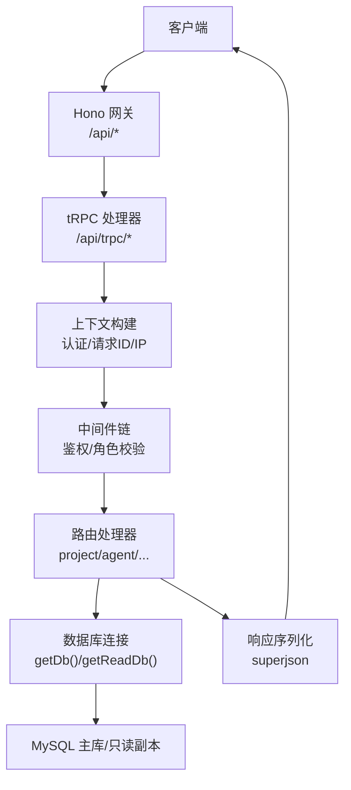
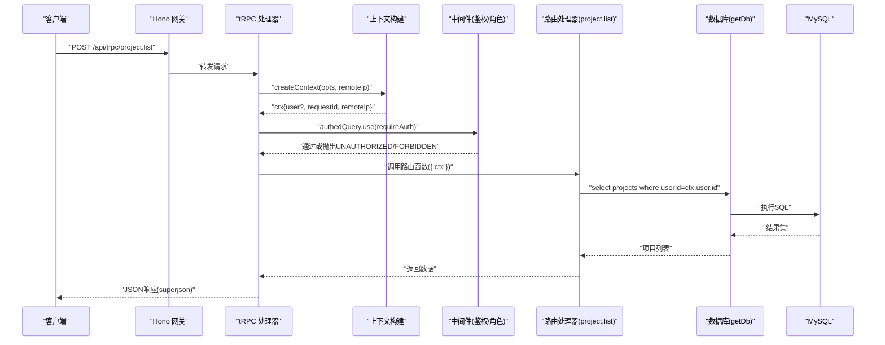
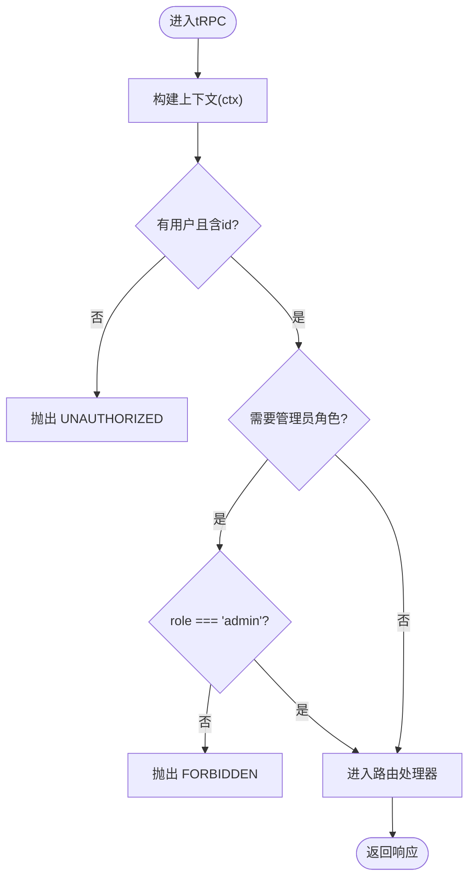
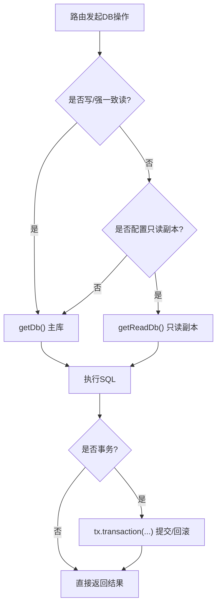
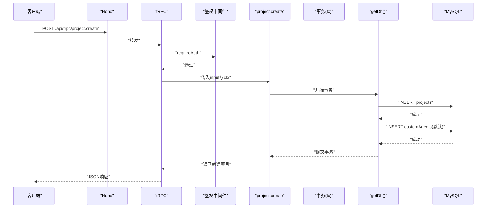
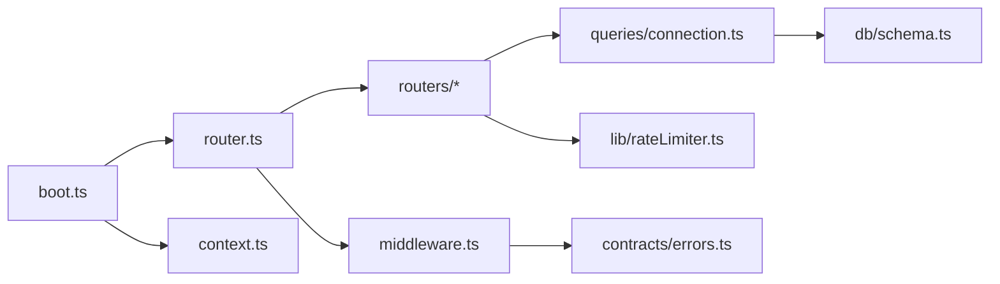

# 同步数据流

<cite>
**本文引用的文件**
- [api/router.ts](file://api/router.ts)
- [api/middleware.ts](file://api/middleware.ts)
- [api/boot.ts](file://api/boot.ts)
- [api/context.ts](file://api/context.ts)
- [api/queries/connection.ts](file://api/queries/connection.ts)
- [db/schema.ts](file://db/schema.ts)
- [api/routers/project.ts](file://api/routers/project.ts)
- [api/routers/agent.ts](file://api/routers/agent.ts)
- [api/lib/rateLimiter.ts](file://api/lib/rateLimiter.ts)
- [contracts/errors.ts](file://contracts/errors.ts)
</cite>

## 目录
1. [简介](#简介)
2. [项目结构](#项目结构)
3. [核心组件](#核心组件)
4. [架构总览](#架构总览)
5. [详细组件分析](#详细组件分析)
6. [依赖关系分析](#依赖关系分析)
7. [性能考量](#性能考量)
8. [故障排查指南](#故障排查指南)
9. [结论](#结论)
10. [附录：典型操作示例路径](#附录：典型操作示例路径)

## 简介
本文件面向DeeWaanAI系统的“同步数据流”，聚焦HTTP请求从进入API网关到tRPC路由处理、中间件执行、上下文传递，再到数据库查询与响应返回的完整同步链路。文档同时覆盖错误处理机制、数据验证流程、连接管理与事务处理，并通过时序图展示关键步骤。

## 项目结构
后端采用Hono作为HTTP网关，将/api/trpc/*转发至tRPC；tRPC通过自定义上下文解析认证信息并注入用户身份；路由层使用zod进行输入校验，业务逻辑调用Drizzle ORM访问MySQL（支持读副本）；全局中间件提供鉴权、角色校验等横切能力。

图表来源
- [api/boot.ts:361-372](file://api/boot.ts#L361-L372)
- [api/context.ts:20-54](file://api/context.ts#L20-L54)
- [api/middleware.ts:10-50](file://api/middleware.ts#L10-L50)
- [api/router.ts:39-70](file://api/router.ts#L39-L70)
- [api/queries/connection.ts:10-42](file://api/queries/connection.ts#L10-L42)

章节来源
- [api/boot.ts:361-372](file://api/boot.ts#L361-L372)
- [api/router.ts:39-70](file://api/router.ts#L39-L70)
- [api/middleware.ts:10-50](file://api/middleware.ts#L10-L50)
- [api/context.ts:20-54](file://api/context.ts#L20-L54)
- [api/queries/connection.ts:10-42](file://api/queries/connection.ts#L10-L42)

## 核心组件
- HTTP网关与tRPC适配：Hono统一入口，/api/trpc/*交由tRPC处理，附带请求ID与安全头。
- 上下文构建：解析本地令牌、注入用户、请求ID、远程IP等，供后续中间件与路由使用。
- tRPC中间件：提供鉴权与角色校验，未通过则抛出标准化错误。
- 路由与校验：各业务路由以zod校验输入，结合authedQuery/adminQuery确保权限。
- 数据库访问：单例连接封装，支持主库与只读副本分离；读写语义清晰。
- 限流：按端点或客户层级进行固定窗口/令牌桶限流，Redis不可用时降级为内存实现。

章节来源
- [api/boot.ts:361-372](file://api/boot.ts#L361-L372)
- [api/context.ts:20-54](file://api/context.ts#L20-L54)
- [api/middleware.ts:17-50](file://api/middleware.ts#L17-L50)
- [api/routers/project.ts:11-101](file://api/routers/project.ts#L11-L101)
- [api/queries/connection.ts:10-42](file://api/queries/connection.ts#L10-L42)
- [api/lib/rateLimiter.ts:31-93](file://api/lib/rateLimiter.ts#L31-L93)

## 架构总览
下图展示一次典型的“获取项目列表”同步请求在系统中的流转过程，包括鉴权、校验、数据库读取与响应返回。

图表来源
- [api/boot.ts:361-372](file://api/boot.ts#L361-L372)
- [api/context.ts:20-54](file://api/context.ts#L20-L54)
- [api/middleware.ts:17-50](file://api/middleware.ts#L17-L50)
- [api/routers/project.ts:11-54](file://api/routers/project.ts#L11-L54)
- [api/queries/connection.ts:10-18](file://api/queries/connection.ts#L10-L18)

## 详细组件分析

### tRPC路由与中间件执行顺序
- 路由注册：appRouter集中挂载各子路由，形成统一的命名空间。
- 中间件链：
  - requireAuth：检查ctx.user是否存在且含id，否则抛出UNAUTHORIZED。
  - requireRole：校验用户角色是否为admin，否则抛出FORBIDDEN。
- 执行顺序：请求进入tRPC后，先构建上下文，再依次经过鉴权与角色中间件，最后到达具体路由。

图表来源
- [api/middleware.ts:17-50](file://api/middleware.ts#L17-L50)
- [api/router.ts:39-70](file://api/router.ts#L39-L70)

章节来源
- [api/middleware.ts:17-50](file://api/middleware.ts#L17-L50)
- [api/router.ts:39-70](file://api/router.ts#L39-L70)

### 上下文传递与认证
- 上下文字段：req、resHeaders、user、giteeToken、requestId、remoteIp。
- 认证流程：优先尝试本地令牌(x-local-auth-token)，成功后查库加载用户；失败时保持匿名，由受保护路由通过中间件拒绝。
- 请求追踪：每个请求生成唯一requestId，便于日志关联。

章节来源
- [api/context.ts:9-54](file://api/context.ts#L9-L54)
- [api/boot.ts:38-45](file://api/boot.ts#L38-L45)

### 数据库查询生命周期
- 连接管理：
  - getDb()：单例主库连接，用于写与一致性读。
  - getReadDb()：可选只读副本，仅用于读多且可容忍复制延迟的场景。
- 事务处理：
  - 路由内使用transaction包裹多个写操作，保证原子性（例如创建项目时插入项目与默认智能体）。
- 结果缓存：
  - 代码中未发现应用级查询缓存；读流量可通过只读副本缓解压力。

图表来源
- [api/queries/connection.ts:10-42](file://api/queries/connection.ts#L10-L42)
- [api/routers/project.ts:145-167](file://api/routers/project.ts#L145-L167)

章节来源
- [api/queries/connection.ts:10-42](file://api/queries/connection.ts#L10-L42)
- [api/routers/project.ts:145-167](file://api/routers/project.ts#L145-L167)

### 数据验证与错误处理
- 输入验证：路由参数使用zod进行强类型校验，非法输入将被拒绝。
- 错误模型：
  - tRPC中间件抛出标准TRPCError（UNAUTHORIZED/FORBIDDEN）。
  - 应用层Errors对象提供统一错误构造器（如badRequest/unauthorized/notFound等），便于上层服务统一处理。
- 限流：
  - 基于Redis固定窗口或内存令牌桶，失败时降级为内存实现，不中断请求。

章节来源
- [api/routers/project.ts:103-105](file://api/routers/project.ts#L103-L105)
- [api/routers/agent.ts:19-21](file://api/routers/agent.ts#L19-L21)
- [contracts/errors.ts:1-16](file://contracts/errors.ts#L1-L16)
- [api/lib/rateLimiter.ts:31-93](file://api/lib/rateLimiter.ts#L31-L93)

### 典型同步操作示例（以“获取项目列表”和“创建项目”为例）
- 获取项目列表
  - 入口：project.list
  - 鉴权：authedQuery.requireAuth
  - 校验：无额外输入
  - 数据流：查询当前用户自有项目 + 团队共享项目，合并去重后返回
  - 参考路径：[api/routers/project.ts:11-54](file://api/routers/project.ts#L11-L54)
- 创建项目
  - 入口：project.create
  - 鉴权：authedQuery.requireAuth
  - 校验：CreateProjectSchema
  - 数据流：可选创建Gitee仓库与README；随后在事务中插入项目记录与默认智能体
  - 参考路径：[api/routers/project.ts:103-200](file://api/routers/project.ts#L103-L200)

章节来源
- [api/routers/project.ts:11-54](file://api/routers/project.ts#L11-L54)
- [api/routers/project.ts:103-200](file://api/routers/project.ts#L103-L200)

### 关键时序图：创建项目（含事务）

图表来源
- [api/routers/project.ts:145-200](file://api/routers/project.ts#L145-L200)
- [api/queries/connection.ts:10-18](file://api/queries/connection.ts#L10-L18)

## 依赖关系分析
- Hono网关依赖tRPC适配器与路由定义，负责请求分发与全局中间件。
- tRPC上下文依赖认证服务与数据库连接，用于解析用户身份。
- 路由依赖中间件提供的鉴权能力与zod校验，以及数据库连接。
- 数据库连接模块依赖环境变量与ORM schema，提供主库与只读副本。
- 限流模块依赖Redis（可选），并提供内存降级。

图表来源
- [api/boot.ts:361-372](file://api/boot.ts#L361-L372)
- [api/router.ts:39-70](file://api/router.ts#L39-L70)
- [api/middleware.ts:10-50](file://api/middleware.ts#L10-L50)
- [api/queries/connection.ts:10-42](file://api/queries/connection.ts#L10-L42)
- [db/schema.ts:1-200](file://db/schema.ts#L1-L200)
- [api/lib/rateLimiter.ts:31-93](file://api/lib/rateLimiter.ts#L31-L93)
- [contracts/errors.ts:1-16](file://contracts/errors.ts#L1-L16)

章节来源
- [api/boot.ts:361-372](file://api/boot.ts#L361-L372)
- [api/router.ts:39-70](file://api/router.ts#L39-L70)
- [api/middleware.ts:10-50](file://api/middleware.ts#L10-L50)
- [api/queries/connection.ts:10-42](file://api/queries/connection.ts#L10-L42)
- [db/schema.ts:1-200](file://db/schema.ts#L1-L200)
- [api/lib/rateLimiter.ts:31-93](file://api/lib/rateLimiter.ts#L31-L93)
- [contracts/errors.ts:1-16](file://contracts/errors.ts#L1-L16)

## 性能考量
- 读写分离：读多场景建议使用getReadDb()降低主库压力。
- 事务边界：仅在必要时开启事务，减少锁持有时间。
- 限流策略：对敏感接口启用更严格的限流，避免雪崩。
- 连接复用：getDb()/getReadDb()均为单例，避免频繁建连。
- 健康检查：/api/health与/api/ready可用于负载均衡与健康探测。

## 故障排查指南
- 鉴权失败
  - 现象：返回UNAUTHORIZED或FORBIDDEN
  - 定位：检查x-local-auth-token是否正确、用户是否存在、角色是否匹配
  - 参考：[api/middleware.ts:17-50](file://api/middleware.ts#L17-L50)
- 数据库不可用
  - 现象：健康检查返回degraded或not-ready
  - 定位：查看/api/health与/api/ready输出，确认MySQL/Redis状态
  - 参考：[api/boot.ts:73-135](file://api/boot.ts#L73-L135)
- 限流触发
  - 现象：请求被拒绝并提示重试间隔
  - 定位：检查对应端点的限流配置与Redis可用性
  - 参考：[api/lib/rateLimiter.ts:31-93](file://api/lib/rateLimiter.ts#L31-L93)
- 输入校验失败
  - 现象：路由返回参数校验错误
  - 定位：核对zod schema与请求体字段
  - 参考：[api/routers/project.ts:103-105](file://api/routers/project.ts#L103-L105)

章节来源
- [api/middleware.ts:17-50](file://api/middleware.ts#L17-L50)
- [api/boot.ts:73-135](file://api/boot.ts#L73-L135)
- [api/lib/rateLimiter.ts:31-93](file://api/lib/rateLimiter.ts#L31-L93)
- [api/routers/project.ts:103-105](file://api/routers/project.ts#L103-L105)

## 结论
DeeWaanAI的同步数据流以Hono为网关、tRPC为路由与中间件编排核心，配合上下文注入与严格的数据校验，实现了清晰的鉴权与职责分离。数据库层通过主从分离与事务保障一致性与扩展性。限流与错误处理提供了健壮的运行保障。整体设计易于维护与扩展，适合高并发与复杂业务场景。

## 附录：典型操作示例路径
- 获取项目列表
  - 路由：project.list
  - 鉴权：authedQuery
  - 数据源：projects、teamMembers、teamProjects
  - 参考路径：[api/routers/project.ts:11-54](file://api/routers/project.ts#L11-L54)
- 创建项目（含默认智能体）
  - 路由：project.create
  - 鉴权：authedQuery
  - 事务：写入项目与默认智能体
  - 参考路径：[api/routers/project.ts:103-200](file://api/routers/project.ts#L103-L200)
- 智能体增删改查
  - 路由：agent.list/create/update/delete/createDefaults
  - 鉴权：authedQuery
  - 数据源：agents
  - 参考路径：[api/routers/agent.ts:8-99](file://api/routers/agent.ts#L8-L99)