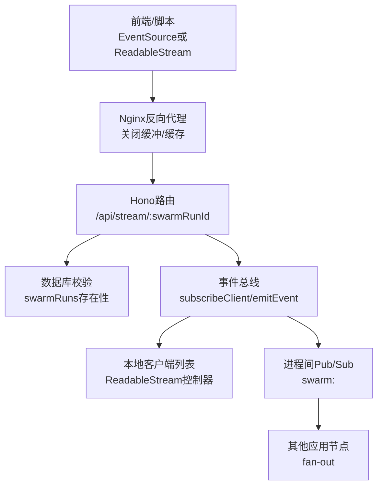
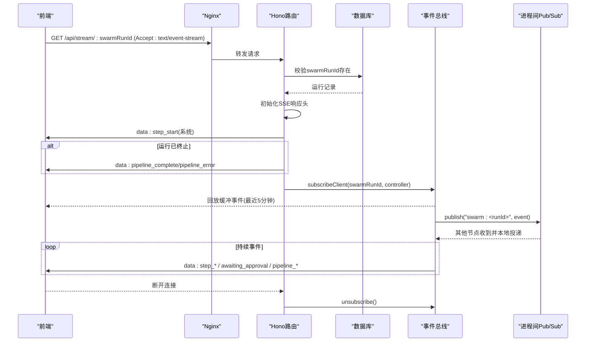
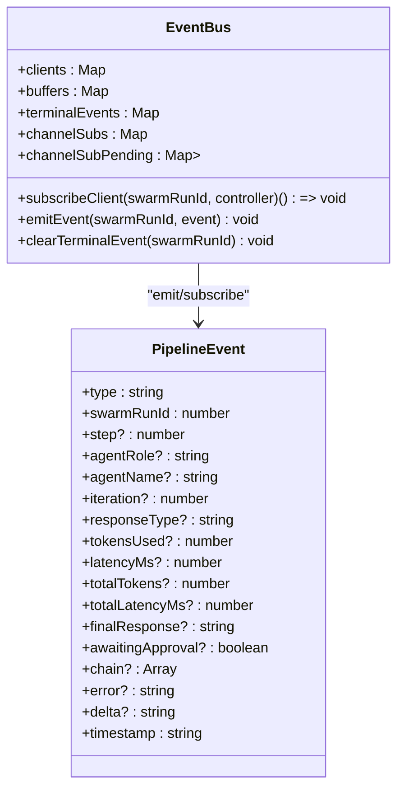
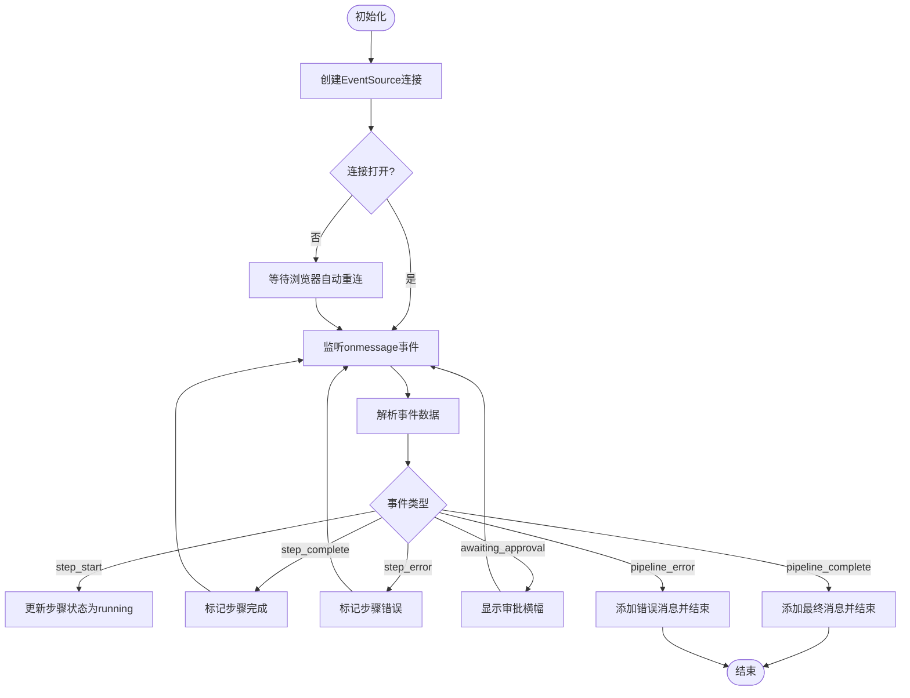
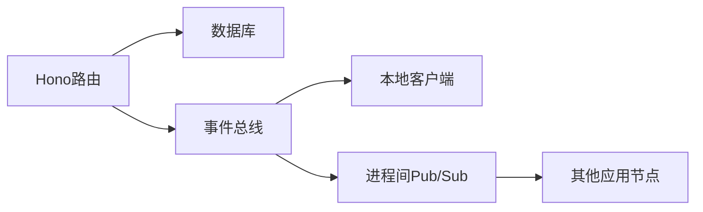

# SSE流式传输

<cite>
**本文引用的文件**
- [api/stream-route.ts](file://api/stream-route.ts)
- [api/services/eventBus.ts](file://api/services/eventBus.ts)
- [deploy/aliyun-setup.sh](file://deploy/aliyun-setup.sh)
- [deploy/aliyun-optimized.md](file://deploy/aliyun-optimized.md)
- [src/pages/ProjectWorkspace.tsx](file://src/pages/ProjectWorkspace.tsx)
- [research/orchestration-economics/code/_repro.mjs](file://research/orchestration-economics/code/_repro.mjs)
</cite>

## 目录
1. [简介](#简介)
2. [项目结构](#项目结构)
3. [核心组件](#核心组件)
4. [架构总览](#架构总览)
5. [详细组件分析](#详细组件分析)
6. [依赖关系分析](#依赖关系分析)
7. [性能考量](#性能考量)
8. [故障排查指南](#故障排查指南)
9. [结论](#结论)
10. [附录](#附录)

## 简介
本文件面向DeeWaanAI系统的SSE（Server-Sent Events）流式传输能力，覆盖连接建立、事件格式规范、数据传输机制、PipelineEvent类型定义与生命周期管理、客户端连接验证、错误处理与资源清理、Nginx等反向代理兼容性配置，以及完整的SSE客户端集成示例（含断线重连）。文末提供端到端序列图，帮助理解从前端到后端再到事件总线的全链路流程。

## 项目结构
SSE相关代码主要分布在以下位置：
- 服务端路由：暴露 /api/stream/:swarmRunId 的SSE接口
- 事件总线：负责本地分发、回放缓冲、终端事件持久化、跨节点广播
- 部署配置：Nginx对SSE路径的反向代理优化
- 前端集成：基于浏览器EventSource监听SSE事件并更新UI
- 测试脚本：演示如何以Node.js方式消费SSE流

图表来源
- [api/stream-route.ts:8-69](file://api/stream-route.ts#L8-L69)
- [api/services/eventBus.ts:10-167](file://api/services/eventBus.ts#L10-L167)
- [deploy/aliyun-setup.sh:149-158](file://deploy/aliyun-setup.sh#L149-L158)

章节来源
- [api/stream-route.ts:8-69](file://api/stream-route.ts#L8-L69)
- [api/services/eventBus.ts:1-193](file://api/services/eventBus.ts#L1-L193)
- [deploy/aliyun-setup.sh:126-166](file://deploy/aliyun-setup.sh#L126-L166)
- [deploy/aliyun-optimized.md:92-122](file://deploy/aliyun-optimized.md#L92-L122)

## 核心组件
- SSE路由：创建ReadableStream，设置SSE响应头，发送初始连接事件，必要时立即发送终端状态，订阅事件总线并在断开时清理。
- 事件总线：维护每个swarmRunId的客户端列表、5分钟回放缓冲、终端事件持久化；支持跨节点广播（best-effort），失败不影响本地投递。
- 部署配置：为/api/stream/*路径禁用Nginx缓冲与缓存，延长读取超时，确保实时性。
- 前端集成：使用EventSource建立连接，解析事件并更新步骤状态、审批提示、最终结果或错误信息。

章节来源
- [api/stream-route.ts:8-69](file://api/stream-route.ts#L8-L69)
- [api/services/eventBus.ts:13-167](file://api/services/eventBus.ts#L13-L167)
- [deploy/aliyun-setup.sh:149-158](file://deploy/aliyun-setup.sh#L149-L158)
- [src/pages/ProjectWorkspace.tsx:409-477](file://src/pages/ProjectWorkspace.tsx#L409-L477)

## 架构总览
SSE端到端流程如下：
- 前端通过EventSource发起GET /api/stream/:swarmRunId请求
- 路由校验swarmRunId有效性并查询数据库确认运行存在
- 返回text/event-stream响应，发送初始step_start事件
- 若运行已处于终态（完成/失败/取消），立即发送对应终端事件
- 订阅事件总线，接收后续事件（步骤开始/完成/错误/流式增量/审批/完成/错误）
- 事件总线将事件写入本地缓冲区、持久化终端事件并推送给所有本地客户端
- 同时发布到共享Pub/Sub通道，供其他节点扇出给其本地客户端

图表来源
- [api/stream-route.ts:8-69](file://api/stream-route.ts#L8-L69)
- [api/services/eventBus.ts:39-167](file://api/services/eventBus.ts#L39-L167)
- [deploy/aliyun-setup.sh:149-158](file://deploy/aliyun-setup.sh#L149-L158)

## 详细组件分析

### SSE路由（/api/stream/:swarmRunId）
- 参数校验：解析swarmRunId，非法则返回400
- 存在性校验：查询swarmRuns表，不存在则返回404
- 响应头：Content-Type=text/event-stream、Cache-Control=no-cache、Connection=keep-alive、X-Accel-Buffering=no
- 初始事件：发送step_start（system）作为连接成功信号
- 终端事件：若运行已完成/失败/取消，立即发送pipeline_complete或pipeline_error
- 订阅与清理：调用subscribeClient注册客户端控制器，监听abort事件进行清理

章节来源
- [api/stream-route.ts:8-69](file://api/stream-route.ts#L8-L69)

### 事件总线（eventBus）
- 数据结构
  - clients：Map<swarmRunId, Client[]>，维护当前连接的ReadableStream控制器
  - buffers：Map<swarmRunId, BufferedEvent[]>，保留最近5分钟的事件用于回放
  - terminalEvents：Map<swarmRunId, Uint8Array>，持久化终态事件（pipeline_complete/pipeline_error）
  - channelSubs/channelSubPending：按runId懒订阅进程间Pub/Sub通道
- 关键函数
  - replayBuffer：为新连接回放近期事件，并清理过期条目
  - ensureChannelSubscription：为runId建立进程间订阅，忽略自身回显，投递到其他实例
  - deliverLocal：编码事件、入缓冲、存储终态、推送至本地客户端、清理已关闭客户端
  - subscribeClient：回放+终态直发+加入客户端列表+确保跨节点订阅，返回unsubscribe回调
  - emitEvent：本地投递后发布到Pub/Sub（fire-and-forget）
  - clearTerminalEvent：在不再需要时清理终态事件
- PipelineEvent类型
  - type：step_start | step_complete | step_error | step_stream | pipeline_complete | pipeline_error | awaiting_approval
  - swarmRunId：关联的运行ID
  - 可选字段：step、agentRole、agentName、iteration、responseType、tokensUsed、latencyMs、totalTokens、totalLatencyMs、finalResponse、awaitingApproval、chain、error、delta、timestamp

图表来源
- [api/services/eventBus.ts:13-192](file://api/services/eventBus.ts#L13-L192)

章节来源
- [api/services/eventBus.ts:1-193](file://api/services/eventBus.ts#L1-L193)

### Nginx反向代理兼容配置
- 针对/api/stream/*路径：
  - proxy_buffering off：禁止Nginx缓冲，保证实时性
  - proxy_cache off：禁止缓存
  - proxy_read_timeout 86400：长连接超时足够大，避免中断
  - chunked_transfer_encoding off：避免分块编码干扰SSE帧
- 通用location：
  - proxy_http_version 1.1、Keep-Alive头部透传
  - 限制请求速率，防止滥用
- 应用层响应头：
  - X-Accel-Buffering: no：进一步阻止Nginx加速缓冲

章节来源
- [deploy/aliyun-setup.sh:149-158](file://deploy/aliyun-setup.sh#L149-L158)
- [deploy/aliyun-optimized.md:117-120](file://deploy/aliyun-optimized.md#L117-L120)
- [api/stream-route.ts:61-68](file://api/stream-route.ts#L61-L68)

### 前端SSE客户端集成示例
- 连接建立：new EventSource(`/api/stream/${rid}`)
- 事件监听：onmessage中解析JSON，根据type更新步骤状态、审批提示、最终消息或错误
- 连接生命周期：onopen表示连接就绪；onerror触发重试或降级逻辑；onclose可清理资源
- 断线重连：浏览器原生EventSource具备自动重连机制；可在onerror中记录日志或做业务级重试策略
- 资源清理：组件卸载或任务结束时关闭EventSource，避免内存泄漏

图表来源
- [src/pages/ProjectWorkspace.tsx:409-477](file://src/pages/ProjectWorkspace.tsx#L409-L477)

章节来源
- [src/pages/ProjectWorkspace.tsx:409-477](file://src/pages/ProjectWorkspace.tsx#L409-L477)

### 非浏览器环境消费SSE示例
- 使用fetch获取ReadableStream，配合TextDecoder逐块解码
- 按“\n\n”分割事件帧，提取data:行，解析JSON
- 遇到pipeline_error或pipeline_complete时终止循环

章节来源
- [research/orchestration-economics/code/_repro.mjs:54-85](file://research/orchestration-economics/code/_repro.mjs#L54-L85)

## 依赖关系分析
- 路由依赖：Hono框架、Drizzle ORM查询swarmRuns表
- 事件总线依赖：进程内客户端列表、回放缓冲、终端事件持久化、进程间Pub/Sub
- 部署依赖：Nginx对SSE路径的特殊配置，确保无缓冲、无缓存、长超时
- 前端依赖：浏览器EventSource API，自动重连与事件模型

图表来源
- [api/stream-route.ts:8-69](file://api/stream-route.ts#L8-L69)
- [api/services/eventBus.ts:10-167](file://api/services/eventBus.ts#L10-L167)

章节来源
- [api/stream-route.ts:8-69](file://api/stream-route.ts#L8-L69)
- [api/services/eventBus.ts:10-167](file://api/services/eventBus.ts#L10-L167)

## 性能考量
- 回放缓冲窗口：5分钟，兼顾新连接补全与内存占用控制
- 终端事件持久化：仅保存pipeline_complete/pipeline_error，避免长期占用
- 跨节点广播：best-effort，失败不阻塞本地投递，提升整体可用性
- Nginx配置：关闭缓冲与缓存，降低延迟；合理设置超时，避免长连接被中断
- 前端重连：利用EventSource自动重连，减少人工干预

[本节为通用指导，无需特定文件引用]

## 故障排查指南
- 连接失败或404：检查swarmRunId是否有效且运行存在
- 事件未到达：确认Nginx对/api/stream/*路径已关闭缓冲与缓存，并设置足够长的proxy_read_timeout
- 频繁断线：检查网络稳定性与代理超时配置；前端可记录onerror日志
- 内存增长：关注回放缓冲与客户端列表清理逻辑，确保断开时正确unsubscribe
- 跨节点事件丢失：Pub/Sub为best-effort，允许偶发丢失；如强一致需求需额外保障

章节来源
- [api/stream-route.ts:8-69](file://api/stream-route.ts#L8-L69)
- [api/services/eventBus.ts:54-92](file://api/services/eventBus.ts#L54-L92)
- [deploy/aliyun-setup.sh:149-158](file://deploy/aliyun-setup.sh#L149-L158)

## 结论
DeeWaanAI的SSE实现通过清晰的路由、健壮的事件总线与合理的Nginx配置，提供了低延迟、可扩展的流式传输能力。PipelineEvent类型统一了事件语义，回放缓冲与终端事件持久化提升了用户体验，跨节点广播增强了多实例部署下的可靠性。前端采用EventSource简化集成，并具备自动重连能力。建议在生产环境中严格遵循Nginx配置与超时设置，并结合监控与日志完善排障能力。

[本节为总结，无需特定文件引用]

## 附录
- SSE事件类型速查
  - step_start：步骤开始
  - step_complete：步骤完成
  - step_error：步骤错误
  - step_stream：流式增量（delta）
  - awaiting_approval：等待人工审批
  - pipeline_complete：流水线完成
  - pipeline_error：流水线错误

- 关键配置要点
  - 响应头：Content-Type=text/event-stream、Cache-Control=no-cache、Connection=keep-alive、X-Accel-Buffering=no
  - Nginx：proxy_buffering off、proxy_cache off、proxy_read_timeout 86400、chunked_transfer_encoding off

- 客户端最佳实践
  - 使用EventSource建立连接，监听onmessage/onerror/onclose
  - 解析data字段为JSON，依据type分支处理
  - 组件卸载时关闭连接，避免资源泄漏
  - 如需非浏览器环境，使用ReadableStream与TextDecoder手动解析

[本节为补充说明，无需特定文件引用]