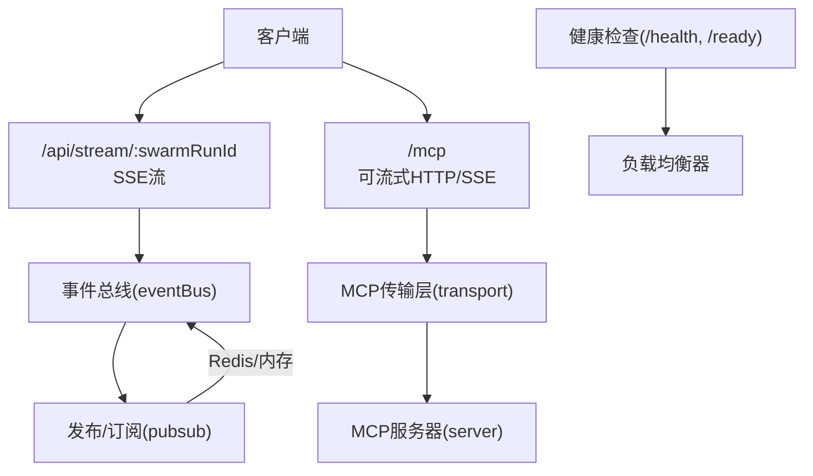
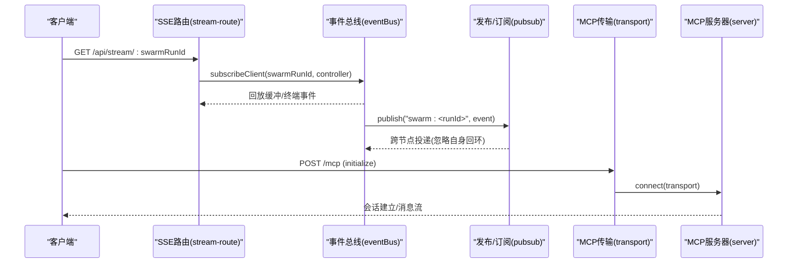
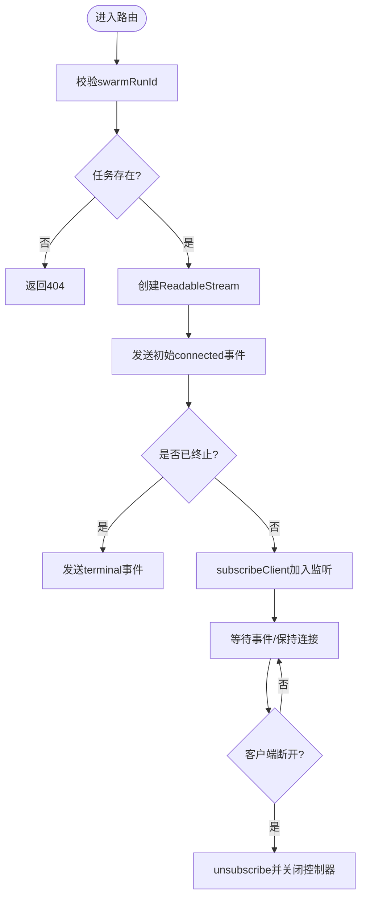
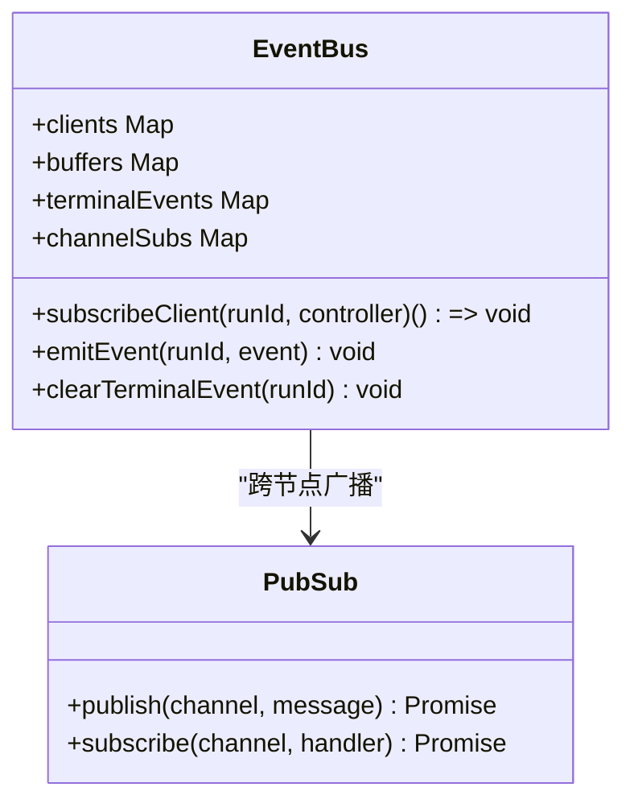
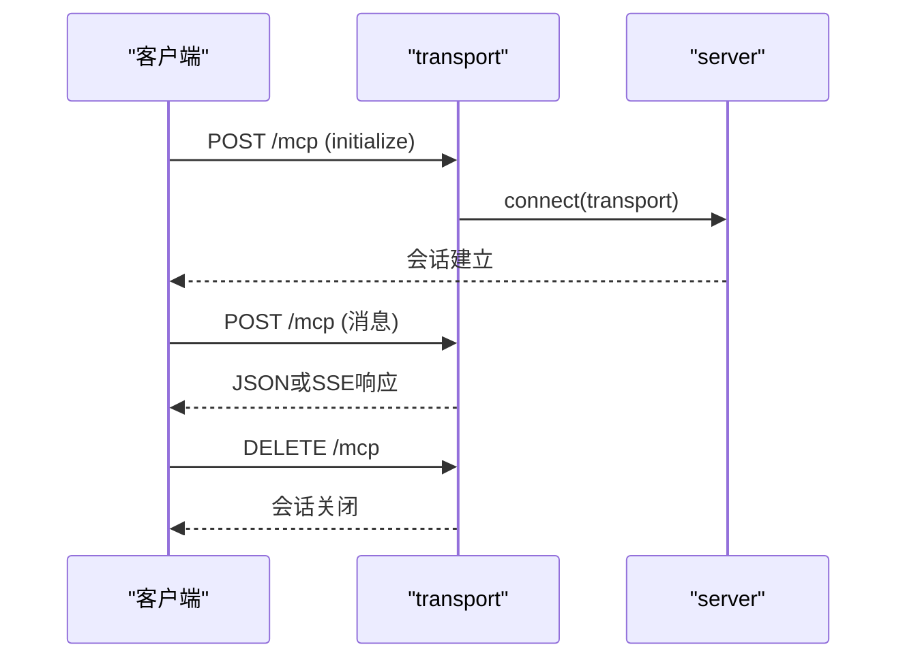
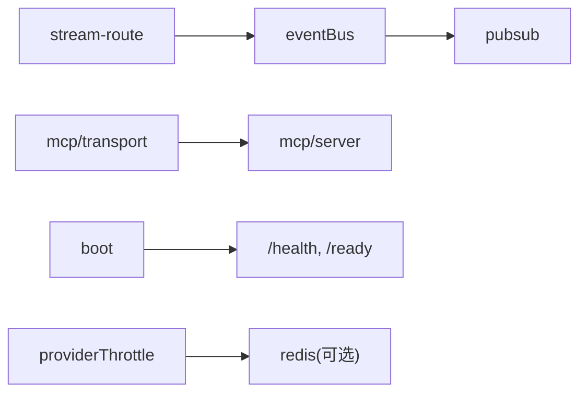

# WebSocket连接管理

<cite>
**本文引用的文件**
- [api/stream-route.ts](file://api/stream-route.ts)
- [api/services/eventBus.ts](file://api/services/eventBus.ts)
- [api/infra/pubsub.ts](file://api/infra/pubsub.ts)
- [api/mcp/transport.ts](file://api/mcp/transport.ts)
- [api/mcp/server.ts](file://api/mcp/server.ts)
- [api/mcp/context.ts](file://api/mcp/context.ts)
- [api/boot.ts](file://api/boot.ts)
- [api/lib/providerThrottle.ts](file://api/lib/providerThrottle.ts)
- [api/workerEntry.ts](file://api/workerEntry.ts)
- [api/relay-route.ts](file://api/relay-route.ts)
</cite>

## 目录
1. [简介](#简介)
2. [项目结构](#项目结构)
3. [核心组件](#核心组件)
4. [架构总览](#架构总览)
5. [详细组件分析](#详细组件分析)
6. [依赖关系分析](#依赖关系分析)
7. [性能与可扩展性](#性能与可扩展性)
8. [故障排查指南](#故障排查指南)
9. [结论](#结论)
10. [附录：客户端最佳实践](#附录客户端最佳实践)

## 简介
本文件为DeeWaanAI系统的“实时连接管理”文档，聚焦于基于SSE（Server-Sent Events）的流式推送、MCP（Model Context Protocol）的HTTP可流式传输通道，以及跨节点事件分发。由于仓库未实现原生WebSocket，本文将以SSE与HTTP流作为“长连接”等价物进行说明，覆盖连接的建立、维护、销毁、重连策略、心跳替代方案、负载均衡、监控指标与故障转移等主题，帮助读者在现有代码基础上构建可靠的实时通信能力。

## 项目结构
- 流式输出端点：提供SSE流用于流水线执行进度与结果推送。
- 事件总线：进程内缓冲、终端事件持久化、跨节点广播。
- MCP传输层：支持“可流式HTTP”和“传统SSE”，以会话为单位管理连接。
- 发布/订阅：Redis或进程内EventEmitter，保证多实例间的事件扩散。
- 健康检查与就绪探针：供负载均衡器判断是否接收流量。
- 限流与重试：AIMD速率控制与指数退避重试，保障稳定性。
- 优雅停机：Worker进程关闭时释放资源。

图表来源
- [api/stream-route.ts:8-69](file://api/stream-route.ts#L8-L69)
- [api/services/eventBus.ts:23-167](file://api/services/eventBus.ts#L23-L167)
- [api/infra/pubsub.ts:90-153](file://api/infra/pubsub.ts#L90-L153)
- [api/mcp/transport.ts:1-22](file://api/mcp/transport.ts#L1-L22)
- [api/mcp/server.ts:188-208](file://api/mcp/server.ts#L188-L208)
- [api/boot.ts:85-125](file://api/boot.ts#L85-L125)

章节来源
- [api/stream-route.ts:8-69](file://api/stream-route.ts#L8-L69)
- [api/services/eventBus.ts:23-167](file://api/services/eventBus.ts#L23-L167)
- [api/infra/pubsub.ts:90-153](file://api/infra/pubsub.ts#L90-L153)
- [api/mcp/transport.ts:1-22](file://api/mcp/transport.ts#L1-L22)
- [api/mcp/server.ts:188-208](file://api/mcp/server.ts#L188-L208)
- [api/boot.ts:85-125](file://api/boot.ts#L85-L125)

## 核心组件
- SSE流路由：负责校验任务ID、发送初始事件、订阅事件并处理断开清理。
- 事件总线：维护客户端列表、5分钟回放缓冲、终端事件永久存储、跨节点广播。
- 发布/订阅：Redis或内存双后端，自动降级，避免单点故障。
- MCP传输层：会话级管理（进程内Map），支持GET/POST/DELETE生命周期；旧版SSE兼容。
- 健康检查：/health返回运行态与依赖状态；/ready仅当DB与可选Redis可用时返回200。
- 限流与重试：AIMD算法调节RPM，结合指数退避重试，区分配额耗尽与瞬时限速。
- 优雅停机：统一关闭队列、工作进程与连接。

章节来源
- [api/stream-route.ts:8-69](file://api/stream-route.ts#L8-L69)
- [api/services/eventBus.ts:23-167](file://api/services/eventBus.ts#L23-L167)
- [api/infra/pubsub.ts:90-153](file://api/infra/pubsub.ts#L90-L153)
- [api/mcp/transport.ts:74-170](file://api/mcp/transport.ts#L74-L170)
- [api/boot.ts:85-125](file://api/boot.ts#L85-L125)
- [api/lib/providerThrottle.ts:1-29](file://api/lib/providerThrottle.ts#L1-L29)
- [api/workerEntry.ts:28-47](file://api/workerEntry.ts#L28-L47)

## 架构总览
下图展示了从客户端到服务端再到跨节点广播的整体数据流，包括SSE流与MCP通道的并存路径。

图表来源
- [api/stream-route.ts:8-69](file://api/stream-route.ts#L8-L69)
- [api/services/eventBus.ts:23-167](file://api/services/eventBus.ts#L23-L167)
- [api/infra/pubsub.ts:90-153](file://api/infra/pubsub.ts#L90-L153)
- [api/mcp/transport.ts:74-170](file://api/mcp/transport.ts#L74-L170)
- [api/mcp/server.ts:188-208](file://api/mcp/server.ts#L188-L208)

## 详细组件分析

### SSE流式管道（/api/stream/:swarmRunId）
- 建立：校验swarmRunId存在后创建ReadableStream，立即发送“已连接”事件；若任务已结束则立刻发送终端事件。
- 维护：通过事件总线订阅该run的事件，按SSE格式写入流；监听请求中止信号，断开时取消订阅并关闭控制器。
- 销毁：客户端断开触发abort，unsubscribe清理本地客户端列表；若无客户端则释放跨节点频道订阅。

图表来源
- [api/stream-route.ts:8-69](file://api/stream-route.ts#L8-L69)
- [api/services/eventBus.ts:129-153](file://api/services/eventBus.ts#L129-L153)

章节来源
- [api/stream-route.ts:8-69](file://api/stream-route.ts#L8-L69)
- [api/services/eventBus.ts:129-153](file://api/services/eventBus.ts#L129-L153)

### 事件总线（eventBus）
- 缓冲与回放：维护每个run的最近5分钟事件缓冲，新订阅者快速回放历史。
- 终端事件持久化：pipeline_complete/pipeline_error会永久保存，确保晚到客户端也能收到最终状态。
- 跨节点广播：通过pubsub将事件发送到“swarm:<runId>”频道，其他节点接收后投递给本地SSE客户端。
- 订阅管理：每run一个频道订阅，无客户端时释放，避免资源泄漏。

图表来源
- [api/services/eventBus.ts:23-167](file://api/services/eventBus.ts#L23-L167)
- [api/infra/pubsub.ts:90-153](file://api/infra/pubsub.ts#L90-L153)

章节来源
- [api/services/eventBus.ts:23-167](file://api/services/eventBus.ts#L23-L167)
- [api/infra/pubsub.ts:90-153](file://api/infra/pubsub.ts#L90-L153)

### MCP传输层（/mcp）
- 会话管理：进程内Map以SDK生成的sessionId为键，记录传输对象、用户ID、创建时间；多节点部署需粘性路由。
- 生命周期：
  - POST /mcp：初始化与消息收发，根据Accept头决定JSON或SSE响应。
  - GET /mcp：独立SSE流，用于服务端→客户端消息。
  - DELETE /mcp：关闭会话。
- 兼容性：保留旧版SSE（/mcp/sse）以兼容老桌面客户端。

图表来源
- [api/mcp/transport.ts:74-170](file://api/mcp/transport.ts#L74-L170)
- [api/mcp/server.ts:188-208](file://api/mcp/server.ts#L188-L208)

章节来源
- [api/mcp/transport.ts:74-170](file://api/mcp/transport.ts#L74-L170)
- [api/mcp/server.ts:188-208](file://api/mcp/server.ts#L188-L208)

### 认证与安全
- MCP鉴权：从Authorization头提取Bearer令牌，调用token服务验证；失败返回401。
- 安全建议：生产环境强制HTTPS；对敏感头部做最小化暴露；对会话ID做防重放与绑定。

章节来源
- [api/mcp/context.ts:1-29](file://api/mcp/context.ts#L1-L29)

### 健康检查与就绪探针
- /health：返回系统状态、依赖连通性、内存与队列/Worker信息。
- /ready：仅在DB可达且Redis（如启用）可达时返回200，供负载均衡器决定是否转发流量。

章节来源
- [api/boot.ts:85-125](file://api/boot.ts#L85-L125)

### 限流与重试（AIMD）
- AIMD算法：按提供者维度维护当前RPM、窗口计数、慢启动与冷却期，遇限流减半、稳定后线性增长。
- 重试策略：指数退避重试，区分配额耗尽（不重试）与瞬时限速（重试并重入队列）。

章节来源
- [api/lib/providerThrottle.ts:1-29](file://api/lib/providerThrottle.ts#L1-L29)

### 优雅停机
- Worker进程捕获未捕获异常与未处理拒绝，统一日志。
- 优雅关闭：设置超时，依次关闭队列与工作进程，断开连接。

章节来源
- [api/workerEntry.ts:28-47](file://api/workerEntry.ts#L28-L47)

## 依赖关系分析

图表来源
- [api/stream-route.ts:8-69](file://api/stream-route.ts#L8-L69)
- [api/services/eventBus.ts:23-167](file://api/services/eventBus.ts#L23-L167)
- [api/infra/pubsub.ts:90-153](file://api/infra/pubsub.ts#L90-L153)
- [api/mcp/transport.ts:74-170](file://api/mcp/transport.ts#L74-L170)
- [api/mcp/server.ts:188-208](file://api/mcp/server.ts#L188-L208)
- [api/lib/providerThrottle.ts:1-29](file://api/lib/providerThrottle.ts#L1-L29)
- [api/boot.ts:85-125](file://api/boot.ts#L85-L125)

章节来源
- [api/stream-route.ts:8-69](file://api/stream-route.ts#L8-L69)
- [api/services/eventBus.ts:23-167](file://api/services/eventBus.ts#L23-L167)
- [api/infra/pubsub.ts:90-153](file://api/infra/pubsub.ts#L90-L153)
- [api/mcp/transport.ts:74-170](file://api/mcp/transport.ts#L74-L170)
- [api/mcp/server.ts:188-208](file://api/mcp/server.ts#L188-L208)
- [api/lib/providerThrottle.ts:1-29](file://api/lib/providerThrottle.ts#L1-L29)
- [api/boot.ts:85-125](file://api/boot.ts#L85-L125)

## 性能与可扩展性
- 连接池与负载均衡
  - 无原生WebSocket连接池；SSE/MCP为HTTP长连接，由负载均衡器基于健康/就绪探针进行流量调度。
  - 多节点部署下，MCP会话需粘性路由（基于mcp-session-id），否则跨节点无法维持会话上下文。
- 心跳检测
  - 当前未实现显式心跳；可通过应用层周期性发送轻量消息或使用SSE空闲超时机制（由代理/浏览器行为决定）。
- 自动重连
  - 客户端应实现指数退避重连；服务端通过回放缓冲与终端事件持久化降低重连丢失影响。
- 监控指标
  - 使用健康接口暴露依赖状态；可在业务层增加SSE活跃连接数、事件吞吐、延迟等指标上报。
- 故障转移
  - pubsub在Redis不可用时自动降级为进程内EventEmitter，保证单机可用性。
  - 队列与Worker具备优雅关闭，避免中断中任务。

[本节为通用指导，不直接分析具体文件]

## 故障排查指南
- SSE连接立即断开
  - 检查swarmRunId是否存在；确认事件总线是否正常订阅与回放。
  - 参考：[api/stream-route.ts:8-69](file://api/stream-route.ts#L8-L69)、[api/services/eventBus.ts:129-153](file://api/services/eventBus.ts#L129-L153)
- 跨节点事件未到达
  - 检查Redis连通性与订阅建立；关注降级日志。
  - 参考：[api/infra/pubsub.ts:90-153](file://api/infra/pubsub.ts#L90-L153)
- MCP会话丢失
  - 确认粘性路由配置；检查会话Map与生命周期处理。
  - 参考：[api/mcp/transport.ts:74-170](file://api/mcp/transport.ts#L74-L170)
- 限流与重试
  - 观察AIMD状态与重试次数；区分配额耗尽与瞬时限速。
  - 参考：[api/lib/providerThrottle.ts:1-29](file://api/lib/providerThrottle.ts#L1-L29)
- 健康与就绪
  - 使用/health与/ready定位依赖问题（DB/Redis/队列/Worker）。
  - 参考：[api/boot.ts:85-125](file://api/boot.ts#L85-L125)

章节来源
- [api/stream-route.ts:8-69](file://api/stream-route.ts#L8-L69)
- [api/services/eventBus.ts:129-153](file://api/services/eventBus.ts#L129-L153)
- [api/infra/pubsub.ts:90-153](file://api/infra/pubsub.ts#L90-L153)
- [api/mcp/transport.ts:74-170](file://api/mcp/transport.ts#L74-L170)
- [api/lib/providerThrottle.ts:1-29](file://api/lib/providerThrottle.ts#L1-L29)
- [api/boot.ts:85-125](file://api/boot.ts#L85-L125)

## 结论
本项目采用SSE与可流式HTTP实现“类WebSocket”的实时通信，配合事件总线与发布/订阅完成跨节点广播。通过健康检查与就绪探针接入负载均衡，利用AIMD限流与优雅停机提升稳定性。尽管未实现原生WebSocket，但现有架构足以支撑高可靠、可扩展的实时场景。建议在客户端侧完善重连与心跳策略，并在运维侧补充连接与事件指标采集。

[本节为总结性内容，不直接分析具体文件]

## 附录：客户端最佳实践
- 连接建立
  - 使用SSE或MCP通道；遵循认证要求（Authorization Bearer）。
  - 参考：[api/mcp/context.ts:1-29](file://api/mcp/context.ts#L1-L29)
- 消息序列化与压缩
  - 优先使用JSON；必要时在应用层启用压缩（如gzip），注意CPU与带宽权衡。
- 心跳与保活
  - 应用层定时发送轻量消息；或依赖代理/浏览器的SSE空闲超时行为。
- 自动重连
  - 指数退避+抖动；重连时利用回放缓冲与终端事件恢复状态。
- 安全
  - 强制HTTPS；最小权限令牌；对会话ID做绑定与过期控制。
- 监控
  - 上报连接时长、断连次数、事件吞吐与延迟；结合/health与/ready进行健康治理。

[本节为通用指导，不直接分析具体文件]