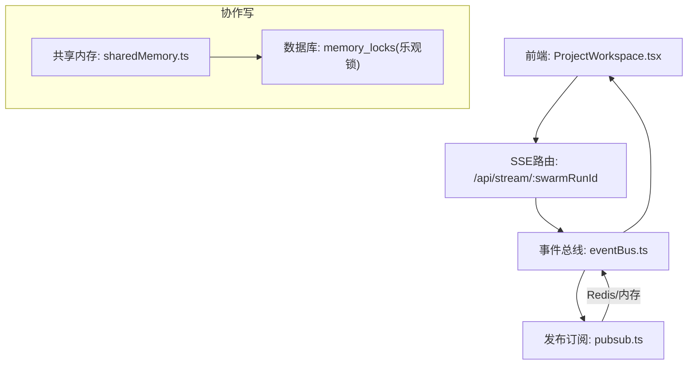
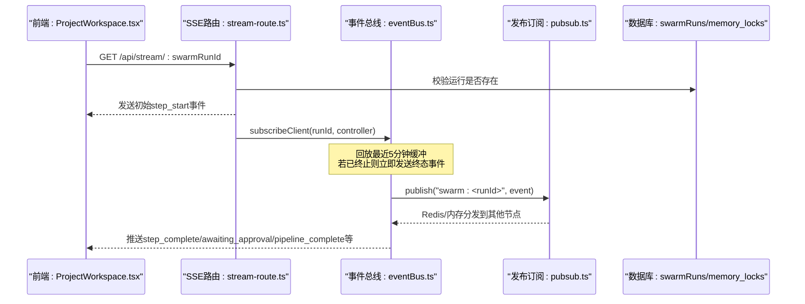
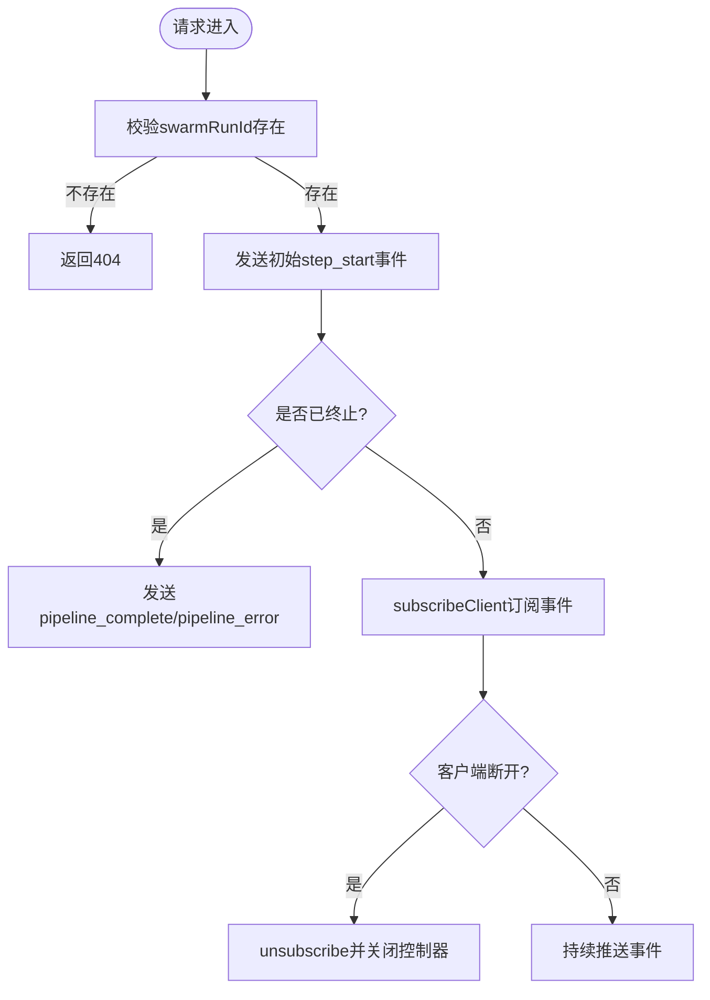
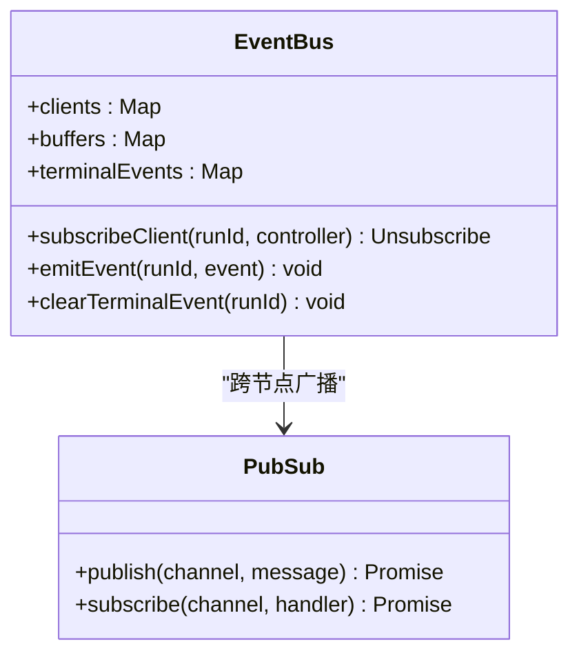
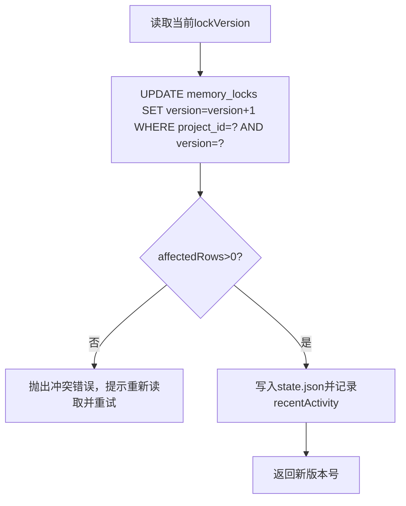
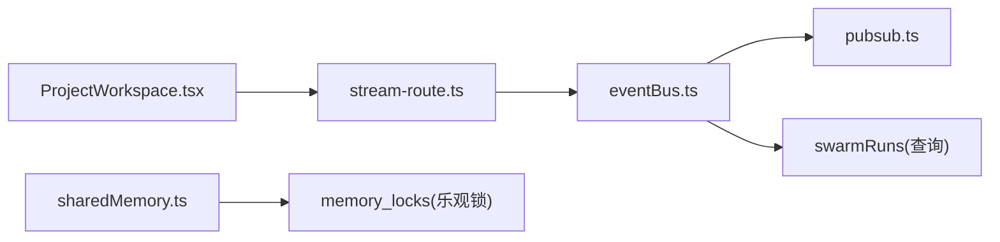
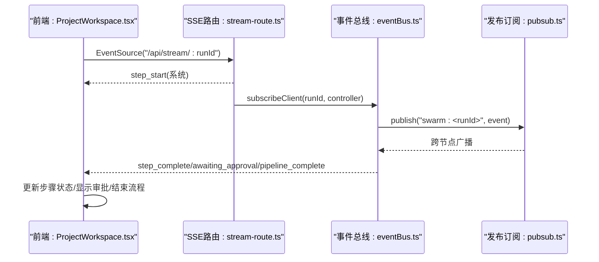

# 实时数据流

<cite>
**本文引用的文件**
- [api/stream-route.ts](file://api/stream-route.ts)
- [api/services/eventBus.ts](file://api/services/eventBus.ts)
- [api/infra/pubsub.ts](file://api/infra/pubsub.ts)
- [api/mcp/transport.ts](file://api/mcp/transport.ts)
- [api/services/sharedMemory.ts](file://api/services/sharedMemory.ts)
- [db/migrations/012_teamsync.sql](file://db/migrations/012_teamsync.sql)
- [src/pages/ProjectWorkspace.tsx](file://src/pages/ProjectWorkspace.tsx)
</cite>

## 目录
1. [简介](#简介)
2. [项目结构](#项目结构)
3. [核心组件](#核心组件)
4. [架构总览](#架构总览)
5. [详细组件分析](#详细组件分析)
6. [依赖关系分析](#依赖关系分析)
7. [性能考量](#性能考量)
8. [故障排查指南](#故障排查指南)
9. [结论](#结论)
10. [附录：前端集成示例与最佳实践](#附录前端集成示例与最佳实践)

## 简介
本文件面向DeeWaanAI系统的实时数据流，聚焦以下目标：
- 说明SSE（Server-Sent Events）与WebSocket/MCP传输的实现机制与适用场景
- 解释前端状态管理与后端数据更新的同步策略
- 描述实时协作功能的实现，包括冲突解决与数据一致性保证
- 提供实时通信的客户端集成示例与最佳实践
- 覆盖连接管理、断线重连与消息持久化机制
- 使用序列图说明端到端的实时数据更新流程

## 项目结构
实时数据流由“前端页面 + SSE路由 + 事件总线 + 发布订阅 + 共享内存”构成。关键路径如下：
- 前端通过EventSource连接SSE端点，接收流水线步骤级进度与终态事件
- 后端SSE路由负责校验运行ID、发送初始事件、订阅事件总线并回推给客户端
- 事件总线维护本地客户端列表、回放缓冲与终端事件缓存，并通过发布订阅跨节点广播
- 发布订阅层支持Redis多实例广播或进程内降级
- 协作写操作通过乐观锁保障一致性，避免丢失写入

图表来源
- [api/stream-route.ts:8-69](file://api/stream-route.ts#L8-L69)
- [api/services/eventBus.ts:1-193](file://api/services/eventBus.ts#L1-L193)
- [api/infra/pubsub.ts:1-154](file://api/infra/pubsub.ts#L1-L154)
- [api/services/sharedMemory.ts:1-207](file://api/services/sharedMemory.ts#L1-L207)
- [db/migrations/012_teamsync.sql:1-27](file://db/migrations/012_teamsync.sql#L1-L27)

章节来源
- [api/stream-route.ts:8-69](file://api/stream-route.ts#L8-L69)
- [api/services/eventBus.ts:1-193](file://api/services/eventBus.ts#L1-L193)
- [api/infra/pubsub.ts:1-154](file://api/infra/pubsub.ts#L1-L154)
- [api/services/sharedMemory.ts:1-207](file://api/services/sharedMemory.ts#L1-L207)
- [db/migrations/012_teamsync.sql:1-27](file://db/migrations/012_teamsync.sql#L1-L27)

## 核心组件
- SSE路由：建立SSE长连接，发送初始事件，订阅事件总线，处理客户端断开
- 事件总线：维护客户端、回放缓冲、终端事件缓存；跨节点广播事件
- 发布订阅：统一抽象Redis与进程内事件分发，具备优雅降级能力
- 共享内存：团队共享项目的追加式记忆与乐观锁状态更新，确保一致性
- MCP传输：提供流式HTTP与遗留SSE两种MCP协议通道，用于工具链交互

章节来源
- [api/stream-route.ts:8-69](file://api/stream-route.ts#L8-L69)
- [api/services/eventBus.ts:1-193](file://api/services/eventBus.ts#L1-L193)
- [api/infra/pubsub.ts:1-154](file://api/infra/pubsub.ts#L1-L154)
- [api/services/sharedMemory.ts:1-207](file://api/services/sharedMemory.ts#L1-L207)
- [api/mcp/transport.ts:1-233](file://api/mcp/transport.ts#L1-L233)

## 架构总览
下图展示从前端发起执行到SSE推送、事件总线分发、跨节点广播的完整链路。

图表来源
- [api/stream-route.ts:8-69](file://api/stream-route.ts#L8-L69)
- [api/services/eventBus.ts:1-193](file://api/services/eventBus.ts#L1-L193)
- [api/infra/pubsub.ts:1-154](file://api/infra/pubsub.ts#L1-L154)
- [db/migrations/012_teamsync.sql:1-27](file://db/migrations/012_teamsync.sql#L1-L27)

## 详细组件分析

### SSE流式管道（/api/stream/:swarmRunId）
- 职责：验证运行ID、发送初始事件、订阅事件总线、在客户端断开时清理
- 关键点：
  - 返回text/event-stream，禁用缓存与代理缓冲
  - 对已完成/失败/取消的运行立即发送终态事件
  - 通过ReadableStream将事件编码为SSE格式推送

图表来源
- [api/stream-route.ts:8-69](file://api/stream-route.ts#L8-L69)

章节来源
- [api/stream-route.ts:8-69](file://api/stream-route.ts#L8-L69)

### 事件总线（eventBus.ts）
- 职责：本地投递、回放缓冲、终端事件持久化、跨节点广播
- 设计要点：
  - 每个运行维护一个客户端列表与回放缓冲（默认5分钟）
  - 终端事件（完成/错误）永久缓存，新连接可立即获取
  - 跨节点通过pubsub频道“swarm:<runId>”广播，忽略自身回显
  - 无阻塞：publish失败仅记录日志，不影响本地投递

图表来源
- [api/services/eventBus.ts:1-193](file://api/services/eventBus.ts#L1-L193)
- [api/infra/pubsub.ts:1-154](file://api/infra/pubsub.ts#L1-L154)

章节来源
- [api/services/eventBus.ts:1-193](file://api/services/eventBus.ts#L1-L193)
- [api/infra/pubsub.ts:1-154](file://api/infra/pubsub.ts#L1-L154)

### 发布订阅（pubsub.ts）
- 职责：统一Redis与进程内事件分发，具备优雅降级
- 特性：
  - 自动创建订阅者连接，失败时退化为进程内分发
  - 所有消息带origin标识，避免自回显
  - 订阅按频道管理，空闲时释放Redis订阅

章节来源
- [api/infra/pubsub.ts:1-154](file://api/infra/pubsub.ts#L1-L154)

### 共享内存与协作一致性（sharedMemory.ts + 012_teamsync.sql）
- 职责：团队共享项目的追加式记忆与状态更新，使用乐观锁防止丢失写入
- 规则：
  - 仅团队共享项目可读写
  - 片段（episodes）追加无需锁
  - 状态更新通过memory_locks表进行版本递增，affectedRows=0即冲突，需重试
- 迁移：定义team_seats与memory_locks表，保障并发安全

图表来源
- [api/services/sharedMemory.ts:131-207](file://api/services/sharedMemory.ts#L131-L207)
- [db/migrations/012_teamsync.sql:17-27](file://db/migrations/012_teamsync.sql#L17-L27)

章节来源
- [api/services/sharedMemory.ts:1-207](file://api/services/sharedMemory.ts#L1-L207)
- [db/migrations/012_teamsync.sql:1-27](file://db/migrations/012_teamsync.sql#L1-L27)

### MCP传输（transport.ts）
- 职责：提供流式HTTP与遗留SSE两种MCP协议通道，用于工具链交互
- 要点：
  - 流式HTTP：POST/GET/DELETE /mcp，基于会话ID
  - 遗留SSE：GET /mcp/sse打开SSE流，POST /mcp/messages发送JSON-RPC消息
  - 会话映射保存在进程内，多节点部署需粘性路由

章节来源
- [api/mcp/transport.ts:1-233](file://api/mcp/transport.ts#L1-L233)

## 依赖关系分析
- 前端依赖SSE路由与trpc接口，通过EventSource消费实时事件
- SSE路由依赖事件总线与数据库校验
- 事件总线依赖发布订阅进行跨节点广播
- 共享内存依赖数据库乐观锁与磁盘存储

图表来源
- [src/pages/ProjectWorkspace.tsx:246-477](file://src/pages/ProjectWorkspace.tsx#L246-L477)
- [api/stream-route.ts:8-69](file://api/stream-route.ts#L8-L69)
- [api/services/eventBus.ts:1-193](file://api/services/eventBus.ts#L1-L193)
- [api/infra/pubsub.ts:1-154](file://api/infra/pubsub.ts#L1-L154)
- [api/services/sharedMemory.ts:1-207](file://api/services/sharedMemory.ts#L1-L207)

章节来源
- [src/pages/ProjectWorkspace.tsx:246-477](file://src/pages/ProjectWorkspace.tsx#L246-L477)
- [api/stream-route.ts:8-69](file://api/stream-route.ts#L8-L69)
- [api/services/eventBus.ts:1-193](file://api/services/eventBus.ts#L1-L193)
- [api/infra/pubsub.ts:1-154](file://api/infra/pubsub.ts#L1-L154)
- [api/services/sharedMemory.ts:1-207](file://api/services/sharedMemory.ts#L1-L207)

## 性能考量
- SSE端点禁用缓存与代理缓冲，降低延迟
- 事件总线维护5分钟回放缓冲，减少重连后的数据缺失
- 终端事件永久缓存，新连接可立即获知最终状态
- 发布订阅在Redis不可用时自动降级为进程内分发，提升可用性
- 共享内存使用乐观锁，避免全局锁带来的瓶颈

[本节为通用指导，不直接分析具体文件]

## 故障排查指南
- SSE连接问题：
  - 检查/swarmRunId有效性，确认运行存在
  - 确认Nginx未缓冲SSE响应（X-Accel-Buffering: no）
- 事件未到达：
  - 检查事件总线是否成功订阅频道
  - 查看发布订阅是否因Redis异常降级
- 协作冲突：
  - 捕获共享内存更新冲突错误，提示用户重新读取并重试
- MCP传输：
  - 确认会话ID正确传递，多节点部署需粘性路由

章节来源
- [api/stream-route.ts:8-69](file://api/stream-route.ts#L8-L69)
- [api/services/eventBus.ts:1-193](file://api/services/eventBus.ts#L1-L193)
- [api/infra/pubsub.ts:1-154](file://api/infra/pubsub.ts#L1-L154)
- [api/services/sharedMemory.ts:131-207](file://api/services/sharedMemory.ts#L131-L207)
- [api/mcp/transport.ts:1-233](file://api/mcp/transport.ts#L1-L233)

## 结论
DeeWaanAI的实时数据流以SSE为核心，结合事件总线与发布订阅，实现了低延迟、可扩展的实时推送。协作写通过乐观锁保障一致性，前端通过EventSource与状态管理实现流畅的用户体验。该架构兼顾单节点与多节点部署，具备良好的可用性与可维护性。

[本节为总结，不直接分析具体文件]

## 附录：前端集成示例与最佳实践

### 端到端流程序列图（前端视角）

图表来源
- [src/pages/ProjectWorkspace.tsx:246-477](file://src/pages/ProjectWorkspace.tsx#L246-L477)
- [api/stream-route.ts:8-69](file://api/stream-route.ts#L8-L69)
- [api/services/eventBus.ts:1-193](file://api/services/eventBus.ts#L1-L193)
- [api/infra/pubsub.ts:1-154](file://api/infra/pubsub.ts#L1-L154)

### 连接管理与断线重连
- 前端在组件卸载时关闭EventSource，避免资源泄漏
- 挂载时根据后端运行状态恢复SSE连接，确保导航后仍可接收事件
- 事件总线回放缓冲帮助新连接快速追赶进度

章节来源
- [src/pages/ProjectWorkspace.tsx:246-477](file://src/pages/ProjectWorkspace.tsx#L246-L477)
- [api/services/eventBus.ts:39-52](file://api/services/eventBus.ts#L39-L52)

### 消息持久化与状态同步
- 前端在页面卸载时使用sendBeacon保存聊天消息，确保升级或重启后恢复
- 共享内存的状态更新通过乐观锁保证一致性，冲突时提示重试

章节来源
- [src/pages/ProjectWorkspace.tsx:293-332](file://src/pages/ProjectWorkspace.tsx#L293-L332)
- [api/services/sharedMemory.ts:151-207](file://api/services/sharedMemory.ts#L151-L207)

### 最佳实践
- 使用SSE进行单向实时推送，避免WebSocket复杂握手与心跳
- 对终端事件进行持久化缓存，便于新连接快速收敛
- 跨节点广播采用发布订阅抽象，提升可移植性与容错性
- 协作写采用乐观锁，避免全局锁导致的性能瓶颈

[本节为通用指导，不直接分析具体文件]