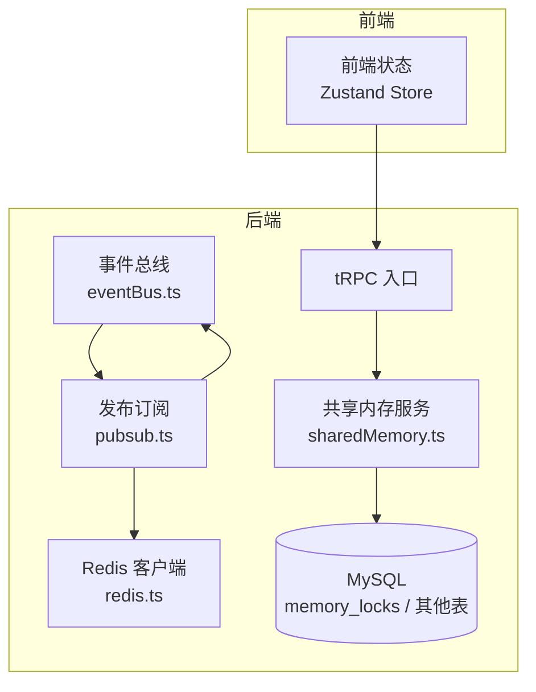
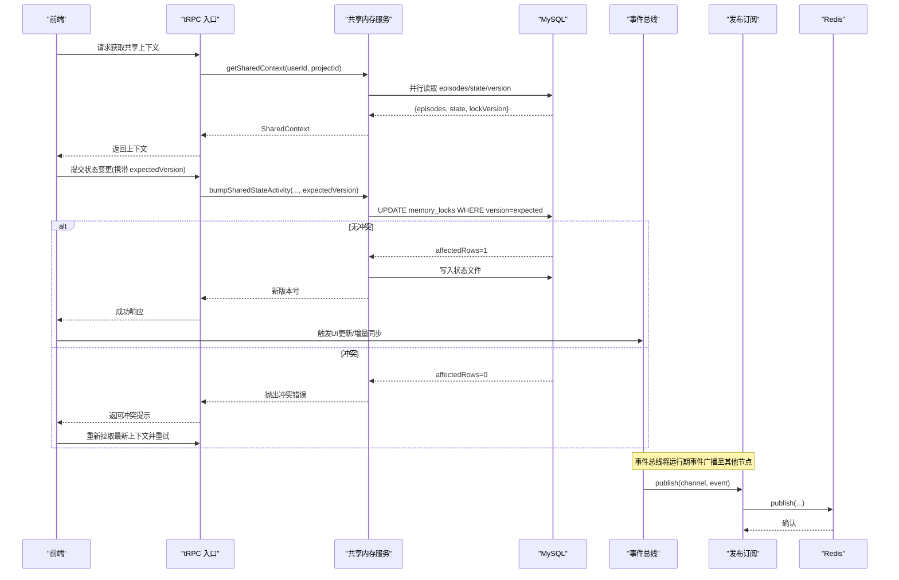
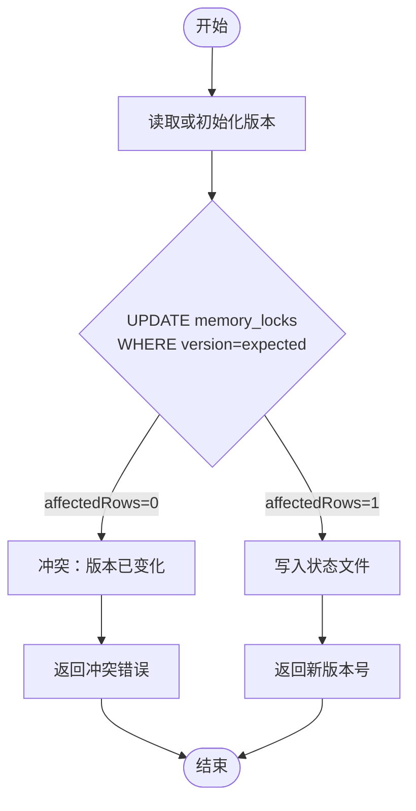
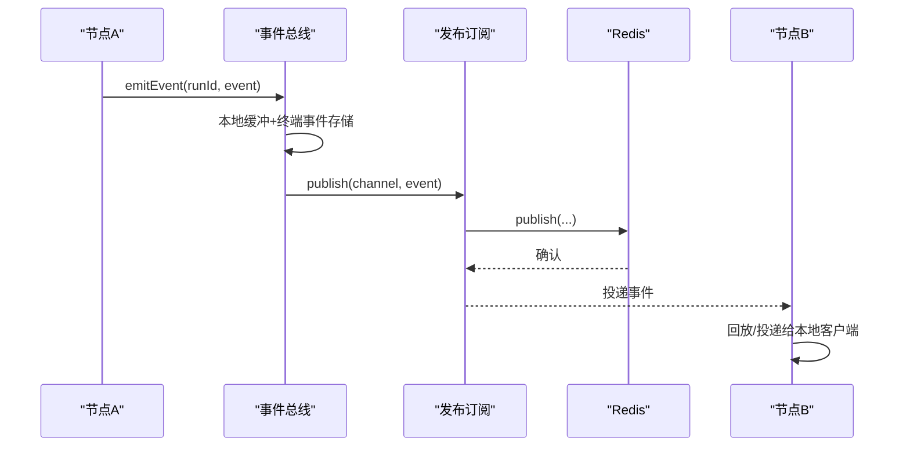
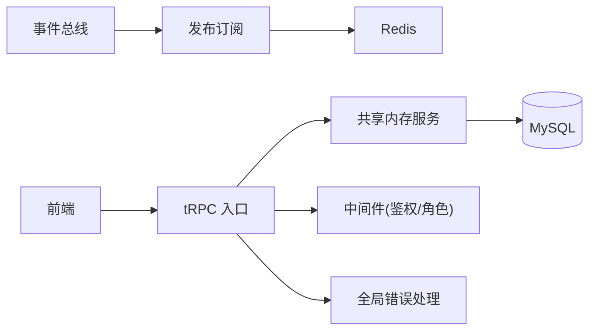

# 状态同步策略

<cite>
**本文引用的文件**
- [sharedMemory.ts](file://api/services/sharedMemory.ts)
- [012_teamsync.sql](file://db/migrations/012_teamsync.sql)
- [eventBus.ts](file://api/services/eventBus.ts)
- [pubsub.ts](file://api/infra/pubsub.ts)
- [redis.ts](file://api/infra/redis.ts)
- [stateSummarizer.ts](file://api/services/stateSummarizer.ts)
- [memoryManager.ts](file://api/services/memoryManager.ts)
- [projectStore.ts](file://src/stores/projectStore.ts)
- [workspaceStore.ts](file://src/stores/workspaceStore.ts)
- [boot.ts](file://api/boot.ts)
- [middleware.ts](file://api/middleware.ts)
</cite>

## 目录
1. [简介](#简介)
2. [项目结构](#项目结构)
3. [核心组件](#核心组件)
4. [架构总览](#架构总览)
5. [详细组件分析](#详细组件分析)
6. [依赖关系分析](#依赖关系分析)
7. [性能考量](#性能考量)
8. [故障排查指南](#故障排查指南)
9. [结论](#结论)
10. [附录](#附录)

## 简介
本文件为 DeeWaanAI 系统的“状态同步策略”文档，聚焦前端状态管理与后端数据更新的同步机制。内容涵盖：
- 冲突检测与解决：乐观更新（基于版本号）与悲观更新（写锁）的适用场景与实现方式
- 数据一致性保证：版本控制、幂等写入、事件回放与跨节点广播
- 增量同步、全量同步与差异合并的实现路径
- 状态管理最佳实践：缓存策略、内存优化与性能调优
- 通过流程图展示完整同步流程与异常处理机制

## 项目结构
系统围绕“团队共享项目状态”展开，关键路径包括：
- 后端服务层：共享内存服务（TeamSync）、事件总线、发布订阅、Redis 连接
- 数据库层：团队同步迁移（包含 memory_locks 表）
- 前端状态层：Zustand 存储（项目与工作区状态）
- 运行时：tRPC 路由入口、全局错误处理与优雅关闭

图表来源
- [sharedMemory.ts:86-104](file://api/services/sharedMemory.ts#L86-L104)
- [eventBus.ts:156-167](file://api/services/eventBus.ts#L156-L167)
- [pubsub.ts:91-106](file://api/infra/pubsub.ts#L91-L106)
- [redis.ts:65-82](file://api/infra/redis.ts#L65-L82)
- [012_teamsync.sql:17-27](file://db/migrations/012_teamsync.sql#L17-L27)

章节来源
- [boot.ts:361-373](file://api/boot.ts#L361-L373)
- [middleware.ts:17-28](file://api/middleware.ts#L17-L28)

## 核心组件
- 共享内存服务（TeamSync）
  - 提供团队共享项目的上下文读取、追加式片段记忆、以及带乐观锁的状态写入
  - 使用 memory_locks 表的 version 字段进行冲突检测
- 事件总线与发布订阅
  - 本地 SSE 缓冲与终端事件持久化
  - 跨节点广播（Redis pub/sub），失败降级为进程内事件
- Redis 客户端
  - 多节点共享状态与广播的基础设施，具备重试与回退到内存模式的能力
- 状态压缩与记忆管理
  - 结构化状态压缩、片段记忆检索与旋转策略，降低传输与存储成本
- 前端状态管理
  - 工作区与项目级状态持久化，避免大对象污染 localStorage，运行态不持久化

章节来源
- [sharedMemory.ts:1-20](file://api/services/sharedMemory.ts#L1-L20)
- [sharedMemory.ts:86-104](file://api/services/sharedMemory.ts#L86-L104)
- [sharedMemory.ts:158-206](file://api/services/sharedMemory.ts#L158-L206)
- [eventBus.ts:1-12](file://api/services/eventBus.ts#L1-L12)
- [eventBus.ts:129-167](file://api/services/eventBus.ts#L129-L167)
- [pubsub.ts:1-24](file://api/infra/pubsub.ts#L1-L24)
- [redis.ts:40-87](file://api/infra/redis.ts#L40-L87)
- [stateSummarizer.ts:112-192](file://api/services/stateSummarizer.ts#L112-L192)
- [memoryManager.ts:54-104](file://api/services/memoryManager.ts#L54-L104)
- [workspaceStore.ts:67-206](file://src/stores/workspaceStore.ts#L67-L206)

## 架构总览
下图展示了从前端发起状态变更到后端写入、并发冲突检测、事件广播与前端重放的全链路。

图表来源
- [sharedMemory.ts:86-104](file://api/services/sharedMemory.ts#L86-L104)
- [sharedMemory.ts:158-206](file://api/services/sharedMemory.ts#L158-L206)
- [eventBus.ts:156-167](file://api/services/eventBus.ts#L156-L167)
- [pubsub.ts:91-106](file://api/infra/pubsub.ts#L91-L106)
- [redis.ts:65-82](file://api/infra/redis.ts#L65-L82)
- [012_teamsync.sql:17-27](file://db/migrations/012_teamsync.sql#L17-L27)

## 详细组件分析

### 共享内存服务（TeamSync）与乐观锁
- 职责
  - 读取团队共享上下文（片段、结构化状态、当前版本）
  - 追加式片段记忆（无需锁）
  - 带乐观锁的状态写入（version 递增）
- 冲突检测
  - 通过 memory_locks.version 的原子更新检测冲突；affectedRows=0 即冲突
- 数据一致性
  - 首次写入时创建 version=1 的行；并发竞争由唯一键约束保证
  - 冲突时明确提示调用方重新读取并重试，避免静默丢失写
- 增量与全量
  - 全量：getSharedContext 返回 episodes + state + lockVersion
  - 增量：appendSharedEpisode 仅追加片段；bumpSharedStateActivity 仅更新最近活动

图表来源
- [sharedMemory.ts:137-149](file://api/services/sharedMemory.ts#L137-L149)
- [sharedMemory.ts:158-206](file://api/services/sharedMemory.ts#L158-L206)
- [012_teamsync.sql:17-27](file://db/migrations/012_teamsync.sql#L17-L27)

章节来源
- [sharedMemory.ts:1-20](file://api/services/sharedMemory.ts#L1-L20)
- [sharedMemory.ts:63-104](file://api/services/sharedMemory.ts#L63-L104)
- [sharedMemory.ts:137-206](file://api/services/sharedMemory.ts#L137-L206)
- [012_teamsync.sql:17-27](file://db/migrations/012_teamsync.sql#L17-L27)

### 事件总线与跨节点广播
- 本地交付
  - 维护每个 runId 的 5 分钟事件缓冲与终端事件持久化
  - 新连接可回放近期事件，确保断线重连后状态一致
- 跨节点广播
  - 通过发布订阅将事件分发到其他节点；失败不影响本地交付
  - 使用实例 ID 过滤自身回声，避免重复消费
- 与状态同步的关系
  - 运行期事件驱动 UI 增量更新；状态变更通过 tRPC 返回的新版本驱动前端重读

图表来源
- [eventBus.ts:1-12](file://api/services/eventBus.ts#L1-L12)
- [eventBus.ts:129-167](file://api/services/eventBus.ts#L129-L167)
- [pubsub.ts:91-106](file://api/infra/pubsub.ts#L91-L106)
- [redis.ts:65-82](file://api/infra/redis.ts#L65-L82)

章节来源
- [eventBus.ts:1-12](file://api/services/eventBus.ts#L1-L12)
- [eventBus.ts:54-92](file://api/services/eventBus.ts#L54-L92)
- [eventBus.ts:129-167](file://api/services/eventBus.ts#L129-L167)
- [pubsub.ts:1-24](file://api/infra/pubsub.ts#L1-L24)
- [pubsub.ts:91-106](file://api/infra/pubsub.ts#L91-L106)

### 发布订阅与 Redis 回退
- 双后端抽象
  - 优先使用 Redis 进行跨节点广播；不可用时自动降级为进程内 EventEmitter
- 连接与订阅
  - 订阅端复用单连接；失败时记录日志并继续本地模式
- 对状态同步的影响
  - 即使 Redis 不可用，本地 SSE 仍可用；跨节点广播失效但不影响单机体验

章节来源
- [pubsub.ts:1-24](file://api/infra/pubsub.ts#L1-L24)
- [pubsub.ts:36-69](file://api/infra/pubsub.ts#L36-L69)
- [pubsub.ts:91-106](file://api/infra/pubsub.ts#L91-L106)
- [redis.ts:40-87](file://api/infra/redis.ts#L40-L87)

### 状态压缩与记忆管理
- 结构化状态压缩
  - 根据 token 阈值与模式（保守/均衡/激进）裁剪近期活动、决策与长期摘要
- 片段记忆
  - 关键词检索与旋转策略，控制片段数量与大小
- 对同步的意义
  - 减少网络传输与存储开销；在冲突重试时能更快恢复

章节来源
- [stateSummarizer.ts:112-192](file://api/services/stateSummarizer.ts#L112-L192)
- [memoryManager.ts:54-104](file://api/services/memoryManager.ts#L54-L104)

### 前端状态管理
- 工作区状态
  - 按项目隔离消息、审批、运行态等；持久化时剔除大附件 dataUrl，避免超出配额
  - 运行态（如 projectRunState）不持久化，防止过期状态残留
- 项目状态
  - 简单的项目选择状态，便于页面渲染
- 与后端同步
  - 通过 tRPC 获取上下文；遇到冲突时重新拉取最新数据并合并

章节来源
- [workspaceStore.ts:67-206](file://src/stores/workspaceStore.ts#L67-L206)
- [projectStore.ts:1-16](file://src/stores/projectStore.ts#L1-L16)

## 依赖关系分析
- 共享内存服务依赖数据库表 memory_locks 进行版本控制
- 事件总线依赖发布订阅与 Redis 实现跨节点广播
- 前端通过 tRPC 访问后端；中间件负责鉴权与角色校验
- 全局错误处理与优雅关闭保障系统稳定性

图表来源
- [boot.ts:361-373](file://api/boot.ts#L361-L373)
- [middleware.ts:17-28](file://api/middleware.ts#L17-L28)
- [sharedMemory.ts:86-104](file://api/services/sharedMemory.ts#L86-L104)
- [eventBus.ts:156-167](file://api/services/eventBus.ts#L156-L167)
- [pubsub.ts:91-106](file://api/infra/pubsub.ts#L91-L106)
- [redis.ts:65-82](file://api/infra/redis.ts#L65-L82)

章节来源
- [boot.ts:361-373](file://api/boot.ts#L361-L373)
- [middleware.ts:17-28](file://api/middleware.ts#L17-L28)

## 性能考量
- 并发与锁粒度
  - 使用细粒度的 memory_locks 行级乐观锁，避免全局锁瓶颈
- 网络与存储
  - 事件缓冲与终端事件持久化减少重连后的带宽消耗
  - 状态压缩与片段记忆控制 payload 大小
- 缓存与回退
  - Redis 不可用时自动降级到内存模式，保证可用性
- 前端内存优化
  - 持久化时剔除大附件 dataUrl，避免 localStorage 溢出
  - 运行态不持久化，避免陈旧状态干扰

[本节为通用指导，不直接分析具体文件]

## 故障排查指南
- 冲突错误
  - 现象：状态写入返回冲突错误，提示“自上次读取后状态已更改”
  - 处理：前端重新调用 getSharedContext 获取最新版本，合并增量后重试
- 事件未到达
  - 现象：SSE 流中断或跨节点事件丢失
  - 处理：检查 Redis 连接与订阅；确认本地缓冲与终端事件是否保留；必要时重连以回放
- 权限问题
  - 现象：tRPC 返回未授权或角色不足
  - 处理：检查认证中间件与角色校验逻辑
- 优雅关闭
  - 现象：服务重启导致事件丢失
  - 处理：利用终端事件与缓冲机制，重连后回放；确保关闭前释放资源

章节来源
- [sharedMemory.ts:158-206](file://api/services/sharedMemory.ts#L158-L206)
- [eventBus.ts:129-167](file://api/services/eventBus.ts#L129-L167)
- [middleware.ts:17-28](file://api/middleware.ts#L17-L28)
- [boot.ts:375-389](file://api/boot.ts#L375-L389)

## 结论
DeeWaanAI 的状态同步策略以“乐观锁 + 事件回放 + 发布订阅”为核心：
- 通过 memory_locks.version 实现强一致的冲突检测与解决
- 借助事件总线与 Redis 广播，实现跨节点的增量同步与断线重连回放
- 前端采用 Zustand 管理状态，结合压缩与持久化策略，平衡性能与一致性
- 在 Redis 不可用时自动降级，确保系统鲁棒性

[本节为总结，不直接分析具体文件]

## 附录
- 术语
  - 乐观更新：先更新本地状态，提交时检测冲突，冲突则回滚并重试
  - 悲观更新：写前加锁，阻塞并发写，避免冲突但可能降低吞吐
  - 增量同步：仅传输变化的部分（如片段、活动）
  - 全量同步：一次性拉取完整上下文（片段+状态+版本）
  - 差异合并：基于版本号的增量合并策略

[本节为概念说明，不直接分析具体文件]