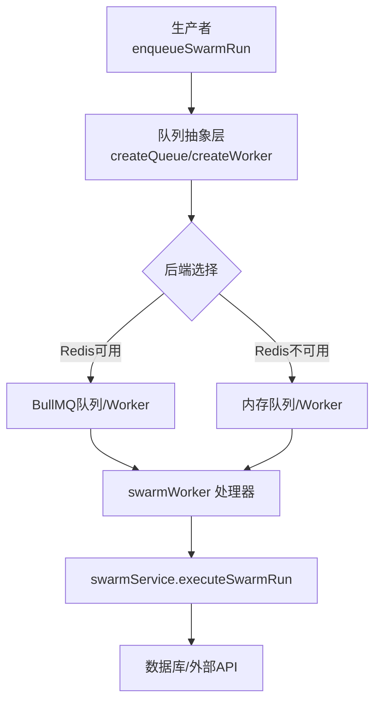
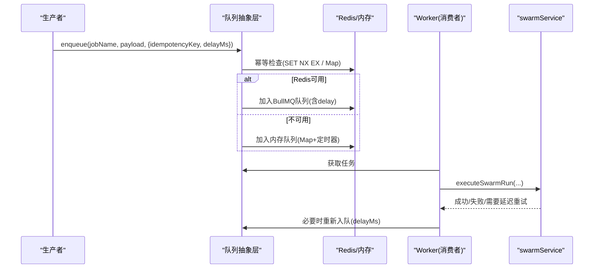
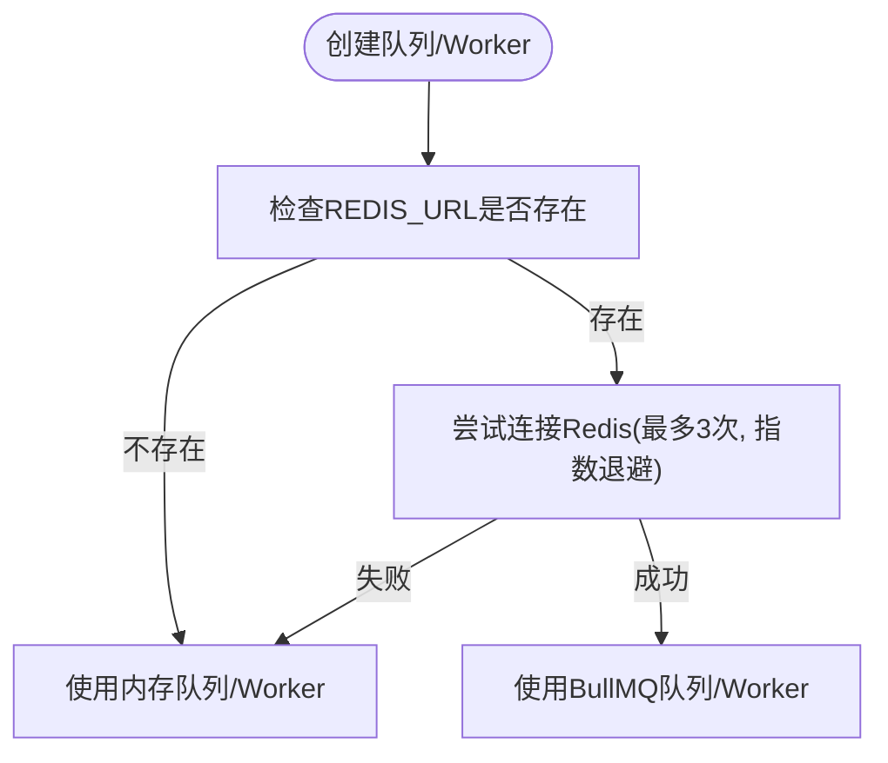
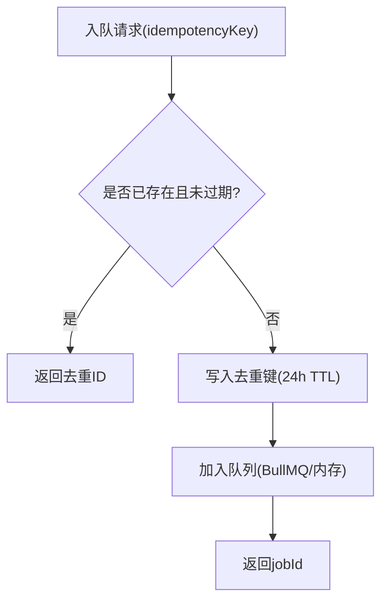
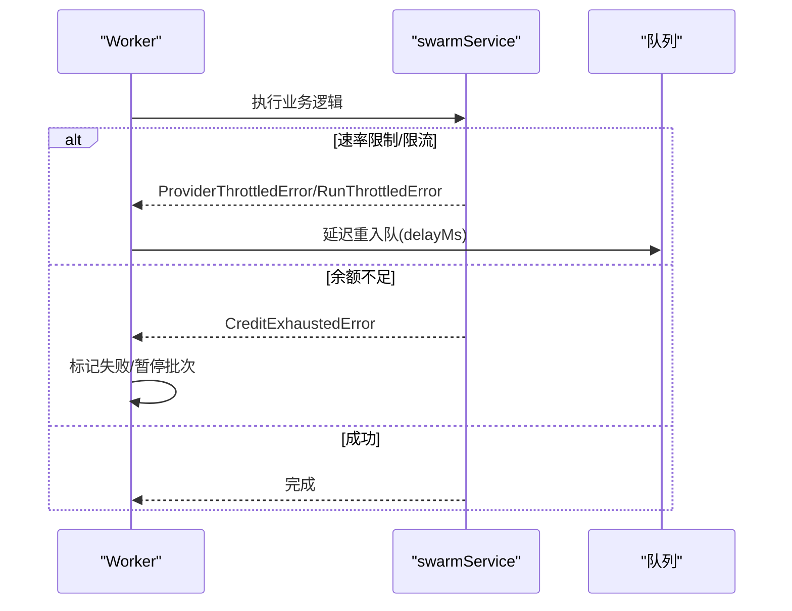
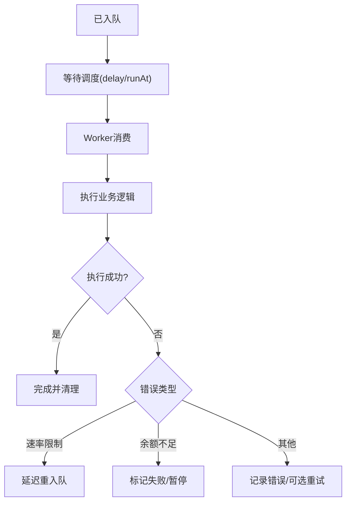
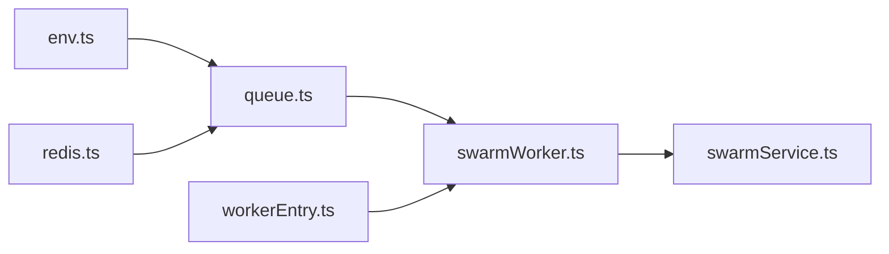

# 任务调度机制

<cite>
**本文引用的文件**
- [api/infra/queue.ts](file://api/infra/queue.ts)
- [api/infra/redis.ts](file://api/infra/redis.ts)
- [api/workers/swarmWorker.ts](file://api/workers/swarmWorker.ts)
- [api/services/swarmService.ts](file://api/services/swarmService.ts)
- [api/lib/env.ts](file://api/lib/env.ts)
- [api/workerEntry.ts](file://api/workerEntry.ts)
</cite>

## 目录
1. [简介](#简介)
2. [项目结构](#项目结构)
3. [核心组件](#核心组件)
4. [架构总览](#架构总览)
5. [详细组件分析](#详细组件分析)
6. [依赖关系分析](#依赖关系分析)
7. [性能考量](#性能考量)
8. [故障排查指南](#故障排查指南)
9. [结论](#结论)
10. [附录](#附录)

## 简介
本文件面向DeeWaanAI系统的任务调度机制，重点说明：
- 双后端架构选择逻辑：BullMQ（基于Redis）与内存队列的自动切换与降级。
- 任务优先级、延迟执行与重试策略的实现原理。
- 幂等性保证机制：基于24小时TTL的去重键管理。
- 任务调度的配置项：并发控制、超时设置与资源清理策略。
- 任务生命周期管理与错误处理流程。

该机制确保系统在无Redis环境下仍可运行（开发/单节点），在具备Redis时提供持久化、跨进程/多实例的任务能力。

## 项目结构
围绕任务调度相关的关键文件与职责如下：
- 队列抽象与后端选择：api/infra/queue.ts
- Redis连接与可用性检测：api/infra/redis.ts
- 工作进程入口与优雅关闭：api/workerEntry.ts
- 任务消费者与工作注册：api/workers/swarmWorker.ts
- 任务执行服务与重试/节流策略：api/services/swarmService.ts
- 环境变量与并发配置：api/lib/env.ts

图表来源
- [api/infra/queue.ts:1-334](file://api/infra/queue.ts#L1-L334)
- [api/workers/swarmWorker.ts:1-75](file://api/workers/swarmWorker.ts#L1-L75)
- [api/services/swarmService.ts:1-200](file://api/services/swarmService.ts#L1-L200)

章节来源
- [api/infra/queue.ts:1-334](file://api/infra/queue.ts#L1-L334)
- [api/infra/redis.ts:1-88](file://api/infra/redis.ts#L1-L88)
- [api/workers/swarmWorker.ts:1-75](file://api/workers/swarmWorker.ts#L1-L75)
- [api/services/swarmService.ts:1-200](file://api/services/swarmService.ts#L1-L200)
- [api/lib/env.ts:1-105](file://api/lib/env.ts#L1-L105)
- [api/workerEntry.ts:1-65](file://api/workerEntry.ts#L1-L65)

## 核心组件
- 队列抽象接口与实现
  - AppQueue/AppWorker：统一的生产者/消费者接口，屏蔽BullMQ与内存实现的差异。
  - MemoryAppQueue/MemoryAppWorker：进程内Map + setTimeout实现，支持延迟执行与简单去重。
  - BullAppQueue/BullAppWorker：基于BullMQ，支持持久化、多实例、失败日志等。
- 后端选择与降级
  - resolveBackend：首次使用时检测Redis是否可用；若不可用则回退到内存队列。
  - getRedis：带指数退避的重试连接，最多3次尝试，失败后标记gaveUp并返回null。
- 幂等性保证
  - 24小时TTL的去重键：BullMQ路径使用Redis SET NX EX；内存路径使用Map记录过期时间。
- 任务执行与重试
  - swarmWorker：注册队列处理器，调用executeSwarmRun，支持按Provider/Run级别的节流与延迟重入队。
  - swarmService：封装LLM调用重试、速率限制识别、余额不足等错误分类与处理。

章节来源
- [api/infra/queue.ts:16-334](file://api/infra/queue.ts#L16-L334)
- [api/infra/redis.ts:1-88](file://api/infra/redis.ts#L1-L88)
- [api/workers/swarmWorker.ts:1-75](file://api/workers/swarmWorker.ts#L1-L75)
- [api/services/swarmService.ts:124-200](file://api/services/swarmService.ts#L124-L200)

## 架构总览
系统采用“队列抽象 + 双后端”的设计：
- 生产端通过统一的enqueue接口提交任务，可携带idempotencyKey与delayMs。
- 消费端通过createWorker注册处理器，内部根据后端类型选择BullMQ或内存队列。
- 当Redis不可用时，自动降级为内存队列，保证本地开发与单实例部署可用。
- 任务执行由swarmWorker驱动，实际业务逻辑在swarmService中完成，包含重试、节流与状态更新。

图表来源
- [api/infra/queue.ts:156-228](file://api/infra/queue.ts#L156-L228)
- [api/workers/swarmWorker.ts:24-58](file://api/workers/swarmWorker.ts#L24-L58)
- [api/services/swarmService.ts:176-200](file://api/services/swarmService.ts#L176-L200)

## 详细组件分析

### 双后端架构与自动降级
- 后端选择时机
  - createQueue：首次enqueue时解析后端，缓存结果。
  - createWorker：启动时解析后端，失败时降级为内存Worker。
- Redis可用性检测
  - isRedisEnabled：检查是否配置了REDIS_URL。
  - getRedis：最多3次快速连接尝试，指数退避；成功后复用连接；失败后标记gaveUp并返回null。
- 降级行为
  - 若Redis不可用，所有队列操作走内存实现；不影响应用启动与基本功能。
  - Worker初始化失败也会回退到内存Worker，确保任务能继续被消费。

图表来源
- [api/infra/queue.ts:36-71](file://api/infra/queue.ts#L36-L71)
- [api/infra/redis.ts:22-82](file://api/infra/redis.ts#L22-L82)

章节来源
- [api/infra/queue.ts:36-71](file://api/infra/queue.ts#L36-L71)
- [api/infra/redis.ts:22-82](file://api/infra/redis.ts#L22-L82)

### 幂等性与去重键管理（24小时TTL）
- 目标：同一idempotencyKey在24小时内重复入队将被拒绝，避免重复执行。
- 实现
  - BullMQ路径：使用Redis SET key "1" EX 86400 NX，原子性保证。
  - 内存路径：维护Map<key, expiryTs>，定期清理过期键。
- 返回值：去重命中时返回dedup标识，便于上层识别。

图表来源
- [api/infra/queue.ts:156-175](file://api/infra/queue.ts#L156-L175)
- [api/infra/queue.ts:210-228](file://api/infra/queue.ts#L210-L228)

章节来源
- [api/infra/queue.ts:156-175](file://api/infra/queue.ts#L156-L175)
- [api/infra/queue.ts:210-228](file://api/infra/queue.ts#L210-L228)

### 任务优先级、延迟执行与重试策略
- 优先级
  - 当前实现未显式实现多级优先级队列；可通过多个命名队列区分不同优先级（例如high/low）。
- 延迟执行
  - 支持delayMs参数：BullMQ直接设置delay；内存队列通过runAt与定时器调度。
- 重试策略
  - 队列层面：BullMQ默认attempts=1，不自动重试；失败由业务侧决定是否需要重入队。
  - 业务侧：swarmService对LLM调用进行重试，支持指数退避；识别速率限制与余额不足等错误类别。
  - 节流与重入队：Provider/Run级别节流时，抛出特定异常，由swarmWorker捕获并按retryAfterMs延迟重新入队。

图表来源
- [api/services/swarmService.ts:124-200](file://api/services/swarmService.ts#L124-L200)
- [api/workers/swarmWorker.ts:50-58](file://api/workers/swarmWorker.ts#L50-L58)

章节来源
- [api/services/swarmService.ts:124-200](file://api/services/swarmService.ts#L124-L200)
- [api/workers/swarmWorker.ts:24-58](file://api/workers/swarmWorker.ts#L24-L58)

### 任务生命周期管理与错误处理
- 生命周期阶段
  - 入队：幂等检查 -> 加入队列（BullMQ/内存）。
  - 调度：BullMQ按delay触发；内存队列按runAt定时扫描。
  - 消费：Worker取出任务，执行业务逻辑。
  - 完成/失败：成功则清理；失败则记录日志，必要时延迟重入队。
- 错误处理
  - 队列层：BullMQ worker监听failed事件并记录错误；内存队列捕获异常并记录。
  - 业务层：swarmService对异常进行分类（余额不足、速率限制、其他），采取不同策略。
- 优雅关闭
  - workerEntry监听SIGTERM/SIGINT，停止消费并关闭队列与Redis连接，超时强制退出。

图表来源
- [api/infra/queue.ts:122-147](file://api/infra/queue.ts#L122-L147)
- [api/infra/queue.ts:248-255](file://api/infra/queue.ts#L248-L255)
- [api/services/swarmService.ts:176-200](file://api/services/swarmService.ts#L176-L200)
- [api/workerEntry.ts:36-65](file://api/workerEntry.ts#L36-L65)

章节来源
- [api/infra/queue.ts:122-147](file://api/infra/queue.ts#L122-L147)
- [api/infra/queue.ts:248-255](file://api/infra/queue.ts#L248-L255)
- [api/services/swarmService.ts:176-200](file://api/services/swarmService.ts#L176-L200)
- [api/workerEntry.ts:36-65](file://api/workerEntry.ts#L36-L65)

## 依赖关系分析
- queue.ts依赖redis.ts进行连接检测与共享客户端获取。
- swarmWorker.ts依赖queue.ts提供的队列与Worker抽象，并调用swarmService执行具体任务。
- swarmService.ts依赖数据库、外部API与节流模块，负责重试与错误分类。
- env.ts提供SWARM_WORKER_CONCURRENCY等关键配置。
- workerEntry.ts作为独立进程入口，协调worker生命周期与优雅关闭。

图表来源
- [api/lib/env.ts:87-87](file://api/lib/env.ts#L87-L87)
- [api/infra/queue.ts:12-14](file://api/infra/queue.ts#L12-L14)
- [api/workers/swarmWorker.ts:7-8](file://api/workers/swarmWorker.ts#L7-L8)
- [api/workerEntry.ts:18-21](file://api/workerEntry.ts#L18-L21)

章节来源
- [api/lib/env.ts:87-87](file://api/lib/env.ts#L87-L87)
- [api/infra/queue.ts:12-14](file://api/infra/queue.ts#L12-L14)
- [api/workers/swarmWorker.ts:7-8](file://api/workers/swarmWorker.ts#L7-L8)
- [api/workerEntry.ts:18-21](file://api/workerEntry.ts#L18-L21)

## 性能考量
- 并发控制
  - BullMQ Worker的concurrency由环境变量SWARM_WORKER_CONCURRENCY控制，默认值为2。
  - 内存Worker为进程内串行/并发取决于任务处理耗时与调度方式（当前实现为逐个处理due任务）。
- 资源清理
  - BullMQ：removeOnComplete与removeOnFail分别设置保留时间与数量上限，避免队列膨胀。
  - 内存：定时器调度与Map清理，避免内存泄漏。
- 延迟与吞吐
  - 合理设置delayMs以平滑流量峰值；在高并发场景建议启用Redis后端以获得更好的持久化与扩展性。
- 连接稳定性
  - Redis连接失败会快速降级，避免阻塞主流程；建议在监控中关注Redis可用性告警。

章节来源
- [api/lib/env.ts:87-87](file://api/lib/env.ts#L87-L87)
- [api/infra/queue.ts:221-227](file://api/infra/queue.ts#L221-L227)
- [api/infra/queue.ts:107-147](file://api/infra/queue.ts#L107-L147)

## 故障排查指南
- 无法入队或任务丢失
  - 检查REDIS_URL是否配置；确认getRedis是否返回有效客户端。
  - 查看队列后端是否为memory（降级情况下仅进程内有效）。
- 任务重复执行
  - 确认idempotencyKey是否正确传递；检查24小时TTL是否生效。
- 任务长时间不执行
  - 检查Worker是否已注册；确认delayMs是否过大；观察是否有节流导致的延迟重入队。
- 频繁失败
  - 查看BullMQ failed事件日志；检查swarmService的错误分类与重试策略。
- 优雅关闭问题
  - 确认SIGTERM/SIGINT处理是否触发；检查closeAllQueues是否执行完毕。

章节来源
- [api/infra/redis.ts:22-82](file://api/infra/redis.ts#L22-L82)
- [api/infra/queue.ts:248-255](file://api/infra/queue.ts#L248-L255)
- [api/services/swarmService.ts:176-200](file://api/services/swarmService.ts#L176-L200)
- [api/workerEntry.ts:36-65](file://api/workerEntry.ts#L36-L65)

## 结论
DeeWaanAI的任务调度机制通过“队列抽象 + 双后端”实现了高可用与易用的平衡：
- 在Redis可用时提供持久化与多实例能力；不可用时自动降级至内存队列，保障开发体验与基础运行。
- 通过24小时TTL的去重键保证幂等性，避免重复执行。
- 结合业务层的重试与节流策略，提升鲁棒性与用户体验。
- 提供清晰的配置项与资源清理策略，便于在生产环境中稳定运行。

## 附录
- 关键配置项
  - SWARM_WORKER_CONCURRENCY：BullMQ Worker并发度，默认2。
  - REDIS_URL：Redis连接地址，为空时将使用内存队列。
- 队列与Worker接口
  - enqueue(jobName, payload, opts)：提交任务，支持idempotencyKey与delayMs。
  - createWorker(name, handler)：注册任务处理器。
- 错误类型
  - CreditExhaustedError：余额不足，需用户充值。
  - ProviderThrottledError/RunThrottledError：速率限制，延迟重入队。
  - 其他：记录日志并根据策略决定是否重试。

章节来源
- [api/lib/env.ts:87-87](file://api/lib/env.ts#L87-L87)
- [api/infra/queue.ts:18-27](file://api/infra/queue.ts#L18-L27)
- [api/services/swarmService.ts:124-155](file://api/services/swarmService.ts#L124-L155)