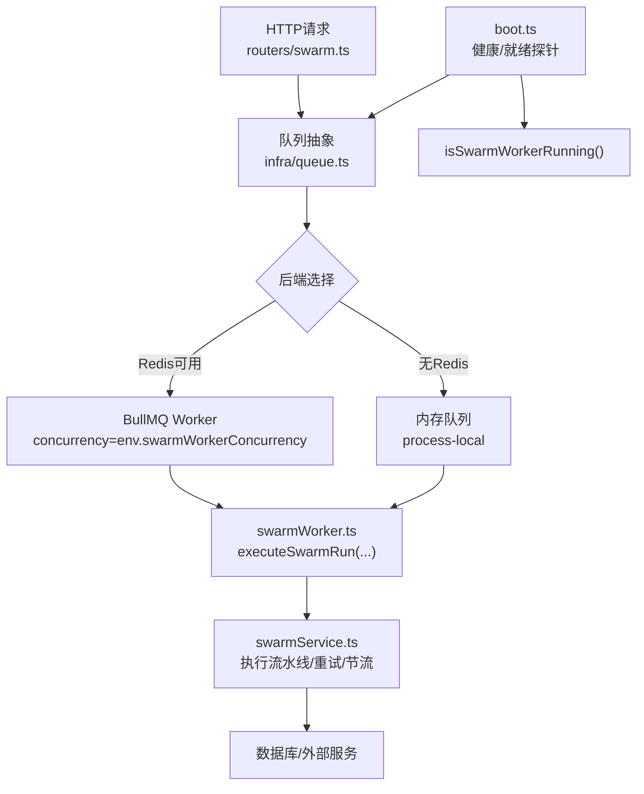
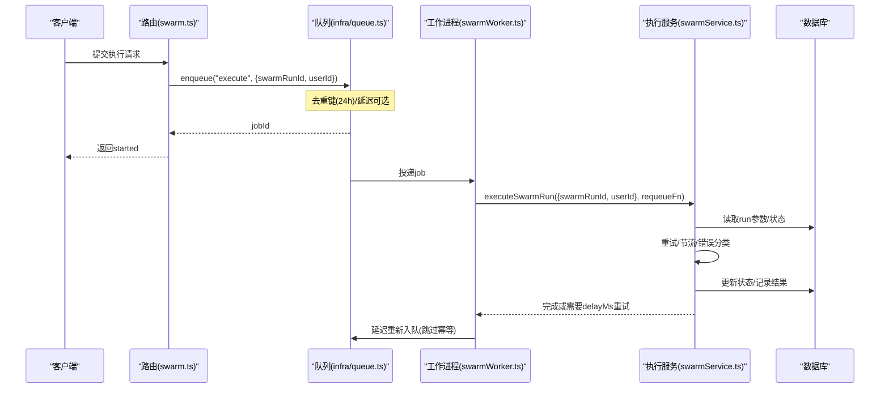
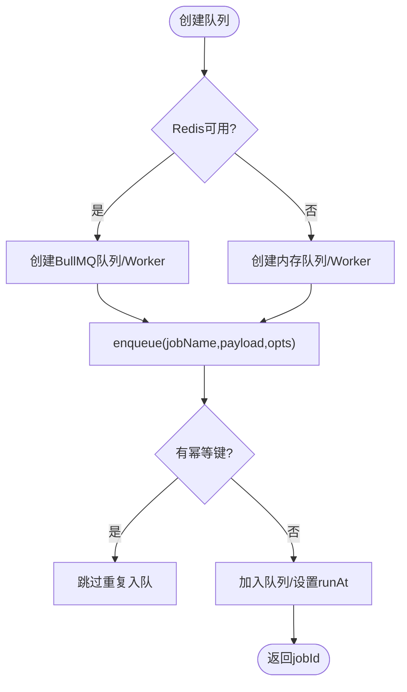
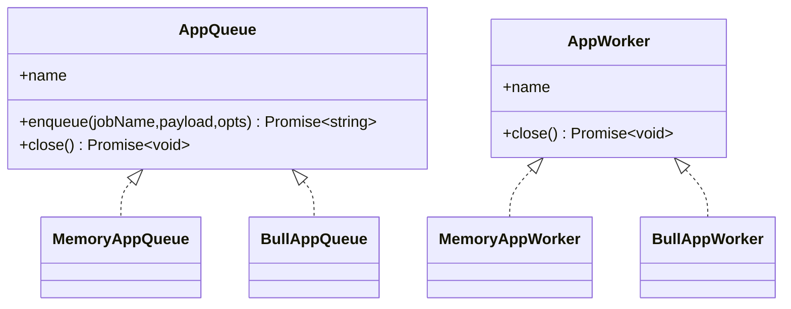
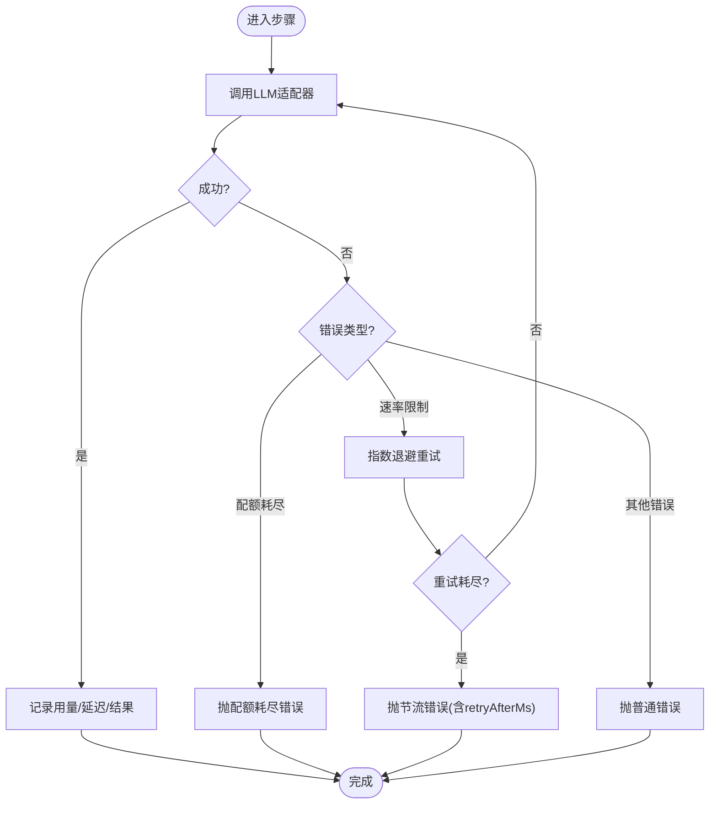
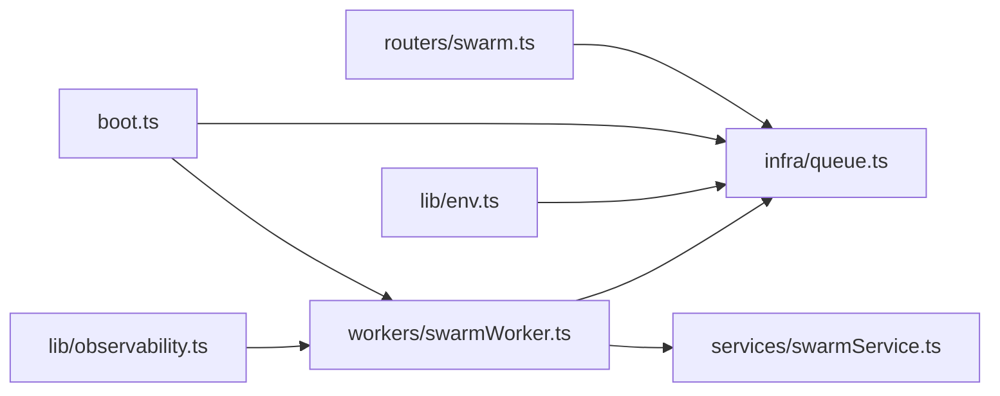
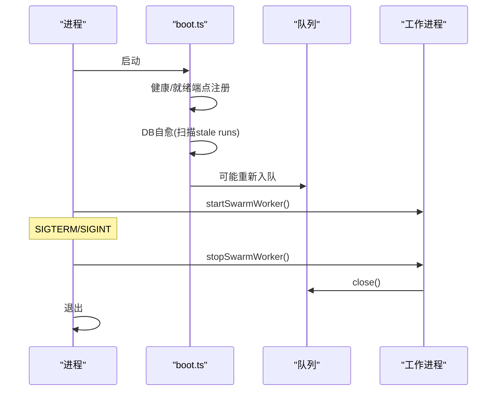

# 工作进程管理

<cite>
**本文引用的文件**
- [api/workers/swarmWorker.ts](file://api/workers/swarmWorker.ts)
- [api/workerEntry.ts](file://api/workerEntry.ts)
- [api/infra/queue.ts](file://api/infra/queue.ts)
- [api/services/swarmService.ts](file://api/services/swarmService.ts)
- [api/routers/swarm.ts](file://api/routers/swarm.ts)
- [api/boot.ts](file://api/boot.ts)
- [api/lib/env.ts](file://api/lib/env.ts)
- [api/lib/observability.ts](file://api/lib/observability.ts)
</cite>

## 目录
1. [简介](#简介)
2. [项目结构](#项目结构)
3. [核心组件](#核心组件)
4. [架构总览](#架构总览)
5. [详细组件分析](#详细组件分析)
6. [依赖关系分析](#依赖关系分析)
7. [性能与并发控制](#性能与并发控制)
8. [健康检查、故障恢复与优雅关闭](#健康检查故障恢复与优雅关闭)
9. [监控与调试](#监控与调试)
10. [生命周期管理与资源清理](#生命周期管理与资源清理)
11. [结论](#结论)

## 简介
本文件面向DeeWaanAI系统的工作进程管理，覆盖工作进程的注册、启动与关闭流程；对比内存队列与BullMQ队列的差异；说明基于swarmWorkerConcurrency的并发控制；阐述健康检查、故障恢复与优雅关闭机制；并提供监控与调试方法（错误日志与指标收集）以及生命周期与资源清理策略。

## 项目结构
工作进程相关代码主要分布在以下模块：
- 队列抽象与后端实现：api/infra/queue.ts
- 工作进程入口与优雅关闭：api/workerEntry.ts
- Swarm任务处理器：api/workers/swarmWorker.ts
- 执行引擎与服务：api/services/swarmService.ts
- HTTP路由触发入队：api/routers/swarm.ts
- 应用启动与健康/就绪探针：api/boot.ts
- 环境变量与并发配置：api/lib/env.ts
- 可观测性初始化：api/lib/observability.ts

图表来源
- [api/routers/swarm.ts:109-199](file://api/routers/swarm.ts#L109-L199)
- [api/infra/queue.ts:36-71](file://api/infra/queue.ts#L36-L71)
- [api/infra/queue.ts:235-261](file://api/infra/queue.ts#L235-L261)
- [api/workers/swarmWorker.ts:24-59](file://api/workers/swarmWorker.ts#L24-L59)
- [api/services/swarmService.ts:176-214](file://api/services/swarmService.ts#L176-L214)
- [api/boot.ts:73-135](file://api/boot.ts#L73-L135)

章节来源
- [api/routers/swarm.ts:109-199](file://api/routers/swarm.ts#L109-L199)
- [api/infra/queue.ts:36-71](file://api/infra/queue.ts#L36-L71)
- [api/workers/swarmWorker.ts:24-59](file://api/workers/swarmWorker.ts#L24-L59)
- [api/boot.ts:73-135](file://api/boot.ts#L73-L135)

## 核心组件
- 队列抽象与后端：提供统一的enqueue/close接口，自动在BullMQ与内存队列间切换；支持去重键与延迟执行；BullMQ Worker使用swarmWorkerConcurrency控制并发。
- Swarm工作进程：注册队列处理器，接收execute任务，调用执行服务；支持节流重试（delayMs）并重新入队。
- 执行服务：封装流水线执行、重试、限流、错误分类（配额耗尽/速率限制）、状态持久化与事件上报。
- 启动与关闭：web进程可选择内嵌worker或独立worker进程；统一优雅关闭与超时保护；DB自愈在启动时修复卡住的运行。

章节来源
- [api/infra/queue.ts:1-334](file://api/infra/queue.ts#L1-L334)
- [api/workers/swarmWorker.ts:1-75](file://api/workers/swarmWorker.ts#L1-L75)
- [api/services/swarmService.ts:176-214](file://api/services/swarmService.ts#L176-L214)
- [api/boot.ts:64-135](file://api/boot.ts#L64-L135)

## 架构总览
工作进程通过队列抽象消费swarm-runs队列中的execute任务。根据是否启用Redis，选择BullMQ或内存队列。BullMQ Worker的并发度由环境变量swarmWorkerConcurrency决定。任务执行逻辑集中在执行服务中，负责重试、节流、错误分类和状态持久化。Web进程可通过健康/就绪端点暴露工作进程状态。

图表来源
- [api/routers/swarm.ts:109-199](file://api/routers/swarm.ts#L109-L199)
- [api/infra/queue.ts:210-228](file://api/infra/queue.ts#L210-L228)
- [api/workers/swarmWorker.ts:37-59](file://api/workers/swarmWorker.ts#L37-L59)
- [api/services/swarmService.ts:176-214](file://api/services/swarmService.ts#L176-L214)

## 详细组件分析

### 队列抽象与后端（内存 vs BullMQ）
- 后端选择：首次使用时检测Redis可用性，选择BullMQ或内存队列；失败时回退到内存模式。
- 幂等性：24小时内相同idempotencyKey不重复入队（Redis用SET NX EX，内存Map带过期）。
- 延迟执行：支持delayMs，BullMQ使用delay字段，内存队列通过runAt调度。
- 并发控制：BullMQ Worker以env.swarmWorkerConcurrency为并发度；内存队列按时间片drain，未显式限制并发但适合单进程场景。
- 关闭：统一closeAllQueues关闭所有已注册队列与BullMQ连接。

图表来源
- [api/infra/queue.ts:36-71](file://api/infra/queue.ts#L36-L71)
- [api/infra/queue.ts:149-198](file://api/infra/queue.ts#L149-L198)
- [api/infra/queue.ts:200-261](file://api/infra/queue.ts#L200-L261)
- [api/infra/queue.ts:263-334](file://api/infra/queue.ts#L263-L334)

章节来源
- [api/infra/queue.ts:1-334](file://api/infra/queue.ts#L1-L334)

### Swarm工作进程（注册、启动、关闭）
- 注册：createWorker绑定队列名与处理器，内部根据后端选择具体实现。
- 启动：startSwarmWorker仅注册一次，避免重复；isSwarmWorkerRunning用于健康检查。
- 关闭：stopSwarmWorker调用worker.close与queue.close，忽略异常保证健壮性。
- 任务处理：校验jobName与payload，调用executeSwarmRun；若需节流则通过requeueFn延迟重新入队。

图表来源
- [api/infra/queue.ts:23-34](file://api/infra/queue.ts#L23-L34)
- [api/infra/queue.ts:149-198](file://api/infra/queue.ts#L149-L198)
- [api/infra/queue.ts:200-261](file://api/infra/queue.ts#L200-L261)

章节来源
- [api/workers/swarmWorker.ts:1-75](file://api/workers/swarmWorker.ts#L1-L75)
- [api/infra/queue.ts:263-334](file://api/infra/queue.ts#L263-L334)

### 执行服务（重试、节流、错误分类）
- 重试：callWithRetry对非配额类错误进行指数退避重试；配额耗尽直接抛出特定错误。
- 节流：ProviderThrottledError携带retryAfterMs，上层通过requeueFn延迟重新入队。
- 错误分类：区分配额耗尽与速率限制，分别走不同路径（暂停批次或重试）。
- 状态持久化：步骤开始/完成/错误均写入DB，支持崩溃后恢复。

图表来源
- [api/services/swarmService.ts:176-214](file://api/services/swarmService.ts#L176-L214)
- [api/services/swarmService.ts:450-483](file://api/services/swarmService.ts#L450-L483)

章节来源
- [api/services/swarmService.ts:176-214](file://api/services/swarmService.ts#L176-L214)
- [api/services/swarmService.ts:450-483](file://api/services/swarmService.ts#L450-L483)

### HTTP路由触发与入队
- 路由validate输入、权限校验、创建/更新run行，持久化runParams后调用enqueueSwarmRun。
- 立即返回started，进度通过SSE推送；实际执行在worker中异步进行。

章节来源
- [api/routers/swarm.ts:109-199](file://api/routers/swarm.ts#L109-L199)

## 依赖关系分析
- 路由依赖队列抽象与工作进程API。
- 工作进程依赖执行服务与队列抽象。
- 队列抽象依赖环境配置与Redis连接。
- 启动脚本注入健康/就绪探针与DB自愈逻辑。

图表来源
- [api/routers/swarm.ts:109-199](file://api/routers/swarm.ts#L109-L199)
- [api/workers/swarmWorker.ts:24-59](file://api/workers/swarmWorker.ts#L24-L59)
- [api/infra/queue.ts:36-71](file://api/infra/queue.ts#L36-L71)
- [api/boot.ts:64-135](file://api/boot.ts#L64-L135)
- [api/lib/env.ts:87-87](file://api/lib/env.ts#L87-L87)
- [api/lib/observability.ts:17-33](file://api/lib/observability.ts#L17-L33)

章节来源
- [api/routers/swarm.ts:109-199](file://api/routers/swarm.ts#L109-L199)
- [api/infra/queue.ts:36-71](file://api/infra/queue.ts#L36-L71)
- [api/workers/swarmWorker.ts:24-59](file://api/workers/swarmWorker.ts#L24-L59)
- [api/boot.ts:64-135](file://api/boot.ts#L64-L135)

## 性能与并发控制
- 并发度来源：BullMQ Worker的concurrency来自env.swarmWorkerConcurrency（默认2），适用于生产多节点扩展；内存队列用于开发/单机，无显式并发限制。
- 节流与重试：执行服务将速率限制转换为retryAfterMs，工作进程通过延迟重新入队避免瞬时拥塞。
- 幂等入队：24小时去重键防止重复执行，保障高并发下的稳定性。
- 建议：在生产部署独立worker进程（START_WORKER=false于web进程），并通过SWARM_WORKER_CONCURRENCY调节吞吐。

章节来源
- [api/lib/env.ts:87-87](file://api/lib/env.ts#L87-L87)
- [api/infra/queue.ts:235-261](file://api/infra/queue.ts#L235-L261)
- [api/workers/swarmWorker.ts:54-57](file://api/workers/swarmWorker.ts#L54-L57)
- [api/infra/queue.ts:210-228](file://api/infra/queue.ts#L210-L228)

## 健康检查、故障恢复与优雅关闭
- 健康检查：/api/health返回进程存活、DB连通、Redis状态、队列后端与工作进程状态。
- 就绪检查：/api/ready要求DB可达且Redis连通（如配置），用于负载均衡器探测。
- 故障恢复：启动时扫描“running”与“pending”超时的run，重置为“pending”并重新入队，确保崩溃后可恢复。
- 优雅关闭：workerEntry监听SIGTERM/SIGINT，停止消费、关闭队列与Redis连接，超时强制退出；in-flight run保持“running”，下次启动自愈。

图表来源
- [api/boot.ts:73-135](file://api/boot.ts#L73-L135)
- [api/boot.ts:197-259](file://api/boot.ts#L197-L259)
- [api/workerEntry.ts:36-64](file://api/workerEntry.ts#L36-L64)
- [api/workers/swarmWorker.ts:62-69](file://api/workers/swarmWorker.ts#L62-L69)

章节来源
- [api/boot.ts:73-135](file://api/boot.ts#L73-L135)
- [api/boot.ts:197-259](file://api/boot.ts#L197-L259)
- [api/workerEntry.ts:36-64](file://api/workerEntry.ts#L36-L64)

## 监控与调试
- 日志：工作进程与队列层记录关键事件（任务拾取、失败、关闭等）；执行服务记录步骤开始/完成/错误与用量。
- 可观测性：initObservability在workerEntry中初始化Sentry（DSN为空时禁用），不影响主流程。
- 健康/就绪：通过/api/health与/api/ready获取运行时状态，便于自动化巡检。
- 调试建议：
  - 开启详细日志级别，关注“BullMQ job failed”与“step_*”事件。
  - 观察队列后端（bullmq/memory）与工作进程状态（running/disabled）。
  - 结合DB自愈日志定位卡住的run。

章节来源
- [api/workerEntry.ts:23-34](file://api/workerEntry.ts#L23-L34)
- [api/lib/observability.ts:17-33](file://api/lib/observability.ts#L17-L33)
- [api/boot.ts:73-135](file://api/boot.ts#L73-L135)
- [api/infra/queue.ts:248-255](file://api/infra/queue.ts#L248-L255)

## 生命周期管理与资源清理
- 注册：createWorker在首次使用时解析后端并实例化具体Worker；createQueue同理。
- 启动：web进程可按需内嵌worker（默认），或通过独立workerEntry进程运行；两者共享同一队列。
- 关闭：stopSwarmWorker与closeAllQueues确保释放BullMQ连接与内存定时器；异常被吞掉以保证关闭流程继续。
- 资源清理：内存队列清理定时器与映射；BullMQ队列关闭后不再消费新任务。

章节来源
- [api/infra/queue.ts:263-334](file://api/infra/queue.ts#L263-L334)
- [api/workers/swarmWorker.ts:62-69](file://api/workers/swarmWorker.ts#L62-L69)
- [api/workerEntry.ts:36-64](file://api/workerEntry.ts#L36-L64)

## 结论
DeeWaanAI的工作进程通过统一的队列抽象屏蔽了BullMQ与内存实现的差异，提供了幂等入队、延迟执行与优雅关闭能力。并发控制由swarmWorkerConcurrency驱动，配合执行服务的重试与节流机制，确保在高负载与外部服务波动下的稳定性。健康/就绪端点与DB自愈保障了系统的可观测性与韧性。生产环境建议采用独立worker进程并合理设置并发度，以获得最佳吞吐与隔离性。