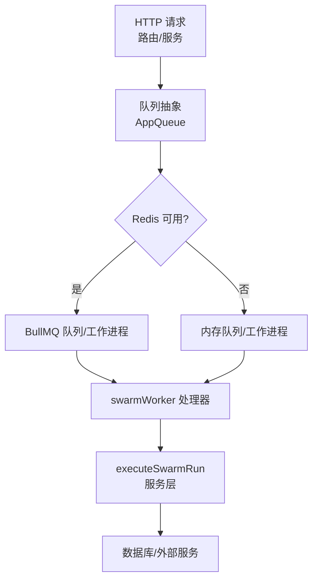
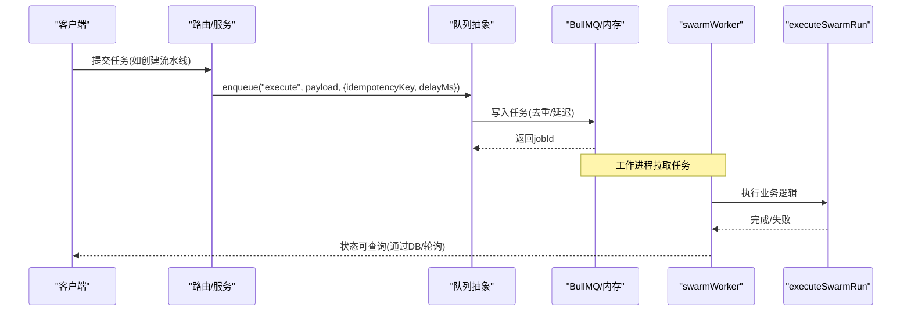
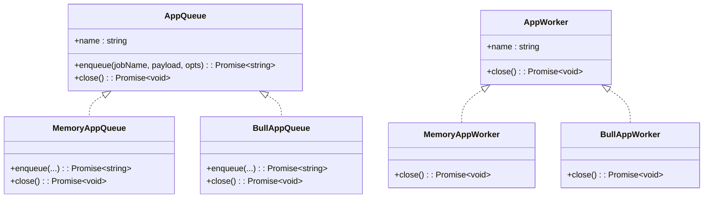
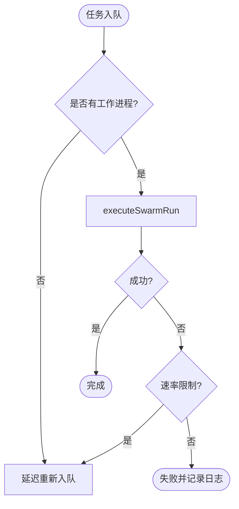
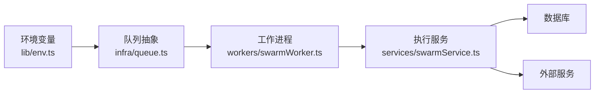

# 异步任务队列

<cite>
**本文引用的文件**
- [api/infra/queue.ts](file://api/infra/queue.ts)
- [api/workers/swarmWorker.ts](file://api/workers/swarmWorker.ts)
- [api/workerEntry.ts](file://api/workerEntry.ts)
- [api/boot.ts](file://api/boot.ts)
- [api/lib/env.ts](file://api/lib/env.ts)
- [api/routers/admin.ts](file://api/routers/admin.ts)
- [api/services/swarmService.ts](file://api/services/swarmService.ts)
</cite>

## 目录
1. [简介](#简介)
2. [项目结构](#项目结构)
3. [核心组件](#核心组件)
4. [架构总览](#架构总览)
5. [详细组件分析](#详细组件分析)
6. [依赖关系分析](#依赖关系分析)
7. [性能与并发](#性能与并发)
8. [故障恢复与健康检查](#故障恢复与健康检查)
9. [API 使用示例](#api-使用示例)
10. [幂等性、去重与超时](#幂等性去重与超时)
11. [排错指南](#排错指南)
12. [结论](#结论)

## 简介
本文件面向DeeWaanAI系统的异步任务队列，说明其双后端（BullMQ + 内存）架构、任务调度机制、优先级与重试策略、工作进程管理（并发控制、健康检查、故障恢复），并提供任务创建、监控与管理的使用示例。同时给出从入队到执行的完整生命周期流程图，以及幂等性保证、任务去重和超时处理机制的说明。

## 项目结构
- 队列抽象与双后端实现位于 infra/queue.ts：统一对外暴露 AppQueue/AppWorker 接口，内部根据 Redis 可用性选择 BullMQ 或内存队列。
- 工作进程入口 workerEntry.ts 启动独立 worker 进程，消费 swarm-runs 队列中的执行任务。
- 工作进程逻辑在 workers/swarmWorker.ts：注册 worker、定义任务载荷、调用服务层执行。
- 健康与就绪探针在 boot.ts：暴露 /api/status 与 /api/ready，报告当前队列后端与工作进程状态。
- 环境变量在 lib/env.ts：包含并发度 SWARM_WORKER_CONCURRENCY 等关键配置。
- 管理端点在 routers/admin.ts：提供系统统计、认证队列查看与重入能力。
- 业务执行服务在 services/swarmService.ts：封装执行流程、错误分类与节流重试。

图表来源
- [api/infra/queue.ts:1-334](file://api/infra/queue.ts#L1-L334)
- [api/workers/swarmWorker.ts:1-75](file://api/workers/swarmWorker.ts#L1-L75)
- [api/services/swarmService.ts:121-174](file://api/services/swarmService.ts#L121-L174)

章节来源
- [api/infra/queue.ts:1-334](file://api/infra/queue.ts#L1-L334)
- [api/workers/swarmWorker.ts:1-75](file://api/workers/swarmWorker.ts#L1-L75)
- [api/workerEntry.ts:1-65](file://api/workerEntry.ts#L1-L65)
- [api/boot.ts:85-125](file://api/boot.ts#L85-L125)
- [api/lib/env.ts:24-95](file://api/lib/env.ts#L24-L95)
- [api/routers/admin.ts:179-219](file://api/routers/admin.ts#L179-L219)
- [api/services/swarmService.ts:121-174](file://api/services/swarmService.ts#L121-L174)

## 核心组件
- 队列抽象与后端选择：统一接口 AppQueue.enqueue(jobName, payload, opts)，自动选择 BullMQ 或内存队列；支持 idempotencyKey 去重与 delayMs 延迟。
- 工作进程抽象：AppWorker 包装具体实现，支持 close 优雅关闭。
- 专用 worker 进程：workerEntry.ts 启动独立进程，仅消费任务，避免与 HTTP 服务争用资源。
- 健康与就绪：/api/status 返回 queue 后端类型与 worker 运行状态；/api/ready 检测 DB/Redis 连通性。
- 环境配置：SWARM_WORKER_CONCURRENCY 控制并发；REDIS_URL 控制是否启用 BullMQ。

章节来源
- [api/infra/queue.ts:18-34](file://api/infra/queue.ts#L18-L34)
- [api/infra/queue.ts:43-71](file://api/infra/queue.ts#L43-L71)
- [api/workerEntry.ts:1-65](file://api/workerEntry.ts#L1-L65)
- [api/boot.ts:85-125](file://api/boot.ts#L85-L125)
- [api/lib/env.ts:87-88](file://api/lib/env.ts#L87-L88)

## 架构总览
- 双后端：当 Redis 可用时采用 BullMQ（持久化、多节点），否则回退到内存队列（进程内 Map + setTimeout）。
- 任务载荷：以 jobName + payload 形式传递，worker 中校验并执行业务逻辑。
- 去重与幂等：通过 idempotencyKey 在 24 小时内防止重复入队；BullMQ 使用 SET NX EX，内存使用 Map 带过期时间。
- 延迟执行：delayMs 支持定时任务；内存队列通过定时器调度。
- 失败处理：BullMQ 记录 failed 事件；内存队列捕获异常并记录日志。
- 健康检查：/api/status 报告后端类型与工作进程状态；/api/ready 探测 DB/Redis。

图表来源
- [api/infra/queue.ts:210-228](file://api/infra/queue.ts#L210-L228)
- [api/workers/swarmWorker.ts:24-59](file://api/workers/swarmWorker.ts#L24-L59)
- [api/services/swarmService.ts:121-174](file://api/services/swarmService.ts#L121-L174)

## 详细组件分析

### 队列抽象与双后端
- 后端选择：首次使用时 resolveBackend() 判断 Redis 是否可用，缓存结果；若失败则降级为内存队列。
- 内存队列：Map 存储任务，setTimeout 调度执行；支持 idempotencyKey 去重（Map 带过期时间）。
- BullMQ 队列：使用 BullQueue.add 入队，设置 attempts=1、清理策略（完成/失败后保留时长）。
- 工作进程：BullMQ 使用 concurrency=env.swarmWorkerConcurrency；内存队列无并发限制（单进程）。

图表来源
- [api/infra/queue.ts:23-34](file://api/infra/queue.ts#L23-L34)
- [api/infra/queue.ts:149-198](file://api/infra/queue.ts#L149-L198)
- [api/infra/queue.ts:201-261](file://api/infra/queue.ts#L201-L261)

章节来源
- [api/infra/queue.ts:43-71](file://api/infra/queue.ts#L43-L71)
- [api/infra/queue.ts:107-147](file://api/infra/queue.ts#L107-L147)
- [api/infra/queue.ts:210-228](file://api/infra/queue.ts#L210-L228)
- [api/infra/queue.ts:235-261](file://api/infra/queue.ts#L235-L261)

### 工作进程与任务执行
- 队列名与任务名：SWARM_QUEUE_NAME="swarm-runs"，SWARM_JOB_EXECUTE="execute"。
- 任务载荷：{ swarmRunId, userId }，worker 中校验并调用 executeSwarmRun。
- 重试与节流：executeSwarmRun 遇到速率限制会抛出 ProviderThrottledError/RunThrottledError，worker 捕获后通过 enqueueSwarmRun 重新入队（bypassDedup=true，delayMs 由服务计算）。
- 优雅关闭：stopSwarmWorker 停止消费并关闭队列；workerEntry 监听 SIGTERM/SIGINT 进行有序退出。

图表来源
- [api/workers/swarmWorker.ts:24-59](file://api/workers/swarmWorker.ts#L24-L59)
- [api/services/swarmService.ts:121-174](file://api/services/swarmService.ts#L121-L174)

章节来源
- [api/workers/swarmWorker.ts:11-75](file://api/workers/swarmWorker.ts#L11-L75)
- [api/workerEntry.ts:36-65](file://api/workerEntry.ts#L36-L65)
- [api/services/swarmService.ts:121-174](file://api/services/swarmService.ts#L121-L174)

### 健康检查与就绪探针
- /api/status：返回 queue 后端类型（bullmq/memory）与 worker 状态（running/disabled）。
- /api/ready：检测 DB 连通性与 Redis ping（若启用），用于负载均衡器就绪判定。

章节来源
- [api/boot.ts:85-125](file://api/boot.ts#L85-L125)
- [api/infra/queue.ts:267-270](file://api/infra/queue.ts#L267-L270)
- [api/workers/swarmWorker.ts:71-75](file://api/workers/swarmWorker.ts#L71-L75)

## 依赖关系分析
- 队列模块依赖 Redis 连接与 BullMQ；若无 Redis 则使用内存实现。
- 工作进程依赖服务层 executeSwarmRun；服务层依赖数据库与外部服务。
- 环境变量影响行为：SWARM_WORKER_CONCURRENCY 控制并发；REDIS_URL 控制后端选择。

图表来源
- [api/lib/env.ts:87-88](file://api/lib/env.ts#L87-L88)
- [api/infra/queue.ts:43-71](file://api/infra/queue.ts#L43-L71)
- [api/workers/swarmWorker.ts:7-9](file://api/workers/swarmWorker.ts#L7-L9)
- [api/services/swarmService.ts:121-174](file://api/services/swarmService.ts#L121-L174)

章节来源
- [api/lib/env.ts:24-95](file://api/lib/env.ts#L24-L95)
- [api/infra/queue.ts:43-71](file://api/infra/queue.ts#L43-L71)
- [api/workers/swarmWorker.ts:7-9](file://api/workers/swarmWorker.ts#L7-L9)
- [api/services/swarmService.ts:121-174](file://api/services/swarmService.ts#L121-L174)

## 性能与并发
- 并发控制：BullMQ 工作进程使用 env.swarmWorkerConcurrency 控制并发；内存队列无并发限制（单进程）。
- 资源隔离：独立 worker 进程避免与 HTTP 服务争用 CPU/堆内存。
- 清理策略：BullMQ 完成/失败后按 age/count 清理，减少存储压力。
- 节流与自适应：服务层对速率限制进行指数退避与重新入队，避免雪崩。

章节来源
- [api/infra/queue.ts:235-247](file://api/infra/queue.ts#L235-L247)
- [api/workerEntry.ts:1-16](file://api/workerEntry.ts#L1-L16)
- [api/infra/queue.ts:221-227](file://api/infra/queue.ts#L221-L227)
- [api/services/swarmService.ts:121-174](file://api/services/swarmService.ts#L121-L174)

## 故障恢复与健康检查
- 优雅关闭：workerEntry 监听 SIGTERM/SIGINT，调用 stopSwarmWorker 与 closeAllQueues，确保任务不丢失。
- 健康检查：/api/status 报告后端与工作进程状态；/api/ready 探测 DB/Redis。
- 失败处理：BullMQ 记录 failed 事件；内存队列捕获异常并记录日志。
- 恢复机制：Web 启动时的 DB-heal 将卡住的运行重置并重入队，结合 24h 去重键避免重复执行。

章节来源
- [api/workerEntry.ts:36-65](file://api/workerEntry.ts#L36-L65)
- [api/boot.ts:85-125](file://api/boot.ts#L85-L125)
- [api/infra/queue.ts:248-255](file://api/infra/queue.ts#L248-L255)
- [api/infra/queue.ts:138-144](file://api/infra/queue.ts#L138-L144)

## API 使用示例
- 任务创建：通过路由或服务调用 enqueueSwarmRun(swarmRunId, userId, opts)，opts 可包含 bypassDedup 与 delayMs。
- 任务监控：查询数据库 swarm_runs 表获取任务状态；或使用 /api/status 查看队列后端与工作进程状态。
- 管理操作：adminRouter 提供系统统计、认证队列查看与重入能力（如 requeueCertification）。

章节来源
- [api/workers/swarmWorker.ts:24-35](file://api/workers/swarmWorker.ts#L24-L35)
- [api/boot.ts:85-98](file://api/boot.ts#L85-L98)
- [api/routers/admin.ts:179-219](file://api/routers/admin.ts#L179-L219)
- [api/routers/admin.ts:374-479](file://api/routers/admin.ts#L374-L479)

## 幂等性、去重与超时
- 幂等性：idempotencyKey 在 24 小时内防止重复入队；BullMQ 使用 SET NX EX，内存使用 Map 带过期时间。
- 去重：同一 key 重复入队返回 dedup:idempotencyKey，避免重复执行。
- 超时处理：BullMQ 设置 attempts=1，失败后记录日志；内存队列捕获异常并记录；服务层对速率限制进行重试与重新入队。

章节来源
- [api/infra/queue.ts:156-165](file://api/infra/queue.ts#L156-L165)
- [api/infra/queue.ts:210-220](file://api/infra/queue.ts#L210-L220)
- [api/infra/queue.ts:221-227](file://api/infra/queue.ts#L221-L227)
- [api/infra/queue.ts:138-144](file://api/infra/queue.ts#L138-L144)

## 排错指南
- 队列后端不可用：检查 REDIS_URL 与网络连通性；/api/status 会返回 memory 表示回退到内存队列。
- 任务未执行：确认工作进程已启动（/api/status 中 worker 为 running）；检查队列是否有积压。
- 任务失败：查看日志中的 failed 事件；检查服务层错误分类（CreditExhaustedError、ProviderThrottledError 等）。
- 健康检查失败：/api/ready 返回 503 表示 DB/Redis 不可用；排查基础设施状态。

章节来源
- [api/boot.ts:85-125](file://api/boot.ts#L85-L125)
- [api/infra/queue.ts:248-255](file://api/infra/queue.ts#L248-L255)
- [api/services/swarmService.ts:121-174](file://api/services/swarmService.ts#L121-L174)

## 结论
DeeWaanAI 的异步任务队列通过统一抽象屏蔽了 BullMQ 与内存实现的差异，提供了可靠的入队、去重、延迟执行与失败处理能力。独立的工作进程确保了长任务不会阻塞 HTTP 服务，健康检查与就绪探针便于运维监控。结合幂等性键与重试策略，系统在分布式环境下具备高可用性与弹性。建议在生产环境中启用 Redis 以获得持久化与多节点支持，并根据负载调整 SWARM_WORKER_CONCURRENCY 以优化吞吐。