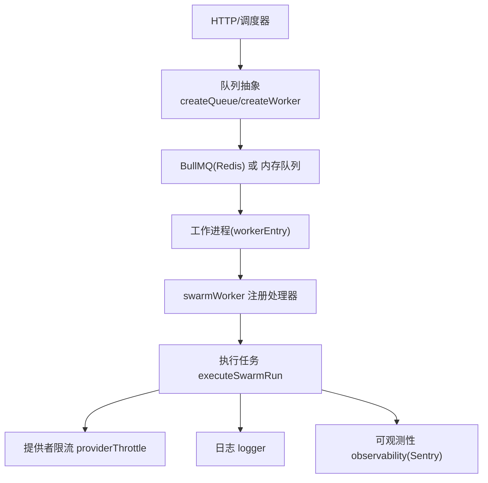
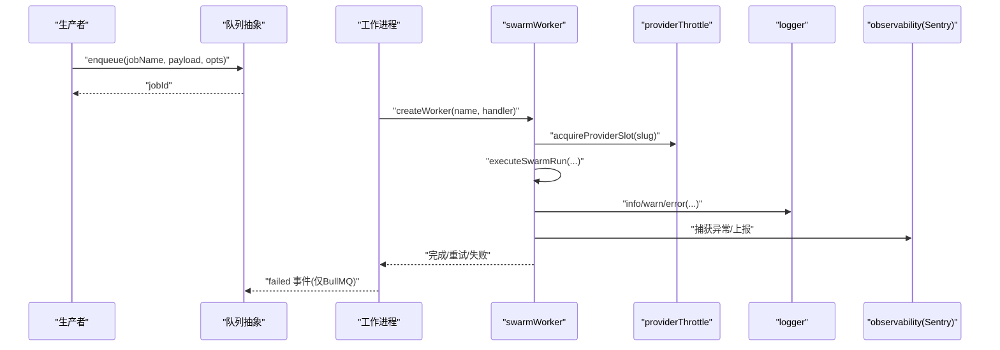
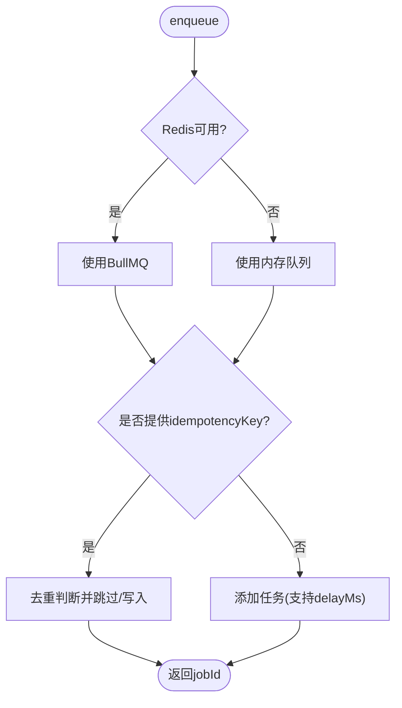
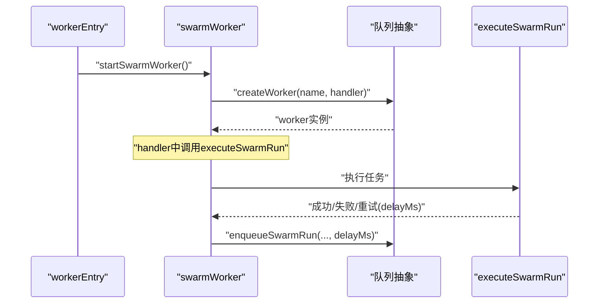
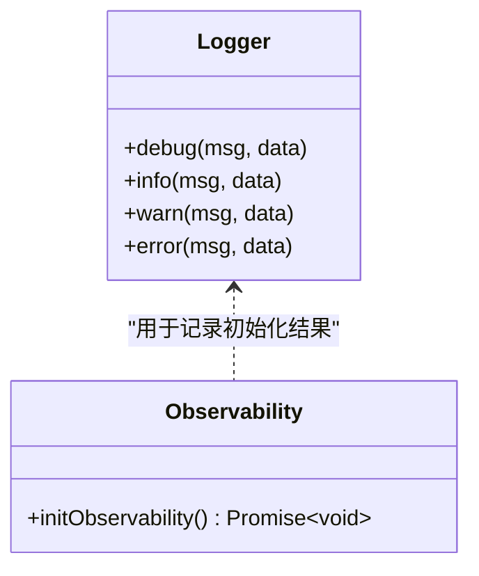
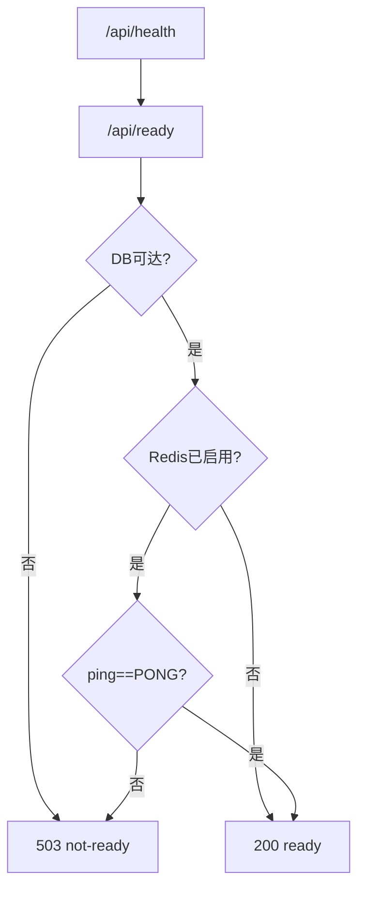
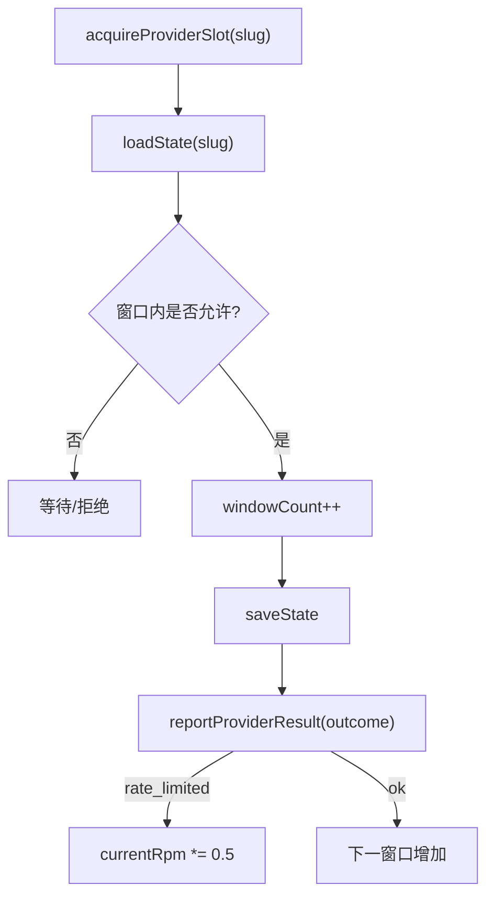
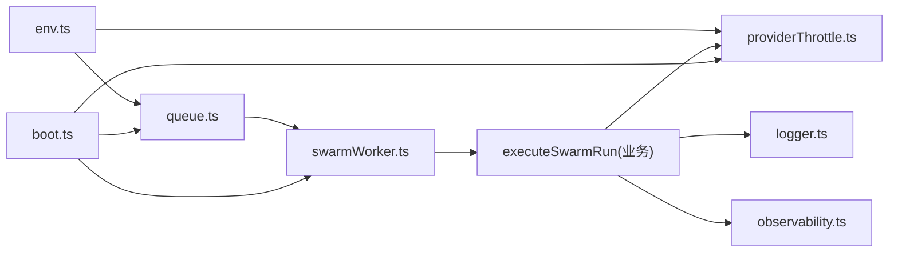

# 监控告警

<cite>
**本文引用的文件**
- [api/infra/queue.ts](file://api/infra/queue.ts)
- [api/workers/swarmWorker.ts](file://api/workers/swarmWorker.ts)
- [api/workerEntry.ts](file://api/workerEntry.ts)
- [api/lib/logger.ts](file://api/lib/logger.ts)
- [api/lib/observability.ts](file://api/lib/observability.ts)
- [api/lib/env.ts](file://api/lib/env.ts)
- [api/boot.ts](file://api/boot.ts)
- [api/lib/providerThrottle.ts](file://api/lib/providerThrottle.ts)
</cite>

## 目录
1. [简介](#简介)
2. [项目结构](#项目结构)
3. [核心组件](#核心组件)
4. [架构总览](#架构总览)
5. [详细组件分析](#详细组件分析)
6. [依赖关系分析](#依赖关系分析)
7. [性能考量](#性能考量)
8. [故障排查指南](#故障排查指南)
9. [结论](#结论)
10. [附录](#附录)

## 简介
本文件面向DeeWaanAI系统的异步任务队列与执行链路，提供一套完整的监控、日志与告警方案。内容覆盖：
- 关键监控指标：队列长度、处理延迟、失败率、吞吐量等
- 日志策略：结构化日志、错误追踪、性能分析
- 告警规则：队列积压、任务失败、系统健康检查
- 可视化与查询：Prometheus指标导出建议、日志聚合分析
- 故障排查与性能优化建议

## 项目结构
围绕“任务入队—工作进程消费—外部依赖限流—可观测性上报”的主路径，核心文件职责如下：
- 队列抽象与后端选择（BullMQ/内存）：[api/infra/queue.ts]
- 工作进程入口与优雅关闭：[api/workerEntry.ts]
- 具体业务队列与工作注册（swarm-runs）：[api/workers/swarmWorker.ts]
- 结构化日志与请求ID：[api/lib/logger.ts]
- 可观测性初始化（Sentry）：[api/lib/observability.ts]
- 环境变量与开关（含并发度、限流配置）：[api/lib/env.ts]
- 健康检查与就绪探针：[api/boot.ts]
- 提供者限流（AIMD）与指标读取：[api/lib/providerThrottle.ts]

图表来源
- [api/infra/queue.ts:1-333](file://api/infra/queue.ts#L1-L333)
- [api/workers/swarmWorker.ts:1-75](file://api/workers/swarmWorker.ts#L1-L75)
- [api/workerEntry.ts:18-47](file://api/workerEntry.ts#L18-L47)
- [api/lib/providerThrottle.ts:25-235](file://api/lib/providerThrottle.ts#L25-L235)
- [api/lib/logger.ts:1-32](file://api/lib/logger.ts#L1-L32)
- [api/lib/observability.ts:1-34](file://api/lib/observability.ts#L1-L34)

章节来源
- [api/infra/queue.ts:1-333](file://api/infra/queue.ts#L1-L333)
- [api/workers/swarmWorker.ts:1-75](file://api/workers/swarmWorker.ts#L1-L75)
- [api/workerEntry.ts:18-47](file://api/workerEntry.ts#L18-L47)
- [api/lib/logger.ts:1-32](file://api/lib/logger.ts#L1-L32)
- [api/lib/observability.ts:1-34](file://api/lib/observability.ts#L1-L34)
- [api/lib/env.ts:24-105](file://api/lib/env.ts#L24-L105)
- [api/boot.ts:80-135](file://api/boot.ts#L80-L135)
- [api/lib/providerThrottle.ts:25-235](file://api/lib/providerThrottle.ts#L25-L235)

## 核心组件
- 队列抽象层
  - 统一接口 AppQueue/AppWorker，自动选择 BullMQ 或内存实现
  - 幂等入队（24小时去重键），支持延迟入队
  - 失败日志记录（BullMQ failed 事件）
- 工作进程
  - workerEntry 启动 swarmWorker，注册全局异常捕获与优雅关闭
  - swarmWorker 暴露 enqueueSwarmRun/startSwarmWorker/isSwarmWorkerRunning
- 日志与可观测性
  - 结构化 JSON 日志，包含时间戳、级别、消息与扩展字段
  - Sentry 可选初始化，失败不阻塞主流程
- 健康检查
  - /api/health 返回运行状态、数据库/Redis/队列/工作进程状态
  - /api/ready 作为就绪探针，要求 DB 可达且 Redis（若启用）连通
- 提供者限流
  - AIMD 算法维护当前 RPM、窗口计数、慢启动标志
  - 提供 getProviderThrottleMetrics 获取实时指标

章节来源
- [api/infra/queue.ts:18-35](file://api/infra/queue.ts#L18-L35)
- [api/infra/queue.ts:200-261](file://api/infra/queue.ts#L200-L261)
- [api/workers/swarmWorker.ts:14-75](file://api/workers/swarmWorker.ts#L14-L75)
- [api/workerEntry.ts:18-47](file://api/workerEntry.ts#L18-L47)
- [api/lib/logger.ts:1-32](file://api/lib/logger.ts#L1-L32)
- [api/lib/observability.ts:1-34](file://api/lib/observability.ts#L1-L34)
- [api/boot.ts:80-135](file://api/boot.ts#L80-L135)
- [api/lib/providerThrottle.ts:25-235](file://api/lib/providerThrottle.ts#L25-L235)

## 架构总览
下图展示从入队到执行、限流、日志与可观测性的端到端流程。

图表来源
- [api/infra/queue.ts:200-261](file://api/infra/queue.ts#L200-L261)
- [api/workers/swarmWorker.ts:24-59](file://api/workers/swarmWorker.ts#L24-L59)
- [api/lib/providerThrottle.ts:186-235](file://api/lib/providerThrottle.ts#L186-L235)
- [api/lib/logger.ts:12-31](file://api/lib/logger.ts#L12-L31)
- [api/lib/observability.ts:16-33](file://api/lib/observability.ts#L16-L33)

## 详细组件分析

### 队列抽象与后端选择
- 后端选择逻辑
  - 优先尝试 BullMQ（需 Redis 可用），失败回退到内存队列
  - 为 BullMQ 创建专用连接并监听连接错误
- 幂等入队
  - 基于 idempotencyKey 的24小时去重（Redis SET NX EX 或内存Map过期）
- 失败与清理
  - BullMQ 失败事件记录结构化日志
  - 完成/失败任务按 age/count 清理，避免堆积

图表来源
- [api/infra/queue.ts:43-71](file://api/infra/queue.ts#L43-L71)
- [api/infra/queue.ts:156-176](file://api/infra/queue.ts#L156-L176)
- [api/infra/queue.ts:210-228](file://api/infra/queue.ts#L210-L228)

章节来源
- [api/infra/queue.ts:43-71](file://api/infra/queue.ts#L43-L71)
- [api/infra/queue.ts:156-176](file://api/infra/queue.ts#L156-L176)
- [api/infra/queue.ts:210-228](file://api/infra/queue.ts#L210-L228)
- [api/infra/queue.ts:248-255](file://api/infra/queue.ts#L248-L255)

### 工作进程与任务执行
- workerEntry
  - 初始化可观测性、启动 swarmWorker、注册全局异常与优雅关闭
- swarmWorker
  - 暴露 enqueueSwarmRun/startSwarmWorker/isSwarmWorkerRunning
  - 对未知 jobName 或畸形负载进行安全丢弃并记录警告
  - 执行任务时通过回调将限流/重试重新入队

图表来源
- [api/workerEntry.ts:18-47](file://api/workerEntry.ts#L18-L47)
- [api/workers/swarmWorker.ts:24-59](file://api/workers/swarmWorker.ts#L24-L59)

章节来源
- [api/workerEntry.ts:18-47](file://api/workerEntry.ts#L18-L47)
- [api/workers/swarmWorker.ts:24-59](file://api/workers/swarmWorker.ts#L24-L59)

### 日志与错误追踪
- 结构化日志
  - 输出JSON行，包含时间戳、级别、消息与扩展字段
  - 支持日志级别过滤（debug/info/warn/error）
- 错误追踪
  - Sentry 可选初始化；未配置或初始化失败不影响主流程
  - 队列失败事件、工作进程未捕获异常均记录结构化日志

图表来源
- [api/lib/logger.ts:1-32](file://api/lib/logger.ts#L1-L32)
- [api/lib/observability.ts:1-34](file://api/lib/observability.ts#L1-L34)

章节来源
- [api/lib/logger.ts:1-32](file://api/lib/logger.ts#L1-L32)
- [api/lib/observability.ts:1-34](file://api/lib/observability.ts#L1-L34)

### 健康检查与就绪探针
- /api/health
  - 返回 status、uptime、memory、db、redis、queue、worker 等运行时信息
- /api/ready
  - 当DB可达且Redis（如启用）连通时返回200，否则503
  - 适合负载均衡器/编排系统做就绪探测

图表来源
- [api/boot.ts:80-135](file://api/boot.ts#L80-L135)

章节来源
- [api/boot.ts:80-135](file://api/boot.ts#L80-L135)

### 提供者限流与指标
- AIMD 限流
  - 窗口内累计请求数，遇到 rate_limited 则乘法降速，配合慢启动恢复
  - 支持 declaredRpm 直接设定初始速率，跳过慢启动
- 指标读取
  - getProviderThrottleMetrics 返回每个提供者的 currentRpm、windowCount、inSlowStart
  - 优先读Redis，回退到内存状态

图表来源
- [api/lib/providerThrottle.ts:88-114](file://api/lib/providerThrottle.ts#L88-L114)
- [api/lib/providerThrottle.ts:186-235](file://api/lib/providerThrottle.ts#L186-L235)
- [api/lib/providerThrottle.ts:237-274](file://api/lib/providerThrottle.ts#L237-L274)

章节来源
- [api/lib/providerThrottle.ts:88-114](file://api/lib/providerThrottle.ts#L88-L114)
- [api/lib/providerThrottle.ts:186-235](file://api/lib/providerThrottle.ts#L186-L235)
- [api/lib/providerThrottle.ts:237-274](file://api/lib/providerThrottle.ts#L237-L274)

## 依赖关系分析
- 队列抽象依赖环境配置与Redis可用性，决定后端选择
- 工作进程依赖队列抽象与业务服务（executeSwarmRun）
- 限流模块依赖Redis或内存状态，对外暴露指标读取
- 健康检查依赖数据库、Redis、队列后端与工作进程状态
- 日志与可观测性贯穿各模块，保证可追溯性

图表来源
- [api/lib/env.ts:24-105](file://api/lib/env.ts#L24-L105)
- [api/infra/queue.ts:1-333](file://api/infra/queue.ts#L1-L333)
- [api/workers/swarmWorker.ts:1-75](file://api/workers/swarmWorker.ts#L1-L75)
- [api/lib/providerThrottle.ts:25-235](file://api/lib/providerThrottle.ts#L25-L235)
- [api/boot.ts:80-135](file://api/boot.ts#L80-L135)

章节来源
- [api/lib/env.ts:24-105](file://api/lib/env.ts#L24-L105)
- [api/infra/queue.ts:1-333](file://api/infra/queue.ts#L1-L333)
- [api/workers/swarmWorker.ts:1-75](file://api/workers/swarmWorker.ts#L1-L75)
- [api/lib/providerThrottle.ts:25-235](file://api/lib/providerThrottle.ts#L25-L235)
- [api/boot.ts:80-135](file://api/boot.ts#L80-L135)

## 性能考量
- 队列与执行
  - 合理设置并发度（SWARM_WORKER_CONCURRENCY），避免资源争用
  - 利用幂等入队减少重复任务，降低无效负载
  - 使用延迟入队平滑突发流量
- 限流与重试
  - 依据 PROVIDER_THROTTLE 配置调整 init/floor/ceiling RPM
  - 对 rate_limited 采用指数退避与AIMD降速，避免雪崩
- 存储与清理
  - BullMQ 已完成/失败任务按age/count清理，防止历史数据膨胀
  - 内存队列在关闭时清理定时器与状态，避免泄漏
- 可观测性
  - 开启Sentry收集异常栈，结合结构化日志定位瓶颈
  - 定期采集 /api/health 与 /api/ready 响应时间与状态码

[本节为通用指导，无需特定文件引用]

## 故障排查指南
- 队列问题
  - 现象：任务堆积、长时间未消费
  - 排查：检查 /api/health 的 queue 与 worker 状态；确认 Redis 连通性与 BullMQ 连接错误日志
  - 参考：[队列后端选择与错误日志:43-71](file://api/infra/queue.ts#L43-L71), [BullMQ失败事件:248-255](file://api/infra/queue.ts#L248-L255)
- 工作进程问题
  - 现象：任务未被执行或频繁重启
  - 排查：查看 workerEntry 的全局异常捕获与优雅关闭日志；确认 isSwarmWorkerRunning 状态
  - 参考：[工作进程入口:18-47](file://api/workerEntry.ts#L18-L47), [swarmWorker状态:71-75](file://api/workers/swarmWorker.ts#L71-L75)
- 限流问题
  - 现象：大量 429/限流信号导致吞吐下降
  - 排查：读取 getProviderThrottleMetrics，观察 currentRpm 与 inSlowStart；根据 PROVIDER_THROTTLE 调参
  - 参考：[限流指标读取:237-274](file://api/lib/providerThrottle.ts#L237-L274), [报告结果与降速:207-235](file://api/lib/providerThrottle.ts#L207-L235)
- 健康检查
  - 现象：/api/ready 持续返回 503
  - 排查：确认 DB 可达与 Redis ping；检查队列后端与健康端点返回
  - 参考：[就绪探针:101-135](file://api/boot.ts#L101-L135)
- 日志与追踪
  - 现象：难以定位失败根因
  - 排查：使用结构化日志关键字段（queue、jobId、jobName、error）检索；结合 Sentry 异常栈
  - 参考：[结构化日志:12-31](file://api/lib/logger.ts#L12-L31), [Sentry初始化:16-33](file://api/lib/observability.ts#L16-L33)

章节来源
- [api/infra/queue.ts:43-71](file://api/infra/queue.ts#L43-L71)
- [api/infra/queue.ts:248-255](file://api/infra/queue.ts#L248-L255)
- [api/workerEntry.ts:18-47](file://api/workerEntry.ts#L18-L47)
- [api/workers/swarmWorker.ts:71-75](file://api/workers/swarmWorker.ts#L71-L75)
- [api/lib/providerThrottle.ts:207-235](file://api/lib/providerThrottle.ts#L207-L235)
- [api/lib/providerThrottle.ts:237-274](file://api/lib/providerThrottle.ts#L237-L274)
- [api/boot.ts:101-135](file://api/boot.ts#L101-L135)
- [api/lib/logger.ts:12-31](file://api/lib/logger.ts#L12-L31)
- [api/lib/observability.ts:16-33](file://api/lib/observability.ts#L16-L33)

## 结论
本方案以统一的队列抽象为核心，结合结构化日志、Sentry异常追踪与健康检查，形成可观测、可告警、可排障的异步任务体系。通过AIMD限流与幂等入队，保障在高并发与外部依赖不稳定场景下的稳定性与吞吐。建议在生产环境中：
- 启用 Redis 与 BullMQ，确保持久化与多节点能力
- 配置合理的并发度与限流参数，结合指标动态调优
- 接入日志聚合与指标导出，建立告警规则与可视化面板
- 定期演练故障场景，验证健康检查与优雅关闭的有效性

[本节为总结，无需特定文件引用]

## 附录

### 监控指标定义与采集建议
- 队列长度
  - 指标：队列待处理任务数（BullMQ 可通过其客户端统计；内存队列可在应用内维护）
  - 采集：周期性读取队列统计或自定义计数器
- 处理延迟
  - 指标：任务从入队到开始处理的时间、端到端耗时
  - 采集：在入队与处理开始/结束时打点，计算差值
- 失败率
  - 指标：失败任务数/总任务数
  - 采集：基于队列失败事件与业务失败标记
- 吞吐量
  - 指标：单位时间内成功处理的任务数
  - 采集：滑动窗口计数

[本节为概念说明，无需特定文件引用]

### 日志记录策略
- 结构化日志格式
  - 字段：时间戳、级别、消息、上下文（queue、jobId、jobName、error等）
  - 输出：JSON行，便于日志聚合与分析
- 错误追踪
  - 全局异常捕获与未处理拒绝记录
  - Sentry 可选初始化，失败不阻塞主流程
- 性能分析
  - 关键路径打点（入队、开始处理、结束处理）
  - 结合限流指标与队列状态分析瓶颈

章节来源
- [api/lib/logger.ts:12-31](file://api/lib/logger.ts#L12-L31)
- [api/workerEntry.ts:28-34](file://api/workerEntry.ts#L28-L34)
- [api/lib/observability.ts:16-33](file://api/lib/observability.ts#L16-L33)

### 告警规则配置建议
- 队列积压告警
  - 条件：队列长度超过阈值持续N分钟
  - 动作：通知运维，触发扩容或限流
- 任务失败告警
  - 条件：失败率超过阈值或连续失败次数
  - 动作：通知开发，附带错误日志与堆栈
- 系统健康检查
  - 条件：/api/ready 非200或响应时间过高
  - 动作：暂停流量或降级服务

[本节为概念说明，无需特定文件引用]

### 可视化与查询方法
- Prometheus指标导出
  - 建议：引入指标库（如 prom-client），暴露 /metrics 端点
  - 指标：队列长度、延迟直方图、失败率、吞吐量、限流RPM
- 日志聚合分析
  - 建议：使用ELK/Loki等聚合平台，按 level、queue、jobId 等维度检索
  - 分析：关联任务生命周期日志，定位失败与性能热点

[本节为概念说明，无需特定文件引用]