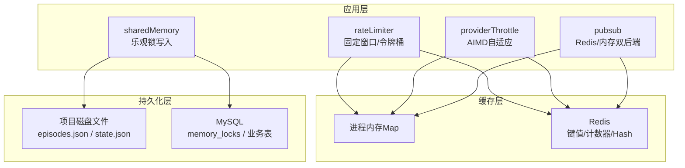
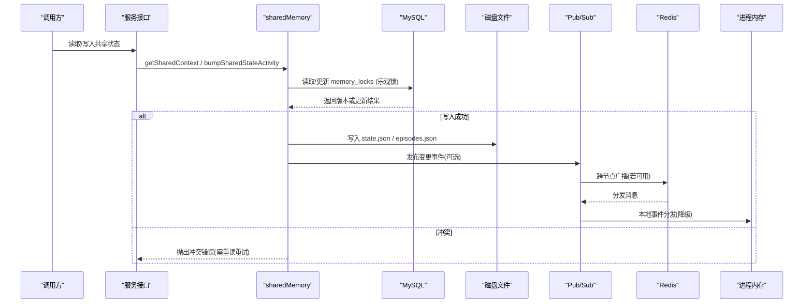
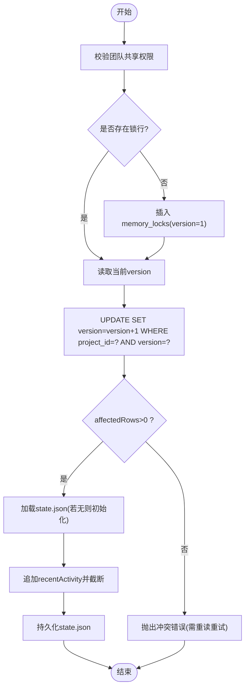
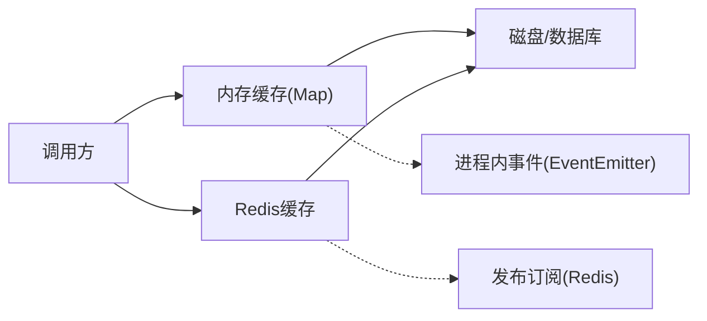
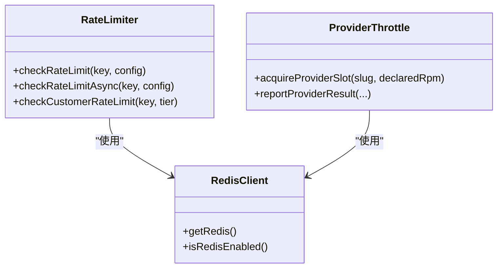
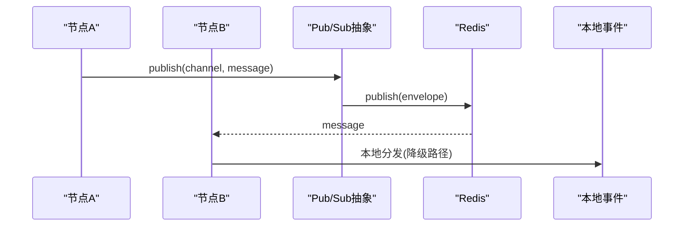
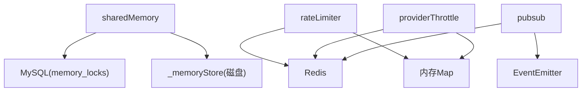

# 数据一致性与缓存

<cite>
**本文引用的文件**
- [api/infra/redis.ts](file://api/infra/redis.ts)
- [api/lib/rateLimiter.ts](file://api/lib/rateLimiter.ts)
- [api/lib/providerThrottle.ts](file://api/lib/providerThrottle.ts)
- [api/infra/pubsub.ts](file://api/infra/pubsub.ts)
- [api/services/sharedMemory.ts](file://api/services/sharedMemory.ts)
- [api/mcp/tools/_memoryStore.ts](file://api/mcp/tools/_memoryStore.ts)
- [api/services/memoryManager.ts](file://api/services/memoryManager.ts)
- [db/schema.ts](file://db/schema.ts)
- [db/migrations/012_teamsync.sql](file://db/migrations/012_teamsync.sql)
- [api/queries/connection.ts](file://api/queries/connection.ts)
</cite>

## 目录
1. [简介](#简介)
2. [项目结构](#项目结构)
3. [核心组件](#核心组件)
4. [架构总览](#架构总览)
5. [详细组件分析](#详细组件分析)
6. [依赖关系分析](#依赖关系分析)
7. [性能考量](#性能考量)
8. [故障排查指南](#故障排查指南)
9. [结论](#结论)
10. [附录](#附录)

## 简介
本文件面向DeeWaanAI系统在分布式环境下的数据一致性与缓存策略，覆盖以下主题：
- 一致性保证机制：乐观锁、版本控制与并发访问控制（无全局悲观锁实现）
- 多级缓存体系：内存缓存、Redis缓存与持久化存储（磁盘/数据库）的协同
- 缓存失效与数据同步：基于事件的分发与降级策略
- 性能优化方案：限流、自适应速率控制、连接重试与回退
- 配置与监控最佳实践：可观测性、错误日志与降级行为
- 并发安全：竞态条件处理与死锁预防

## 项目结构
与数据一致性和缓存相关的代码主要分布在以下模块：
- Redis基础设施与客户端管理
- 速率限制与提供者自适应限速
- 进程内/跨节点发布订阅
- 团队共享内存服务（乐观锁+磁盘状态）
- 数据库模式与迁移（乐观锁表）
- 读/写数据库连接分离

图表来源
- [api/services/sharedMemory.ts:86-206](file://api/services/sharedMemory.ts#L86-L206)
- [api/lib/rateLimiter.ts:31-93](file://api/lib/rateLimiter.ts#L31-L93)
- [api/lib/providerThrottle.ts:88-199](file://api/lib/providerThrottle.ts#L88-L199)
- [api/infra/pubsub.ts:90-153](file://api/infra/pubsub.ts#L90-L153)
- [api/mcp/tools/_memoryStore.ts:18-36](file://api/mcp/tools/_memoryStore.ts#L18-L36)
- [db/schema.ts:1215-1224](file://db/schema.ts#L1215-L1224)

章节来源
- [api/infra/redis.ts:1-88](file://api/infra/redis.ts#L1-L88)
- [api/lib/rateLimiter.ts:1-216](file://api/lib/rateLimiter.ts#L1-L216)
- [api/lib/providerThrottle.ts:1-199](file://api/lib/providerThrottle.ts#L1-L199)
- [api/infra/pubsub.ts:1-154](file://api/infra/pubsub.ts#L1-L154)
- [api/services/sharedMemory.ts:1-207](file://api/services/sharedMemory.ts#L1-L207)
- [api/mcp/tools/_memoryStore.ts:1-37](file://api/mcp/tools/_memoryStore.ts#L1-L37)
- [db/schema.ts:1215-1224](file://db/schema.ts#L1215-L1224)
- [db/migrations/012_teamsync.sql:1-27](file://db/migrations/012_teamsync.sql#L1-L27)
- [api/queries/connection.ts:1-43](file://api/queries/connection.ts#L1-L43)

## 核心组件
- 乐观锁与版本控制：通过数据库表 memory_locks 维护每项目的版本号，写操作采用“先更新版本号再落盘”的模式，冲突时返回明确错误提示上层重试。
- 多级缓存：
  - 内存缓存：进程内 Map 用于速率计数、AIMD状态等，作为Redis不可用时的降级路径。
  - Redis缓存：提供跨节点一致的计数器、哈希状态、发布订阅通道。
  - 持久化存储：磁盘文件保存 episodes.json 与 state.json；数据库保存元数据与锁版本。
- 并发控制与限流：
  - 通用限流：固定窗口与令牌桶两种算法，支持Redis与内存双实现。
  - 提供者自适应限速：AIMD算法动态调整RPM，避免上游限流。
- 事件驱动的数据同步：发布订阅抽象在Redis可用时跨节点广播，否则退化为进程内事件。

章节来源
- [api/services/sharedMemory.ts:151-206](file://api/services/sharedMemory.ts#L151-L206)
- [api/lib/rateLimiter.ts:31-93](file://api/lib/rateLimiter.ts#L31-L93)
- [api/lib/providerThrottle.ts:88-199](file://api/lib/providerThrottle.ts#L88-L199)
- [api/infra/pubsub.ts:90-153](file://api/infra/pubsub.ts#L90-L153)

## 架构总览
下图展示了从请求到缓存与持久化的完整数据流，以及降级路径。

图表来源
- [api/services/sharedMemory.ts:86-206](file://api/services/sharedMemory.ts#L86-L206)
- [api/infra/pubsub.ts:90-153](file://api/infra/pubsub.ts#L90-L153)
- [api/infra/redis.ts:65-82](file://api/infra/redis.ts#L65-L82)

## 详细组件分析

### 乐观锁与版本控制（sharedMemory + memory_locks）
- 设计要点
  - 仅团队共享项目允许读写，防止越权。
  - 追加型片段（episodes）无需锁；结构化状态（state.json）使用乐观锁。
  - 首次写入时插入 memory_locks 行（version=1），后续每次写入将 version 原子递增并记录 lastWriterId。
  - 当 UPDATE affectedRows=0 时视为冲突，要求调用方重新读取后重试，避免静默丢失写。
- 数据流向
  - 读取：并行加载 episodes、state、lockVersion。
  - 写入：先尝试确保锁行存在，再执行带版本的UPDATE，成功后再写磁盘文件。
- 并发与一致性
  - 通过数据库主键与WHERE version=expected实现无锁并发控制。
  - 不存在死锁风险（无多行锁定、无嵌套事务）。
- 复杂度
  - 时间复杂度：O(1) 数据库更新；磁盘IO为顺序追加或覆盖写。
  - 空间复杂度：内存中仅保留当前上下文对象。

图表来源
- [api/services/sharedMemory.ts:137-206](file://api/services/sharedMemory.ts#L137-L206)
- [db/migrations/012_teamsync.sql:17-27](file://db/migrations/012_teamsync.sql#L17-L27)

章节来源
- [api/services/sharedMemory.ts:49-206](file://api/services/sharedMemory.ts#L49-L206)
- [db/schema.ts:1215-1224](file://db/schema.ts#L1215-L1224)
- [db/migrations/012_teamsync.sql:1-27](file://db/migrations/012_teamsync.sql#L1-L27)

### 多级缓存策略（内存、Redis、磁盘/数据库）
- 内存缓存
  - 用途：速率计数、AIMD状态、本地事件分发。
  - 特点：低延迟、进程内隔离；Redis不可用时自动降级。
- Redis缓存
  - 用途：跨节点一致的固定窗口计数、AIMD状态哈希、发布订阅通道。
  - 特性：连接失败时优雅降级，不抛异常；具备指数退避重试。
- 持久化存储
  - 磁盘：项目级 episodes.json 与 state.json，MCP工具直接读写。
  - 数据库：业务元数据与乐观锁版本。

图表来源
- [api/lib/rateLimiter.ts:31-93](file://api/lib/rateLimiter.ts#L31-L93)
- [api/lib/providerThrottle.ts:88-199](file://api/lib/providerThrottle.ts#L88-L199)
- [api/infra/pubsub.ts:90-153](file://api/infra/pubsub.ts#L90-L153)
- [api/mcp/tools/_memoryStore.ts:18-36](file://api/mcp/tools/_memoryStore.ts#L18-L36)

章节来源
- [api/lib/rateLimiter.ts:1-216](file://api/lib/rateLimiter.ts#L1-L216)
- [api/lib/providerThrottle.ts:1-199](file://api/lib/providerThrottle.ts#L1-L199)
- [api/infra/pubsub.ts:1-154](file://api/infra/pubsub.ts#L1-L154)
- [api/mcp/tools/_memoryStore.ts:1-37](file://api/mcp/tools/_memoryStore.ts#L1-L37)

### 并发访问控制与限流
- 通用限流（rateLimiter）
  - 固定窗口：Redis INCR + PEXPIRE 实现跨节点一致计数；失败回退到进程内固定窗口。
  - 令牌桶：进程内按秒补充token，简单高效。
  - 客户分层：solo/team/admin不同配额，便于资源隔离。
- 提供者自适应限速（providerThrottle）
  - AIMD算法：根据429等信号增加/减少RPM，避免过度触发上游限流。
  - 状态存储：优先Redis Hash，失败回退到内存Map。
  - 窗口推进：60秒窗口，过期后重置计数并继续尝试。

图表来源
- [api/lib/rateLimiter.ts:31-93](file://api/lib/rateLimiter.ts#L31-L93)
- [api/lib/providerThrottle.ts:88-199](file://api/lib/providerThrottle.ts#L88-L199)
- [api/infra/redis.ts:65-82](file://api/infra/redis.ts#L65-L82)

章节来源
- [api/lib/rateLimiter.ts:1-216](file://api/lib/rateLimiter.ts#L1-L216)
- [api/lib/providerThrottle.ts:1-199](file://api/lib/providerThrottle.ts#L1-L199)

### 数据同步机制（发布订阅）
- 双后端：Redis pub/sub 用于跨节点广播；EventEmitter 用于单进程或Redis不可用时的降级。
- 消息信封：包含 origin（实例ID）、时间戳与消息体，避免自环回声。
- 订阅生命周期：首次订阅时建立Redis订阅；取消订阅时清理处理器与频道。

图表来源
- [api/infra/pubsub.ts:90-153](file://api/infra/pubsub.ts#L90-L153)

章节来源
- [api/infra/pubsub.ts:1-154](file://api/infra/pubsub.ts#L1-L154)

### 数据库连接与读分离
- 写库：getDb() 获取默认连接，所有写与一致性关键读必须使用该连接。
- 读库：getReadDb() 在配置了只读副本时将读请求路由至副本，提升吞吐；不适用于强一致读。

章节来源
- [api/queries/connection.ts:1-43](file://api/queries/connection.ts#L1-L43)

## 依赖关系分析
- sharedMemory 依赖：
  - 数据库：memory_locks 表进行乐观锁更新。
  - 磁盘：_memoryStore 读写 episodes.json 与 state.json。
  - 日志：统一logger输出。
- rateLimiter 与 providerThrottle 依赖：
  - Redis：跨节点一致计数与状态。
  - 内存：降级路径。
- pubsub 依赖：
  - Redis：跨节点广播。
  - EventEmitter：进程内广播。

图表来源
- [api/services/sharedMemory.ts:86-206](file://api/services/sharedMemory.ts#L86-L206)
- [api/lib/rateLimiter.ts:31-93](file://api/lib/rateLimiter.ts#L31-L93)
- [api/lib/providerThrottle.ts:88-199](file://api/lib/providerThrottle.ts#L88-L199)
- [api/infra/pubsub.ts:90-153](file://api/infra/pubsub.ts#L90-L153)

章节来源
- [api/services/sharedMemory.ts:1-207](file://api/services/sharedMemory.ts#L1-L207)
- [api/lib/rateLimiter.ts:1-216](file://api/lib/rateLimiter.ts#L1-L216)
- [api/lib/providerThrottle.ts:1-199](file://api/lib/providerThrottle.ts#L1-L199)
- [api/infra/pubsub.ts:1-154](file://api/infra/pubsub.ts#L1-L154)

## 性能考量
- 乐观锁更新为O(1)，磁盘IO为顺序写，整体延迟低；在高并发下通过冲突重试保障一致性。
- Redis连接具备指数退避与最大尝试次数，避免雪崩；不可用时快速降级到内存。
- 固定窗口计数使用INCR+PEXPIRE，避免扫描与过期清理开销。
- AIMD自适应限速降低上游限流概率，提高整体吞吐。
- 读分离减轻写库压力，但需注意复制延迟对一致性的影响。

[本节为通用性能讨论，不直接分析具体文件]

## 故障排查指南
- Redis不可用
  - 现象：限流、AIMD、发布订阅降级到内存或本地事件。
  - 排查：检查连接配置与网络；查看日志中的“Redis unavailable after retries”。
  - 建议：确保健康检查与告警；必要时重启或切换备用实例。
- 乐观锁冲突
  - 现象：bumpSharedStateActivity抛出冲突错误。
  - 排查：确认调用方是否携带正确的expectedVersion；检查是否有并发写入。
  - 建议：实现重试逻辑，先re-read再重试；避免长时间持有旧版本。
- 限流被触发
  - 现象：checkRateLimitAsync或checkCustomerRateLimit返回allowed=false。
  - 排查：核对key与配额；观察Redis键是否按窗口正确过期。
  - 建议：合理设置maxTokens与windowMs；对热点key做分片。
- 发布订阅未生效
  - 现象：跨节点未收到消息。
  - 排查：确认Redis订阅是否建立；检查origin过滤是否正确。
  - 建议：监听订阅错误日志；必要时回退到轮询或队列。

章节来源
- [api/infra/redis.ts:40-82](file://api/infra/redis.ts#L40-L82)
- [api/lib/rateLimiter.ts:64-93](file://api/lib/rateLimiter.ts#L64-L93)
- [api/lib/providerThrottle.ts:88-199](file://api/lib/providerThrottle.ts#L88-L199)
- [api/infra/pubsub.ts:90-153](file://api/infra/pubsub.ts#L90-L153)
- [api/services/sharedMemory.ts:158-206](file://api/services/sharedMemory.ts#L158-L206)

## 结论
DeeWaanAI在分布式环境下通过“数据库乐观锁 + 多级缓存 + 事件驱动同步”的组合，实现了高可用与强一致性的平衡：
- 一致性：以memory_locks的版本号为核心，确保共享状态写操作的串行化语义。
- 可用性：Redis不可用时自动降级到内存与本地事件，系统持续运行。
- 可扩展性：固定窗口计数与AIMD自适应限速有效保护上游与自身资源。
- 可维护性：清晰的降级路径与日志记录便于问题定位与调优。

[本节为总结性内容，不直接分析具体文件]

## 附录

### 缓存配置与监控最佳实践
- Redis配置
  - 启用连接超时与最大重试次数；使用惰性连接与离线队列关闭以减少阻塞。
  - 定期检测连接状态，记录连接失败与恢复事件。
- 限流配置
  - 根据业务峰值与上游限制设定maxTokens与windowMs；对热点key进行分片。
  - 使用CUSTOMER_RATE_LIMITS区分用户层级，避免资源争抢。
- 发布订阅
  - 为每个channel独立订阅，避免单点过载；记录消息解析与处理异常。
- 监控指标
  - Redis命中率、连接失败次数、限流拒绝率、AIMD RPM变化、乐观锁冲突率。
  - 磁盘IO延迟与文件大小增长趋势。

[本节为通用指导，不直接分析具体文件]

### 并发访问控制、竞态条件与死锁预防
- 并发控制
  - 使用乐观锁避免长事务与锁竞争；冲突时快速失败并重试。
  - 对追加型数据（episodes）采用无锁追加，降低写放大。
- 竞态条件处理
  - 确保first-writer竞争时仅一个成功创建锁行，其余走正常更新路径。
  - 窗口推进与计数更新使用原子操作（Redis INCR）。
- 死锁预防
  - 无多行锁定与嵌套事务；所有更新均为单行且条件明确。
  - 避免在持锁期间进行耗时IO；先更新版本，再写磁盘。

[本节为通用指导，不直接分析具体文件]