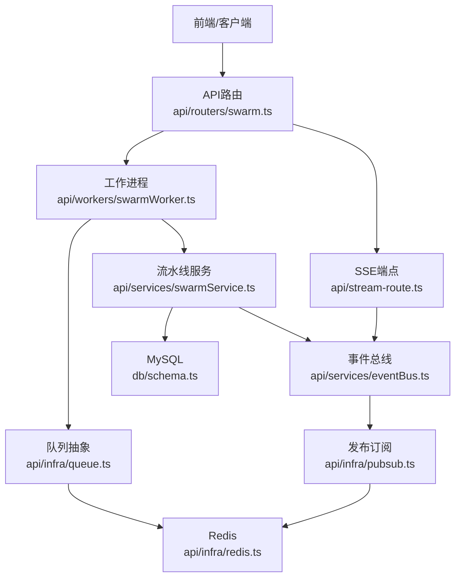
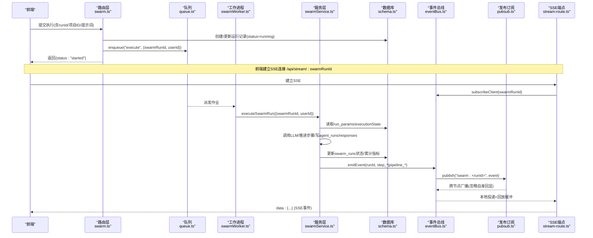
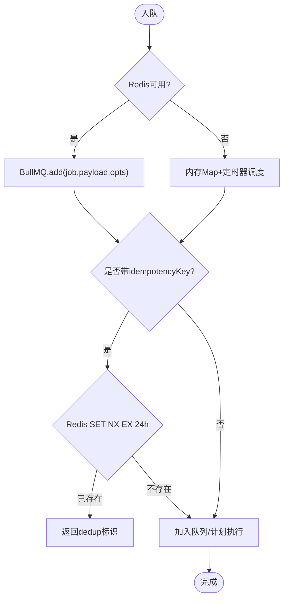
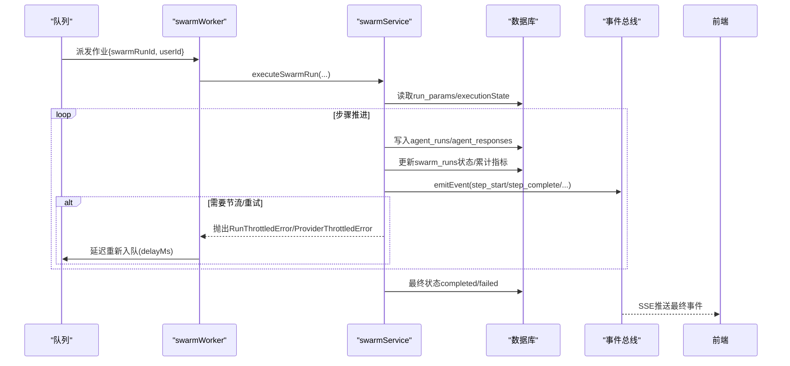
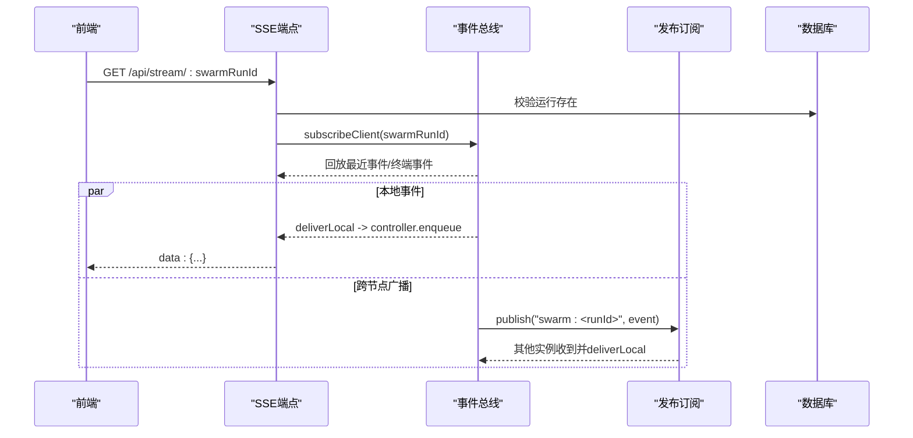
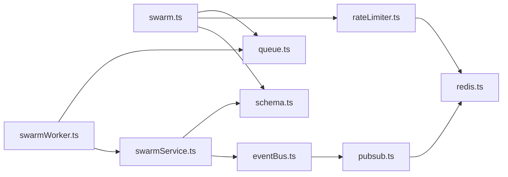

# 数据流设计

<cite>
**本文引用的文件**
- [api/routers/swarm.ts](file://api/routers/swarm.ts)
- [api/workers/swarmWorker.ts](file://api/workers/swarmWorker.ts)
- [api/services/swarmService.ts](file://api/services/swarmService.ts)
- [api/infra/queue.ts](file://api/infra/queue.ts)
- [api/infra/pubsub.ts](file://api/infra/pubsub.ts)
- [api/infra/redis.ts](file://api/infra/redis.ts)
- [api/services/eventBus.ts](file://api/services/eventBus.ts)
- [api/stream-route.ts](file://api/stream-route.ts)
- [db/schema.ts](file://db/schema.ts)
- [api/lib/rateLimiter.ts](file://api/lib/rateLimiter.ts)
- [api/boot.ts](file://api/boot.ts)
</cite>

## 目录
1. [简介](#简介)
2. [项目结构](#项目结构)
3. [核心组件](#核心组件)
4. [架构总览](#架构总览)
5. [详细组件分析](#详细组件分析)
6. [依赖关系分析](#依赖关系分析)
7. [性能与一致性](#性能与一致性)
8. [故障排查指南](#故障排查指南)
9. [结论](#结论)
10. [附录](#附录)

## 简介
本文件面向DeeWaanAI系统的数据流设计，覆盖从用户请求到数据库持久化、再到前端展示的完整链路；阐述异步任务队列的调度、执行与结果处理机制；说明实时数据更新（SSE流式传输与跨节点广播）；并给出数据一致性保证、缓存策略与性能优化建议。文末提供关键业务流程的数据流图与时序图，便于快速理解与排障。

## 项目结构
系统采用“路由层 + 服务层 + 基础设施层”的分层组织：
- 路由层：接收HTTP/tRPC请求，进行鉴权、限流、参数校验，并将长耗时任务入队。
- 服务层：编排业务逻辑（流水线执行、状态机推进、外部LLM调用、存储写入）。
- 基础设施层：队列（BullMQ或内存）、Redis客户端、发布订阅、事件总线、速率限制等。

图表来源
- [api/routers/swarm.ts:109-199](file://api/routers/swarm.ts#L109-L199)
- [api/workers/swarmWorker.ts:24-59](file://api/workers/swarmWorker.ts#L24-L59)
- [api/infra/queue.ts:272-319](file://api/infra/queue.ts#L272-L319)
- [api/infra/redis.ts:65-82](file://api/infra/redis.ts#L65-L82)
- [api/services/swarmService.ts:1-24](file://api/services/swarmService.ts#L1-L24)
- [api/services/eventBus.ts:1-12](file://api/services/eventBus.ts#L1-L12)
- [api/infra/pubsub.ts:1-12](file://api/infra/pubsub.ts#L1-L12)
- [api/stream-route.ts:8-69](file://api/stream-route.ts#L8-L69)
- [db/schema.ts:174-237](file://db/schema.ts#L174-L237)

章节来源
- [api/routers/swarm.ts:109-199](file://api/routers/swarm.ts#L109-L199)
- [api/workers/swarmWorker.ts:24-59](file://api/workers/swarmWorker.ts#L24-L59)
- [api/infra/queue.ts:272-319](file://api/infra/queue.ts#L272-L319)
- [api/infra/redis.ts:65-82](file://api/infra/redis.ts#L65-L82)
- [api/services/swarmService.ts:1-24](file://api/services/swarmService.ts#L1-L24)
- [api/services/eventBus.ts:1-12](file://api/services/eventBus.ts#L1-L12)
- [api/infra/pubsub.ts:1-12](file://api/infra/pubsub.ts#L1-L12)
- [api/stream-route.ts:8-69](file://api/stream-route.ts#L8-L69)
- [db/schema.ts:174-237](file://db/schema.ts#L174-L237)

## 核心组件
- 路由与入口：swarmRouter负责创建/恢复运行、权限校验、限流、将执行任务入队；boot启动时注册SSE路由与工作进程。
- 异步队列：统一抽象支持BullMQ（多节点持久）与内存队列（开发单节点），具备幂等去重与延迟执行能力。
- 工作进程：消费swarm-runs队列，调用服务层执行流水线，支持节流重试与重新入队。
- 服务层：流水线执行引擎，负责状态机推进、LLM调用、文件同步、结果落库、事件发射。
- 事件总线：本地SSE缓冲+终端事件持久化，并通过pub/sub跨节点广播。
- 发布订阅：Redis pub/sub（多节点）与内存EventEmitter（单节点）双后端，自动降级。
- Redis客户端：懒加载连接、指数退避重试、失败不抛错，全局可降级。
- 速率限制：固定窗口计数（Redis优先，内存回退），保护接口与批量提交。
- 数据库模式：swarm_runs、agent_runs、agent_responses等表承载运行元数据与结果。

章节来源
- [api/routers/swarm.ts:109-199](file://api/routers/swarm.ts#L109-L199)
- [api/boot.ts:64-71](file://api/boot.ts#L64-L71)
- [api/infra/queue.ts:1-8](file://api/infra/queue.ts#L1-L8)
- [api/workers/swarmWorker.ts:1-17](file://api/workers/swarmWorker.ts#L1-L17)
- [api/services/swarmService.ts:1-24](file://api/services/swarmService.ts#L1-L24)
- [api/services/eventBus.ts:1-12](file://api/services/eventBus.ts#L1-L12)
- [api/infra/pubsub.ts:1-12](file://api/infra/pubsub.ts#L1-L12)
- [api/infra/redis.ts:1-6](file://api/infra/redis.ts#L1-L6)
- [api/lib/rateLimiter.ts:57-93](file://api/lib/rateLimiter.ts#L57-L93)
- [db/schema.ts:174-237](file://db/schema.ts#L174-L237)

## 架构总览
下图展示一次“执行流水线”的端到端数据流：前端发起请求 → 路由校验与限流 → 写入DB并入队 → 工作进程拉取执行 → 服务层推进状态并写库 → 事件总线广播 → SSE推送前端。

图表来源
- [api/routers/swarm.ts:109-199](file://api/routers/swarm.ts#L109-L199)
- [api/workers/swarmWorker.ts:24-59](file://api/workers/swarmWorker.ts#L24-L59)
- [api/services/swarmService.ts:1-24](file://api/services/swarmService.ts#L1-L24)
- [api/infra/queue.ts:272-319](file://api/infra/queue.ts#L272-L319)
- [api/services/eventBus.ts:129-167](file://api/services/eventBus.ts#L129-L167)
- [api/infra/pubsub.ts:90-153](file://api/infra/pubsub.ts#L90-L153)
- [api/stream-route.ts:8-69](file://api/stream-route.ts#L8-L69)
- [db/schema.ts:174-237](file://db/schema.ts#L174-L237)

## 详细组件分析

### 异步任务队列（BullMQ/内存）
- 目标：为流水线执行提供可靠、可扩展的作业调度，支持幂等去重、延迟执行与优雅关闭。
- 关键点：
  - 后端选择：优先BullMQ（需Redis），否则回退到内存队列，保证开发体验与可用性。
  - 幂等键：同一idempotencyKey在24小时内重复入队会被去重，避免重复执行。
  - 并发控制：通过环境变量控制worker并发度，防止资源争用。
  - 健康与关闭：集中管理队列与worker生命周期，保障优雅停机。

图表来源
- [api/infra/queue.ts:43-71](file://api/infra/queue.ts#L43-L71)
- [api/infra/queue.ts:156-176](file://api/infra/queue.ts#L156-L176)
- [api/infra/queue.ts:210-228](file://api/infra/queue.ts#L210-L228)
- [api/infra/queue.ts:272-319](file://api/infra/queue.ts#L272-L319)

章节来源
- [api/infra/queue.ts:1-8](file://api/infra/queue.ts#L1-L8)
- [api/infra/queue.ts:43-71](file://api/infra/queue.ts#L43-L71)
- [api/infra/queue.ts:156-176](file://api/infra/queue.ts#L156-L176)
- [api/infra/queue.ts:210-228](file://api/infra/queue.ts#L210-L228)
- [api/infra/queue.ts:272-319](file://api/infra/queue.ts#L272-L319)

### 工作进程与流水线执行
- 目标：将耗时的流水线执行移出HTTP请求路径，确保响应及时性与可恢复性。
- 关键点：
  - 作业载荷仅包含最小信息（swarmRunId, userId），其余上下文从DB重建，提升容错与重启恢复能力。
  - 执行过程中遇到限流/配额不足/超时等，按策略重试或重新入队（delayMs）。
  - 错误分类：账户额度耗尽直接失败；临时限流指数退避重试；其他异常记录并标记失败。

图表来源
- [api/workers/swarmWorker.ts:24-59](file://api/workers/swarmWorker.ts#L24-L59)
- [api/services/swarmService.ts:176-200](file://api/services/swarmService.ts#L176-L200)
- [api/services/swarmService.ts:124-155](file://api/services/swarmService.ts#L124-L155)

章节来源
- [api/workers/swarmWorker.ts:1-17](file://api/workers/swarmWorker.ts#L1-L17)
- [api/workers/swarmWorker.ts:24-59](file://api/workers/swarmWorker.ts#L24-L59)
- [api/services/swarmService.ts:124-155](file://api/services/swarmService.ts#L124-L155)
- [api/services/swarmService.ts:176-200](file://api/services/swarmService.ts#L176-L200)

### 实时数据更新（SSE与跨节点广播）
- 目标：为前端提供低延迟、可重放的流水线进度流，并在多节点部署下保持一致性。
- 关键点：
  - SSE端点验证运行存在，发送初始连接事件；若运行已结束，立即发送终端事件。
  - 事件总线维护每个运行的5分钟回放缓冲与永久终端事件，新连接可回放近期事件。
  - 跨节点通过pub/sub广播，订阅者忽略自身回显，避免重复推送。

图表来源
- [api/stream-route.ts:8-69](file://api/stream-route.ts#L8-L69)
- [api/services/eventBus.ts:39-127](file://api/services/eventBus.ts#L39-L127)
- [api/services/eventBus.ts:129-167](file://api/services/eventBus.ts#L129-L167)
- [api/infra/pubsub.ts:90-153](file://api/infra/pubsub.ts#L90-L153)

章节来源
- [api/stream-route.ts:8-69](file://api/stream-route.ts#L8-L69)
- [api/services/eventBus.ts:39-127](file://api/services/eventBus.ts#L39-L127)
- [api/services/eventBus.ts:129-167](file://api/services/eventBus.ts#L129-L167)
- [api/infra/pubsub.ts:90-153](file://api/infra/pubsub.ts#L90-L153)

### 数据一致性与幂等
- 运行创建/恢复：使用事务原子写入运行记录，避免部分成功导致的状态不一致。
- 幂等入队：基于idempotencyKey的24小时去重，防止重复触发执行。
- 崩溃恢复：启动时扫描“running/pending”且无活动的运行，重置为“pending”并重新入队，确保任务不丢失。
- 终端事件：对pipeline_complete/pipeline_error进行持久化，确保断线重连后能获取最终状态。

章节来源
- [api/routers/swarm.ts:66-81](file://api/routers/swarm.ts#L66-L81)
- [api/routers/swarm.ts:155-167](file://api/routers/swarm.ts#L155-L167)
- [api/infra/queue.ts:210-228](file://api/infra/queue.ts#L210-L228)
- [api/boot.ts:197-200](file://api/boot.ts#L197-L200)
- [api/services/eventBus.ts:108-112](file://api/services/eventBus.ts#L108-L112)

### 缓存策略与性能优化
- Redis作为共享状态中心：队列、发布订阅、速率限制均优先使用Redis，保证多节点一致性。
- 事件回放缓冲：5分钟内存缓冲减少SSE重连后的补发开销。
- 速率限制：固定窗口计数（Redis INCR+PEXPIRE），保护接口与批量提交；无Redis时自动降级到内存实现。
- 连接与重试：Redis客户端懒连接、指数退避重试，避免雪崩；队列worker并发可控。
- 查询优化：路由层使用JOIN与索引字段过滤，减少多余查询。

章节来源
- [api/infra/redis.ts:22-82](file://api/infra/redis.ts#L22-L82)
- [api/services/eventBus.ts:23-29](file://api/services/eventBus.ts#L23-L29)
- [api/lib/rateLimiter.ts:57-93](file://api/lib/rateLimiter.ts#L57-L93)
- [api/lib/rateLimiter.ts:168-189](file://api/lib/rateLimiter.ts#L168-L189)
- [api/routers/swarm.ts:31-51](file://api/routers/swarm.ts#L31-L51)

## 依赖关系分析
- 路由层依赖：数据库访问、限流器、工作进程入队、SSE端点注册。
- 工作进程依赖：队列抽象、服务层执行、日志与监控。
- 服务层依赖：数据库、事件总线、加密服务、Gitee集成、状态摘要与记忆管理。
- 基础设施依赖：Redis（队列、发布订阅、限流）、内存回退、日志。

图表来源
- [api/routers/swarm.ts:109-199](file://api/routers/swarm.ts#L109-L199)
- [api/workers/swarmWorker.ts:24-59](file://api/workers/swarmWorker.ts#L24-L59)
- [api/services/swarmService.ts:1-24](file://api/services/swarmService.ts#L1-L24)
- [api/services/eventBus.ts:1-12](file://api/services/eventBus.ts#L1-L12)
- [api/infra/pubsub.ts:1-12](file://api/infra/pubsub.ts#L1-L12)
- [api/infra/redis.ts:1-6](file://api/infra/redis.ts#L1-L6)
- [api/lib/rateLimiter.ts:57-93](file://api/lib/rateLimiter.ts#L57-L93)

章节来源
- [api/routers/swarm.ts:109-199](file://api/routers/swarm.ts#L109-L199)
- [api/workers/swarmWorker.ts:24-59](file://api/workers/swarmWorker.ts#L24-L59)
- [api/services/swarmService.ts:1-24](file://api/services/swarmService.ts#L1-L24)
- [api/services/eventBus.ts:1-12](file://api/services/eventBus.ts#L1-L12)
- [api/infra/pubsub.ts:1-12](file://api/infra/pubsub.ts#L1-L12)
- [api/infra/redis.ts:1-6](file://api/infra/redis.ts#L1-L6)
- [api/lib/rateLimiter.ts:57-93](file://api/lib/rateLimiter.ts#L57-L93)

## 性能与一致性
- 高可用与弹性：
  - Redis不可用时，队列、发布订阅、限流均自动降级到内存实现，保证基本功能可用。
  - 工作进程支持优雅关闭与崩溃恢复，避免任务丢失。
- 吞吐与延迟：
  - 队列并发度可调；SSE事件本地缓冲降低重连开销；跨节点广播为best-effort，不影响本地交付。
- 一致性：
  - 运行创建/恢复使用事务；终端事件持久化；幂等入队避免重复执行；启动时修复“幽灵运行”。
- 安全与合规：
  - 敏感配置（如Gitee Token）加密存储；请求级request-id贯穿日志链路，便于追踪。

章节来源
- [api/infra/queue.ts:43-71](file://api/infra/queue.ts#L43-L71)
- [api/infra/pubsub.ts:90-153](file://api/infra/pubsub.ts#L90-L153)
- [api/lib/rateLimiter.ts:57-93](file://api/lib/rateLimiter.ts#L57-L93)
- [api/boot.ts:197-200](file://api/boot.ts#L197-L200)
- [api/routers/swarm.ts:66-81](file://api/routers/swarm.ts#L66-L81)
- [api/services/eventBus.ts:108-112](file://api/services/eventBus.ts#L108-L112)

## 故障排查指南
- 无法连接Redis：
  - 现象：队列/发布订阅/限流降级到内存；健康检查中redis状态为disabled/disconnected。
  - 处理：检查REDIS_URL与网络连通；确认ioredis连接重试与降级逻辑生效。
- 任务未执行：
  - 检查队列后端是否为memory；确认worker已启动；查看是否有重复入队被去重。
  - 查看工作进程日志中的作业失败记录。
- SSE无事件：
  - 确认SSE端点已注册；检查运行是否存在；确认事件总线是否收到emitEvent；观察回放缓冲是否清空。
- 运行卡死：
  - 检查“running”超过阈值的运行；启动时会尝试修复；必要时手动重置状态并重新入队。

章节来源
- [api/boot.ts:73-135](file://api/boot.ts#L73-L135)
- [api/infra/redis.ts:22-82](file://api/infra/redis.ts#L22-L82)
- [api/workers/swarmWorker.ts:37-69](file://api/workers/swarmWorker.ts#L37-L69)
- [api/stream-route.ts:8-69](file://api/stream-route.ts#L8-L69)
- [api/boot.ts:197-200](file://api/boot.ts#L197-L200)

## 结论
DeeWaanAI的数据流以“路由-队列-工作进程-服务-存储-事件总线-SSE”为主线，结合Redis与发布订阅实现多节点扩展与实时推送。通过幂等入队、事务写入、终端事件持久化与崩溃恢复，系统在可用性、一致性与可观测性方面形成闭环。建议在高峰期关注队列并发与Redis负载，结合限流与降级策略保障整体稳定性。

## 附录
- 关键数据模型（节选）
  - swarm_runs：运行主记录，包含状态、提示词、执行状态、批次信息等。
  - agent_runs：每步执行明细，记录模型、令牌消耗、耗时等。
  - agent_responses：每步输出与元数据，支撑审计与回溯。
  - swarm_batches：研究模式的批运行分组，跟踪完成/失败计数与累计指标。

章节来源
- [db/schema.ts:174-237](file://db/schema.ts#L174-L237)
- [db/schema.ts:262-333](file://db/schema.ts#L262-L333)
- [db/schema.ts:239-260](file://db/schema.ts#L239-L260)