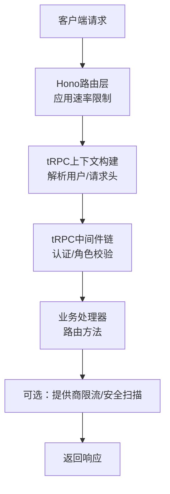
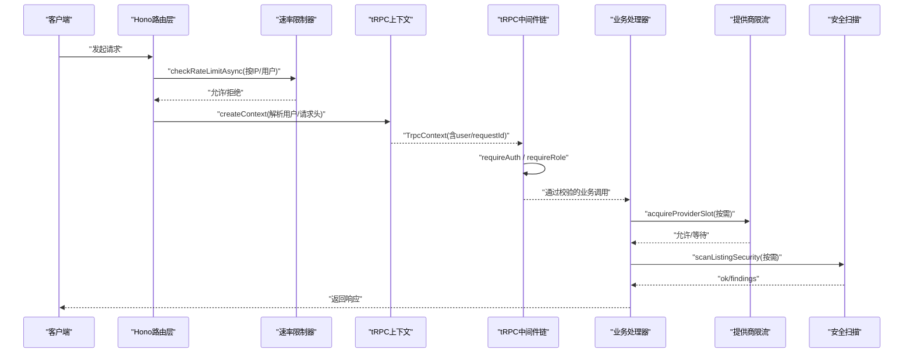
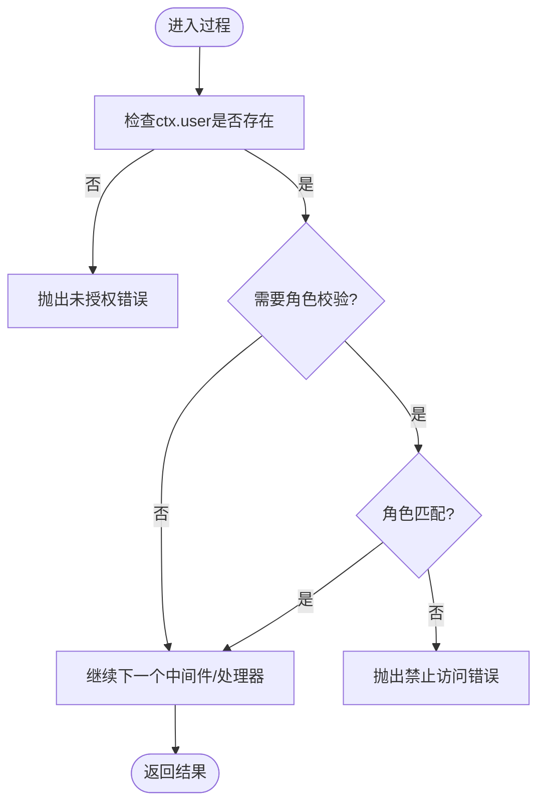
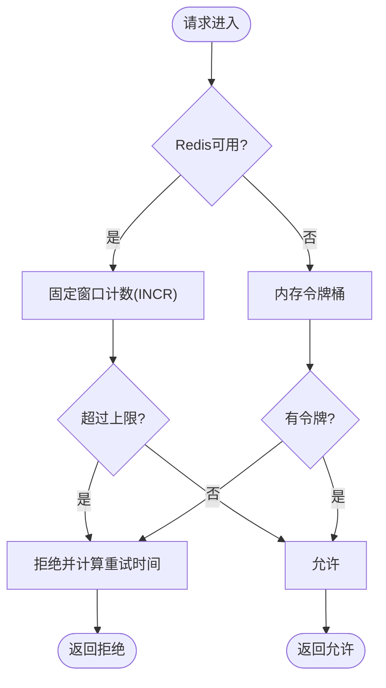
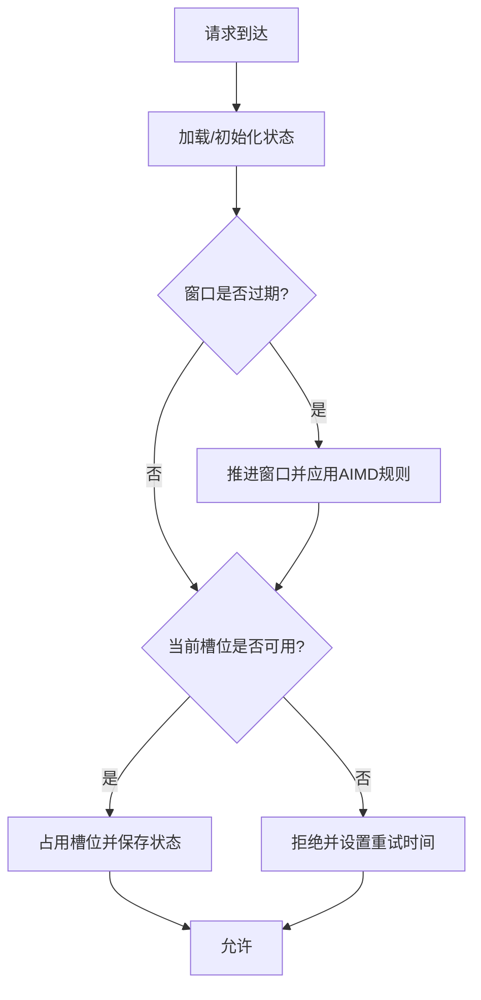
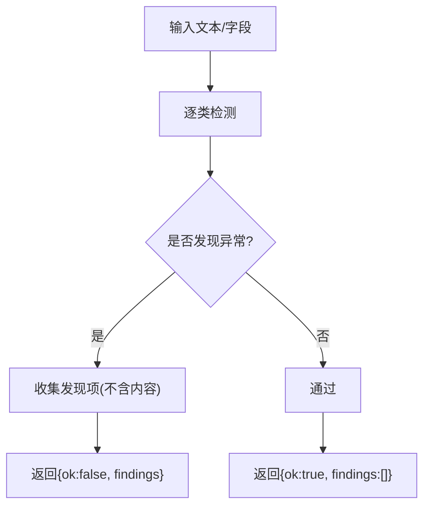
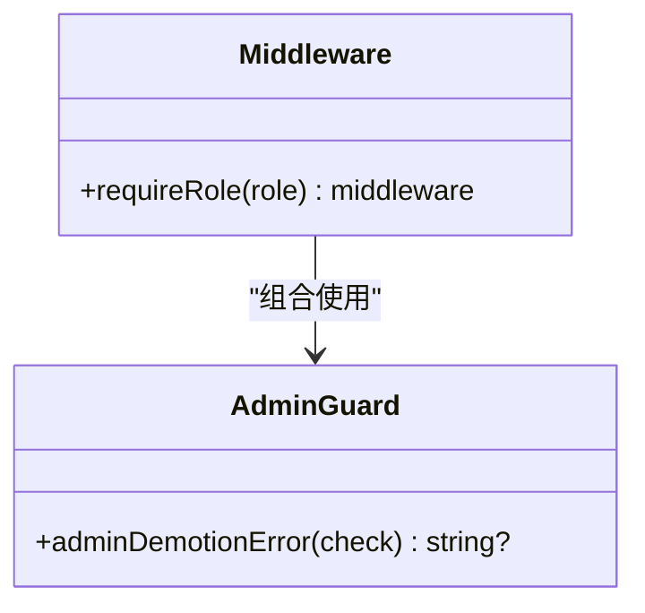
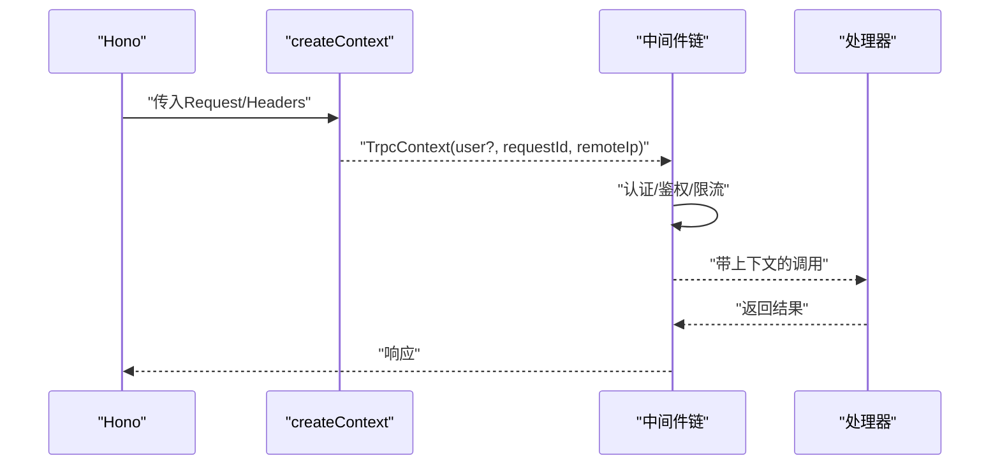
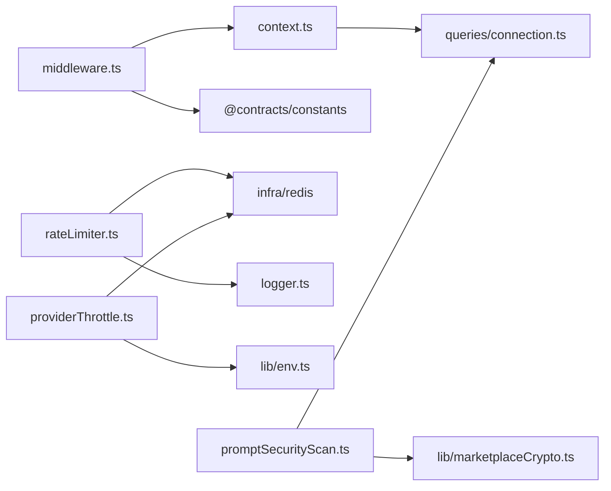

# 中间件模式

<cite>
**本文引用的文件**
- [api/middleware.ts](file://api/middleware.ts)
- [api/context.ts](file://api/context.ts)
- [api/lib/rateLimiter.ts](file://api/lib/rateLimiter.ts)
- [api/lib/providerThrottle.ts](file://api/lib/providerThrottle.ts)
- [api/services/promptSecurityScan.ts](file://api/services/promptSecurityScan.ts)
- [api/lib/adminGuards.ts](file://api/lib/adminGuards.ts)
- [api/routers/localAuth.ts](file://api/routers/localAuth.ts)
- [api/routers/agent.ts](file://api/routers/agent.ts)
- [api/lib/logger.ts](file://api/lib/logger.ts)
</cite>

## 目录
1. [简介](#简介)
2. [项目结构](#项目结构)
3. [核心组件](#核心组件)
4. [架构总览](#架构总览)
5. [详细组件分析](#详细组件分析)
6. [依赖关系分析](#依赖关系分析)
7. [性能考量](#性能考量)
8. [故障排查指南](#故障排查指南)
9. [结论](#结论)
10. [附录](#附录)

## 简介
本文件面向DeeWaanAI系统的“中间件模式”，聚焦于请求预处理、响应后处理与错误拦截的链路设计；系统采用tRPC中间件机制，结合Hono路由层的速率限制、提供商限流与安全扫描等能力，形成可插拔、可扩展的请求处理管道。文档将说明：
- 中间件链的执行顺序与作用域
- 内置中间件（管理员权限验证、速率限制、提供商限流、安全检查）的实现要点
- 上下文对象在中间件间的传递方式（用户信息、请求元数据、配置参数）
- 如何自定义中间件扩展系统功能
- 典型示例：权限守卫、性能监控、日志记录

## 项目结构
围绕中间件的核心代码主要分布在以下位置：
- tRPC中间件定义与认证/授权中间件：api/middleware.ts
- tRPC上下文构造与用户解析：api/context.ts
- 速率限制（内存/Redis）：api/lib/rateLimiter.ts
- 提供商自适应限流（AIMD）：api/lib/providerThrottle.ts
- 市场商品安全扫描（注入/泄露/敏感信息检测）：api/services/promptSecurityScan.ts
- 管理员降级保护纯逻辑：api/lib/adminGuards.ts
- 本地认证路由（登录/注册/令牌签发）：api/routers/localAuth.ts
- 受保护路由示例（使用认证中间件）：api/routers/agent.ts
- 结构化日志工具：api/lib/logger.ts

图表来源
- [api/middleware.ts:17-50](file://api/middleware.ts#L17-L50)
- [api/context.ts:20-54](file://api/context.ts#L20-L54)
- [api/lib/rateLimiter.ts:31-93](file://api/lib/rateLimiter.ts#L31-L93)
- [api/lib/providerThrottle.ts:168-199](file://api/lib/providerThrottle.ts#L168-L199)
- [api/services/promptSecurityScan.ts:226-300](file://api/services/promptSecurityScan.ts#L226-L300)

章节来源
- [api/middleware.ts:1-51](file://api/middleware.ts#L1-L51)
- [api/context.ts:1-55](file://api/context.ts#L1-L55)
- [api/lib/rateLimiter.ts:1-216](file://api/lib/rateLimiter.ts#L1-L216)
- [api/lib/providerThrottle.ts:1-275](file://api/lib/providerThrottle.ts#L1-L275)
- [api/services/promptSecurityScan.ts:1-301](file://api/services/promptSecurityScan.ts#L1-L301)
- [api/lib/adminGuards.ts:1-29](file://api/lib/adminGuards.ts#L1-L29)
- [api/routers/localAuth.ts:1-216](file://api/routers/localAuth.ts#L1-L216)
- [api/routers/agent.ts:1-100](file://api/routers/agent.ts#L1-L100)
- [api/lib/logger.ts:1-32](file://api/lib/logger.ts#L1-L32)

## 核心组件
- tRPC中间件与认证/授权
  - 提供公共/已认证/管理员三种过程类型，封装了认证检查与角色校验。
  - 通过中间件链对请求进行前置校验，失败时抛出标准化错误。
- 上下文对象
  - 统一承载请求、响应头、用户信息、Gitee令牌、请求ID、远端IP等。
  - 在构造阶段尝试解析本地认证令牌并填充用户信息。
- 速率限制
  - 提供内存令牌桶与基于Redis的固定窗口两种实现，支持多档策略与按客户分层限速。
- 提供商限流
  - 基于AIMD算法动态调整各提供商RPM，状态持久化到Redis或回退至内存。
- 安全扫描
  - 针对市场商品可见字段、测试提示词与加密提示词解密后的明文进行多维度检测，仅输出发现项，不泄露内容。
- 管理员保护
  - 提取出防误操作的降级保护逻辑，避免误删最后一个管理员或自我降级。

章节来源
- [api/middleware.ts:17-50](file://api/middleware.ts#L17-L50)
- [api/context.ts:20-54](file://api/context.ts#L20-L54)
- [api/lib/rateLimiter.ts:31-216](file://api/lib/rateLimiter.ts#L31-L216)
- [api/lib/providerThrottle.ts:168-275](file://api/lib/providerThrottle.ts#L168-L275)
- [api/services/promptSecurityScan.ts:226-300](file://api/services/promptSecurityScan.ts#L226-L300)
- [api/lib/adminGuards.ts:17-28](file://api/lib/adminGuards.ts#L17-L28)

## 架构总览
下图展示了从请求进入Hono路由层到tRPC中间件链再到业务处理的完整流程，以及关键横切关注点（速率限制、提供商限流、安全扫描）的接入位置。

图表来源
- [api/lib/rateLimiter.ts:64-93](file://api/lib/rateLimiter.ts#L64-L93)
- [api/context.ts:20-54](file://api/context.ts#L20-L54)
- [api/middleware.ts:17-50](file://api/middleware.ts#L17-L50)
- [api/lib/providerThrottle.ts:168-199](file://api/lib/providerThrottle.ts#L168-L199)
- [api/services/promptSecurityScan.ts:226-300](file://api/services/promptSecurityScan.ts#L226-L300)

## 详细组件分析

### tRPC中间件链与认证/授权
- 执行机制
  - 通过initTRPC创建路由器与过程类型，定义公共、已认证、管理员三类过程。
  - 认证中间件检查上下文中的用户是否存在且有效，否则抛出未授权错误。
  - 角色中间件根据用户角色进行访问控制，不符合则抛出禁止访问错误。
- 上下文传递
  - 上下文包含req、resHeaders、user、giteeToken、requestId、remoteIp等。
  - 构造时尝试解析本地认证令牌并加载用户信息，供后续中间件与处理器使用。
- 错误拦截
  - 使用标准化错误类型，便于上层统一捕获与响应格式化。

图表来源
- [api/middleware.ts:17-50](file://api/middleware.ts#L17-L50)
- [api/context.ts:20-54](file://api/context.ts#L20-L54)

章节来源
- [api/middleware.ts:1-51](file://api/middleware.ts#L1-L51)
- [api/context.ts:1-55](file://api/context.ts#L1-L55)

### 速率限制（全局与按客户分层）
- 内存令牌桶
  - 以键为维度维护令牌桶，周期性清理过期桶，支持配置最大令牌、补充速率与窗口。
- Redis固定窗口
  - 使用INCR+PEXPIRE实现跨节点共享的固定窗口计数，失败自动降级到内存路径。
- 按客户分层
  - 提供solo/team/admin三档配额，同样具备Redis优先、内存回退的健壮性。

图表来源
- [api/lib/rateLimiter.ts:31-93](file://api/lib/rateLimiter.ts#L31-L93)
- [api/lib/rateLimiter.ts:198-216](file://api/lib/rateLimiter.ts#L198-L216)

章节来源
- [api/lib/rateLimiter.ts:1-216](file://api/lib/rateLimiter.ts#L1-L216)

### 提供商限流（AIMD自适应）
- 核心思想
  - 借鉴TCP拥塞控制的AIMD：慢启动阶段指数增长，稳定期线性增长，遇429信号乘法减半并冷却若干窗口。
- 状态管理
  - 状态存储于Redis哈希，不可用时回退到进程内Map。
- 接口
  - 获取槽位：acquireProviderSlot
  - 上报结果：reportProviderResult
  - 指标查询：getProviderThrottleMetrics

图表来源
- [api/lib/providerThrottle.ts:88-133](file://api/lib/providerThrottle.ts#L88-L133)
- [api/lib/providerThrottle.ts:135-199](file://api/lib/providerThrottle.ts#L135-L199)
- [api/lib/providerThrottle.ts:207-235](file://api/services/promptSecurityScan.ts#L207-L235)

章节来源
- [api/lib/providerThrottle.ts:1-275](file://api/lib/providerThrottle.ts#L1-L275)

### 安全检查（市场商品）
- 扫描范围
  - 可见元数据字段、测试提示词输入、加密提示词解密后的明文（仅在内存中短暂存在）。
- 检测维度
  - Unicode清洗（零宽字符、BIDI覆盖、控制字符、混合脚本）
  - 注入短语（忽略指令、角色覆盖、系统提示词引用）
  - 数据外泄（发送URL、邮件、命令式动词+URL）
  - 敏感信息与滥用（API Key、Base64大段、邮箱批量、银行卡号）
- 输出
  - 仅返回发现项代码与字段标签，绝不泄露内容；失败关闭策略确保无法扫描即视为问题。

图表来源
- [api/services/promptSecurityScan.ts:23-210](file://api/services/promptSecurityScan.ts#L23-L210)
- [api/services/promptSecurityScan.ts:226-300](file://api/services/promptSecurityScan.ts#L226-L300)

章节来源
- [api/services/promptSecurityScan.ts:1-301](file://api/services/promptSecurityScan.ts#L1-L301)

### 管理员权限与降级保护
- 中间件层面
  - 通过角色中间件强制要求admin角色，用于管理端操作。
- 业务层面
  - 提取出降级保护纯函数，防止自我降级或删除最后一个管理员，避免部署后无法进入管理面板。

图表来源
- [api/middleware.ts:30-43](file://api/middleware.ts#L30-L43)
- [api/lib/adminGuards.ts:17-28](file://api/lib/adminGuards.ts#L17-L28)

章节来源
- [api/middleware.ts:17-50](file://api/middleware.ts#L17-L50)
- [api/lib/adminGuards.ts:1-29](file://api/lib/adminGuards.ts#L1-L29)

### 上下文对象与跨中间件传递
- 上下文内容
  - 请求对象、响应头、用户信息、Gitee令牌、请求ID、远端IP。
- 构造流程
  - 优先解析本地认证令牌，若成功则加载用户信息并返回上下文；否则保持匿名上下文，由后续中间件决定拒绝。
- 使用场景
  - 速率限制可按IP或用户维度；认证/鉴权中间件读取用户信息；日志记录携带requestId便于追踪。

图表来源
- [api/context.ts:20-54](file://api/context.ts#L20-L54)
- [api/middleware.ts:17-50](file://api/middleware.ts#L17-L50)

章节来源
- [api/context.ts:1-55](file://api/context.ts#L1-L55)
- [api/middleware.ts:1-51](file://api/middleware.ts#L1-L51)

### 路由示例：受保护资源
- 示例路由使用已认证过程类型，确保调用者已通过认证。
- 展示如何在路由中直接使用数据库与业务逻辑，同时享受中间件提供的安全与上下文保障。

章节来源
- [api/routers/agent.ts:1-100](file://api/routers/agent.ts#L1-L100)

## 依赖关系分析
- 模块耦合
  - 中间件依赖上下文与错误常量；上下文依赖本地认证与数据库连接；速率限制依赖Redis与日志；提供商限流依赖Redis与环境配置；安全扫描依赖数据库与加密模块。
- 外部依赖
  - Redis用于分布式限流与状态共享；Sentry用于错误观测（可选）。
- 潜在循环
  - 各模块职责清晰，未见直接循环依赖；通过接口与工具函数解耦。

图表来源
- [api/middleware.ts:1-51](file://api/middleware.ts#L1-L51)
- [api/context.ts:1-55](file://api/context.ts#L1-L55)
- [api/lib/rateLimiter.ts:1-216](file://api/lib/rateLimiter.ts#L1-L216)
- [api/lib/providerThrottle.ts:1-275](file://api/lib/providerThrottle.ts#L1-L275)
- [api/services/promptSecurityScan.ts:1-301](file://api/services/promptSecurityScan.ts#L1-L301)

章节来源
- [api/middleware.ts:1-51](file://api/middleware.ts#L1-L51)
- [api/context.ts:1-55](file://api/context.ts#L1-L55)
- [api/lib/rateLimiter.ts:1-216](file://api/lib/rateLimiter.ts#L1-L216)
- [api/lib/providerThrottle.ts:1-275](file://api/lib/providerThrottle.ts#L1-L275)
- [api/services/promptSecurityScan.ts:1-301](file://api/services/promptSecurityScan.ts#L1-L301)

## 性能考量
- 速率限制
  - 优先使用Redis固定窗口以获得跨节点一致性；无Redis时自动降级到内存令牌桶，保证可用性。
  - 定期清理过期桶与窗口，避免内存无限增长。
- 提供商限流
  - AIMD算法快速收敛到可持续RPM，减少429风暴；状态落盘Redis提升稳定性。
- 安全扫描
  - 字符串级检测开销低；加密提示词仅在内存中解密并立即释放，降低泄露风险。
- 日志与观测
  - 结构化日志便于检索；Sentry初始化失败不影响服务运行。

[本节为通用指导，无需特定文件来源]

## 故障排查指南
- 认证失败
  - 检查上下文是否正确解析本地令牌；确认中间件是否抛出未授权错误。
- 速率限制触发
  - 查看Redis键rl:*或内存桶状态；确认请求频率与配额档位是否合理。
- 提供商限流
  - 观察当前RPM与窗口计数；根据429信号调整RPM；必要时重置状态。
- 安全扫描失败
  - 根据返回的发现项定位字段；注意不要记录或传播明文内容。
- 管理员降级保护
  - 使用降级保护函数判断是否允许操作，避免误删最后一个管理员。

章节来源
- [api/middleware.ts:17-50](file://api/middleware.ts#L17-L50)
- [api/lib/rateLimiter.ts:31-216](file://api/lib/rateLimiter.ts#L31-L216)
- [api/lib/providerThrottle.ts:168-275](file://api/lib/providerThrottle.ts#L168-L275)
- [api/services/promptSecurityScan.ts:226-300](file://api/services/promptSecurityScan.ts#L226-L300)
- [api/lib/adminGuards.ts:17-28](file://api/lib/adminGuards.ts#L17-L28)

## 结论
DeeWaanAI通过tRPC中间件链实现了统一的请求预处理、响应后处理与错误拦截；结合Hono路由层的速率限制、提供商自适应限流与安全扫描，构建了高可用、可扩展的横切能力。上下文对象贯穿全链路，使认证、鉴权、限流与日志得以协同工作。开发者可基于现有中间件模式快速扩展新功能，如新增权限守卫、性能监控与更细粒度的日志记录。

[本节为总结，无需特定文件来源]

## 附录

### 自定义中间件指南（示例思路）
- 权限守卫
  - 参考角色中间件，读取上下文用户信息并校验资源归属或权限集，失败时抛出标准化错误。
- 性能监控
  - 在中间件入口记录开始时间，出口计算耗时并写入日志；可选择采样以降低开销。
- 日志记录
  - 利用requestId关联一次请求的全链路日志；对敏感字段脱敏后再记录。

章节来源
- [api/middleware.ts:17-50](file://api/middleware.ts#L17-L50)
- [api/lib/logger.ts:1-32](file://api/lib/logger.ts#L1-L32)

### 内置中间件清单与职责
- 认证中间件：确保调用者身份有效
- 角色中间件：校验用户角色是否符合要求
- 速率限制：按IP/用户/租户维度限制请求频率
- 提供商限流：按提供商动态调整RPM，避免过载
- 安全扫描：对发布内容进行注入、外泄、敏感信息检测

章节来源
- [api/middleware.ts:17-50](file://api/middleware.ts#L17-L50)
- [api/lib/rateLimiter.ts:31-216](file://api/lib/rateLimiter.ts#L31-L216)
- [api/lib/providerThrottle.ts:168-275](file://api/lib/providerThrottle.ts#L168-L275)
- [api/services/promptSecurityScan.ts:226-300](file://api/services/promptSecurityScan.ts#L226-L300)