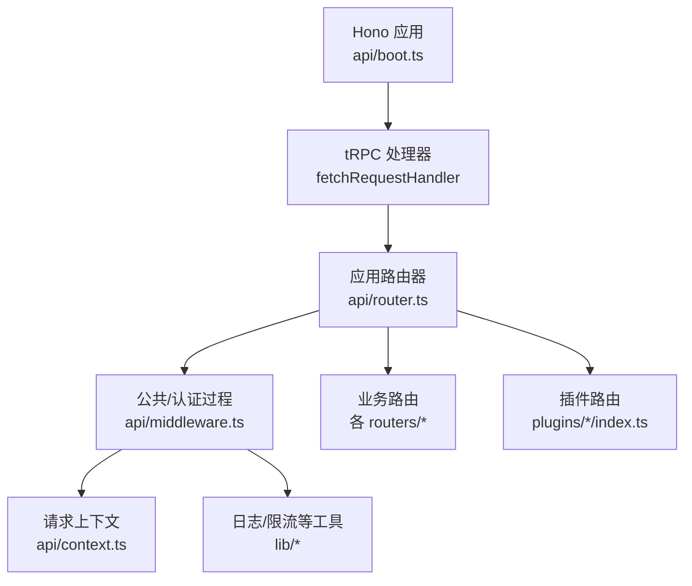
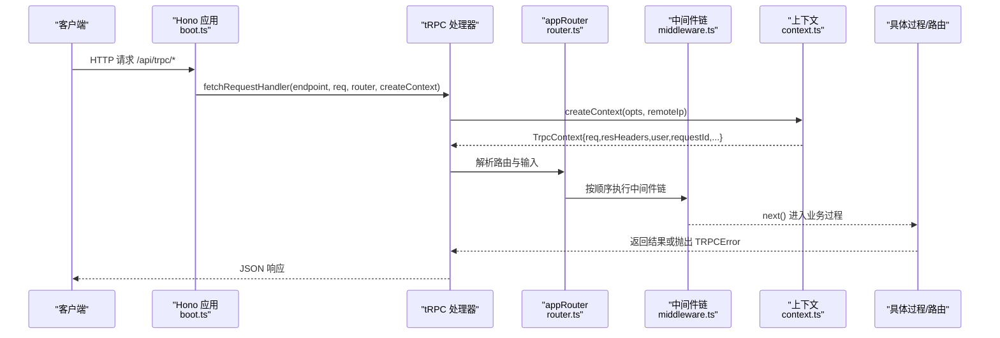
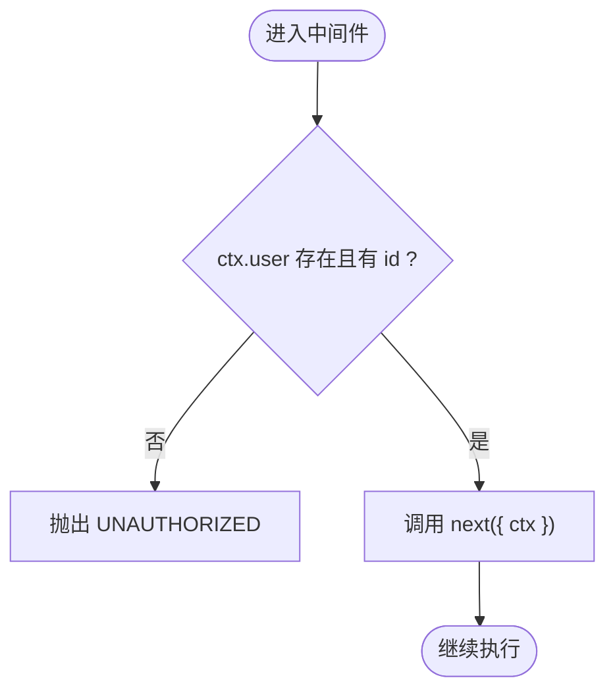
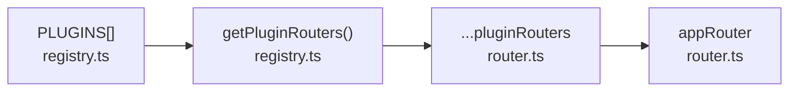
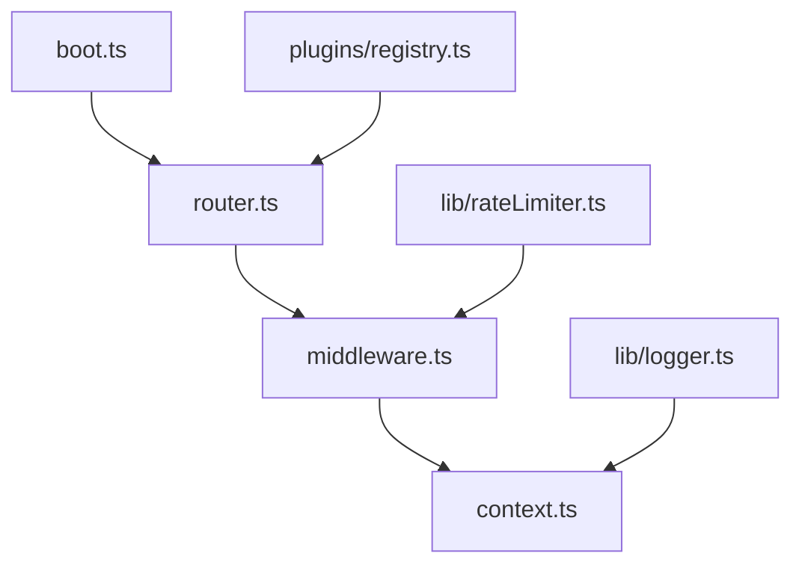

# 自定义中间件开发

<cite>
**本文引用的文件**
- [api/middleware.ts](file://api/middleware.ts)
- [api/context.ts](file://api/context.ts)
- [api/router.ts](file://api/router.ts)
- [api/boot.ts](file://api/boot.ts)
- [api/plugins/registry.ts](file://api/plugins/registry.ts)
- [api/plugins/circuit-breaker/index.ts](file://api/plugins/circuit-breaker/index.ts)
- [api/lib/rateLimiter.ts](file://api/lib/rateLimiter.ts)
- [api/lib/logger.ts](file://api/lib/logger.ts)
- [contracts/errors.ts](file://contracts/errors.ts)
</cite>

## 目录
1. [简介](#简介)
2. [项目结构](#项目结构)
3. [核心组件](#核心组件)
4. [架构总览](#架构总览)
5. [详细组件分析](#详细组件分析)
6. [依赖关系分析](#依赖关系分析)
7. [性能考虑](#性能考虑)
8. [故障排查指南](#故障排查指南)
9. [结论](#结论)
10. [附录](#附录)

## 简介
本指南面向在 DeeWaanAI 系统中编写 tRPC 自定义中间件的开发者，系统性地说明：
- 中间件函数签名、上下文对象操作与错误处理模式
- 中间件的注册机制与插件系统集成方式、执行顺序控制
- 最佳实践：性能优化、日志记录与调试技巧
- 完整示例：安全扫描中间件、性能监控中间件、数据转换中间件
- 测试方法：单元测试与集成测试的编写方式

## 项目结构
DeeWaanAI 的 tRPC 中间件体系围绕以下关键位置组织：
- 中间件定义与过程组合：api/middleware.ts
- 请求上下文构建：api/context.ts
- 路由装配与插件路由合并：api/router.ts
- 服务器启动与 tRPC 处理器挂载：api/boot.ts
- 插件注册表与元数据：api/plugins/registry.ts
- 限流能力（供中间件复用）：api/lib/rateLimiter.ts
- 日志与请求追踪：api/lib/logger.ts
- 错误常量与类型：contracts/errors.ts

图表来源
- [api/boot.ts:361-372](file://api/boot.ts#L361-L372)
- [api/router.ts:31-70](file://api/router.ts#L31-L70)
- [api/middleware.ts:10-50](file://api/middleware.ts#L10-L50)
- [api/context.ts:9-54](file://api/context.ts#L9-L54)

章节来源
- [api/boot.ts:361-372](file://api/boot.ts#L361-L372)
- [api/router.ts:31-70](file://api/router.ts#L31-L70)
- [api/middleware.ts:10-50](file://api/middleware.ts#L10-L50)
- [api/context.ts:9-54](file://api/context.ts#L9-L54)

## 核心组件
- 中间件工厂与过程组合
  - 通过 initTRPC 创建带上下文的 tRPC 实例，并导出 createRouter、publicQuery、authedQuery、adminQuery 等可复用过程。
  - 内置 requireAuth、requireRole 中间件用于鉴权与权限校验，统一抛出 TRPCError。
- 请求上下文
  - createContext 负责从请求头解析本地令牌、注入用户信息、生成 requestId、传递 remoteIp 等。
- 路由装配
  - router.ts 聚合所有业务路由与插件路由，形成 appRouter。
- 插件系统
  - registry.ts 维护 PLUGINS 清单，提供 getPluginRouters、validateDependencies 等辅助。
- 限流与日志
  - rateLimiter.ts 提供内存/Redis 双路径限流；logger.ts 提供结构化日志与请求 ID。

章节来源
- [api/middleware.ts:10-50](file://api/middleware.ts#L10-L50)
- [api/context.ts:9-54](file://api/context.ts#L9-L54)
- [api/router.ts:31-70](file://api/router.ts#L31-L70)
- [api/plugins/registry.ts:19-69](file://api/plugins/registry.ts#L19-L69)
- [api/lib/rateLimiter.ts:31-93](file://api/lib/rateLimiter.ts#L31-L93)
- [api/lib/logger.ts:1-32](file://api/lib/logger.ts#L1-L32)

## 架构总览
下图展示一次 tRPC 调用从进入服务器到执行中间件链与业务逻辑的完整流程。

图表来源
- [api/boot.ts:361-372](file://api/boot.ts#L361-L372)
- [api/context.ts:20-54](file://api/context.ts#L20-L54)
- [api/router.ts:39-70](file://api/router.ts#L39-L70)
- [api/middleware.ts:17-50](file://api/middleware.ts#L17-L50)

## 详细组件分析

### 中间件函数签名与上下文操作
- 中间件签名
  - 使用 t.middleware(async (opts) => {...})，opts.ctx 为当前上下文，opts.next 用于继续执行后续中间件或过程。
- 上下文对象 TrpcContext
  - 包含 req、resHeaders、user、giteeToken、requestId、remoteIp 等字段，由 createContext 构造。
- 鉴权与角色
  - requireAuth：若 ctx.user 缺失或无 id，抛出 UNAUTHORIZED。
  - requireRole(role)：校验 user.role 是否匹配，不匹配则抛出 FORBIDDEN。
- 错误处理
  - 统一通过 TRPCError 抛出，便于上层统一序列化与客户端消费。

图表来源
- [api/middleware.ts:17-43](file://api/middleware.ts#L17-L43)
- [api/context.ts:9-54](file://api/context.ts#L9-L54)

章节来源
- [api/middleware.ts:17-43](file://api/middleware.ts#L17-L43)
- [api/context.ts:9-54](file://api/context.ts#L9-L54)

### 中间件注册与执行顺序
- 过程级注册
  - 通过 t.procedure.use(mw) 将中间件附加到过程上，如 authedQuery = publicQuery.use(requireAuth)。
  - 可在过程上叠加多个中间件，执行顺序即声明顺序。
- 路由级装配
  - router.ts 中通过 createRouter 组装 appRouter，业务路由与插件路由以键值形式合并。
- 插件路由合并
  - 遍历 PLUGINS，收集每个插件的 router 并以插件 id 为命名空间挂载到 appRouter。

图表来源
- [api/plugins/registry.ts:44-53](file://api/plugins/registry.ts#L44-L53)
- [api/router.ts:31-70](file://api/router.ts#L31-L70)

章节来源
- [api/router.ts:31-70](file://api/router.ts#L31-L70)
- [api/plugins/registry.ts:44-53](file://api/plugins/registry.ts#L44-L53)

### 插件系统与中间件集成
- 插件清单
  - PluginManifest 描述插件 id、name、description、version、featureFlag、dependencies、router。
- 插件路由
  - 插件可导出 router，并在 registry.ts 的 PLUGINS 数组中注册，最终被 router.ts 合并进 appRouter。
- 依赖校验
  - validateDependencies 检查插件依赖是否满足，未满足时返回错误列表。

章节来源
- [api/plugins/registry.ts:19-69](file://api/plugins/registry.ts#L19-L69)
- [api/router.ts:31-70](file://api/router.ts#L31-L70)

### 现有中间件示例：熔断器插件
- 功能要点
  - 在每次步骤执行前进行预算与时序检查（token、花费、超时、循环次数）。
  - 提供 start/end 生命周期方法与查询接口，暴露状态与限制。
- 与中间件的关系
  - 该插件通过 tRPC 过程暴露能力，内部逻辑可作为“业务侧”的防护；如需全局拦截，可将类似逻辑封装为中间件并挂载到所需过程。

章节来源
- [api/plugins/circuit-breaker/index.ts:1-186](file://api/plugins/circuit-breaker/index.ts#L1-L186)

### 最佳实践：性能、日志与调试
- 性能
  - 优先在 Hono 层或独立中间件中做快速失败（如限流、鉴权），减少进入业务过程的开销。
  - 避免在中间件中进行昂贵 I/O；必要时异步化并缓存热点数据。
- 日志
  - 使用 logger 输出结构化日志，并通过 context.requestId 关联请求链路。
- 调试
  - 利用 requestId 串联日志；对异常路径记录必要上下文（如输入摘要、耗时）。
  - 结合 vitest 对纯函数与中间件分支进行单测覆盖。

章节来源
- [api/lib/logger.ts:1-32](file://api/lib/logger.ts#L1-L32)
- [api/context.ts:20-54](file://api/context.ts#L20-L54)

## 依赖关系分析
- 模块耦合
  - middleware.ts 依赖 context.ts 的类型与实现；router.ts 依赖 middleware.ts 的过程与 createRouter。
  - boot.ts 通过 fetchRequestHandler 将 Hono 请求接入 tRPC，并传入 createContext。
  - plugins/registry.ts 提供插件清单与路由收集，router.ts 将其合并入 appRouter。
- 外部依赖
  - @trpc/server 提供中间件与过程能力；superjson 作为数据转换器；drizzle-orm 用于数据库访问（在 context 中）。

图表来源
- [api/middleware.ts:10-50](file://api/middleware.ts#L10-L50)
- [api/context.ts:9-54](file://api/context.ts#L9-L54)
- [api/router.ts:31-70](file://api/router.ts#L31-L70)
- [api/boot.ts:361-372](file://api/boot.ts#L361-L372)
- [api/plugins/registry.ts:44-53](file://api/plugins/registry.ts#L44-L53)
- [api/lib/rateLimiter.ts:31-93](file://api/lib/rateLimiter.ts#L31-L93)
- [api/lib/logger.ts:1-32](file://api/lib/logger.ts#L1-L32)

章节来源
- [api/middleware.ts:10-50](file://api/middleware.ts#L10-L50)
- [api/context.ts:9-54](file://api/context.ts#L9-L54)
- [api/router.ts:31-70](file://api/router.ts#L31-L70)
- [api/boot.ts:361-372](file://api/boot.ts#L361-L372)
- [api/plugins/registry.ts:44-53](file://api/plugins/registry.ts#L44-L53)
- [api/lib/rateLimiter.ts:31-93](file://api/lib/rateLimiter.ts#L31-L93)
- [api/lib/logger.ts:1-32](file://api/lib/logger.ts#L1-L32)

## 性能考虑
- 中间件应尽早返回：鉴权失败、限流拒绝应在最外层快速返回，避免后续 I/O。
- 避免重复计算：将昂贵的校验或查询结果放入上下文缓存（注意作用域与并发安全）。
- 限流策略：优先使用 rateLimiter.ts 提供的 Redis 固定窗口或内存桶，按需选择 key（如 userId、IP）。
- 日志开销：生产环境降低 debug 级别，仅记录必要字段，避免大对象序列化。

[本节为通用指导，无需特定文件引用]

## 故障排查指南
- 常见问题
  - 未登录访问受保护过程：检查 requireAuth 是否生效，确认上下文 user 是否正确注入。
  - 权限不足：确认 requireRole 的角色判断逻辑与用户角色一致。
  - 限流触发：检查 key 粒度与配置，必要时调整 RATE_LIMITS 或 CUSTOMER_RATE_LIMITS。
  - 插件路由未生效：确认 PLUGINS 已注册且 router 字段存在。
- 定位手段
  - 使用 requestId 串联日志，定位请求全链路。
  - 在中间件前后记录耗时与异常堆栈，结合 logger.error 输出。
  - 借助 vitest 对中间件分支与边界条件进行断言。

章节来源
- [api/middleware.ts:17-50](file://api/middleware.ts#L17-L50)
- [api/lib/rateLimiter.ts:31-93](file://api/lib/rateLimiter.ts#L31-L93)
- [api/plugins/registry.ts:44-69](file://api/plugins/registry.ts#L44-L69)
- [api/lib/logger.ts:1-32](file://api/lib/logger.ts#L1-L32)

## 结论
DeeWaanAI 的 tRPC 中间件体系以清晰的上下文、统一的错误处理和可扩展的插件系统为核心。通过过程级 use 组合中间件、在 router.ts 中集中装配路由，以及通过 registry.ts 管理插件，开发者可以高效地实现鉴权、限流、审计、监控与安全扫描等横切关注点。遵循本文的最佳实践与测试建议，可确保中间件的可维护性与稳定性。

[本节为总结性内容，无需特定文件引用]

## 附录

### 自定义中间件开发规范（速查）
- 函数签名
  - 使用 t.middleware(async ({ ctx, next, ...rest }) => { ... })
- 上下文操作
  - 读取：ctx.req、ctx.resHeaders、ctx.user、ctx.requestId、ctx.remoteIp
  - 写入：通过 next({ ctx: { ...ctx, ... } }) 扩展上下文
- 错误处理
  - 使用 TRPCError 抛出标准错误码（如 UNAUTHORIZED、FORBIDDEN）
- 执行顺序
  - 在同一过程上多次 use 时，按声明顺序依次执行
  - 插件路由通过 registry.ts 的 PLUGINS 数组注册，并在 router.ts 合并

章节来源
- [api/middleware.ts:10-50](file://api/middleware.ts#L10-L50)
- [api/context.ts:9-54](file://api/context.ts#L9-L54)
- [api/plugins/registry.ts:19-69](file://api/plugins/registry.ts#L19-L69)
- [api/router.ts:31-70](file://api/router.ts#L31-L70)

### 完整示例：安全扫描中间件
- 目标
  - 在敏感过程（如提交 Prompt、Pipeline 运行）前进行内容扫描，阻断恶意输入。
- 设计要点
  - 在 process 上挂载中间件，读取输入并进行扫描；失败时抛出 TRPCError。
  - 扫描结果可写入上下文以便后续记录。
- 参考实现位置
  - 可参照服务层的 promptSecurityScan 思路，在中间件中调用相应服务。

章节来源
- [api/services/promptSecurityScan.ts](file://api/services/promptSecurityScan.ts)

### 完整示例：性能监控中间件
- 目标
  - 统计过程耗时、成功率、错误率，并输出结构化日志。
- 设计要点
  - 在进入时记录开始时间，在 next 完成后记录结束时间与结果状态。
  - 使用 logger.info/error 输出指标，附带 requestId。
- 参考实现位置
  - 可复用 logger.ts 的结构化日志能力。

章节来源
- [api/lib/logger.ts:1-32](file://api/lib/logger.ts#L1-L32)

### 完整示例：数据转换中间件
- 目标
  - 对输入/输出进行标准化（如 superjson 反序列化后的二次清洗、脱敏）。
- 设计要点
  - 在 next 之前对 input 进行校验与转换；在 next 之后对 result 进行清理。
  - 保持幂等与可观测性。
- 参考实现位置
  - 可基于 superjson 与 zod 输入校验配合使用。

章节来源
- [api/middleware.ts:10-15](file://api/middleware.ts#L10-L15)

### 测试方法
- 单元测试
  - 针对纯函数与中间件分支编写用例，验证正常与异常路径。
  - 参考 rateLimiter.test.ts 的模式，使用 vitest 的 fake timers 模拟时间推进。
- 集成测试
  - 通过 mock 上下文与数据库连接，端到端验证中间件链与路由行为。
  - 参考 team.integration.test.ts 的组织方式。

章节来源
- [api/lib/rateLimiter.test.ts:1-141](file://api/lib/rateLimiter.test.ts#L1-L141)
- [api/routers/team.integration.test.ts](file://api/routers/team.integration.test.ts)

### 错误与常量
- 错误类型
  - contracts/errors.ts 定义了 AppError 与便捷构造器，可用于跨层错误表达。
- 中间件错误
  - 中间件内统一使用 TRPCError 抛出，保证客户端一致性。

章节来源
- [contracts/errors.ts:1-15](file://contracts/errors.ts#L1-L15)
- [api/middleware.ts:17-43](file://api/middleware.ts#L17-L43)