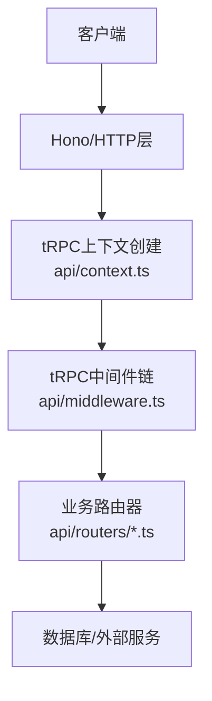
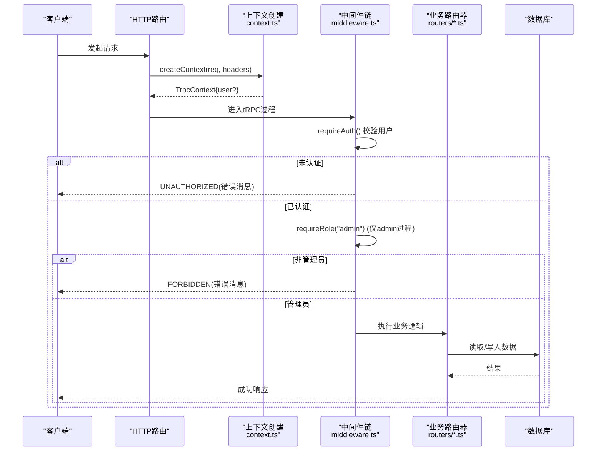
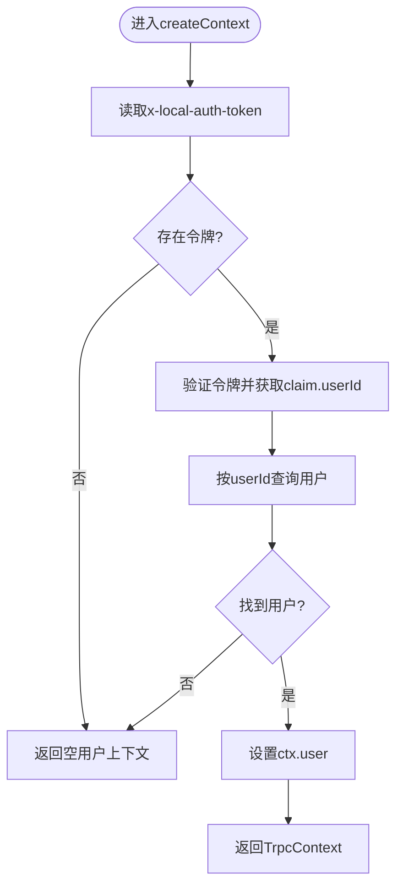
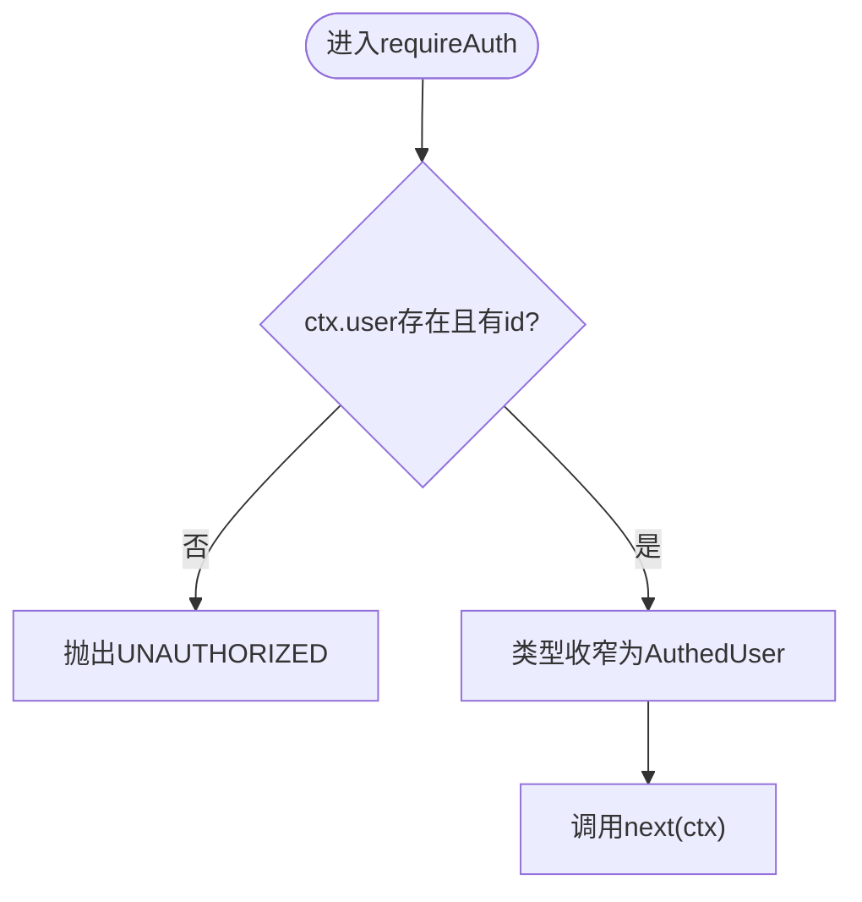
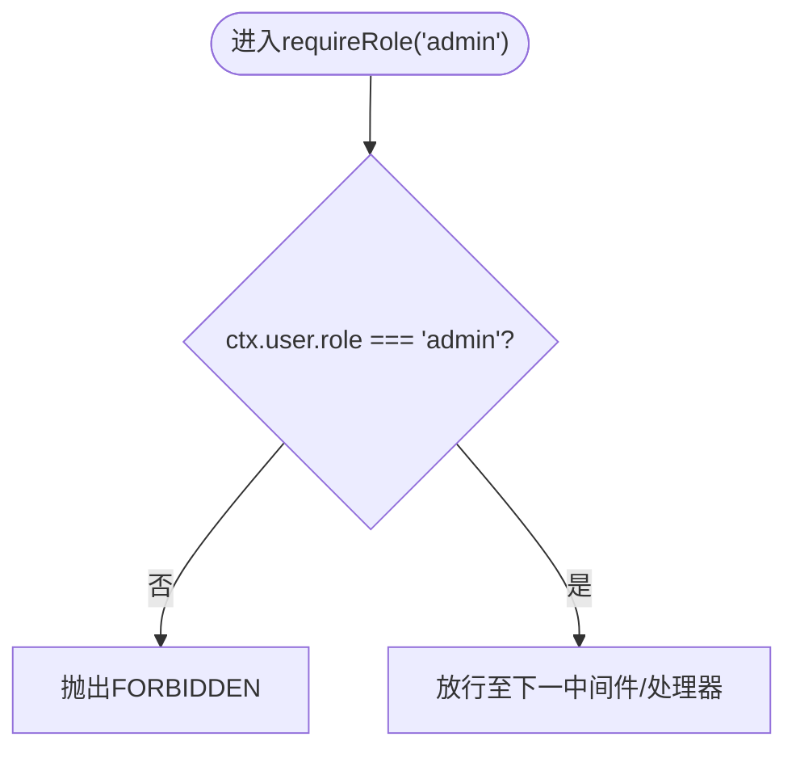
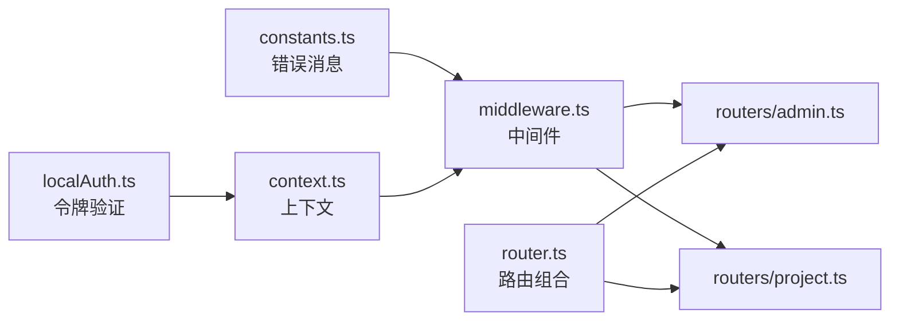

# 认证中间件

<cite>
**本文引用的文件**
- [api/middleware.ts](file://api/middleware.ts)
- [api/context.ts](file://api/context.ts)
- [api/auth-router.ts](file://api/auth-router.ts)
- [api/router.ts](file://api/router.ts)
- [api/routers/admin.ts](file://api/routers/admin.ts)
- [api/routers/project.ts](file://api/routers/project.ts)
- [contracts/constants.ts](file://contracts/constants.ts)
</cite>

## 目录
1. [简介](#简介)
2. [项目结构](#项目结构)
3. [核心组件](#核心组件)
4. [架构总览](#架构总览)
5. [详细组件分析](#详细组件分析)
6. [依赖关系分析](#依赖关系分析)
7. [性能考虑](#性能考虑)
8. [故障排查指南](#故障排查指南)
9. [结论](#结论)
10. [附录：tRPC端点保护示例](#附录trpc端点保护示例)

## 简介
本文件面向DeeWaanAI系统的认证与授权机制，聚焦于tRPC中间件的实现与使用。内容涵盖：
- requireAuth中间件的实现原理与权限检查流程
- 基于角色的访问控制（RBAC）：adminQuery与requireRole的使用方式
- 认证状态在请求上下文中的传递、类型转换与安全处理
- 如何保护tRPC端点：公共查询、认证查询与管理员操作的配置方法
- 错误处理策略：未认证与权限不足时的响应格式

## 项目结构
认证相关代码主要分布在以下位置：
- tRPC中间件与过程定义：api/middleware.ts
- 请求上下文构建与用户解析：api/context.ts
- 路由注册与组合：api/router.ts
- 认证相关路由示例：api/auth-router.ts
- 管理员路由示例（RBAC使用）：api/routers/admin.ts
- 普通认证路由示例（RBAC使用）：api/routers/project.ts
- 统一错误消息常量：contracts/constants.ts

图表来源
- [api/context.ts:20-54](file://api/context.ts#L20-L54)
- [api/middleware.ts:10-50](file://api/middleware.ts#L10-L50)
- [api/router.ts:39-70](file://api/router.ts#L39-L70)

章节来源
- [api/middleware.ts:1-50](file://api/middleware.ts#L1-L50)
- [api/context.ts:1-55](file://api/context.ts#L1-L55)
- [api/router.ts:1-73](file://api/router.ts#L1-L73)

## 核心组件
- 认证中间件 requireAuth
  - 校验请求上下文中是否存在有效用户；若缺失则抛出未认证错误
  - 通过类型收窄将ctx.user转换为带确定id的类型，便于后续安全使用
- 角色检查中间件 requireRole(role)
  - 校验当前用户的角色是否匹配指定角色；不匹配则抛出权限不足错误
- 预置过程
  - publicQuery：无需鉴权的公开过程
  - authedQuery：已认证过程（use(requireAuth)）
  - adminQuery：管理员过程（authedQuery.use(requireRole("admin"))）

章节来源
- [api/middleware.ts:17-50](file://api/middleware.ts#L17-L50)
- [contracts/constants.ts:6-9](file://contracts/constants.ts#L6-L9)

## 架构总览
下图展示了从HTTP请求到tRPC处理器执行的完整链路，包括上下文构建、认证与授权中间件以及最终的业务逻辑。

图表来源
- [api/context.ts:20-54](file://api/context.ts#L20-L54)
- [api/middleware.ts:17-50](file://api/middleware.ts#L17-L50)
- [api/routers/admin.ts:16-85](file://api/routers/admin.ts#L16-L85)

## 详细组件分析

### 认证上下文与用户解析
- 上下文字段
  - req/resHeaders：原始请求与响应头
  - user：解析后的用户对象（可能为空）
  - giteeToken/requestId/remoteIp：辅助信息
- 解析流程
  - 优先从请求头x-local-auth-token解析本地令牌
  - 验证通过后根据userId查询用户表并注入ctx.user
  - 若解析失败或无令牌，ctx.user为null，由后续中间件决定是否拒绝

图表来源
- [api/context.ts:20-54](file://api/context.ts#L20-L54)

章节来源
- [api/context.ts:1-55](file://api/context.ts#L1-L55)

### requireAuth中间件
- 职责
  - 确保ctx.user存在且具备有效id
  - 通过类型转换将ctx.user收窄为“已认证用户”类型，避免后续误用
- 行为
  - 未认证：抛出UNAUTHORIZED错误，携带统一错误消息
  - 已认证：继续执行next()

图表来源
- [api/middleware.ts:17-28](file://api/middleware.ts#L17-L28)

章节来源
- [api/middleware.ts:1-50](file://api/middleware.ts#L1-L50)

### RBAC：requireRole与adminQuery
- requireRole(role)
  - 校验ctx.user.role是否等于目标角色
  - 不匹配时抛出FORBIDDEN错误，携带统一错误消息
- adminQuery
  - 基于authedQuery再叠加requireRole("admin")
  - 用于所有管理员操作的路由保护

图表来源
- [api/middleware.ts:30-43](file://api/middleware.ts#L30-L43)

章节来源
- [api/middleware.ts:30-50](file://api/middleware.ts#L30-L50)

### 路由与端点保护示例
- 公共查询
  - 使用publicQuery，无需认证即可访问
  - 示例：认证路由中的me/logout
- 认证查询
  - 使用authedQuery，要求已登录用户
  - 示例：项目列表/详情/创建等
- 管理员操作
  - 使用adminQuery，要求管理员角色
  - 示例：用户管理、系统统计、功能开关、审计日志等

章节来源
- [api/auth-router.ts:1-12](file://api/auth-router.ts#L1-L12)
- [api/routers/project.ts:11-101](file://api/routers/project.ts#L11-L101)
- [api/routers/admin.ts:16-85](file://api/routers/admin.ts#L16-L85)

## 依赖关系分析
- 中间件依赖
  - middleware.ts依赖contracts/constants.ts的错误消息常量
  - context.ts依赖localAuth的令牌验证与数据库连接
- 路由组合
  - router.ts聚合各子路由，形成appRouter
  - 各子路由通过createRouter创建，并使用publicQuery/authedQuery/adminQuery进行保护

图表来源
- [api/middleware.ts:1-50](file://api/middleware.ts#L1-L50)
- [api/context.ts:1-55](file://api/context.ts#L1-L55)
- [api/router.ts:1-73](file://api/router.ts#L1-L73)
- [api/routers/admin.ts:1-85](file://api/routers/admin.ts#L1-L85)
- [api/routers/project.ts:1-101](file://api/routers/project.ts#L1-L101)

章节来源
- [api/middleware.ts:1-50](file://api/middleware.ts#L1-L50)
- [api/context.ts:1-55](file://api/context.ts#L1-L55)
- [api/router.ts:1-73](file://api/router.ts#L1-L73)

## 性能考虑
- 上下文构建仅在请求入口执行一次，避免重复解析
- 中间件链短小精悍，职责单一，减少不必要的计算
- 管理员操作涉及数据库查询与审计记录，建议结合缓存与批处理优化热点路径
- 令牌验证与用户查询可考虑引入短期缓存以降低数据库压力

## 故障排查指南
- 未认证（UNAUTHORIZED）
  - 现象：调用需要认证的接口返回未认证错误
  - 排查要点：确认请求头包含有效的x-local-auth-token；确认令牌验证通过；确认用户存在
  - 参考：中间件在未满足条件时抛出错误
- 权限不足（FORBIDDEN）
  - 现象：调用管理员接口返回权限不足错误
  - 排查要点：确认当前用户role是否为admin；确认使用了adminQuery而非authedQuery
- 上下文用户为空
  - 现象：ctx.user为null导致后续逻辑异常
  - 排查要点：检查令牌解析与用户查询逻辑；确认数据库连接正常

章节来源
- [api/middleware.ts:17-43](file://api/middleware.ts#L17-L43)
- [contracts/constants.ts:6-9](file://contracts/constants.ts#L6-L9)

## 结论
DeeWaanAI的认证与授权体系以tRPC中间件为核心，通过requireAuth与requireRole实现细粒度的访问控制。上下文构建阶段完成令牌解析与用户注入，中间件链负责校验与类型收窄，路由层按需选择publicQuery/authedQuery/adminQuery保护不同敏感度的端点。统一的错误消息常量确保了前后端交互的一致性。

## 附录：tRPC端点保护示例
- 公共查询
  - 使用publicQuery.query(...)，无需认证
  - 示例路径：认证路由中的me/logout
- 认证查询
  - 使用authedQuery.query(...)或authedQuery.mutation(...)，要求已登录用户
  - 示例路径：项目列表、项目详情、项目创建
- 管理员操作
  - 使用adminQuery.query(...)或adminQuery.mutation(...)，要求管理员角色
  - 示例路径：用户角色变更、系统统计、功能开关、审计日志

章节来源
- [api/auth-router.ts:1-12](file://api/auth-router.ts#L1-L12)
- [api/routers/project.ts:11-101](file://api/routers/project.ts#L11-L101)
- [api/routers/admin.ts:16-85](file://api/routers/admin.ts#L16-L85)