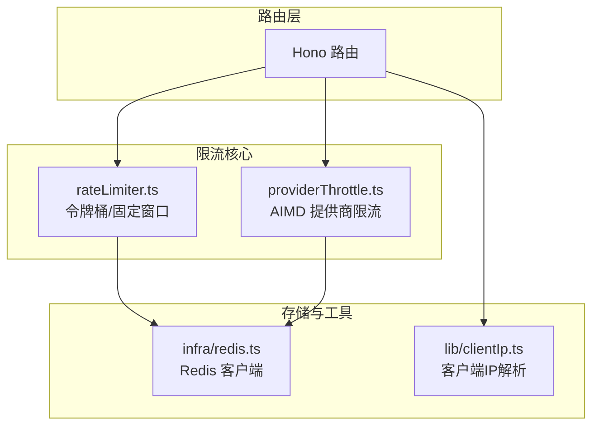
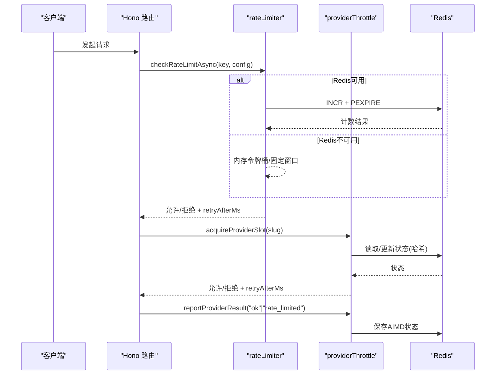
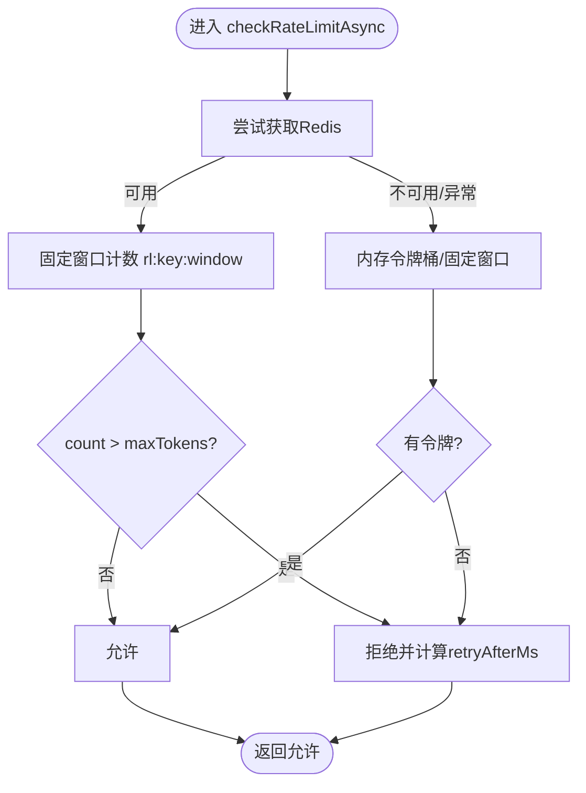
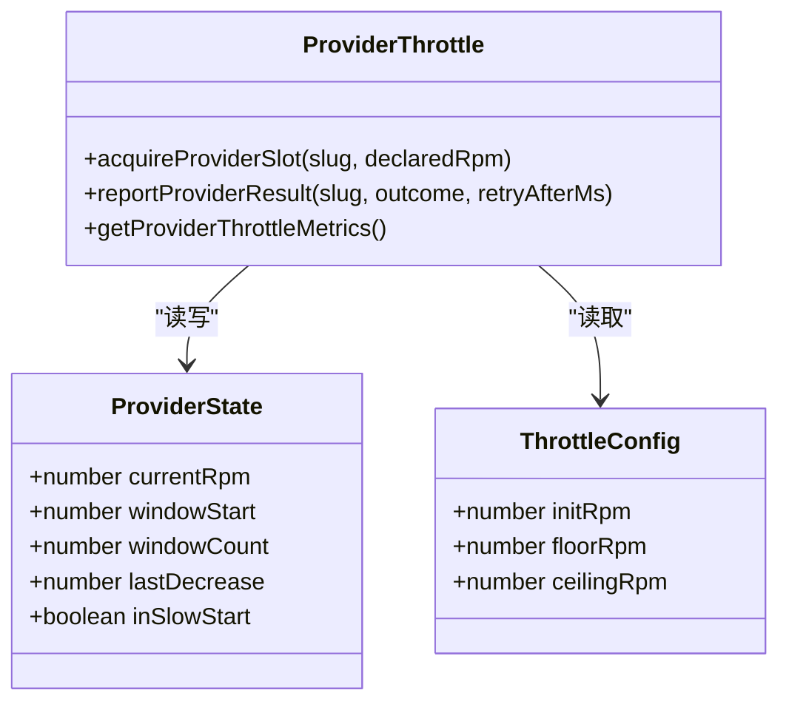
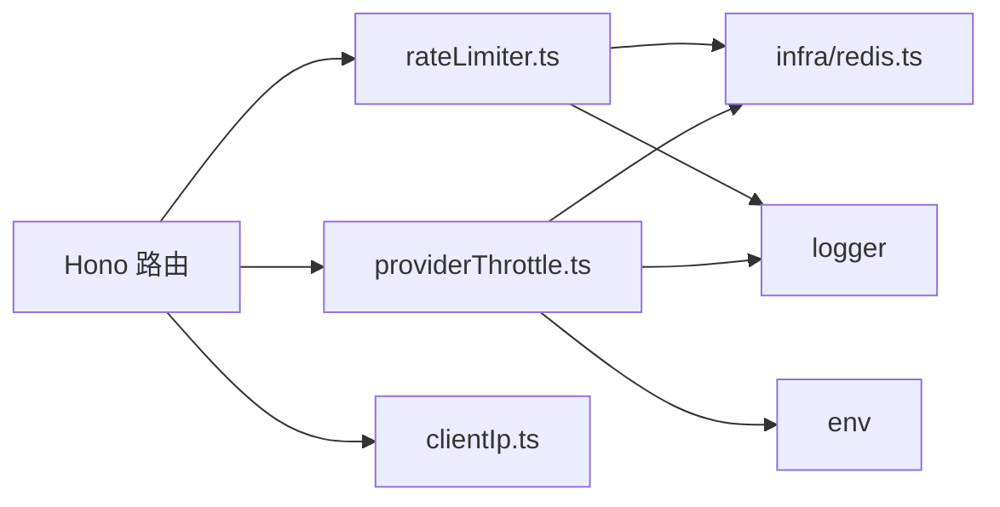

# 速率限制中间件

<cite>
**本文引用的文件**
- [api/lib/rateLimiter.ts](file://api/lib/rateLimiter.ts)
- [api/lib/providerThrottle.ts](file://api/lib/providerThrottle.ts)
- [api/infra/redis.ts](file://api/infra/redis.ts)
- [api/middleware.ts](file://api/middleware.ts)
- [api/router.ts](file://api/router.ts)
- [api/lib/clientIp.ts](file://api/lib/clientIp.ts)
- [api/lib/rateLimiter.test.ts](file://api/lib/rateLimiter.test.ts)
- [api/lib/providerThrottle.test.ts](file://api/lib/providerThrottle.test.ts)
- [api/backup-route.ts](file://api/backup-route.ts)
- [api/feedback-screenshot-route.ts](file://api/feedback-screenshot-route.ts)
</cite>

## 目录
1. [简介](#简介)
2. [项目结构](#项目结构)
3. [核心组件](#核心组件)
4. [架构总览](#架构总览)
5. [详细组件分析](#详细组件分析)
6. [依赖关系分析](#依赖关系分析)
7. [性能考量](#性能考量)
8. [故障排查指南](#故障排查指南)
9. [结论](#结论)
10. [附录：配置与使用示例](#附录配置与使用示例)

## 简介
本文件面向DeeWaanAI系统的速率限制中间件，聚焦以下目标：
- Hono路由层的请求频率控制与防滥用机制（基于令牌桶与固定窗口）
- 提供商限流器AIMD设计模式（自动发现可持续RPM、配额管理）
- 存储策略：内存缓存与Redis持久化（含降级策略）
- 配置示例：全局限制、IP级别限制、用户级别限制
- 算法选择与调优：令牌桶与滑动窗口的适用场景

## 项目结构
速率限制能力由以下模块协同完成：
- 通用速率限制库：提供令牌桶与固定窗口计数，支持Redis分布式共享与内存降级
- 提供商限流器：对LLM提供商调用进行AIMD自适应限速
- Redis基础设施：连接管理、失败重试与降级
- 客户端IP解析：用于按IP维度限流
- 路由层集成：在Hono路由中按业务维度应用限流

图表来源
- [api/lib/rateLimiter.ts:1-216](file://api/lib/rateLimiter.ts#L1-L216)
- [api/lib/providerThrottle.ts:1-275](file://api/lib/providerThrottle.ts#L1-L275)
- [api/infra/redis.ts:1-88](file://api/infra/redis.ts#L1-L88)
- [api/lib/clientIp.ts:1-36](file://api/lib/clientIp.ts#L1-L36)

章节来源
- [api/lib/rateLimiter.ts:1-216](file://api/lib/rateLimiter.ts#L1-L216)
- [api/lib/providerThrottle.ts:1-275](file://api/lib/providerThrottle.ts#L1-L275)
- [api/infra/redis.ts:1-88](file://api/infra/redis.ts#L1-L88)
- [api/lib/clientIp.ts:1-36](file://api/lib/clientIp.ts#L1-L36)

## 核心组件
- 令牌桶限流器：进程内Map维护Bucket，周期性清理；支持异步Redis固定窗口计数作为分布式实现，失败时回退到内存。
- 客户级限流：按订阅层级（solo/team/admin）分配不同每分钟配额，采用固定窗口计数，支持Redis与内存双路径。
- 提供商AIMD限流：为每个LLM提供商维护当前RPM、窗口计数、慢启动与冷却期，依据成功/429信号动态调整。
- Redis基础设施：懒加载单例，最多3次快速重试，失败后标记不可用并返回null，确保系统不崩溃。
- 客户端IP：根据可信代理开关决定从x-forwarded-for或直连地址获取IP，用于IP级限流键。

章节来源
- [api/lib/rateLimiter.ts:11-103](file://api/lib/rateLimiter.ts#L11-L103)
- [api/lib/rateLimiter.ts:118-216](file://api/lib/rateLimiter.ts#L118-L216)
- [api/lib/providerThrottle.ts:17-86](file://api/lib/providerThrottle.ts#L17-L86)
- [api/infra/redis.ts:1-88](file://api/infra/redis.ts#L1-L88)
- [api/lib/clientIp.ts:1-36](file://api/lib/clientIp.ts#L1-L36)

## 架构总览
整体数据流：
- 请求进入Hono路由，先通过IP/用户维度限流检查
- 若涉及LLM调用，再经提供商AIMD限流器申请槽位
- 限流状态优先写入Redis（分布式共享），失败则回退到进程内存
- 提供商调用结果上报，触发AIMD的增减策略

图表来源
- [api/lib/rateLimiter.ts:64-93](file://api/lib/rateLimiter.ts#L64-L93)
- [api/lib/rateLimiter.ts:168-189](file://api/lib/rateLimiter.ts#L168-L189)
- [api/lib/providerThrottle.ts:88-133](file://api/lib/providerThrottle.ts#L88-L133)
- [api/lib/providerThrottle.ts:168-199](file://api/lib/providerThrottle.ts#L168-L199)
- [api/lib/providerThrottle.ts:207-235](file://api/lib/providerThrottle.ts#L207-L235)

## 详细组件分析

### 令牌桶与固定窗口限流（rateLimiter）
- 令牌桶（同步）：以key为单位维护tokens与lastRefill，按refillRate补充，达到maxTokens上限；每次请求消耗1个token，不足则拒绝并给出retryAfterMs。
- 异步Redis路径：使用固定窗口计数器rl:${key}:${windowIndex}，INCR原子计数，首次命中设置过期时间；超过maxTokens即拒绝。
- 客户级限流：按tier（solo/team/admin）选择不同配额，固定窗口计数，返回limit与remaining便于响应头展示。
- 内存降级：当Redis不可用时，自动回退到进程内Map，保证可用性。

图表来源
- [api/lib/rateLimiter.ts:64-93](file://api/lib/rateLimiter.ts#L64-L93)
- [api/lib/rateLimiter.ts:150-166](file://api/lib/rateLimiter.ts#L150-L166)
- [api/lib/rateLimiter.ts:168-189](file://api/lib/rateLimiter.ts#L168-L189)

章节来源
- [api/lib/rateLimiter.ts:11-103](file://api/lib/rateLimiter.ts#L11-L103)
- [api/lib/rateLimiter.ts:118-216](file://api/lib/rateLimiter.ts#L118-L216)
- [api/lib/rateLimiter.test.ts:22-65](file://api/lib/rateLimiter.test.ts#L22-L65)
- [api/lib/rateLimiter.test.ts:111-141](file://api/lib/rateLimiter.test.ts#L111-L141)

### 提供商AIMD限流器（providerThrottle）
- 状态模型：currentRpm、windowStart、windowCount、lastDecrease、inSlowStart
- 慢启动：未声明RPM时，每过一个干净窗口将RPM翻倍直至上限
- 拥塞避免：非慢启动且冷却期过后，按加法增加（固定增量或百分比）
- 拥塞反应：收到“rate_limited”时乘法减半，并可按Retry-After暂停窗口
- 槽位申请：按elapsed比例计算proratedLimit，超出则拒绝并返回等待时间
- 指标查询：可汇总所有提供商当前RPM、窗口计数、是否处于慢启动

图表来源
- [api/lib/providerThrottle.ts:17-35](file://api/lib/providerThrottle.ts#L17-L35)
- [api/lib/providerThrottle.ts:88-133](file://api/lib/providerThrottle.ts#L88-L133)
- [api/lib/providerThrottle.ts:135-199](file://api/lib/providerThrottle.ts#L135-L199)
- [api/lib/providerThrottle.ts:207-275](file://api/lib/providerThrottle.ts#L207-L275)

章节来源
- [api/lib/providerThrottle.ts:17-86](file://api/lib/providerThrottle.ts#L17-L86)
- [api/lib/providerThrottle.ts:135-199](file://api/lib/providerThrottle.ts#L135-L199)
- [api/lib/providerThrottle.ts:207-275](file://api/lib/providerThrottle.ts#L207-L275)
- [api/lib/providerThrottle.test.ts:24-103](file://api/lib/providerThrottle.test.ts#L24-L103)
- [api/lib/providerThrottle.test.ts:105-185](file://api/lib/providerThrottle.test.ts#L105-L185)

### Redis基础设施（infra/redis）
- 懒加载单例：首次访问时建立连接，最多3次快速重试，指数退避
- 失败处理：连接失败记录日志并标记gaveUp，后续直接返回null
- 安全策略：关闭ioredis内部重试队列，避免雪崩；错误事件被吞掉并由上层处理
- 启用判断：仅当配置了REDIS_URL时才尝试连接

章节来源
- [api/infra/redis.ts:1-88](file://api/infra/redis.ts#L1-L88)

### 客户端IP解析（clientIp）
- 可信代理模式：默认信任x-forwarded-for第一个条目，否则忽略
- 直连模式：直接使用remoteAddress，无则降级为unknown（聚合限流，fail-closed）
- 用途：构造IP级限流键，防止单IP滥用

章节来源
- [api/lib/clientIp.ts:1-36](file://api/lib/clientIp.ts#L1-L36)

### Hono路由层集成
- 注释明确：tRPC中间件不再承担限流职责，限流下沉至Hono路由层与具体router
- 路由装配：appRouter集中注册各功能子路由，限流在各子路由内按需挂载
- 实际用法：在敏感接口（如备份、截图上传/服务）中使用checkRateLimitAsync并结合RATE_LIMITS配置

章节来源
- [api/middleware.ts:45-51](file://api/middleware.ts#L45-L51)
- [api/router.ts:1-73](file://api/router.ts#L1-L73)
- [api/backup-route.ts:21-41](file://api/backup-route.ts#L21-L41)
- [api/feedback-screenshot-route.ts:25-69](file://api/feedback-screenshot-route.ts#L25-L69)
- [api/feedback-screenshot-route.ts:149-149](file://api/feedback-screenshot-route.ts#L149-L149)

## 依赖关系分析
- rateLimiter依赖infra/redis获取Redis客户端，依赖logger记录降级信息
- providerThrottle同样依赖redis与logger，并通过env解析每提供商配置
- 路由层通过middleware导出createRouter等，但限流逻辑在路由内显式调用
- clientIp为IP级限流提供键源

图表来源
- [api/lib/rateLimiter.ts:1-3](file://api/lib/rateLimiter.ts#L1-L3)
- [api/lib/providerThrottle.ts:13-15](file://api/lib/providerThrottle.ts#L13-L15)
- [api/middleware.ts:1-12](file://api/middleware.ts#L1-L12)
- [api/lib/clientIp.ts:1-3](file://api/lib/clientIp.ts#L1-L3)

章节来源
- [api/lib/rateLimiter.ts:1-3](file://api/lib/rateLimiter.ts#L1-L3)
- [api/lib/providerThrottle.ts:13-15](file://api/lib/providerThrottle.ts#L13-L15)
- [api/middleware.ts:1-12](file://api/middleware.ts#L1-L12)
- [api/lib/clientIp.ts:1-3](file://api/lib/clientIp.ts#L1-L3)

## 性能考量
- 令牌桶：O(1)操作，内存Map定期清理，适合高吞吐短窗口限流
- 固定窗口（Redis）：INCR+PEXPIRE原子操作，跨节点一致；窗口键自然过期，减少维护成本
- AIMD：窗口边界批量调整RPM，单次申请为O(1)，降低频繁写盘开销
- Redis降级：连接失败快速回退内存路径，保障可用性；建议生产环境保持Redis在线以获得跨节点一致性
- 键空间：合理拆分key（用户ID/IP/业务域），避免热点冲突

[本节为通用指导，无需特定文件引用]

## 故障排查指南
- Redis不可用：
  - 现象：日志出现“Redis unavailable after retries — running with in-memory fallbacks”
  - 影响：分布式一致性丢失，退化为进程内限流
  - 处置：检查REDIS_URL、网络连通性、Redis服务健康
- 限流误杀：
  - 现象：正常请求被拒绝并附带retryAfterMs
  - 排查：确认key粒度（用户/IP/业务）、配额是否过严、是否存在突发流量
- 提供商限流过度：
  - 现象：大量429导致RPM持续下降
  - 排查：确认reportProviderResult是否正确上报“rate_limited”，观察slow start与冷却期行为
- IP识别问题：
  - 现象：多用户共用一个IP键导致互相影响
  - 排查：检查TRUSTED_PROXY设置与x-forwarded-for头是否可信

章节来源
- [api/infra/redis.ts:61-88](file://api/infra/redis.ts#L61-L88)
- [api/lib/rateLimiter.ts:86-93](file://api/lib/rateLimiter.ts#L86-L93)
- [api/lib/providerThrottle.ts:207-235](file://api/lib/providerThrottle.ts#L207-L235)
- [api/lib/clientIp.ts:1-36](file://api/lib/clientIp.ts#L1-L36)

## 结论
本系统实现了分层、可扩展的速率限制方案：
- 通用API层面：令牌桶与固定窗口结合，兼顾突发与稳定流量
- 业务层面：按用户/团队/管理员分级配额，适配商业化策略
- LLM提供商：AIMD自适应调节，有效应对上游限流与抖动
- 存储层：Redis优先、内存降级，确保高可用与一致性平衡
建议在上线前结合压测与监控，逐步调参以达到最佳体验与稳定性。

[本节为总结，无需特定文件引用]

## 附录：配置与使用示例

### 全局限制（令牌桶）
- 使用默认配置或自定义RateLimitConfig
- 适用于一般读接口或轻量操作
- 参考路径：[api/lib/rateLimiter.ts:11-21](file://api/lib/rateLimiter.ts#L11-L21)

### IP级别限制
- 使用getClientIp生成IP键，结合RATE_LIMITS中的screenshotServe等配置
- 适用于图片服务、公开接口等
- 参考路径：
  - [api/lib/clientIp.ts:1-36](file://api/lib/clientIp.ts#L1-L36)
  - [api/lib/rateLimiter.ts:96-103](file://api/lib/rateLimiter.ts#L96-L103)
  - [api/feedback-screenshot-route.ts:25-69](file://api/feedback-screenshot-route.ts#L25-L69)

### 用户级别限制
- 使用userId作为key，结合RATE_LIMITS.screenshotUpload等
- 适用于用户上传、敏感操作
- 参考路径：
  - [api/lib/rateLimiter.ts:96-103](file://api/lib/rateLimiter.ts#L96-L103)
  - [api/feedback-screenshot-route.ts:149-149](file://api/feedback-screenshot-route.ts#L149-L149)

### 客户级配额（solo/team/admin）
- 使用checkCustomerRateLimit，传入对应tier
- 适用于MCP表面或需要区分付费等级的接口
- 参考路径：
  - [api/lib/rateLimiter.ts:118-124](file://api/lib/rateLimiter.ts#L118-L124)
  - [api/lib/rateLimiter.ts:198-216](file://api/lib/rateLimiter.ts#L198-L216)

### 提供商AIMD限流
- 调用acquireProviderSlot申请槽位，reportProviderResult上报结果
- 可通过环境变量PROVIDER_THROTTLE为不同提供商定制init/floor/ceiling
- 参考路径：
  - [api/lib/providerThrottle.ts:45-70](file://api/lib/providerThrottle.ts#L45-L70)
  - [api/lib/providerThrottle.ts:168-199](file://api/lib/providerThrottle.ts#L168-L199)
  - [api/lib/providerThrottle.ts:207-235](file://api/lib/providerThrottle.ts#L207-L235)

### 算法选择与调优建议
- 令牌桶：适合突发流量与平滑限流，关注refillRate与maxTokens
- 固定窗口：简单高效，适合按分钟配额的场景；注意窗口切换时的瞬时峰值
- AIMD：对上游限流敏感的系统非常有效，需正确上报“rate_limited”并配合Retry-After
- 监控与观测：结合getProviderThrottleMetrics与日志，观察RPM收敛与窗口行为

[本节为实践指导，无需特定文件引用]