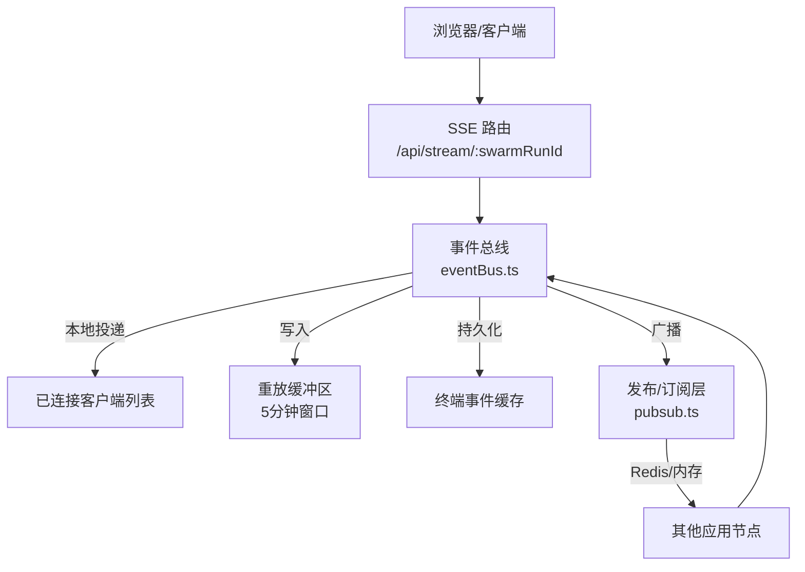
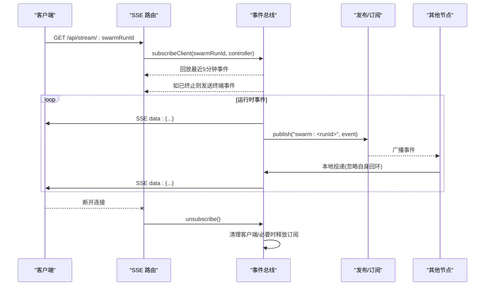
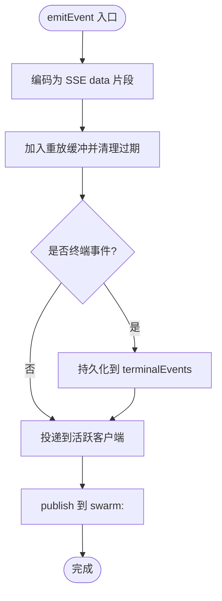
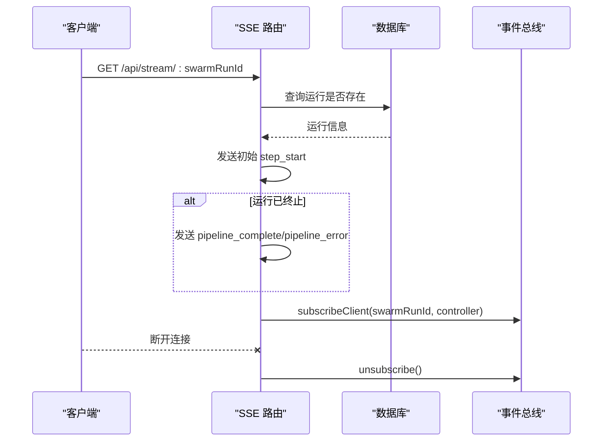
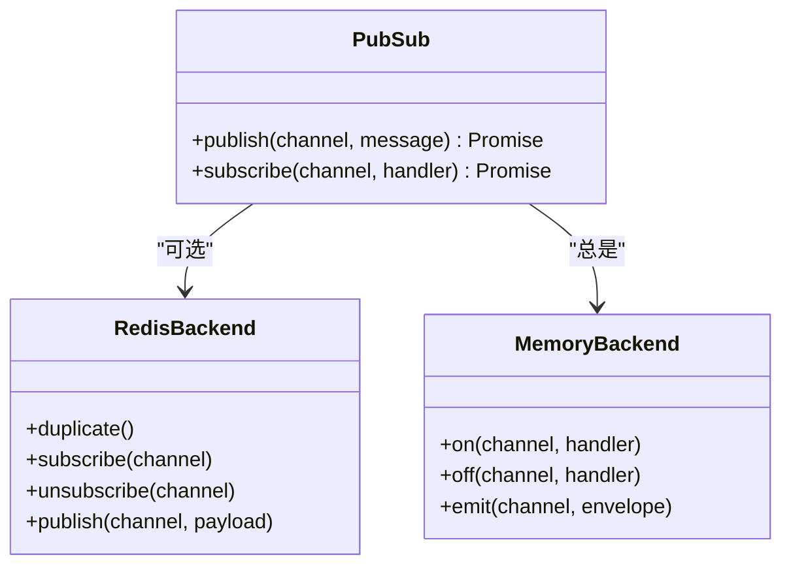
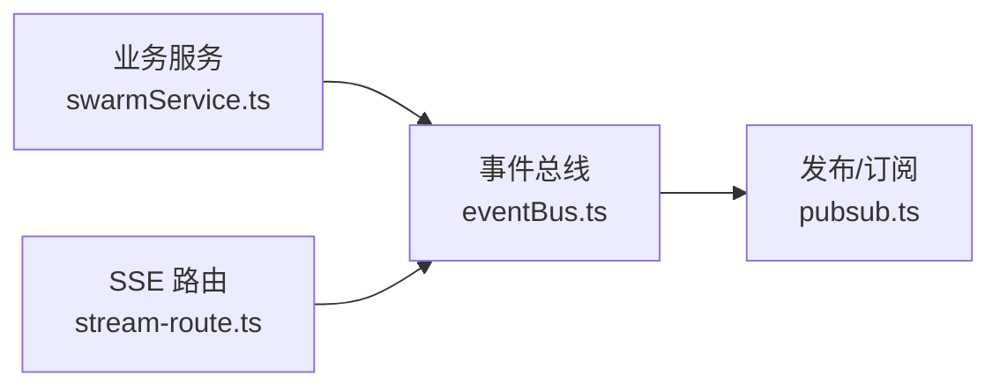

# 事件总线

<cite>
**本文引用的文件**
- [api/services/eventBus.ts](file://api/services/eventBus.ts)
- [api/stream-route.ts](file://api/stream-route.ts)
- [api/infra/pubsub.ts](file://api/infra/pubsub.ts)
- [api/services/swarmService.ts](file://api/services/swarmService.ts)
</cite>

## 目录
1. [简介](#简介)
2. [项目结构](#项目结构)
3. [核心组件](#核心组件)
4. [架构总览](#架构总览)
5. [详细组件分析](#详细组件分析)
6. [依赖关系分析](#依赖关系分析)
7. [性能考量](#性能考量)
8. [故障排查指南](#故障排查指南)
9. [结论](#结论)
10. [附录：使用示例与最佳实践](#附录使用示例与最佳实践)

## 简介
本文件为 DeeWaanAI 系统的事件总线提供深入技术文档，聚焦以下能力：
- SSE 流式传输：服务端通过 /api/stream/:swarmRunId 向客户端推送流水线执行进度。
- 重放缓冲区：新连接可回放最近 5 分钟内的流水线事件，避免漏掉近期进度。
- 终端事件持久化：当流水线完成或出错时，最终事件在进程内存中永久保存，直到清理。
- 事件订阅与发布：统一的 emitEvent 接口用于发布；subscribeClient 用于订阅并管理客户端生命周期。
- PipelineEvent 类型体系：step_start、step_complete、step_error、step_stream、pipeline_complete、pipeline_error、awaiting_approval 等。
- 内存管理与资源释放：客户端断开清理、缓冲区维护、跨节点广播订阅的按需创建与释放。

## 项目结构
事件总线由以下关键部分组成：
- 事件总线服务：负责本地投递、重放缓冲、终端事件存储、跨节点广播订阅。
- SSE 路由：暴露 /api/stream/:swarmRunId，处理连接建立、初始事件、断连清理。
- 发布/订阅基础设施：抽象 Redis 与内存两种后端，实现多实例间的事件广播。
- 业务侧事件发布：流水线执行过程中调用 emitEvent 发布各类事件。

图表来源
- [api/stream-route.ts:8-69](file://api/stream-route.ts#L8-L69)
- [api/services/eventBus.ts:23-167](file://api/services/eventBus.ts#L23-L167)
- [api/infra/pubsub.ts:90-153](file://api/infra/pubsub.ts#L90-L153)

章节来源
- [api/stream-route.ts:8-69](file://api/stream-route.ts#L8-L69)
- [api/services/eventBus.ts:23-167](file://api/services/eventBus.ts#L23-L167)
- [api/infra/pubsub.ts:90-153](file://api/infra/pubsub.ts#L90-L153)

## 核心组件
- 事件总线（eventBus.ts）
  - 客户端管理：按 swarmRunId 维护 ReadableStreamDefaultController 列表，支持断连清理。
  - 重放缓冲：每个运行保留最近 5 分钟的 SSE data 片段，新连接立即回放。
  - 终端事件：pipeline_complete/pipeline_error 被持久化到进程内存，供后续连接快速获知终态。
  - 跨节点广播：基于 pubsub 将事件分发到其他节点，再由其本地投递给各自 SSE 客户端。
- SSE 路由（stream-route.ts）
  - 校验 swarmRunId 存在性。
  - 发送初始 step_start 事件。
  - 若运行已终止，立即发送对应终端事件。
  - 订阅事件总线并在断连时清理。
- 发布/订阅（pubsub.ts）
  - 统一 API publish/subscribe，自动选择 Redis 或内存后端。
  - 消息包裹 origin 字段，避免自环重复消费。
- 业务事件发布（swarmService.ts）
  - 在步骤开始、完成、错误、等待审批、循环迭代等处调用 emitEvent 发布事件。

章节来源
- [api/services/eventBus.ts:13-167](file://api/services/eventBus.ts#L13-L167)
- [api/stream-route.ts:8-69](file://api/stream-route.ts#L8-L69)
- [api/infra/pubsub.ts:1-154](file://api/infra/pubsub.ts#L1-L154)
- [api/services/swarmService.ts:380-515](file://api/services/swarmService.ts#L380-L515)

## 架构总览
事件总线采用“本地优先 + 跨节点广播”的双通道模型：
- 本地通道：emitEvent 直接 deliverLocal，写入缓冲、终端事件，并推送到当前进程的 SSE 客户端。
- 跨节点通道：publish 到 swarm:<runId> 频道，其他节点收到后同样 deliverLocal 给其本地客户端。
- 订阅管理：首次有客户端订阅某 run 时，懒创建进程级 pub/sub 订阅；无客户端时释放订阅，减少资源占用。

图表来源
- [api/stream-route.ts:24-58](file://api/stream-route.ts#L24-L58)
- [api/services/eventBus.ts:129-167](file://api/services/eventBus.ts#L129-L167)
- [api/infra/pubsub.ts:90-153](file://api/infra/pubsub.ts#L90-L153)

## 详细组件分析

### 事件总线（eventBus.ts）
- 数据结构
  - clients: Map<swarmRunId, Client[]>，维护每个运行的活跃 SSE 控制器。
  - buffers: Map<swarmRunId, BufferedEvent[]>，记录每条事件的字节与时间戳，用于回放。
  - terminalEvents: Map<swarmRunId, Uint8Array>，持久化 pipeline_complete/pipeline_error。
  - channelSubs/channelSubPending: 管理跨节点订阅的生命周期。
- 关键流程
  - deliverLocal：编码事件、写入缓冲、持久化终端事件、推送至所有活跃客户端、清理已关闭客户端。
  - replayBuffer：为新连接回放最近 5 分钟的事件，同时清理过期条目。
  - ensureChannelSubscription：懒创建进程级 pub/sub 订阅，接收来自其他节点的事件并本地投递。
  - maybeReleaseChannelSubscription：当某 run 无活跃客户端时释放订阅。
  - subscribeClient：回放 + 终端事件 + 注册客户端 + 确保订阅。
  - emitEvent：本地投递 + 跨节点广播（失败不抛错）。
  - clearTerminalEvent：在适当时机清理终端事件。

图表来源
- [api/services/eventBus.ts:94-167](file://api/services/eventBus.ts#L94-L167)

章节来源
- [api/services/eventBus.ts:23-167](file://api/services/eventBus.ts#L23-L167)

### SSE 路由（stream-route.ts）
- 功能要点
  - 参数校验：swarmRunId 必须为有效数字。
  - 运行存在性检查：查询数据库确认运行存在。
  - 初始事件：发送 step_start 表示连接成功。
  - 终端状态即时返回：若运行已完成/失败/取消，立即发送对应终端事件。
  - 订阅与清理：调用 subscribeClient 订阅事件，监听请求中止以清理。
- 响应头
  - Content-Type: text/event-stream
  - Cache-Control: no-cache
  - Connection: keep-alive
  - X-Accel-Buffering: no（防止反向代理缓冲）

图表来源
- [api/stream-route.ts:8-69](file://api/stream-route.ts#L8-L69)

章节来源
- [api/stream-route.ts:8-69](file://api/stream-route.ts#L8-L69)

### 发布/订阅（pubsub.ts）
- 双后端策略
  - Redis：多实例部署时的跨节点广播。
  - 内存：开发或单实例场景下的进程内广播。
- 消息信封
  - origin：实例 ID，用于丢弃自身回环消息。
  - ts：时间戳。
  - message：实际事件载荷。
- 订阅与发布
  - publish：先尝试 Redis，失败降级到内存 EventEmitter。
  - subscribe：始终注册本地处理器，可选注册 Redis 订阅；返回 unsubscribe 函数。

图表来源
- [api/infra/pubsub.ts:90-153](file://api/infra/pubsub.ts#L90-L153)

章节来源
- [api/infra/pubsub.ts:1-154](file://api/infra/pubsub.ts#L1-L154)

### 业务事件发布（swarmService.ts）
- 典型事件
  - step_start：步骤开始时发布，包含 step、agentRole、agentName。
  - step_complete：步骤完成时发布，包含 tokensUsed、latencyMs。
  - step_error：步骤异常时发布，包含 error、isCreditError。
  - awaiting_approval：需要人工审批时发布，包含 lastOutput、agentName。
  - pipeline_complete/pipeline_error：流水线结束或出错时发布。
- 使用方式
  - 在步骤执行前后、异常捕获处、循环控制逻辑中调用 emitEvent。

章节来源
- [api/services/swarmService.ts:380-515](file://api/services/swarmService.ts#L380-L515)

## 依赖关系分析
- 事件总线依赖
  - 发布/订阅层：用于跨节点广播。
  - 日志器：记录警告与调试信息。
- SSE 路由依赖
  - 事件总线：订阅客户端。
  - 数据库：验证运行存在性。
- 业务服务依赖
  - 事件总线：发布流水线事件。

图表来源
- [api/services/swarmService.ts:380-515](file://api/services/swarmService.ts#L380-L515)
- [api/stream-route.ts:8-69](file://api/stream-route.ts#L8-L69)
- [api/services/eventBus.ts:10-11](file://api/services/eventBus.ts#L10-L11)
- [api/infra/pubsub.ts:90-153](file://api/infra/pubsub.ts#L90-L153)

章节来源
- [api/services/swarmService.ts:380-515](file://api/services/swarmService.ts#L380-L515)
- [api/stream-route.ts:8-69](file://api/stream-route.ts#L8-L69)
- [api/services/eventBus.ts:10-11](file://api/services/eventBus.ts#L10-L11)
- [api/infra/pubsub.ts:90-153](file://api/infra/pubsub.ts#L90-L153)

## 性能考量
- 重放缓冲大小与清理
  - 固定 5 分钟窗口，每次写入时过滤过期事件，避免无限增长。
  - 若无新鲜事件，删除该 run 的缓冲项，降低内存占用。
- 客户端清理
  - 投递失败标记 closed，定期过滤无效客户端；当某 run 无活跃客户端时删除映射。
- 跨节点订阅管理
  - 懒创建订阅，仅在至少一个客户端存在时保持；无客户端时释放订阅，减少 Redis 订阅数。
- 广播失败容忍
  - publish 失败仅记录日志，不影响本地投递，保证可用性。
- SSE 头部优化
  - 禁用代理缓冲，确保实时性。

[本节为通用性能指导，不直接分析具体文件]

## 故障排查指南
- 客户端未收到事件
  - 检查 /api/stream/:swarmRunId 是否正确返回 SSE 头。
  - 确认 swarmRunId 在数据库中是否存在。
  - 查看事件总线是否已将事件写入缓冲和终端事件。
- 多实例下事件丢失
  - 确认 Redis 可用且订阅成功；若不可用，退化为内存模式，仅同实例可见。
  - 检查 origin 字段是否导致自环丢弃。
- 内存泄漏迹象
  - 长时间运行后内存持续增长：检查是否有未清理的客户端或订阅。
  - 确认客户端断开时 unsubscribe 被调用。
- 终端事件未触发
  - 确认业务侧确实发布了 pipeline_complete/pipeline_error。
  - 检查终端事件是否在合适时机被清理。

章节来源
- [api/stream-route.ts:8-69](file://api/stream-route.ts#L8-L69)
- [api/services/eventBus.ts:94-167](file://api/services/eventBus.ts#L94-L167)
- [api/infra/pubsub.ts:90-153](file://api/infra/pubsub.ts#L90-L153)

## 结论
事件总线为 DeeWaanAI 提供了高可用的流水线事件流式传输能力：
- 通过本地优先与跨节点广播结合，确保事件可靠送达。
- 5 分钟重放缓冲提升用户体验，终端事件持久化保障终态可达。
- 完善的客户端与订阅生命周期管理，避免资源泄露。
- 清晰的 PipelineEvent 类型定义，便于前端与后端协同演进。

[本节为总结性内容，不直接分析具体文件]

## 附录：使用示例与最佳实践

### 事件类型与字段说明（PipelineEvent）
- type：事件类型，包括 step_start、step_complete、step_error、step_stream、pipeline_complete、pipeline_error、awaiting_approval。
- swarmRunId：关联的运行标识。
- step：步骤序号（可选）。
- agentRole/agentName：代理角色与名称（可选）。
- iteration：迭代次数（可选）。
- responseType：响应类型（可选）。
- tokensUsed/latencyMs：当前步骤使用的 token 数与耗时（可选）。
- totalTokens/totalLatencyMs：累计 token 与耗时（可选）。
- finalResponse：最终响应文本（可选）。
- awaitingApproval：是否需要人工审批（可选）。
- chain：步骤链信息（可选）。
- error：错误信息（可选）。
- delta：增量数据，用于 step_stream 的 token 增量（可选）。
- timestamp：事件时间戳（必填）。

章节来源
- [api/services/eventBus.ts:174-192](file://api/services/eventBus.ts#L174-L192)

### 订阅事件（客户端）
- 打开 SSE 连接：GET /api/stream/:swarmRunId。
- 接收初始 step_start 事件。
- 若运行已终止，立即收到 pipeline_complete 或 pipeline_error。
- 持续接收后续事件，直至连接关闭。

章节来源
- [api/stream-route.ts:24-58](file://api/stream-route.ts#L24-L58)

### 发布事件（服务端）
- 在步骤开始、完成、错误、等待审批、流水线结束等时机调用 emitEvent。
- 示例路径：
  - 步骤开始：[api/services/swarmService.ts:380-384](file://api/services/swarmService.ts#L380-L384)
  - 步骤完成：[api/services/swarmService.ts:514-515](file://api/services/swarmService.ts#L514-L515)
  - 步骤错误：[api/services/swarmService.ts:474-482](file://api/services/swarmService.ts#L474-L482)
  - 等待审批：[api/services/swarmService.ts:630-630](file://api/services/swarmService.ts#L630-L630)
  - 流水线错误：[api/services/swarmService.ts:987-987](file://api/services/swarmService.ts#L987-L987)
  - 流水线完成：[api/services/swarmService.ts:1008-1008](file://api/services/swarmService.ts#L1008-L1008)

章节来源
- [api/services/swarmService.ts:380-515](file://api/services/swarmService.ts#L380-L515)

### 内存管理与资源释放策略
- 客户端断开：
  - 路由监听请求中止，调用 unsubscribe 清理控制器与客户端列表。
- 缓冲区维护：
  - 每次写入时过滤过期事件，空缓冲删除键。
- 订阅释放：
  - 当某 run 无活跃客户端时，释放进程级 pub/sub 订阅。
- 终端事件清理：
  - 在适当时机调用 clearTerminalEvent 清理不再相关的终态事件。

章节来源
- [api/stream-route.ts:50-58](file://api/stream-route.ts#L50-L58)
- [api/services/eventBus.ts:129-172](file://api/services/eventBus.ts#L129-L172)