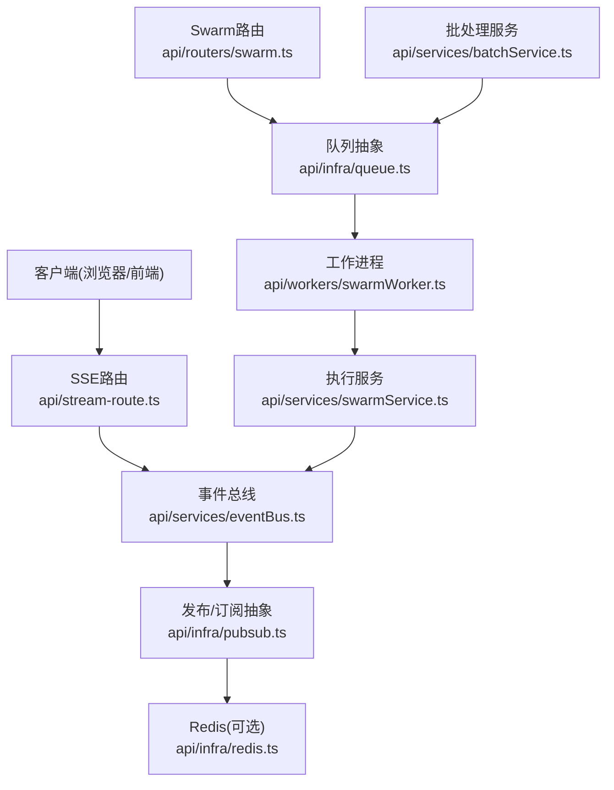
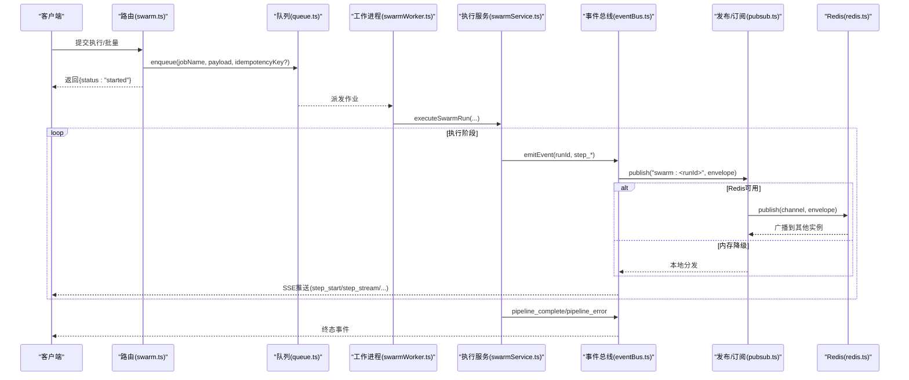
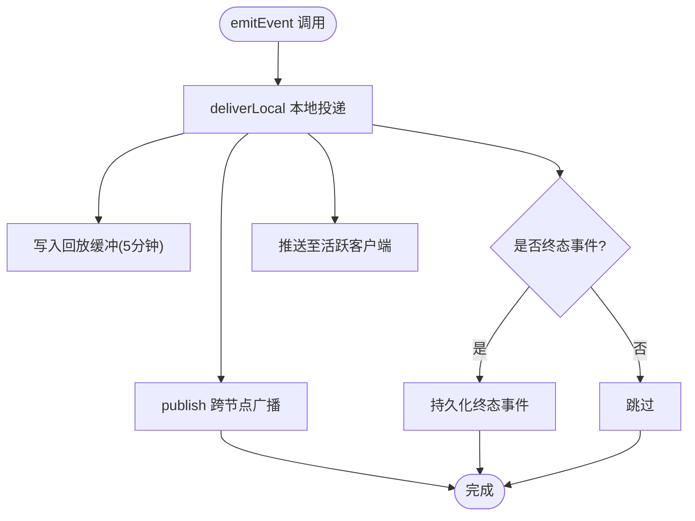
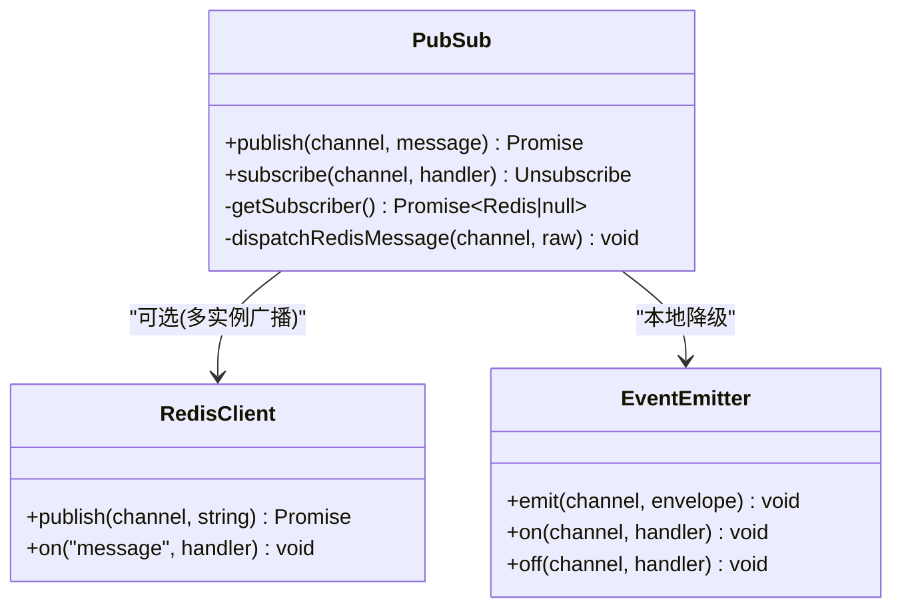
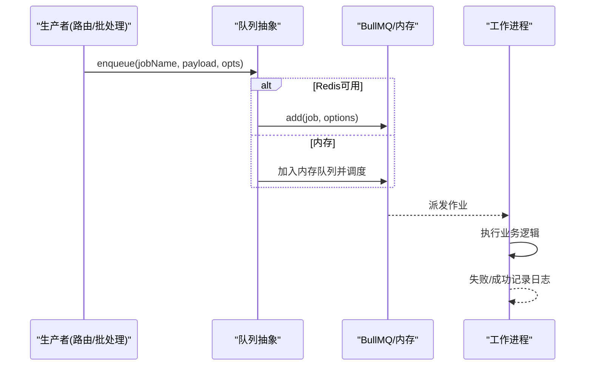
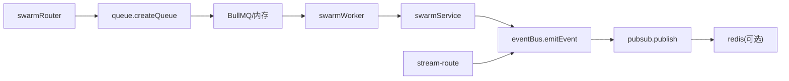

# 事件驱动模式

<cite>
**本文引用的文件**
- [api/services/eventBus.ts](file://api/services/eventBus.ts)
- [api/infra/pubsub.ts](file://api/infra/pubsub.ts)
- [api/infra/queue.ts](file://api/infra/queue.ts)
- [api/infra/redis.ts](file://api/infra/redis.ts)
- [api/workers/swarmWorker.ts](file://api/workers/swarmWorker.ts)
- [api/services/batchService.ts](file://api/services/batchService.ts)
- [api/routers/swarm.ts](file://api/routers/swarm.ts)
- [api/stream-route.ts](file://api/stream-route.ts)
</cite>

## 目录
1. [简介](#简介)
2. [项目结构](#项目结构)
3. [核心组件](#核心组件)
4. [架构总览](#架构总览)
5. [详细组件分析](#详细组件分析)
6. [依赖关系分析](#依赖关系分析)
7. [性能与可靠性](#性能与可靠性)
8. [故障排查指南](#故障排查指南)
9. [结论](#结论)
10. [附录：事件规范与示例路径](#附录事件规范与示例路径)

## 简介
本文件面向DeeWaanAI系统的事件驱动模式，聚焦事件总线（Event Bus）、发布/订阅（Pub/Sub）与消息队列的协同设计。文档解释如何通过事件总线实现SSE实时流式推送、跨节点广播；通过消息队列解耦批处理任务与工作进程；并通过统一的Redis抽象提供多后端能力（Redis优先，内存降级）。同时给出事件命名约定、数据格式规范、错误处理策略以及典型场景（批量调度、状态更新通知、跨服务通信）的实现要点与代码路径参考。

## 项目结构
围绕事件驱动的核心位于以下模块：
- 事件总线：api/services/eventBus.ts
- 发布/订阅抽象：api/infra/pubsub.ts
- 消息队列抽象：api/infra/queue.ts
- Redis连接管理：api/infra/redis.ts
- 工作进程：api/workers/swarmWorker.ts
- 批处理服务：api/services/batchService.ts
- 路由入口（触发执行/批量）：api/routers/swarm.ts
- SSE流式输出：api/stream-route.ts

图表来源
- [api/stream-route.ts:39-70](file://api/stream-route.ts#L39-L70)
- [api/services/eventBus.ts:1-193](file://api/services/eventBus.ts#L1-L193)
- [api/infra/pubsub.ts:1-154](file://api/infra/pubsub.ts#L1-L154)
- [api/infra/redis.ts:1-88](file://api/infra/redis.ts#L1-L88)
- [api/routers/swarm.ts:109-199](file://api/routers/swarm.ts#L109-L199)
- [api/infra/queue.ts:1-334](file://api/infra/queue.ts#L1-L334)
- [api/workers/swarmWorker.ts:1-75](file://api/workers/swarmWorker.ts#L1-L75)

章节来源
- [api/stream-route.ts:39-70](file://api/stream-route.ts#L39-L70)
- [api/services/eventBus.ts:1-193](file://api/services/eventBus.ts#L1-L193)
- [api/infra/pubsub.ts:1-154](file://api/infra/pubsub.ts#L1-L154)
- [api/infra/queue.ts:1-334](file://api/infra/queue.ts#L1-L334)
- [api/infra/redis.ts:1-88](file://api/infra/redis.ts#L1-L88)
- [api/workers/swarmWorker.ts:1-75](file://api/workers/swarmWorker.ts#L1-L75)
- [api/services/batchService.ts:45-142](file://api/services/batchService.ts#L45-L142)
- [api/routers/swarm.ts:109-199](file://api/routers/swarm.ts#L109-L199)

## 核心组件
- 事件总线（Event Bus）
  - 职责：本地SSE分发、5分钟回放缓冲、终态事件持久化、跨节点广播（基于Pub/Sub）。
  - 关键能力：subscribeClient/emitEvent/clearTerminalEvent；按swarmRunId隔离通道。
- 发布/订阅（Pub/Sub）
  - 职责：统一Redis与内存两种后端；封装envelope（origin、ts、message）；自动去重自身回环。
  - 关键API：publish/subscribe；惰性建立订阅并优雅降级。
- 消息队列（Queue）
  - 职责：BullMQ或内存队列的统一抽象；支持延迟、幂等键（24小时TTL）、失败日志。
  - 关键API：createQueue/createWorker/closeAllQueues；队列名与作业名分离。
- Redis连接
  - 职责：懒加载、重试退避、失败即返回null；所有子系统均有内存降级。
- 工作进程（Worker）
  - 职责：消费swarm-runs队列，调用执行服务；支持节流重试与去重绕过。
- 批处理服务（Batch）
  - 职责：创建批次、入队成员运行、原子推进进度、取消/恢复/导出结果。
- 路由与SSE
  - 职责：路由触发执行/批量；SSE端点订阅事件总线并回放历史。

章节来源
- [api/services/eventBus.ts:1-193](file://api/services/eventBus.ts#L1-L193)
- [api/infra/pubsub.ts:1-154](file://api/infra/pubsub.ts#L1-L154)
- [api/infra/queue.ts:1-334](file://api/infra/queue.ts#L1-L334)
- [api/infra/redis.ts:1-88](file://api/infra/redis.ts#L1-L88)
- [api/workers/swarmWorker.ts:1-75](file://api/workers/swarmWorker.ts#L1-L75)
- [api/services/batchService.ts:45-142](file://api/services/batchService.ts#L45-L142)
- [api/routers/swarm.ts:109-199](file://api/routers/swarm.ts#L109-L199)
- [api/stream-route.ts:39-70](file://api/stream-route.ts#L39-L70)

## 架构总览
事件驱动的整体流程如下：
- 请求进入路由后，将任务入队（队列抽象），立即返回“已启动”。
- 工作进程从队列取出作业，执行业务逻辑（如流水线执行），过程中持续通过事件总线发出步骤级事件。
- 事件总线将事件写入本地SSE缓冲区，并广播到Pub/Sub通道；其他节点的SSE客户端可收到跨节点事件。
- 批处理服务将多个运行项入队，并在完成时原子推进批次进度。

图表来源
- [api/routers/swarm.ts:109-199](file://api/routers/swarm.ts#L109-L199)
- [api/infra/queue.ts:210-228](file://api/infra/queue.ts#L210-L228)
- [api/workers/swarmWorker.ts:37-60](file://api/workers/swarmWorker.ts#L37-L60)
- [api/services/eventBus.ts:156-167](file://api/services/eventBus.ts#L156-L167)
- [api/infra/pubsub.ts:91-106](file://api/infra/pubsub.ts#L91-L106)
- [api/infra/redis.ts:65-82](file://api/infra/redis.ts#L65-L82)

## 详细组件分析

### 事件总线（Event Bus）
- 设计要点
  - 本地投递：为每个swarmRunId维护客户端列表与5分钟回放缓冲；终态事件持久化以便迟到客户端获取。
  - 跨节点广播：对每个运行通道lazy订阅，忽略自身回环，仅转发其他实例事件。
  - 对外API同步：emitEvent/subscribeClient/clearTerminalEvent不抛错，内部失败仅记录日志。
- 关键流程
  - subscribeClient：回放历史→发送终态→注册客户端→确保跨节点订阅。
  - emitEvent：本地投递→异步publish（失败不影响本地）。
  - deliverLocal：编码SSE data行→追加缓冲→存储终态→推送到活跃客户端→清理关闭客户端。

图表来源
- [api/services/eventBus.ts:94-127](file://api/services/eventBus.ts#L94-L127)
- [api/services/eventBus.ts:156-167](file://api/services/eventBus.ts#L156-L167)

章节来源
- [api/services/eventBus.ts:1-193](file://api/services/eventBus.ts#L1-L193)

### 发布/订阅（Pub/Sub）
- 双后端策略
  - Redis优先：使用ioredis的duplicate连接作为订阅者，集中订阅各频道；发布失败则降级到内存EventEmitter。
  - 内存模式：开发/单机环境直接本地分发。
- 信封机制
  - 每条消息包装为{origin, ts, message}，用于丢弃自身回环与调试。
- 订阅生命周期
  - 首次订阅某个频道才真正SUBSCRIBE；最后一个监听器移除时UNSUBSCRIBE。
  - 订阅失败仅记录警告，不影响本地分发。

图表来源
- [api/infra/pubsub.ts:1-154](file://api/infra/pubsub.ts#L1-L154)

章节来源
- [api/infra/pubsub.ts:1-154](file://api/infra/pubsub.ts#L1-L154)
- [api/infra/redis.ts:1-88](file://api/infra/redis.ts#L1-L88)

### 消息队列（Queue）
- 双后端策略
  - BullMQ（Redis）：持久化、多节点、支持延迟与失败日志；连接配置满足BullMQ要求。
  - 内存队列：Map+定时器，适合开发/单节点；具备幂等键（24h TTL）与延迟。
- 幂等性
  - 同一idempotencyKey在24小时内重复入队将被去重，避免重复执行。
- 工作进程
  - createWorker根据后端选择BullWorker或内存处理器；支持并发度与环境变量控制。
- 优雅关闭
  - closeAllQueues依次关闭worker与queue，并断开BullMQ连接。

图表来源
- [api/infra/queue.ts:210-228](file://api/infra/queue.ts#L210-L228)
- [api/infra/queue.ts:235-260](file://api/infra/queue.ts#L235-L260)
- [api/infra/queue.ts:149-198](file://api/infra/queue.ts#L149-L198)

章节来源
- [api/infra/queue.ts:1-334](file://api/infra/queue.ts#L1-L334)

### 工作进程（swarmWorker）
- 职责：消费swarm-runs队列，调用executeSwarmRun；遇到限流时以bypassDedup方式重新入队。
- 健壮性：校验payload，未知job名直接丢弃；异常由执行服务内部处理并标记失败。

章节来源
- [api/workers/swarmWorker.ts:1-75](file://api/workers/swarmWorker.ts#L1-L75)

### 批处理服务（batchService）
- 职责：创建批次、插入成员运行、逐个入队；原子推进completed/failed计数；支持取消、恢复、导出CSV。
- 与队列集成：enqueueSwarmRun支持bypassDedup用于内部重试/恢复。

章节来源
- [api/services/batchService.ts:45-142](file://api/services/batchService.ts#L45-L142)
- [api/services/batchService.ts:201-273](file://api/services/batchService.ts#L201-L273)

### 路由与SSE
- 路由：validate输入、权限检查、持久化runParams、入队并立即返回；支持批量接口。
- SSE：连接时回放历史、若已终态立即发送终态事件；断开时清理订阅。

章节来源
- [api/routers/swarm.ts:109-199](file://api/routers/swarm.ts#L109-L199)
- [api/routers/swarm.ts:569-652](file://api/routers/swarm.ts#L569-L652)
- [api/stream-route.ts:39-70](file://api/stream-route.ts#L39-L70)

## 依赖关系分析
- 松耦合
  - 路由只负责入队与鉴权，业务执行下沉到工作进程。
  - 事件总线与Pub/Sub解耦具体传输介质，Redis不可用时自动降级。
  - 队列抽象屏蔽BullMQ与内存差异，生产/开发一致体验。
- 关键依赖链
  - swarmRouter → queue.createQueue → bullmq/memory → worker → swarmService → eventBus → pubsub → redis
  - batchService → queue.createQueue → ...（同上）
  - stream-route → eventBus.subscribeClient → pubsub.subscribe（跨节点）

图表来源
- [api/routers/swarm.ts:109-199](file://api/routers/swarm.ts#L109-L199)
- [api/infra/queue.ts:272-293](file://api/infra/queue.ts#L272-L293)
- [api/workers/swarmWorker.ts:37-60](file://api/workers/swarmWorker.ts#L37-L60)
- [api/services/eventBus.ts:156-167](file://api/services/eventBus.ts#L156-L167)
- [api/infra/pubsub.ts:91-106](file://api/infra/pubsub.ts#L91-L106)
- [api/infra/redis.ts:65-82](file://api/infra/redis.ts#L65-L82)
- [api/stream-route.ts:39-70](file://api/stream-route.ts#L39-L70)

章节来源
- [api/routers/swarm.ts:109-199](file://api/routers/swarm.ts#L109-L199)
- [api/infra/queue.ts:272-293](file://api/infra/queue.ts#L272-L293)
- [api/workers/swarmWorker.ts:37-60](file://api/workers/swarmWorker.ts#L37-L60)
- [api/services/eventBus.ts:156-167](file://api/services/eventBus.ts#L156-L167)
- [api/infra/pubsub.ts:91-106](file://api/infra/pubsub.ts#L91-L106)
- [api/infra/redis.ts:65-82](file://api/infra/redis.ts#L65-L82)
- [api/stream-route.ts:39-70](file://api/stream-route.ts#L39-L70)

## 性能与可靠性
- 可扩展性
  - 多节点：Pub/Sub通过Redis广播，任意节点均可向SSE客户端推送事件。
  - 水平扩展：队列由BullMQ管理，工作进程独立部署，可按需扩容。
- 容错与降级
  - Redis不可用：Pub/Sub与队列均降级到内存实现，保证单机可用性。
  - 幂等入队：24小时TTL防止重复执行；内部重试可通过bypassDedup绕过。
  - 优雅关闭：closeAllQueues确保资源释放。
- 实时性与回放
  - 5分钟回放缓冲减少重连丢消息风险；终态事件持久化保障最终一致性。
- 吞吐优化
  - 队列并发度可由环境变量控制；SSE服务端避免代理缓冲（X-Accel-Buffering: no）。

[本节为通用指导，不直接分析具体文件]

## 故障排查指南
- 事件未到达SSE客户端
  - 检查是否已调用subscribeClient并正确回放历史；确认终端事件是否存在。
  - 参考路径：[api/services/eventBus.ts:129-154](file://api/services/eventBus.ts#L129-L154)、[api/stream-route.ts:39-70](file://api/stream-route.ts#L39-L70)
- 跨节点事件丢失
  - 确认Redis可用；查看Pub/Sub订阅是否成功建立；关注降级日志。
  - 参考路径：[api/infra/pubsub.ts:36-69](file://api/infra/pubsub.ts#L36-L69)、[api/infra/pubsub.ts:91-106](file://api/infra/pubsub.ts#L91-L106)
- 队列重复执行或丢失
  - 检查idempotencyKey是否被误用；内部重试需bypassDedup。
  - 参考路径：[api/infra/queue.ts:156-176](file://api/infra/queue.ts#L156-L176)、[api/infra/queue.ts:210-228](file://api/infra/queue.ts#L210-L228)
- 工作进程未消费
  - 确认createWorker已注册；检查队列后端选择与连接健康。
  - 参考路径：[api/infra/queue.ts:295-319](file://api/infra/queue.ts#L295-L319)、[api/workers/swarmWorker.ts:37-60](file://api/workers/swarmWorker.ts#L37-L60)
- 批处理进度不更新
  - 检查incrementBatchProgress是否被调用；确认完成/失败计数与阈值判断。
  - 参考路径：[api/services/batchService.ts:107-142](file://api/services/batchService.ts#L107-L142)

章节来源
- [api/services/eventBus.ts:129-154](file://api/services/eventBus.ts#L129-L154)
- [api/stream-route.ts:39-70](file://api/stream-route.ts#L39-L70)
- [api/infra/pubsub.ts:36-69](file://api/infra/pubsub.ts#L36-L69)
- [api/infra/pubsub.ts:91-106](file://api/infra/pubsub.ts#L91-L106)
- [api/infra/queue.ts:156-176](file://api/infra/queue.ts#L156-L176)
- [api/infra/queue.ts:210-228](file://api/infra/queue.ts#L210-L228)
- [api/infra/queue.ts:295-319](file://api/infra/queue.ts#L295-L319)
- [api/workers/swarmWorker.ts:37-60](file://api/workers/swarmWorker.ts#L37-L60)
- [api/services/batchService.ts:107-142](file://api/services/batchService.ts#L107-L142)

## 结论
DeeWaanAI采用“队列+事件总线+Pub/Sub”的组合，实现了高内聚、低耦合的异步任务处理与实时通知体系。通过双后端策略与幂等机制，系统在Redis可用时具备多节点扩展能力，在不可用时仍能保持单机可用性。事件总线提供的回放与终态持久化确保了SSE的强一致体验。批处理服务将复杂批量任务拆解为可追踪、可恢复的作业流，配合队列的工作进程模型，提升了整体系统的可扩展性与可靠性。

[本节为总结性内容，不直接分析具体文件]

## 附录：事件规范与示例路径

- 事件命名约定
  - 通道命名：swarm:<runId>（按运行ID隔离）
  - 事件类型：step_start、step_complete、step_error、step_stream、pipeline_complete、pipeline_error、awaiting_approval
  - 参考路径：[api/services/eventBus.ts:174-192](file://api/services/eventBus.ts#L174-L192)

- 数据格式规范
  - 事件体包含type、swarmRunId、时间戳及上下文字段（如step、agentRole、tokensUsed、latencyMs、delta等）
  - 参考路径：[api/services/eventBus.ts:174-192](file://api/services/eventBus.ts#L174-L192)

- 发布与订阅实现
  - 发布：emitEvent（本地投递+跨节点广播）
    - 参考路径：[api/services/eventBus.ts:156-167](file://api/services/eventBus.ts#L156-L167)
  - 订阅：subscribeClient（回放历史+终态事件+跨节点订阅）
    - 参考路径：[api/services/eventBus.ts:129-154](file://api/services/eventBus.ts#L129-L154)
  - Pub/Sub底层：publish/subscribe（Redis/内存双后端）
    - 参考路径：[api/infra/pubsub.ts:91-106](file://api/infra/pubsub.ts#L91-L106)、[api/infra/pubsub.ts:114-153](file://api/infra/pubsub.ts#L114-L153)

- 批量任务调度
  - 创建批次并逐个入队；原子推进进度；支持取消/恢复/导出
    - 参考路径：[api/services/batchService.ts:45-142](file://api/services/batchService.ts#L45-L142)、[api/services/batchService.ts:201-273](file://api/services/batchService.ts#L201-L273)
  - 路由入口：runBatch/getBatchStatus/listBatches/cancelBatch/resumeBatch/exportBatchResults
    - 参考路径：[api/routers/swarm.ts:569-652](file://api/routers/swarm.ts#L569-L652)

- 工作进程通信
  - 队列作业：swarm-runs队列，作业名execute，负载{swarmRunId, userId}
    - 参考路径：[api/workers/swarmWorker.ts:11-35](file://api/workers/swarmWorker.ts#L11-L35)
  - 节流重试：bypassDedup=true重新入队
    - 参考路径：[api/workers/swarmWorker.ts:54-57](file://api/workers/swarmWorker.ts#L54-L57)

- 实时通知场景
  - SSE端点：连接时回放历史、订阅事件、断开清理
    - 参考路径：[api/stream-route.ts:39-70](file://api/stream-route.ts#L39-L70)
  - 事件总线：本地SSE推送与跨节点广播
    - 参考路径：[api/services/eventBus.ts:94-127](file://api/services/eventBus.ts#L94-L127)、[api/services/eventBus.ts:156-167](file://api/services/eventBus.ts#L156-L167)

- 错误处理策略
  - 事件总线：内部失败仅记录日志，不抛错；跨节点广播失败不影响本地投递
    - 参考路径：[api/services/eventBus.ts:160-166](file://api/services/eventBus.ts#L160-L166)
  - Pub/Sub：Redis失败降级到内存；订阅失败记录警告
    - 参考路径：[api/infra/pubsub.ts:91-106](file://api/infra/pubsub.ts#L91-L106)、[api/infra/pubsub.ts:131-135](file://api/infra/pubsub.ts#L131-L135)
  - 队列：BullMQ失败记录日志；内存队列捕获异常并记录
    - 参考路径：[api/infra/queue.ts:235-260](file://api/infra/queue.ts#L235-L260)、[api/infra/queue.ts:138-145](file://api/infra/queue.ts#L138-L145)

章节来源
- [api/services/eventBus.ts:129-192](file://api/services/eventBus.ts#L129-L192)
- [api/infra/pubsub.ts:91-153](file://api/infra/pubsub.ts#L91-L153)
- [api/infra/queue.ts:138-145](file://api/infra/queue.ts#L138-L145)
- [api/infra/queue.ts:235-260](file://api/infra/queue.ts#L235-L260)
- [api/workers/swarmWorker.ts:11-57](file://api/workers/swarmWorker.ts#L11-L57)
- [api/services/batchService.ts:45-142](file://api/services/batchService.ts#L45-L142)
- [api/routers/swarm.ts:569-652](file://api/routers/swarm.ts#L569-L652)
- [api/stream-route.ts:39-70](file://api/stream-route.ts#L39-L70)