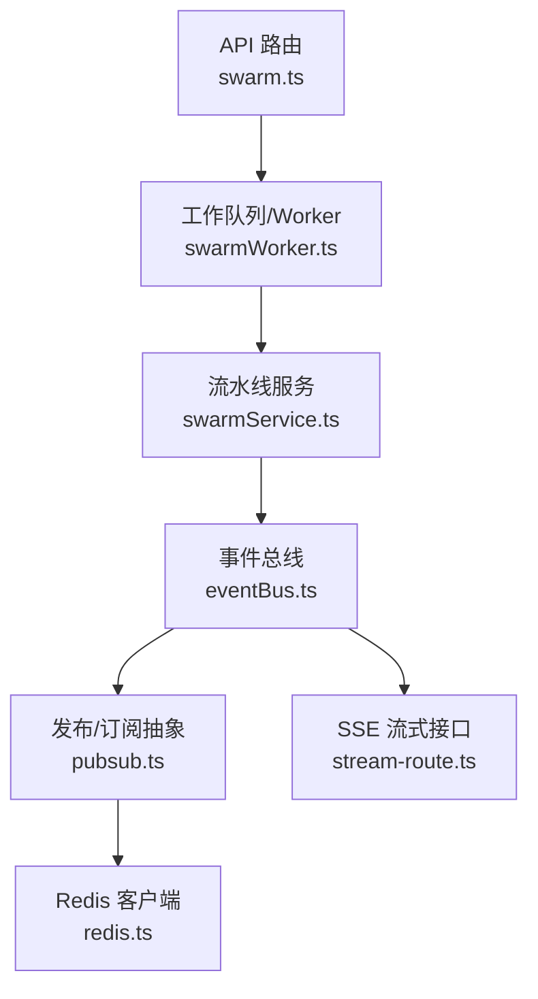
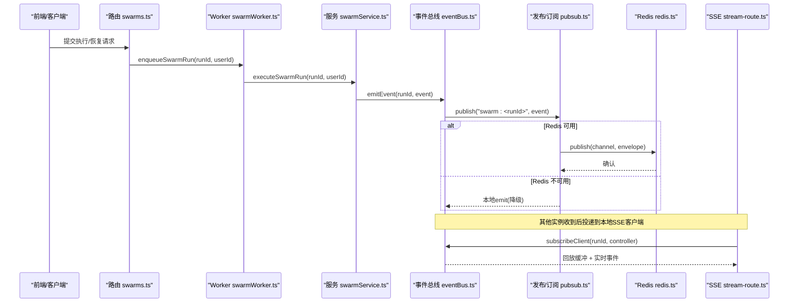
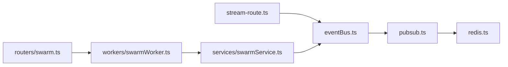

# 发布/订阅系统

<cite>
**本文引用的文件**
- [api/infra/pubsub.ts](file://api/infra/pubsub.ts)
- [api/infra/redis.ts](file://api/infra/redis.ts)
- [api/services/eventBus.ts](file://api/services/eventBus.ts)
- [api/stream-route.ts](file://api/stream-route.ts)
- [api/routers/swarm.ts](file://api/routers/swarm.ts)
- [api/workers/swarmWorker.ts](file://api/workers/swarmWorker.ts)
- [api/services/swarmService.ts](file://api/services/swarmService.ts)
</cite>

## 目录
1. [简介](#简介)
2. [项目结构](#项目结构)
3. [核心组件](#核心组件)
4. [架构总览](#架构总览)
5. [详细组件分析](#详细组件分析)
6. [依赖关系分析](#依赖关系分析)
7. [性能考量](#性能考量)
8. [故障排查指南](#故障排查指南)
9. [结论](#结论)
10. [附录：使用示例与最佳实践](#附录使用示例与最佳实践)

## 简介
本文件为 DeeWaanAI 系统的发布/订阅（Pub/Sub）子系统提供完整技术文档。该子系统用于在分布式环境中进行跨节点事件广播、实例标识管理以及消息传递，支撑流水线执行过程中的 SSE 流式进度推送。其关键特性包括：
- 双后端适配：优先使用 Redis Pub/Sub 实现跨节点广播；不可用时自动降级到进程内 EventEmitter。
- 通道命名约定：基于 swarm 运行 ID 的专用通道 swarm:<runId>，确保事件隔离与路由。
- 实例去重：通过 origin 字段避免同一实例重复处理自身发出的回环消息。
- 异步发布与健壮错误处理：发布失败不阻塞调用方，仅记录日志并降级。
- 订阅生命周期管理：按 run 维度懒创建订阅，无客户端时释放资源。
- SSE 集成：将事件缓冲、回放与终端事件持久化结合，保证客户端连接恢复后的连续性。

## 项目结构
下图展示了与 Pub/Sub 相关的模块及其职责边界：

图表来源
- [api/routers/swarm.ts:109-199](file://api/routers/swarm.ts#L109-L199)
- [api/workers/swarmWorker.ts:24-59](file://api/workers/swarmWorker.ts#L24-L59)
- [api/services/swarmService.ts:1284-1392](file://api/services/swarmService.ts#L1284-L1392)
- [api/services/eventBus.ts:156-167](file://api/services/eventBus.ts#L156-L167)
- [api/infra/pubsub.ts:90-153](file://api/infra/pubsub.ts#L90-L153)
- [api/infra/redis.ts:65-82](file://api/infra/redis.ts#L65-L82)
- [api/stream-route.ts:8-69](file://api/stream-route.ts#L8-L69)

章节来源
- [api/routers/swarm.ts:109-199](file://api/routers/swarm.ts#L109-L199)
- [api/workers/swarmWorker.ts:24-59](file://api/workers/swarmWorker.ts#L24-L59)
- [api/services/swarmService.ts:1284-1392](file://api/services/swarmService.ts#L1284-L1392)
- [api/services/eventBus.ts:1-167](file://api/services/eventBus.ts#L1-L167)
- [api/infra/pubsub.ts:1-154](file://api/infra/pubsub.ts#L1-L154)
- [api/infra/redis.ts:1-88](file://api/infra/redis.ts#L1-L88)
- [api/stream-route.ts:8-69](file://api/stream-route.ts#L8-L69)

## 核心组件
- 发布/订阅抽象层（pubsub.ts）
  - 提供 publish(channel, message) 与 subscribe(channel, handler) 两个稳定 API。
  - 自动选择 Redis 或内存 EventEmitter 作为后端；失败时降级且不影响主流程。
  - 每个进程拥有唯一 INSTANCE_ID，用于丢弃自身回环消息。
- 事件总线（eventBus.ts）
  - 面向 SSE 客户端的本地分发器，维护 5 分钟回放缓冲与“终态事件”永久存储。
  - 对每个 swarmRunId 懒订阅共享通道 swarm:<runId>，接收其他实例的事件并投递给本地客户端。
  - emitEvent(swarmRunId, event) 负责本地投递与跨节点广播（fire-and-forget）。
- Redis 基础设施（redis.ts）
  - 惰性单例连接，最多尝试 3 次快速重试；不可用则返回 null，由上层降级。
- SSE 流式接口（stream-route.ts）
  - GET /api/stream/:swarmRunId 建立 SSE 连接，发送初始事件与终态事件，并通过 eventBus.subscribeClient 接入实时流。
- 路由与工作队列（swarm.ts, swarmWorker.ts）
  - 路由负责校验、落库与入队；Worker 消费任务并驱动流水线执行，期间通过 eventBus.emitEvent 广播事件。

章节来源
- [api/infra/pubsub.ts:15-153](file://api/infra/pubsub.ts#L15-L153)
- [api/services/eventBus.ts:23-167](file://api/services/eventBus.ts#L23-L167)
- [api/infra/redis.ts:1-88](file://api/infra/redis.ts#L1-L88)
- [api/stream-route.ts:8-69](file://api/stream-route.ts#L8-L69)
- [api/routers/swarm.ts:109-199](file://api/routers/swarm.ts#L109-L199)
- [api/workers/swarmWorker.ts:24-59](file://api/workers/swarmWorker.ts#L24-L59)

## 架构总览
下图展示从请求到事件广播再到 SSE 客户端的端到端流程：

图表来源
- [api/routers/swarm.ts:109-199](file://api/routers/swarm.ts#L109-L199)
- [api/workers/swarmWorker.ts:24-59](file://api/workers/swarmWorker.ts#L24-L59)
- [api/services/swarmService.ts:1284-1392](file://api/services/swarmService.ts#L1284-L1392)
- [api/services/eventBus.ts:129-167](file://api/services/eventBus.ts#L129-L167)
- [api/infra/pubsub.ts:90-153](file://api/infra/pubsub.ts#L90-L153)
- [api/infra/redis.ts:65-82](file://api/infra/redis.ts#L65-L82)
- [api/stream-route.ts:8-69](file://api/stream-route.ts#L8-L69)

## 详细组件分析

### 发布/订阅抽象层（pubsub.ts）
- 设计要点
  - 双后端：优先 Redis，失败时回退到内存 EventEmitter；订阅同样先注册本地再尝试 Redis。
  - 实例标识：INSTANCE_ID 用于包裹 envelope.origin，使订阅者可忽略自身回环。
  - 错误策略：publish 从不抛出异常，失败仅记录警告；subscribe 的 Redis 订阅失败也仅记录警告并继续本地模式。
  - 资源清理：unsubscribe 会移除本地监听，并在最后一个处理器移除时取消 Redis 订阅。
- 复杂度与性能
  - 发布：O(1) 网络写入（Redis）或 O(n) 本地分发（n 为同频道监听数）。
  - 订阅：首次订阅可能触发 Redis SUBSCRIBE；后续为 O(1) 注册。
- 关键路径参考
  - 发布入口与降级逻辑
  - 订阅入口与资源释放

章节来源
- [api/infra/pubsub.ts:15-153](file://api/infra/pubsub.ts#L15-L153)

### 事件总线（eventBus.ts）
- 设计要点
  - 本地分发：encode 为 SSE data 行，推入缓冲区并发送给已连接的控制器。
  - 回放缓冲：保留最近 5 分钟事件，新连接可回放缺失片段。
  - 终态事件：pipeline_complete/pipeline_error 永久缓存，新连接立即补发。
  - 跨节点广播：emitEvent 调用 publish 将事件发送到 swarm:<runId> 频道。
  - 订阅生命周期：ensureChannelSubscription 懒创建 per-run 订阅；当无客户端时释放。
- 复杂度与性能
  - 缓冲写入 O(1)，回放 O(k)（k 为窗口内事件数），定期清理旧事件。
  - 跨节点广播 fire-and-forget，失败不影响本地投递。
- 关键路径参考
  - 客户端订阅与回放
  - 事件发出与跨节点广播

章节来源
- [api/services/eventBus.ts:23-167](file://api/services/eventBus.ts#L23-L167)

### Redis 基础设施（redis.ts）
- 设计要点
  - 惰性连接，最多 3 次快速重试，指数退避；失败则标记放弃并返回 null。
  - 所有上层组件必须容忍 null 返回值并降级。
- 关键路径参考
  - getRedis 获取客户端或 null

章节来源
- [api/infra/redis.ts:1-88](file://api/infra/redis.ts#L1-L88)

### SSE 流式接口（stream-route.ts）
- 设计要点
  - 验证 runId 存在性，发送初始 step_start 事件。
  - 若 run 已终止，立即发送 pipeline_complete 或 pipeline_error。
  - 通过 eventBus.subscribeClient 接入事件流，断开时自动清理。
- 关键路径参考
  - 建立 SSE 连接与事件推送

章节来源
- [api/stream-route.ts:8-69](file://api/stream-route.ts#L8-L69)

### 路由与工作队列（swarm.ts, swarmWorker.ts）
- 路由职责
  - 权限校验、参数校验、事务创建 run 记录、更新状态、入队。
  - 支持执行、恢复、审批、取消等流程。
- Worker 职责
  - 消费队列任务，调用 executeSwarmRun 执行流水线。
  - 捕获限流异常并重入队；设置失败时标记 run 为 failed 并广播 pipeline_error。
- 关键路径参考
  - 入队与执行入口
  - 执行完成/失败回调

章节来源
- [api/routers/swarm.ts:109-199](file://api/routers/swarm.ts#L109-L199)
- [api/workers/swarmWorker.ts:24-59](file://api/workers/swarmWorker.ts#L24-L59)
- [api/services/swarmService.ts:1284-1392](file://api/services/swarmService.ts#L1284-L1392)

## 依赖关系分析
- 松耦合与高内聚
  - eventBus 依赖 pubsub 抽象，屏蔽底层差异；stream-route 仅依赖 eventBus 的客户端订阅 API。
  - 路由与 worker 解耦：路由只负责入队，worker 负责执行与事件广播。
- 外部依赖
  - Redis：可选，不可用时全部功能仍可在单机模式下工作。
  - 数据库：用于 run 元数据与状态持久化。
- 潜在循环依赖
  - 当前分层清晰，未发现循环依赖。

图表来源
- [api/stream-route.ts:8-69](file://api/stream-route.ts#L8-L69)
- [api/services/eventBus.ts:129-167](file://api/services/eventBus.ts#L129-L167)
- [api/infra/pubsub.ts:90-153](file://api/infra/pubsub.ts#L90-L153)
- [api/infra/redis.ts:65-82](file://api/infra/redis.ts#L65-L82)
- [api/routers/swarm.ts:109-199](file://api/routers/swarm.ts#L109-L199)
- [api/workers/swarmWorker.ts:24-59](file://api/workers/swarmWorker.ts#L24-L59)
- [api/services/swarmService.ts:1284-1392](file://api/services/swarmService.ts#L1284-L1392)

## 性能考量
- 发布路径
  - Redis 发布失败不会阻塞调用方；本地 EventEmitter 作为兜底，保证低延迟。
- 订阅路径
  - 每 run 一个频道，避免全局风暴；仅在存在客户端时维持跨节点订阅。
- 缓冲与回放
  - 5 分钟缓冲平衡了内存占用与重连体验；过期事件自动清理。
- 资源释放
  - 无客户端时释放跨节点订阅，减少 Redis 负载。
- 并发与背压
  - SSE 控制器写入失败视为客户端断开，及时清理；避免堆积。

[本节为通用指导，不直接分析具体文件]

## 故障排查指南
- 现象：跨节点事件未到达
  - 检查 Redis 是否启用且可达；查看日志中“Redis subscriber setup failed”或“Redis publish failed”。
  - 确认频道名是否为 swarm:<runId>，且订阅已在有客户端时创建。
- 现象：SSE 断线后无回放
  - 确认客户端是否在 5 分钟内重连；检查终端事件是否已缓存（pipeline_complete/error）。
- 现象：重复处理同一事件
  - 确认订阅者是否根据 envelope.origin 过滤自身回环。
- 现象：Worker 执行失败
  - 查看 executeSwarmRun 的失败分支，确认是否已标记 run 为 failed 并广播 pipeline_error。

章节来源
- [api/infra/pubsub.ts:45-85](file://api/infra/pubsub.ts#L45-L85)
- [api/infra/pubsub.ts:90-106](file://api/infra/pubsub.ts#L90-L106)
- [api/services/eventBus.ts:60-83](file://api/services/eventBus.ts#L60-L83)
- [api/services/swarmService.ts:1368-1392](file://api/services/swarmService.ts#L1368-L1392)

## 结论
DeeWaanAI 的 Pub/Sub 子系统以“双后端 + 严格降级”的设计实现了高可用的跨节点事件广播。通过 swarm:<runId> 通道隔离、实例 origin 去重、懒订阅与资源回收，系统在多节点环境下既保证了可靠性，又兼顾了性能与资源效率。SSE 侧的回放与终态事件机制进一步提升了用户体验。整体架构清晰、职责分明，便于扩展与维护。

[本节为总结性内容，不直接分析具体文件]

## 附录：使用示例与最佳实践

### 创建订阅与发布消息
- 在流水线执行过程中，服务层调用事件总线发出事件：
  - 调用 emitEvent(swarmRunId, event) 进行本地投递与跨节点广播。
  - 事件类型包括 step_start、step_complete、step_error、pipeline_complete、pipeline_error 等。
- 客户端通过 SSE 订阅：
  - 打开 GET /api/stream/:swarmRunId，接收初始事件、回放与实时事件。
  - 连接断开后重连可获得回放与终态事件。

章节来源
- [api/services/eventBus.ts:156-167](file://api/services/eventBus.ts#L156-L167)
- [api/stream-route.ts:8-69](file://api/stream-route.ts#L8-L69)

### 订阅生命周期管理
- 懒订阅：ensureChannelSubscription 在首个客户端出现时创建跨节点订阅。
- 自动释放：当某 run 的所有客户端断开，释放对应订阅，减少 Redis 压力。
- 本地兜底：即使 Redis 不可用，本地 EventEmitter 仍能保证进程内 SSE 推送。

章节来源
- [api/services/eventBus.ts:60-92](file://api/services/eventBus.ts#L60-L92)
- [api/services/eventBus.ts:129-154](file://api/services/eventBus.ts#L129-L154)

### 发布操作的异步执行与错误处理
- 发布策略：publish 采用 fire-and-forget，失败仅记录日志，不抛异常。
- 降级策略：Redis 不可用时自动降级到内存 EventEmitter，保证本地可用性。
- 重试与限流：Worker 层对限流异常进行重入队；发布层不做业务重试，避免放大抖动。

章节来源
- [api/infra/pubsub.ts:90-106](file://api/infra/pubsub.ts#L90-L106)
- [api/workers/swarmWorker.ts:50-59](file://api/workers/swarmWorker.ts#L50-L59)
- [api/services/swarmService.ts:1368-1392](file://api/services/swarmService.ts#L1368-L1392)

### 实例间通信的最佳实践
- 避免重复处理：订阅者依据 envelope.origin 丢弃自身回环消息。
- 通道隔离：严格按 swarm:<runId> 划分频道，避免事件串扰。
- 性能优化：
  - 仅在存在客户端时维持跨节点订阅。
  - 合理设置回放窗口（当前 5 分钟）以平衡内存与重连体验。
  - 使用 SSE 控制器写入失败即视为客户端断开，及时清理。

章节来源
- [api/services/eventBus.ts:60-83](file://api/services/eventBus.ts#L60-L83)
- [api/services/eventBus.ts:129-154](file://api/services/eventBus.ts#L129-L154)