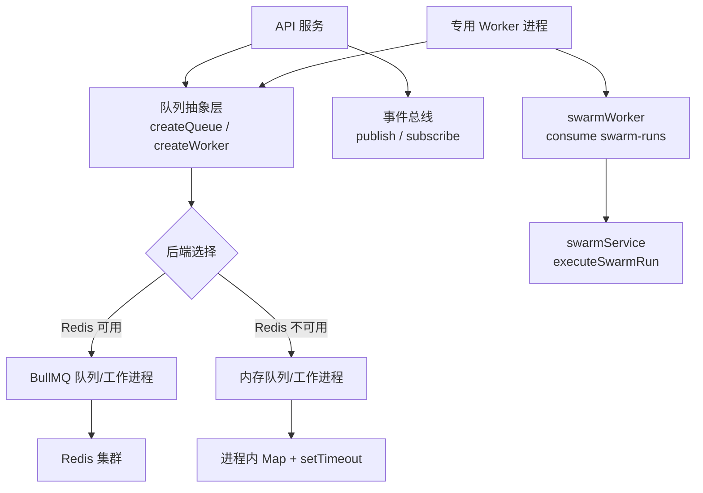
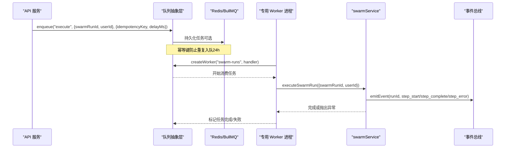
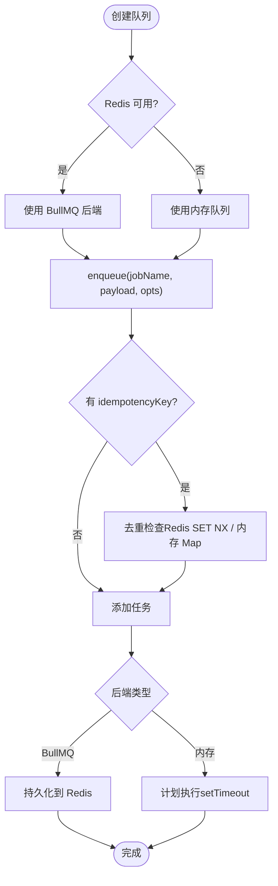
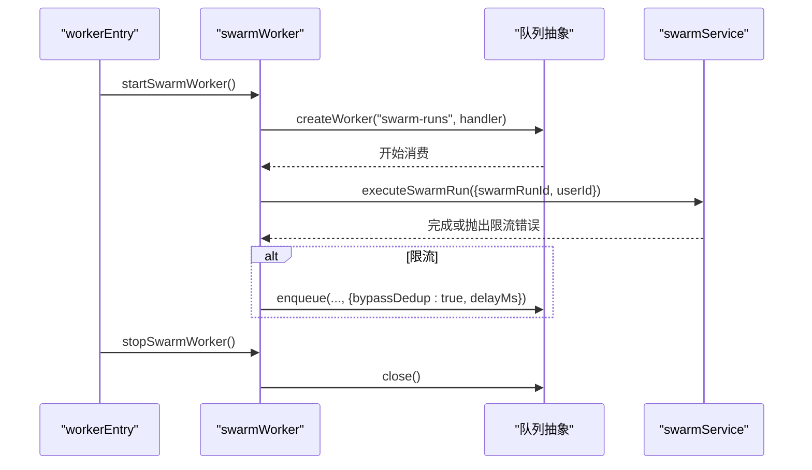
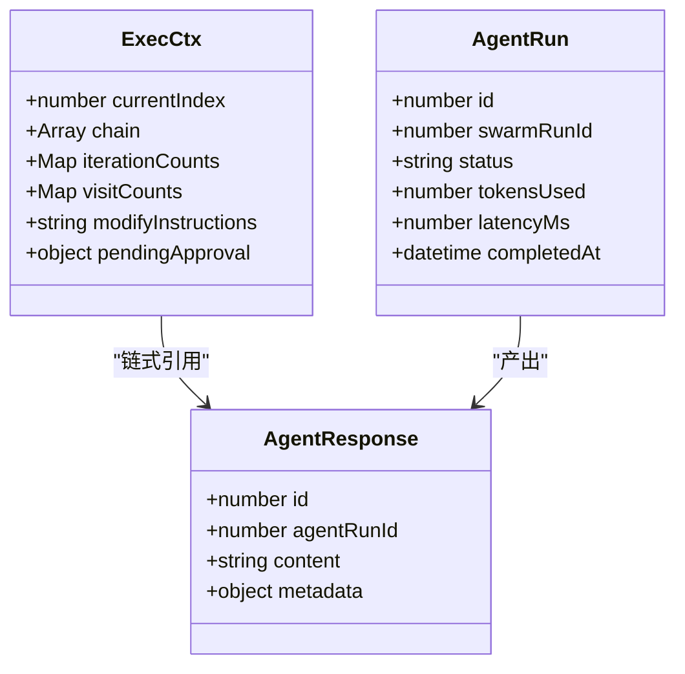
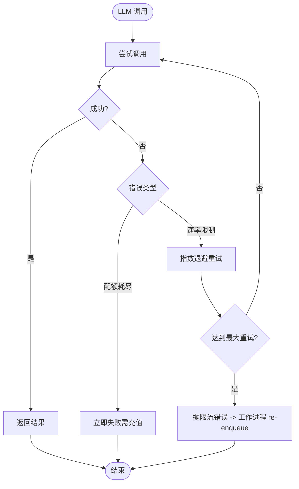
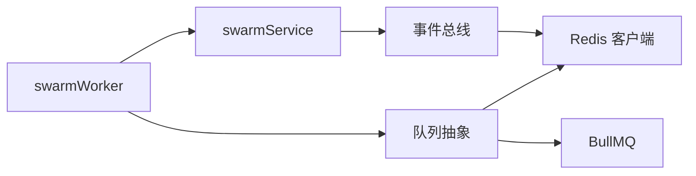

# 消息队列

<cite>
**本文引用的文件**
- [api/infra/queue.ts](file://api/infra/queue.ts)
- [api/workers/swarmWorker.ts](file://api/workers/swarmWorker.ts)
- [api/workerEntry.ts](file://api/workerEntry.ts)
- [api/services/swarmService.ts](file://api/services/swarmService.ts)
- [api/infra/pubsub.ts](file://api/infra/pubsub.ts)
- [api/lib/env.ts](file://api/lib/env.ts)
- [api/infra/redis.ts](file://api/infra/redis.ts)
</cite>

## 目录
1. [简介](#简介)
2. [项目结构](#项目结构)
3. [核心组件](#核心组件)
4. [架构总览](#架构总览)
5. [详细组件分析](#详细组件分析)
6. [依赖关系分析](#依赖关系分析)
7. [性能考虑](#性能考虑)
8. [故障排查指南](#故障排查指南)
9. [结论](#结论)
10. [附录：使用示例与最佳实践](#附录使用示例与最佳实践)

## 简介
本文件为 DeeWaanAI 系统的“消息队列”专项文档，聚焦于异步任务处理中的任务调度、工作进程管理与任务状态跟踪。系统采用生产者-消费者模式，提供可插拔的队列后端（BullMQ + Redis 或内存队列），支持幂等入队、延迟执行、失败重试与优雅关闭；并通过事件总线实现任务完成后的跨进程通知。本文从架构设计、数据流、错误处理、持久化机制、性能调优与集成方式等方面进行全面说明，并给出创建任务、消费任务与监控队列状态的实践指引。

## 项目结构
与消息队列相关的代码主要分布在以下模块：
- 队列抽象与后端选择：api/infra/queue.ts
- 专用工作进程入口：api/workerEntry.ts
- 流水线工作进程与任务定义：api/workers/swarmWorker.ts
- 流水线执行服务（任务主体逻辑）：api/services/swarmService.ts
- 事件总线（发布/订阅）：api/infra/pubsub.ts
- 环境配置（并发度等）：api/lib/env.ts
- Redis 客户端与可用性检测：api/infra/redis.ts

**图示来源**
- [api/infra/queue.ts:1-334](file://api/infra/queue.ts#L1-L334)
- [api/workers/swarmWorker.ts:1-75](file://api/workers/swarmWorker.ts#L1-L75)
- [api/workerEntry.ts:1-65](file://api/workerEntry.ts#L1-L65)
- [api/infra/pubsub.ts:1-154](file://api/infra/pubsub.ts#L1-L154)
- [api/infra/redis.ts:1-88](file://api/infra/redis.ts#L1-L88)

**章节来源**
- [api/infra/queue.ts:1-334](file://api/infra/queue.ts#L1-L334)
- [api/workers/swarmWorker.ts:1-75](file://api/workers/swarmWorker.ts#L1-L75)
- [api/workerEntry.ts:1-65](file://api/workerEntry.ts#L1-L65)
- [api/infra/pubsub.ts:1-154](file://api/infra/pubsub.ts#L1-L154)
- [api/infra/redis.ts:1-88](file://api/infra/redis.ts#L1-L88)

## 核心组件
- 队列抽象接口与实现
  - AppQueue：统一 enqueue(jobName, payload, opts)、close()
  - AppWorker：统一 close()，内部持有具体后端实现
  - 后端：BullAppQueue/BullAppWorker（基于 BullMQ + Redis）与 MemoryAppQueue/MemoryAppWorker（进程内 Map + 定时器）
- 工作进程与任务
  - SWARM_QUEUE_NAME = "swarm-runs"
  - SWARM_JOB_EXECUTE = "execute"
  - SwarmJobPayload：{ swarmRunId, userId }
  - startSwarmWorker()/stopSwarmWorker()：注册/停止工作进程
- 事件总线
  - publish(channel, message)/subscribe(channel, handler)
  - 多后端：Redis pub/sub 或进程内 EventEmitter
  - 消息信封包含 origin（实例 ID）、ts、message，用于去回声
- Redis 客户端
  - getRedis()：带退避的重连策略，失败时返回 null
  - isRedisEnabled()：是否配置 REDIS_URL

**章节来源**
- [api/infra/queue.ts:18-35](file://api/infra/queue.ts#L18-L35)
- [api/infra/queue.ts:73-198](file://api/infra/queue.ts#L73-L198)
- [api/infra/queue.ts:200-261](file://api/infra/queue.ts#L200-L261)
- [api/workers/swarmWorker.ts:11-35](file://api/workers/swarmWorker.ts#L11-L35)
- [api/infra/pubsub.ts:15-25](file://api/infra/pubsub.ts#L15-L25)
- [api/infra/pubsub.ts:88-153](file://api/infra/pubsub.ts#L88-L153)
- [api/infra/redis.ts:1-88](file://api/infra/redis.ts#L1-L88)

## 架构总览
系统采用“生产者-消费者”模型：
- 生产者：API 服务或其他业务模块通过 createQueue(name).enqueue(...) 将任务入队，支持幂等键与延迟执行
- 消费者：专用 worker 进程启动后通过 createWorker(name, handler) 消费任务，调用 executeSwarmRun 执行业务逻辑
- 后端选择：首次使用时根据 Redis 可用性自动选择 BullMQ 或内存队列；BullMQ 提供持久化与多节点能力
- 事件通知：任务执行过程中通过 emitEvent 发布事件，外部订阅者可通过事件总线接收

**图示来源**
- [api/infra/queue.ts:210-228](file://api/infra/queue.ts#L210-L228)
- [api/workers/swarmWorker.ts:24-59](file://api/workers/swarmWorker.ts#L24-L59)
- [api/services/swarmService.ts:383-515](file://api/services/swarmService.ts#L383-L515)
- [api/infra/pubsub.ts:90-106](file://api/infra/pubsub.ts#L90-L106)

## 详细组件分析

### 队列抽象与后端选择
- 后端解析：resolveBackend() 在首次使用时判断 Redis 是否可用，若可用则建立独立连接供 BullMQ 使用；否则回退到内存队列
- 幂等入队：
  - Redis：SET NX EX 24h 的去重键
  - 内存：Map 记录过期时间，定时清理
- 任务生命周期：
  - BullMQ：add(jobName, payload, {delay, attempts=1, removeOnComplete, removeOnFail})
  - 内存：Map 存储 job，setTimeout 调度执行
- 工作进程：
  - BullMQ：Worker 设置 concurrency = env.swarmWorkerConcurrency
  - 内存：按 runAt 顺序执行，无处理器时短暂延迟重新排队

**图示来源**
- [api/infra/queue.ts:43-71](file://api/infra/queue.ts#L43-L71)
- [api/infra/queue.ts:156-176](file://api/infra/queue.ts#L156-L176)
- [api/infra/queue.ts:210-228](file://api/infra/queue.ts#L210-L228)

**章节来源**
- [api/infra/queue.ts:36-71](file://api/infra/queue.ts#L36-L71)
- [api/infra/queue.ts:73-198](file://api/infra/queue.ts#L73-L198)
- [api/infra/queue.ts:200-261](file://api/infra/queue.ts#L200-L261)

### 工作进程与任务调度
- 队列名与作业名：SWARM_QUEUE_NAME="swarm-runs"，SWARM_JOB_EXECUTE="execute"
- 入队：enqueueSwarmRun(swarmRunId, userId, opts)，默认以 run-{swarmRunId} 作为幂等键，支持 bypassDedup 与 delayMs
- 工作进程：startSwarmWorker() 注册处理器，收到 execute 作业后调用 executeSwarmRun；若需要限流重试，通过回调 re-enqueue
- 优雅关闭：workerEntry 监听 SIGTERM/SIGINT，先 stopSwarmWorker() 再 closeAllQueues()，超时强制退出

**图示来源**
- [api/workers/swarmWorker.ts:19-59](file://api/workers/swarmWorker.ts#L19-L59)
- [api/workerEntry.ts:25-64](file://api/workerEntry.ts#L25-L64)

**章节来源**
- [api/workers/swarmWorker.ts:11-75](file://api/workers/swarmWorker.ts#L11-L75)
- [api/workerEntry.ts:1-65](file://api/workerEntry.ts#L1-L65)

### 任务序列化、反序列化与状态跟踪
- 执行上下文序列化：serializeCtx/deserializeCtx 将执行状态（当前步骤、链式响应、循环计数、访问计数、待审批信息）持久化到数据库字段 executionState
- 任务状态跟踪：
  - agentRuns：每个步骤的运行记录（status: running/completed/failed）
  - agentResponses：步骤输出与元数据（tokens、latency、model、provider 等）
  - swarmRuns：整体运行状态与执行状态快照
- 事件通知：emitEvent 在步骤开始、完成、错误时发布事件，便于前端或监控系统实时展示

**图示来源**
- [api/services/swarmService.ts:243-284](file://api/services/swarmService.ts#L243-L284)
- [api/services/swarmService.ts:383-515](file://api/services/swarmService.ts#L383-L515)

**章节来源**
- [api/services/swarmService.ts:243-284](file://api/services/swarmService.ts#L243-L284)
- [api/services/swarmService.ts:383-515](file://api/services/swarmService.ts#L383-L515)

### 错误处理策略
- 重试与退避：callWithRetry 对 LLM 调用进行指数退避重试；识别配额耗尽与速率限制两类错误
- 限流处理：ProviderThrottledError/RunThrottledError 携带 retryAfterMs，工作进程据此 re-enqueue
- 幂等与去重：入队时使用 idempotencyKey 避免重复执行；BullMQ 侧 removeOnComplete/removeOnFail 控制保留策略
- 优雅关闭：workerEntry 中设置关闭超时，确保进行中任务安全收尾

**图示来源**
- [api/services/swarmService.ts:176-214](file://api/services/swarmService.ts#L176-L214)
- [api/workers/swarmWorker.ts:50-59](file://api/workers/swarmWorker.ts#L50-L59)

**章节来源**
- [api/services/swarmService.ts:176-214](file://api/services/swarmService.ts#L176-L214)
- [api/workers/swarmWorker.ts:50-59](file://api/workers/swarmWorker.ts#L50-L59)

### 持久化机制与一致性
- 队列持久化：
  - BullMQ：任务持久化至 Redis，支持多节点与重启恢复
  - 内存队列：进程内 Map，仅适用于开发/单节点场景
- 任务状态持久化：
  - executionState 序列化到 swarm_runs 表，支持崩溃恢复与断点续跑
  - agent_runs/agent_responses 记录步骤级状态与输出
- 事件一致性：
  - 事件通过事件总线发布，Redis 模式下跨进程广播；本地模式降级为进程内分发
  - 消息信封包含 origin，避免自回声

**章节来源**
- [api/infra/queue.ts:210-228](file://api/infra/queue.ts#L210-L228)
- [api/infra/queue.ts:156-176](file://api/infra/queue.ts#L156-L176)
- [api/services/swarmService.ts:243-284](file://api/services/swarmService.ts#L243-L284)
- [api/infra/pubsub.ts:90-106](file://api/infra/pubsub.ts#L90-L106)

### 与事件总线的集成
- 任务执行过程中通过 emitEvent 发布 step_start/step_complete/step_error 等事件
- 订阅者通过 subscribe(channel, handler) 接收事件，Redis 模式下跨进程广播，本地模式降级为进程内分发
- 消息信封包含 origin（实例 ID）、ts、message，便于过滤与审计

**章节来源**
- [api/services/swarmService.ts:383-515](file://api/services/swarmService.ts#L383-L515)
- [api/infra/pubsub.ts:88-153](file://api/infra/pubsub.ts#L88-L153)

## 依赖关系分析
- 队列抽象依赖 Redis 客户端与 BullMQ；当 Redis 不可用时自动降级到内存队列
- 工作进程依赖队列抽象与执行服务；执行服务依赖数据库、事件总线与提供者适配器
- 事件总线依赖 Redis 或进程内 EventEmitter；具备健壮的错误处理与降级机制

**图示来源**
- [api/infra/queue.ts:1-334](file://api/infra/queue.ts#L1-L334)
- [api/workers/swarmWorker.ts:1-75](file://api/workers/swarmWorker.ts#L1-L75)
- [api/services/swarmService.ts:1-800](file://api/services/swarmService.ts#L1-L800)
- [api/infra/pubsub.ts:1-154](file://api/infra/pubsub.ts#L1-L154)
- [api/infra/redis.ts:1-88](file://api/infra/redis.ts#L1-L88)

**章节来源**
- [api/infra/queue.ts:1-334](file://api/infra/queue.ts#L1-L334)
- [api/workers/swarmWorker.ts:1-75](file://api/workers/swarmWorker.ts#L1-L75)
- [api/services/swarmService.ts:1-800](file://api/services/swarmService.ts#L1-L800)
- [api/infra/pubsub.ts:1-154](file://api/infra/pubsub.ts#L1-L154)
- [api/infra/redis.ts:1-88](file://api/infra/redis.ts#L1-L88)

## 性能考虑
- 并发度：env.swarmWorkerConcurrency 控制 BullMQ Worker 的并发度，影响吞吐与资源占用
- 批处理大小：当前实现为逐条处理；如需批处理，可在工作进程中聚合任务后再批量执行
- 超时配置：
  - Redis 连接：connectTimeout=2000ms，快速失败并降级
  - 关闭超时：workerEntry 中 gracefulShutdown 设置 30s 超时，防止无限等待
- 重试与退避：callWithRetry 使用指数退避，减少瞬时拥塞对系统的影响
- 资源隔离：专用 Worker 进程与 HTTP 服务分离，避免长任务阻塞请求

**章节来源**
- [api/lib/env.ts:87-88](file://api/lib/env.ts#L87-L88)
- [api/infra/redis.ts:26-33](file://api/infra/redis.ts#L26-L33)
- [api/workerEntry.ts:39-60](file://api/workerEntry.ts#L39-L60)
- [api/services/swarmService.ts:176-214](file://api/services/swarmService.ts#L176-L214)

## 故障排查指南
- Redis 不可用：getRedis() 会尝试多次连接并记录警告；队列与事件总线自动降级到内存模式
- 任务未执行：检查队列后端是否为 BullMQ；确认 createWorker 已注册；查看日志中“unknown job name”或“malformed job payload”
- 任务重复执行：确认 idempotencyKey 是否正确设置；检查 Redis 去重键是否过期
- 任务失败：查看 BullMQ failed 事件日志；检查 callWithRetry 是否达到最大重试；关注 ProviderThrottledError 的 retryAfterMs
- 优雅关闭：确认 SIGTERM/SIGINT 被捕获；检查 stopSwarmWorker 与 closeAllQueues 是否成功执行

**章节来源**
- [api/infra/redis.ts:40-58](file://api/infra/redis.ts#L40-L58)
- [api/workers/swarmWorker.ts:40-59](file://api/workers/swarmWorker.ts#L40-L59)
- [api/infra/queue.ts:248-255](file://api/infra/queue.ts#L248-L255)
- [api/workerEntry.ts:39-64](file://api/workerEntry.ts#L39-L64)

## 结论
DeeWaanAI 的消息队列通过抽象层屏蔽了后端差异，在生产环境使用 BullMQ + Redis 提供持久化与多节点能力，在开发环境使用内存队列保证易用性。结合幂等入队、延迟执行、重试与优雅关闭，系统实现了高可靠的异步任务处理。事件总线进一步解耦了任务执行与状态通知，便于构建实时监控与告警体系。通过合理配置并发度、超时与重试策略，可在保证稳定性的同时提升吞吐与响应速度。

## 附录：使用示例与最佳实践
- 创建任务（生产者）
  - 使用 createQueue("swarm-runs").enqueue("execute", {swarmRunId, userId}, {idempotencyKey: `run-${swarmRunId}`, delayMs: ...})
  - 参考路径：[api/workers/swarmWorker.ts:24-35](file://api/workers/swarmWorker.ts#L24-L35)
- 消费任务（消费者）
  - 使用 createWorker("swarm-runs", handler) 注册处理器，handler 中调用 executeSwarmRun
  - 参考路径：[api/workers/swarmWorker.ts:37-59](file://api/workers/swarmWorker.ts#L37-L59)
- 监控队列状态
  - 通过事件总线订阅相关频道，接收 step_start/step_complete/step_error 事件
  - 参考路径：[api/infra/pubsub.ts:88-153](file://api/infra/pubsub.ts#L88-L153)
- 性能调优参数
  - 并发度：env.swarmWorkerConcurrency
  - 超时：Redis connectTimeout=2000ms；关闭超时 30s
  - 重试：callWithRetry 指数退避，最大重试次数可配置
  - 参考路径：[api/lib/env.ts:87-88](file://api/lib/env.ts#L87-L88), [api/infra/redis.ts:26-33](file://api/infra/redis.ts#L26-L33), [api/workerEntry.ts:39-60](file://api/workerEntry.ts#L39-L60), [api/services/swarmService.ts:176-214](file://api/services/swarmService.ts#L176-L214)

**章节来源**
- [api/workers/swarmWorker.ts:24-59](file://api/workers/swarmWorker.ts#L24-L59)
- [api/infra/pubsub.ts:88-153](file://api/infra/pubsub.ts#L88-L153)
- [api/lib/env.ts:87-88](file://api/lib/env.ts#L87-L88)
- [api/infra/redis.ts:26-33](file://api/infra/redis.ts#L26-L33)
- [api/workerEntry.ts:39-60](file://api/workerEntry.ts#L39-L60)
- [api/services/swarmService.ts:176-214](file://api/services/swarmService.ts#L176-L214)