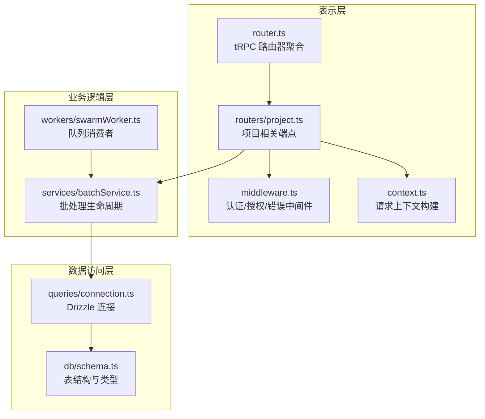
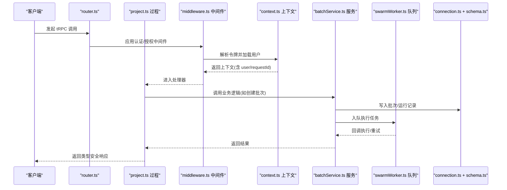
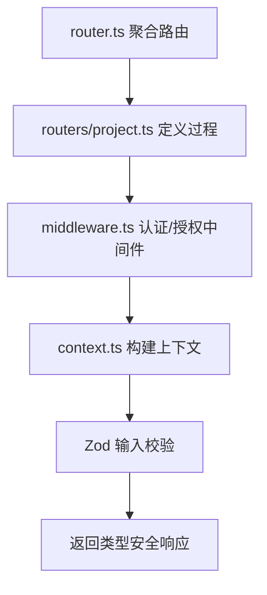
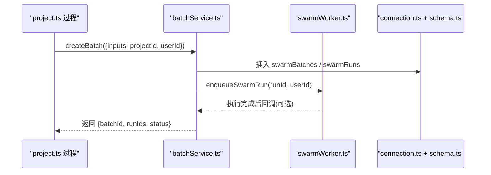
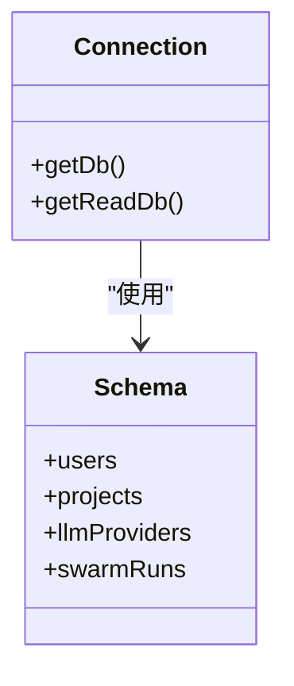
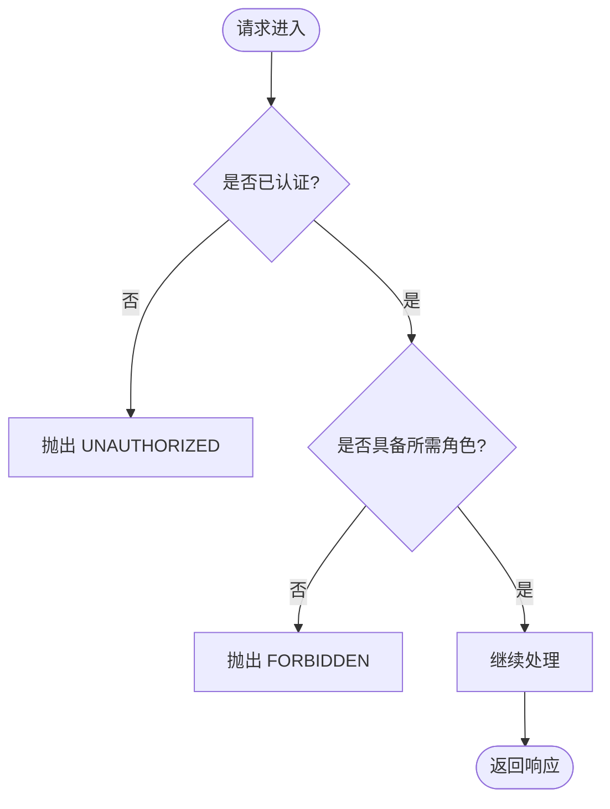
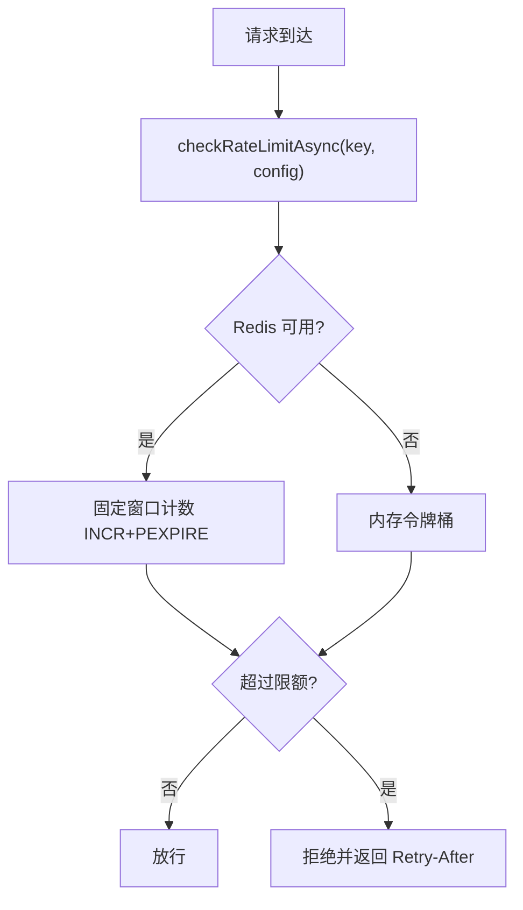
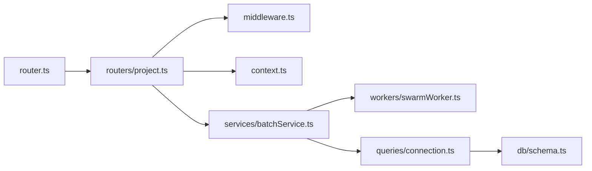

# 分层架构

<cite>
**本文引用的文件**
- [api/router.ts](file://api/router.ts)
- [api/middleware.ts](file://api/middleware.ts)
- [api/context.ts](file://api/context.ts)
- [api/queries/connection.ts](file://api/queries/connection.ts)
- [db/schema.ts](file://db/schema.ts)
- [api/routers/project.ts](file://api/routers/project.ts)
- [api/services/batchService.ts](file://api/services/batchService.ts)
- [api/workers/swarmWorker.ts](file://api/workers/swarmWorker.ts)
- [api/lib/logger.ts](file://api/lib/logger.ts)
- [api/lib/rateLimiter.ts](file://api/lib/rateLimiter.ts)
- [api/lib/adminGuards.ts](file://api/lib/adminGuards.ts)
</cite>

## 目录
1. [简介](#简介)
2. [项目结构](#项目结构)
3. [核心组件](#核心组件)
4. [架构总览](#架构总览)
5. [详细组件分析](#详细组件分析)
6. [依赖关系分析](#依赖关系分析)
7. [性能考量](#性能考量)
8. [故障排查指南](#故障排查指南)
9. [结论](#结论)
10. [附录](#附录)

## 简介
本文件为 DeeWaanAI 系统提供分层架构文档，聚焦三层设计：表示层（API 路由）、业务逻辑层（服务层）与数据访问层（数据库操作）。重点说明 tRPC 如何实现类型安全的 API 层、路由器组织方式、请求处理流程与响应格式化；阐述中间件在认证、授权、日志与错误处理中的作用；并通过具体代码路径展示从路由到服务再到数据的完整调用链。

## 项目结构
DeeWaanAI 的 API 部分采用清晰的三层划分：
- 表示层：基于 tRPC 的路由聚合与过程定义，位于 api/router.ts 与各功能路由（如 project.ts）。
- 业务逻辑层：封装领域能力与编排逻辑的服务模块（如 batchService.ts），以及后台任务执行器（swarmWorker.ts）。
- 数据访问层：通过 Drizzle ORM 对 MySQL 进行读写，连接管理在 queries/connection.ts，表结构定义在 db/schema.ts。

图表来源
- [api/router.ts:39-70](file://api/router.ts#L39-L70)
- [api/routers/project.ts:11-54](file://api/routers/project.ts#L11-L54)
- [api/middleware.ts:10-51](file://api/middleware.ts#L10-L51)
- [api/context.ts:20-54](file://api/context.ts#L20-L54)
- [api/services/batchService.ts:46-105](file://api/services/batchService.ts#L46-L105)
- [api/workers/swarmWorker.ts:24-60](file://api/workers/swarmWorker.ts#L24-L60)
- [api/queries/connection.ts:10-18](file://api/queries/connection.ts#L10-L18)
- [db/schema.ts:17-51](file://db/schema.ts#L17-L51)

章节来源
- [api/router.ts:1-73](file://api/router.ts#L1-L73)
- [api/middleware.ts:1-51](file://api/middleware.ts#L1-L51)
- [api/context.ts:1-55](file://api/context.ts#L1-L55)
- [api/queries/connection.ts:1-43](file://api/queries/connection.ts#L1-L43)
- [db/schema.ts:1-200](file://db/schema.ts#L1-L200)

## 核心组件
- tRPC 路由器与过程：通过 createRouter 聚合各子路由，使用 publicQuery/authedQuery/adminQuery 声明查询与变更过程，实现强类型输入输出校验与端到端类型推导。
- 中间件：统一认证（requireAuth）、角色授权（requireRole）、错误标准化（TRPCError）与上下文增强。
- 上下文：在请求进入时解析本地令牌、注入用户信息、生成请求 ID，供后续中间件与处理器使用。
- 服务层：将复杂业务流程抽象为可复用的函数（如创建批次、更新进度、导出结果），并协调队列与数据库。
- 数据访问：通过 Drizzle ORM 暴露表模型与关系，提供主库与只读副本的连接工厂。

章节来源
- [api/router.ts:39-70](file://api/router.ts#L39-L70)
- [api/middleware.ts:17-51](file://api/middleware.ts#L17-L51)
- [api/context.ts:20-54](file://api/context.ts#L20-L54)
- [api/services/batchService.ts:46-105](file://api/services/batchService.ts#L46-L105)
- [api/queries/connection.ts:10-43](file://api/queries/connection.ts#L10-L43)

## 架构总览
下图展示了典型请求从客户端到数据库的完整链路，包括 tRPC 中间件、服务层与队列消费。

图表来源
- [api/router.ts:39-70](file://api/router.ts#L39-L70)
- [api/middleware.ts:17-51](file://api/middleware.ts#L17-L51)
- [api/context.ts:20-54](file://api/context.ts#L20-L54)
- [api/routers/project.ts:103-250](file://api/routers/project.ts#L103-L250)
- [api/services/batchService.ts:46-105](file://api/services/batchService.ts#L46-L105)
- [api/workers/swarmWorker.ts:24-60](file://api/workers/swarmWorker.ts#L24-L60)
- [api/queries/connection.ts:10-18](file://api/queries/connection.ts#L10-L18)
- [db/schema.ts:84-150](file://db/schema.ts#L84-L150)

## 详细组件分析

### 表示层：tRPC 路由器与过程
- 路由器组织：router.ts 聚合多个领域路由（项目、代理、流水线、市场等），并通过插件机制动态挂载子路由。
- 过程定义：使用 authedQuery/adminQuery 限定权限，结合 Zod 输入校验确保类型安全。
- 响应格式化：通过 superjson 转换器支持复杂对象序列化，保证前后端类型一致。

图表来源
- [api/router.ts:39-70](file://api/router.ts#L39-L70)
- [api/routers/project.ts:11-54](file://api/routers/project.ts#L11-L54)
- [api/middleware.ts:17-51](file://api/middleware.ts#L17-L51)
- [api/context.ts:20-54](file://api/context.ts#L20-L54)

章节来源
- [api/router.ts:1-73](file://api/router.ts#L1-L73)
- [api/routers/project.ts:11-101](file://api/routers/project.ts#L11-L101)
- [api/middleware.ts:10-51](file://api/middleware.ts#L10-L51)

### 业务逻辑层：服务与队列
- 批处理服务：负责创建批次、原子更新进度、查询状态、取消/恢复、导出结果。
- 队列工作器：将耗时任务（流水线执行）移出 HTTP 请求，支持去重、延迟与重试。
- 与数据库交互：通过 Drizzle 插入/更新 swarmBatches 与 swarmRuns，并在完成时标记批次状态。

图表来源
- [api/routers/project.ts:103-250](file://api/routers/project.ts#L103-L250)
- [api/services/batchService.ts:46-105](file://api/services/batchService.ts#L46-L105)
- [api/workers/swarmWorker.ts:24-60](file://api/workers/swarmWorker.ts#L24-L60)
- [api/queries/connection.ts:10-18](file://api/queries/connection.ts#L10-L18)
- [db/schema.ts:173-200](file://db/schema.ts#L173-L200)

章节来源
- [api/services/batchService.ts:46-105](file://api/services/batchService.ts#L46-L105)
- [api/workers/swarmWorker.ts:24-60](file://api/workers/swarmWorker.ts#L24-L60)

### 数据访问层：连接与模式
- 连接工厂：getDb() 提供主库实例，getReadDb() 在配置了只读副本时路由读请求。
- 表模式：users、projects、llmProviders、swarmRuns 等表结构定义，包含索引与约束，保障数据完整性与查询性能。

图表来源
- [api/queries/connection.ts:10-43](file://api/queries/connection.ts#L10-L43)
- [db/schema.ts:17-51](file://db/schema.ts#L17-L51)
- [db/schema.ts:84-150](file://db/schema.ts#L84-L150)
- [db/schema.ts:173-200](file://db/schema.ts#L173-L200)

章节来源
- [api/queries/connection.ts:1-43](file://api/queries/connection.ts#L1-L43)
- [db/schema.ts:1-200](file://db/schema.ts#L1-L200)

### 中间件：认证、授权、日志与错误
- 认证：requireAuth 检查 ctx.user 是否存在，否则抛出 UNAUTHORIZED。
- 授权：requireRole("admin") 限制管理员操作。
- 日志：logger 提供结构化日志与请求 ID，便于追踪。
- 错误：统一使用 TRPCError 返回标准错误码与信息。

图表来源
- [api/middleware.ts:17-51](file://api/middleware.ts#L17-L51)
- [api/lib/logger.ts:1-32](file://api/lib/logger.ts#L1-L32)

章节来源
- [api/middleware.ts:1-51](file://api/middleware.ts#L1-L51)
- [api/lib/logger.ts:1-32](file://api/lib/logger.ts#L1-L32)

### 速率限制与防护
- 令牌桶与固定窗口：checkRateLimit/checkCustomerRateLimit 提供进程内与 Redis 两种实现，失败自动降级。
- 预置策略：auth/execute/batch/read 等场景化限速配置。
- 管理员保护：adminGuards 防止误删最后一个管理员或自我降级。

图表来源
- [api/lib/rateLimiter.ts:31-93](file://api/lib/rateLimiter.ts#L31-L93)
- [api/lib/rateLimiter.ts:198-215](file://api/lib/rateLimiter.ts#L198-L215)
- [api/lib/adminGuards.ts:1-29](file://api/lib/adminGuards.ts#L1-L29)

章节来源
- [api/lib/rateLimiter.ts:1-216](file://api/lib/rateLimiter.ts#L1-L216)
- [api/lib/adminGuards.ts:1-29](file://api/lib/adminGuards.ts#L1-L29)

## 依赖关系分析
- 表示层依赖中间件与上下文，用于鉴权与参数校验。
- 服务层依赖数据访问层与队列，负责事务与异步编排。
- 数据访问层依赖 Drizzle ORM 与数据库模式，提供类型安全的查询与写入。

图表来源
- [api/router.ts:39-70](file://api/router.ts#L39-L70)
- [api/routers/project.ts:11-54](file://api/routers/project.ts#L11-L54)
- [api/middleware.ts:17-51](file://api/middleware.ts#L17-L51)
- [api/context.ts:20-54](file://api/context.ts#L20-L54)
- [api/services/batchService.ts:46-105](file://api/services/batchService.ts#L46-L105)
- [api/workers/swarmWorker.ts:24-60](file://api/workers/swarmWorker.ts#L24-L60)
- [api/queries/connection.ts:10-18](file://api/queries/connection.ts#L10-L18)
- [db/schema.ts:84-150](file://db/schema.ts#L84-L150)

章节来源
- [api/router.ts:1-73](file://api/router.ts#L1-L73)
- [api/services/batchService.ts:46-105](file://api/services/batchService.ts#L46-L105)
- [api/queries/connection.ts:1-43](file://api/queries/connection.ts#L1-L43)

## 性能考量
- 读写分离：getReadDb() 可将读密集型查询路由至只读副本，降低主库压力。
- 队列解耦：长耗时任务通过 swarmWorker 异步执行，避免阻塞 HTTP 请求。
- 速率限制：多节点共享的 Redis 固定窗口计数，失败时回退到内存实现，保障可用性。
- 事务边界：仅在关键写路径使用事务，外部 API 调用（如 Gitee）置于事务外，减少锁持有时间。

[本节为通用指导，不直接分析具体文件]

## 故障排查指南
- 认证失败：检查 context.ts 中本地令牌验证与用户加载逻辑，确认 requireAuth 抛出的 UNAUTHORIZED。
- 权限不足：确认 requireRole 的角色判断与 adminGuards 的保护规则。
- 速率限制触发：查看 rateLimiter 的日志与 Redis 键空间，定位 key 与 window 计算。
- 队列问题：核对 swarmWorker 的 job 负载与去重键，确认 enqueueSwarmRun 是否被重复调用。
- 数据库异常：通过 logger 的结构化日志与 requestId 追踪，定位 getDb/getReadDb 的使用位置。

章节来源
- [api/middleware.ts:17-51](file://api/middleware.ts#L17-L51)
- [api/lib/adminGuards.ts:1-29](file://api/lib/adminGuards.ts#L1-L29)
- [api/lib/rateLimiter.ts:31-93](file://api/lib/rateLimiter.ts#L31-L93)
- [api/workers/swarmWorker.ts:24-60](file://api/workers/swarmWorker.ts#L24-L60)
- [api/lib/logger.ts:1-32](file://api/lib/logger.ts#L1-L32)

## 结论
DeeWaanAI 采用清晰的分层架构：表示层通过 tRPC 提供类型安全的 API，业务逻辑层以服务与队列解耦复杂流程，数据访问层借助 Drizzle 实现类型安全的数据操作。中间件贯穿认证、授权、日志与错误处理，配合速率限制与管理员保护提升系统稳定性与安全性。该设计便于扩展与维护，同时为高并发与可靠性提供了坚实基础。

[本节为总结性内容，不直接分析具体文件]

## 附录
- 示例路径参考（不包含代码片段）：
  - 路由定义与过程：[api/routers/project.ts:11-101](file://api/routers/project.ts#L11-L101)
  - 认证与授权中间件：[api/middleware.ts:17-51](file://api/middleware.ts#L17-L51)
  - 上下文构建：[api/context.ts:20-54](file://api/context.ts#L20-L54)
  - 批处理服务：[api/services/batchService.ts:46-105](file://api/services/batchService.ts#L46-L105)
  - 队列工作器：[api/workers/swarmWorker.ts:24-60](file://api/workers/swarmWorker.ts#L24-L60)
  - 数据库连接与模式：[api/queries/connection.ts:10-43](file://api/queries/connection.ts#L10-L43), [db/schema.ts:84-150](file://db/schema.ts#L84-L150)

[本节为参考链接汇总，不直接分析具体文件]