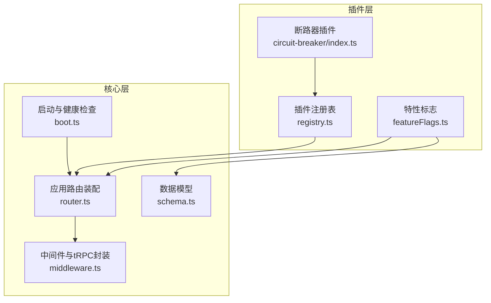
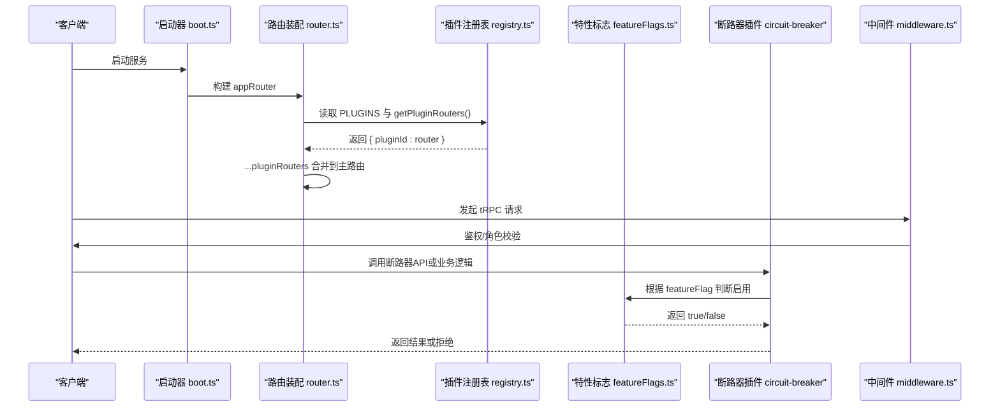
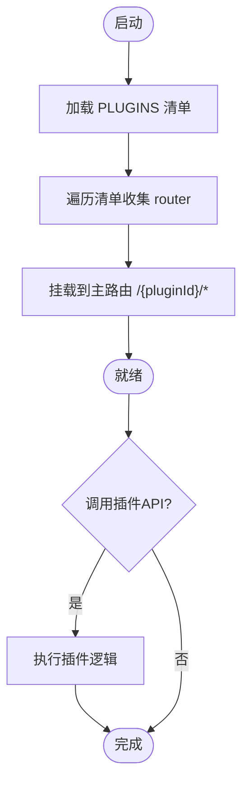
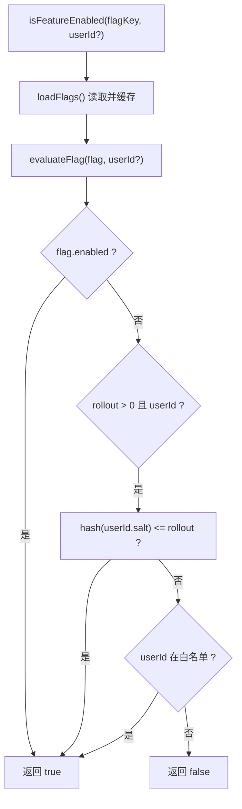
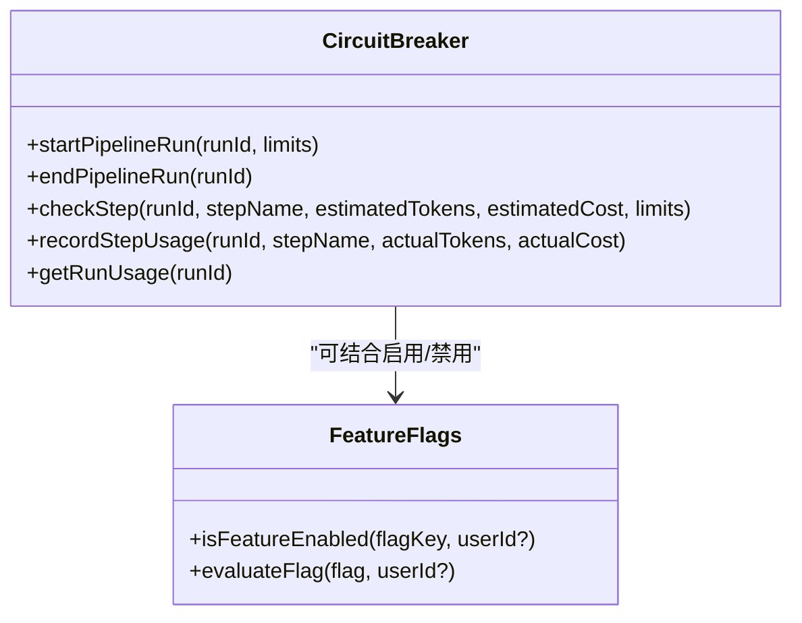
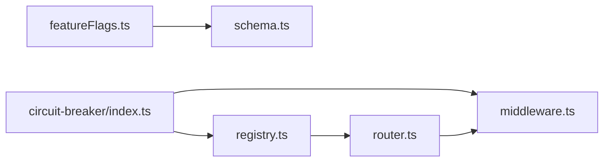

# 插件化设计

<cite>
**本文引用的文件**
- [api/plugins/registry.ts](file://api/plugins/registry.ts)
- [api/plugins/featureFlags.ts](file://api/plugins/featureFlags.ts)
- [api/plugins/circuit-breaker/index.ts](file://api/plugins/circuit-breaker/index.ts)
- [api/router.ts](file://api/router.ts)
- [api/middleware.ts](file://api/middleware.ts)
- [db/schema.ts](file://db/schema.ts)
- [api/boot.ts](file://api/boot.ts)
</cite>

## 目录
1. [简介](#简介)
2. [项目结构](#项目结构)
3. [核心组件](#核心组件)
4. [架构总览](#架构总览)
5. [详细组件分析](#详细组件分析)
6. [依赖关系分析](#依赖关系分析)
7. [性能考量](#性能考量)
8. [故障排查指南](#故障排查指南)
9. [结论](#结论)
10. [附录：自定义插件开发示例](#附录自定义插件开发示例)

## 简介
本设计文档面向DeeWaanAI系统的插件化能力，围绕以下目标展开：
- 插件注册表机制：插件发现、加载与生命周期管理
- 插件接口规范：路由注册、功能扩展点与配置选项
- 特性标志（Feature Flags）系统：动态功能开关与灰度发布
- 断路器模式：在插件中实现故障隔离与系统稳定性保障
- 自定义插件开发：提供结构与集成方法的具体指引

## 项目结构
插件相关代码集中在 api/plugins 目录下，并通过统一的注册表与路由装配机制接入核心系统。关键路径如下：
- 插件注册表：定义插件清单、依赖校验与路由器聚合
- 特性标志：从数据库读取并缓存，支持全局开关、用户白名单与按比例灰度
- 断路器插件：以“安全护栏”形式限制资源消耗，防止失控
- 路由装配：将插件的 tRPC Router 挂载到应用主路由下，形成 /{pluginId}/* 命名空间

图表来源
- [api/plugins/registry.ts:19-38](file://api/plugins/registry.ts#L19-L38)
- [api/plugins/featureFlags.ts:27-81](file://api/plugins/featureFlags.ts#L27-L81)
- [api/plugins/circuit-breaker/index.ts:147-185](file://api/plugins/circuit-breaker/index.ts#L147-L185)
- [api/router.ts:31-70](file://api/router.ts#L31-L70)
- [api/middleware.ts:10-51](file://api/middleware.ts#L10-L51)
- [db/schema.ts:1010-1024](file://db/schema.ts#L1010-L1024)
- [api/boot.ts:361-372](file://api/boot.ts#L361-L372)

章节来源
- [api/plugins/registry.ts:1-70](file://api/plugins/registry.ts#L1-L70)
- [api/plugins/featureFlags.ts:1-119](file://api/plugins/featureFlags.ts#L1-L119)
- [api/plugins/circuit-breaker/index.ts:1-186](file://api/plugins/circuit-breaker/index.ts#L1-L186)
- [api/router.ts:1-73](file://api/router.ts#L1-L73)
- [api/middleware.ts:1-51](file://api/middleware.ts#L1-L51)
- [db/schema.ts:1010-1024](file://db/schema.ts#L1010-L1024)
- [api/boot.ts:361-372](file://api/boot.ts#L361-L372)

## 核心组件
- 插件注册表（Plugin Registry）
  - 定义插件清单类型 PluginManifest，包含 id、name、description、version、featureFlag、dependencies、router
  - 集中维护 PLUGINS 数组，导出 getPluginRouters() 与 validateDependencies()
- 特性标志（Feature Flags）
  - 从 feature_flags 表读取并缓存，支持 enabled、rolloutPercent、allowedUserIds
  - 提供 isFeatureEnabled(flagKey, userId?) 与 evaluateFlag(flag, userId?)
  - 提供 seedDefaultFlags() 用于首次启动时写入默认标志
- 断路器插件（Circuit Breaker）
  - 提供 startPipelineRun/endPipelineRun/checkStep/recordStepUsage/getRunUsage
  - 暴露 tRPC Router 用于查询状态与管理员更新默认限制
  - 通过 featureFlag 字段与特性标志系统联动

章节来源
- [api/plugins/registry.ts:19-69](file://api/plugins/registry.ts#L19-L69)
- [api/plugins/featureFlags.ts:27-119](file://api/plugins/featureFlags.ts#L27-L119)
- [api/plugins/circuit-breaker/index.ts:23-185](file://api/plugins/circuit-breaker/index.ts#L23-L185)

## 架构总览
插件化架构由“注册表 + 路由装配 + 特性标志 + 断路器”构成。启动时，应用构建 appRouter，并将所有已注册的插件 Router 以插件 ID 为命名空间挂载；请求进入后，通过 tRPC 中间件进行鉴权与角色控制；特性标志在运行时决定功能是否可用；断路器在流水线执行前对资源使用进行限额检查，避免失控。

图表来源
- [api/router.ts:31-70](file://api/router.ts#L31-L70)
- [api/plugins/registry.ts:44-53](file://api/plugins/registry.ts#L44-L53)
- [api/plugins/featureFlags.ts:51-73](file://api/plugins/featureFlags.ts#L51-L73)
- [api/plugins/circuit-breaker/index.ts:147-185](file://api/plugins/circuit-breaker/index.ts#L147-L185)
- [api/middleware.ts:17-51](file://api/middleware.ts#L17-L51)
- [api/boot.ts:361-372](file://api/boot.ts#L361-L372)

## 详细组件分析

### 插件注册表机制
- 插件清单与元数据
  - 每个插件必须提供唯一 id、可读名称、描述、版本、关联的特性标志 key、可选依赖列表以及可选的 tRPC Router
- 插件发现与加载
  - 通过 PLUGINS 数组静态声明插件；getPluginRouters() 遍历清单并收集 router
  - 路由装配阶段将各插件 Router 以插件 ID 为键挂载到主路由，形成 /{pluginId}/* 访问路径
- 依赖校验
  - validateDependencies() 检查每个插件声明的依赖是否存在于 PLUGINS 列表中，返回缺失依赖的错误信息
- 生命周期管理
  - 当前实现为“启动期发现 + 运行期按需调用”，无显式初始化/销毁钩子；可通过插件内部函数（如断路器 start/end）管理运行期状态

图表来源
- [api/plugins/registry.ts:33-53](file://api/plugins/registry.ts#L33-L53)
- [api/router.ts:31-70](file://api/router.ts#L31-L70)

章节来源
- [api/plugins/registry.ts:19-69](file://api/plugins/registry.ts#L19-L69)
- [api/router.ts:31-70](file://api/router.ts#L31-L70)

### 插件接口规范
- 路由注册
  - 插件通过 export 一个 tRPC Router，并在清单中声明 router 字段；路由装配阶段自动将其挂载到主路由
  - 中间件提供 authedQuery/adminQuery，便于插件内实现鉴权与权限控制
- 功能扩展点
  - 插件可暴露任意 tRPC 端点作为扩展点，供前端或其他服务调用
  - 通过 featureFlag 字段与特性标志系统联动，实现按部署/用户维度的功能开关
- 配置选项
  - 插件可在清单中声明 dependencies，用于声明对其他插件的依赖
  - 断路器插件展示了如何在运行时调整默认限制（管理员接口），体现配置可扩展性

章节来源
- [api/plugins/circuit-breaker/index.ts:147-185](file://api/plugins/circuit-breaker/index.ts#L147-L185)
- [api/middleware.ts:17-51](file://api/middleware.ts#L17-L51)
- [api/plugins/registry.ts:19-38](file://api/plugins/registry.ts#L19-L38)

### 特性标志（Feature Flags）系统
- 数据存储与缓存
  - 使用 feature_flags 表存储 key、enabled、rolloutPercent、allowedUserIds 等
  - 内存 Map 缓存配置，TTL 60s，减少频繁读库
- 评估策略
  - 优先级：完全开启 > 按比例灰度（基于 userId 哈希）> 白名单用户 > 默认关闭
  - 提供 evaluateFlag(flag, userId?) 纯函数便于单元测试
- 默认值与初始化
  - seedDefaultFlags() 在首次启动时写入默认标志（如 circuit_breaker、batch_mode 等）
- 与插件集成
  - 插件清单中的 featureFlag 字段标识该插件对应的标志 key，可在业务逻辑中调用 isFeatureEnabled 进行开关控制

图表来源
- [api/plugins/featureFlags.ts:27-73](file://api/plugins/featureFlags.ts#L27-L73)
- [db/schema.ts:1010-1024](file://db/schema.ts#L1010-L1024)

章节来源
- [api/plugins/featureFlags.ts:27-119](file://api/plugins/featureFlags.ts#L27-L119)
- [db/schema.ts:1010-1024](file://db/schema.ts#L1010-L1024)

### 断路器模式在插件中的实现
- 目标
  - 防止流水线步骤无限循环或过度消耗 token/成本，确保系统稳定性
- 核心能力
  - 每笔流水线运行维护计数器：累计 token、累计成本、步骤超时、WHILE 迭代次数
  - checkStep() 在执行前检查预算与超时，recordStepUsage() 记录实际消耗
  - 管理员可通过 tRPC 接口动态调整默认限制
- 与特性标志联动
  - 插件清单声明 featureFlag: "circuit_breaker"，可按部署/用户维度启用/禁用断路器保护

图表来源
- [api/plugins/circuit-breaker/index.ts:44-143](file://api/plugins/circuit-breaker/index.ts#L44-L143)
- [api/plugins/featureFlags.ts:51-73](file://api/plugins/featureFlags.ts#L51-L73)

章节来源
- [api/plugins/circuit-breaker/index.ts:23-185](file://api/plugins/circuit-breaker/index.ts#L23-L185)
- [api/plugins/featureFlags.ts:51-73](file://api/plugins/featureFlags.ts#L51-L73)

## 依赖关系分析
- 插件注册表依赖 tRPC 类型与插件清单；路由装配依赖注册表提供的 routers
- 特性标志依赖数据库 schema 与连接；缓存提升性能
- 断路器插件依赖中间件提供的鉴权能力，并通过 tRPC 暴露 API
- 启动流程负责健康检查与服务就绪，不直接耦合插件细节，但通过路由装配间接启用插件

图表来源
- [api/plugins/registry.ts:44-53](file://api/plugins/registry.ts#L44-L53)
- [api/router.ts:31-70](file://api/router.ts#L31-L70)
- [api/middleware.ts:17-51](file://api/middleware.ts#L17-L51)
- [api/plugins/featureFlags.ts:27-81](file://api/plugins/featureFlags.ts#L27-L81)
- [db/schema.ts:1010-1024](file://db/schema.ts#L1010-L1024)
- [api/plugins/circuit-breaker/index.ts:147-185](file://api/plugins/circuit-breaker/index.ts#L147-L185)

章节来源
- [api/plugins/registry.ts:44-69](file://api/plugins/registry.ts#L44-L69)
- [api/router.ts:31-70](file://api/router.ts#L31-L70)
- [api/middleware.ts:17-51](file://api/middleware.ts#L17-L51)
- [api/plugins/featureFlags.ts:27-81](file://api/plugins/featureFlags.ts#L27-L81)
- [db/schema.ts:1010-1024](file://db/schema.ts#L1010-L1024)
- [api/plugins/circuit-breaker/index.ts:147-185](file://api/plugins/circuit-breaker/index.ts#L147-L185)

## 性能考量
- 特性标志缓存：内存 Map + 60s TTL，降低数据库压力
- 断路器计数：每笔运行独立计数器，避免跨请求污染；步骤完成后重置计时，提高响应速度
- 路由装配：一次性遍历 PLUGINS 构建 routers，避免重复计算
- 建议：
  - 对于高频调用的特性标志，可考虑增加本地缓存或分布式缓存（如 Redis）
  - 断路器统计可持久化到数据库或指标系统，便于监控与告警

[本节为通用指导，无需特定文件引用]

## 故障排查指南
- 插件未生效
  - 检查 PLUGINS 数组是否包含新插件
  - 检查插件清单中的 featureFlag 是否在数据库中启用
  - 查看路由装配日志，确认插件 Router 是否被挂载
- 特性标志不生效
  - 确认 feature_flags 表中对应 key 的 enabled、rolloutPercent、allowedUserIds 设置
  - 使用 evaluateFlag 进行单元测试验证逻辑
- 断路器误拦截
  - 检查 checkStep 传入的 estimatedTokens/estimatedCost 是否合理
  - 通过管理员接口调整默认限制，观察行为变化
- 启动失败
  - 检查 boot.ts 中的健康检查与就绪探针，确认数据库/Redis/队列状态
  - 关注异常捕获与日志输出

章节来源
- [api/plugins/registry.ts:33-69](file://api/plugins/registry.ts#L33-L69)
- [api/plugins/featureFlags.ts:51-119](file://api/plugins/featureFlags.ts#L51-L119)
- [api/plugins/circuit-breaker/index.ts:147-185](file://api/plugins/circuit-breaker/index.ts#L147-L185)
- [api/boot.ts:73-135](file://api/boot.ts#L73-L135)

## 结论
DeeWaanAI 的插件化设计通过清晰的注册表、统一的路由装配、灵活的特性标志与健壮的断路器模式，实现了高内聚、低耦合的扩展能力。开发者可以以最小代价新增插件，并通过特性标志与断路器保障系统稳定性与可控性。

[本节为总结，无需特定文件引用]

## 附录：自定义插件开发示例
以下为开发自定义插件的步骤与要点（不含具体代码内容，仅给出路径参考）：
- 创建插件目录与清单
  - 在 api/plugins/{your-plugin}/index.ts 中导出 PluginManifest，包含 id、name、description、version、featureFlag、dependencies、router
  - 参考路径：[api/plugins/registry.ts:19-38](file://api/plugins/registry.ts#L19-L38)、[api/plugins/circuit-breaker/index.ts:178-185](file://api/plugins/circuit-breaker/index.ts#L178-L185)
- 实现 tRPC Router
  - 使用 createRouter/authedQuery/adminQuery 定义端点，实现业务逻辑
  - 参考路径：[api/plugins/circuit-breaker/index.ts:147-174](file://api/plugins/circuit-breaker/index.ts#L147-L174)、[api/middleware.ts:17-51](file://api/middleware.ts#L17-L51)
- 注册插件
  - 在 PLUGINS 数组中添加你的插件清单，使路由装配阶段自动挂载
  - 参考路径：[api/plugins/registry.ts:33-38](file://api/plugins/registry.ts#L33-L38)、[api/router.ts:31-70](file://api/router.ts#L31-L70)
- 使用特性标志
  - 在插件逻辑中调用 isFeatureEnabled(flagKey, userId?) 控制功能开关
  - 参考路径：[api/plugins/featureFlags.ts:51-73](file://api/plugins/featureFlags.ts#L51-L73)
- 测试与验证
  - 编写单元测试覆盖 evaluateFlag 与插件逻辑
  - 参考路径：[api/plugins/featureFlags.test.ts:1-53](file://api/plugins/featureFlags.test.ts#L1-L53)

章节来源
- [api/plugins/registry.ts:19-38](file://api/plugins/registry.ts#L19-L38)
- [api/plugins/circuit-breaker/index.ts:147-185](file://api/plugins/circuit-breaker/index.ts#L147-L185)
- [api/middleware.ts:17-51](file://api/middleware.ts#L17-L51)
- [api/router.ts:31-70](file://api/router.ts#L31-L70)
- [api/plugins/featureFlags.ts:51-73](file://api/plugins/featureFlags.ts#L51-L73)
- [api/plugins/featureFlags.test.ts:1-53](file://api/plugins/featureFlags.test.ts#L1-L53)