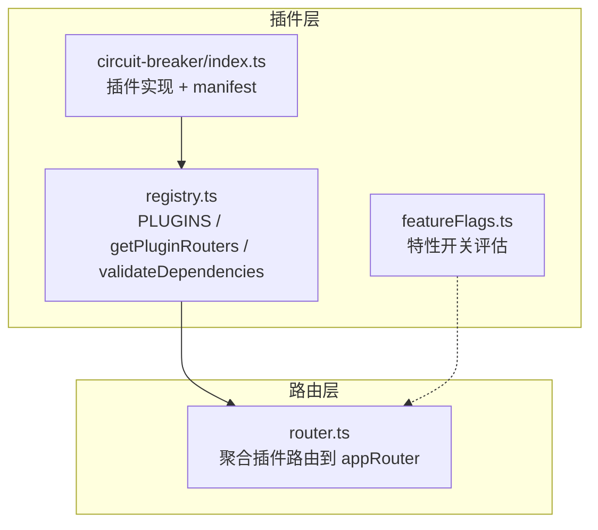
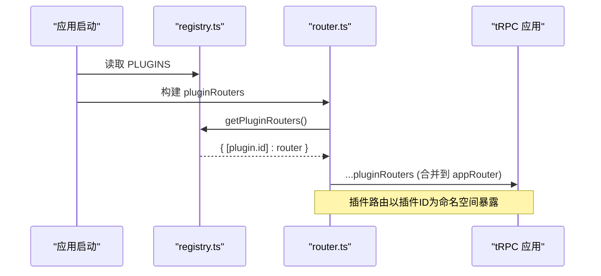
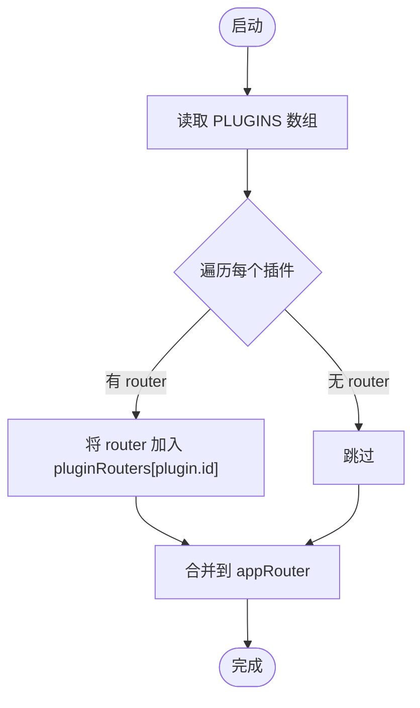
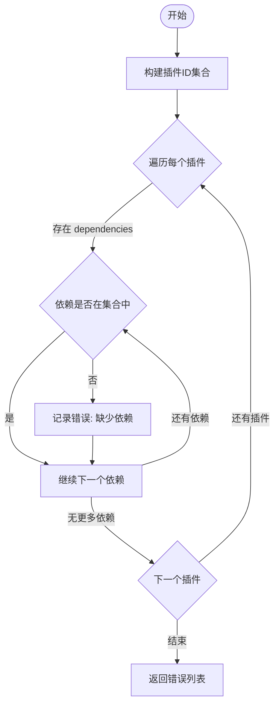
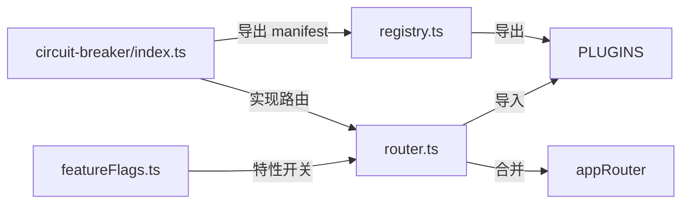

# 插件注册表机制

<cite>
**本文引用的文件**
- [api/plugins/registry.ts](file://api/plugins/registry.ts)
- [api/plugins/circuit-breaker/index.ts](file://api/plugins/circuit-breaker/index.ts)
- [api/plugins/featureFlags.ts](file://api/plugins/featureFlags.ts)
- [api/router.ts](file://api/router.ts)
</cite>

## 目录
1. [简介](#简介)
2. [项目结构](#项目结构)
3. [核心组件](#核心组件)
4. [架构总览](#架构总览)
5. [详细组件分析](#详细组件分析)
6. [依赖关系分析](#依赖关系分析)
7. [性能与扩展性](#性能与扩展性)
8. [故障排查指南](#故障排查指南)
9. [结论](#结论)
10. [附录：创建新插件最佳实践](#附录：创建新插件最佳实践)

## 简介
本文件系统性说明 DeeWaanAI 的插件注册表机制，重点包括：
- PluginManifest 接口结构与字段含义（id、name、description、version、featureFlag、dependencies、router）
- PLUGINS 数组的注册流程
- getPluginRouters 如何汇总所有插件路由器
- validateDependencies 依赖校验的工作原理
- 如何从零创建一个新插件并正确注册到系统中（目录结构、manifest 定义、依赖声明）

## 项目结构
插件系统位于 api/plugins 目录下，采用“按功能域分目录”的组织方式。当前已实现一个示例插件 circuit-breaker，并通过 registry.ts 集中管理插件清单和工具函数；路由层在 router.ts 中聚合所有插件路由器，使其以插件 ID 为命名空间挂载到主 tRPC 应用。

图表来源
- [api/plugins/registry.ts:19-69](file://api/plugins/registry.ts#L19-L69)
- [api/plugins/circuit-breaker/index.ts:178-185](file://api/plugins/circuit-breaker/index.ts#L178-L185)
- [api/plugins/featureFlags.ts:51-73](file://api/plugins/featureFlags.ts#L51-L73)
- [api/router.ts:29-37](file://api/router.ts#L29-L37)

章节来源
- [api/plugins/registry.ts:1-70](file://api/plugins/registry.ts#L1-L70)
- [api/router.ts:1-73](file://api/router.ts#L1-L73)

## 核心组件
- PluginManifest：插件元数据契约，描述插件身份、版本、特性开关键、可选依赖以及可选的 tRPC 路由器。
- PLUGINS：全局插件清单，集中注册所有插件实例。
- getPluginRouters：从 PLUGINS 中提取所有带 router 的插件，返回以插件 id 为键的路由器映射。
- validateDependencies：校验每个插件声明的 dependencies 是否都在 PLUGINS 中存在，返回缺失依赖的错误信息列表。
- featureFlags：运行时特性开关评估，用于控制插件功能的启用与灰度发布。

章节来源
- [api/plugins/registry.ts:19-69](file://api/plugins/registry.ts#L19-L69)
- [api/plugins/featureFlags.ts:51-73](file://api/plugins/featureFlags.ts#L51-L73)

## 架构总览
插件通过统一的 manifest 暴露元数据和可选路由器；路由层在启动时遍历 PLUGINS，将带有 router 的插件以插件 id 作为命名空间挂载到主应用路由器上，形成可被客户端调用的 API 路径。

图表来源
- [api/plugins/registry.ts:45-53](file://api/plugins/registry.ts#L45-L53)
- [api/router.ts:29-37](file://api/router.ts#L29-L37)
- [api/router.ts:39-70](file://api/router.ts#L39-L70)

## 详细组件分析

### PluginManifest 接口与字段说明
- id：插件唯一标识，建议使用 kebab-case 字符串，作为路由命名空间和依赖引用键。
- name：人类可读的名称，用于展示与日志。
- description：插件功能描述，便于维护者理解。
- version：语义化版本号，便于管理与升级。
- featureFlag：关联的特性开关 key，用于控制该插件或功能的启用状态。
- dependencies：可选，依赖的其他插件 id 列表，用于声明插件间的依赖关系。
- router：可选，tRPC 路由器对象，若提供则会被注册到主应用路由下。

章节来源
- [api/plugins/registry.ts:19-27](file://api/plugins/registry.ts#L19-L27)

### PLUGINS 数组的注册流程
- 新增插件需在 api/plugins/{pluginId}/index.ts 中导出符合 PluginManifest 的对象。
- 在 api/plugins/registry.ts 的 PLUGINS 数组中添加该插件实例。
- 启动时，router.ts 会遍历 PLUGINS，收集所有包含 router 的插件，并以插件 id 为键合并到主应用路由器中。

图表来源
- [api/router.ts:31-37](file://api/router.ts#L31-L37)
- [api/router.ts:39-70](file://api/router.ts#L39-L70)

章节来源
- [api/plugins/registry.ts:33-38](file://api/plugins/registry.ts#L33-L38)
- [api/router.ts:29-37](file://api/router.ts#L29-L37)

### getPluginRouters 工作原理
- 遍历 PLUGINS，筛选出包含 router 的插件。
- 以插件 id 为键、router 为值构建映射对象。
- 供上层（如 router.ts）使用，将插件路由以命名空间形式挂载到主应用。

章节来源
- [api/plugins/registry.ts:45-53](file://api/plugins/registry.ts#L45-L53)
- [api/router.ts:31-37](file://api/router.ts#L31-L37)

### validateDependencies 依赖验证机制
- 首先收集 PLUGINS 中所有插件的 id 集合。
- 对每个插件的 dependencies 逐一检查是否存在于该集合中。
- 若发现缺失依赖，记录错误消息（包含插件 id 与缺失依赖 id）。
- 返回所有错误消息数组；为空表示依赖满足。

图表来源
- [api/plugins/registry.ts:56-69](file://api/plugins/registry.ts#L56-L69)

章节来源
- [api/plugins/registry.ts:56-69](file://api/plugins/registry.ts#L56-L69)

### 特性开关与插件启用
- 插件通过 manifest.featureFlag 指定特性开关 key。
- 运行时通过 isFeatureEnabled 查询数据库缓存，结合 rollout 百分比与允许用户白名单进行判定。
- 可用于前端条件渲染与后端路由访问控制（由调用方决定如何使用）。

章节来源
- [api/plugins/featureFlags.ts:51-73](file://api/plugins/featureFlags.ts#L51-L73)

### 示例插件：Circuit Breaker
- 提供管道运行时的安全限制（token、花费、超时、循环次数），并在每一步执行前进行检查。
- 暴露 tRPC 路由用于查询状态与管理员更新默认限制。
- 通过 manifest 注册到插件系统，具备 id、name、description、version、featureFlag、router 等字段。

章节来源
- [api/plugins/circuit-breaker/index.ts:178-185](file://api/plugins/circuit-breaker/index.ts#L178-L185)
- [api/plugins/circuit-breaker/index.ts:147-174](file://api/plugins/circuit-breaker/index.ts#L147-L174)

## 依赖关系分析
- registry.ts 依赖 tRPC 类型 AnyRouter，并提供 PLUGINS、getPluginRouters、validateDependencies。
- router.ts 引入 PLUGINS，构建插件子路由并合并到主应用路由器。
- circuit-breaker 插件导出 manifest 并实现 tRPC 路由，依赖中间件 createRouter/authedQuery/adminQuery。
- featureFlags 提供运行时特性开关评估，供上层逻辑决定是否启用某功能。

图表来源
- [api/plugins/registry.ts:33-38](file://api/plugins/registry.ts#L33-L38)
- [api/router.ts:29-37](file://api/router.ts#L29-L37)
- [api/plugins/circuit-breaker/index.ts:178-185](file://api/plugins/circuit-breaker/index.ts#L178-L185)
- [api/plugins/featureFlags.ts:51-73](file://api/plugins/featureFlags.ts#L51-L73)

章节来源
- [api/plugins/registry.ts:1-70](file://api/plugins/registry.ts#L1-L70)
- [api/router.ts:1-73](file://api/router.ts#L1-L73)
- [api/plugins/circuit-breaker/index.ts:1-186](file://api/plugins/circuit-breaker/index.ts#L1-L186)
- [api/plugins/featureFlags.ts:1-119](file://api/plugins/featureFlags.ts#L1-L119)

## 性能与扩展性
- 插件路由聚合在启动时一次性完成，时间复杂度 O(n)，n 为插件数量，开销极小。
- 依赖校验同样为 O(n*m)，m 为平均依赖数，适合在启动阶段执行。
- 特性开关使用内存缓存（TTL 60s），减少数据库压力，提升高频判断性能。
- 扩展建议：
  - 保持插件间低耦合，仅通过明确定义的接口或 tRPC 路由交互。
  - 合理拆分大插件为多个子模块，避免单文件过大。
  - 使用 featureFlag 控制新功能灰度，降低上线风险。

## 故障排查指南
- 插件未生效：
  - 确认已在 PLUGINS 数组中注册插件实例。
  - 确认插件导出的 manifest 包含 router（如需暴露路由）。
  - 检查 router.ts 是否正确合并插件路由。
- 依赖缺失报错：
  - 使用 validateDependencies 获取缺失依赖列表，修正 dependencies 或确保依赖插件已注册。
- 特性开关不生效：
  - 核对 manifest.featureFlag 与数据库中 feature_flags 表的 key 一致。
  - 检查 enabled、rolloutPercent、allowedUserIds 配置是否符合预期。
- 路由冲突：
  - 确保各插件 id 唯一且不与现有路由冲突。

章节来源
- [api/plugins/registry.ts:56-69](file://api/plugins/registry.ts#L56-L69)
- [api/plugins/featureFlags.ts:51-73](file://api/plugins/featureFlags.ts#L51-L73)
- [api/router.ts:31-37](file://api/router.ts#L31-L37)

## 结论
DeeWaanAI 的插件注册表机制通过统一的 manifest 契约、集中的 PLUGINS 清单与简洁的工具函数，实现了插件的可插拔式扩展。依赖校验保证了系统的稳定性，特性开关提供了灵活的运行时控制能力。遵循本文的最佳实践可以快速、安全地扩展系统功能。

## 附录：创建新插件最佳实践
- 目录结构
  - 在 api/plugins/{your-plugin-id}/ 下创建 index.ts，导出符合 PluginManifest 的对象。
  - 将业务逻辑、tRPC 路由、常量与工具函数组织在该目录内，保持高内聚。
- Manifest 定义
  - id：使用 kebab-case 的唯一标识。
  - name/description/version：清晰描述插件用途与版本。
  - featureFlag：填写与 feature_flags 表中一致的 key。
  - dependencies：仅声明必要的其他插件 id。
  - router：如需对外暴露 API，提供 tRPC 路由器。
- 注册步骤
  - 在 api/plugins/registry.ts 的 PLUGINS 数组中引入并添加你的插件实例。
  - 启动后，router.ts 会自动将其路由以插件 id 为命名空间挂载到主应用。
- 依赖声明最佳实践
  - 仅在确实需要时才声明依赖，避免不必要的耦合。
  - 若依赖尚未实现，先占位或在启动时进行兼容性检查。
- 特性开关使用
  - 在插件内部根据 isFeatureEnabled 的结果决定是否启用特定功能。
  - 通过 feature_flags 表配置 rollout 百分比与白名单用户，逐步放量。

章节来源
- [api/plugins/registry.ts:11-15](file://api/plugins/registry.ts#L11-L15)
- [api/plugins/registry.ts:33-38](file://api/plugins/registry.ts#L33-L38)
- [api/plugins/circuit-breaker/index.ts:178-185](file://api/plugins/circuit-breaker/index.ts#L178-L185)
- [api/plugins/featureFlags.ts:51-73](file://api/plugins/featureFlags.ts#L51-L73)
- [api/router.ts:29-37](file://api/router.ts#L29-L37)