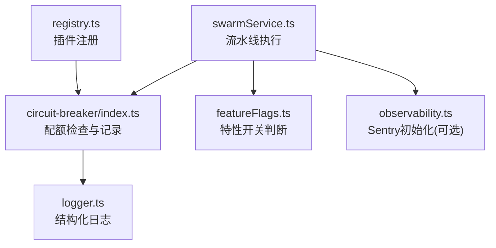
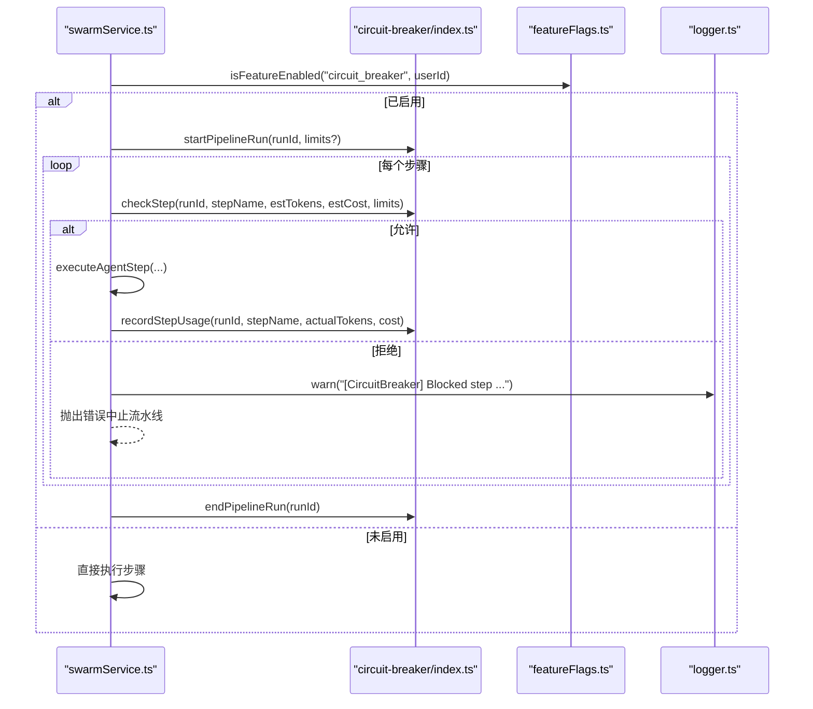
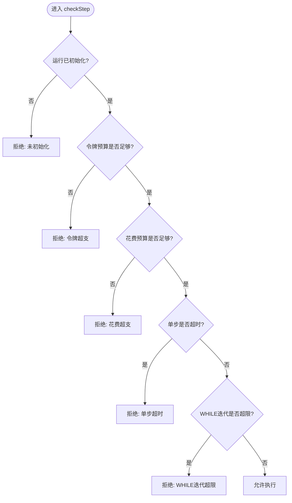
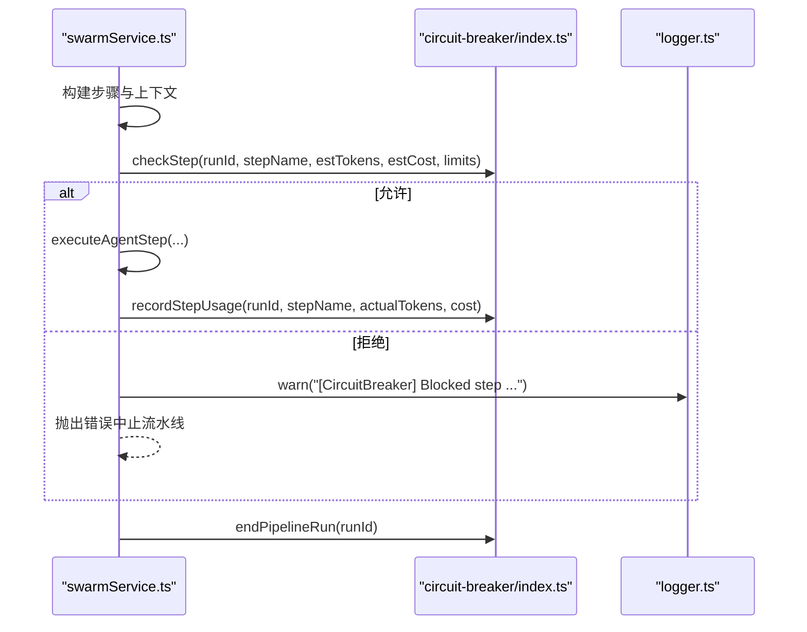
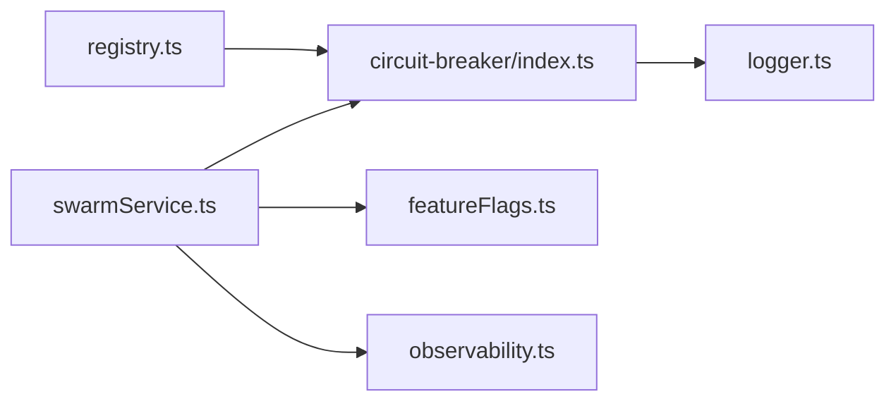

# 断路器模式实现

<cite>
**本文引用的文件**
- [api/plugins/circuit-breaker/index.ts](file://api/plugins/circuit-breaker/index.ts)
- [api/services/swarmService.ts](file://api/services/swarmService.ts)
- [api/plugins/registry.ts](file://api/plugins/registry.ts)
- [api/plugins/featureFlags.ts](file://api/plugins/featureFlags.ts)
- [api/lib/logger.ts](file://api/lib/logger.ts)
- [api/lib/observability.ts](file://api/lib/observability.ts)
</cite>

## 目录
1. [简介](#简介)
2. [项目结构](#项目结构)
3. [核心组件](#核心组件)
4. [架构总览](#架构总览)
5. [详细组件分析](#详细组件分析)
6. [依赖关系分析](#依赖关系分析)
7. [性能考量](#性能考量)
8. [故障排查指南](#故障排查指南)
9. [结论](#结论)
10. [附录](#附录)

## 简介
本文件为DeeWaanAI插件系统中的“断路器”能力提供完整技术文档。该能力以“安全护栏”的形式，在流水线（pipeline）执行前对每个步骤进行资源与时间限制检查，防止失控调用导致成本飙升、超时堆积或无限循环。它通过令牌预算、花费上限、单步超时和WHILE循环次数等阈值，保障系统稳定性并保护外部服务资源。

需要特别说明的是：当前仓库中的“circuit-breaker”插件并非传统意义上的“熔断器状态机（关闭/打开/半开）”，而是“运行期配额与限流式断路器”。它基于每次流水线运行的内存计数器，在执行前拦截超限步骤，并在执行后记录实际用量。若未来需要引入真正的“熔断器状态机”，可在此模块基础上扩展。

## 项目结构
断路器相关代码主要分布在以下位置：
- 插件实现：api/plugins/circuit-breaker/index.ts
- 流水线执行集成：api/services/swarmService.ts
- 插件注册与特性开关：api/plugins/registry.ts、api/plugins/featureFlags.ts
- 日志与可观测性：api/lib/logger.ts、api/lib/observability.ts

图表来源
- [api/services/swarmService.ts:590-852](file://api/services/swarmService.ts#L590-L852)
- [api/plugins/circuit-breaker/index.ts:44-143](file://api/plugins/circuit-breaker/index.ts#L44-L143)
- [api/plugins/featureFlags.ts:51-73](file://api/plugins/featureFlags.ts#L51-L73)
- [api/plugins/registry.ts:33-38](file://api/plugins/registry.ts#L33-L38)
- [api/lib/logger.ts:12-31](file://api/lib/logger.ts#L12-L31)
- [api/lib/observability.ts:17-33](file://api/lib/observability.ts#L17-L33)

章节来源
- [api/plugins/circuit-breaker/index.ts:1-186](file://api/plugins/circuit-breaker/index.ts#L1-L186)
- [api/services/swarmService.ts:590-852](file://api/services/swarmService.ts#L590-L852)
- [api/plugins/registry.ts:1-70](file://api/plugins/registry.ts#L1-L70)
- [api/plugins/featureFlags.ts:1-119](file://api/plugins/featureFlags.ts#L1-L119)
- [api/lib/logger.ts:1-32](file://api/lib/logger.ts#L1-L32)
- [api/lib/observability.ts:1-34](file://api/lib/observability.ts#L1-L34)

## 核心组件
- 断路器插件（配额型）
  - 生命周期管理：startPipelineRun/endPipelineRun
  - 执行前检查：checkStep（令牌预算、花费上限、单步超时、WHILE迭代上限）
  - 执行后记录：recordStepUsage（累计令牌与花费，重置单步计时）
  - 运行时查询：getRunUsage（获取当前运行累计用量）
  - tRPC路由：getStatus（查看限额与用量）、updateLimits（管理员动态调整默认限额）
- 流水线集成（swarmService）
  - 启动时根据特性开关决定是否启用断路器
  - 每步执行前估算令牌与花费，调用checkStep拦截超限
  - 执行后读取实际令牌使用量，调用recordStepUsage更新累计
  - 结束时清理run上下文
- 特性开关与插件注册
  - featureFlags提供运行时开关控制（默认开启）
  - registry将断路器插件纳入全局插件清单

章节来源
- [api/plugins/circuit-breaker/index.ts:23-143](file://api/plugins/circuit-breaker/index.ts#L23-L143)
- [api/services/swarmService.ts:590-852](file://api/services/swarmService.ts#L590-L852)
- [api/plugins/featureFlags.ts:51-73](file://api/plugins/featureFlags.ts#L51-L73)
- [api/plugins/registry.ts:33-38](file://api/plugins/registry.ts#L33-L38)

## 架构总览
下图展示断路器在流水线执行中的介入点与数据流：

图表来源
- [api/services/swarmService.ts:590-852](file://api/services/swarmService.ts#L590-L852)
- [api/plugins/circuit-breaker/index.ts:44-143](file://api/plugins/circuit-breaker/index.ts#L44-L143)
- [api/plugins/featureFlags.ts:51-73](file://api/plugins/featureFlags.ts#L51-L73)
- [api/lib/logger.ts:12-31](file://api/lib/logger.ts#L12-L31)

## 详细组件分析

### 断路器插件（配额型）
- 设计要点
  - 以“运行ID”为键维护内存计数器，避免跨运行污染
  - 执行前检查覆盖四类风险：令牌超支、花费超支、单步超时、WHILE无限循环
  - 执行后记录真实用量，用于后续步骤的预算判定
  - 暴露tRPC接口供前端/管理端查询与动态调参
- 关键数据结构
  - RunCounters：totalTokens、totalCost、stepStartTime、whileIterations(stepId -> count)
- 复杂度
  - checkStep/recordStepUsage均为O(1)操作（Map查找与数值累加）
- 错误处理
  - 未初始化运行返回不允许；超限返回明确原因；异常路径由调用方捕获并中止流程
- 可观测性
  - 通过logger输出阻断告警；可通过Sentry上报异常（可选）

图表来源
- [api/plugins/circuit-breaker/index.ts:62-110](file://api/plugins/circuit-breaker/index.ts#L62-L110)

章节来源
- [api/plugins/circuit-breaker/index.ts:23-143](file://api/plugins/circuit-breaker/index.ts#L23-L143)

### 流水线集成（swarmService）
- 启动阶段
  - 动态导入断路器插件并检查特性开关
  - 如启用则创建运行上下文（startPipelineRun），传入默认或自定义限额
- 执行阶段
  - 每步执行前估算令牌与花费，调用checkStep拦截
  - 执行后读取实际令牌使用量，计算花费并调用recordStepUsage
- 结束阶段
  - 清理运行上下文（endPipelineRun），释放内存
- 异常与恢复
  - 被阻断时记录警告日志并抛出错误，流水线中止
  - 支持用户取消与全局访问次数保护，避免死循环

图表来源
- [api/services/swarmService.ts:760-793](file://api/services/swarmService.ts#L760-L793)
- [api/services/swarmService.ts:845-852](file://api/services/swarmService.ts#L845-L852)
- [api/plugins/circuit-breaker/index.ts:115-131](file://api/plugins/circuit-breaker/index.ts#L115-L131)

章节来源
- [api/services/swarmService.ts:590-852](file://api/services/swarmService.ts#L590-L852)

### 特性开关与插件注册
- 特性开关
  - 默认启用“circuit_breaker”，支持按用户 rollout 百分比与白名单控制
  - 缓存策略：60秒TTL，降低数据库压力
- 插件注册
  - 在PLUGINS数组中声明断路器插件，便于统一挂载router与元信息

章节来源
- [api/plugins/featureFlags.ts:22-73](file://api/plugins/featureFlags.ts#L22-L73)
- [api/plugins/registry.ts:19-38](file://api/plugins/registry.ts#L19-L38)

## 依赖关系分析
- 耦合度
  - swarmService与断路器插件松耦合：通过动态import按需加载，失败不影响主流程
  - 断路器插件依赖logger输出告警，不直接依赖业务逻辑
- 外部依赖
  - 无持久化存储（内存计数器），适合进程内隔离
  - 可选Sentry上报（observability）
- 潜在循环依赖
  - 无循环引用；swarmService仅调用插件API，插件不反向依赖swarmService

图表来源
- [api/services/swarmService.ts:590-852](file://api/services/swarmService.ts#L590-L852)
- [api/plugins/circuit-breaker/index.ts:19-21](file://api/plugins/circuit-breaker/index.ts#L19-L21)
- [api/plugins/registry.ts:33-38](file://api/plugins/registry.ts#L33-L38)
- [api/lib/logger.ts:12-31](file://api/lib/logger.ts#L12-L31)
- [api/lib/observability.ts:17-33](file://api/lib/observability.ts#L17-L33)

章节来源
- [api/services/swarmService.ts:590-852](file://api/services/swarmService.ts#L590-L852)
- [api/plugins/circuit-breaker/index.ts:19-21](file://api/plugins/circuit-breaker/index.ts#L19-L21)
- [api/plugins/registry.ts:33-38](file://api/plugins/registry.ts#L33-L38)

## 性能考量
- 内存占用
  - 每个运行一个RunCounters对象，包含少量数值与Map，开销极低
- CPU开销
  - 每步一次checkStep（O(1)）与一次recordStepUsage（O(1)），对整体吞吐影响可忽略
- I/O
  - 无数据库读写；仅logger输出与可选Sentry上报
- 建议
  - 合理设置maxTokens与maxSpend，避免频繁阻断造成用户体验下降
  - stepTimeout不宜过短，以免误杀长耗时但必要的步骤
  - 在高并发场景下，如需跨进程共享状态，可将计数器迁移至Redis等外部存储

[本节为通用指导，不直接分析具体文件]

## 故障排查指南
- 常见问题
  - 令牌超支：检查步骤预估令牌与实际使用差异，必要时提高maxTokens或优化提示词
  - 花费超支：评估模型单价与token消耗，调整maxSpend或拆分流水线
  - 单步超时：提升stepTimeout或优化外部服务响应时间
  - WHILE迭代超限：审查循环条件与质量门控逻辑，避免死循环
- 定位方法
  - 查看logger输出的阻断告警，确认触发原因
  - 通过tRPC getStatus查询当前运行用量，对比限额
  - 结合Sentry（如启用）追踪异常堆栈
- 恢复策略
  - 动态调整限额：通过updateLimits临时放宽限制，观察效果
  - 重试机制：当前实现不包含自动重试；可在上层调用处实现指数退避重试

章节来源
- [api/plugins/circuit-breaker/index.ts:62-110](file://api/plugins/circuit-breaker/index.ts#L62-L110)
- [api/plugins/circuit-breaker/index.ts:147-173](file://api/plugins/circuit-breaker/index.ts#L147-L173)
- [api/lib/logger.ts:12-31](file://api/lib/logger.ts#L12-L31)
- [api/lib/observability.ts:17-33](file://api/lib/observability.ts#L17-L33)

## 结论
当前DeeWaanAI的“断路器”以配额与限流为核心，提供了轻量、低耦合、易配置的安全护栏，有效防止流水线失控带来的成本与稳定性风险。其实现简洁高效，易于扩展。若未来需要更复杂的“熔断器状态机（关闭/打开/半开）”，可在此基础上增加状态管理与滑动窗口统计，以实现对外部依赖的自适应熔断与恢复。

[本节为总结性内容，不直接分析具体文件]

## 附录

### 配置参数说明（来自默认值与管理接口）
- maxTokens：单次流水线运行的令牌预算（默认50000）
- maxSpend：单次流水线运行的花费上限（默认$5.00）
- stepTimeout：单步超时阈值（默认60秒）
- maxIterations：WHILE循环最大迭代次数（默认5次）

章节来源
- [api/plugins/circuit-breaker/index.ts:23-29](file://api/plugins/circuit-breaker/index.ts#L23-L29)
- [api/plugins/circuit-breaker/index.ts:160-173](file://api/plugins/circuit-breaker/index.ts#L160-L173)

### 在插件中使用断路器的示例指引
- 启动流水线时初始化断路器上下文
  - 参考：[api/services/swarmService.ts:590-599](file://api/services/swarmService.ts#L590-L599)
- 每步执行前检查限额
  - 参考：[api/services/swarmService.ts:760-771](file://api/services/swarmService.ts#L760-L771)
- 每步执行后记录实际用量
  - 参考：[api/services/swarmService.ts:787-793](file://api/services/swarmService.ts#L787-L793)
- 结束时清理上下文
  - 参考：[api/services/swarmService.ts:845-852](file://api/services/swarmService.ts#L845-L852)

章节来源
- [api/services/swarmService.ts:590-852](file://api/services/swarmService.ts#L590-L852)

### 可观测性与监控
- 日志
  - 阻断告警通过logger输出，便于集中采集与分析
  - 参考：[api/lib/logger.ts:12-31](file://api/lib/logger.ts#L12-L31)
- 错误上报
  - 可选Sentry初始化，用于异常追踪
  - 参考：[api/lib/observability.ts:17-33](file://api/lib/observability.ts#L17-L33)
- 指标收集建议
  - 建议在swarmService中聚合断路器阻断次数、平均令牌使用、花费分布等指标，接入APM或时序数据库

章节来源
- [api/lib/logger.ts:12-31](file://api/lib/logger.ts#L12-L31)
- [api/lib/observability.ts:17-33](file://api/lib/observability.ts#L17-L33)