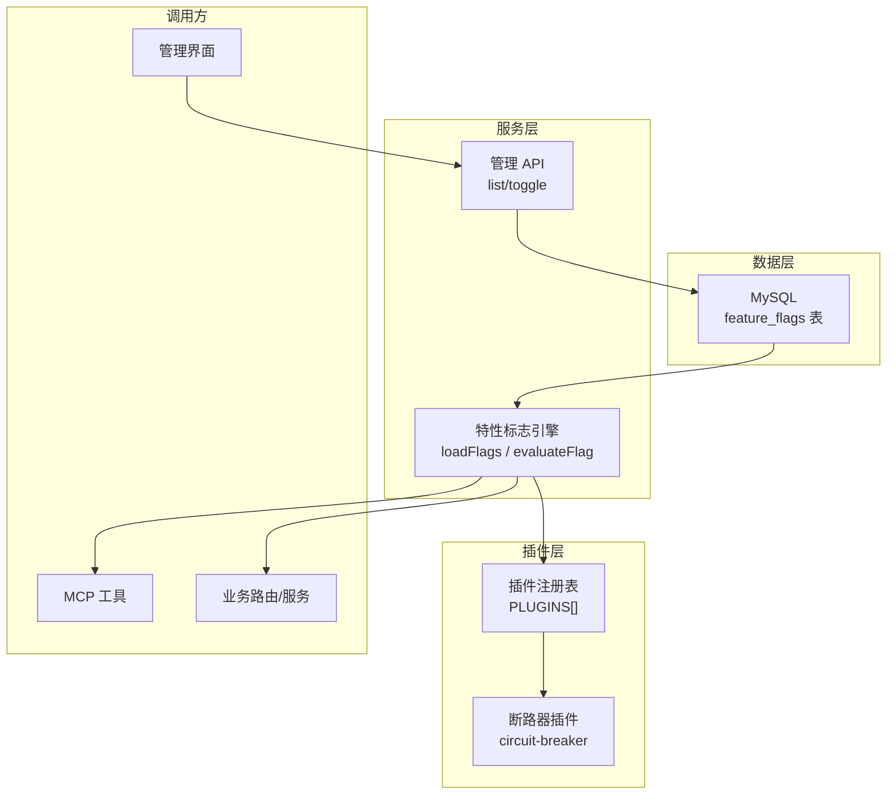
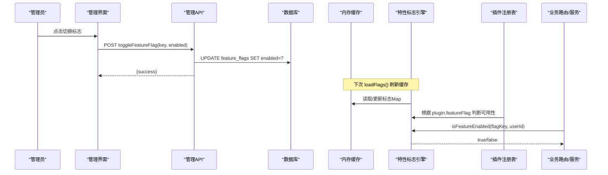
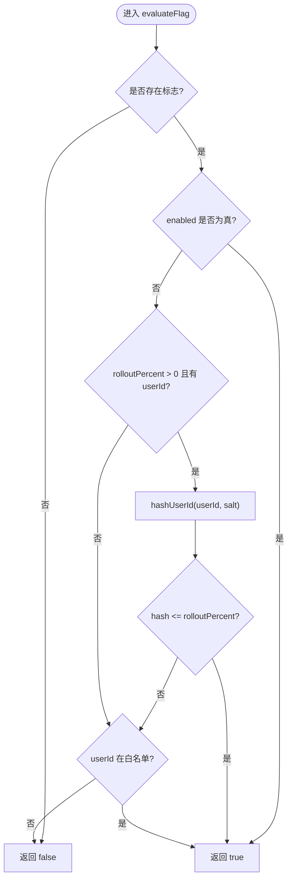
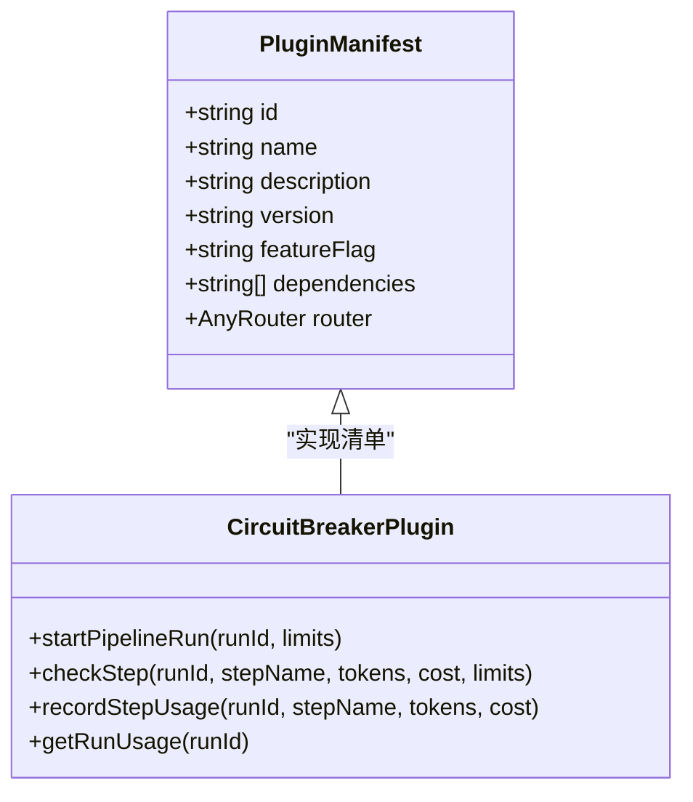
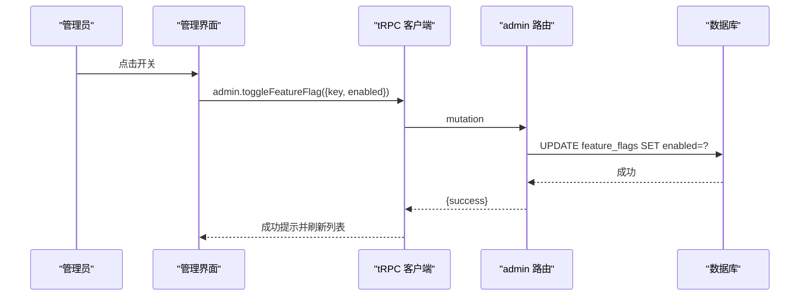
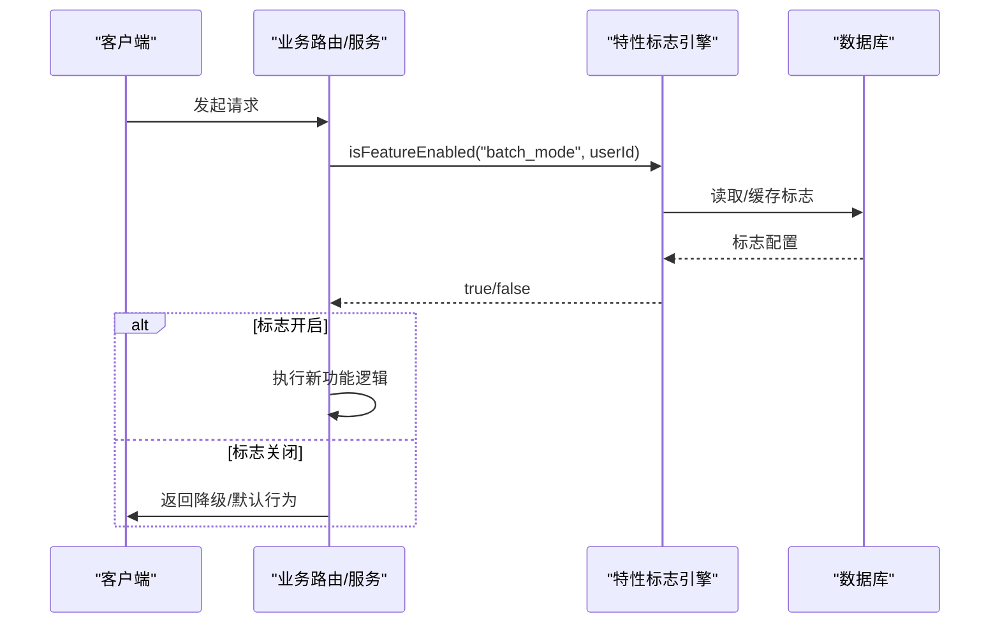
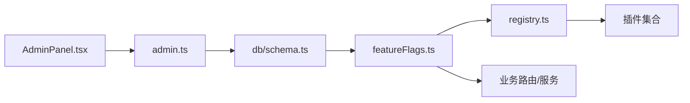

# 特性标志系统

<cite>
**本文引用的文件**
- [api/plugins/featureFlags.ts](file://api/plugins/featureFlags.ts)
- [api/plugins/registry.ts](file://api/plugins/registry.ts)
- [api/plugins/circuit-breaker/index.ts](file://api/plugins/circuit-breaker/index.ts)
- [db/schema.ts](file://db/schema.ts)
- [api/routers/admin.ts](file://api/routers/admin.ts)
- [src/pages/AdminPanel.tsx](file://src/pages/AdminPanel.tsx)
- [api/mcp/server.ts](file://api/mcp/server.ts)
- [api/mcp/tools/designPipeline.ts](file://api/mcp/tools/designPipeline.ts)
- [api/mcp/tools/help.ts](file://api/mcp/tools/help.ts)
- [api/relay-route.ts](file://api/relay-route.ts)
- [api/services/swarmService.ts](file://api/services/swarmService.ts)
- [api/sso-route.ts](file://api/sso-route.ts)
- [api/routers/marketplace.ts](file://api/routers/marketplace.ts)
- [api/routers/swarm.ts](file://api/routers/swarm.ts)
- [api/routers/gitee.ts](file://api/routers/gitee.ts)
- [api/plugins/featureFlags.test.ts](file://api/plugins/featureFlags.test.ts)
</cite>

## 目录
1. [简介](#简介)
2. [项目结构](#项目结构)
3. [核心组件](#核心组件)
4. [架构总览](#架构总览)
5. [详细组件分析](#详细组件分析)
6. [依赖关系分析](#依赖关系分析)
7. [性能考虑](#性能考虑)
8. [故障排查指南](#故障排查指南)
9. [结论](#结论)
10. [附录](#附录)

## 简介
本文件系统性地说明 DeeWaanAI 的特性标志（Feature Flag）机制及其在插件化架构中的作用。特性标志通过数据库持久化，并在运行时以内存缓存方式提供快速判定，用于动态启用或禁用功能、灰度发布与白名单控制。每个插件通过声明式清单中的 featureFlag 字段与特性标志绑定，从而在注册表、后端路由和前端界面中实现“按标志开关”的能力。

特性标志的判定顺序为：
- 若标志完全启用，则允许所有用户；
- 若设置了灰度比例 rolloutPercent > 0，则基于 userId 的确定性哈希进行按比例放行；
- 若设置了 allowedUserIds 白名单，则命中白名单的用户放行；
- 否则拒绝。

该机制支持：
- 插件功能的动态启停；
- 按用户或比例的灰度发布；
- 管理端可视化配置与审计；
- 前端条件渲染与后端路由守卫。

## 项目结构
特性标志系统涉及以下关键位置：
- 数据模型：数据库 schema 定义 feature_flags 表；
- 运行时引擎：api/plugins/featureFlags.ts 提供加载、缓存、评估与默认值初始化；
- 插件注册表：api/plugins/registry.ts 定义插件清单接口并集中注册插件；
- 插件示例：api/plugins/circuit-breaker/index.ts 展示插件如何声明 featureFlag；
- 管理端：api/routers/admin.ts 暴露查询与切换接口，src/pages/AdminPanel.tsx 提供 UI；
- 使用方：多个路由与服务通过 isFeatureEnabled 进行功能门控。

图表来源
- [db/schema.ts:1010-1024](file://db/schema.ts#L1010-L1024)
- [api/plugins/featureFlags.ts:27-81](file://api/plugins/featureFlags.ts#L27-L81)
- [api/plugins/registry.ts:19-38](file://api/plugins/registry.ts#L19-L38)
- [api/routers/admin.ts:222-239](file://api/routers/admin.ts#L222-L239)
- [src/pages/AdminPanel.tsx:836-925](file://src/pages/AdminPanel.tsx#L836-L925)

章节来源
- [db/schema.ts:1010-1024](file://db/schema.ts#L1010-L1024)
- [api/plugins/featureFlags.ts:1-119](file://api/plugins/featureFlags.ts#L1-L119)
- [api/plugins/registry.ts:1-70](file://api/plugins/registry.ts#L1-L70)
- [api/routers/admin.ts:222-239](file://api/routers/admin.ts#L222-L239)
- [src/pages/AdminPanel.tsx:836-925](file://src/pages/AdminPanel.tsx#L836-L925)

## 核心组件
- 特性标志引擎（featureFlags.ts）
  - 负责从数据库加载标志并构建内存 Map，设置 60 秒 TTL 缓存；
  - 提供 isFeatureEnabled(flagKey, userId?) 进行运行时判定；
  - 提供 evaluateFlag(flag, userId?) 纯函数用于单元测试；
  - 提供 getAllFlags() 供管理端读取；
  - 提供 seedDefaultFlags() 在首次启动时写入默认标志（如 circuit_breaker、local_folder、marketplace_ai_triage、batch_mode、pipeline_chaining）。

- 插件注册表（registry.ts）
  - 定义 PluginManifest 接口，包含 id、name、description、version、featureFlag、dependencies、router；
  - 集中维护 PLUGINS 数组，便于统一装配；
  - 提供 getPluginRouters() 与 validateDependencies() 辅助方法。

- 插件示例（circuit-breaker/index.ts）
  - 通过 PluginManifest 声明 featureFlag: "circuit_breaker"；
  - 提供 tRPC 路由用于状态查询与限额调整；
  - 作为可被特性标志控制的插件实例。

- 数据模型（db/schema.ts）
  - feature_flags 表包含 key、name、description、enabled、rolloutPercent、allowedUserIds、pluginId 等字段；
  - key 唯一约束，确保标志键稳定且可引用。

- 管理端（admin.ts + AdminPanel.tsx）
  - 后端提供 listFeatureFlags 与 toggleFeatureFlag 接口；
  - 前端提供可视化的开关列表，支持一键切换 enabled 状态；
  - 记录管理员操作审计日志。

章节来源
- [api/plugins/featureFlags.ts:27-119](file://api/plugins/featureFlags.ts#L27-L119)
- [api/plugins/registry.ts:19-70](file://api/plugins/registry.ts#L19-L70)
- [api/plugins/circuit-breaker/index.ts:176-186](file://api/plugins/circuit-breaker/index.ts#L176-L186)
- [db/schema.ts:1010-1024](file://db/schema.ts#L1010-L1024)
- [api/routers/admin.ts:222-239](file://api/routers/admin.ts#L222-L239)
- [src/pages/AdminPanel.tsx:836-925](file://src/pages/AdminPanel.tsx#L836-L925)

## 架构总览
下图展示了特性标志在系统中的整体交互：管理端修改标志后，服务端的内存缓存会在下次刷新周期内生效；插件注册表依据标志决定是否挂载路由；业务路由与服务在请求路径上按需检查标志以启用或降级功能。

图表来源
- [api/routers/admin.ts:222-239](file://api/routers/admin.ts#L222-L239)
- [api/plugins/featureFlags.ts:27-55](file://api/plugins/featureFlags.ts#L27-L55)
- [api/plugins/registry.ts:19-38](file://api/plugins/registry.ts#L19-L38)

## 详细组件分析

### 特性标志引擎（featureFlags.ts）
- 生命周期
  - 启动阶段：可通过 seedDefaultFlags() 写入默认标志；
  - 运行阶段：isFeatureEnabled 每次调用会先尝试从内存缓存获取，未命中或过期则从数据库加载并重建 Map；
  - 管理阶段：getAllFlags 返回全部标志供管理界面展示；toggle 由管理 API 直接写库，缓存将在下一个 TTL 周期刷新。

- 判定逻辑
  - 未知标志或未配置 → 拒绝；
  - enabled=true → 立即放行；
  - rolloutPercent>0 且传入 userId → 基于 hashUserId(userId, salt) 计算百分比命中；
  - allowedUserIds 包含 userId → 放行；
  - 其他情况 → 拒绝。

- 缓存策略
  - 进程内 Map 缓存，TTL 60 秒；
  - 避免频繁读库，提升高并发下的判定性能。

- 错误处理与回退
  - 未找到标志 → 安全地返回 false；
  - 无 userId 但仅配置了 rollout → 不命中；
  - 白名单为空或不存在 → 不影响 enabled 与 rollout 的优先级。

图表来源
- [api/plugins/featureFlags.ts:61-73](file://api/plugins/featureFlags.ts#L61-L73)
- [api/plugins/featureFlags.ts:109-118](file://api/plugins/featureFlags.ts#L109-L118)

章节来源
- [api/plugins/featureFlags.ts:27-119](file://api/plugins/featureFlags.ts#L27-L119)
- [api/plugins/featureFlags.test.ts:1-53](file://api/plugins/featureFlags.test.ts#L1-L53)

### 插件注册表与插件集成（registry.ts + circuit-breaker/index.ts）
- 插件清单
  - 每个插件导出一个 PluginManifest，其中 featureFlag 字段指向 feature_flags.key；
  - 插件可声明 dependencies 表示对其他插件的依赖；
  - 可选 router 字段用于挂载 tRPC 路由。

- 注册与装配
  - PLUGINS 数组集中声明所有插件；
  - getPluginRouters() 收集所有带 router 的插件；
  - validateDependencies() 校验依赖是否满足。

- 与特性标志的集成
  - 插件本身并不直接读取标志，而是在上层（路由/服务）根据 plugin.featureFlag 调用 isFeatureEnabled 来决定是否启用该插件的功能；
  - 断路器插件示例展示了如何在插件内部提供能力并通过外部标志控制其可用性。

图表来源
- [api/plugins/registry.ts:19-38](file://api/plugins/registry.ts#L19-L38)
- [api/plugins/circuit-breaker/index.ts:176-186](file://api/plugins/circuit-breaker/index.ts#L176-L186)

章节来源
- [api/plugins/registry.ts:1-70](file://api/plugins/registry.ts#L1-L70)
- [api/plugins/circuit-breaker/index.ts:1-186](file://api/plugins/circuit-breaker/index.ts#L1-L186)

### 管理端配置与管理界面（admin.ts + AdminPanel.tsx）
- 后端接口
  - listFeatureFlags：返回所有标志；
  - toggleFeatureFlag：按 key 切换 enabled 状态，并记录审计日志。

- 前端界面
  - 展示标志名称、key、描述、灰度比例、关联插件、白名单数量；
  - 提供开关按钮，触发 toggle 并刷新列表。

图表来源
- [api/routers/admin.ts:222-239](file://api/routers/admin.ts#L222-L239)
- [src/pages/AdminPanel.tsx:836-925](file://src/pages/AdminPanel.tsx#L836-L925)

章节来源
- [api/routers/admin.ts:222-239](file://api/routers/admin.ts#L222-L239)
- [src/pages/AdminPanel.tsx:836-925](file://src/pages/AdminPanel.tsx#L836-L925)

### 运行时使用示例（路由与服务）
- 典型用法模式
  - 在路由或服务入口处调用 isFeatureEnabled(flagKey, userId)，根据结果决定是否执行特定逻辑；
  - 若标志关闭，可返回降级响应或跳过相关步骤。

- 已集成点
  - MCP 工具：designPipeline、help 等工具在需要时检查标志；
  - 业务路由：relay-route、sso-route、marketplace、swarm、gitee 等；
  - 服务：swarmService 在需要时动态导入并使用 isFeatureEnabled。

图表来源
- [api/mcp/tools/designPipeline.ts:13](file://api/mcp/tools/designPipeline.ts#L13)
- [api/mcp/tools/help.ts:13](file://api/mcp/tools/help.ts#L13)
- [api/mcp/server.ts:31](file://api/mcp/server.ts#L31)
- [api/relay-route.ts:30](file://api/relay-route.ts#L30)
- [api/sso-route.ts:23](file://api/sso-route.ts#L23)
- [api/routers/marketplace.ts:24](file://api/routers/marketplace.ts#L24)
- [api/routers/swarm.ts:18](file://api/routers/swarm.ts#L18)
- [api/routers/gitee.ts:8](file://api/routers/gitee.ts#L8)
- [api/services/swarmService.ts:594](file://api/services/swarmService.ts#L594)

章节来源
- [api/mcp/server.ts:31](file://api/mcp/server.ts#L31)
- [api/mcp/tools/designPipeline.ts:13](file://api/mcp/tools/designPipeline.ts#L13)
- [api/mcp/tools/help.ts:13](file://api/mcp/tools/help.ts#L13)
- [api/relay-route.ts:30](file://api/relay-route.ts#L30)
- [api/sso-route.ts:23](file://api/sso-route.ts#L23)
- [api/routers/marketplace.ts:24](file://api/routers/marketplace.ts#L24)
- [api/routers/swarm.ts:18](file://api/routers/swarm.ts#L18)
- [api/routers/gitee.ts:8](file://api/routers/gitee.ts#L8)
- [api/services/swarmService.ts:594](file://api/services/swarmService.ts#L594)

## 依赖关系分析
- 模块耦合
  - featureFlags.ts 依赖数据库连接与 schema；
  - registry.ts 与插件解耦，仅通过 featureFlag 字符串与标志系统间接耦合；
  - 各路由/服务通过 isFeatureEnabled 与标志系统松耦合，便于扩展与维护。

- 潜在循环依赖
  - 标志系统与插件之间通过字符串键关联，避免直接导入循环；
  - 管理端与后端通过 tRPC 解耦。

- 外部依赖
  - Drizzle ORM 用于数据库访问；
  - tRPC 用于前后端类型安全的接口通信。

图表来源
- [db/schema.ts:1010-1024](file://db/schema.ts#L1010-L1024)
- [api/plugins/featureFlags.ts:27-81](file://api/plugins/featureFlags.ts#L27-L81)
- [api/plugins/registry.ts:19-38](file://api/plugins/registry.ts#L19-L38)
- [api/routers/admin.ts:222-239](file://api/routers/admin.ts#L222-L239)
- [src/pages/AdminPanel.tsx:836-925](file://src/pages/AdminPanel.tsx#L836-L925)

章节来源
- [db/schema.ts:1010-1024](file://db/schema.ts#L1010-L1024)
- [api/plugins/featureFlags.ts:27-81](file://api/plugins/featureFlags.ts#L27-L81)
- [api/plugins/registry.ts:19-38](file://api/plugins/registry.ts#L19-L38)
- [api/routers/admin.ts:222-239](file://api/routers/admin.ts#L222-L239)
- [src/pages/AdminPanel.tsx:836-925](file://src/pages/AdminPanel.tsx#L836-L925)

## 性能考虑
- 内存缓存
  - 标志 Map 每 60 秒刷新一次，显著降低数据库压力；
  - 在高并发场景下，evaluateFlag 为纯函数，判定开销极低。

- 灰度哈希
  - hashUserId 使用确定性算法，保证同一用户在一定时间内稳定命中或不命中；
  - 灰度比例控制流量分布，适合渐进式发布。

- 建议优化
  - 若标志变更频繁，可缩短 TTL 或引入事件驱动刷新；
  - 对热点标志可增加本地短 TTL 缓存以减少跨进程共享成本；
  - 监控标志命中率与延迟，必要时扩容或分片。

[本节为通用性能指导，无需具体文件来源]

## 故障排查指南
- 常见问题
  - 标志未生效：确认管理端已成功更新 enabled 状态，并等待缓存刷新；
  - 灰度不命中：检查 userId 是否正确传入，以及 rolloutPercent 设置；
  - 白名单无效：确认 allowedUserIds 包含目标用户 ID；
  - 插件未挂载：核对插件清单中的 featureFlag 是否与数据库 key 一致。

- 调试步骤
  - 使用 getAllFlags() 查看当前标志配置；
  - 使用 evaluateFlag() 进行离线测试，验证判定逻辑；
  - 检查管理端日志与审计记录，确认变更来源；
  - 在调用处打印 flagKey 与 userId，确认参数传递正确。

- 回退机制
  - 未知标志或未配置 → 默认拒绝，避免误开功能；
  - 无 userId 但仅配置 rollout → 不命中，防止意外放量；
  - 白名单为空 → 不影响 enabled 与 rollout 的优先级。

章节来源
- [api/plugins/featureFlags.ts:61-73](file://api/plugins/featureFlags.ts#L61-L73)
- [api/plugins/featureFlags.test.ts:1-53](file://api/plugins/featureFlags.test.ts#L1-L53)
- [api/routers/admin.ts:222-239](file://api/routers/admin.ts#L222-L239)

## 结论
DeeWaanAI 的特性标志系统通过数据库持久化与内存缓存结合，提供了高效、可控的动态功能开关能力。它与插件注册表紧密集成，使插件功能可按部署、用户或比例灵活启用。管理端提供直观的可视化配置与审计，保障运维可控。通过统一的判定逻辑与清晰的职责划分，系统在可扩展性、可维护性与安全性方面表现良好。

[本节为总结性内容，无需具体文件来源]

## 附录
- 默认标志
  - circuit_breaker：流水线安全限制；
  - local_folder：本地文件夹访问；
  - marketplace_ai_triage：市场提交 AI 初筛（非门控）；
  - batch_mode：研究模式—批量运行；
  - pipeline_chaining：研究模式—流水线串联。

- 扩展新插件的步骤
  - 在 api/plugins/{pluginId}/index.ts 导出 PluginManifest，并设置 featureFlag；
  - 将插件加入 api/plugins/registry.ts 的 PLUGINS 数组；
  - 在需要的路由/服务中调用 isFeatureEnabled(plugin.featureFlag, userId) 进行门控；
  - 在管理端配置对应标志的 enabled、rolloutPercent、allowedUserIds。

- 参考实现路径
  - 标志引擎：[api/plugins/featureFlags.ts](file://api/plugins/featureFlags.ts)
  - 插件清单：[api/plugins/registry.ts](file://api/plugins/registry.ts)
  - 插件示例：[api/plugins/circuit-breaker/index.ts](file://api/plugins/circuit-breaker/index.ts)
  - 数据模型：[db/schema.ts](file://db/schema.ts)
  - 管理接口：[api/routers/admin.ts](file://api/routers/admin.ts)
  - 管理界面：[src/pages/AdminPanel.tsx](file://src/pages/AdminPanel.tsx)
  - 使用示例：[api/mcp/tools/designPipeline.ts](file://api/mcp/tools/designPipeline.ts)、[api/mcp/tools/help.ts](file://api/mcp/tools/help.ts)、[api/relay-route.ts](file://api/relay-route.ts)、[api/sso-route.ts](file://api/sso-route.ts)、[api/routers/marketplace.ts](file://api/routers/marketplace.ts)、[api/routers/swarm.ts](file://api/routers/swarm.ts)、[api/routers/gitee.ts](file://api/routers/gitee.ts)、[api/services/swarmService.ts](file://api/services/swarmService.ts)