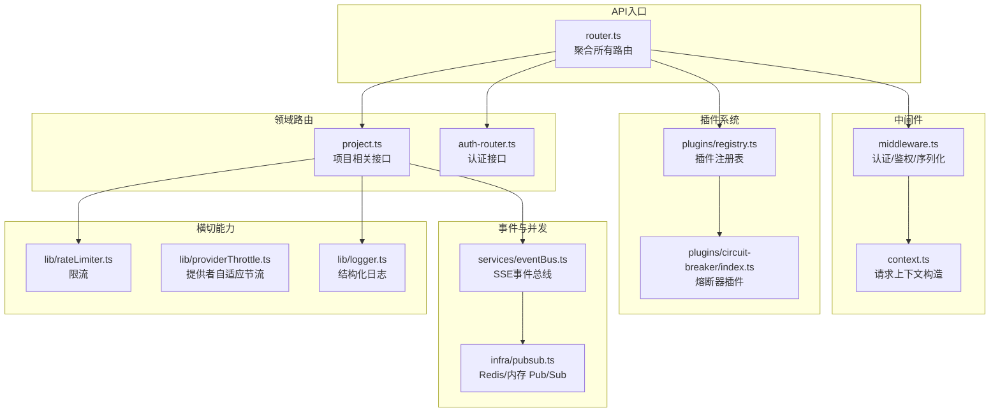
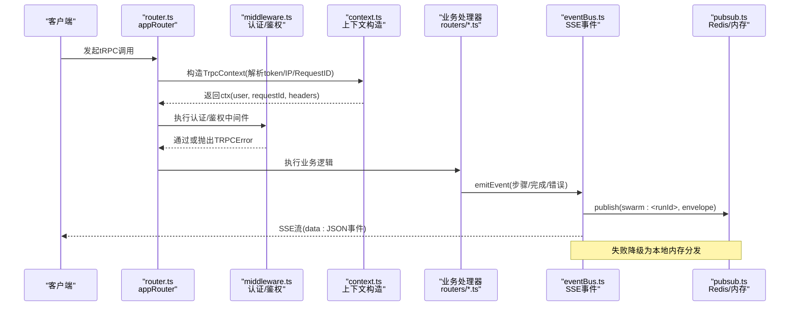
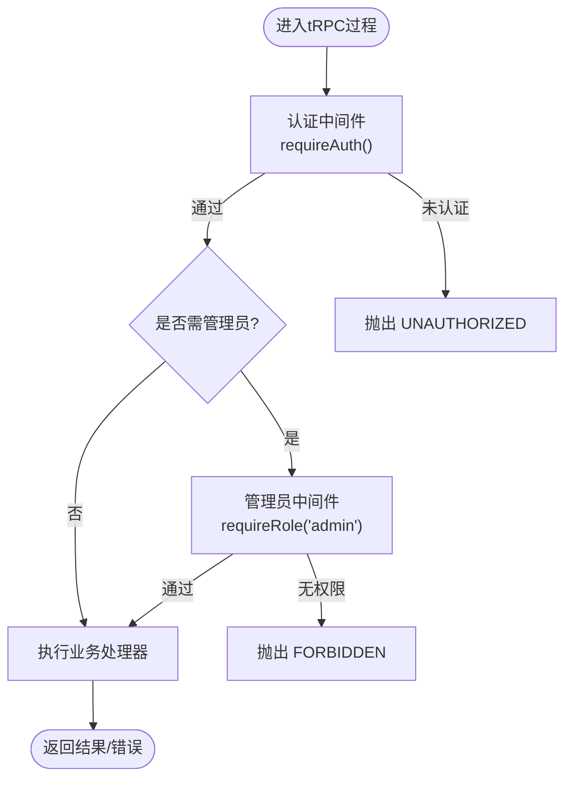
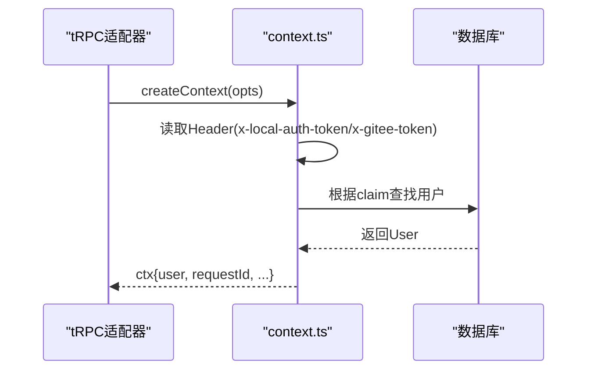
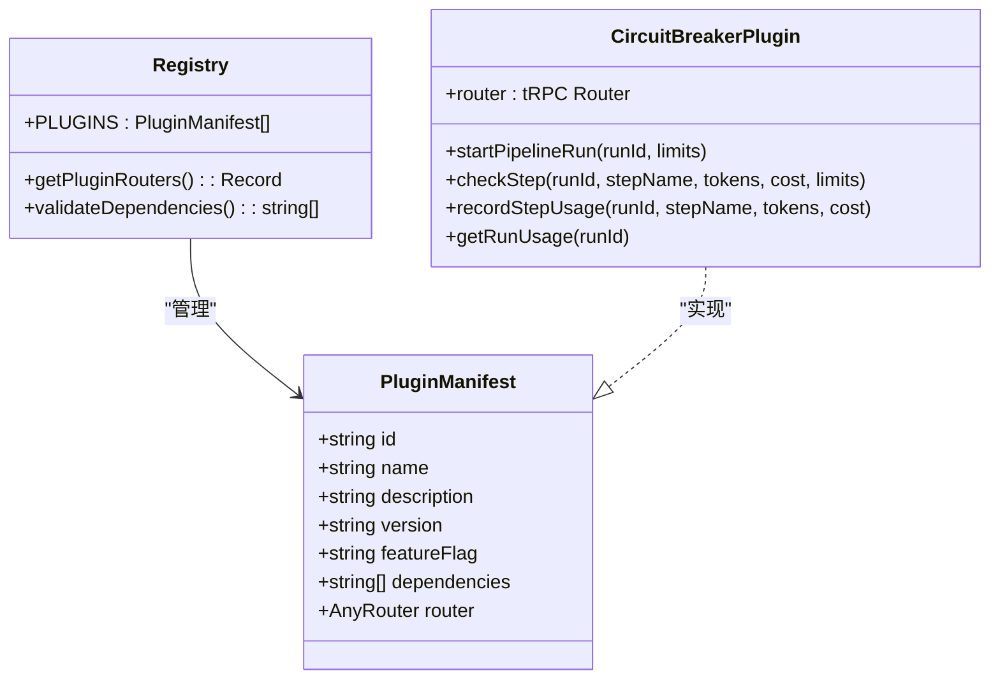
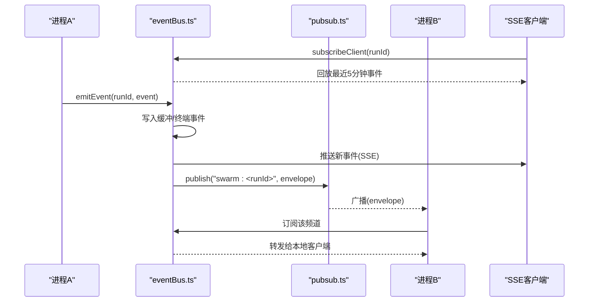
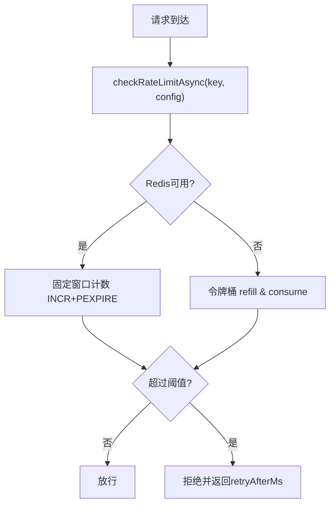
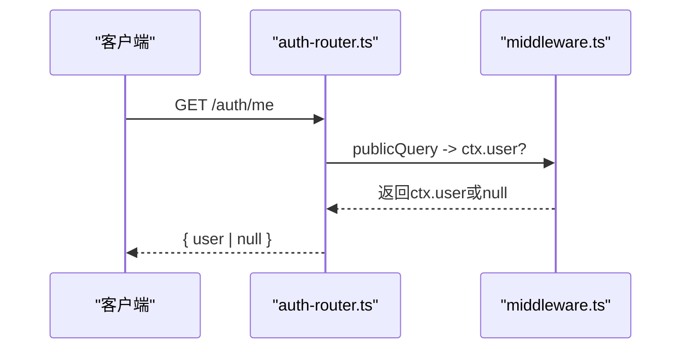
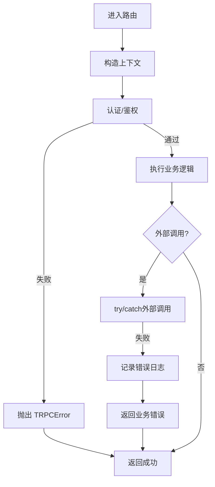
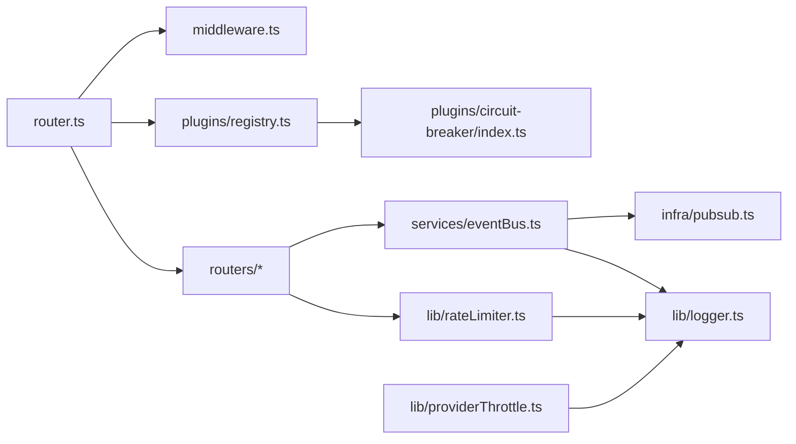

# 架构模式

<cite>
**本文引用的文件**
- [api/router.ts](file://api/router.ts)
- [api/middleware.ts](file://api/middleware.ts)
- [api/context.ts](file://api/context.ts)
- [api/auth-router.ts](file://api/auth-router.ts)
- [api/plugins/registry.ts](file://api/plugins/registry.ts)
- [api/plugins/circuit-breaker/index.ts](file://api/plugins/circuit-breaker/index.ts)
- [api/services/eventBus.ts](file://api/services/eventBus.ts)
- [api/lib/rateLimiter.ts](file://api/lib/rateLimiter.ts)
- [api/lib/providerThrottle.ts](file://api/lib/providerThrottle.ts)
- [api/infra/pubsub.ts](file://api/infra/pubsub.ts)
- [api/lib/logger.ts](file://api/lib/logger.ts)
- [api/routers/project.ts](file://api/routers/project.ts)
</cite>

## 目录
1. [简介](#简介)
2. [项目结构](#项目结构)
3. [核心组件](#核心组件)
4. [架构总览](#架构总览)
5. [详细组件分析](#详细组件分析)
6. [依赖关系分析](#依赖关系分析)
7. [性能考量](#性能考量)
8. [故障排查指南](#故障排查指南)
9. [结论](#结论)
10. [附录](#附录)

## 简介
本文件面向DeeWaanAI系统的后端API与服务层，系统性阐述其采用的分层架构、插件化设计与事件驱动模式。重点说明：
- tRPC如何构建类型安全的API层（输入校验、上下文与中间件）
- 中间件如何实现横切关注点（认证、鉴权、限流、日志）
- 插件注册表机制如何支持功能扩展（路由挂载、依赖校验）
- 请求处理流程、上下文传递机制与错误处理策略
- 事件总线与跨节点广播（SSE流式输出、回放缓冲、终端事件持久化）
- 提供具体代码路径以便快速定位实现

## 项目结构
后端采用“路由层 + 中间件 + 服务层 + 基础设施”的分层组织：
- 路由层：按领域拆分router文件，统一通过createRouter装配
- 中间件：认证、角色鉴权、序列化等横切逻辑
- 服务层：业务编排、外部集成、事件发布
- 基础设施：Redis、Pub/Sub、日志、限流、存储等

图表来源
- [api/router.ts:1-73](file://api/router.ts#L1-L73)
- [api/middleware.ts:1-51](file://api/middleware.ts#L1-L51)
- [api/context.ts:1-55](file://api/context.ts#L1-L55)
- [api/plugins/registry.ts:1-70](file://api/plugins/registry.ts#L1-L70)
- [api/plugins/circuit-breaker/index.ts:1-186](file://api/plugins/circuit-breaker/index.ts#L1-L186)
- [api/services/eventBus.ts:1-193](file://api/services/eventBus.ts#L1-L193)
- [api/infra/pubsub.ts:1-154](file://api/infra/pubsub.ts#L1-L154)
- [api/lib/rateLimiter.ts:1-216](file://api/lib/rateLimiter.ts#L1-L216)
- [api/lib/providerThrottle.ts:1-275](file://api/lib/providerThrottle.ts#L1-L275)
- [api/lib/logger.ts:1-32](file://api/lib/logger.ts#L1-L32)

章节来源
- [api/router.ts:1-73](file://api/router.ts#L1-L73)
- [api/middleware.ts:1-51](file://api/middleware.ts#L1-L51)
- [api/context.ts:1-55](file://api/context.ts#L1-L55)

## 核心组件
- tRPC路由器与中间件：统一创建路由器、定义公开查询与受保护查询，注入用户上下文与序列化器
- 插件注册表：集中管理插件清单、动态挂载子路由、依赖校验
- 事件总线：SSE流式推送、本地回放缓冲、跨节点广播、终端事件持久化
- 限流与节流：进程内令牌桶/固定窗口、Redis分布式计数、提供者AIMD自适应限速
- 日志与可观测性：结构化日志、请求ID贯穿、错误分级输出

章节来源
- [api/middleware.ts:1-51](file://api/middleware.ts#L1-L51)
- [api/plugins/registry.ts:1-70](file://api/plugins/registry.ts#L1-L70)
- [api/services/eventBus.ts:1-193](file://api/services/eventBus.ts#L1-L193)
- [api/lib/rateLimiter.ts:1-216](file://api/lib/rateLimiter.ts#L1-L216)
- [api/lib/providerThrottle.ts:1-275](file://api/lib/providerThrottle.ts#L1-L275)
- [api/lib/logger.ts:1-32](file://api/lib/logger.ts#L1-L32)

## 架构总览
下图展示了从HTTP请求到tRPC处理器、再到服务与事件总线的完整调用链，以及中间件在其中的作用位置。

图表来源
- [api/router.ts:1-73](file://api/router.ts#L1-L73)
- [api/middleware.ts:1-51](file://api/middleware.ts#L1-L51)
- [api/context.ts:1-55](file://api/context.ts#L1-L55)
- [api/services/eventBus.ts:1-193](file://api/services/eventBus.ts#L1-L193)
- [api/infra/pubsub.ts:1-154](file://api/infra/pubsub.ts#L1-L154)

## 详细组件分析

### tRPC API层与类型安全
- 使用initTRPC配置superjson转换器，统一前后端数据结构传输
- createRouter用于组合各域路由；publicQuery为公开接口，authedQuery强制认证，adminQuery进一步要求管理员角色
- 输入校验通过Zod schema在路由中声明，确保运行时类型安全
- 错误处理通过TRPCError抛出标准错误码（如UNAUTHORIZED、FORBIDDEN），便于前端统一处理

图表来源
- [api/middleware.ts:17-51](file://api/middleware.ts#L17-L51)
- [api/routers/project.ts:1-200](file://api/routers/project.ts#L1-L200)

章节来源
- [api/middleware.ts:1-51](file://api/middleware.ts#L1-L51)
- [api/routers/project.ts:1-200](file://api/routers/project.ts#L1-L200)

### 上下文传递机制
- createContext负责组装TrpcContext：包含原始Request、响应头、用户信息、Gitee Token、请求ID、远端IP等
- 优先尝试本地Token认证（x-local-auth-token），成功后从数据库加载用户并注入ctx.user
- 认证失败不中断流程，由后续中间件决定拒绝访问
- 每个请求生成唯一requestId，贯穿日志与追踪

图表来源
- [api/context.ts:1-55](file://api/context.ts#L1-L55)
- [api/lib/logger.ts:1-32](file://api/lib/logger.ts#L1-L32)

章节来源
- [api/context.ts:1-55](file://api/context.ts#L1-L55)
- [api/lib/logger.ts:1-32](file://api/lib/logger.ts#L1-L32)

### 插件注册表与扩展机制
- 插件以PluginManifest描述：id、name、description、version、featureFlag、dependencies、可选router
- PLUGINS数组集中注册插件；getPluginRouters提取所有插件路由并按插件ID挂载
- validateDependencies检查插件依赖是否满足，避免启动期隐式错误
- 示例：熔断器插件暴露状态查询与管理员更新限制接口，并通过router挂载

图表来源
- [api/plugins/registry.ts:1-70](file://api/plugins/registry.ts#L1-L70)
- [api/plugins/circuit-breaker/index.ts:1-186](file://api/plugins/circuit-breaker/index.ts#L1-L186)

章节来源
- [api/plugins/registry.ts:1-70](file://api/plugins/registry.ts#L1-L70)
- [api/plugins/circuit-breaker/index.ts:1-186](file://api/plugins/circuit-breaker/index.ts#L1-L186)

### 事件驱动模式（SSE与跨节点广播）
- eventBus维护每个swarmRunId的客户端列表、5分钟回放缓冲、终端事件永久缓存
- subscribeClient为连接方回放历史事件，并在运行结束后立即发送终端事件
- emitEvent将事件写入本地缓冲与终端缓存，同时通过pubsub广播到其它节点
- pubsub抽象了Redis与内存两种后端，自动忽略自身实例的回声，保证多节点一致性

图表来源
- [api/services/eventBus.ts:1-193](file://api/services/eventBus.ts#L1-L193)
- [api/infra/pubsub.ts:1-154](file://api/infra/pubsub.ts#L1-L154)

章节来源
- [api/services/eventBus.ts:1-193](file://api/services/eventBus.ts#L1-L193)
- [api/infra/pubsub.ts:1-154](file://api/infra/pubsub.ts#L1-L154)

### 限流与节流策略
- 通用限流：checkRateLimitAsync优先使用Redis固定窗口计数，失败回退到进程内令牌桶；提供多种预设配额（认证、执行、批量、读取、截图上传/服务等）
- 客户等级限流：checkCustomerRateLimit按solo/team/admin不同档位分配每分钟请求上限，同样具备Redis优先、内存回退
- 提供者自适应节流：providerThrottle基于AIMD算法动态调整RPM，遇到429则指数回退并暂停；成功则在窗口边界线性增长；状态持久化至Redis或内存

图表来源
- [api/lib/rateLimiter.ts:31-93](file://api/lib/rateLimiter.ts#L31-L93)
- [api/lib/rateLimiter.ts:198-216](file://api/lib/rateLimiter.ts#L198-L216)

章节来源
- [api/lib/rateLimiter.ts:1-216](file://api/lib/rateLimiter.ts#L1-L216)
- [api/lib/providerThrottle.ts:1-275](file://api/lib/providerThrottle.ts#L1-L275)

### 认证与鉴权
- auth-router提供获取当前用户与登出接口
- 认证流程：context阶段解析本地Token并加载用户；middleware中的requireAuth确保ctx.user存在且有效，否则抛出UNAUTHORIZED
- 鉴权：adminQuery叠加角色校验，非管理员访问管理接口时抛出FORBIDDEN

图表来源
- [api/auth-router.ts:1-13](file://api/auth-router.ts#L1-L13)
- [api/middleware.ts:17-51](file://api/middleware.ts#L17-L51)

章节来源
- [api/auth-router.ts:1-13](file://api/auth-router.ts#L1-L13)
- [api/middleware.ts:1-51](file://api/middleware.ts#L1-L51)

### 请求处理流程与错误处理策略
- 请求进入router后，先构造上下文，再依次执行认证/鉴权中间件
- 业务处理器中进行参数校验（Zod）、数据访问（Drizzle ORM）、外部调用（如Gitee）
- 错误处理：
  - 认证失败：抛出TRPCError(UNAUTHORIZED)
  - 权限不足：抛出TRPCError(FORBIDDEN)
  - 外部调用异常：记录日志并返回友好错误（例如Gitee创建仓库失败）
  - 限流触发：返回重试间隔，客户端据此退避
  - 事件广播失败：降级为本地分发，不影响主流程

图表来源
- [api/routers/project.ts:103-200](file://api/routers/project.ts#L103-L200)
- [api/middleware.ts:17-51](file://api/middleware.ts#L17-L51)
- [api/lib/logger.ts:1-32](file://api/lib/logger.ts#L1-L32)

章节来源
- [api/routers/project.ts:1-200](file://api/routers/project.ts#L1-L200)
- [api/middleware.ts:1-51](file://api/middleware.ts#L1-L51)
- [api/lib/logger.ts:1-32](file://api/lib/logger.ts#L1-L32)

## 依赖关系分析
- router.ts依赖多个领域路由与插件注册表，形成松耦合的模块化结构
- middleware.ts依赖上下文与常量错误消息，提供统一的认证/鉴权能力
- eventBus依赖pubsub与logger，实现高可用的事件分发
- rateLimiter与providerThrottle依赖redis与logger，提供弹性降级
- 插件系统通过registry解耦新增功能，避免对核心路由的侵入

图表来源
- [api/router.ts:1-73](file://api/router.ts#L1-L73)
- [api/plugins/registry.ts:1-70](file://api/plugins/registry.ts#L1-L70)
- [api/services/eventBus.ts:1-193](file://api/services/eventBus.ts#L1-L193)
- [api/lib/rateLimiter.ts:1-216](file://api/lib/rateLimiter.ts#L1-L216)
- [api/lib/providerThrottle.ts:1-275](file://api/lib/providerThrottle.ts#L1-L275)
- [api/lib/logger.ts:1-32](file://api/lib/logger.ts#L1-L32)

章节来源
- [api/router.ts:1-73](file://api/router.ts#L1-L73)
- [api/plugins/registry.ts:1-70](file://api/plugins/registry.ts#L1-L70)
- [api/services/eventBus.ts:1-193](file://api/services/eventBus.ts#L1-L193)
- [api/lib/rateLimiter.ts:1-216](file://api/lib/rateLimiter.ts#L1-L216)
- [api/lib/providerThrottle.ts:1-275](file://api/lib/providerThrottle.ts#L1-L275)
- [api/lib/logger.ts:1-32](file://api/lib/logger.ts#L1-L32)

## 性能考量
- 事件回放缓冲：5分钟窗口平衡内存占用与用户体验，过期清理避免无限增长
- 跨节点广播：Redis不可用时自动降级为内存事件分发，保障可用性
- 限流策略：Redis固定窗口计数保证多实例一致性；失败时回退到进程内令牌桶，避免雪崩
- 提供者节流：AIMD算法自适应收敛，减少429风暴，提高整体吞吐
- 日志级别控制：通过环境变量过滤调试日志，降低I/O开销

[本节为通用指导，不直接分析具体文件]

## 故障排查指南
- 认证失败：检查x-local-auth-token是否正确，确认verifyLocalToken与用户查询逻辑
- 权限不足：确认用户角色是否为admin，检查adminQuery中间件
- 限流触发：查看rateLimiter日志与Redis键rl:*，确认窗口与配额设置
- 事件丢失：检查eventBus的缓冲与终端事件，确认pubsub订阅是否建立成功
- 外部调用异常：查看Gitee等服务调用日志，确认网络与凭据

章节来源
- [api/middleware.ts:17-51](file://api/middleware.ts#L17-L51)
- [api/lib/rateLimiter.ts:86-93](file://api/lib/rateLimiter.ts#L86-L93)
- [api/services/eventBus.ts:60-83](file://api/services/eventBus.ts#L60-L83)
- [api/routers/project.ts:103-200](file://api/routers/project.ts#L103-L200)

## 结论
DeeWaanAI后端采用清晰的分层架构与插件化设计，结合tRPC的类型安全与中间件机制，实现了高内聚、低耦合的API体系。事件驱动模式通过SSE与Pub/Sub支撑实时流式交互与多节点广播，具备强韧的降级能力。限流与节流策略兼顾公平性与稳定性，配合结构化日志与错误处理，为系统提供了良好的可观测性与可维护性。

[本节为总结性内容，不直接分析具体文件]

## 附录
- 典型API调用路径参考：
  - 认证接口：[api/auth-router.ts:1-13](file://api/auth-router.ts#L1-L13)
  - 项目列表/创建：[api/routers/project.ts:1-200](file://api/routers/project.ts#L1-L200)
  - 插件路由挂载：[api/router.ts:31-70](file://api/router.ts#L31-L70)
  - 事件发布与回放：[api/services/eventBus.ts:129-167](file://api/services/eventBus.ts#L129-L167)
  - 限流与回退：[api/lib/rateLimiter.ts:31-93](file://api/lib/rateLimiter.ts#L31-L93)
  - 提供者自适应节流：[api/lib/providerThrottle.ts:168-235](file://api/lib/providerThrottle.ts#L168-L235)

[本节为索引性内容，不直接分析具体文件]