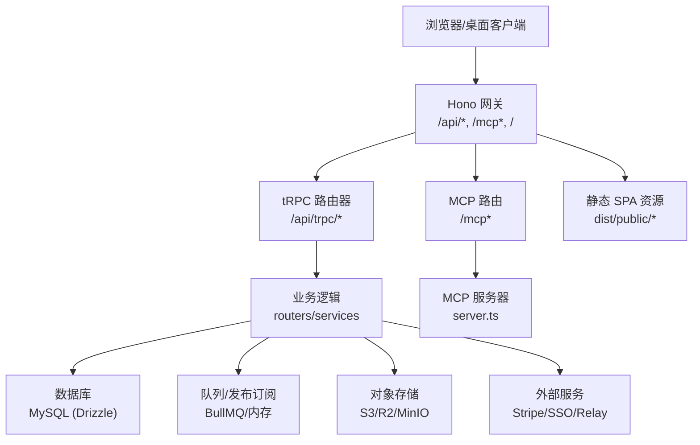
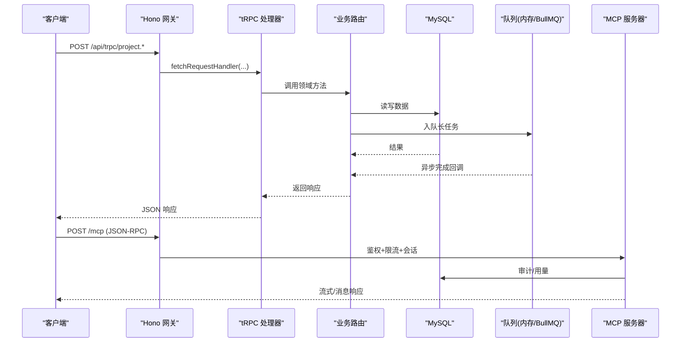
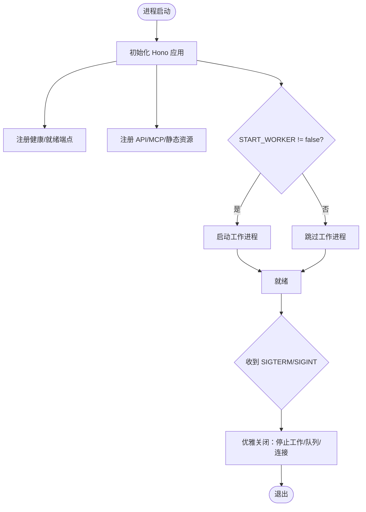
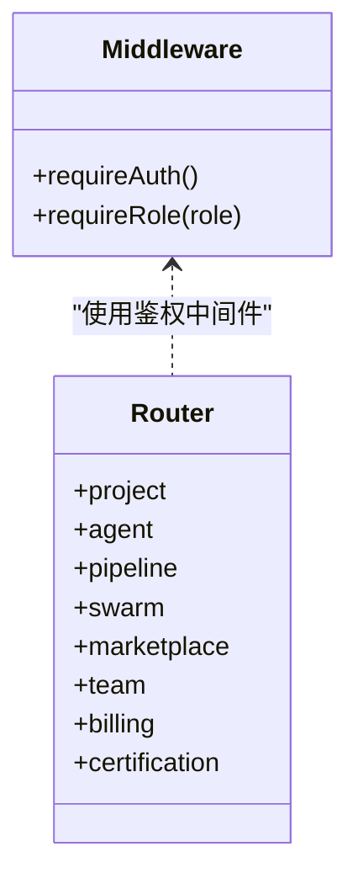
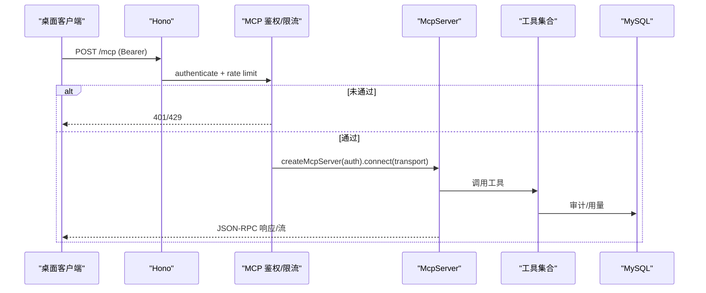
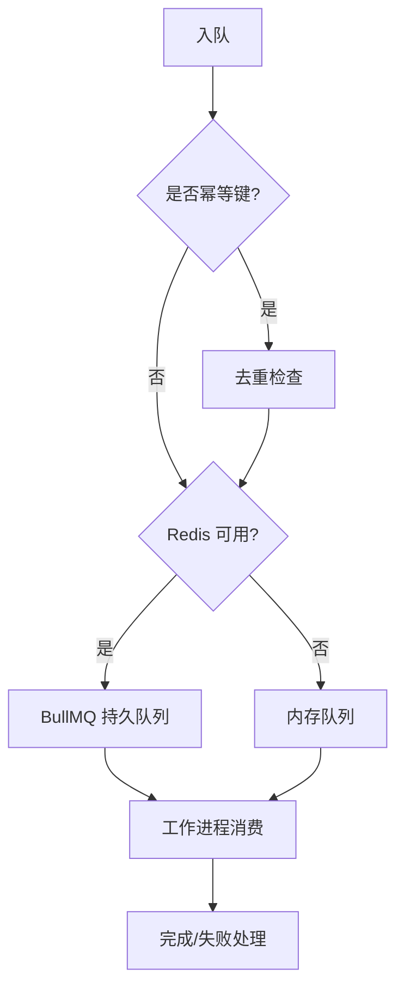
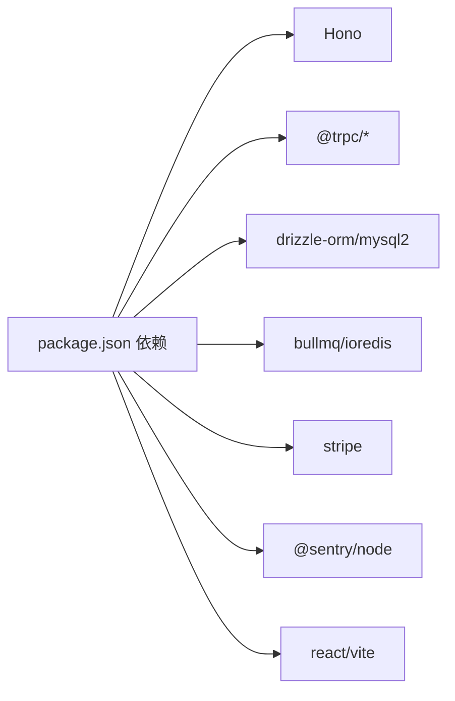

# 架构设计

<cite>
**本文引用的文件**
- [README.md](file://README.md)
- [package.json](file://package.json)
- [api/boot.ts](file://api/boot.ts)
- [api/router.ts](file://api/router.ts)
- [api/middleware.ts](file://api/middleware.ts)
- [api/lib/env.ts](file://api/lib/env.ts)
- [api/infra/queue.ts](file://api/infra/queue.ts)
- [api/infra/redis.ts](file://api/infra/redis.ts)
- [api/mcp/server.ts](file://api/mcp/server.ts)
- [api/mcp/register.ts](file://api/mcp/register.ts)
- [vite.config.ts](file://vite.config.ts)
- [Dockerfile](file://Dockerfile)
- [docker-compose.yml](file://docker-compose.yml)
- [db/schema.ts](file://db/schema.ts)
</cite>

## 目录
1. [简介](#简介)
2. [项目结构](#项目结构)
3. [核心组件](#核心组件)
4. [架构总览](#架构总览)
5. [详细组件分析](#详细组件分析)
6. [依赖关系分析](#依赖关系分析)
7. [性能与可扩展性](#性能与可扩展性)
8. [故障排查指南](#故障排查指南)
9. [结论](#结论)
10. [附录：部署拓扑与基础设施](#附录部署拓扑与基础设施)

## 简介
DeeWaanAI 是一个单进程 Node.js 应用，同时提供三类表面：
- REST/tRPC API（业务接口）
- MCP 伴侣服务器（面向桌面 LLM 客户端的协议表面）
- 构建后的 SPA（静态前端资源）

系统采用“单一入口、多路由”的架构模式：Hono 作为 HTTP 网关，tRPC 聚合业务端点，MCP 通过独立注册器挂载到同一进程；生产模式下由 Hono 直接提供静态 SPA。该设计简化了部署与运维，并通过可插拔的基础设施（Redis/BullMQ、S3、Stripe、SSO、Relay）实现能力扩展与降级。

**章节来源**
- [README.md:1-18](file://README.md#L1-L18)
- [api/boot.ts:35-62](file://api/boot.ts#L35-L62)
- [vite.config.ts:9-12](file://vite.config.ts#L9-L12)

## 项目结构
- 后端服务：位于 api/ 目录，包含启动入口、路由、中间件、MCP、基础设施抽象等。
- 数据层：db/ 使用 Drizzle ORM 定义 schema 与迁移。
- 前端：src/ 为 React + Vite SPA，构建产物输出至 dist/public，由生产环境服务。
- 基础设施：docker-compose.yml 提供 MySQL 与 Redis；Dockerfile 定义两阶段构建与运行镜像。
- 配置与环境：api/lib/env.ts 集中管理环境变量与校验；package.json 定义脚本与依赖。

**图表来源**
- [api/boot.ts:35-62](file://api/boot.ts#L35-L62)
- [api/router.ts:39-70](file://api/router.ts#L39-L70)
- [api/mcp/register.ts:144-164](file://api/mcp/register.ts#L144-L164)
- [vite.config.ts:25-27](file://vite.config.ts#L25-L27)
- [Dockerfile:1-39](file://Dockerfile#L1-L39)

**章节来源**
- [package.json:7-21](file://package.json#L7-L21)
- [api/boot.ts:35-62](file://api/boot.ts#L35-L62)
- [api/router.ts:39-70](file://api/router.ts#L39-L70)
- [api/mcp/register.ts:144-164](file://api/mcp/register.ts#L144-L164)
- [vite.config.ts:25-27](file://vite.config.ts#L25-L27)
- [Dockerfile:1-39](file://Dockerfile#L1-L39)

## 核心组件
- 应用启动与健康检查：Hono 应用初始化、安全头、请求 ID、健康/就绪探针、优雅关闭。
- tRPC 路由聚合：按领域划分的路由模块统一挂载，支持鉴权与角色控制。
- MCP 伴侣服务器：OAuth 鉴权、流式 HTTP 与 SSE 兼容传输、工具注册、审计与用量统计。
- 队列与任务：BullMQ（Redis）或内存队列，支持幂等入队与延迟执行。
- 环境与配置：强制必填项、敏感值校验、可选基础设施开关与降级策略。
- 数据模型：用户、项目、代理、流水线、运行记录等实体定义。

**章节来源**
- [api/boot.ts:35-135](file://api/boot.ts#L35-L135)
- [api/router.ts:39-70](file://api/router.ts#L39-L70)
- [api/middleware.ts:17-51](file://api/middleware.ts#L17-L51)
- [api/mcp/server.ts:84-186](file://api/mcp/server.ts#L84-L186)
- [api/infra/queue.ts:1-334](file://api/infra/queue.ts#L1-L334)
- [api/lib/env.ts:21-95](file://api/lib/env.ts#L21-L95)
- [db/schema.ts:17-200](file://db/schema.ts#L17-L200)

## 架构总览
单进程架构下，Hono 承担所有 HTTP 流量分发：
- /api/trpc/* 交由 tRPC 处理，进入业务路由与领域服务。
- /mcp* 交由 MCP 注册器处理，进行 OAuth 鉴权、速率限制、会话管理与协议传输。
- 其他 /api/* 用于上传、Webhook、备份等专用端点。
- 生产模式下，静态 SPA 由 Hono 直接提供，减少反向代理复杂度。

**图表来源**
- [api/boot.ts:361-372](file://api/boot.ts#L361-L372)
- [api/router.ts:39-70](file://api/router.ts#L39-L70)
- [api/mcp/register.ts:144-164](file://api/mcp/register.ts#L144-L164)
- [api/mcp/server.ts:84-186](file://api/mcp/server.ts#L84-L186)

**章节来源**
- [api/boot.ts:35-135](file://api/boot.ts#L35-L135)
- [api/mcp/register.ts:144-164](file://api/mcp/register.ts#L144-L164)
- [vite.config.ts:25-27](file://vite.config.ts#L25-L27)

## 详细组件分析

### 应用启动与生命周期
- 请求追踪与安全头：注入 requestId、设置安全响应头。
- 健康/就绪探针：/api/health 检测 DB 连通，/api/ready 额外检查 Redis。
- 工作进程：默认启动 swarm 工作进程消费队列；可通过 START_WORKER=false 禁用。
- 优雅关闭：停止工作进程、关闭队列与连接，超时强制退出。
- SPA 静态服务：生产模式下加载并服务 dist/public。

**图表来源**
- [api/boot.ts:35-135](file://api/boot.ts#L35-L135)
- [api/boot.ts:375-416](file://api/boot.ts#L375-L416)
- [api/boot.ts:418-427](file://api/boot.ts#L418-L427)

**章节来源**
- [api/boot.ts:35-135](file://api/boot.ts#L35-L135)
- [api/boot.ts:375-416](file://api/boot.ts#L375-L416)
- [api/boot.ts:418-427](file://api/boot.ts#L418-L427)

### tRPC 路由与鉴权
- 路由聚合：将各业务域路由（项目、代理、流水线、市场、团队等）合并为 appRouter。
- 鉴权中间件：authedQuery 要求登录，adminQuery 要求管理员角色。
- 上下文：通过 Hono 中间件注入远程 IP，供速率限制与审计使用。

**图表来源**
- [api/router.ts:39-70](file://api/router.ts#L39-L70)
- [api/middleware.ts:17-51](file://api/middleware.ts#L17-L51)

**章节来源**
- [api/router.ts:39-70](file://api/router.ts#L39-L70)
- [api/middleware.ts:17-51](file://api/middleware.ts#L17-L51)

### MCP 伴侣服务器
- 认证与授权：每个 /mcp* 请求需携带有效 Bearer 令牌，失败返回 401 与 WWW-Authenticate。
- 速率限制：基于客户层级（solo/team/admin）进行每客户限流，失败返回 429 与 Retry-After。
- 工具注册：按会话创建 McpServer，动态注册工具，支持特性标志隐藏工具。
- 审计与用量：每次工具调用记录审计日志与月度用量计数器。
- 传输协议：支持流式 HTTP 与遗留 SSE 两种传输方式。

**图表来源**
- [api/mcp/register.ts:90-164](file://api/mcp/register.ts#L90-L164)
- [api/mcp/server.ts:84-186](file://api/mcp/server.ts#L84-L186)

**章节来源**
- [api/mcp/register.ts:90-164](file://api/mcp/register.ts#L90-L164)
- [api/mcp/server.ts:84-186](file://api/mcp/server.ts#L84-L186)

### 队列与工作进程
- 后端选择：优先 BullMQ（Redis），不可用时回退到内存队列。
- 幂等入队：支持 idempotencyKey，24 小时内去重。
- 工作进程：默认在应用进程内消费队列；也可单独 workerEntry 进程运行。
- 恢复机制：启动时修复“running/pending”残留任务，周期性 reconciler 清理异常状态。

**图表来源**
- [api/infra/queue.ts:36-71](file://api/infra/queue.ts#L36-L71)
- [api/infra/queue.ts:149-233](file://api/infra/queue.ts#L149-L233)
- [api/boot.ts:197-263](file://api/boot.ts#L197-L263)

**章节来源**
- [api/infra/queue.ts:1-334](file://api/infra/queue.ts#L1-L334)
- [api/boot.ts:197-263](file://api/boot.ts#L197-L263)

### 环境与配置
- 必需变量：APP_ID、APP_SECRET、DATABASE_URL 等在生产环境缺失会阻止启动。
- 安全校验：禁止已知开发默认密钥在 production 使用。
- 可选能力：Redis、Stripe、S3、SSO、Relay 等均可按需启用，未配置时返回 503 或降级。
- 公共 URL 与 CORS：PUBLIC_APP_URL 用于绝对链接；WAITLIST_CORS_ORIGINS 控制跨域。

**章节来源**
- [api/lib/env.ts:21-95](file://api/lib/env.ts#L21-L95)
- [README.md:41-69](file://README.md#L41-L69)

### 数据模型概览
- 用户与权限：users（角色、层级、偏好）。
- 项目与智能卡片：projects（仓库集成、流水线配置、智能摘要）。
- 代理与提供者：agents、llm_providers（模型、参数、密钥引用）。
- 运行与批次：swarm_runs、swarm_batches（状态机、执行状态、指标）。

**章节来源**
- [db/schema.ts:17-200](file://db/schema.ts#L17-L200)

## 依赖关系分析
- 运行时依赖：Hono、tRPC、Drizzle、ioredis、BullMQ、Stripe、Sentry、React/Vite 等。
- 构建与脚本：Vite 构建 SPA，esbuild 打包服务端；npm scripts 提供 dev/build/start/db 命令。
- 容器化：两阶段 Docker 构建，非 root 运行，暴露 3000 端口，健康检查指向 /api/health。
- 本地编排：docker-compose 提供 MySQL 与 Redis，便于开发与测试。

**图表来源**
- [package.json:23-72](file://package.json#L23-L72)
- [Dockerfile:1-39](file://Dockerfile#L1-L39)
- [docker-compose.yml:1-52](file://docker-compose.yml#L1-L52)

**章节来源**
- [package.json:7-21](file://package.json#L7-L21)
- [package.json:23-72](file://package.json#L23-L72)
- [Dockerfile:1-39](file://Dockerfile#L1-L39)
- [docker-compose.yml:1-52](file://docker-compose.yml#L1-L52)

## 性能与可扩展性
- 单进程多面：API、MCP、SPA 共用进程，降低部署成本；通过路由隔离职责。
- 队列解耦：长任务入队，避免阻塞请求；支持 BullMQ 横向扩展与内存回退。
- 读扩展：支持只读副本 DATABASE_READ_URL，分离读查询压力。
- 速率限制：按客户层级限流，保护后端与第三方服务。
- 缓存与降级：Redis 不可用自动降级为内存方案；Stripe/SSO/Relay 未配置时返回 503 或关闭功能。
- 构建优化：Vite 手动分包（react、trpc、i18n、icons）提升首屏性能。

[本节为通用指导，不直接分析具体文件]

## 故障排查指南
- 健康检查：访问 /api/health 查看 DB、Redis、队列、工作进程状态。
- 就绪检查：/api/ready 用于负载均衡器探测，确保依赖就绪。
- 常见错误：
  - 401：MCP 缺少或无效 Bearer 令牌。
  - 429：超过客户层级速率限制，关注 Retry-After。
  - 503：Stripe/SSO/Relay/Backup 未配置或不可用。
- 日志与观测：Sentry 上报错误；队列/工作进程失败日志定位问题。
- 优雅关闭：SIGTERM/SIGINT 触发停止工作进程与队列，注意超时。

**章节来源**
- [api/boot.ts:73-135](file://api/boot.ts#L73-L135)
- [api/boot.ts:375-416](file://api/boot.ts#L375-L416)
- [api/mcp/register.ts:90-142](file://api/mcp/register.ts#L90-L142)

## 结论
DeeWaanAI 以单进程为核心，通过 Hono 统一接入 API、MCP 与 SPA，结合 tRPC 组织业务、队列解耦长任务、可插拔基础设施支撑扩展与降级。该架构在保持部署简洁的同时，提供了足够的弹性与可观测性，适合快速迭代与多场景交付。

[本节为总结性内容，不直接分析具体文件]

## 附录：部署拓扑与基础设施
- 推荐部署：Railway/Docker/PM2；生产镜像非 root 运行，暴露 3000 端口。
- 本地栈：docker-compose 提供 MySQL 与 Redis，便于开发调试。
- 企业选项：SSO（OIDC/SAML）、出站 Relay（无入站端口）、签名导出、按客户限流。
- 备份：/api/admin/backup 触发 mysqldump 并流式写入 S3，需 BACKUP_TOKEN 与 S3_*。

**章节来源**
- [README.md:89-103](file://README.md#L89-L103)
- [Dockerfile:1-39](file://Dockerfile#L1-L39)
- [docker-compose.yml:1-52](file://docker-compose.yml#L1-L52)
- [api/lib/env.ts:65-74](file://api/lib/env.ts#L65-L74)