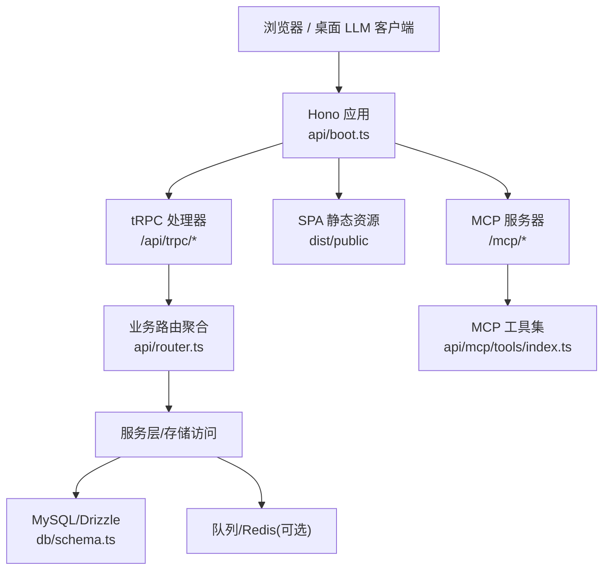
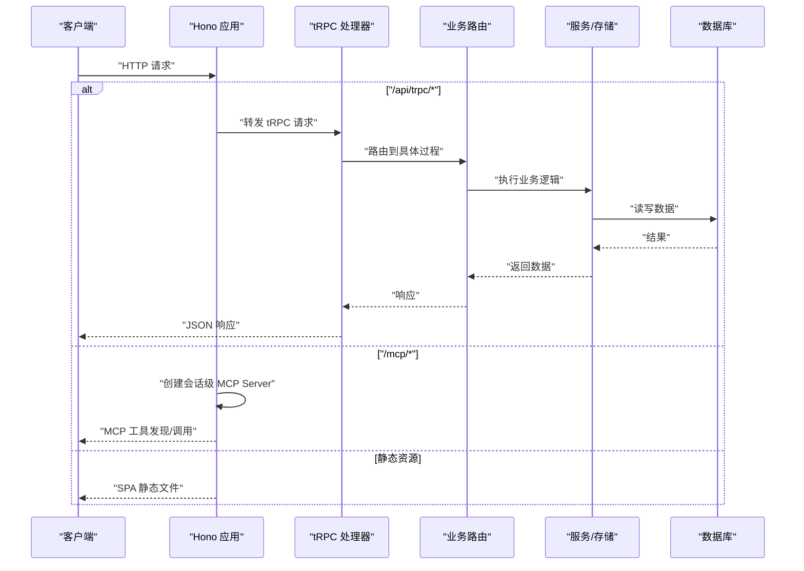
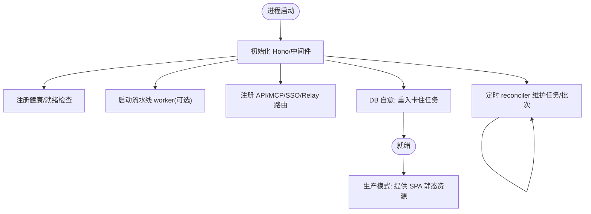
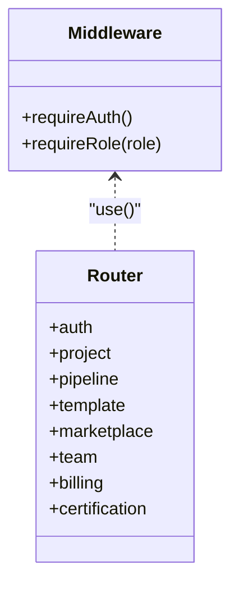
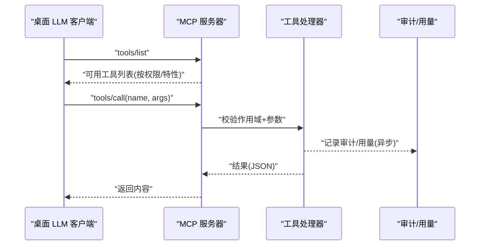
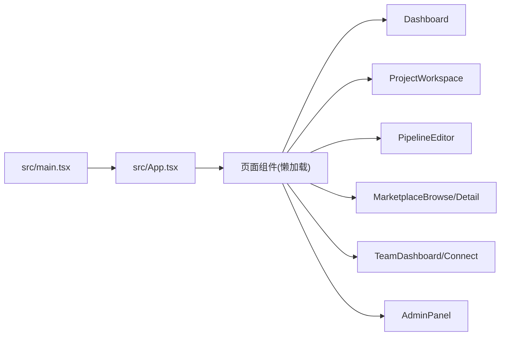
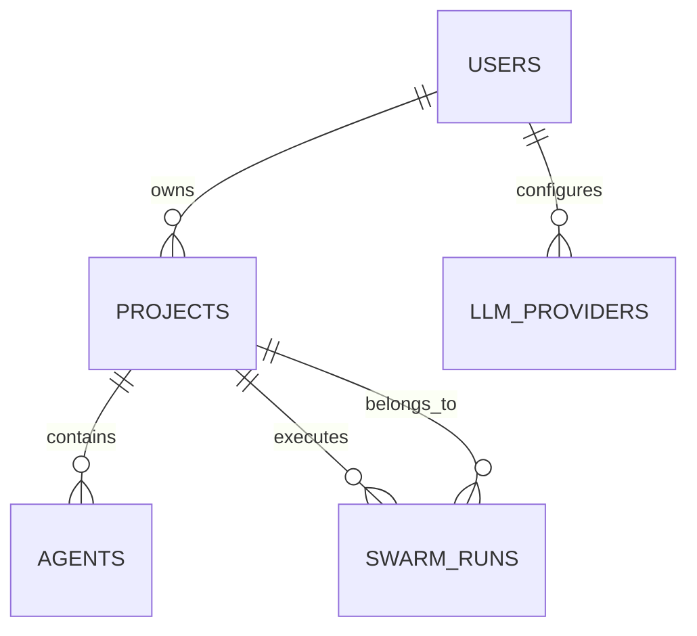
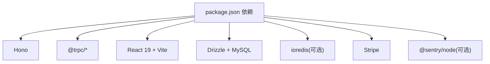

# 系统概览

<cite>
**本文引用的文件**
- [README.md](file://README.md)
- [package.json](file://package.json)
- [api/boot.ts](file://api/boot.ts)
- [api/router.ts](file://api/router.ts)
- [api/middleware.ts](file://api/middleware.ts)
- [api/mcp/server.ts](file://api/mcp/server.ts)
- [api/mcp/tools/index.ts](file://api/mcp/tools/index.ts)
- [src/main.tsx](file://src/main.tsx)
- [src/App.tsx](file://src/App.tsx)
- [db/schema.ts](file://db/schema.ts)
</cite>

## 目录
1. [简介](#简介)
2. [项目结构](#项目结构)
3. [核心组件](#核心组件)
4. [架构总览](#架构总览)
5. [详细组件分析](#详细组件分析)
6. [依赖关系分析](#依赖关系分析)
7. [性能考量](#性能考量)
8. [故障排查指南](#故障排查指南)
9. [结论](#结论)

## 简介
DeeWaanAI 是一个“单进程”多面手平台：同一个 Node.js 进程同时提供三类能力——REST/tRPC API、MCP（Model Context Protocol）服务器，以及构建后的 SPA 前端静态资源。其技术栈为 Hono + tRPC + React，数据库使用 MySQL/Drizzle，可选 Redis 作为队列与发布订阅后端，并集成 Stripe 计费。

该平台的核心用例包括：
- AI 流水线工作室：可视化编排与执行多步骤 AI 工作流（创建、编辑、运行、批处理、导出）。
- 市场生态系统：可认证、可购买、可复用的流水线与技能资产，支持评价与审计。
- 团队协作：跨桌面 LLM 应用共享记忆、运行记录、交接与反馈（TeamSync）。
- 企业功能：SSO（OIDC/SAML）、出站-only 的本地中继、合规导出与按客户维度的 MCP 限流。

该设计让开发者与用户通过同一入口获得一致体验：Web 界面用于管理与协作，MCP 工具暴露给任意桌面 LLM 客户端直接驱动流水线与市场能力。

**章节来源**
- [README.md:1-18](file://README.md#L1-L18)

## 项目结构
- 服务端入口与路由装配
  - 启动与中间件：[api/boot.ts](file://api/boot.ts)
  - tRPC 路由器聚合：[api/router.ts](file://api/router.ts)
  - tRPC 鉴权与中间件：[api/middleware.ts](file://api/middleware.ts)
- MCP 服务器与工具集
  - 会话级服务器工厂：[api/mcp/server.ts](file://api/mcp/server.ts)
  - 工具注册表：[api/mcp/tools/index.ts](file://api/mcp/tools/index.ts)
- 前端 SPA
  - 应用入口：[src/main.tsx](file://src/main.tsx)
  - 路由与页面懒加载：[src/App.tsx](file://src/App.tsx)
- 数据模型
  - 数据库 schema（用户、项目、代理、流水线、运行等）：[db/schema.ts](file://db/schema.ts)
- 技术栈声明
  - 依赖与脚本：[package.json](file://package.json)

**图表来源**
- [api/boot.ts:35-195](file://api/boot.ts#L35-L195)
- [api/router.ts:39-70](file://api/router.ts#L39-L70)
- [api/mcp/server.ts:135-186](file://api/mcp/server.ts#L135-L186)
- [api/mcp/tools/index.ts:45-94](file://api/mcp/tools/index.ts#L45-L94)
- [db/schema.ts:17-200](file://db/schema.ts#L17-L200)

**章节来源**
- [api/boot.ts:35-195](file://api/boot.ts#L35-L195)
- [api/router.ts:39-70](file://api/router.ts#L39-L70)
- [src/main.tsx:10-20](file://src/main.tsx#L10-L20)
- [src/App.tsx:32-63](file://src/App.tsx#L32-L63)
- [db/schema.ts:17-200](file://db/schema.ts#L17-L200)
- [package.json:23-72](file://package.json#L23-L72)

## 核心组件
- Hono 应用与中间件
  - 统一请求 ID、安全头、请求体大小限制、健康检查、优雅关闭、全局错误处理。
  - 在开发/生产模式下分别提供 Vite 热更新与静态 SPA 托管。
- tRPC 路由器
  - 将各业务模块（项目、代理、流水线、模板、市场、团队、计费、认证等）聚合为类型安全的 API。
  - 通过中间件实现鉴权与角色控制。
- MCP 服务器
  - 每个会话创建一个 McpServer，按权限与特性开关动态注册工具；所有调用写入审计日志与用量计数器。
  - 工具覆盖流水线管理、市场检索与购买、团队共享、批处理与导出等。
- 前端 SPA
  - React 19 + React Router 7，基于 tRPC 客户端与 i18n 国际化，懒加载页面提升首屏性能。
- 数据层
  - Drizzle ORM + MySQL，定义用户、项目、代理、流水线、运行、模板、市场、团队等企业实体。

**章节来源**
- [api/boot.ts:35-195](file://api/boot.ts#L35-L195)
- [api/router.ts:39-70](file://api/router.ts#L39-L70)
- [api/middleware.ts:17-50](file://api/middleware.ts#L17-L50)
- [api/mcp/server.ts:84-186](file://api/mcp/server.ts#L84-L186)
- [api/mcp/tools/index.ts:45-94](file://api/mcp/tools/index.ts#L45-L94)
- [src/main.tsx:10-20](file://src/main.tsx#L10-L20)
- [src/App.tsx:32-63](file://src/App.tsx#L32-L63)
- [db/schema.ts:17-200](file://db/schema.ts#L17-L200)

## 架构总览
单进程架构下，Hono 作为 HTTP 网关，将三类流量分发到不同处理器：
- /api/* 下的 REST 与 tRPC 接口
- /mcp/* 的 MCP 协议端点（streamable HTTP 与 SSE 兼容）
- 根路径或 /public 下的 SPA 静态资源

**图表来源**
- [api/boot.ts:361-373](file://api/boot.ts#L361-L373)
- [api/router.ts:39-70](file://api/router.ts#L39-L70)
- [api/mcp/server.ts:135-186](file://api/mcp/server.ts#L135-L186)

**章节来源**
- [api/boot.ts:361-373](file://api/boot.ts#L361-L373)
- [api/router.ts:39-70](file://api/router.ts#L39-L70)
- [api/mcp/server.ts:135-186](file://api/mcp/server.ts#L135-L186)

## 详细组件分析

### 单进程服务：API、MCP 与 SPA
- 启动流程
  - 初始化 Hono 应用、中间件、健康检查、队列与 worker、MCP/SSO/Relay 路由注册。
  - 启动时进行“DB 自愈”：将卡住的 running/pending 任务重置并重入队列。
  - 定时 reconciler 每 60s 修复丢失的任务、收尾批次状态。
  - 生产模式挂载静态 SPA 资源并监听端口。
- 路由与中间件
  - tRPC 统一入口 /api/trpc/*，上下文注入 IP、用户信息。
  - 全局错误捕获与优雅关闭，确保 worker 与队列安全停止。

**图表来源**
- [api/boot.ts:64-195](file://api/boot.ts#L64-L195)
- [api/boot.ts:197-359](file://api/boot.ts#L197-L359)
- [api/boot.ts:361-427](file://api/boot.ts#L361-L427)

**章节来源**
- [api/boot.ts:64-195](file://api/boot.ts#L64-L195)
- [api/boot.ts:197-359](file://api/boot.ts#L197-L359)
- [api/boot.ts:361-427](file://api/boot.ts#L361-L427)

### tRPC 路由器与鉴权
- 路由聚合
  - 将认证、项目、代理、流水线、模板、市场、团队、计费、认证报告等子路由合并为 appRouter。
- 鉴权与角色
  - 通过中间件实现 requireAuth 与 requireRole("admin")，未登录或未授权抛出标准错误。
  - 速率限制在 Hono 层与具体路由内实现，避免在 tRPC 中间件中重复处理。

**图表来源**
- [api/middleware.ts:17-50](file://api/middleware.ts#L17-L50)
- [api/router.ts:39-70](file://api/router.ts#L39-L70)

**章节来源**
- [api/router.ts:39-70](file://api/router.ts#L39-L70)
- [api/middleware.ts:17-50](file://api/middleware.ts#L17-L50)

### MCP 服务器与工具生态
- 会话级服务器
  - 每次连接创建独立 McpServer，绑定认证上下文与传输通道。
  - 工具按权限与作用域过滤，并按特性开关隐藏或启用。
- 工具注册与调用
  - 工具清单集中管理，涵盖流水线、市场、团队、批处理、导出等。
  - 每次调用记录审计日志与月度用量计数，失败不阻断主流程。

**图表来源**
- [api/mcp/server.ts:84-186](file://api/mcp/server.ts#L84-L186)
- [api/mcp/tools/index.ts:45-94](file://api/mcp/tools/index.ts#L45-L94)

**章节来源**
- [api/mcp/server.ts:84-186](file://api/mcp/server.ts#L84-L186)
- [api/mcp/tools/index.ts:45-94](file://api/mcp/tools/index.ts#L45-L94)

### 前端 SPA 与路由
- 应用入口
  - React 19 根节点渲染，包裹路由、错误边界与 tRPC Provider。
- 路由与页面
  - 使用 React Router 7 配置页面路由，全部页面懒加载以提升性能。
  - 包含仪表盘、项目工作区、流水线编辑器、市场、团队、管理员面板等。

**图表来源**
- [src/main.tsx:10-20](file://src/main.tsx#L10-L20)
- [src/App.tsx:32-63](file://src/App.tsx#L32-L63)

**章节来源**
- [src/main.tsx:10-20](file://src/main.tsx#L10-L20)
- [src/App.tsx:32-63](file://src/App.tsx#L32-L63)

### 数据模型与关键实体
- 用户与提供者
  - 用户表支持 OAuth 与本地账号，默认 LLM 提供者与模型配置。
  - LLM 提供者表存储加密密钥引用与模型元数据。
- 项目与流水线
  - 项目关联用户与代码仓库（Gitee/GitHub），支持流水线配置与智能卡片。
  - 代理（Agent）定义角色、提示词、模型与迭代策略。
- 运行与批次
  - 流水线运行记录状态、步骤、令牌消耗与执行状态快照。
  - 批次用于批量执行与汇总统计。

**图表来源**
- [db/schema.ts:17-200](file://db/schema.ts#L17-L200)

**章节来源**
- [db/schema.ts:17-200](file://db/schema.ts#L17-L200)

## 依赖关系分析
- 运行时依赖
  - Hono 作为轻量 HTTP 框架承载 API 与静态资源。
  - tRPC 提供端到端类型安全的 API 契约。
  - React 19 + Vite 构建 SPA，React Router 7 管理路由。
  - Drizzle ORM + MySQL 持久化数据，可选 Redis 做队列与 pub/sub。
  - Stripe 处理订阅与支付，Sentry 可选上报错误。
- 构建与部署
  - 构建产物：Vite 输出 dist/public，esbuild 打包 api/boot.ts 与 workerEntry。
  - 生产启动：NODE_ENV=production node dist/boot.js，端口默认 3000。

**图表来源**
- [package.json:23-72](file://package.json#L23-L72)

**章节来源**
- [package.json:23-72](file://package.json#L23-L72)

## 性能考量
- 单进程并发
  - Node.js 事件循环适合 I/O 密集型任务；长耗时流水线由 worker 处理，避免阻塞请求。
- 队列与重试
  - 使用队列后端（内存或 Redis）解耦任务提交与执行；reconciler 定期修复丢失任务与收尾批次。
- 静态资源与缓存
  - 生产模式提供 SPA 静态资源，配合 CDN 缓存公共资源（如认证徽章）。
- 限流与保护
  - 请求体大小限制、IP 级速率限制、MCP 工具调用审计与用量统计，防止滥用。

[本节为通用指导，无需特定文件引用]

## 故障排查指南
- 健康与就绪
  - GET /api/health：进程存活且数据库可达返回 200；数据库不可达返回 503。
  - GET /api/ready：需要数据库与 Redis（若启用）均正常才返回 200。
- 常见错误
  - 未认证：tRPC 中间件返回 UNAUTHORIZED。
  - 无权限：角色不足返回 FORBIDDEN。
  - MCP 工具未知：特性开关未启用或作用域不足导致工具隐藏或拒绝。
- 恢复机制
  - 启动时自动将卡住的 running/pending 任务重置并重入队列。
  - 定时 reconciler 持续修复丢失任务与收尾批次。

**章节来源**
- [api/boot.ts:73-135](file://api/boot.ts#L73-L135)
- [api/middleware.ts:17-50](file://api/middleware.ts#L17-L50)
- [api/boot.ts:197-359](file://api/boot.ts#L197-L359)

## 结论
DeeWaanAI 采用“单进程 + 多面手”的架构，以 Hono 为核心网关，统一承载 API、MCP 与 SPA，降低运维复杂度并提升一致性。tRPC 保证前后端类型一致，React 提供现代交互体验；MCP 使桌面 LLM 客户端可直接驱动流水线与市场能力。结合队列、审计与自愈机制，系统在可用性、可观测性与扩展性之间取得平衡，支撑 AI 流水线工作室、市场生态、团队协作与企业功能的全面落地。

[本节为总结性内容，无需特定文件引用]