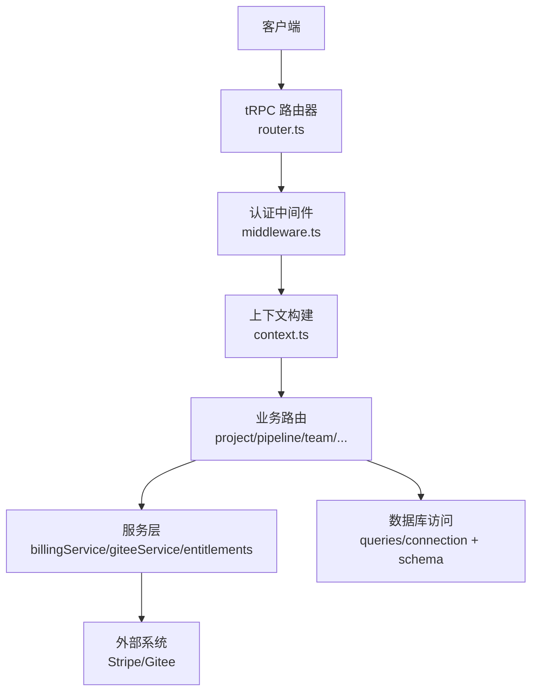
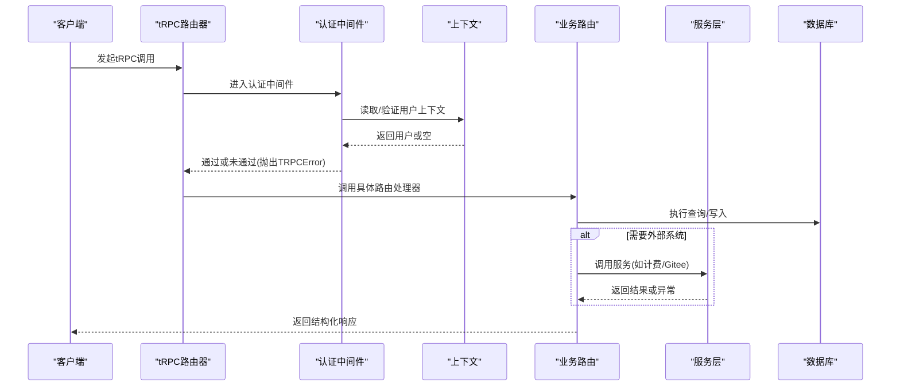
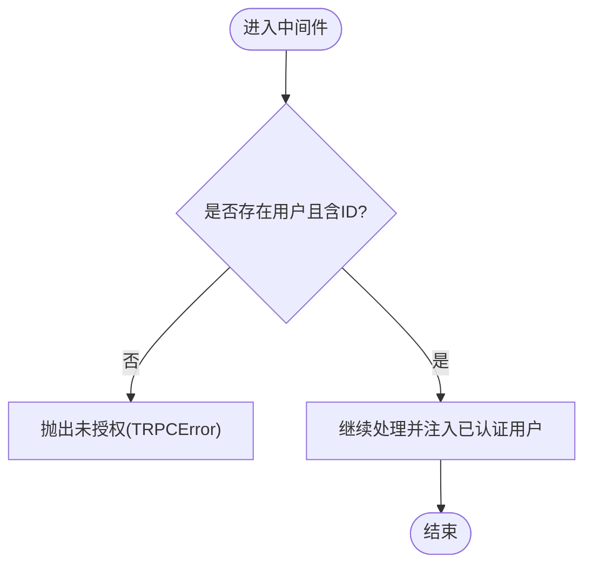
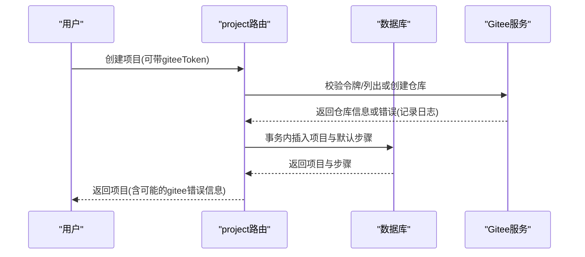
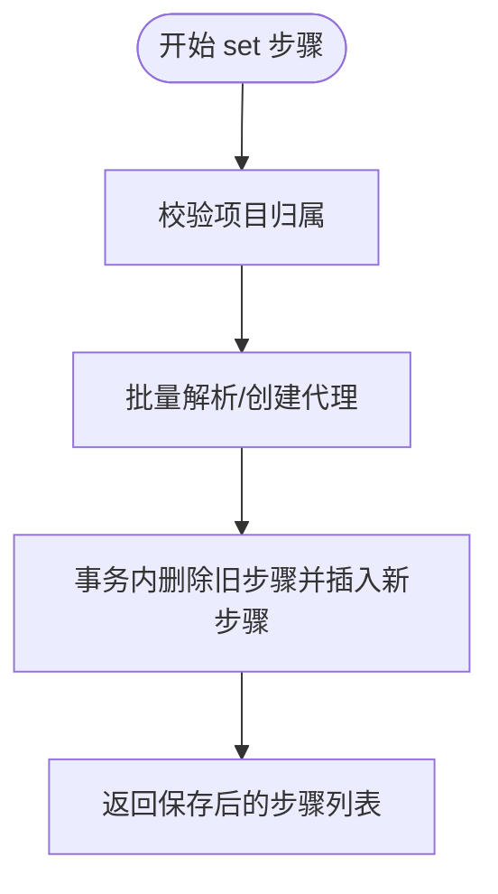
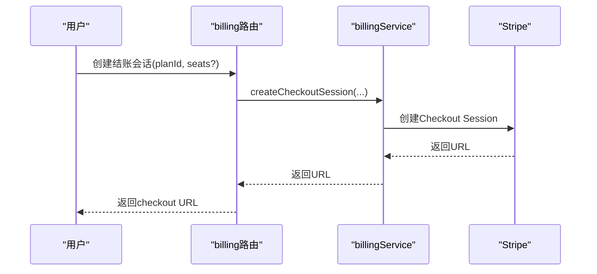
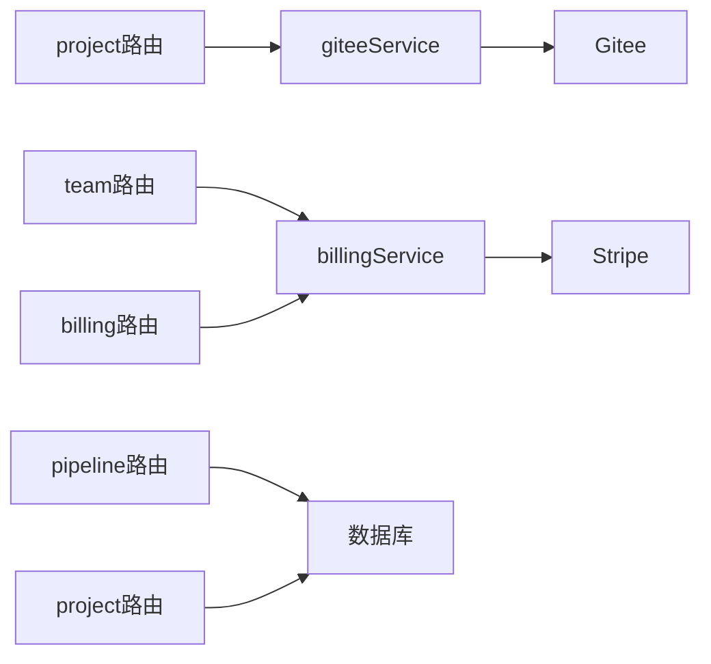

# API路由与服务层关系

<cite>
**本文引用的文件**
- [api/router.ts](file://api/router.ts)
- [api/middleware.ts](file://api/middleware.ts)
- [api/context.ts](file://api/context.ts)
- [api/routers/project.ts](file://api/routers/project.ts)
- [api/routers/pipeline.ts](file://api/routers/pipeline.ts)
- [api/routers/team.ts](file://api/routers/team.ts)
- [api/routers/agent.ts](file://api/routers/agent.ts)
- [api/routers/response.ts](file://api/routers/response.ts)
- [api/routers/billing.ts](file://api/routers/billing.ts)
- [api/services/billingService.ts](file://api/services/billingService.ts)
- [api/services/giteeService.ts](file://api/services/giteeService.ts)
- [api/services/entitlements.ts](file://api/services/entitlements.ts)
- [api/lib/logger.ts](file://api/lib/logger.ts)
</cite>

## 目录
1. [简介](#简介)
2. [项目结构](#项目结构)
3. [核心组件](#核心组件)
4. [架构总览](#架构总览)
5. [详细组件分析](#详细组件分析)
6. [依赖关系分析](#依赖关系分析)
7. [性能考量](#性能考量)
8. [故障排查指南](#故障排查指南)
9. [结论](#结论)
10. [附录：API端点与最佳实践](#附录api端点与最佳实践)

## 简介
本文面向DeeWaanAI的API层，系统性说明tRPC路由器如何组织并调用后端服务，中间件如何处理请求上下文与认证鉴权，以及各路由模块（用户管理、项目管理、流水线操作等）与服务层的职责边界。文档还涵盖请求处理流程、错误传播机制、响应格式化方式，并提供典型API端点的调用示例与最佳实践建议。

## 项目结构
- 路由入口：统一在根路由器中聚合各业务子路由，形成对外暴露的tRPC命名空间。
- 中间件：提供认证、角色校验、类型转换等横切能力。
- 上下文：解析请求头、注入用户信息、追踪ID等。
- 服务层：封装外部系统交互（如Stripe、Gitee）、计费与权限计算、数据同步等。
- 数据库访问：通过ORM查询连接获取数据库实例，进行CRUD与事务操作。

**图表来源**
- [api/router.ts:39-70](file://api/router.ts#L39-L70)
- [api/middleware.ts:17-50](file://api/middleware.ts#L17-L50)
- [api/context.ts:20-54](file://api/context.ts#L20-L54)

**章节来源**
- [api/router.ts:1-73](file://api/router.ts#L1-L73)
- [api/middleware.ts:1-51](file://api/middleware.ts#L1-L51)
- [api/context.ts:1-55](file://api/context.ts#L1-L55)

## 核心组件
- 路由器聚合器：集中注册所有业务路由，支持插件扩展。
- tRPC中间件：定义公共查询、认证、管理员角色校验。
- 上下文构造：从请求头解析本地令牌，加载用户信息，生成请求追踪ID。
- 服务层：
  - 计费服务：Stripe结账会话创建、Webhook事件处理、团队席位同步、订阅权益变更。
  - Gitee服务：仓库与文件操作、令牌校验。
  - 权益服务：统一的能力判定与能力集合解析。
- 日志工具：结构化日志输出与请求ID生成。

**章节来源**
- [api/router.ts:31-70](file://api/router.ts#L31-L70)
- [api/middleware.ts:10-50](file://api/middleware.ts#L10-L50)
- [api/context.ts:20-54](file://api/context.ts#L20-L54)
- [api/services/billingService.ts:19-29](file://api/services/billingService.ts#L19-L29)
- [api/services/giteeService.ts:1-8](file://api/services/giteeService.ts#L1-L8)
- [api/services/entitlements.ts:42-104](file://api/services/entitlements.ts#L42-L104)
- [api/lib/logger.ts:8-30](file://api/lib/logger.ts#L8-L30)

## 架构总览
下图展示一次受保护查询的典型调用链：客户端发起请求 → tRPC路由器匹配路由 → 中间件校验认证/角色 → 上下文注入用户 → 路由执行业务逻辑 → 必要时调用服务层 → 返回结果。

**图表来源**
- [api/middleware.ts:17-50](file://api/middleware.ts#L17-L50)
- [api/context.ts:20-54](file://api/context.ts#L20-L54)
- [api/routers/project.ts:12-54](file://api/routers/project.ts#L12-L54)
- [api/services/billingService.ts:39-78](file://api/services/billingService.ts#L39-L78)

## 详细组件分析

### 认证与中间件
- 公共查询：允许匿名访问。
- 认证中间件：若上下文中无用户或用户ID缺失，抛出未授权错误；通过后增强上下文类型为已认证用户。
- 管理员中间件：在认证基础上校验角色为admin，否则抛出禁止访问错误。
- 速率限制：注释指出在Hono路由层实现，不在tRPC中间件中重复包装。

**图表来源**
- [api/middleware.ts:17-50](file://api/middleware.ts#L17-L50)

**章节来源**
- [api/middleware.ts:10-50](file://api/middleware.ts#L10-L50)

### 上下文构建与请求追踪
- 从请求头提取本地认证令牌，验证后加载用户信息到上下文。
- 记录请求ID用于链路追踪。
- 保留远程IP字段供限流使用。

**章节来源**
- [api/context.ts:20-54](file://api/context.ts#L20-L54)
- [api/lib/logger.ts:8-10](file://api/lib/logger.ts#L8-L10)

### 项目管理路由（project）
- 列表：返回当前用户自有项目与共享给其所属团队的项目，去重合并。
- 详情：校验所有权或团队共享权限。
- 创建：可选自动创建Gitee仓库/文件夹；在事务内创建项目与默认流水线步骤；失败时记录日志但不影响项目创建。
- 更新/删除：按所有权更新或删除；删除时清理Gitee与本地磁盘文件（尽力而为）。
- 流水线配置：读取项目流水线步骤与可用LLM提供者；更新时限制最多3个不同LLM。

**图表来源**
- [api/routers/project.ts:103-250](file://api/routers/project.ts#L103-L250)
- [api/services/giteeService.ts:121-146](file://api/services/giteeService.ts#L121-L146)

**章节来源**
- [api/routers/project.ts:12-405](file://api/routers/project.ts#L12-L405)

### 流水线路由（pipeline）
- 获取步骤：校验项目归属或团队共享，返回按顺序排列的步骤。
- 设置步骤：批量解析/创建代理（避免N+1查询），在事务中清空并重建步骤；限制最多3个不同LLM。
- 创建默认流水线：为用户创建默认代理（Builder/Critic/Refiner/Polisher）并写入步骤。
- 可用提供者：返回当前用户的LLM提供者列表。

**图表来源**
- [api/routers/pipeline.ts:130-219](file://api/routers/pipeline.ts#L130-L219)

**章节来源**
- [api/routers/pipeline.ts:82-327](file://api/routers/pipeline.ts#L82-L327)

### 团队路由（team）
- 创建团队：生成邀请码，事务内创建团队、所有者成员与席位基线。
- 加入团队：按邀请码加入，处理并发重复插入，触发席位数量同步。
- 查看团队：校验成员身份，返回团队、成员与共享项目。
- 成员角色管理：仅所有者/管理员可修改，禁止更改所有者角色。
- 移除成员：允许自删或管理员删他人，禁止删除所有者；触发席位同步。
- 共享/取消共享项目：仅所有者/管理员可操作，需校验项目归属。
- 删除团队：仅所有者可删，尝试取消席位订阅。
- 共享流水线/自定义代理导入：校验团队共享来源与目标项目归属，复制步骤/代理。

**章节来源**
- [api/routers/team.ts:25-721](file://api/routers/team.ts#L25-L721)

### 代理路由（agent）
- 列表/创建/更新/删除：基于项目维度管理代理，支持默认提示词批量创建。

**章节来源**
- [api/routers/agent.ts:8-100](file://api/routers/agent.ts#L8-L100)

### 响应与运行路由（response）
- 获取链式响应：按swarmRunId查询响应序列。
- 按类型分页查询：支持raw/feedback/corrected/synthesized/final。
- 标记/备注：人工审核与标注。
- 运行列表：按项目或全局范围列出运行，附带统计指标。

**章节来源**
- [api/routers/response.ts:7-146](file://api/routers/response.ts#L7-L146)

### 计费路由与服务（billing）
- 公开计划目录：返回公开计划与是否启用计费。
- 创建结账会话：根据计划与席位创建Stripe Checkout URL。
- 团队席位结账：仅团队所有者可创建，按当前成员数设定席位。
- 席位状态：团队成员可查看席位与订阅状态。
- 我的订阅与能力：返回活跃订阅与解析出的能力集合。

**图表来源**
- [api/routers/billing.ts:32-61](file://api/routers/billing.ts#L32-L61)
- [api/services/billingService.ts:39-78](file://api/services/billingService.ts#L39-L78)

**章节来源**
- [api/routers/billing.ts:32-163](file://api/routers/billing.ts#L32-L163)
- [api/services/billingService.ts:19-78](file://api/services/billingService.ts#L19-L78)

### 权益服务（entitlements）
- 能力判定：按显式授予 > 活跃订阅计划 > 用户层级 > 优惠券兑换的顺序判断。
- 能力集合解析：汇总上述来源得到完整能力集，供UI与路由决策使用。

**章节来源**
- [api/services/entitlements.ts:42-104](file://api/services/entitlements.ts#L42-L104)
- [api/services/entitlements.ts:165-200](file://api/services/entitlements.ts#L165-L200)

## 依赖关系分析
- 路由对中间件的依赖：所有受保护接口均通过authedQuery接入认证与角色校验。
- 路由对服务的依赖：
  - project路由依赖giteeService进行仓库/文件操作。
  - billing路由依赖billingService进行Stripe交互与Webhook处理。
  - team路由在成员变更时调用billingService同步席位数量。
- 服务对数据库的依赖：所有持久化操作通过ORM连接完成，关键路径使用事务保证一致性。
- 日志贯穿全链路：上下文生成请求ID，服务与路由在关键节点记录日志。

**图表来源**
- [api/routers/project.ts:103-250](file://api/routers/project.ts#L103-L250)
- [api/routers/team.ts:113-117](file://api/routers/team.ts#L113-L117)
- [api/routers/billing.ts:32-104](file://api/routers/billing.ts#L32-L104)
- [api/services/billingService.ts:39-78](file://api/services/billingService.ts#L39-L78)
- [api/services/giteeService.ts:121-146](file://api/services/giteeService.ts#L121-L146)

**章节来源**
- [api/routers/project.ts:103-250](file://api/routers/project.ts#L103-L250)
- [api/routers/team.ts:113-117](file://api/routers/team.ts#L113-L117)
- [api/routers/billing.ts:32-104](file://api/routers/billing.ts#L32-L104)
- [api/services/billingService.ts:39-78](file://api/services/billingService.ts#L39-L78)
- [api/services/giteeService.ts:121-146](file://api/services/giteeService.ts#L121-L146)

## 性能考量
- 批量代理解析：pipeline路由使用批量查询与Map映射减少N+1数据库访问。
- 事务边界：项目创建、默认流水线设置、团队创建等关键写操作使用事务确保原子性。
- 外部调用降级：Gitee与Stripe调用失败时尽量记录日志并返回部分成功，避免阻塞主流程。
- 日志级别控制：通过环境变量控制日志级别，降低生产环境开销。

[本节为通用指导，不直接分析具体文件]

## 故障排查指南
- 未授权/禁止访问：检查中间件抛出的TRPCError代码（UNAUTHORIZED/FORBIDDEN），确认上下文是否包含有效用户与角色。
- 计费不可用：当Stripe未配置时，计费相关路由会返回前置条件失败；检查环境变量与isBillingConfigured。
- Stripe事件重复：Webhook处理使用幂等键表防止重复处理；若出现重复，应视为已处理。
- 团队席位同步失败：成员增删后同步Stripe可能失败，但不会回滚成员变更；查看日志中的警告信息。
- Gitee操作失败：创建/删除文件或仓库失败时会记录错误，但不影响项目创建/删除的主流程。

**章节来源**
- [api/middleware.ts:17-50](file://api/middleware.ts#L17-L50)
- [api/routers/billing.ts:11-16](file://api/routers/billing.ts#L11-L16)
- [api/services/billingService.ts:182-211](file://api/services/billingService.ts#L182-L211)
- [api/services/billingService.ts:370-412](file://api/services/billingService.ts#L370-L412)
- [api/routers/project.ts:139-142](file://api/routers/project.ts#L139-L142)
- [api/services/giteeService.ts:92-95](file://api/services/giteeService.ts#L92-L95)

## 结论
DeeWaanAI的API层采用清晰的tRPC路由分层与中间件治理，结合上下文注入与统一日志，实现了高内聚、低耦合的服务调用。项目、流水线、团队、计费与权益等模块职责明确，并通过事务与批量优化保障一致性与性能。建议在新增功能时遵循现有模式：路由负责参数校验与流程编排，服务层封装外部系统与复杂逻辑，中间件统一处理横切关注点。

[本节为总结性内容，不直接分析具体文件]

## 附录：API端点与最佳实践

### 路由模块与职责概览
- 项目路由：项目CRUD、流水线配置、Gitee集成。
- 流水线路由：步骤获取/设置、默认流水线创建、提供者列表。
- 团队路由：团队创建/加入/管理、成员角色、共享项目与资源导入。
- 代理路由：项目级代理管理。
- 响应路由：运行与响应的查询、标注与审计。
- 计费路由：计划目录、结账会话、团队席位、订阅与能力查询。

**章节来源**
- [api/routers/project.ts:12-405](file://api/routers/project.ts#L12-L405)
- [api/routers/pipeline.ts:82-327](file://api/routers/pipeline.ts#L82-L327)
- [api/routers/team.ts:25-721](file://api/routers/team.ts#L25-L721)
- [api/routers/agent.ts:8-100](file://api/routers/agent.ts#L8-L100)
- [api/routers/response.ts:7-146](file://api/routers/response.ts#L7-L146)
- [api/routers/billing.ts:32-163](file://api/routers/billing.ts#L32-L163)

### 典型端点调用示例（描述性）
- 创建项目
  - 方法：mutation
  - 输入：项目名称、描述、可选默认LLM提供者/模型、可选Gitee令牌
  - 行为：可选创建Gitee仓库/文件夹；事务内创建项目与默认流水线步骤
  - 输出：项目信息与可能的Gitee错误
  - 参考路径：[api/routers/project.ts:103-250](file://api/routers/project.ts#L103-L250)

- 设置流水线步骤
  - 方法：mutation
  - 输入：项目ID、步骤数组（名称、角色、系统提示、提供者、模型、温度、最大令牌、开关、类型、条件配置）
  - 行为：批量解析/创建代理；事务内替换步骤；限制最多3个不同LLM
  - 输出：保存后的步骤列表
  - 参考路径：[api/routers/pipeline.ts:130-219](file://api/routers/pipeline.ts#L130-L219)

- 创建结账会话
  - 方法：mutation
  - 输入：计划ID、可选席位数量
  - 行为：校验计费配置；创建Stripe结账会话
  - 输出：结账URL
  - 参考路径：[api/routers/billing.ts:32-61](file://api/routers/billing.ts#L32-L61), [api/services/billingService.ts:39-78](file://api/services/billingService.ts#L39-L78)

- 加入团队
  - 方法：mutation
  - 输入：邀请码
  - 行为：校验邀请码；插入成员；触发席位数量同步
  - 输出：团队ID、名称、角色
  - 参考路径：[api/routers/team.ts:72-117](file://api/routers/team.ts#L72-L117)

### 最佳实践
- 始终使用Zod对输入进行强校验，避免脏数据进入服务层。
- 对涉及多表写入的操作使用事务，保证一致性。
- 对外部系统调用增加超时与重试策略，并在失败时记录日志与降级。
- 使用中间件统一处理认证与权限，不要在路由中重复实现。
- 对敏感操作（删除、角色变更）进行二次校验与审计日志。
- 利用能力服务进行功能门控，避免硬编码权限判断。

[本节为通用指导，不直接分析具体文件]