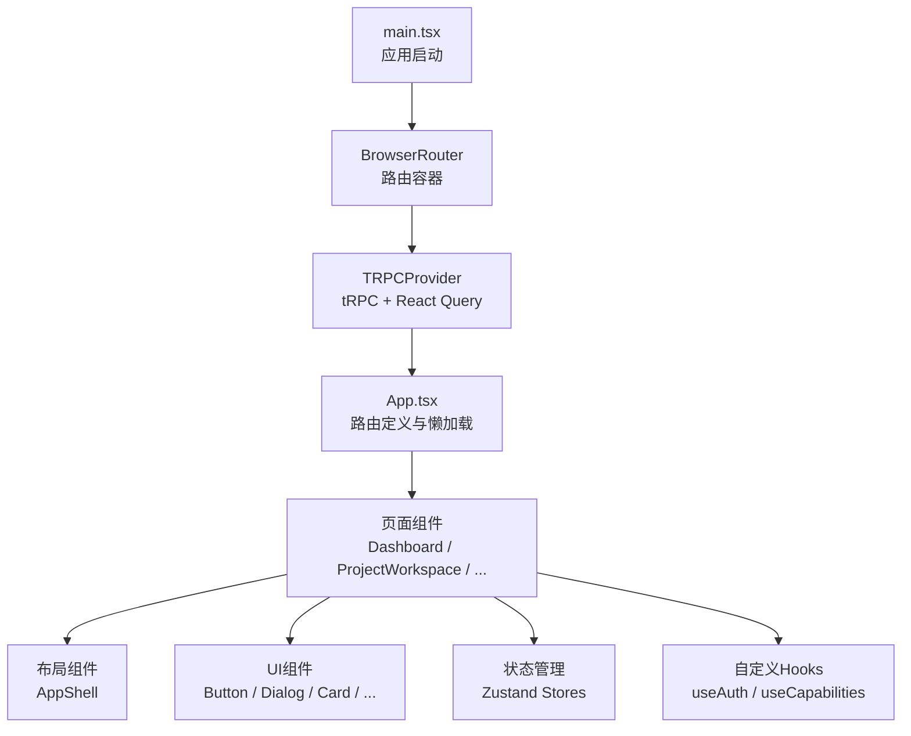
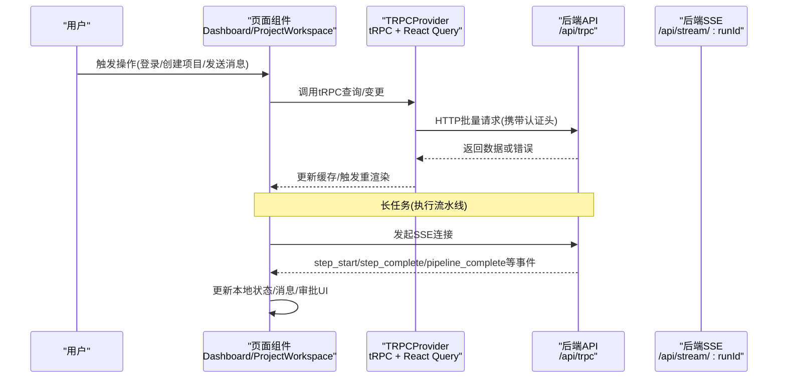
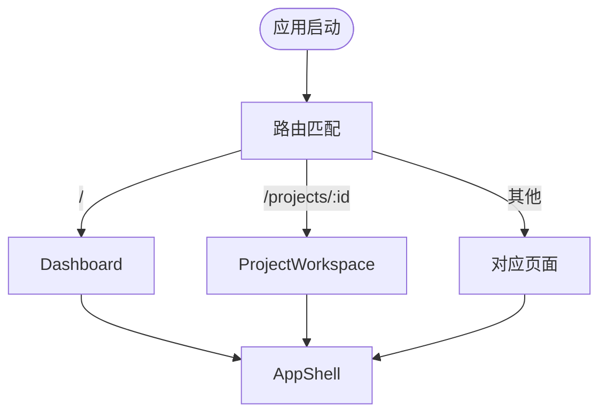
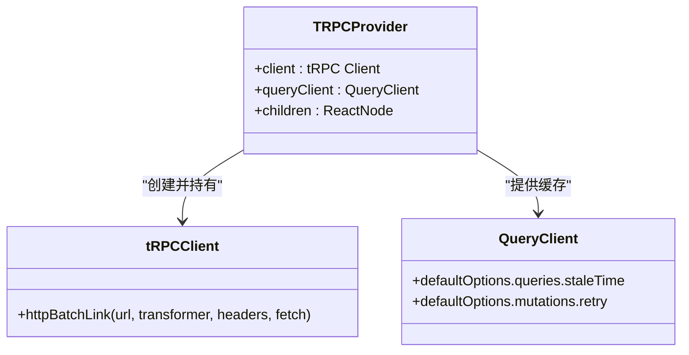
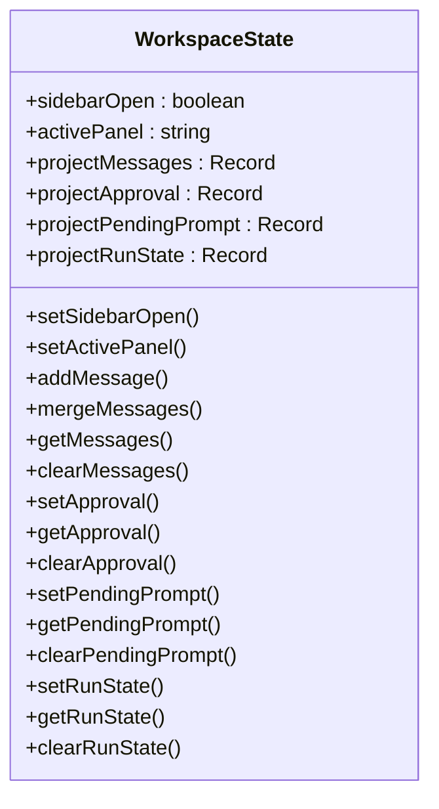
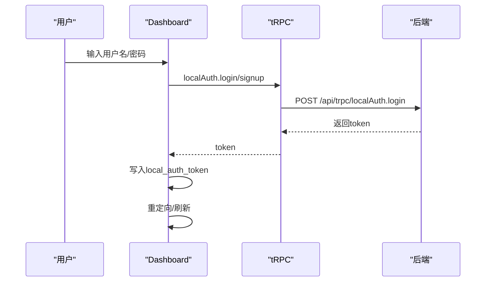
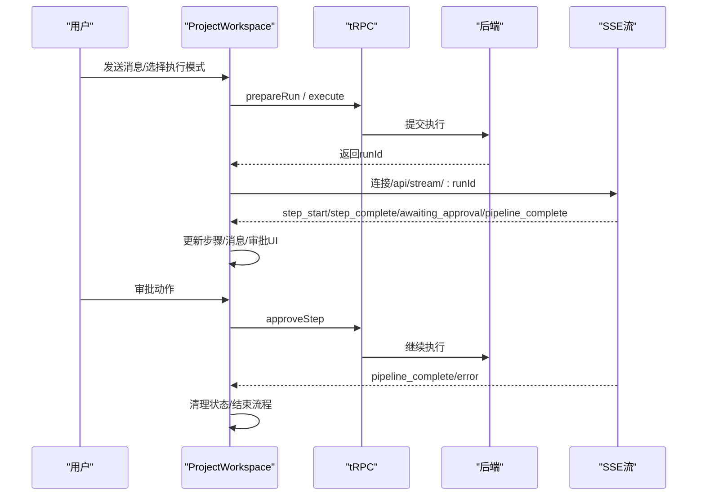
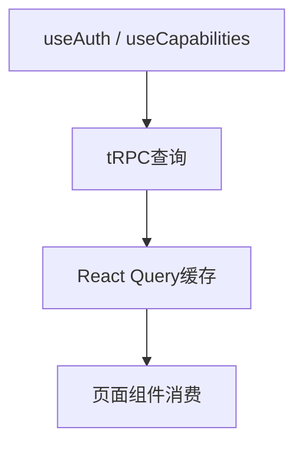
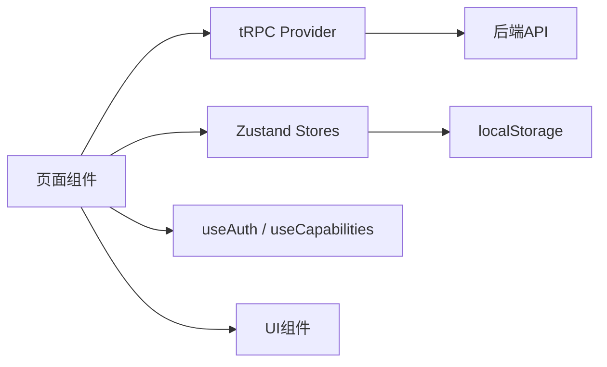

# 前端组件架构关系

<cite>
**本文引用的文件**
- [main.tsx](file://src/main.tsx)
- [App.tsx](file://src/App.tsx)
- [trpc.tsx](file://src/providers/trpc.tsx)
- [projectStore.ts](file://src/stores/projectStore.ts)
- [workspaceStore.ts](file://src/stores/workspaceStore.ts)
- [Dashboard.tsx](file://src/pages/Dashboard.tsx)
- [ProjectWorkspace.tsx](file://src/pages/ProjectWorkspace.tsx)
- [AppShell.tsx](file://src/components/layout/AppShell.tsx)
- [ErrorBoundary.tsx](file://src/components/ErrorBoundary.tsx)
- [RouteFallback.tsx](file://src/components/RouteFallback.tsx)
- [useAuth.ts](file://src/hooks/useAuth.ts)
- [useCapabilities.ts](file://src/hooks/useCapabilities.ts)
- [button.tsx](file://src/components/ui/button.tsx)
</cite>

## 目录
1. [简介](#简介)
2. [项目结构](#项目结构)
3. [核心组件](#核心组件)
4. [架构总览](#架构总览)
5. [详细组件分析](#详细组件分析)
6. [依赖关系分析](#依赖关系分析)
7. [性能考虑](#性能考虑)
8. [故障排查指南](#故障排查指南)
9. [结论](#结论)
10. [附录](#附录)

## 简介
本文件面向DeeWaanAI前端应用，系统化梳理React组件层次、状态管理与UI组件的交互模式，重点说明：
- React路由与懒加载的组织方式
- tRPC提供者如何桥接前端组件与后端API（含认证头、批量请求、超时策略）
- 项目存储与工作台存储的状态管理职责及持久化策略
- 页面组件与UI组件的组合模式
- 组件生命周期管理、状态同步机制与性能优化策略
- 自定义Hooks的使用示例与最佳实践

## 项目结构
前端采用“按功能域组织”的结构：
- 入口与全局装配：main.tsx、App.tsx
- 数据与网络层：providers/trpc.tsx
- 状态层：stores/projectStore.ts、stores/workspaceStore.ts
- 页面层：pages/*（如Dashboard、ProjectWorkspace等）
- 布局与通用UI：components/layout/*、components/ui/*
- 业务Hook：hooks/*（如useAuth、useCapabilities）

图表来源
- [main.tsx:1-21](file://src/main.tsx#L1-L21)
- [App.tsx:1-70](file://src/App.tsx#L1-L70)

章节来源
- [main.tsx:1-21](file://src/main.tsx#L1-L21)
- [App.tsx:1-70](file://src/App.tsx#L1-L70)

## 核心组件
- 应用壳与路由
  - AppShell：提供侧边导航、用户信息、语言切换、项目列表等全局布局能力。
  - App：集中声明所有页面路由，使用Suspense包裹并配合懒加载提升首屏性能。
- 数据与网络
  - TRPCProvider：封装tRPC客户端与React Query实例，统一配置staleTime、refetch策略、HTTP批量链接、认证头注入、长耗时请求超时控制。
- 状态管理
  - projectStore：轻量级当前项目上下文（内存态）。
  - workspaceStore：工作区多项目聊天消息、审批态、运行态、待处理提示等；通过persist中间件持久化到localStorage，并对大附件做裁剪以规避配额限制。
- 页面组件
  - Dashboard：登录/注册、SSO流程、项目卡片与创建弹窗，调用tRPC进行认证与项目管理。
  - ProjectWorkspace：项目工作区，负责SSE流式进度、审批交互、模板应用、自动设计、文件上传等复杂交互。
- UI组件
  - Button等基础组件：基于样式变体系统，保证一致性与可组合性。

章节来源
- [AppShell.tsx:1-214](file://src/components/layout/AppShell.tsx#L1-L214)
- [App.tsx:1-70](file://src/App.tsx#L1-L70)
- [trpc.tsx:1-50](file://src/providers/trpc.tsx#L1-L50)
- [projectStore.ts:1-16](file://src/stores/projectStore.ts#L1-L16)
- [workspaceStore.ts:1-207](file://src/stores/workspaceStore.ts#L1-L207)
- [Dashboard.tsx:1-556](file://src/pages/Dashboard.tsx#L1-L556)
- [ProjectWorkspace.tsx:1-800](file://src/pages/ProjectWorkspace.tsx#L1-L800)
- [button.tsx:1-63](file://src/components/ui/button.tsx#L1-L63)

## 架构总览
前端以React Router为路由中心，TRPCProvider作为数据层中枢，页面组件通过tRPC调用后端API，并通过Zustand维护跨组件共享状态。工作区页面结合SSE实现长连接实时反馈，形成“请求-响应+事件流”的双通道通信。

图表来源
- [trpc.tsx:1-50](file://src/providers/trpc.tsx#L1-L50)
- [ProjectWorkspace.tsx:235-477](file://src/pages/ProjectWorkspace.tsx#L235-L477)

## 详细组件分析

### 应用壳与路由（AppShell 与 App）
- AppShell
  - 提供全局导航、项目列表、用户信息与语言切换；通过useWorkspaceStore控制侧边栏展开/收起。
  - 动态显示审计入口（当处于项目页时）。
- App
  - 集中定义路由表，使用React.lazy与Suspense对页面进行代码分割，减少初始包体积。
  - 挂载全局Toaster与反馈按钮。

图表来源
- [App.tsx:1-70](file://src/App.tsx#L1-L70)
- [AppShell.tsx:1-214](file://src/components/layout/AppShell.tsx#L1-L214)

章节来源
- [App.tsx:1-70](file://src/App.tsx#L1-L70)
- [AppShell.tsx:1-214](file://src/components/layout/AppShell.tsx#L1-L214)

### 数据与网络层（TRPCProvider）
- 统一配置
  - React Query默认staleTime与refetch策略，关闭mutations自动重试以避免非幂等操作重复执行。
  - httpBatchLink批量请求，superjson序列化，自动附加认证头。
  - fetch包装增加10分钟超时AbortController，适配流水线执行等长耗时场景。
- 使用方式
  - 在根节点包裹TRPCProvider后，任意子组件可通过trpc.*调用后端接口，并使用useUtils进行缓存失效与乐观更新。

图表来源
- [trpc.tsx:1-50](file://src/providers/trpc.tsx#L1-L50)

章节来源
- [trpc.tsx:1-50](file://src/providers/trpc.tsx#L1-L50)

### 状态管理（Zustand Stores）
- projectStore
  - 维护当前选中项目（内存态），用于页面间快速传递上下文。
- workspaceStore
  - 维护每个项目的聊天消息、审批状态、运行状态、待处理提示等。
  - 使用persist中间件将关键状态持久化到localStorage，并对大附件dataUrl进行裁剪，避免超出配额。
  - 提供addMessage、mergeMessages、getMessages、clearMessages等方法，支持去重合并与按项目隔离。

图表来源
- [workspaceStore.ts:1-207](file://src/stores/workspaceStore.ts#L1-L207)

章节来源
- [projectStore.ts:1-16](file://src/stores/projectStore.ts#L1-L16)
- [workspaceStore.ts:1-207](file://src/stores/workspaceStore.ts#L1-L207)

### 页面组件：Dashboard
- 认证与SSO
  - 支持本地账号登录/注册与SSO跳转；成功后写入本地令牌并重定向。
- 项目管理
  - 列出项目卡片，支持新建项目、删除项目；创建后可选ZIP导入。
- 与tRPC集成
  - 使用trpc.localAuth.*与trpc.project.*进行认证与CRUD；通过utils.invalidate刷新列表。

图表来源
- [Dashboard.tsx:38-171](file://src/pages/Dashboard.tsx#L38-L171)
- [trpc.tsx:18-39](file://src/providers/trpc.tsx#L18-L39)

章节来源
- [Dashboard.tsx:1-556](file://src/pages/Dashboard.tsx#L1-L556)

### 页面组件：ProjectWorkspace
- 工作区核心能力
  - 读取项目与流水线配置，轮询运行状态，恢复挂起的运行。
  - 通过SSE订阅流水线步骤事件，实时更新步骤状态与最终结果。
  - 支持人工审批（approve/reject/modify），并在审批后继续执行。
  - 支持自动设计生成流水线，并将提示词持久化以便后续一键运行。
  - 文件上传与附件展示，结合本地存储与服务器偏好设置进行消息持久化。
- 状态同步
  - 将运行状态与审批状态同步至workspaceStore，确保页面导航后仍可恢复。
  - 使用sendBeacon在页面卸载时保存消息，提高可靠性。

图表来源
- [ProjectWorkspace.tsx:235-477](file://src/pages/ProjectWorkspace.tsx#L235-L477)
- [ProjectWorkspace.tsx:479-652](file://src/pages/ProjectWorkspace.tsx#L479-L652)

章节来源
- [ProjectWorkspace.tsx:1-800](file://src/pages/ProjectWorkspace.tsx#L1-L800)

### 自定义Hooks
- useAuth
  - 获取当前用户信息，提供logout方法（清除本地令牌并刷新）。
- useCapabilities
  - 拉取用户能力集，提供has(capability)判断，用于功能门控（如是否允许自定义流水线、自动设计等）。

图表来源
- [useAuth.ts:1-35](file://src/hooks/useAuth.ts#L1-L35)
- [useCapabilities.ts:1-31](file://src/hooks/useCapabilities.ts#L1-L31)

章节来源
- [useAuth.ts:1-35](file://src/hooks/useAuth.ts#L1-L35)
- [useCapabilities.ts:1-31](file://src/hooks/useCapabilities.ts#L1-L31)

### UI组件与组合模式
- 基础组件（如Button）
  - 基于样式变体系统，提供多种variant与size，便于在不同页面中复用。
- 组合模式
  - 页面组件通过组合AppShell、Dialog、Card、Button等构建复杂界面；通过props与context（tRPC、i18n）传递数据与行为。

章节来源
- [button.tsx:1-63](file://src/components/ui/button.tsx#L1-L63)
- [Dashboard.tsx:175-415](file://src/pages/Dashboard.tsx#L175-L415)
- [ProjectWorkspace.tsx:715-800](file://src/pages/ProjectWorkspace.tsx#L715-L800)

## 依赖关系分析
- 组件耦合
  - 页面组件依赖TRPCProvider提供的tRPC客户端与React Query缓存。
  - 页面组件通过Zustand stores共享跨组件状态，降低props穿透。
  - 布局组件AppShell与页面解耦，仅通过children承载内容。
- 外部依赖
  - tRPC + React Query：类型安全的数据获取与缓存。
  - Zustand + persist：轻量状态管理与持久化。
  - React Router：路由与懒加载。
  - i18next：国际化。
  - Sonner：全局通知。

图表来源
- [trpc.tsx:1-50](file://src/providers/trpc.tsx#L1-L50)
- [workspaceStore.ts:1-207](file://src/stores/workspaceStore.ts#L1-L207)
- [useAuth.ts:1-35](file://src/hooks/useAuth.ts#L1-L35)
- [useCapabilities.ts:1-31](file://src/hooks/useCapabilities.ts#L1-L31)

章节来源
- [trpc.tsx:1-50](file://src/providers/trpc.tsx#L1-L50)
- [workspaceStore.ts:1-207](file://src/stores/workspaceStore.ts#L1-L207)
- [useAuth.ts:1-35](file://src/hooks/useAuth.ts#L1-L35)
- [useCapabilities.ts:1-31](file://src/hooks/useCapabilities.ts#L1-L31)

## 性能考虑
- 代码分割与懒加载
  - 使用React.lazy与Suspense对页面进行按需加载，减少初始包体积。
- 数据缓存与增量更新
  - React Query默认staleTime与refetch策略，避免频繁请求；通过utils.invalidate在变更后主动刷新。
- 长耗时请求保护
  - tRPC客户端封装fetch增加10分钟超时AbortController，防止长时间阻塞。
- 持久化优化
  - workspaceStore对大附件dataUrl进行裁剪后再持久化，避免超出localStorage配额。
- 渲染优化
  - 使用useMemo/useCallback稳定引用，减少不必要的重渲染。
  - 步骤状态更新采用函数式更新与最小化diff，避免循环更新。

[本节为通用指导，不直接分析具体文件]

## 故障排查指南
- 全局错误边界
  - ErrorBoundary捕获渲染期异常并提供重载入口，避免白屏。
- 路由加载失败
  - RouteFallback为懒加载路由提供统一的加载占位。
- 认证问题
  - 检查local_auth_token是否正确写入与携带；确认tRPC请求头已附加。
- SSE连接异常
  - 检查/runId有效性与服务端SSE可用性；注意onerror与超时处理。
- 审批状态不同步
  - 确认workspaceStore中的approval状态与后端runStatus一致；避免并发操作导致竞态。

章节来源
- [ErrorBoundary.tsx:1-54](file://src/components/ErrorBoundary.tsx#L1-L54)
- [RouteFallback.tsx:1-17](file://src/components/RouteFallback.tsx#L1-L17)
- [trpc.tsx:18-39](file://src/providers/trpc.tsx#L18-L39)
- [ProjectWorkspace.tsx:379-477](file://src/pages/ProjectWorkspace.tsx#L379-L477)

## 结论
本项目采用清晰的分层架构：路由与布局、数据与网络、状态管理、页面与UI组件各司其职。tRPC与React Query提供类型安全与高效缓存，Zustand承担跨组件状态与持久化，SSE保障长任务实时反馈。通过懒加载、缓存策略与持久化优化，整体具备良好的可维护性与性能表现。建议在新功能开发中遵循现有模式：优先使用tRPC调用后端、通过Zustand管理共享状态、利用自定义Hooks抽象业务逻辑，并以UI组件组合构建界面。

## 附录
- 组件组合示例路径
  - 登录表单与项目卡片：[Dashboard.tsx:175-415](file://src/pages/Dashboard.tsx#L175-L415)
  - 工作区SSE与审批流程：[ProjectWorkspace.tsx:235-477](file://src/pages/ProjectWorkspace.tsx#L235-L477)
  - 状态持久化与裁剪：[workspaceStore.ts:180-204](file://src/stores/workspaceStore.ts#L180-L204)
  - tRPC客户端配置与超时：[trpc.tsx:18-39](file://src/providers/trpc.tsx#L18-L39)
- 常用自定义Hooks
  - 认证：[useAuth.ts:1-35](file://src/hooks/useAuth.ts#L1-L35)
  - 能力门控：[useCapabilities.ts:1-31](file://src/hooks/useCapabilities.ts#L1-L31)