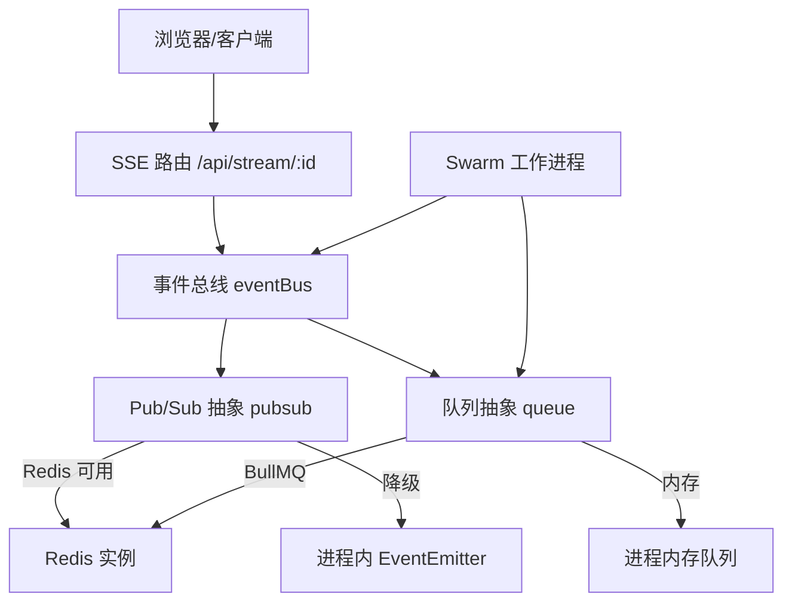
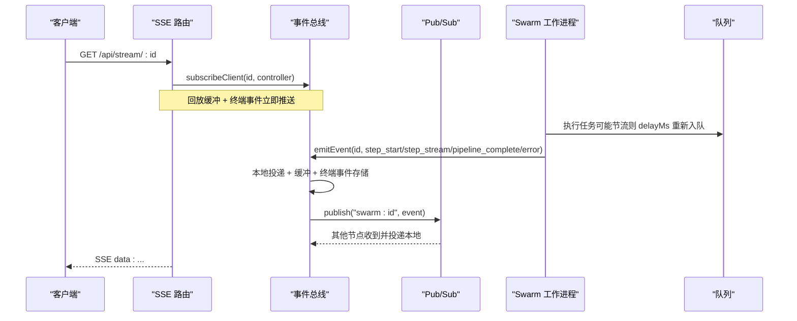
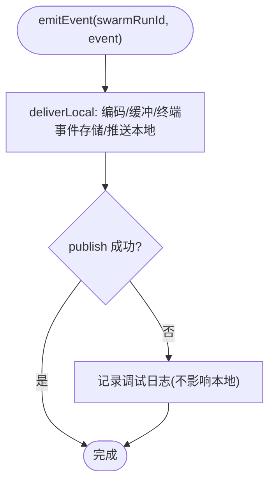
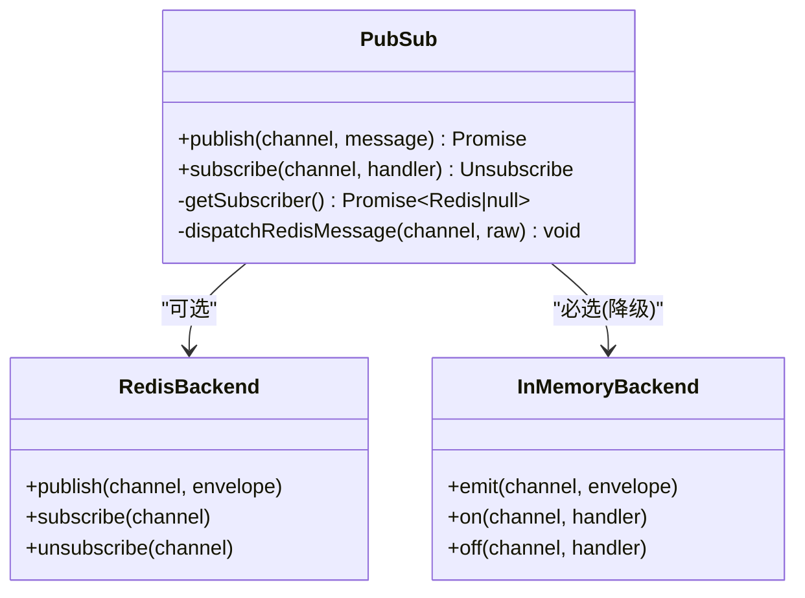
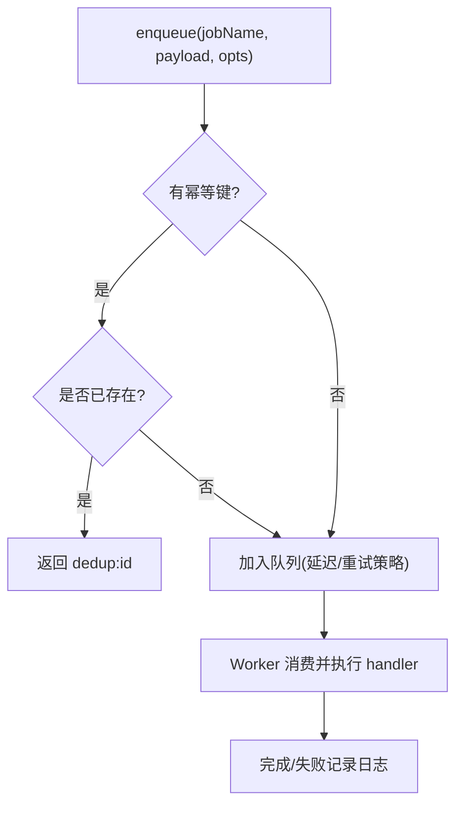
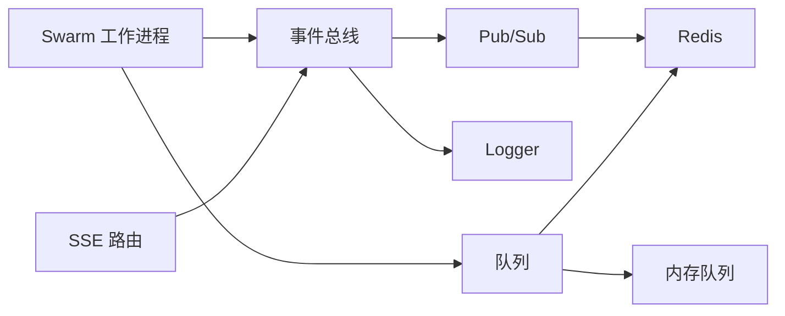

# 事件总线服务

<cite>
**本文引用的文件**
- [api/services/eventBus.ts](file://api/services/eventBus.ts)
- [api/infra/pubsub.ts](file://api/infra/pubsub.ts)
- [api/infra/queue.ts](file://api/infra/queue.ts)
- [api/infra/redis.ts](file://api/infra/redis.ts)
- [api/stream-route.ts](file://api/stream-route.ts)
- [api/lib/logger.ts](file://api/lib/logger.ts)
- [api/workers/swarmWorker.ts](file://api/workers/swarmWorker.ts)
</cite>

## 目录
1. [简介](#简介)
2. [项目结构](#项目结构)
3. [核心组件](#核心组件)
4. [架构总览](#架构总览)
5. [详细组件分析](#详细组件分析)
6. [依赖关系分析](#依赖关系分析)
7. [性能与可靠性](#性能与可靠性)
8. [故障排查指南](#故障排查指南)
9. [结论](#结论)
10. [附录：最佳实践与规范](#附录最佳实践与规范)

## 简介
本文件为 DeeWaanAI 事件总线服务的完整技术文档，聚焦于异步事件驱动架构的实现与使用。内容涵盖事件发布、订阅、路由与处理机制；事件注册、消息传递、错误重试与监控追踪；以及事件总线与其他服务之间的解耦关系（服务间通信、依赖管理、故障隔离）。同时提供事件生命周期的具体示例路径，并总结设计原则与最佳实践（事件命名、版本兼容、性能优化）。

## 项目结构
事件总线由三层组成：
- 业务层：SSE 流式事件总线（eventBus），负责本地投递、回放缓冲、终端事件持久化与跨节点广播。
- 基础设施层：pub/sub 抽象（pubsub）与队列抽象（queue），分别提供进程内与 Redis 双后端的事件分发与任务调度能力。
- 接入层：SSE 路由（stream-route）将客户端连接接入事件总线；工作进程（swarmWorker）通过队列消费任务并在执行过程中发布事件。

图表来源
- [api/stream-route.ts:8-70](file://api/stream-route.ts#L8-L70)
- [api/services/eventBus.ts:1-193](file://api/services/eventBus.ts#L1-L193)
- [api/infra/pubsub.ts:1-154](file://api/infra/pubsub.ts#L1-L154)
- [api/infra/queue.ts:1-334](file://api/infra/queue.ts#L1-L334)
- [api/workers/swarmWorker.ts:37-74](file://api/workers/swarmWorker.ts#L37-L74)

章节来源
- [api/stream-route.ts:8-70](file://api/stream-route.ts#L8-L70)
- [api/services/eventBus.ts:1-193](file://api/services/eventBus.ts#L1-L193)
- [api/infra/pubsub.ts:1-154](file://api/infra/pubsub.ts#L1-L154)
- [api/infra/queue.ts:1-334](file://api/infra/queue.ts#L1-L334)
- [api/workers/swarmWorker.ts:37-74](file://api/workers/swarmWorker.ts#L37-L74)

## 核心组件
- 事件总线（eventBus）
  - 职责：本地 SSE 客户端投递、5 分钟回放缓冲、终端事件永久缓存、跨节点广播。
  - 关键接口：subscribeClient、emitEvent、clearTerminalEvent、PipelineEvent 类型。
- Pub/Sub 抽象（pubsub）
  - 职责：统一 publish/subscribe API，自动选择 Redis 或进程内 EventEmitter 后端；包裹消息信封（origin、ts、message）以去重自身回环。
- 队列抽象（queue）
  - 职责：统一 enqueue/close/createWorker API，自动选择 BullMQ 或内存队列；支持幂等键与延迟执行；提供优雅关闭。
- Redis 客户端（redis）
  - 职责：懒加载、带退避的重试连接；不可用时返回 null，供上层降级。
- SSE 路由（stream-route）
  - 职责：建立 SSE 连接、发送初始事件、根据运行状态立即推送终端事件、订阅事件总线并清理资源。
- Swarm 工作进程（swarmWorker）
  - 职责：从队列取任务执行流水线，调用事件总线发布步骤/完成/错误事件；在节流时重新入队。

章节来源
- [api/services/eventBus.ts:1-193](file://api/services/eventBus.ts#L1-L193)
- [api/infra/pubsub.ts:1-154](file://api/infra/pubsub.ts#L1-L154)
- [api/infra/queue.ts:1-334](file://api/infra/queue.ts#L1-L334)
- [api/infra/redis.ts:1-88](file://api/infra/redis.ts#L1-L88)
- [api/stream-route.ts:8-70](file://api/stream-route.ts#L8-L70)
- [api/workers/swarmWorker.ts:37-74](file://api/workers/swarmWorker.ts#L37-L74)

## 架构总览
事件总线采用“本地优先 + 跨节点广播”的混合模式：
- 本地投递：所有事件先写入进程内缓冲区并推送给当前进程的 SSE 客户端，保证低延迟与强一致的用户体验。
- 跨节点广播：随后通过 pub/sub 将事件广播到其它节点，其它节点再投递给各自的 SSE 客户端。
- 降级策略：当 Redis 不可用时，pub/sub 自动降级为进程内 EventEmitter；队列自动降级为内存队列。
- 幂等与可靠：队列支持幂等键防止重复执行；工作进程失败会记录日志并可重新入队。

图表来源
- [api/stream-route.ts:8-70](file://api/stream-route.ts#L8-L70)
- [api/services/eventBus.ts:129-167](file://api/services/eventBus.ts#L129-L167)
- [api/infra/pubsub.ts:91-153](file://api/infra/pubsub.ts#L91-L153)
- [api/workers/swarmWorker.ts:37-74](file://api/workers/swarmWorker.ts#L37-L74)

## 详细组件分析

### 事件总线（eventBus）
- 事件模型：PipelineEvent 定义了步骤开始/完成/错误、流式增量、管道完成/错误、等待审批等事件类型，包含 swarmRunId、时间戳等元数据。
- 本地投递：deliverLocal 将事件编码为 SSE 格式，写入回放缓冲（默认 5 分钟），对 terminal 事件（pipeline_complete/pipeline_error）进行永久缓存以便迟到订阅者获取最终状态。
- 跨节点广播：emitEvent 在完成本地投递后，调用 publish 将事件发送到 swarm:<runId> 频道；失败仅记录日志，不影响本地投递。
- 订阅管理：subscribeClient 注册客户端控制器，触发 ensureChannelSubscription 按需订阅频道；无客户端时释放订阅。
- 生命周期：clearTerminalEvent 在运行结束后清理终端事件，避免 UI 重复触发。

图表来源
- [api/services/eventBus.ts:94-167](file://api/services/eventBus.ts#L94-L167)

章节来源
- [api/services/eventBus.ts:1-193](file://api/services/eventBus.ts#L1-L193)

### Pub/Sub 抽象（pubsub）
- 双后端：优先使用 Redis 实现多节点广播；若不可用则回退到进程内 EventEmitter。
- 信封机制：每条消息包装 origin（进程 ID）、ts（时间戳）、message（实际负载），订阅者可忽略自身进程的回声。
- 订阅语义：subscribe 始终注册本地监听器，确保即使 Redis 失败也能收到消息；首次订阅某个频道时才尝试 Redis SUBSCRIBE。
- 健壮性：连接错误、消息解析异常、处理器抛出异常均被捕获并记录日志，不中断系统。

图表来源
- [api/infra/pubsub.ts:1-154](file://api/infra/pubsub.ts#L1-L154)

章节来源
- [api/infra/pubsub.ts:1-154](file://api/infra/pubsub.ts#L1-L154)

### 队列抽象（queue）
- 双后端：优先使用 BullMQ（基于 Redis）实现持久化、多节点任务队列；不可用时使用内存队列（Map + setTimeout）。
- 幂等性：支持 idempotencyKey，在 24 小时内去重（Redis SET NX EX 或内存 Map 过期）。
- 延迟与重试：支持 delayMs；BullMQ 配置 removeOnComplete/removeOnFail 控制保留策略；工作进程失败记录日志。
- 生命周期：createQueue/createWorker 创建队列与工作进程；closeAllQueues 优雅关闭所有资源。

图表来源
- [api/infra/queue.ts:156-233](file://api/infra/queue.ts#L156-L233)
- [api/infra/queue.ts:295-334](file://api/infra/queue.ts#L295-L334)

章节来源
- [api/infra/queue.ts:1-334](file://api/infra/queue.ts#L1-L334)

### Redis 客户端（redis）
- 懒连接：仅在需要时建立连接，最多尝试 3 次并指数退避；失败后标记 gaveUp，后续直接返回 null。
- 安全降级：isRedisEnabled 判断是否启用；getRedis 返回 null 时上层自动降级。
- 错误处理：连接错误、超时等通过 logger.warn 记录，不抛错。

章节来源
- [api/infra/redis.ts:1-88](file://api/infra/redis.ts#L1-L88)

### SSE 路由（stream-route）
- 连接建立：验证 swarmRunId 存在，创建 ReadableStream，发送初始 connected 事件。
- 终端事件：若运行已完成/失败/取消，立即推送对应终端事件。
- 事件订阅：调用 subscribeClient 将控制器注入事件总线；断开时清理订阅与控制器。

章节来源
- [api/stream-route.ts:8-70](file://api/stream-route.ts#L8-L70)

### Swarm 工作进程（swarmWorker）
- 任务执行：从队列取出任务，执行 executeSwarmRun；内部会在步骤推进、完成或错误时调用 emitEvent。
- 节流重试：遇到限流时计算 delayMs 并通过队列重新入队，避免阻塞。
- 资源管理：startSwarmWorker 启动 worker；stopSwarmWorker 关闭 worker 与队列。

章节来源
- [api/workers/swarmWorker.ts:37-74](file://api/workers/swarmWorker.ts#L37-L74)

## 依赖关系分析
- 事件总线依赖：
  - 依赖 pubsub 进行跨节点广播。
  - 依赖 logger 记录警告与调试信息。
- Pub/Sub 依赖：
  - 依赖 redis 获取连接；失败时回退到进程内 EventEmitter。
- 队列依赖：
  - 依赖 redis 与 BullMQ；失败时回退到内存队列。
- 路由与工作进程：
  - 路由通过事件总线订阅事件；工作进程通过队列消费任务并发布事件。

图表来源
- [api/services/eventBus.ts:10-11](file://api/services/eventBus.ts#L10-L11)
- [api/infra/pubsub.ts:9-13](file://api/infra/pubsub.ts#L9-L13)
- [api/infra/queue.ts:9-14](file://api/infra/queue.ts#L9-L14)
- [api/workers/swarmWorker.ts:37-74](file://api/workers/swarmWorker.ts#L37-L74)
- [api/stream-route.ts:1-70](file://api/stream-route.ts#L1-L70)

章节来源
- [api/services/eventBus.ts:1-193](file://api/services/eventBus.ts#L1-L193)
- [api/infra/pubsub.ts:1-154](file://api/infra/pubsub.ts#L1-L154)
- [api/infra/queue.ts:1-334](file://api/infra/queue.ts#L1-L334)
- [api/workers/swarmWorker.ts:37-74](file://api/workers/swarmWorker.ts#L37-L74)
- [api/stream-route.ts:8-70](file://api/stream-route.ts#L8-L70)

## 性能与可靠性
- 低延迟本地投递：事件先本地推送，减少网络开销，提升 SSE 响应速度。
- 回放缓冲：5 分钟窗口允许迟到订阅者看到近期进度，改善用户体验。
- 终端事件持久化：完成/错误事件长期缓存，新连接可立即获知最终状态。
- 跨节点广播：基于 Redis 的多节点广播，失败时降级为进程内广播，保障可用性。
- 幂等与去重：队列支持幂等键，避免重复执行；pub/sub 使用 origin 过滤自身回声。
- 优雅降级：Redis 不可用时，pub/sub 与队列均降级为内存实现，系统继续运行。
- 资源回收：无客户端时释放频道订阅；队列与工作进程支持优雅关闭。

[本节为通用性能讨论，无需特定文件引用]

## 故障排查指南
- 无法接收跨节点事件
  - 检查 Redis 是否可用；查看 pubsub 日志中是否有“Redis subscriber setup failed”或“Redis publish failed”。
  - 确认频道名称是否正确（swarm:<runId>）。
- SSE 连接无事件
  - 确认 swarmRunId 有效且运行存在；检查 stream-route 是否发送了初始事件与终端事件。
  - 检查事件总线是否调用了 emitEvent；查看 deliverLocal 是否写入缓冲与终端事件。
- 队列任务未执行
  - 检查工作进程是否启动；查看队列后端（BullMQ 或内存）是否正常工作。
  - 检查是否存在幂等键导致去重；查看日志中的“Idempotent enqueue skipped”。
- 工作进程失败
  - 查看 BullMQ 失败日志；确认 handler 抛出异常的原因；必要时调整并发与重试策略。
- 终端事件重复触发
  - 确认在运行完成后调用 clearTerminalEvent；避免 UI 侧重复处理。

章节来源
- [api/infra/pubsub.ts:45-84](file://api/infra/pubsub.ts#L45-L84)
- [api/infra/queue.ts:138-145](file://api/infra/queue.ts#L138-L145)
- [api/infra/queue.ts:248-255](file://api/infra/queue.ts#L248-L255)
- [api/services/eventBus.ts:108-112](file://api/services/eventBus.ts#L108-L112)
- [api/stream-route.ts:39-48](file://api/stream-route.ts#L39-L48)

## 结论
DeeWaanAI 事件总线通过“本地优先 + 跨节点广播”的设计，在保证低延迟与高可用的同时，实现了服务间的松耦合通信。结合队列抽象与幂等机制，系统在分布式环境下具备弹性与鲁棒性。SSE 路由提供了直观的实时事件推送能力，配合回放缓冲与终端事件持久化，显著提升了用户体验。整体架构遵循可降级、可观测、易维护的原则，适合复杂流水线与多节点部署场景。

[本节为总结性内容，无需特定文件引用]

## 附录：最佳实践与规范
- 事件命名规范
  - 频道命名：使用“swarm:<runId>”形式，确保唯一性与可读性。
  - 事件类型：使用 PipelineEvent.type 枚举值（如 step_start、step_complete、step_error、step_stream、pipeline_complete、pipeline_error、awaiting_approval）。
- 版本兼容性
  - 事件载荷应向后兼容；新增字段不应破坏旧版消费者。
  - 对于重大变更，考虑引入版本号或扩展字段，逐步迁移。
- 性能优化策略
  - 合理设置回放缓冲大小与 TTL，平衡内存占用与用户体验。
  - 在高吞吐场景下，优先启用 Redis 后端以获得更好的跨节点广播能力。
  - 使用幂等键避免重复执行，降低下游压力。
- 监控与追踪
  - 利用 logger 记录关键路径（连接、发布、订阅、失败）；集中收集日志便于排障。
  - 对队列与工作进程添加健康检查与指标上报（如队列长度、失败率）。
- 错误重试与隔离
  - 工作进程失败应记录上下文并尽可能恢复（如节流重试）；严重错误需隔离并告警。
  - 外部依赖（Redis）不可用时，确保系统降级运行，不中断核心流程。

[本节为通用指导，无需特定文件引用]