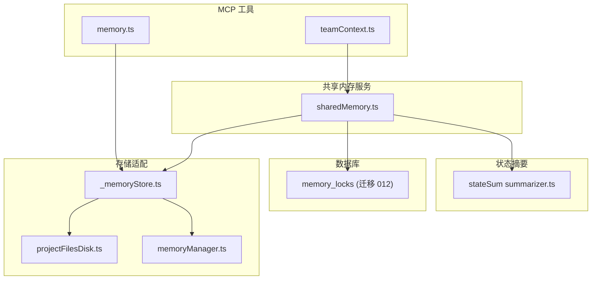
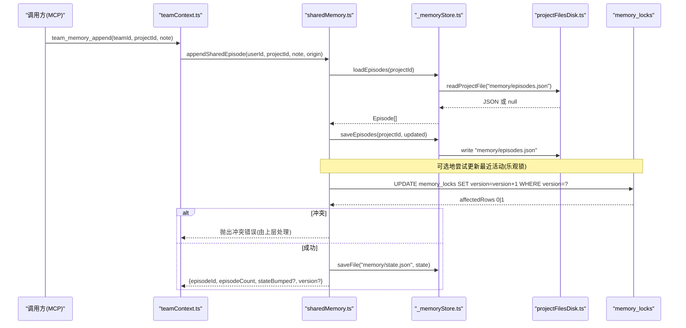
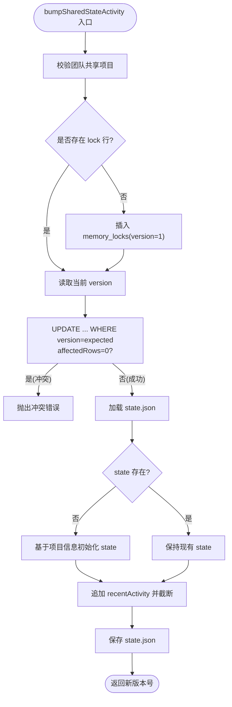
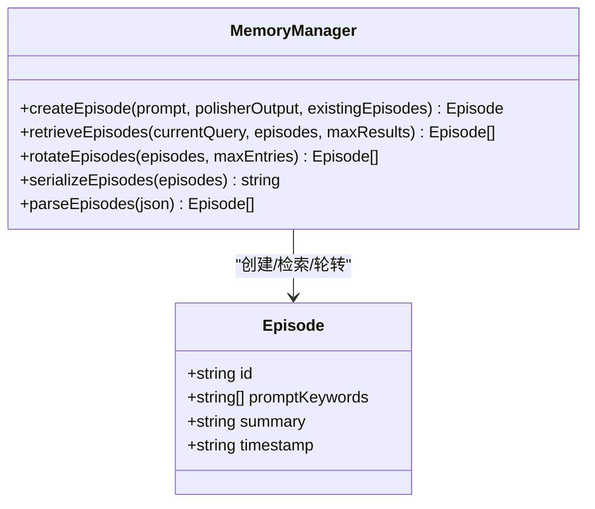
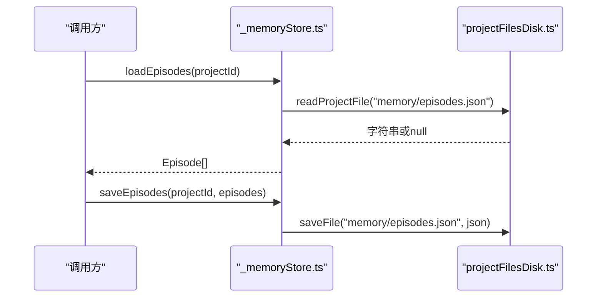
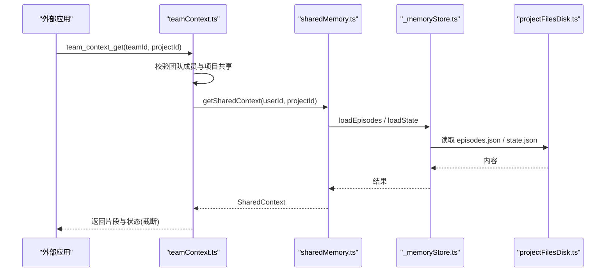
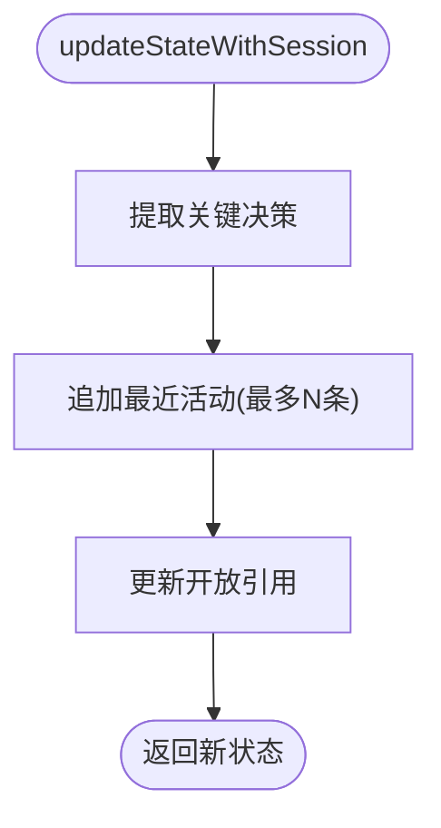
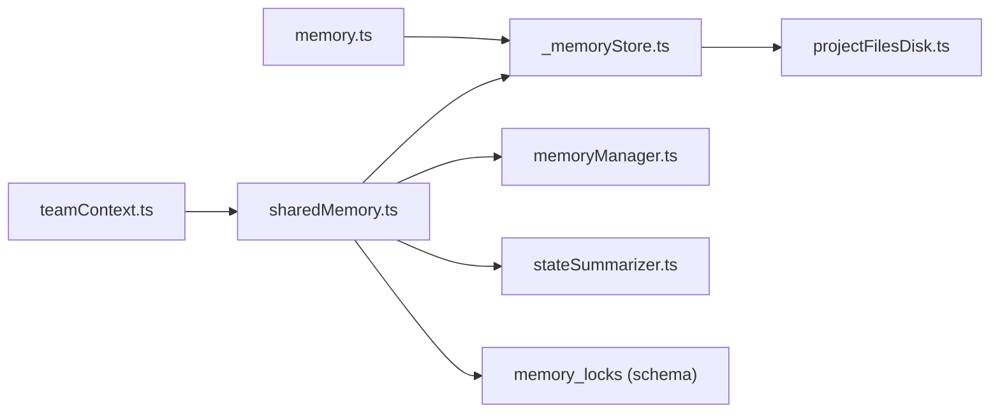
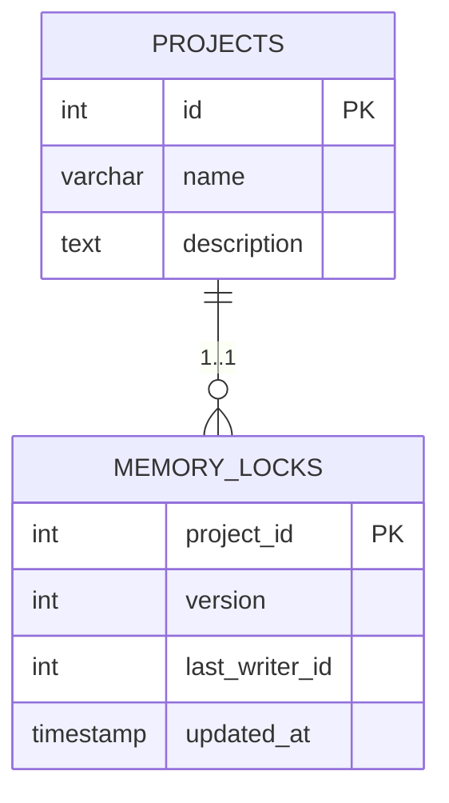

# 共享内存服务

<cite>
**本文引用的文件**
- [sharedMemory.ts](file://api/services/sharedMemory.ts)
- [memoryManager.ts](file://api/services/memoryManager.ts)
- [_memoryStore.ts](file://api/mcp/tools/_memoryStore.ts)
- [memory.ts](file://api/mcp/tools/memory.ts)
- [teamContext.ts](file://api/mcp/tools/team/teamContext.ts)
- [stateSummarizer.ts](file://api/services/stateSummarizer.ts)
- [projectFilesDisk.ts](file://api/services/projectFilesDisk.ts)
- [012_teamsync.sql](file://db/migrations/012_teamsync.sql)
</cite>

## 目录
1. [简介](#简介)
2. [项目结构](#项目结构)
3. [核心组件](#核心组件)
4. [架构总览](#架构总览)
5. [详细组件分析](#详细组件分析)
6. [依赖关系分析](#依赖关系分析)
7. [性能考虑](#性能考虑)
8. [故障排查指南](#故障排查指南)
9. [结论](#结论)
10. [附录](#附录)

## 简介
本文件为 DeeWaanAI 共享内存服务的权威技术文档，聚焦于“实时数据共享与状态同步”机制。该服务以磁盘为持久化主存储，结合数据库中的乐观锁表实现多进程/多客户端并发安全；提供事件式片段（Episode）追加、结构化状态维护、团队级上下文读取与写入能力，并与项目上下文、用户会话、缓存系统协同工作。

## 项目结构
共享内存相关代码按职责分层组织：
- MCP 工具层：对外暴露 memory_get / memory_append、team_context_get / team_memory_append 等接口
- 共享内存服务层：封装权限校验、乐观锁、片段管理、状态更新
- 存储适配层：磁盘读写、序列化/反序列化、片段压缩与检索
- 状态摘要层：结构化状态模型、压缩策略、提示构建
- 迁移与模式：数据库表定义与约束

图表来源
- [memory.ts:1-92](file://api/mcp/tools/memory.ts#L1-L92)
- [teamContext.ts:1-157](file://api/mcp/tools/team/teamContext.ts#L1-L157)
- [sharedMemory.ts:1-207](file://api/services/sharedMemory.ts#L1-L207)
- [_memoryStore.ts:1-37](file://api/mcp/tools/_memoryStore.ts#L1-L37)
- [projectFilesDisk.ts:1-143](file://api/services/projectFilesDisk.ts#L1-L143)
- [memoryManager.ts:1-123](file://api/services/memoryManager.ts#L1-L123)
- [stateSummarizer.ts:1-312](file://api/services/stateSummarizer.ts#L1-L312)
- [012_teamsync.sql:17-27](file://db/migrations/012_teamsync.sql#L17-L27)

章节来源
- [memory.ts:1-92](file://api/mcp/tools/memory.ts#L1-L92)
- [teamContext.ts:1-157](file://api/mcp/tools/team/teamContext.ts#L1-L157)
- [sharedMemory.ts:1-207](file://api/services/sharedMemory.ts#L1-L207)
- [_memoryStore.ts:1-37](file://api/mcp/tools/_memoryStore.ts#L1-L37)
- [projectFilesDisk.ts:1-143](file://api/services/projectFilesDisk.ts#L1-L143)
- [memoryManager.ts:1-123](file://api/services/memoryManager.ts#L1-L123)
- [stateSummarizer.ts:1-312](file://api/services/stateSummarizer.ts#L1-L312)
- [012_teamsync.sql:17-27](file://db/migrations/012_teamsync.sql#L17-L27)

## 核心组件
- 共享内存服务（sharedMemory.ts）
  - 团队共享项目的读/写入口
  - 片段追加（append-only）、结构化状态活动更新（乐观锁）
  - 权限校验：仅允许“团队共享项目”访问
- 记忆管理器（memoryManager.ts）
  - 片段创建、关键词提取、检索排序、轮转裁剪
- 磁盘存储适配（_memoryStore.ts + projectFilesDisk.ts）
  - episodes.json 与 state.json 的本地持久化
  - 路径安全与目录管理
- 状态摘要器（stateSummarizer.ts）
  - ProjectState 模型、压缩策略、提示构建
- MCP 工具（memory.ts, teamContext.ts）
  - 对外 API：读取/写入片段、团队上下文获取与写入

章节来源
- [sharedMemory.ts:35-104](file://api/services/sharedMemory.ts#L35-L104)
- [memoryManager.ts:9-123](file://api/services/memoryManager.ts#L9-L123)
- [_memoryStore.ts:15-37](file://api/mcp/tools/_memoryStore.ts#L15-L37)
- [projectFilesDisk.ts:18-99](file://api/services/projectFilesDisk.ts#L18-L99)
- [stateSummarizer.ts:12-19](file://api/services/stateSummarizer.ts#L12-L19)
- [memory.ts:24-92](file://api/mcp/tools/memory.ts#L24-L92)
- [teamContext.ts:19-157](file://api/mcp/tools/team/teamContext.ts#L19-L157)

## 架构总览
共享内存采用“磁盘为主、数据库为辅”的混合架构：
- 片段（episodes.json）与状态（state.json）落盘，保证高吞吐与离线可用
- 通过 memory_locks 表进行乐观锁控制，避免并发写冲突导致的数据丢失
- MCP 工具作为统一入口，屏蔽底层存储细节并实施权限控制

图表来源
- [teamContext.ts:99-157](file://api/mcp/tools/team/teamContext.ts#L99-L157)
- [sharedMemory.ts:111-207](file://api/services/sharedMemory.ts#L111-L207)
- [_memoryStore.ts:18-37](file://api/mcp/tools/_memoryStore.ts#L18-L37)
- [projectFilesDisk.ts:42-99](file://api/services/projectFilesDisk.ts#L42-L99)
- [012_teamsync.sql:17-27](file://db/migrations/012_teamsync.sql#L17-L27)

## 详细组件分析

### 共享内存服务（sharedMemory.ts）
- 功能要点
  - getSharedContext：读取团队共享项目的片段、结构化状态与当前锁版本
  - appendSharedEpisode：追加片段（无锁），记录来源 origin
  - bumpSharedStateActivity：通过乐观锁更新最近活动，失败则要求重读重试
  - 权限校验：仅允许“团队共享项目”，拒绝个人项目
- 并发与一致性
  - 使用 memory_locks.version 做乐观锁，UPDATE 影响行数为 0 即冲突
  - 首次写入时确保插入 lock 行（版本号从 1 开始）
- 数据结构
  - SharedContext：包含 projectId、片段列表、结构化状态、lockVersion

图表来源
- [sharedMemory.ts:137-207](file://api/services/sharedMemory.ts#L137-L207)
- [012_teamsync.sql:17-27](file://db/migrations/012_teamsync.sql#L17-L27)

章节来源
- [sharedMemory.ts:35-207](file://api/services/sharedMemory.ts#L35-L207)

### 记忆管理器（memoryManager.ts）
- 片段模型：id、promptKeywords、summary、timestamp
- 关键词提取：中英停用词过滤、去重
- 检索：按关键词重叠度评分并按时间倒序
- 轮转：保留最新 N 条，防止无限增长
- 序列化/解析：JSON 格式，兼容损坏数据

图表来源
- [memoryManager.ts:9-123](file://api/services/memoryManager.ts#L9-L123)

章节来源
- [memoryManager.ts:9-123](file://api/services/memoryManager.ts#L9-L123)

### 磁盘存储适配（_memoryStore.ts + projectFilesDisk.ts）
- _memoryStore.ts：对 episodes.json 与 state.json 的统一读写封装
- projectFilesDisk.ts：本地文件系统存取，含路径安全校验、目录自动创建、批量写入与删除

图表来源
- [_memoryStore.ts:15-37](file://api/mcp/tools/_memoryStore.ts#L15-L37)
- [projectFilesDisk.ts:42-99](file://api/services/projectFilesDisk.ts#L42-L99)

章节来源
- [_memoryStore.ts:15-37](file://api/mcp/tools/_memoryStore.ts#L15-L37)
- [projectFilesDisk.ts:18-143](file://api/services/projectFilesDisk.ts#L18-L143)

### MCP 工具（memory.ts, teamContext.ts）
- memory.ts：项目级 memory_get / memory_append
- teamContext.ts：团队级 team_context_get / team_memory_append，强制团队共享校验
- 两者均遵循“先鉴权后读写”的原则，并对输出进行截断与限流

图表来源
- [teamContext.ts:56-97](file://api/mcp/tools/team/teamContext.ts#L56-L97)
- [sharedMemory.ts:86-104](file://api/services/sharedMemory.ts#L86-L104)
- [_memoryStore.ts:18-37](file://api/mcp/tools/_memoryStore.ts#L18-L37)
- [projectFilesDisk.ts:87-99](file://api/services/projectFilesDisk.ts#L87-L99)

章节来源
- [memory.ts:24-92](file://api/mcp/tools/memory.ts#L24-L92)
- [teamContext.ts:19-157](file://api/mcp/tools/team/teamContext.ts#L19-L157)

### 状态摘要器（stateSummarizer.ts）
- ProjectState：goal、keyDecisions、recentActivity、openReferences、longTermSummaries
- 压缩策略：保守/平衡/激进三种模式，按 token 阈值滚动压缩
- 提示构建：将目标、决策、近期活动、相关片段、上次输出与当前任务组合成结构化提示

图表来源
- [stateSummarizer.ts:70-98](file://api/services/stateSummarizer.ts#L70-L98)

章节来源
- [stateSummarizer.ts:12-312](file://api/services/stateSummarizer.ts#L12-L312)

## 依赖关系分析
- 耦合关系
  - sharedMemory.ts 依赖 _memoryStore.ts（磁盘读写）、memoryManager.ts（片段逻辑）、stateSummarizer.ts（状态模型）、数据库 schema（权限与乐观锁）
  - MCP 工具依赖 sharedMemory.ts 与 _memoryStore.ts，并通过 projectFilesDisk.ts 间接访问磁盘
- 外部依赖
  - Drizzle ORM 用于数据库查询与事务性更新
  - 文件系统 I/O 用于持久化
- 循环依赖
  - 未发现直接循环依赖

图表来源
- [teamContext.ts:1-157](file://api/mcp/tools/team/teamContext.ts#L1-L157)
- [memory.ts:1-92](file://api/mcp/tools/memory.ts#L1-L92)
- [sharedMemory.ts:1-207](file://api/services/sharedMemory.ts#L1-L207)
- [_memoryStore.ts:1-37](file://api/mcp/tools/_memoryStore.ts#L1-L37)
- [projectFilesDisk.ts:1-143](file://api/services/projectFilesDisk.ts#L1-L143)
- [memoryManager.ts:1-123](file://api/services/memoryManager.ts#L1-L123)
- [stateSummarizer.ts:1-312](file://api/services/stateSummarizer.ts#L1-L312)

章节来源
- [sharedMemory.ts:1-207](file://api/services/sharedMemory.ts#L1-L207)
- [_memoryStore.ts:1-37](file://api/mcp/tools/_memoryStore.ts#L1-L37)
- [projectFilesDisk.ts:1-143](file://api/services/projectFilesDisk.ts#L1-L143)
- [memoryManager.ts:1-123](file://api/services/memoryManager.ts#L1-L123)
- [stateSummarizer.ts:1-312](file://api/services/stateSummarizer.ts#L1-L312)
- [teamContext.ts:1-157](file://api/mcp/tools/team/teamContext.ts#L1-L157)
- [memory.ts:1-92](file://api/mcp/tools/memory.ts#L1-L92)

## 性能考虑
- 磁盘优先
  - 片段与状态文件直接落盘，减少数据库压力，提升读写吞吐
- 乐观锁
  - 通过 memory_locks.version 原子更新，避免复杂分布式锁，冲突时快速失败并重试
- 片段压缩与轮转
  - 限制最大片段数与最近活动条目，降低 I/O 与序列化开销
- 关键词检索
  - 轻量级关键词匹配，避免向量检索开销，满足大多数场景
- 建议优化
  - 定期归档旧片段至长期摘要，减少热数据体积
  - 在高频写入路径上合并小文件写入，减少 fs 调用次数
  - 监控磁盘空间与文件数量，设置告警阈值

[本节为通用性能指导，不直接分析具体文件]

## 故障排查指南
- 常见错误
  - 非团队共享项目：getSharedContext / team 工具会拒绝访问
  - 乐观锁冲突：bumpSharedStateActivity 返回冲突错误，需重读后重试
  - 磁盘 I/O 异常：read/write 失败时返回空或错误日志
- 定位步骤
  - 检查团队与项目共享关系（teamMembers / teamProjects）
  - 检查 memory_locks 中 version 是否一致
  - 检查磁盘路径权限与可用空间
- 恢复策略
  - 遇到冲突：重新读取 SharedContext，携带新的 lockVersion 重试
  - 磁盘不可用：回退到只读模式，等待恢复后重试写入

章节来源
- [sharedMemory.ts:49-69](file://api/services/sharedMemory.ts#L49-L69)
- [sharedMemory.ts:169-180](file://api/services/sharedMemory.ts#L169-L180)
- [projectFilesDisk.ts:87-99](file://api/services/projectFilesDisk.ts#L87-L99)

## 结论
DeeWaanAI 共享内存服务通过“磁盘持久化 + 数据库乐观锁”的组合，实现了高性能、可伸缩的团队共享内存。其清晰的层次划分（工具层/服务层/存储层/状态层）使得扩展与维护成本可控。建议在后续迭代中持续优化片段压缩策略与磁盘 I/O 合并，进一步提升稳定性与吞吐。

[本节为总结性内容，不直接分析具体文件]

## 附录

### 使用示例（代码片段路径）
- 读取团队共享上下文
  - [teamContext.ts:56-97](file://api/mcp/tools/team/teamContext.ts#L56-L97)
  - [sharedMemory.ts:86-104](file://api/services/sharedMemory.ts#L86-L104)
- 追加团队片段并尝试更新状态活动
  - [teamContext.ts:99-157](file://api/mcp/tools/team/teamContext.ts#L99-L157)
  - [sharedMemory.ts:111-207](file://api/services/sharedMemory.ts#L111-L207)
- 读取/写入项目片段（非团队）
  - [memory.ts:24-92](file://api/mcp/tools/memory.ts#L24-L92)
  - [_memoryStore.ts:18-37](file://api/mcp/tools/_memoryStore.ts#L18-L37)

### 数据模型（ER 图）

图表来源
- [012_teamsync.sql:17-27](file://db/migrations/012_teamsync.sql#L17-L27)