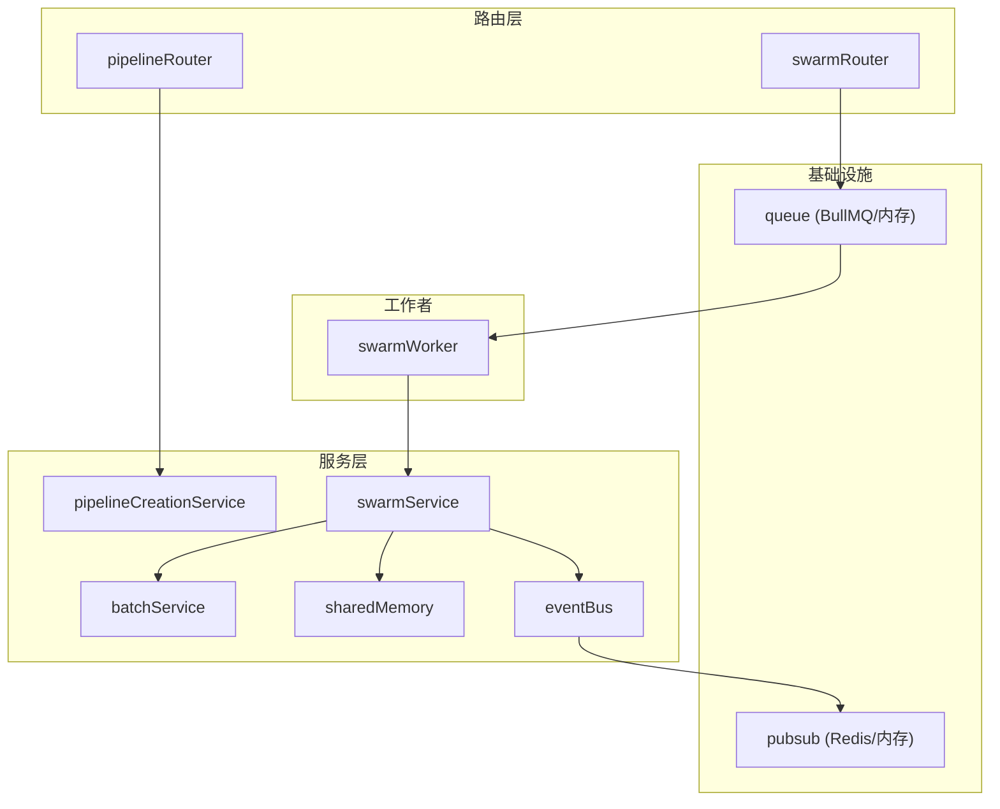
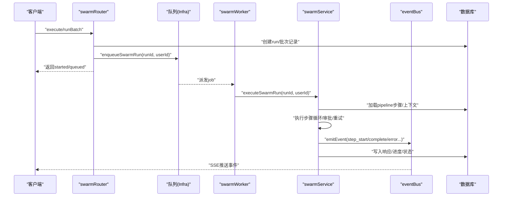
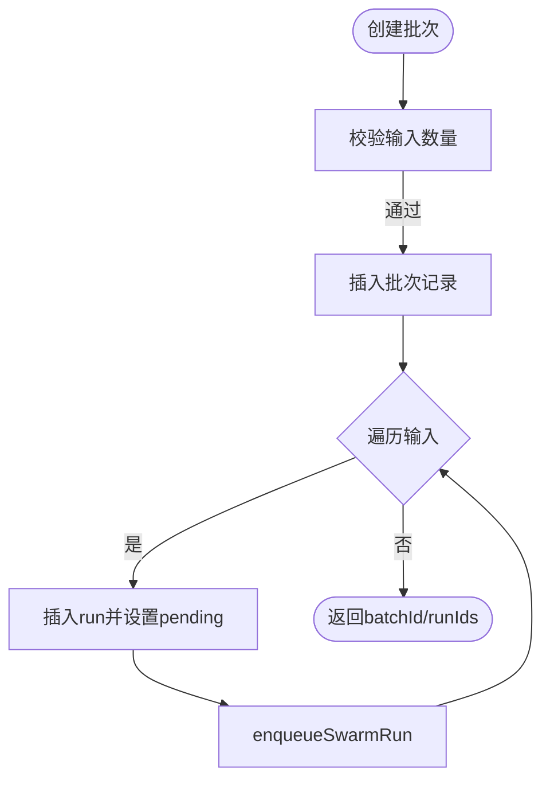
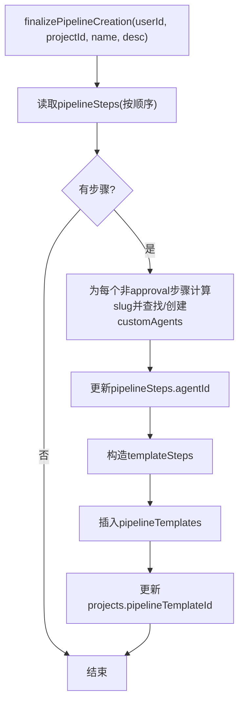
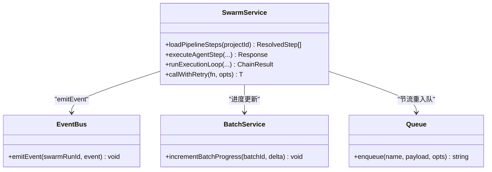
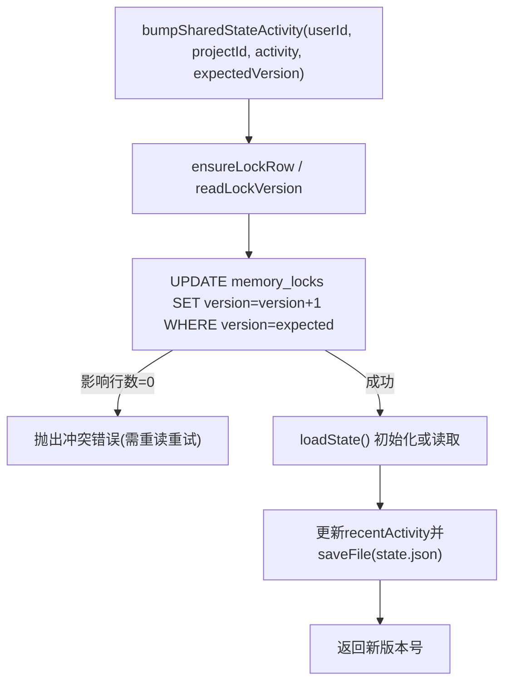
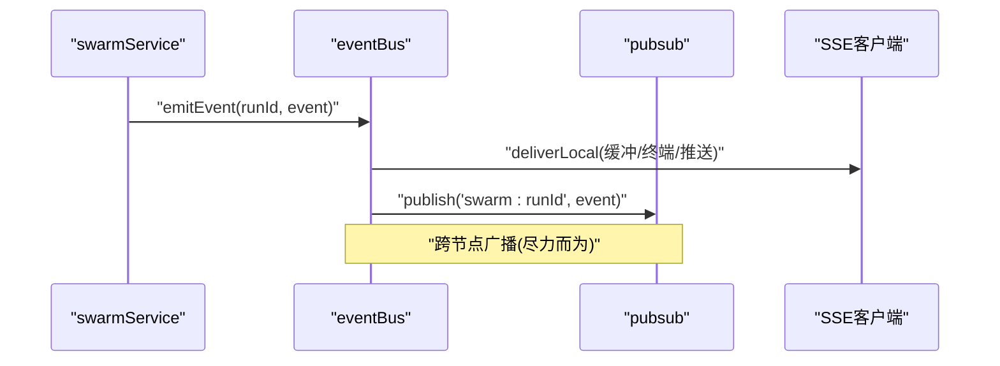
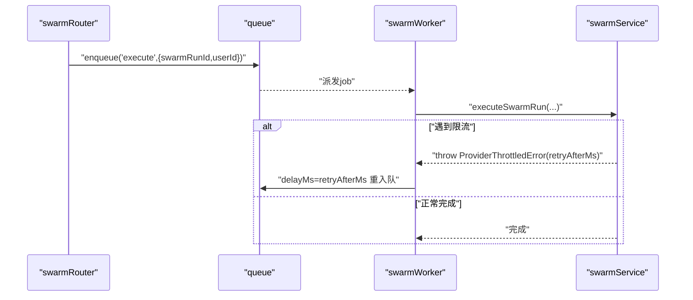
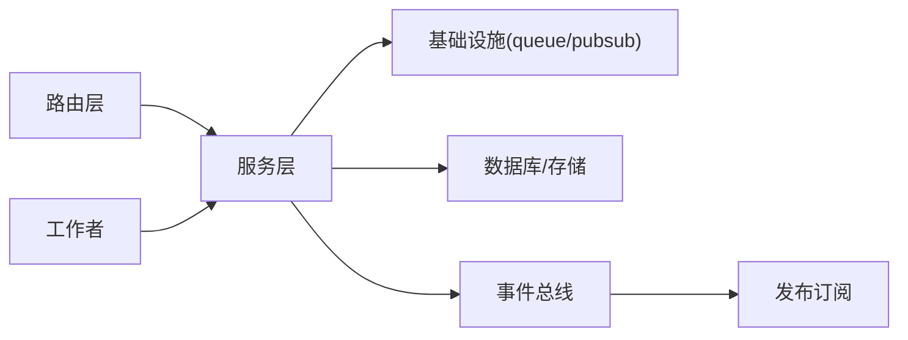

# 后端服务层关系

<cite>
**本文引用的文件**
- [api/services/batchService.ts](file://api/services/batchService.ts)
- [api/services/pipelineCreationService.ts](file://api/services/pipelineCreationService.ts)
- [api/services/swarmService.ts](file://api/services/swarmService.ts)
- [api/services/sharedMemory.ts](file://api/services/sharedMemory.ts)
- [api/services/eventBus.ts](file://api/services/eventBus.ts)
- [api/workers/swarmWorker.ts](file://api/workers/swarmWorker.ts)
- [api/infra/pubsub.ts](file://api/infra/pubsub.ts)
- [api/infra/queue.ts](file://api/infra/queue.ts)
- [api/routers/swarm.ts](file://api/routers/swarm.ts)
- [api/routers/pipeline.ts](file://api/routers/pipeline.ts)
</cite>

## 目录
1. [简介](#简介)
2. [项目结构](#项目结构)
3. [核心组件](#核心组件)
4. [架构总览](#架构总览)
5. [详细组件分析](#详细组件分析)
6. [依赖关系分析](#依赖关系分析)
7. [性能与可靠性](#性能与可靠性)
8. [故障排查指南](#故障排查指南)
9. [结论](#结论)
10. [附录：服务间通信最佳实践示例](#附录服务间通信最佳实践示例)

## 简介
本文件聚焦 DeeWaanAI 后端服务层的组件关系与交互模式，重点覆盖批处理服务、流水线创建服务、蜂群（Swarm）执行服务、共享内存服务与事件总线等关键模块。文档从分层架构、服务注册与依赖注入、错误处理策略、数据流转与状态同步机制等方面展开，并通过序列图、类图和流程图帮助读者理解系统如何协作完成“流水线编排—任务调度—执行—结果回写—实时通知”的完整链路。

## 项目结构
- 路由层（routers）：负责请求校验、鉴权、事务边界与入参组装，将工作委派给服务层与队列。
- 服务层（services）：封装业务逻辑，如批处理生命周期、流水线创建收尾、蜂群执行引擎、共享内存并发控制等。
- 基础设施（infra）：提供队列抽象（BullMQ/内存）、发布订阅抽象（Redis/内存）、Redis 连接等。
- 工作者（workers）：消费队列中的流水线执行任务，调用服务层执行引擎。
- 数据库与存储：通过 Drizzle ORM 访问关系型表；共享内存以磁盘文件 + 乐观锁版本管理。

图表来源
- [api/routers/swarm.ts:109-199](file://api/routers/swarm.ts#L109-L199)
- [api/routers/pipeline.ts:82-200](file://api/routers/pipeline.ts#L82-L200)
- [api/workers/swarmWorker.ts:24-59](file://api/workers/swarmWorker.ts#L24-L59)
- [api/services/swarmService.ts:567-800](file://api/services/swarmService.ts#L567-L800)
- [api/services/batchService.ts:45-105](file://api/services/batchService.ts#L45-L105)
- [api/services/eventBus.ts:156-167](file://api/services/eventBus.ts#L156-L167)
- [api/infra/queue.ts:272-319](file://api/infra/queue.ts#L272-L319)
- [api/infra/pubsub.ts:90-154](file://api/infra/pubsub.ts#L90-L154)

章节来源
- [api/routers/swarm.ts:1-200](file://api/routers/swarm.ts#L1-L200)
- [api/routers/pipeline.ts:1-200](file://api/routers/pipeline.ts#L1-L200)
- [api/workers/swarmWorker.ts:1-75](file://api/workers/swarmWorker.ts#L1-L75)
- [api/infra/queue.ts:1-334](file://api/infra/queue.ts#L1-L334)
- [api/infra/pubsub.ts:1-154](file://api/infra/pubsub.ts#L1-L154)

## 核心组件
- 批处理服务（batchService）：负责批量任务的创建、进度原子更新、查询、取消、恢复与导出。
- 流水线创建服务（pipelineCreationService）：在步骤写入后，自动创建/复用自定义代理并生成可复用的流水线模板。
- 蜂群服务（swarmService）：流水线执行引擎，包含步骤解析、LLM 调用重试、上下文构建、审批暂停、循环控制、Gitee 增量保存、电路熔断与令牌统计。
- 共享内存服务（sharedMemory）：团队项目的“共享记忆”，基于磁盘文件与乐观锁版本实现并发安全的状态读写与片段追加。
- 事件总线（eventBus）：SSE 流式事件分发，具备本地缓冲、终端事件持久化与跨节点广播能力。
- 工作者（swarmWorker）：队列消费者，负责拉取执行任务并调用蜂群服务执行，支持节流重入队。
- 基础设施（queue/pubsub）：统一抽象队列与发布订阅，支持 Redis/BullMQ 与内存降级。

章节来源
- [api/services/batchService.ts:45-321](file://api/services/batchService.ts#L45-L321)
- [api/services/pipelineCreationService.ts:20-116](file://api/services/pipelineCreationService.ts#L20-L116)
- [api/services/swarmService.ts:1-800](file://api/services/swarmService.ts#L1-L800)
- [api/services/sharedMemory.ts:1-207](file://api/services/sharedMemory.ts#L1-L207)
- [api/services/eventBus.ts:1-193](file://api/services/eventBus.ts#L1-L193)
- [api/workers/swarmWorker.ts:1-75](file://api/workers/swarmWorker.ts#L1-L75)
- [api/infra/queue.ts:1-334](file://api/infra/queue.ts#L1-L334)
- [api/infra/pubsub.ts:1-154](file://api/infra/pubsub.ts#L1-L154)

## 架构总览
下图展示了从 HTTP 请求到后台执行、再到 SSE 事件推送的整体流程。

图表来源
- [api/routers/swarm.ts:109-199](file://api/routers/swarm.ts#L109-L199)
- [api/workers/swarmWorker.ts:24-59](file://api/workers/swarmWorker.ts#L24-L59)
- [api/services/swarmService.ts:567-800](file://api/services/swarmService.ts#L567-L800)
- [api/services/eventBus.ts:156-167](file://api/services/eventBus.ts#L156-L167)

## 详细组件分析

### 批处理服务（batchService）
- 职责
  - 创建批次：校验输入规模，插入批次行，为每个输入创建 run 并加入队列。
  - 进度原子更新：使用 SQL 自增字段原子更新完成数、失败数与 token 用量，并在全部结束时标记最终状态。
  - 查询与导出：按用户维度查询批次与成员运行摘要，支持 CSV 导出。
  - 取消与恢复：取消非终态成员，或将暂停批次重新入队。
- 关键交互
  - 与 swarmWorker 集成：通过 enqueueSwarmRun 将成员 run 入队。
  - 与 swarmService 协同：由执行端调用 incrementBatchProgress 推进批次进度。
- 错误与边界
  - 输入数量限制（1–100）。
  - 恢复时仅允许特定暂停状态。
  - 幂等重入队：re-enqueue 时使用 bypassDedup 避免重复。

图表来源
- [api/services/batchService.ts:45-105](file://api/services/batchService.ts#L45-L105)

章节来源
- [api/services/batchService.ts:45-321](file://api/services/batchService.ts#L45-L321)

### 流水线创建服务（pipelineCreationService）
- 职责
  - 在 pipelineSteps 已存在的前提下，为每个唯一角色（排除审批）创建或复用 customAgents。
  - 将步骤与 agent 关联，并生成 pipelineTemplate，最后回填到 projects。
- 设计要点
  - 去重键：role+name 组合，slug 规范化。
  - 批量读取与更新：先读步骤，再批量映射 agent，最后回填。
  - 模板化：将步骤信息序列化为 steps 数组，便于后续复用。

图表来源
- [api/services/pipelineCreationService.ts:20-116](file://api/services/pipelineCreationService.ts#L20-L116)

章节来源
- [api/services/pipelineCreationService.ts:20-116](file://api/services/pipelineCreationService.ts#L20-L116)

### 蜂群服务（swarmService）
- 职责
  - 解析并加载 pipeline 步骤（含 if/while/agent/approval）。
  - 维护执行上下文（当前步、链式响应、循环计数、审批挂起状态）。
  - 调用 LLM 提供商适配器，带指数退避重试、配额/限流识别、提供者级节流。
  - 支持审批暂停（等待人工确认）、循环门控（if/while）、质量反馈闭环。
  - 增量保存到 Gitee、记录 token/延迟、触发事件总线。
  - 可选电路熔断保护（按步估算与实际用量）。
- 关键交互
  - 与 eventBus：在每个步骤开始、完成、错误时 emitEvent。
  - 与 batchService：当成员 run 达到终态时，调用 incrementBatchProgress。
  - 与 queue：被 swarmWorker 调用，支持节流重入队。
- 错误处理
  - 信用耗尽：抛出专用异常，不重试，可能暂停批次。
  - 速率限制：识别 429/throttled，指数退避后仍超限则抛 ProviderThrottledError，由 worker 重入队。
  - 审批暂停：返回 awaitingApproval，前端需介入。

图表来源
- [api/services/swarmService.ts:176-214](file://api/services/swarmService.ts#L176-L214)
- [api/services/swarmService.ts:355-530](file://api/services/swarmService.ts#L355-L530)
- [api/services/swarmService.ts:567-800](file://api/services/swarmService.ts#L567-L800)
- [api/services/eventBus.ts:156-167](file://api/services/eventBus.ts#L156-L167)
- [api/services/batchService.ts:107-142](file://api/services/batchService.ts#L107-L142)
- [api/workers/swarmWorker.ts:54-57](file://api/workers/swarmWorker.ts#L54-L57)

章节来源
- [api/services/swarmService.ts:1-800](file://api/services/swarmService.ts#L1-L800)

### 共享内存服务（sharedMemory）
- 职责
  - 团队项目级别的“共享记忆”：片段（episodes）追加、结构化状态（state）读写。
  - 通过 memory_locks 表的 version 字段实现乐观锁，避免并发写冲突。
  - 仅对“团队共享项目”开放，个人项目拒绝访问。
- 关键交互
  - 与 memoryManager：片段检索、创建、旋转（保留最新 N 条）。
  - 与 projectFilesDisk：持久化 state.json。
  - 与 DB：读取 teamMembers/teamProjects 判断共享权限，维护 memory_locks。
- 并发模型
  - 片段追加无锁（append-only）。
  - 状态写采用“先获取版本，再 UPDATE WHERE version=expected”，失败则提示上层重试。

图表来源
- [api/services/sharedMemory.ts:137-206](file://api/services/sharedMemory.ts#L137-L206)

章节来源
- [api/services/sharedMemory.ts:1-207](file://api/services/sharedMemory.ts#L1-L207)

### 事件总线（eventBus）
- 职责
  - 本地 SSE 客户端投递，附带 5 分钟回放缓冲与终态事件持久化。
  - 跨节点广播：通过 pubsub 将事件发布到 swarm:<runId> 频道，其他节点订阅并转发给本地客户端。
- 特性
  - 本地优先：deliverLocal 始终可用。
  - 跨节点降级：publish 失败不影响本地投递。
  - 终端事件：pipeline_complete/pipeline_error 永久缓存，新连接可立即收到。

图表来源
- [api/services/eventBus.ts:94-167](file://api/services/eventBus.ts#L94-L167)
- [api/infra/pubsub.ts:90-154](file://api/infra/pubsub.ts#L90-L154)

章节来源
- [api/services/eventBus.ts:1-193](file://api/services/eventBus.ts#L1-L193)

### 工作者与队列（swarmWorker + infra/queue）
- 职责
  - 统一队列抽象：生产端 enqueue，消费端 createWorker 处理 job。
  - 支持 BullMQ（多节点、持久化）与内存队列（开发单机）自动切换。
  - 幂等入队：idempotencyKey 防止重复入队。
  - 节流重入队：ProviderThrottledError 携带 retryAfterMs，worker 延迟重入队。
- 健康与关闭
  - 提供 isSwarmWorkerRunning 用于就绪检查。
  - stopSwarmWorker/closeAllQueues 优雅关闭。

图表来源
- [api/routers/swarm.ts:109-199](file://api/routers/swarm.ts#L109-L199)
- [api/workers/swarmWorker.ts:24-59](file://api/workers/swarmWorker.ts#L24-L59)
- [api/infra/queue.ts:272-319](file://api/infra/queue.ts#L272-L319)

章节来源
- [api/workers/swarmWorker.ts:1-75](file://api/workers/swarmWorker.ts#L1-L75)
- [api/infra/queue.ts:1-334](file://api/infra/queue.ts#L1-L334)

## 依赖关系分析
- 路由层依赖服务层：
  - swarmRouter 依赖 swarmService、batchService、swarmWorker。
  - pipelineRouter 依赖 pipelineCreationService 进行步骤与模板的落库。
- 服务层依赖基础设施：
  - swarmService 依赖 eventBus、providerThrottle、cryptoService、giteeService、memoryManager、stateSummarizer。
  - sharedMemory 依赖 memoryManager、projectFilesDisk、DB schema。
  - batchService 依赖 swarmWorker（入队）与 DB。
- 工作者依赖服务层：
  - swarmWorker 调用 executeSwarmRun，并将限流错误转译为延迟重入队。
- 事件总线依赖 pubsub：
  - eventBus 通过 publish/subscribe 实现跨节点广播，内部使用 Redis 或内存 EventEmitter。

图表来源
- [api/routers/swarm.ts:109-199](file://api/routers/swarm.ts#L109-L199)
- [api/routers/pipeline.ts:82-200](file://api/routers/pipeline.ts#L82-L200)
- [api/services/swarmService.ts:1-800](file://api/services/swarmService.ts#L1-L800)
- [api/services/eventBus.ts:1-193](file://api/services/eventBus.ts#L1-L193)
- [api/infra/queue.ts:1-334](file://api/infra/queue.ts#L1-L334)
- [api/infra/pubsub.ts:1-154](file://api/infra/pubsub.ts#L1-L154)

章节来源
- [api/routers/swarm.ts:1-200](file://api/routers/swarm.ts#L1-L200)
- [api/routers/pipeline.ts:1-200](file://api/routers/pipeline.ts#L1-L200)
- [api/services/swarmService.ts:1-800](file://api/services/swarmService.ts#L1-L800)
- [api/services/eventBus.ts:1-193](file://api/services/eventBus.ts#L1-L193)
- [api/infra/queue.ts:1-334](file://api/infra/queue.ts#L1-L334)
- [api/infra/pubsub.ts:1-154](file://api/infra/pubsub.ts#L1-L154)

## 性能与可靠性
- 队列与并发
  - 使用 BullMQ 时支持多进程并发消费；内存模式下适合开发调试。
  - 幂等入队避免重复执行；限流时延迟重入队，平滑削峰。
- 重试与容错
  - callWithRetry 对 LLM 调用进行指数退避重试，区分信用耗尽与速率限制。
  - 事件总线跨节点广播尽力而为，失败不影响本地 SSE。
- 状态一致性
  - 批次进度使用 SQL 自增原子更新，避免竞态。
  - 共享内存通过乐观锁版本控制，写冲突时强制上层重试。
- 资源保护
  - 可选电路熔断：按步估算与实际用量限制，防止单跑失控。
  - 提供者级节流：acquireProviderSlot/reportProviderResult 控制并发与失败上报。

[本节为通用指导，不直接分析具体文件]

## 故障排查指南
- 常见问题定位
  - 执行卡住：检查 swarmWorker 是否启动、队列是否堆积、是否有 ProviderThrottledError 导致重入队。
  - 批次未完结：确认 incrementBatchProgress 是否被正确调用，检查 completedRuns + failedRuns 是否达到 totalRuns。
  - 共享内存冲突：出现“状态已变更”错误时，按提示重新读取最新版本并重试。
  - SSE 无事件：确认 eventBus 的 subscribeClient 是否建立，终端事件是否已缓存。
- 日志与追踪
  - 使用 logger 输出步骤跟踪、重试次数、限流原因。
  - 利用 clientTraceId 贯穿请求链路，便于问题回溯。

章节来源
- [api/services/swarmService.ts:176-214](file://api/services/swarmService.ts#L176-L214)
- [api/services/batchService.ts:107-142](file://api/services/batchService.ts#L107-L142)
- [api/services/sharedMemory.ts:158-206](file://api/services/sharedMemory.ts#L158-L206)
- [api/services/eventBus.ts:129-167](file://api/services/eventBus.ts#L129-L167)
- [api/workers/swarmWorker.ts:37-59](file://api/workers/swarmWorker.ts#L37-L59)

## 结论
DeeWaanAI 后端服务层采用清晰的分层架构：路由层负责接入与校验，服务层承载核心业务，工作者解耦长耗时执行，基础设施提供可靠的队列与事件通道。批处理、流水线创建、蜂群执行、共享内存与事件总线之间通过明确的接口与约定协作，配合幂等、重试、乐观锁与熔断等机制，实现了高可靠、可扩展的执行体系。

[本节为总结性内容，不直接分析具体文件]

## 附录：服务间通信最佳实践示例
以下示例展示服务间通信的关键模式与调用路径（以代码片段路径代替具体代码）：

- 路由 → 队列 → 工作者 → 服务 → 事件总线
  - 路由入队：[api/routers/swarm.ts:109-199](file://api/routers/swarm.ts#L109-L199)
  - 工作者消费：[api/workers/swarmWorker.ts:24-59](file://api/workers/swarmWorker.ts#L24-L59)
  - 服务执行与事件：[api/services/swarmService.ts:567-800](file://api/services/swarmService.ts#L567-L800), [api/services/eventBus.ts:156-167](file://api/services/eventBus.ts#L156-L167)

- 批处理进度原子更新
  - 进度推进：[api/services/batchService.ts:107-142](file://api/services/batchService.ts#L107-L142)

- 共享内存乐观锁
  - 状态写入：[api/services/sharedMemory.ts:158-206](file://api/services/sharedMemory.ts#L158-L206)

- 队列幂等与限流重入队
  - 幂等入队：[api/infra/queue.ts:210-228](file://api/infra/queue.ts#L210-L228)
  - 限流重入队：[api/workers/swarmWorker.ts:54-57](file://api/workers/swarmWorker.ts#L54-L57)

- 流水线创建收尾
  - 模板化与关联：[api/services/pipelineCreationService.ts:20-116](file://api/services/pipelineCreationService.ts#L20-L116)

[本节为实践指引，不直接分析具体文件]