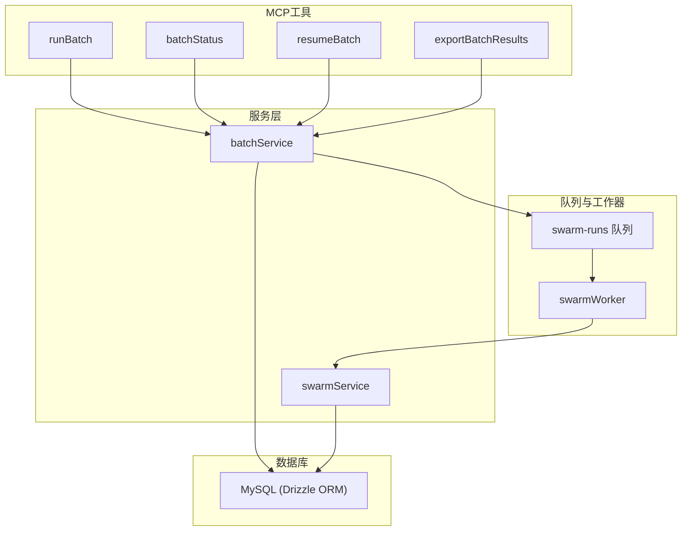
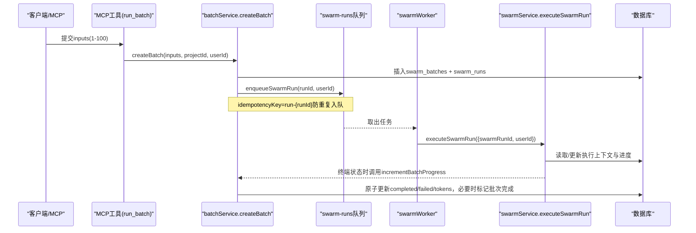
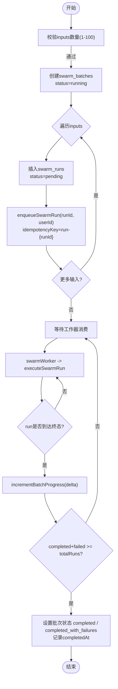
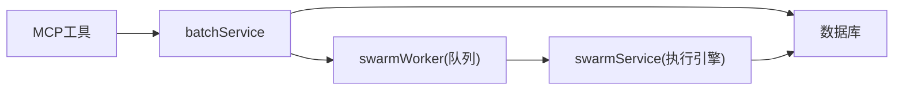

# 批处理服务

<cite>
**本文引用的文件**
- [batchService.ts](file://api/services/batchService.ts)
- [swarmWorker.ts](file://api/workers/swarmWorker.ts)
- [swarmService.ts](file://api/services/swarmService.ts)
- [runBatch.ts](file://api/mcp/tools/runBatch.ts)
- [batchStatus.ts](file://api/mcp/tools/batchStatus.ts)
- [resumeBatch.ts](file://api/mcp/tools/resumeBatch.ts)
- [exportBatchResults.ts](file://api/mcp/tools/exportBatchResults.ts)
- [schema.ts](file://db/schema.ts)
- [smoke-batch.mjs](file://scripts/smoke-batch.mjs)
</cite>

## 目录
1. [简介](#简介)
2. [项目结构](#项目结构)
3. [核心组件](#核心组件)
4. [架构总览](#架构总览)
5. [详细组件分析](#详细组件分析)
6. [依赖关系分析](#依赖关系分析)
7. [性能与可靠性](#性能与可靠性)
8. [故障排查指南](#故障排查指南)
9. [结论](#结论)
10. [附录：端到端使用流程示例](#附录端到端使用流程示例)

## 简介
本文件面向DeeWaanAI的“研究模式”批处理服务，系统性说明批量任务的生命周期管理：从创建、队列化、进度跟踪到状态同步；并详解核心能力：createBatch（创建并排队）、incrementBatchProgress（原子性更新进度）、getBatchStatus（获取批次与成员摘要）、cancelBatch（取消批次与非终止成员）、resumeBatch（恢复暂停批次）、exportBatchResults（导出CSV结果）。同时阐述批处理与蜂群工作器的集成关系（enqueueSwarmRun调用与去重机制），并提供端到端使用流程与最佳实践。

## 项目结构
批处理相关代码主要分布在以下位置：
- 服务层：api/services/batchService.ts（批处理生命周期）
- 执行引擎：api/services/swarmService.ts（单条运行执行、错误分类、重试/节流、进度回写）
- 队列与工作器：api/workers/swarmWorker.ts（BullMQ/内存队列封装、去重、延迟重试）
- MCP工具：api/mcp/tools/*（run_batch、batch_status、resume_batch、export_batch_results）
- 数据模型：db/schema.ts（swarm_batches、swarm_runs、agent_responses等）
- 冒烟测试：scripts/smoke-batch.mjs（端到端验证）

图表来源
- [runBatch.ts:1-65](file://api/mcp/tools/runBatch.ts#L1-L65)
- [batchStatus.ts:1-53](file://api/mcp/tools/batchStatus.ts#L1-L53)
- [resumeBatch.ts:1-36](file://api/mcp/tools/resumeBatch.ts#L1-L36)
- [exportBatchResults.ts:1-37](file://api/mcp/tools/exportBatchResults.ts#L1-L37)
- [batchService.ts:45-321](file://api/services/batchService.ts#L45-L321)
- [swarmWorker.ts:1-75](file://api/workers/swarmWorker.ts#L1-L75)
- [swarmService.ts:1-800](file://api/services/swarmService.ts#L1-L800)
- [schema.ts:173-200](file://db/schema.ts#L173-L200)

章节来源
- [batchService.ts:45-321](file://api/services/batchService.ts#L45-L321)
- [swarmWorker.ts:1-75](file://api/workers/swarmWorker.ts#L1-L75)
- [swarmService.ts:1-800](file://api/services/swarmService.ts#L1-L800)
- [schema.ts:173-200](file://db/schema.ts#L173-L200)

## 核心组件
- createBatch：校验输入数量（1–100），创建批次记录，为每个输入插入swarm_run，并调用enqueueSwarmRun入队。返回{ batchId, runIds, status:"queued" }。
- incrementBatchProgress：原子性增加completedRuns/failedRuns/totalTokensUsed；当完成或失败数达到totalRuns时，将批次状态置为completed/completed_with_failures并记录完成时间。
- getBatchStatus：按userId权限查询批次及该批次下的所有运行摘要（最近优先），包含token与错误摘要。
- cancelBatch：将批次置为cancelled，并将pending/running状态的成员置为cancelled。
- resumeBatch：仅允许paused_credit/paused_outage状态恢复；将批次置为running，并重新入队所有非终止成员（bypassDedup=true）。
- exportBatchResults：按批次拉取运行与最终响应，生成CSV字符串（含run_id、input_preview、status、final_response、error、tokens、latency）。

章节来源
- [batchService.ts:45-321](file://api/services/batchService.ts#L45-L321)

## 架构总览
批处理通过MCP工具暴露API，服务层负责持久化与队列编排，蜂群工作器消费队列并驱动执行引擎，执行引擎在DB中维护运行上下文与进度，并在终端状态时回调批处理进度更新。

图表来源
- [runBatch.ts:24-65](file://api/mcp/tools/runBatch.ts#L24-L65)
- [batchService.ts:45-105](file://api/services/batchService.ts#L45-L105)
- [swarmWorker.ts:24-59](file://api/workers/swarmWorker.ts#L24-L59)
- [swarmService.ts:1-800](file://api/services/swarmService.ts#L1-L800)

## 详细组件分析

### 批处理生命周期（createBatch → 队列化 → 进度 → 完成/失败）
- 创建阶段：
  - 校验inputs长度（1–100），创建swarm_batches（status=running），并为每个输入插入swarm_runs（status=pending）。
  - 对每个run调用enqueueSwarmRun，使用idempotencyKey=run-{runId}保证幂等。
- 执行阶段：
  - 工作器从队列取出任务，调用executeSwarmRun执行流水线。
  - 执行过程中持续写入agent_runs/agent_responses，累积token与耗时。
- 进度更新：
  - 当单个run进入终态（completed/failed），swarmService回调incrementBatchProgress原子更新批次计数。
  - 若completed+failed≥totalRuns，批次状态置为completed或completed_with_failures，并记录completedAt。

图表来源
- [batchService.ts:45-142](file://api/services/batchService.ts#L45-L142)
- [swarmWorker.ts:24-59](file://api/workers/swarmWorker.ts#L24-L59)
- [swarmService.ts:1-800](file://api/services/swarmService.ts#L1-L800)

章节来源
- [batchService.ts:45-142](file://api/services/batchService.ts#L45-L142)
- [swarmWorker.ts:24-59](file://api/workers/swarmWorker.ts#L24-L59)
- [swarmService.ts:1-800](file://api/services/swarmService.ts#L1-L800)

### 进度跟踪与状态同步（incrementBatchProgress）
- 原子更新：使用SQL自增表达式累计completedRuns/failedRuns/totalTokensUsed，避免并发竞态。
- 完成判定：当完成与失败之和达到totalRuns时，根据是否有失败决定最终状态，并写入completedAt。
- 日志：记录批次最终状态变更。

章节来源
- [batchService.ts:107-142](file://api/services/batchService.ts#L107-L142)

### 状态查询（getBatchStatus）
- 权限控制：按userId过滤批次。
- 返回内容：批次基本信息、运行总数、完成/失败数、总token、创建/完成时间；以及该批次下运行的摘要列表（最新优先），包含状态、输入预览、token与错误摘要。

章节来源
- [batchService.ts:144-186](file://api/services/batchService.ts#L144-L186)

### 取消批处理（cancelBatch）
- 将批次状态置为cancelled。
- 将所有pending/running的成员置为cancelled，阻止继续执行。

章节来源
- [batchService.ts:201-230](file://api/services/batchService.ts#L201-L230)

### 恢复批处理（resumeBatch）
- 仅允许paused_credit/paused_outage状态恢复。
- 将批次状态置为running。
- 重新入队所有非终止成员（bypassDedup=true），确保被节流或失败的运行可再次尝试。

章节来源
- [batchService.ts:233-273](file://api/services/batchService.ts#L233-L273)

### 导出结果（exportBatchResults）
- 按批次拉取swarm_runs与对应的agent_responses（最终响应）。
- 生成CSV：列包括run_id、input_preview、status、final_response、error、total_tokens_used、total_latency_ms。
- 安全转义：对换行与引号进行CSV兼容处理。

章节来源
- [batchService.ts:275-321](file://api/services/batchService.ts#L275-L321)

### 与蜂群工作器的集成（enqueueSwarmRun与去重）
- 入队：enqueueSwarmRun将任务放入swarm-runs队列，默认使用idempotencyKey=run-{swarmRunId}防止重复入队。
- 工作器：startSwarmWorker注册消费者，收到任务后调用executeSwarmRun；若遇到需要延迟重试的情况，可通过回调enqueueSwarmRun以delayMs延迟并bypassDedup=true重新入队。
- 健康检查：isSwarmWorkerRunning用于就绪探测。

章节来源
- [swarmWorker.ts:1-75](file://api/workers/swarmWorker.ts#L1-L75)
- [batchService.ts:99-101](file://api/services/batchService.ts#L99-L101)
- [batchService.ts:264-270](file://api/services/batchService.ts#L264-L270)

### 执行引擎与错误分类（swarmService）
- 重试与节流：callWithRetry对LLM调用进行指数退避重试；识别配额/余额不足（CreditExhaustedError）直接抛出，不重试；识别速率限制（ProviderThrottledError）则走节流路径并可能延迟重试。
- 批次暂停：当检测到账户/计费问题（如insufficient_quota、402等），抛出BatchPausedError，上层可将批次置为paused_credit；当提供商中断时，置为paused_outage。
- 进度回写：在run终端状态时调用incrementBatchProgress，确保批次统计一致。

章节来源
- [swarmService.ts:124-214](file://api/services/swarmService.ts#L124-L214)
- [swarmService.ts:148-174](file://api/services/swarmService.ts#L148-L174)

## 依赖关系分析
- MCP工具依赖batchService暴露的能力。
- batchService依赖数据库（drizzle-orm）与swarmWorker队列。
- swarmWorker依赖队列基础设施与swarmService执行引擎。
- swarmService依赖数据库、提供者适配、事件总线、令牌/限速等。

图表来源
- [runBatch.ts:24-65](file://api/mcp/tools/runBatch.ts#L24-L65)
- [batchService.ts:45-105](file://api/services/batchService.ts#L45-L105)
- [swarmWorker.ts:24-59](file://api/workers/swarmWorker.ts#L24-L59)
- [swarmService.ts:1-800](file://api/services/swarmService.ts#L1-L800)

章节来源
- [runBatch.ts:24-65](file://api/mcp/tools/runBatch.ts#L24-L65)
- [batchService.ts:45-105](file://api/services/batchService.ts#L45-L105)
- [swarmWorker.ts:24-59](file://api/workers/swarmWorker.ts#L24-L59)
- [swarmService.ts:1-800](file://api/services/swarmService.ts#L1-L800)

## 性能与可靠性
- 幂等入队：idempotencyKey=run-{runId}避免重复入队，提高重试安全性。
- 原子进度：incrementBatchProgress使用SQL自增，避免并发竞争。
- 节流与重试：ProviderThrottledError触发延迟重试，避免雪崩；Rate Limit场景不暂停批次。
- 配额保护：CreditExhaustedError立即停止重试，转为批次暂停，提示充值。
- 批量上限：inputs限制1–100，防止过大批次导致资源耗尽。
- 导出优化：CSV导出时对长文本截断与转义，减少体积与解析风险。

[本节提供通用指导，无需特定文件引用]

## 故障排查指南
- 批次未启动：
  - 检查队列是否已启动（isSwarmWorkerRunning），确认队列实例存在。
  - 查看队列日志，确认任务是否被消费。
- 进度不更新：
  - 确认executeSwarmRun在终端状态时调用了incrementBatchProgress。
  - 检查数据库更新是否成功（completed/failed计数）。
- 批次一直暂停：
  - paused_credit：需充值或调整配额；paused_outage：等待提供商恢复。
  - 使用resumeBatch恢复，注意仅允许上述两种暂停状态。
- 导出CSV为空或缺失字段：
  - 确认finalResponseId是否存在；若不存在，final_response将为空。
  - 检查agent_responses表是否写入成功。

章节来源
- [swarmWorker.ts:37-59](file://api/workers/swarmWorker.ts#L37-L59)
- [batchService.ts:107-142](file://api/services/batchService.ts#L107-L142)
- [batchService.ts:233-273](file://api/services/batchService.ts#L233-L273)
- [batchService.ts:275-321](file://api/services/batchService.ts#L275-L321)

## 结论
批处理服务通过清晰的分层设计实现了高可靠、可扩展的批量任务管理：MCP工具提供易用接口，batchService负责生命周期与状态同步，swarmWorker与swarmService构成执行与容错闭环。幂等入队、原子进度、节流重试与配额保护共同保障了系统在大规模运行时的稳定性与一致性。配合CSV导出与状态查询，便于监控与审计。

[本节总结性内容，无需特定文件引用]

## 附录：端到端使用流程示例
以下为基于现有脚本与工具的端到端流程说明（不含具体代码片段，仅提供路径参考）：
- 创建用户与项目、配置LLM提供商：参见冒烟脚本中的初始化步骤。
- 启动批处理：调用run_batch（MCP工具），传入projectId与inputs（1–100），返回batchId与runIds。
- 轮询进度：周期性调用batch_status，直到状态变为completed/completed_with_failures。
- 导出结果：调用export_batch_results，获取CSV字符串并保存。
- 异常处理：如遇配额不足或提供商中断，批次会暂停；充值或恢复后调用resume_batch恢复。

章节来源
- [smoke-batch.mjs:74-115](file://scripts/smoke-batch.mjs#L74-L115)
- [runBatch.ts:24-65](file://api/mcp/tools/runBatch.ts#L24-L65)
- [batchStatus.ts:13-53](file://api/mcp/tools/batchStatus.ts#L13-L53)
- [exportBatchResults.ts:13-37](file://api/mcp/tools/exportBatchResults.ts#L13-L37)
- [resumeBatch.ts:13-36](file://api/mcp/tools/resumeBatch.ts#L13-L36)