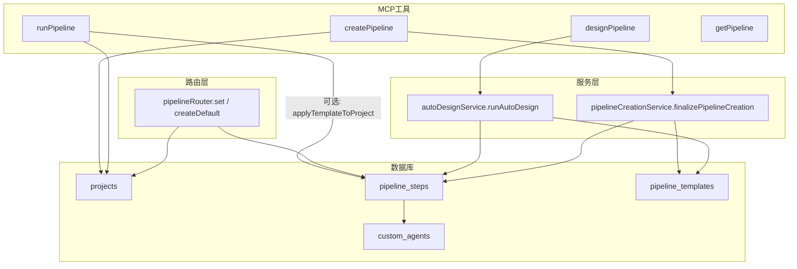
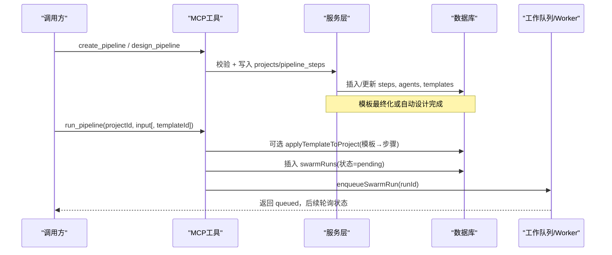
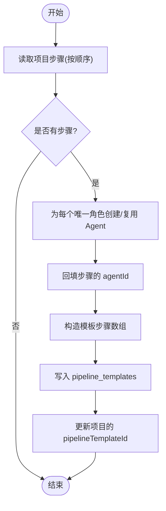
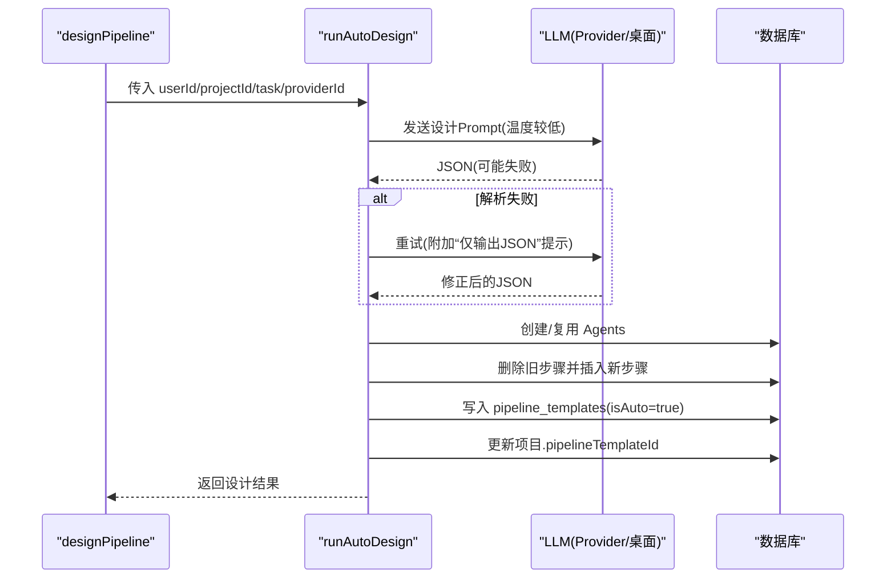
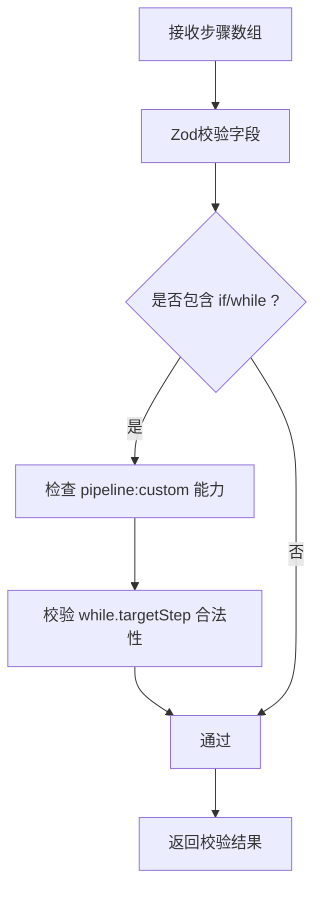
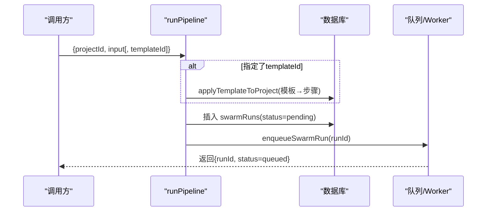
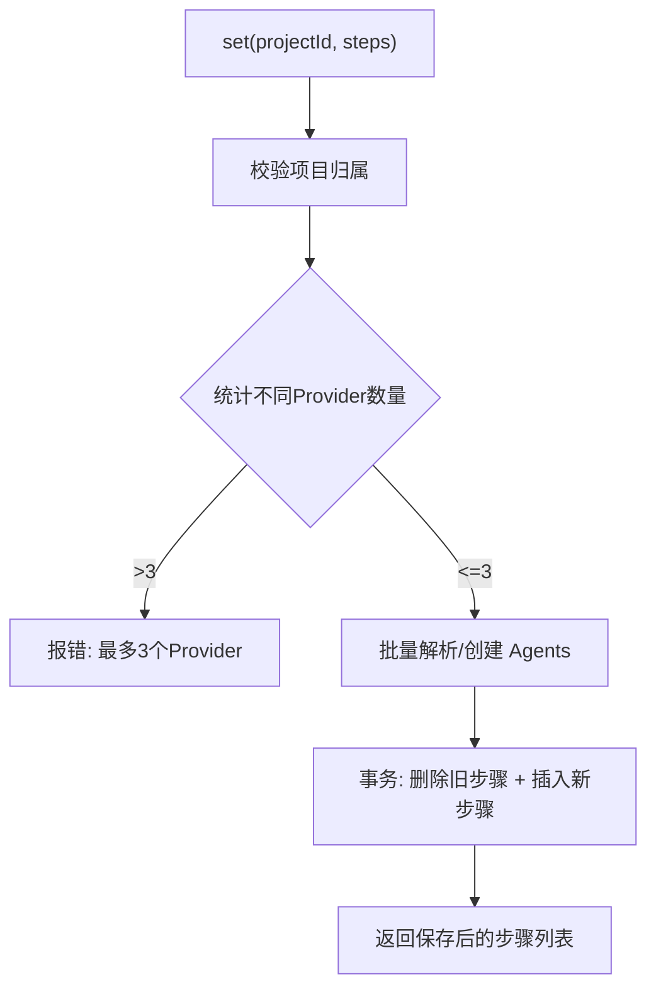
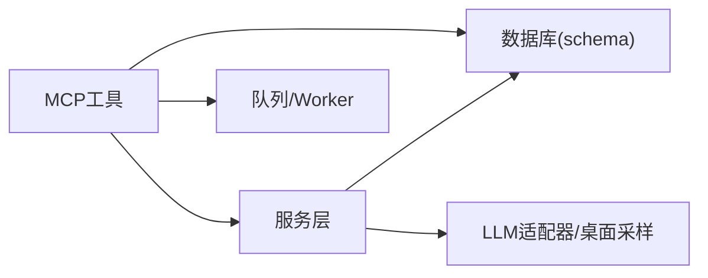

# 流水线创建服务

<cite>
**本文引用的文件**
- [api/services/pipelineCreationService.ts](file://api/services/pipelineCreationService.ts)
- [api/mcp/tools/createPipeline.ts](file://api/mcp/tools/createPipeline.ts)
- [api/mcp/tools/designPipeline.ts](file://api/mcp/tools/designPipeline.ts)
- [api/mcp/tools/runPipeline.ts](file://api/mcp/tools/runPipeline.ts)
- [api/mcp/tools/getPipeline.ts](file://api/mcp/tools/getPipeline.ts)
- [api/mcp/tools/pipelineValidation.ts](file://api/mcp/tools/pipelineValidation.ts)
- [api/routers/pipeline.ts](file://api/routers/pipeline.ts)
- [api/services/autoDesignService.ts](file://api/services/autoDesignService.ts)
- [db/schema.ts](file://db/schema.ts)
</cite>

## 目录
1. [简介](#简介)
2. [项目结构](#项目结构)
3. [核心组件](#核心组件)
4. [架构总览](#架构总览)
5. [详细组件分析](#详细组件分析)
6. [依赖关系分析](#依赖关系分析)
7. [性能考虑](#性能考虑)
8. [故障排查指南](#故障排查指南)
9. [结论](#结论)
10. [附录](#附录)

## 简介
本文件面向DeeWaanAI的“流水线创建服务”，聚焦模板系统的设计原理与实现机制，覆盖模板解析、验证与执行流程；详细说明流水线创建的核心能力：模板管理、步骤定义、参数绑定与执行配置；解释与服务层（MCP工具、tRPC路由、自动设计服务）的集成关系，包括项目上下文、用户权限与资源管理的交互；并提供创建、配置与执行的端到端示例路径、错误处理、版本控制与回滚策略；最后给出最佳实践与性能优化建议。

## 项目结构
围绕流水线创建的关键代码分布在以下模块：
- MCP工具层：提供创建、设计、运行、获取流水线的API入口
- 服务层：封装自动设计、最终化创建等复杂业务逻辑
- 路由层：提供Web/内部调用的批量设置、默认流水线生成等能力
- 数据模型：项目、步骤、模板、自定义Agent、运行记录等持久化结构

图表来源
- [api/mcp/tools/createPipeline.ts:33-107](file://api/mcp/tools/createPipeline.ts#L33-L107)
- [api/mcp/tools/designPipeline.ts:26-85](file://api/mcp/tools/designPipeline.ts#L26-L85)
- [api/mcp/tools/runPipeline.ts:32-95](file://api/mcp/tools/runPipeline.ts#L32-L95)
- [api/services/autoDesignService.ts:35-319](file://api/services/autoDesignService.ts#L35-L319)
- [api/services/pipelineCreationService.ts:20-115](file://api/services/pipelineCreationService.ts#L20-L115)
- [api/routers/pipeline.ts:128-219](file://api/routers/pipeline.ts#L128-L219)
- [db/schema.ts:84-150](file://db/schema.ts#L84-L150)
- [db/schema.ts:452-505](file://db/schema.ts#L452-L505)

章节来源
- [api/mcp/tools/createPipeline.ts:33-107](file://api/mcp/tools/createPipeline.ts#L33-L107)
- [api/mcp/tools/designPipeline.ts:26-85](file://api/mcp/tools/designPipeline.ts#L26-L85)
- [api/mcp/tools/runPipeline.ts:32-95](file://api/mcp/tools/runPipeline.ts#L32-L95)
- [api/services/autoDesignService.ts:35-319](file://api/services/autoDesignService.ts#L35-L319)
- [api/services/pipelineCreationService.ts:20-115](file://api/services/pipelineCreationService.ts#L20-L115)
- [api/routers/pipeline.ts:128-219](file://api/routers/pipeline.ts#L128-L219)
- [db/schema.ts:84-150](file://db/schema.ts#L84-L150)
- [db/schema.ts:452-505](file://db/schema.ts#L452-L505)

## 核心组件
- 模板系统
  - 模板存储：pipeline_templates 表保存可复用的步骤序列与参数
  - 模板应用：将模板步骤物化为 pipeline_steps，并关联 custom_agents
  - 自动设计：基于LLM输出JSON，构建agents/steps/templates并落库
- 步骤定义与校验
  - 支持 agent/if/while/approval 四类步骤
  - 条件分支(if)与循环(while)通过ifConfig/whileConfig描述
  - 输入校验使用Zod schema，限制步数、迭代次数、目标步骤合法性
- 执行配置
  - 项目级 pipeline_config 控制全局行为（最大迭代、启用哪些agent、停止策略）
  - 步骤级 provider/model/temperature/maxTokens 覆盖默认值
- 权限与上下文
  - MCP工具在创建/运行前进行项目访问校验与能力鉴权（如 pipeline:custom、pipeline:autodesign）
  - tRPC路由对团队共享项目进行成员校验

章节来源
- [api/mcp/tools/pipelineValidation.ts:1-84](file://api/mcp/tools/pipelineValidation.ts#L1-L84)
- [api/mcp/tools/createPipeline.ts:40-97](file://api/mcp/tools/createPipeline.ts#L40-L97)
- [api/mcp/tools/designPipeline.ts:33-78](file://api/mcp/tools/designPipeline.ts#L33-L78)
- [api/services/autoDesignService.ts:35-319](file://api/services/autoDesignService.ts#L35-L319)
- [api/routers/pipeline.ts:82-219](file://api/routers/pipeline.ts#L82-L219)
- [db/schema.ts:452-505](file://db/schema.ts#L452-L505)

## 架构总览
下图展示从“创建/设计”到“执行”的主干流程，以及模板系统与执行层的协作方式。

图表来源
- [api/mcp/tools/createPipeline.ts:33-107](file://api/mcp/tools/createPipeline.ts#L33-L107)
- [api/mcp/tools/designPipeline.ts:26-85](file://api/mcp/tools/designPipeline.ts#L26-L85)
- [api/mcp/tools/runPipeline.ts:97-155](file://api/mcp/tools/runPipeline.ts#L97-L155)
- [api/services/autoDesignService.ts:35-319](file://api/services/autoDesignService.ts#L35-L319)
- [api/services/pipelineCreationService.ts:20-115](file://api/services/pipelineCreationService.ts#L20-L115)

## 详细组件分析

### 模板系统与最终化创建
- 设计要点
  - 当项目已存在步骤后，调用 finalizePipelineCreation 为每个唯一非审批角色创建或复用 customAgents，并将步骤映射到 agentId
  - 基于步骤构建模板步骤数组，写入 pipeline_templates，并反向更新项目的 pipelineTemplateId
- 关键流程
  - 读取步骤 → 去重生成/查找Agent → 回填步骤的agentId → 构造模板 → 落库模板 → 更新项目引用

图表来源
- [api/services/pipelineCreationService.ts:20-115](file://api/services/pipelineCreationService.ts#L20-L115)

章节来源
- [api/services/pipelineCreationService.ts:20-115](file://api/services/pipelineCreationService.ts#L20-L115)

### 自动设计与模板生成
- 设计要点
  - 通过 LLM 输出严格JSON，包含 agents、pipeline、explanation
  - 若首次解析失败，会重试一次，附带更严格的提示
  - 将生成的 agents 去重入库，删除旧步骤后重建，并自动生成模板
- 权限与提供者
  - 需要 pipeline:autodesign 能力
  - 优先使用桌面端MCP采样（无需API Key），否则回退到配置的Provider

图表来源
- [api/mcp/tools/designPipeline.ts:26-85](file://api/mcp/tools/designPipeline.ts#L26-L85)
- [api/services/autoDesignService.ts:35-319](file://api/services/autoDesignService.ts#L35-L319)

章节来源
- [api/mcp/tools/designPipeline.ts:26-85](file://api/mcp/tools/designPipeline.ts#L26-L85)
- [api/services/autoDesignService.ts:35-319](file://api/services/autoDesignService.ts#L35-L319)

### 步骤定义与校验
- 步骤类型
  - agent：普通智能体步骤
  - if：条件分支，需 ifConfig(options, mappings)
  - while：循环，需 whileConfig(targetStep, maxIterations)
  - approval：人工审批节点
- 校验规则
  - 最多20步；while最大迭代10次
  - if/while属于“自定义流水线”能力门控
  - while.targetStep 必须指向当前步或更早步
- 输入Schema
  - 使用Zod定义 stepType、ifConfig、whileConfig、model/temperature/maxTokens 等字段约束

图表来源
- [api/mcp/tools/pipelineValidation.ts:1-84](file://api/mcp/tools/pipelineValidation.ts#L1-L84)
- [api/mcp/tools/createPipeline.ts:40-52](file://api/mcp/tools/createPipeline.ts#L40-L52)

章节来源
- [api/mcp/tools/pipelineValidation.ts:1-84](file://api/mcp/tools/pipelineValidation.ts#L1-L84)
- [api/mcp/tools/createPipeline.ts:40-52](file://api/mcp/tools/createPipeline.ts#L40-L52)

### 执行配置与运行
- 运行入口
  - run_pipeline 支持可选 templateId，先应用模板到项目步骤，再创建运行记录并入队
- 模板应用
  - 仅项目所有者可应用模板；删除旧步骤后按模板顺序插入，缺失Agent则按需创建
- 运行记录
  - 写入 swarmRuns，标记 pipelineVersion（有模板为 custom-v2，否则 cascade-v1）
  - 入队后由Worker异步执行，客户端轮询状态

图表来源
- [api/mcp/tools/runPipeline.ts:32-95](file://api/mcp/tools/runPipeline.ts#L32-L95)
- [api/mcp/tools/runPipeline.ts:97-155](file://api/mcp/tools/runPipeline.ts#L97-L155)

章节来源
- [api/mcp/tools/runPipeline.ts:32-95](file://api/mcp/tools/runPipeline.ts#L32-L95)
- [api/mcp/tools/runPipeline.ts:97-155](file://api/mcp/tools/runPipeline.ts#L97-L155)

### Web路由：批量设置与默认流水线
- 批量设置(set)
  - 原子事务内删除旧步骤并插入新步骤
  - 批量解析/创建 customAgents，避免N+1查询
  - 限制每流水线最多3个不同Provider
- 默认流水线(createDefault)
  - 为用户创建标准四步(Builder/Critic/Refiner/Polisher)，并写入步骤
  - 若已有对应Agent则复用

图表来源
- [api/routers/pipeline.ts:128-219](file://api/routers/pipeline.ts#L128-L219)
- [api/routers/pipeline.ts:221-318](file://api/routers/pipeline.ts#L221-L318)

章节来源
- [api/routers/pipeline.ts:128-219](file://api/routers/pipeline.ts#L128-L219)
- [api/routers/pipeline.ts:221-318](file://api/routers/pipeline.ts#L221-L318)

## 依赖关系分析
- 组件耦合
  - MCP工具强依赖服务层进行复杂逻辑（自动设计、最终化创建）
  - 路由层与MCP工具共同操作同一套数据模型（projects/pipeline_steps/custom_agents/pipeline_templates）
- 外部依赖
  - 数据库：Drizzle ORM 访问MySQL
  - LLM：Provider适配器或桌面端MCP采样
  - 队列：enqueueSwarmRun 将运行任务交给Worker
- 权限与上下文
  - 能力门控：pipeline:custom（if/while）、pipeline:autodesign（自动设计）
  - 项目访问：运行/获取前校验项目所有权或团队共享

图表来源
- [api/mcp/tools/createPipeline.ts:33-107](file://api/mcp/tools/createPipeline.ts#L33-L107)
- [api/mcp/tools/designPipeline.ts:26-85](file://api/mcp/tools/designPipeline.ts#L26-L85)
- [api/services/autoDesignService.ts:35-319](file://api/services/autoDesignService.ts#L35-L319)
- [api/services/pipelineCreationService.ts:20-115](file://api/services/pipelineCreationService.ts#L20-L115)
- [api/mcp/tools/runPipeline.ts:97-155](file://api/mcp/tools/runPipeline.ts#L97-L155)
- [db/schema.ts:84-150](file://db/schema.ts#L84-L150)
- [db/schema.ts:452-505](file://db/schema.ts#L452-L505)

章节来源
- [api/mcp/tools/createPipeline.ts:33-107](file://api/mcp/tools/createPipeline.ts#L33-L107)
- [api/mcp/tools/designPipeline.ts:26-85](file://api/mcp/tools/designPipeline.ts#L26-L85)
- [api/services/autoDesignService.ts:35-319](file://api/services/autoDesignService.ts#L35-L319)
- [api/services/pipelineCreationService.ts:20-115](file://api/services/pipelineCreationService.ts#L20-L115)
- [api/mcp/tools/runPipeline.ts:97-155](file://api/mcp/tools/runPipeline.ts#L97-L155)
- [db/schema.ts:84-150](file://db/schema.ts#L84-L150)
- [db/schema.ts:452-505](file://db/schema.ts#L452-L505)

## 性能考虑
- 批量解析Agent
  - 路由层采用 batchResolveAgents 一次性拉取用户所有Agent，减少N+1查询
- 事务与原子性
  - 设置步骤、默认流水线均使用事务保证一致性
- Provider限制
  - 单流水线最多3个不同Provider，降低并发与调度复杂度
- 自动设计重试
  - 首次解析失败时二次重试，提升鲁棒性
- 模板应用
  - 应用模板时按需创建Agent，避免重复开销

[本节为通用性能讨论，不直接分析具体文件]

## 故障排查指南
- 常见错误与定位
  - 未配置LLM提供者：自动设计时会报错，需在设置中添加Provider或使用桌面端采样
  - 非法步骤配置：Zod校验失败（缺少role/systemPrompt、if/while配置不完整、while.targetStep越界）
  - 能力不足：使用if/while或自动设计时，若无相应能力会抛出错误
  - 模板不存在或无权限：应用模板时需确保模板属于当前用户且项目归属正确
- 排查建议
  - 使用 get_pipeline 查看项目完整结构与步骤详情
  - 检查 pipeline_config 与步骤级 model/temperature/maxTokens 是否合理
  - 关注日志中的解析失败与重试信息，必要时简化任务描述以提升LLM输出稳定性

章节来源
- [api/mcp/tools/pipelineValidation.ts:1-84](file://api/mcp/tools/pipelineValidation.ts#L1-L84)
- [api/mcp/tools/designPipeline.ts:33-78](file://api/mcp/tools/designPipeline.ts#L33-L78)
- [api/mcp/tools/runPipeline.ts:32-95](file://api/mcp/tools/runPipeline.ts#L32-L95)
- [api/mcp/tools/getPipeline.ts:15-59](file://api/mcp/tools/getPipeline.ts#L15-L59)

## 结论
DeeWaanAI的流水线创建服务以“模板即资产”为核心，结合自动设计与标准化校验，实现了从自然语言目标到可执行多Agent流水线的闭环。通过MCP工具与路由层的双通道接入，既满足自动化编排需求，也便于人工编辑与团队协作。模板系统在步骤定义、参数绑定与执行配置上提供了灵活而可控的能力，配合权限门控与事务保障，确保了系统的健壮性与可维护性。

[本节为总结性内容，不直接分析具体文件]

## 附录

### 端到端示例路径（创建、配置、执行）
- 创建流水线（含步骤）
  - 入口：create_pipeline
  - 参考路径：[api/mcp/tools/createPipeline.ts:33-107](file://api/mcp/tools/createPipeline.ts#L33-L107)
- 自动设计流水线
  - 入口：design_pipeline → runAutoDesign
  - 参考路径：[api/mcp/tools/designPipeline.ts:26-85](file://api/mcp/tools/designPipeline.ts#L26-L85)、[api/services/autoDesignService.ts:35-319](file://api/services/autoDesignService.ts#L35-L319)
- 批量设置步骤（Web/内部）
  - 入口：pipelineRouter.set
  - 参考路径：[api/routers/pipeline.ts:128-219](file://api/routers/pipeline.ts#L128-L219)
- 运行流水线（可选应用模板）
  - 入口：run_pipeline
  - 参考路径：[api/mcp/tools/runPipeline.ts:97-155](file://api/mcp/tools/runPipeline.ts#L97-L155)
- 获取流水线详情
  - 入口：get_pipeline
  - 参考路径：[api/mcp/tools/getPipeline.ts:15-59](file://api/mcp/tools/getPipeline.ts#L15-L59)

### 数据模型概览
- 项目：projects（含 pipeline_config、pipelineTemplateId）
- 步骤：pipeline_steps（stepType、ifConfig、whileConfig、provider/model/参数）
- 模板：pipeline_templates（steps数组、isAuto、sourceProjectId）
- 自定义Agent：custom_agents（role、systemPrompt、默认Provider/模型/参数）
- 运行：swarm_runs（status、pipelineVersion、runParams）

章节来源
- [db/schema.ts:84-150](file://db/schema.ts#L84-L150)
- [db/schema.ts:452-505](file://db/schema.ts#L452-L505)

### 最佳实践
- 步骤设计
  - 将质量门禁放在被评估步骤之后；IF/WHILE的目标步骤必须存在且合法
  - 控制单流水线步骤数与迭代次数，避免过长链路与过度循环
- 参数与Provider
  - 尽量复用用户已有的Agent与Provider；必要时在步骤级覆盖
  - 保持 temperature/maxTokens 与任务复杂度匹配
- 模板化
  - 将稳定流程沉淀为模板，便于复用与版本化管理
  - 模板应用前确认项目归属与权限
- 错误与重试
  - 自动设计失败时简化任务描述；必要时分阶段设计
  - 对关键路径使用事务与幂等写入

[本节为通用指导，不直接分析具体文件]