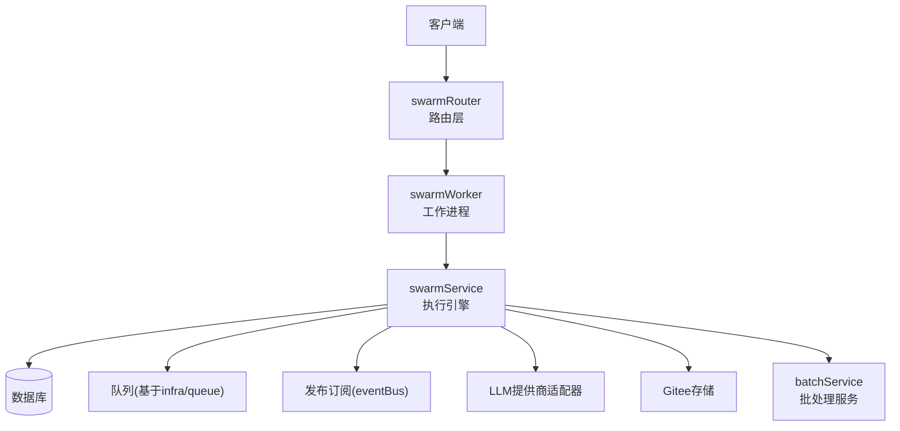
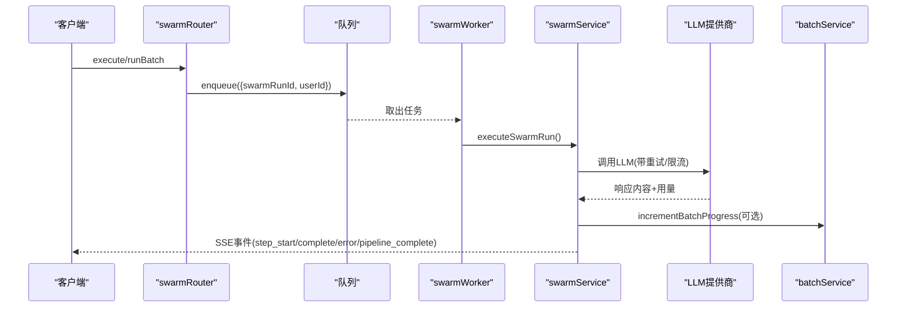
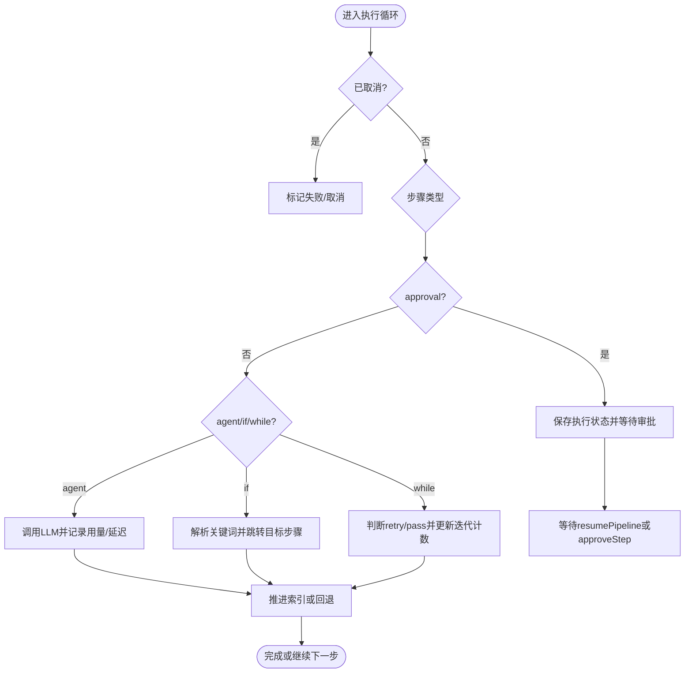
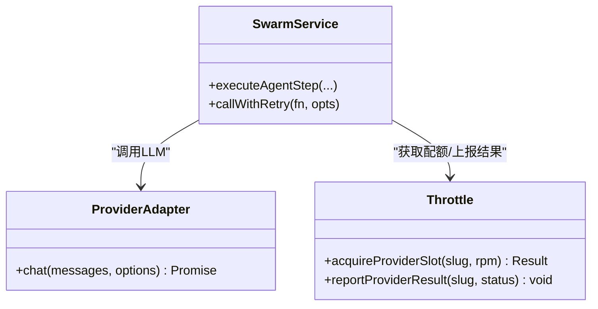
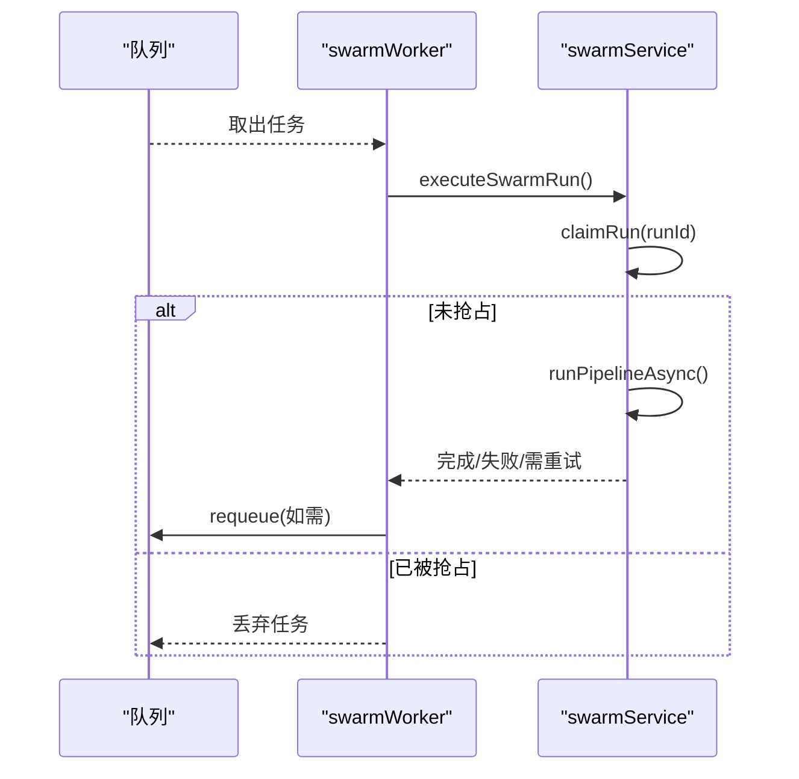
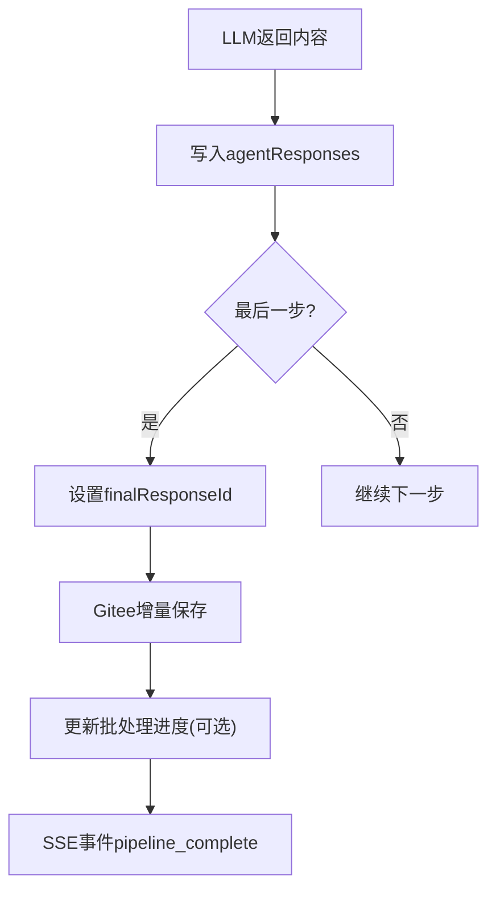
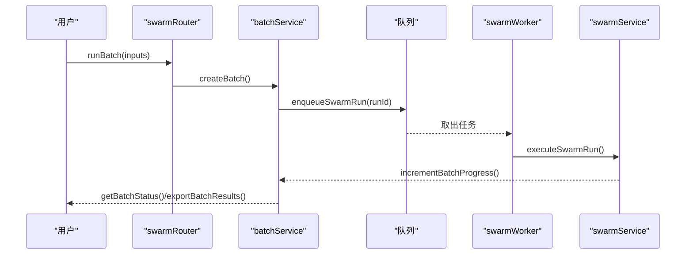
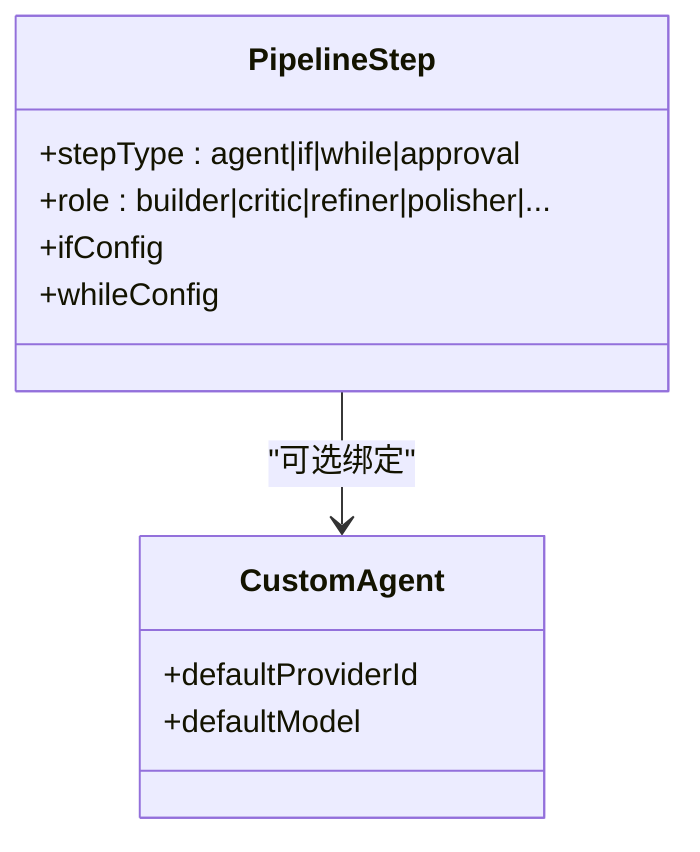
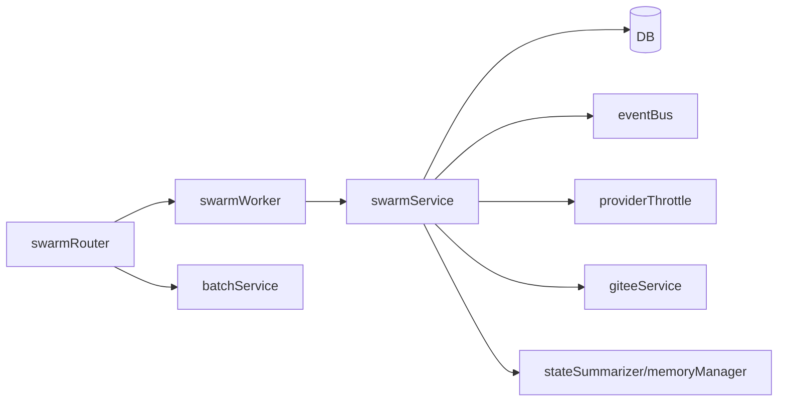

# 蜂群服务

<cite>
**本文引用的文件**
- [api/services/swarmService.ts](file://api/services/swarmService.ts)
- [api/workers/swarmWorker.ts](file://api/workers/swarmWorker.ts)
- [api/routers/swarm.ts](file://api/routers/swarm.ts)
- [api/services/batchService.ts](file://api/services/batchService.ts)
- [api/lib/providerThrottle.ts](file://api/lib/providerThrottle.ts)
- [api/infra/queue.ts](file://api/infra/queue.ts)
- [api/infra/pubsub.ts](file://api/infra/pubsub.ts)
- [api/services/eventBus.ts](file://api/services/eventBus.ts)
</cite>

## 目录
1. [简介](#简介)
2. [项目结构](#项目结构)
3. [核心组件](#核心组件)
4. [架构总览](#架构总览)
5. [详细组件分析](#详细组件分析)
6. [依赖关系分析](#依赖关系分析)
7. [性能与并发特性](#性能与并发特性)
8. [故障排查指南](#故障排查指南)
9. [结论](#结论)
10. [附录：执行流程示例](#附录：执行流程示例)

## 简介
本文件面向DeeWaanAI蜂群服务的多代理协作执行框架，系统性说明代理调度、负载均衡与结果聚合机制；详述SwarmRunParams参数定义、代理选择策略、并行执行控制与结果合并；解释蜂群服务与批处理服务的集成（任务分发、状态同步、错误处理）；并提供端到端的执行流程示例（代理配置、执行监控、结果分析），以及扩展机制以支持自定义代理类型和执行策略。

## 项目结构
蜂群服务由“路由层—服务层—工作进程—基础设施”四层组成：
- 路由层：接收请求、鉴权、入队、SSE事件流返回
- 服务层：编排执行循环、状态机、LLM调用、Gitee持久化、批处理进度更新
- 工作进程：消费队列，执行executeSwarmRun，支持重试与去重
- 基础设施：队列、Redis、发布订阅、限流、加密等

图表来源
- [api/routers/swarm.ts:109-199](file://api/routers/swarm.ts#L109-L199)
- [api/workers/swarmWorker.ts:24-59](file://api/workers/swarmWorker.ts#L24-L59)
- [api/services/swarmService.ts:1284-1392](file://api/services/swarmService.ts#L1284-L1392)
- [api/services/batchService.ts:45-105](file://api/services/batchService.ts#L45-L105)

章节来源
- [api/routers/swarm.ts:1-655](file://api/routers/swarm.ts#L1-L655)
- [api/workers/swarmWorker.ts:1-75](file://api/workers/swarmWorker.ts#L1-L75)
- [api/services/swarmService.ts:1-1741](file://api/services/swarmService.ts#L1-L1741)
- [api/services/batchService.ts:1-321](file://api/services/batchService.ts#L1-L321)

## 核心组件
- SwarmRunParams：描述一次蜂群执行的上下文与参数，包括来源、提示词、Gitee令牌、记忆模式、附件、是否包含项目文件、测试运行、自动审批、追踪ID、批处理ID、链式调用等。
- 执行引擎：runExecutionLoop驱动步骤顺序、IF/WHILE分支、审批暂停、全局访问计数保护、电路断路器、令牌/延迟统计、Gitee增量保存。
- 工作进程：swarmWorker负责从队列取任务、去重、重试、健康检查。
- 批处理服务：批量创建、进度更新、取消/恢复、导出CSV。
- 提供商限流：按RPM窗口自适应限速，避免触发上游限制。
- 事件总线：SSE事件回放与跨实例广播。

章节来源
- [api/services/swarmService.ts:64-83](file://api/services/swarmService.ts#L64-L83)
- [api/services/swarmService.ts:568-855](file://api/services/swarmService.ts#L568-L855)
- [api/workers/swarmWorker.ts:24-59](file://api/workers/swarmWorker.ts#L24-L59)
- [api/services/batchService.ts:45-142](file://api/services/batchService.ts#L45-L142)
- [api/lib/providerThrottle.ts:168-199](file://api/lib/providerThrottle.ts#L168-L199)
- [api/services/eventBus.ts:35-61](file://api/services/eventBus.ts#L35-L61)

## 架构总览
蜂群执行采用“请求即入队、异步执行、状态可恢复”的架构：
- 路由层只做校验与入队，不阻塞HTTP请求
- 工作进程在后台执行，支持崩溃恢复（executionState持久化）
- 执行过程通过事件总线推送SSE事件，前端实时展示
- 批处理服务将多个run聚合为批次，统一跟踪完成度与资源消耗

图表来源
- [api/routers/swarm.ts:109-199](file://api/routers/swarm.ts#L109-L199)
- [api/workers/swarmWorker.ts:24-59](file://api/workers/swarmWorker.ts#L24-L59)
- [api/services/swarmService.ts:1284-1392](file://api/services/swarmService.ts#L1284-L1392)
- [api/services/batchService.ts:107-142](file://api/services/batchService.ts#L107-L142)

## 详细组件分析

### 执行框架与状态机
- 执行循环：遍历pipeline步骤，支持agent/if/while/approval四类步骤
- 审批暂停：遇到approval步骤时挂起，等待approveStep再恢复
- 循环保护：visitCounts防止单步无限访问；while有最大迭代次数硬限制
- 上下文构建：根据角色与反馈动态构造prompt，注入质量反馈与历史评估
- 结果聚合：chain记录每一步输出，最终输出作为finalResponse并写入DB

图表来源
- [api/services/swarmService.ts:568-855](file://api/services/swarmService.ts#L568-L855)

章节来源
- [api/services/swarmService.ts:568-855](file://api/services/swarmService.ts#L568-L855)

### 代理选择策略与提供商适配
- 优先使用步骤配置的provider/model，否则回退到项目默认，再回退到用户默认
- 若团队共享流水线引用了他人provider，会尝试匹配当前用户可用provider
- 每次调用前通过acquireProviderSlot进行RPM窗口限流，失败则抛出ProviderThrottledError并重新排队
- 成功调用后reportProviderResult用于自适应调整RPM

图表来源
- [api/services/swarmService.ts:356-530](file://api/services/swarmService.ts#L356-L530)
- [api/lib/providerThrottle.ts:168-199](file://api/lib/providerThrottle.ts#L168-L199)

章节来源
- [api/services/swarmService.ts:356-530](file://api/services/swarmService.ts#L356-L530)
- [api/lib/providerThrottle.ts:168-199](file://api/lib/providerThrottle.ts#L168-L199)

### 并行执行控制与负载均衡
- 队列并发：swarmWorker基于队列实现多节点并发执行，支持Redis或内存队列
- 任务去重：idempotencyKey确保同一run不会重复执行
- 抢占锁：claimRun通过Redis或本地Map保证同一run仅被一个worker执行
- 重试与退避：ProviderThrottledError/RunThrottledError触发requeue，指数退避
- 批处理并发：createBatch为每个输入创建run并立即入队，天然并发

图表来源
- [api/workers/swarmWorker.ts:24-59](file://api/workers/swarmWorker.ts#L24-L59)
- [api/services/swarmService.ts:1143-1174](file://api/services/swarmService.ts#L1143-L1174)
- [api/services/swarmService.ts:1284-1392](file://api/services/swarmService.ts#L1284-L1392)

章节来源
- [api/workers/swarmWorker.ts:24-59](file://api/workers/swarmWorker.ts#L24-L59)
- [api/services/swarmService.ts:1143-1174](file://api/services/swarmService.ts#L1143-L1174)
- [api/services/swarmService.ts:1284-1392](file://api/services/swarmService.ts#L1284-L1392)

### 结果聚合与持久化
- 每步输出写入agentResponses，metadata包含模型、提供商、用量、延迟、角色等
- 最终输出作为finalResponseId关联到swarmRuns
- Gitee增量保存：每步完成后生成Markdown片段，最终保存state.md与memory/episodes.json
- 批处理进度：incrementBatchProgress原子更新completed/failed/tokens，并在全部结束时标记批次状态

图表来源
- [api/services/swarmService.ts:486-530](file://api/services/swarmService.ts#L486-L530)
- [api/services/swarmService.ts:880-910](file://api/services/swarmService.ts#L880-L910)
- [api/services/batchService.ts:107-142](file://api/services/batchService.ts#L107-L142)

章节来源
- [api/services/swarmService.ts:486-530](file://api/services/swarmService.ts#L486-L530)
- [api/services/swarmService.ts:880-910](file://api/services/swarmService.ts#L880-L910)
- [api/services/batchService.ts:107-142](file://api/services/batchService.ts#L107-L142)

### 与批处理服务的集成
- 任务分发：runBatch为每个输入创建swarm_runs并enqueueSwarmRun
- 状态同步：每个run完成后调用incrementBatchProgress累计完成/失败/用量
- 错误处理：余额不足/额度耗尽导致批次暂停，通知用户充值后可恢复
- 恢复与取消：resumeBatch重新入队非终态成员；cancelBatch批量标记取消

图表来源
- [api/routers/swarm.ts:569-602](file://api/routers/swarm.ts#L569-L602)
- [api/services/batchService.ts:45-105](file://api/services/batchService.ts#L45-L105)
- [api/services/batchService.ts:107-142](file://api/services/batchService.ts#L107-L142)

章节来源
- [api/routers/swarm.ts:569-602](file://api/routers/swarm.ts#L569-L602)
- [api/services/batchService.ts:45-142](file://api/services/batchService.ts#L45-L142)

### 扩展机制：自定义代理与执行策略
- 自定义步骤：pipelineSteps支持stepType=agent/if/while/approval，role决定系统提示与行为
- 自定义代理：customAgents可绑定provider/model，loadPipelineSteps会合并默认值
- 执行策略：通过ifConfig/whileConfig实现条件分支与循环；approval步骤支持人机协同
- 链式调用：handlePipelineChain支持将上一个run的最终响应作为下一个项目的输入模板

图表来源
- [api/services/swarmService.ts:227-241](file://api/services/swarmService.ts#L227-L241)
- [api/services/swarmService.ts:287-353](file://api/services/swarmService.ts#L287-L353)
- [api/services/swarmService.ts:1175-1268](file://api/services/swarmService.ts#L1175-L1268)

章节来源
- [api/services/swarmService.ts:227-353](file://api/services/swarmService.ts#L227-L353)
- [api/services/swarmService.ts:1175-1268](file://api/services/swarmService.ts#L1175-L1268)

## 依赖关系分析
- 路由层依赖：zod校验、权限检查、rate limiter、队列、批处理服务
- 服务层依赖：数据库ORM、事件总线、加密服务、提供商适配器、Gitee服务、状态摘要器、记忆管理器
- 工作进程依赖：队列抽象、日志、服务入口
- 批处理服务依赖：队列、数据库、服务层接口

图表来源
- [api/routers/swarm.ts:1-655](file://api/routers/swarm.ts#L1-L655)
- [api/services/swarmService.ts:13-61](file://api/services/swarmService.ts#L13-L61)
- [api/services/batchService.ts:7-12](file://api/services/batchService.ts#L7-L12)

章节来源
- [api/routers/swarm.ts:1-655](file://api/routers/swarm.ts#L1-L655)
- [api/services/swarmService.ts:13-61](file://api/services/swarmService.ts#L13-L61)
- [api/services/batchService.ts:7-12](file://api/services/batchService.ts#L7-L12)

## 性能与并发特性
- 并发默认：队列驱动的多worker并发执行，支持Redis多节点
- 限流与自适应：按提供商RPM窗口自适应降速，遇限流指数退避并重试
- 防抖与幂等：队列idempotencyKey避免重复执行；claimRun防止重复抢占
- 资源统计：每步记录tokens与延迟，最终汇总至swarmRuns
- 批处理吞吐：批量入队天然并发，原子更新进度，避免竞态

[本节提供通用指导，无需特定文件引用]

## 故障排查指南
- 运行被抢占：检查claimRun是否成功，确认Redis或本地Map状态
- 提供商限流：查看ProviderThrottledError与retryAfterMs，必要时降低并发或等待窗口重置
- 余额不足：CreditExhaustedError会导致批次暂停，需充值后resumeBatch
- 审批卡住：确认executionState.pendingApproval是否存在，调用approveStep后再执行
- 队列堆积：检查swarmWorker是否启动，队列后端是否可用
- 事件丢失：SSE回放依赖eventBus缓冲，确认通道订阅与清理逻辑

章节来源
- [api/services/swarmService.ts:1143-1174](file://api/services/swarmService.ts#L1143-L1174)
- [api/services/swarmService.ts:176-214](file://api/services/swarmService.ts#L176-L214)
- [api/services/swarmService.ts:1082-1140](file://api/services/swarmService.ts#L1082-L1140)
- [api/services/eventBus.ts:35-61](file://api/services/eventBus.ts#L35-L61)

## 结论
DeeWaanAI蜂群服务通过“路由入队—工作进程执行—服务编排—事件总线反馈”的架构，实现了高可靠、可恢复、可扩展的多代理协作执行。其核心优势在于：
- 明确的执行状态机与审批点，支持复杂质量控制
- 细粒度的提供商限流与自适应调优，提升稳定性
- 批处理集成简化大规模任务管理
- 灵活的pipeline与自定义代理，便于业务扩展

[本节总结性内容，无需特定文件引用]

## 附录：执行流程示例
以下示例展示从发起执行到结果分析的完整流程（路径引用而非代码片段）：
- 发起执行：准备SwarmRunParams并调用execute，路由层校验后入队
  - 参考：[api/routers/swarm.ts:109-199](file://api/routers/swarm.ts#L109-L199)
- 工作进程执行：swarmWorker取出任务，调用executeSwarmRun
  - 参考：[api/workers/swarmWorker.ts:24-59](file://api/workers/swarmWorker.ts#L24-L59)
  - 参考：[api/services/swarmService.ts:1284-1392](file://api/services/swarmService.ts#L1284-L1392)
- 代理执行与监控：runExecutionLoop驱动步骤，SSE事件推送step_start/complete/error
  - 参考：[api/services/swarmService.ts:568-855](file://api/services/swarmService.ts#L568-L855)
  - 参考：[api/services/eventBus.ts:35-61](file://api/services/eventBus.ts#L35-L61)
- 结果聚合与持久化：写入agentResponses，最终输出关联finalResponseId，Gitee保存
  - 参考：[api/services/swarmService.ts:486-530](file://api/services/swarmService.ts#L486-L530)
  - 参考：[api/services/swarmService.ts:880-910](file://api/services/swarmService.ts#L880-L910)
- 批处理集成：创建批次、入队、进度更新、导出CSV
  - 参考：[api/routers/swarm.ts:569-602](file://api/routers/swarm.ts#L569-L602)
  - 参考：[api/services/batchService.ts:45-105](file://api/services/batchService.ts#L45-L105)
  - 参考：[api/services/batchService.ts:275-321](file://api/services/batchService.ts#L275-L321)

章节来源
- [api/routers/swarm.ts:109-199](file://api/routers/swarm.ts#L109-L199)
- [api/workers/swarmWorker.ts:24-59](file://api/workers/swarmWorker.ts#L24-L59)
- [api/services/swarmService.ts:568-855](file://api/services/swarmService.ts#L568-L855)
- [api/services/swarmService.ts:486-530](file://api/services/swarmService.ts#L486-L530)
- [api/services/swarmService.ts:880-910](file://api/services/swarmService.ts#L880-L910)
- [api/routers/swarm.ts:569-602](file://api/routers/swarm.ts#L569-L602)
- [api/services/batchService.ts:45-105](file://api/services/batchService.ts#L45-L105)
- [api/services/batchService.ts:275-321](file://api/services/batchService.ts#L275-L321)