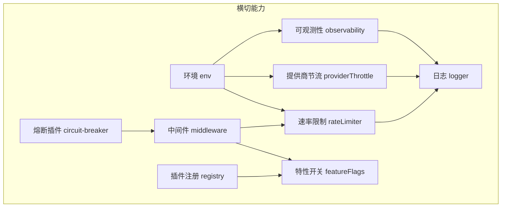
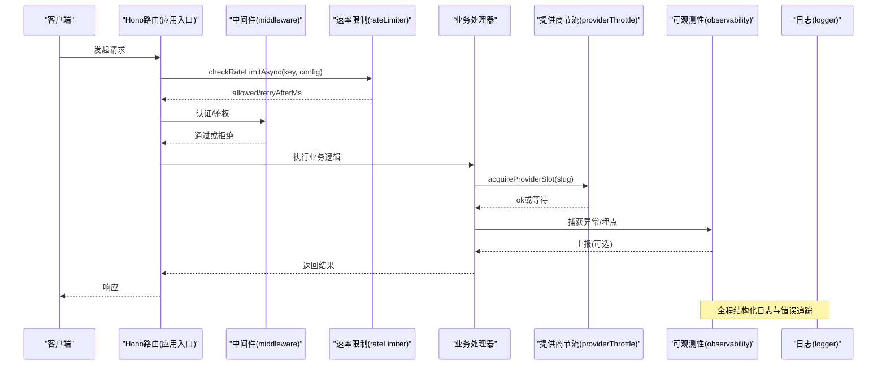
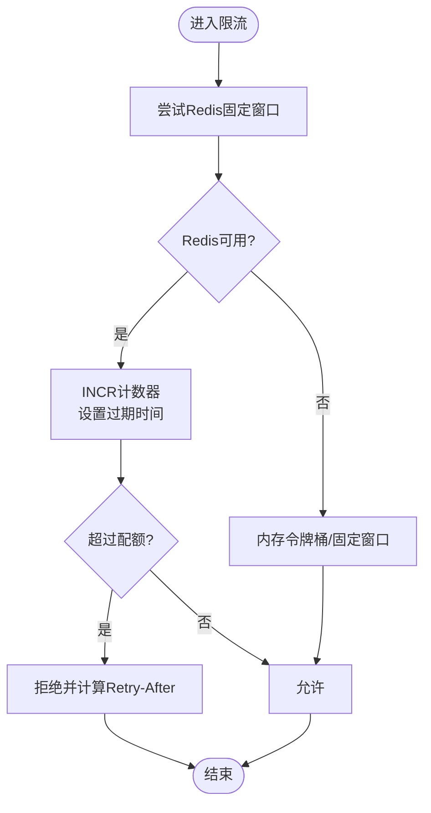
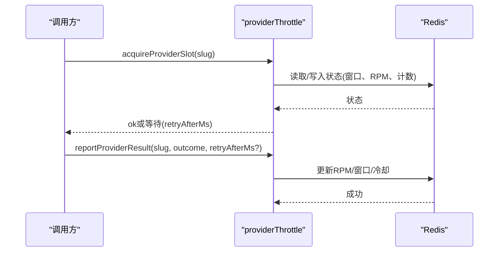
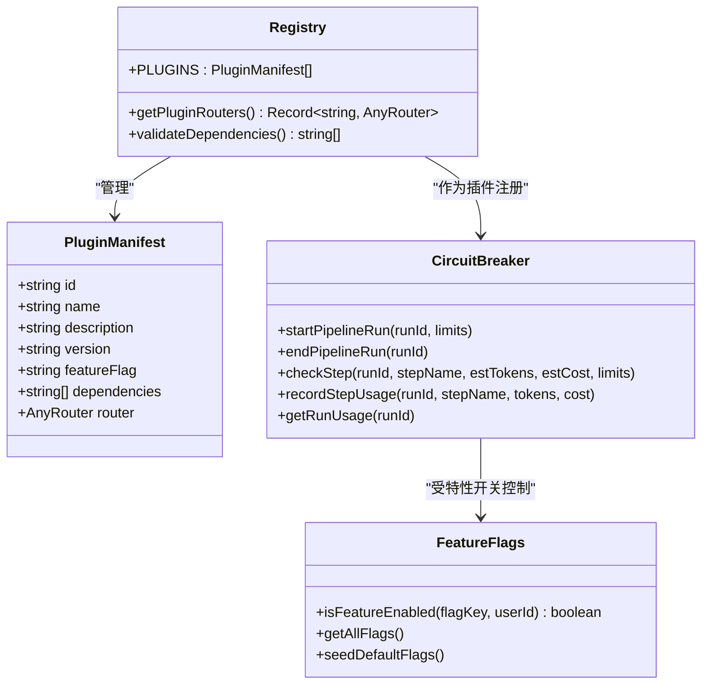
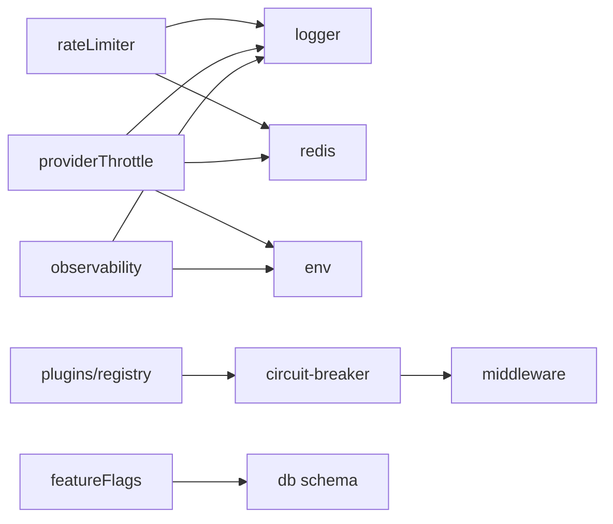

# 横切关注点组件关系

<cite>
**本文引用的文件**
- [api/lib/logger.ts](file://api/lib/logger.ts)
- [api/lib/rateLimiter.ts](file://api/lib/rateLimiter.ts)
- [api/lib/providerThrottle.ts](file://api/lib/providerThrottle.ts)
- [api/lib/observability.ts](file://api/lib/observability.ts)
- [api/plugins/registry.ts](file://api/plugins/registry.ts)
- [api/plugins/circuit-breaker/index.ts](file://api/plugins/circuit-breaker/index.ts)
- [api/plugins/featureFlags.ts](file://api/plugins/featureFlags.ts)
- [api/middleware.ts](file://api/middleware.ts)
- [api/lib/env.ts](file://api/lib/env.ts)
</cite>

## 目录
1. [简介](#简介)
2. [项目结构](#项目结构)
3. [核心组件](#核心组件)
4. [架构总览](#架构总览)
5. [详细组件分析](#详细组件分析)
6. [依赖分析](#依赖分析)
7. [性能考虑](#性能考虑)
8. [故障排查指南](#故障排查指南)
9. [结论](#结论)
10. [附录：扩展与自定义示例](#附录扩展与自定义示例)

## 简介
本文件聚焦DeeWaanAI系统的横切关注点（日志记录、速率限制、提供商节流、插件系统、可观测性）及其在各组件中的集成方式。重点说明：
- 中间件与装饰器模式如何为业务组件注入横切能力
- 配置项与环境变量如何驱动行为
- 性能监控、错误追踪与安全检查的实现机制
- 如何扩展与自定义这些横切功能

## 项目结构
横切关注点主要分布在以下模块：
- 日志与可观测性：logger、observability
- 速率限制：rateLimiter（含按客户分层的固定窗口限流）
- 提供商节流：providerThrottle（AIMD自适应限速）
- 插件系统：plugins/registry、circuit-breaker、featureFlags
- 中间件：middleware（认证、鉴权，限流在Hono路由层）
- 环境配置：env（集中管理环境变量与校验）

图表来源
- [api/lib/logger.ts:1-32](file://api/lib/logger.ts#L1-L32)
- [api/lib/observability.ts:1-34](file://api/lib/observability.ts#L1-L34)
- [api/lib/rateLimiter.ts:1-216](file://api/lib/rateLimiter.ts#L1-L216)
- [api/lib/providerThrottle.ts:1-275](file://api/lib/providerThrottle.ts#L1-L275)
- [api/plugins/registry.ts:1-70](file://api/plugins/registry.ts#L1-L70)
- [api/plugins/circuit-breaker/index.ts:1-186](file://api/plugins/circuit-breaker/index.ts#L1-L186)
- [api/plugins/featureFlags.ts:1-119](file://api/plugins/featureFlags.ts#L1-L119)
- [api/middleware.ts:1-51](file://api/middleware.ts#L1-L51)
- [api/lib/env.ts:1-105](file://api/lib/env.ts#L1-L105)

章节来源
- [api/lib/logger.ts:1-32](file://api/lib/logger.ts#L1-L32)
- [api/lib/rateLimiter.ts:1-216](file://api/lib/rateLimiter.ts#L1-L216)
- [api/lib/providerThrottle.ts:1-275](file://api/lib/providerThrottle.ts#L1-L275)
- [api/lib/observability.ts:1-34](file://api/lib/observability.ts#L1-L34)
- [api/plugins/registry.ts:1-70](file://api/plugins/registry.ts#L1-L70)
- [api/plugins/circuit-breaker/index.ts:1-186](file://api/plugins/circuit-breaker/index.ts#L1-L186)
- [api/plugins/featureFlags.ts:1-119](file://api/plugins/featureFlags.ts#L1-L119)
- [api/middleware.ts:1-51](file://api/middleware.ts#L1-L51)
- [api/lib/env.ts:1-105](file://api/lib/env.ts#L1-L105)

## 核心组件
- 日志记录：结构化JSON日志，支持级别过滤与请求ID生成，统一输出到控制台。
- 速率限制：内存令牌桶 + Redis固定窗口双实现；提供按角色/场景的预置策略与“按客户分层”的固定窗口限流。
- 提供商节流：基于AIMD算法自适应调整RPM，状态持久化至Redis并具备内存降级。
- 插件系统：以清单形式注册插件，支持依赖校验、路由聚合与特性开关控制。
- 可观测性：Sentry初始化封装，失败不抛错，确保不影响服务可用性。
- 中间件：tRPC认证与角色鉴权；注释明确限流在Hono路由层处理。
- 环境配置：集中读取与校验环境变量，包含安全校验与可选基础设施开关。

章节来源
- [api/lib/logger.ts:1-32](file://api/lib/logger.ts#L1-L32)
- [api/lib/rateLimiter.ts:1-216](file://api/lib/rateLimiter.ts#L1-L216)
- [api/lib/providerThrottle.ts:1-275](file://api/lib/providerThrottle.ts#L1-L275)
- [api/plugins/registry.ts:1-70](file://api/plugins/registry.ts#L1-L70)
- [api/lib/observability.ts:1-34](file://api/lib/observability.ts#L1-L34)
- [api/middleware.ts:1-51](file://api/middleware.ts#L1-L51)
- [api/lib/env.ts:1-105](file://api/lib/env.ts#L1-L105)

## 架构总览
横切能力通过“中间件/装饰器 + 工具库 + 插件”的方式被各组件复用：
- 中间件负责认证与鉴权，限流在Hono路由层调用rateLimiter。
- 插件通过特性开关决定是否启用，并在执行前进行安全检查（如熔断插件）。
- 可观测性与日志贯穿全链路，Sentry按需加载且失败不中断。
- 提供商节流在外部调用前申请配额，调用后上报结果以自适应调整。

图表来源
- [api/lib/rateLimiter.ts:31-93](file://api/lib/rateLimiter.ts#L31-L93)
- [api/middleware.ts:17-50](file://api/middleware.ts#L17-L50)
- [api/lib/providerThrottle.ts:168-199](file://api/lib/providerThrottle.ts#L168-L199)
- [api/lib/observability.ts:16-33](file://api/lib/observability.ts#L16-L33)
- [api/lib/logger.ts:12-31](file://api/lib/logger.ts#L12-L31)

## 详细组件分析

### 日志记录（logger）
- 设计要点
  - 结构化JSON输出，支持debug/info/warn/error四级
  - 通过环境变量控制日志级别
  - 提供请求ID生成器，便于链路追踪
- 使用方式
  - 其他模块直接导入logger实例，调用info/warn/error等
  - 错误路径建议附带上下文数据以便定位问题
- 性能影响
  - JSON序列化开销较小；生产环境建议仅开启必要级别
- 可扩展性
  - 可通过包装logger增加字段（如租户、用户ID）

章节来源
- [api/lib/logger.ts:1-32](file://api/lib/logger.ts#L1-L32)

### 速率限制（rateLimiter）
- 设计要点
  - 内存令牌桶：单进程内快速判断，适合单机
  - Redis固定窗口：多节点共享预算，失败自动降级到内存
  - 预置策略：auth/execute/batch/read/screenshotUpload/screenshotServe
  - 按客户分层：solo/team/admin三种配额，固定窗口计数
- 使用方式
  - 同步checkRateLimit用于简单场景
  - 异步checkRateLimitAsync/checkCustomerRateLimit用于生产
- 性能影响
  - Redis路径有网络开销；无Redis时回退内存路径，保证可用性
- 可扩展性
  - 新增RATE_LIMITS条目即可接入新场景
  - 新增CUSTOMER_RATE_LIMITS层级即可扩展配额模型

图表来源
- [api/lib/rateLimiter.ts:64-93](file://api/lib/rateLimiter.ts#L64-L93)
- [api/lib/rateLimiter.ts:168-189](file://api/lib/rateLimiter.ts#L168-L189)
- [api/lib/rateLimiter.ts:198-215](file://api/lib/rateLimiter.ts#L198-L215)

章节来源
- [api/lib/rateLimiter.ts:1-216](file://api/lib/rateLimiter.ts#L1-L216)

### 提供商节流（providerThrottle）
- 设计要点
  - AIMD算法：慢启动+拥塞避免+乘法降速
  - 状态存储：优先Redis哈希，失败回退内存
  - 每60秒窗口推进，根据429信号动态调整RPM
- 使用方式
  - 调用前acquireProviderSlot申请配额
  - 调用后reportProviderResult上报结果（ok或rate_limited），可带Retry-After
- 性能影响
  - 窗口推进与状态读写在Redis中完成，内存降级不影响正确性
- 可扩展性
  - 通过环境变量PROVIDER_THROTTLE为不同slug配置init/floor/ceiling

图表来源
- [api/lib/providerThrottle.ts:88-133](file://api/lib/providerThrottle.ts#L88-L133)
- [api/lib/providerThrottle.ts:168-199](file://api/lib/providerThrottle.ts#L168-L199)
- [api/lib/providerThrottle.ts:207-235](file://api/lib/providerThrottle.ts#L207-L235)

章节来源
- [api/lib/providerThrottle.ts:1-275](file://api/lib/providerThrottle.ts#L1-L275)

### 插件系统（registry + circuit-breaker + featureFlags）
- 设计要点
  - 插件清单：id/name/description/version/featureFlag/router/dependencies
  - 依赖校验：启动时检查依赖是否满足
  - 路由聚合：getPluginRouters汇总插件路由
  - 特性开关：isFeatureEnabled支持全局启用、按比例灰度、白名单用户
  - 熔断插件：在流水线步骤执行前检查token/花费/超时/循环次数上限
- 使用方式
  - 在PLUGINS数组注册新插件
  - 通过特性开关控制插件生效范围
  - 熔断插件在流水线执行前后分别start/end与checkStep/recordStepUsage
- 可扩展性
  - 新增插件只需遵循PluginManifest约定并注册
  - 通过featureFlags实现细粒度灰度

图表来源
- [api/plugins/registry.ts:19-70](file://api/plugins/registry.ts#L19-L70)
- [api/plugins/circuit-breaker/index.ts:44-143](file://api/plugins/circuit-breaker/index.ts#L44-L143)
- [api/plugins/featureFlags.ts:27-81](file://api/plugins/featureFlags.ts#L27-L81)

章节来源
- [api/plugins/registry.ts:1-70](file://api/plugins/registry.ts#L1-L70)
- [api/plugins/circuit-breaker/index.ts:1-186](file://api/plugins/circuit-breaker/index.ts#L1-L186)
- [api/plugins/featureFlags.ts:1-119](file://api/plugins/featureFlags.ts#L1-L119)

### 中间件（middleware）
- 设计要点
  - tRPC中间件提供认证与角色鉴权
  - 注释明确：速率限制在Hono路由层处理，不在tRPC中间件中
- 使用方式
  - 使用authedQuery/adminQuery组合保护需要认证的接口
- 可扩展性
  - 可按需添加新的中间件（如审计、计费前置）

章节来源
- [api/middleware.ts:1-51](file://api/middleware.ts#L1-L51)

### 可观测性（observability）
- 设计要点
  - Sentry仅在配置DSN时加载，失败不抛错
  - 区分production/development环境
- 使用方式
  - 启动时调用initObservability进行初始化
- 性能影响
  - 按需加载，避免未配置时的额外开销

章节来源
- [api/lib/observability.ts:1-34](file://api/lib/observability.ts#L1-L34)

### 环境配置（env）
- 设计要点
  - 集中读取环境变量，生产环境缺失必填项会抛出错误
  - 对敏感字段进行安全校验（防止默认值泄露）
  - 提供可选基础设施开关（Redis、Stripe、S3、Sentry等）
- 使用方式
  - 其他模块通过env访问配置
- 可扩展性
  - 新增配置项时补充required/可选字段与校验逻辑

章节来源
- [api/lib/env.ts:1-105](file://api/lib/env.ts#L1-L105)

## 依赖分析
横切能力的耦合关系如下：
- rateLimiter依赖logger与redis（infra/redis）
- providerThrottle依赖logger、env与redis
- observability依赖env与logger
- plugins/registry依赖插件实现与tRPC类型
- circuit-breaker依赖middleware暴露的createRouter/authedQuery/adminQuery
- featureFlags依赖数据库连接与schema
- middleware依赖contracts常量与tRPC

图表来源
- [api/lib/rateLimiter.ts:1-3](file://api/lib/rateLimiter.ts#L1-L3)
- [api/lib/providerThrottle.ts:13-15](file://api/lib/providerThrottle.ts#L13-L15)
- [api/lib/observability.ts:8-9](file://api/lib/observability.ts#L8-L9)
- [api/plugins/registry.ts:33-38](file://api/plugins/registry.ts#L33-L38)
- [api/plugins/circuit-breaker/index.ts:19-21](file://api/plugins/circuit-breaker/index.ts#L19-L21)
- [api/plugins/featureFlags.ts:18-20](file://api/plugins/featureFlags.ts#L18-L20)

章节来源
- [api/lib/rateLimiter.ts:1-216](file://api/lib/rateLimiter.ts#L1-L216)
- [api/lib/providerThrottle.ts:1-275](file://api/lib/providerThrottle.ts#L1-L275)
- [api/lib/observability.ts:1-34](file://api/lib/observability.ts#L1-L34)
- [api/plugins/registry.ts:1-70](file://api/plugins/registry.ts#L1-L70)
- [api/plugins/circuit-breaker/index.ts:1-186](file://api/plugins/circuit-breaker/index.ts#L1-L186)
- [api/plugins/featureFlags.ts:1-119](file://api/plugins/featureFlags.ts#L1-L119)

## 性能考虑
- 速率限制
  - 优先使用Redis固定窗口以获得跨节点一致性；无Redis时自动降级到内存路径
  - 预置策略覆盖常见场景，减少重复配置
- 提供商节流
  - AIMD算法在429信号下快速降速，避免雪崩；窗口推进时再增加RPM
  - 状态落盘Redis，内存降级保证可用性
- 可观测性
  - Sentry按需加载，失败不中断服务；生产环境区分环境标签
- 日志
  - 结构化JSON便于采集与分析；生产建议调高日志级别降低I/O压力
- 插件
  - 特性开关控制加载范围，减少不必要的路由与逻辑开销

[本节为通用指导，不直接分析具体文件]

## 故障排查指南
- 速率限制相关问题
  - 现象：频繁收到限流响应
  - 排查：确认Redis是否可用；检查key与window配置；查看降级日志
  - 参考：[api/lib/rateLimiter.ts:86-93](file://api/lib/rateLimiter.ts#L86-L93)
- 提供商节流相关问题
  - 现象：RPM持续下降或无法恢复
  - 排查：确认reportProviderResult是否正确上报；检查retryAfterMs与窗口推进
  - 参考：[api/lib/providerThrottle.ts:207-235](file://api/lib/providerThrottle.ts#L207-L235)
- 可观测性问题
  - 现象：未收到错误报告
  - 排查：确认SENTRY_DSN是否配置；观察初始化警告日志
  - 参考：[api/lib/observability.ts:16-33](file://api/lib/observability.ts#L16-L33)
- 插件相关问题
  - 现象：插件未生效
  - 排查：检查特性开关配置；验证依赖是否满足；查看PLUGINS注册
  - 参考：[api/plugins/registry.ts:55-69](file://api/plugins/registry.ts#L55-L69)、[api/plugins/featureFlags.ts:51-73](file://api/plugins/featureFlags.ts#L51-L73)
- 安全问题
  - 现象：生产环境启动失败
  - 排查：检查APP_SECRET等敏感变量是否为开发默认值
  - 参考：[api/lib/env.ts:11-19](file://api/lib/env.ts#L11-L19)

章节来源
- [api/lib/rateLimiter.ts:86-93](file://api/lib/rateLimiter.ts#L86-L93)
- [api/lib/providerThrottle.ts:207-235](file://api/lib/providerThrottle.ts#L207-L235)
- [api/lib/observability.ts:16-33](file://api/lib/observability.ts#L16-L33)
- [api/plugins/registry.ts:55-69](file://api/plugins/registry.ts#L55-L69)
- [api/plugins/featureFlags.ts:51-73](file://api/plugins/featureFlags.ts#L51-L73)
- [api/lib/env.ts:11-19](file://api/lib/env.ts#L11-L19)

## 结论
DeeWaanAI通过中间件、工具库与插件体系将横切关注点解耦并标准化：
- 日志与可观测性贯穿全链路，保障可诊断性
- 速率限制与提供商节流提供弹性与稳定性保障
- 插件系统与特性开关实现功能模块化与灰度发布
- 环境配置集中管理与安全校验提升部署可靠性

[本节为总结性内容，不直接分析具体文件]

## 附录：扩展与自定义示例
- 新增速率限制策略
  - 在RATE_LIMITS中添加新条目，并在路由层调用checkRateLimitAsync
  - 参考：[api/lib/rateLimiter.ts:96-103](file://api/lib/rateLimiter.ts#L96-L103)
- 新增按客户分层配额
  - 在CUSTOMER_RATE_LIMITS中定义新tier，并在MCP或服务层解析用户tier后调用checkCustomerRateLimit
  - 参考：[api/lib/rateLimiter.ts:120-124](file://api/lib/rateLimiter.ts#L120-L124)
- 配置提供商节流参数
  - 设置环境变量PROVIDER_THROTTLE为JSON对象，为特定slug配置init/floor/ceiling
  - 参考：[api/lib/providerThrottle.ts:46-64](file://api/lib/providerThrottle.ts#L46-L64)
- 启用/灰度插件功能
  - 在featureFlags表中配置对应key的enabled/rolloutPercent/allowedUserIds
  - 参考：[api/plugins/featureFlags.ts:87-107](file://api/plugins/featureFlags.ts#L87-L107)
- 注册新插件
  - 创建插件目录与manifest，导出PluginManifest并在PLUGINS中注册
  - 参考：[api/plugins/registry.ts:33-38](file://api/plugins/registry.ts#L33-L38)
- 初始化可观测性
  - 在服务启动时调用initObservability，确保SENTRY_DSN已配置
  - 参考：[api/lib/observability.ts:16-33](file://api/lib/observability.ts#L16-L33)

章节来源
- [api/lib/rateLimiter.ts:96-103](file://api/lib/rateLimiter.ts#L96-L103)
- [api/lib/rateLimiter.ts:120-124](file://api/lib/rateLimiter.ts#L120-L124)
- [api/lib/providerThrottle.ts:46-64](file://api/lib/providerThrottle.ts#L46-L64)
- [api/plugins/featureFlags.ts:87-107](file://api/plugins/featureFlags.ts#L87-L107)
- [api/plugins/registry.ts:33-38](file://api/plugins/registry.ts#L33-L38)
- [api/lib/observability.ts:16-33](file://api/lib/observability.ts#L16-L33)