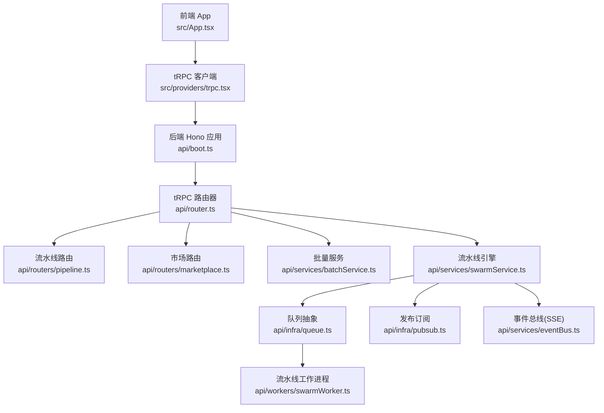
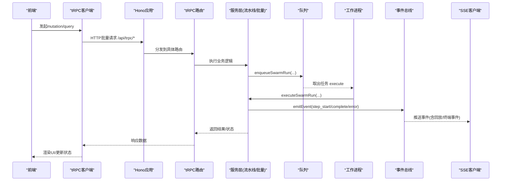
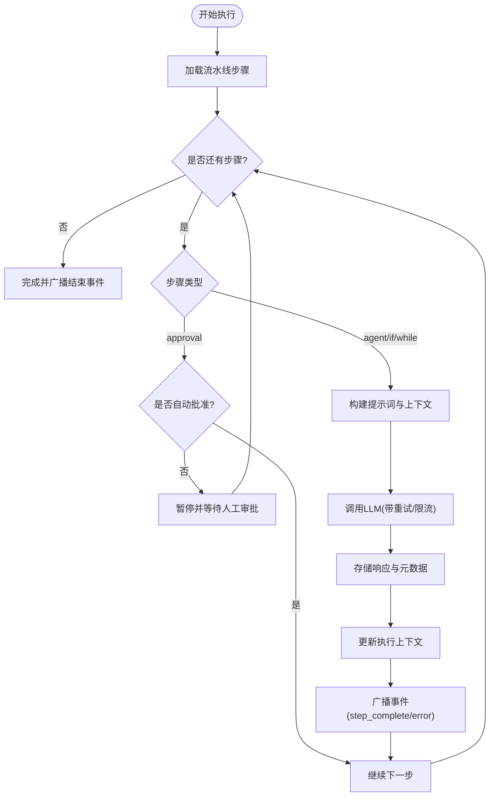
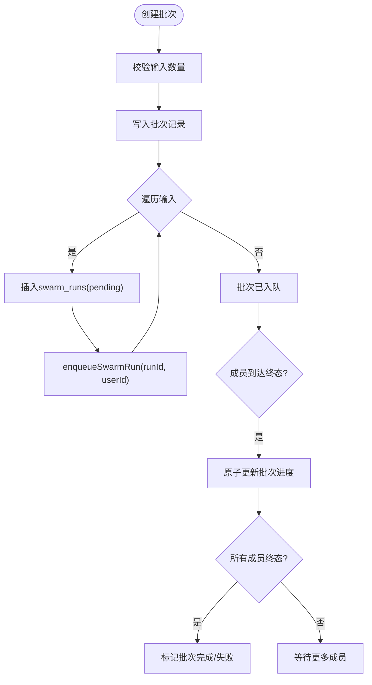
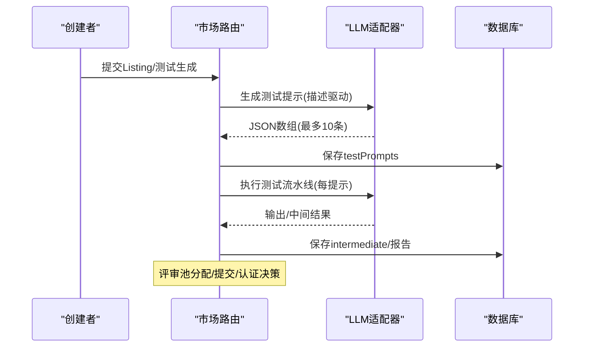
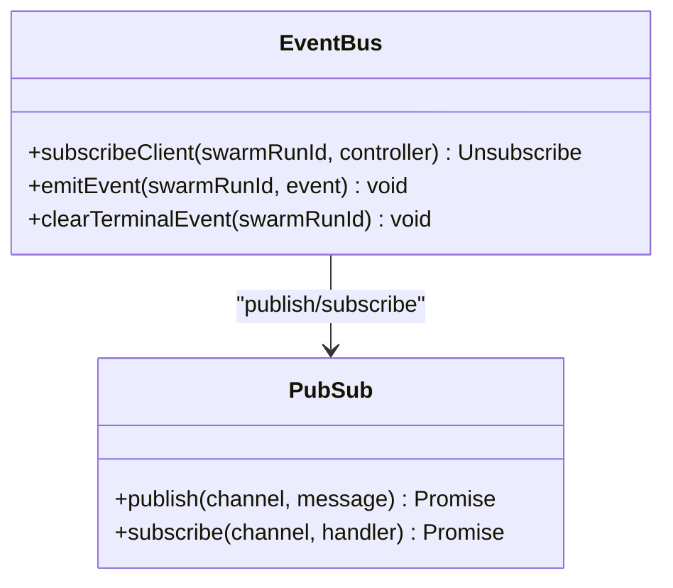
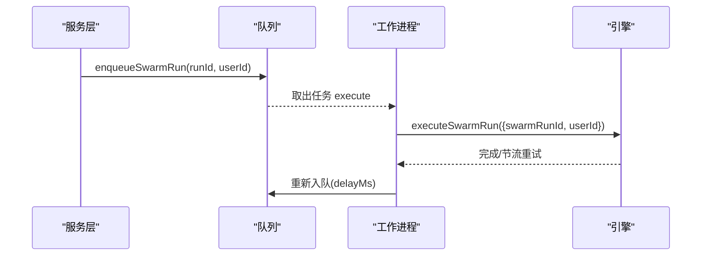
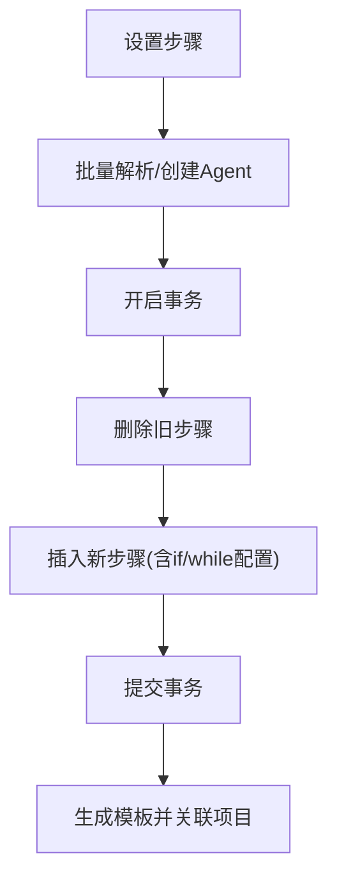
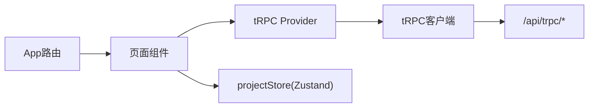
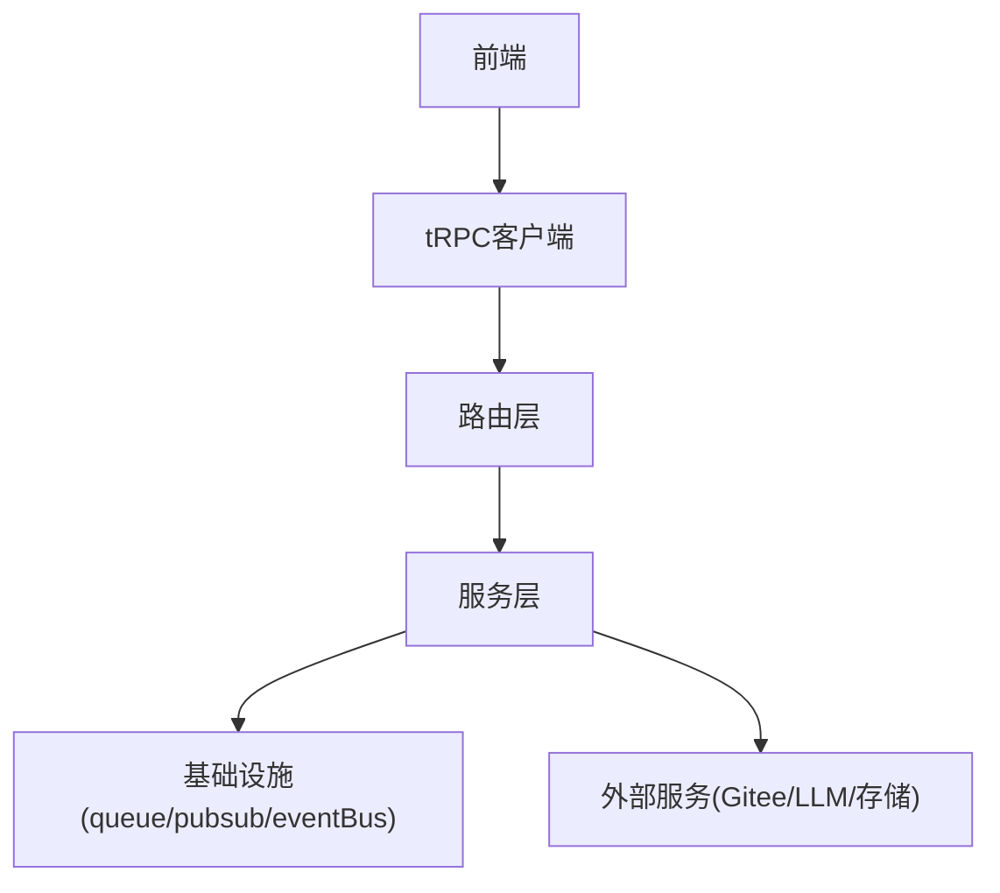

# 组件关系

<cite>
**本文引用的文件**
- [api/router.ts](file://api/router.ts)
- [api/boot.ts](file://api/boot.ts)
- [src/App.tsx](file://src/App.tsx)
- [src/providers/trpc.tsx](file://src/providers/trpc.tsx)
- [api/services/eventBus.ts](file://api/services/eventBus.ts)
- [api/infra/pubsub.ts](file://api/infra/pubsub.ts)
- [api/workers/swarmWorker.ts](file://api/workers/swarmWorker.ts)
- [api/infra/queue.ts](file://api/infra/queue.ts)
- [api/services/batchService.ts](file://api/services/batchService.ts)
- [api/services/pipelineCreationService.ts](file://api/services/pipelineCreationService.ts)
- [api/routers/pipeline.ts](file://api/routers/pipeline.ts)
- [api/routers/marketplace.ts](file://api/routers/marketplace.ts)
- [api/services/swarmService.ts](file://api/services/swarmService.ts)
- [src/stores/projectStore.ts](file://src/stores/projectStore.ts)
</cite>

## 目录
1. [简介](#简介)
2. [项目结构](#项目结构)
3. [核心组件](#核心组件)
4. [架构总览](#架构总览)
5. [详细组件分析](#详细组件分析)
6. [依赖关系分析](#依赖关系分析)
7. [性能考量](#性能考量)
8. [故障排查指南](#故障排查指南)
9. [结论](#结论)
10. [附录](#附录)

## 简介
本文件面向DeeWaanAI系统的组件关系与交互模式，覆盖后端服务层、路由层、前端组件与状态管理之间的依赖关系。重点说明：
- API调用、事件发布订阅与状态同步机制
- 流水线引擎、批量处理器、市场服务等核心业务组件的协作方式
- 组件生命周期管理与资源清理策略
- 组件关系图与依赖注入示例（以代码级引用标注）

## 项目结构
系统采用前后端分离架构：
- 前端：React + tRPC客户端，通过HTTP批量链接调用后端tRPC接口；页面懒加载，提供全局查询缓存与超时控制。
- 后端：Hono应用作为入口，注册健康检查、SSE流式上传、tRPC路由等；tRouter聚合各功能模块路由；服务层封装业务逻辑；队列与消息总线支撑异步执行与跨节点广播。

图表来源
- [api/boot.ts:1-428](file://api/boot.ts#L1-L428)
- [api/router.ts:1-73](file://api/router.ts#L1-L73)
- [src/App.tsx:1-70](file://src/App.tsx#L1-L70)
- [src/providers/trpc.tsx:1-50](file://src/providers/trpc.tsx#L1-L50)
- [api/routers/pipeline.ts:1-327](file://api/routers/pipeline.ts#L1-L327)
- [api/routers/marketplace.ts:1-800](file://api/routers/marketplace.ts#L1-L800)
- [api/services/batchService.ts:1-321](file://api/services/batchService.ts#L1-L321)
- [api/services/swarmService.ts:1-800](file://api/services/swarmService.ts#L1-L800)
- [api/infra/queue.ts:1-334](file://api/infra/queue.ts#L1-L334)
- [api/infra/pubsub.ts:1-154](file://api/infra/pubsub.ts#L1-L154)
- [api/services/eventBus.ts:1-193](file://api/services/eventBus.ts#L1-L193)
- [api/workers/swarmWorker.ts:1-75](file://api/workers/swarmWorker.ts#L1-L75)

章节来源
- [api/boot.ts:1-428](file://api/boot.ts#L1-L428)
- [api/router.ts:1-73](file://api/router.ts#L1-L73)
- [src/App.tsx:1-70](file://src/App.tsx#L1-L70)
- [src/providers/trpc.tsx:1-50](file://src/providers/trpc.tsx#L1-L50)

## 核心组件
- 路由层（tRPC Router）：统一暴露API，按领域划分子路由（流水线、市场、团队、认证等），并挂载插件路由。
- 服务层：
  - 流水线引擎（swarmService）：解析步骤、调度LLM、处理审批/条件/循环、持久化执行上下文、统计用量、触发事件。
  - 批量处理器（batchService）：创建批次、入队成员任务、原子更新进度、取消/恢复、导出结果。
  - 市场服务（marketplace router）：浏览/购买/测试生成、评审池、认证决策、安全扫描、计费集成。
- 基础设施：
  - 队列（queue）：BullMQ或内存队列，支持幂等入队、延迟执行、优雅关闭。
  - 发布订阅（pubsub）：Redis或内存EventEmitter，跨节点广播事件，带实例ID去重回显。
  - 事件总线（eventBus）：SSE流式推送，本地缓冲+终端事件持久化，跨节点广播。
- 工作进程（swarmWorker）：消费队列任务，执行流水线引擎，支持节流重试与重新入队。
- 前端：
  - tRPC客户端：批量请求、自动超时、鉴权头注入、QueryClient缓存配置。
  - 状态管理：Zustand轻量状态（如当前项目）。

章节来源
- [api/router.ts:1-73](file://api/router.ts#L1-L73)
- [api/services/swarmService.ts:1-800](file://api/services/swarmService.ts#L1-L800)
- [api/services/batchService.ts:1-321](file://api/services/batchService.ts#L1-L321)
- [api/routers/marketplace.ts:1-800](file://api/routers/marketplace.ts#L1-L800)
- [api/infra/queue.ts:1-334](file://api/infra/queue.ts#L1-L334)
- [api/infra/pubsub.ts:1-154](file://api/infra/pubsub.ts#L1-L154)
- [api/services/eventBus.ts:1-193](file://api/services/eventBus.ts#L1-L193)
- [api/workers/swarmWorker.ts:1-75](file://api/workers/swarmWorker.ts#L1-L75)
- [src/providers/trpc.tsx:1-50](file://src/providers/trpc.tsx#L1-L50)
- [src/stores/projectStore.ts:1-16](file://src/stores/projectStore.ts#L1-L16)

## 架构总览
下图展示从前端到后端的完整调用链，包括流水线执行、队列与工作进程、事件总线与SSE推送。

图表来源
- [api/boot.ts:361-373](file://api/boot.ts#L361-L373)
- [api/router.ts:39-70](file://api/router.ts#L39-L70)
- [api/workers/swarmWorker.ts:24-59](file://api/workers/swarmWorker.ts#L24-L59)
- [api/services/swarmService.ts:567-800](file://api/services/swarmService.ts#L567-L800)
- [api/services/eventBus.ts:129-167](file://api/services/eventBus.ts#L129-L167)

## 详细组件分析

### 流水线引擎（swarmService）
- 职责：加载流水线步骤、构建提示词、调用LLM适配器、记录用量与耗时、处理审批/条件/循环、持久化执行上下文、触发事件、增量保存至Gitee。
- 关键流程：
  - 加载步骤与默认Agent参数
  - 执行循环：步序推进、审批暂停、IF/WHILE分支、质量反馈拼接
  - 调用LLM：重试/退避、限流、信用耗尽错误分类
  - 存储响应与运行日志，更新批进度
  - 事件广播：step_start/complete/error、pipeline_complete/error
- 复杂度与优化：
  - 步骤解析为ResolvedStep，避免N+1查询
  - 使用visitCounts/iterationCounts防止无限循环
  - 令牌与延迟累计用于监控与成本估算

图表来源
- [api/services/swarmService.ts:286-353](file://api/services/swarmService.ts#L286-L353)
- [api/services/swarmService.ts:567-800](file://api/services/swarmService.ts#L567-L800)
- [api/services/swarmService.ts:355-530](file://api/services/swarmService.ts#L355-L530)

章节来源
- [api/services/swarmService.ts:1-800](file://api/services/swarmService.ts#L1-L800)

### 批量处理器（batchService）
- 职责：创建批次、插入成员run、入队执行、原子更新进度、取消/恢复、导出CSV。
- 关键点：
  - 输入校验（1–100条）
  - 每个成员run独立入队，幂等键防重复
  - 原子更新completedRuns/failedRuns/totalTokensUsed，达到阈值时标记批次完成
  - 支持暂停原因（credit/outage）与恢复重入队
  - 导出包含最终响应与统计信息

图表来源
- [api/services/batchService.ts:45-105](file://api/services/batchService.ts#L45-L105)
- [api/services/batchService.ts:107-142](file://api/services/batchService.ts#L107-L142)
- [api/services/batchService.ts:201-273](file://api/services/batchService.ts#L201-L273)
- [api/services/batchService.ts:275-321](file://api/services/batchService.ts#L275-L321)

章节来源
- [api/services/batchService.ts:1-321](file://api/services/batchService.ts#L1-L321)

### 市场服务（marketplace router）
- 职责：公开浏览、测试提示生成、评审池分配与提交、认证决策、安全扫描、计费集成。
- 关键点：
  - 测试提示生成：基于描述调用LLM生成多样化输入，失败回退通用提示
  - 单提示执行：顺序执行步骤，存储中间结果，异常捕获与降级
  - 评审池：匿名评审任务分配、原子领取、配额限制、随机公平排序
  - 认证决策：加权评分、通过率阈值、Kappa计算（诊断）
  - 安全扫描与加密：敏感内容检测、加密提示存储

图表来源
- [api/routers/marketplace.ts:55-122](file://api/routers/marketplace.ts#L55-L122)
- [api/routers/marketplace.ts:201-328](file://api/routers/marketplace.ts#L201-L328)
- [api/routers/marketplace.ts:589-735](file://api/routers/marketplace.ts#L589-L735)
- [api/routers/marketplace.ts:737-800](file://api/routers/marketplace.ts#L737-L800)

章节来源
- [api/routers/marketplace.ts:1-800](file://api/routers/marketplace.ts#L1-L800)

### 事件总线与发布订阅（eventBus + pubsub）
- 职责：SSE流式推送、本地缓冲回放、终端事件持久化、跨节点广播。
- 关键点：
  - 本地缓冲：最近5分钟事件可回放给迟到订阅者
  - 终端事件：pipeline_complete/error永久保存，新连接立即发送
  - 跨节点：基于channel swarm:<runId>，忽略自身回显
  - 降级：Redis不可用时回退到内存EventEmitter

图表来源
- [api/services/eventBus.ts:129-167](file://api/services/eventBus.ts#L129-L167)
- [api/infra/pubsub.ts:90-154](file://api/infra/pubsub.ts#L90-L154)

章节来源
- [api/services/eventBus.ts:1-193](file://api/services/eventBus.ts#L1-L193)
- [api/infra/pubsub.ts:1-154](file://api/infra/pubsub.ts#L1-L154)

### 队列与工作进程（queue + swarmWorker）
- 职责：将流水线执行移出HTTP请求，支持多节点、幂等、延迟、优雅关闭。
- 关键点：
  - 后端选择：优先BullMQ（Redis），否则内存队列
  - 幂等键：同一runId在24小时内不重复入队
  - 工作进程：接收execute任务，调用executeSwarmRun，支持节流重试重新入队
  - 健康检查：isSwarmWorkerRunning用于就绪探针

图表来源
- [api/infra/queue.ts:272-319](file://api/infra/queue.ts#L272-L319)
- [api/workers/swarmWorker.ts:24-59](file://api/workers/swarmWorker.ts#L24-L59)

章节来源
- [api/infra/queue.ts:1-334](file://api/infra/queue.ts#L1-L334)
- [api/workers/swarmWorker.ts:1-75](file://api/workers/swarmWorker.ts#L1-L75)

### 流水线模板与创建（pipelineCreationService + pipeline router）
- 职责：根据项目步骤自动生成自定义Agent与模板，关联项目与模板。
- 关键点：
  - 批量解析Agent，避免N+1查询
  - 事务内删除旧步骤并插入新步骤，保证一致性
  - 默认流水线：Builder→Critic→Refiner→Polisher

图表来源
- [api/routers/pipeline.ts:128-219](file://api/routers/pipeline.ts#L128-L219)
- [api/services/pipelineCreationService.ts:20-116](file://api/services/pipelineCreationService.ts#L20-L116)

章节来源
- [api/routers/pipeline.ts:1-327](file://api/routers/pipeline.ts#L1-L327)
- [api/services/pipelineCreationService.ts:1-116](file://api/services/pipelineCreationService.ts#L1-L116)

### 前端与状态管理（App + tRPC Provider + projectStore）
- 职责：页面路由、懒加载、tRPC客户端配置、全局状态。
- 关键点：
  - 路由集中定义，懒加载提升首屏性能
  - tRPC客户端：httpBatchLink、superjson序列化、鉴权头注入、长超时（10分钟）
  - Zustand store：当前项目状态

图表来源
- [src/App.tsx:32-68](file://src/App.tsx#L32-L68)
- [src/providers/trpc.tsx:18-49](file://src/providers/trpc.tsx#L18-L49)
- [src/stores/projectStore.ts:1-16](file://src/stores/projectStore.ts#L1-L16)

章节来源
- [src/App.tsx:1-70](file://src/App.tsx#L1-L70)
- [src/providers/trpc.tsx:1-50](file://src/providers/trpc.tsx#L1-L50)
- [src/stores/projectStore.ts:1-16](file://src/stores/projectStore.ts#L1-L16)

## 依赖关系分析
- 路由层依赖服务层：pipeline/marketplace等路由调用对应服务进行业务处理。
- 服务层依赖基础设施：
  - swarmService依赖queue、pubsub、eventBus、providerThrottle、stateSummarizer、memoryManager、giteeService。
  - batchService依赖queue与数据库schema。
  - marketplace路由依赖cryptoService、billingService、entitlements、promptSecurityScan等。
- 前端依赖tRPC客户端与服务端router类型，确保类型安全。

图表来源
- [api/router.ts:39-70](file://api/router.ts#L39-L70)
- [api/services/swarmService.ts:13-62](file://api/services/swarmService.ts#L13-L62)
- [api/services/batchService.ts:7-12](file://api/services/batchService.ts#L7-L12)
- [api/routers/marketplace.ts:1-36](file://api/routers/marketplace.ts#L1-L36)
- [src/providers/trpc.tsx:1-50](file://src/providers/trpc.tsx#L1-L50)

章节来源
- [api/router.ts:1-73](file://api/router.ts#L1-L73)
- [api/services/swarmService.ts:1-800](file://api/services/swarmService.ts#L1-L800)
- [api/services/batchService.ts:1-321](file://api/services/batchService.ts#L1-L321)
- [api/routers/marketplace.ts:1-800](file://api/routers/marketplace.ts#L1-L800)
- [src/providers/trpc.tsx:1-50](file://src/providers/trpc.tsx#L1-L50)

## 性能考量
- 队列与并发：BullMQ支持多节点与并发控制；内存队列适合开发环境。
- 重试与退避：LLM调用指数退避，区分信用耗尽与速率限制，避免无效重试。
- 事件回放：SSE本地缓冲减少重放开销，终端事件持久化提升可靠性。
- 数据库事务：流水线步骤设置与模板创建使用事务保证一致性。
- 前端超时：长耗时操作设置10分钟超时，避免悬挂请求。

[本节为通用指导，无需特定文件引用]

## 故障排查指南
- 健康与就绪检查：
  - /api/health：进程存活与数据库连通性
  - /api/ready：数据库与Redis连通性、队列后端、工作进程状态
- 工作进程与队列：
  - 启动时修复“running”和“pending”残留任务，重新入队
  - 定期协调器每60秒修复丢失任务与终止批次
- 事件与SSE：
  - 事件发布失败不影响本地投递，仅记录日志
  - Redis订阅失败降级为内存事件
- 错误分类：
  - 信用耗尽：立即失败，提示充值
  - 速率限制：重试并重入队，不暂停批次
  - 其他错误：记录并标记失败

章节来源
- [api/boot.ts:73-135](file://api/boot.ts#L73-L135)
- [api/boot.ts:197-359](file://api/boot.ts#L197-L359)
- [api/services/eventBus.ts:156-167](file://api/services/eventBus.ts#L156-L167)
- [api/infra/pubsub.ts:90-154](file://api/infra/pubsub.ts#L90-L154)
- [api/services/swarmService.ts:176-214](file://api/services/swarmService.ts#L176-L214)

## 结论
DeeWaanAI系统通过清晰的分层架构与基础设施抽象，实现了高可靠、可扩展的流水线执行与批量处理能力。路由层聚合API，服务层专注业务逻辑，队列与工作进程解耦长耗时任务，事件总线提供实时反馈。前端通过tRPC与状态管理实现高效交互。整体设计兼顾了容错、性能与可维护性。

[本节为总结，无需特定文件引用]

## 附录
- 组件生命周期与资源清理：
  - 启动：注册路由、初始化观察性、启动工作进程、健康检查
  - 运行：周期性协调器修复任务、SSE事件广播
  - 关闭：停止工作进程、关闭队列与Redis连接、释放订阅
- 依赖注入示例（代码级引用）：
  - 路由注入服务：pipeline/marketplace路由直接调用服务函数
  - 服务注入基础设施：swarmService通过queue/pubsub/eventBus抽象访问队列与消息
  - 前端注入客户端：App通过TRPCProvider注入tRPC客户端与QueryClient

章节来源
- [api/boot.ts:64-71](file://api/boot.ts#L64-L71)
- [api/boot.ts:383-415](file://api/boot.ts#L383-L415)
- [api/router.ts:39-70](file://api/router.ts#L39-L70)
- [src/providers/trpc.tsx:41-49](file://src/providers/trpc.tsx#L41-L49)