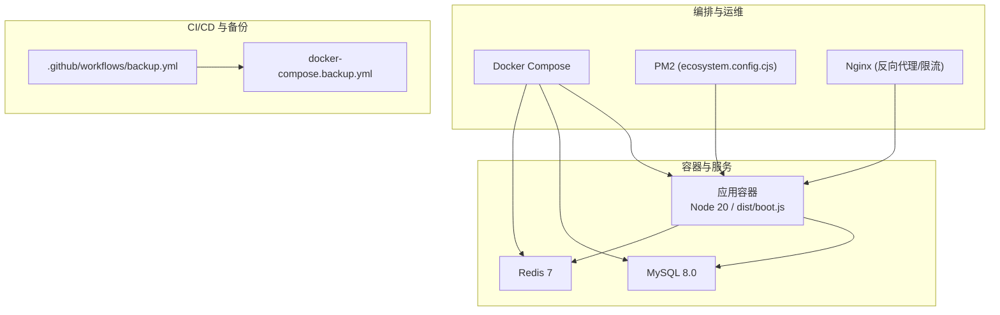
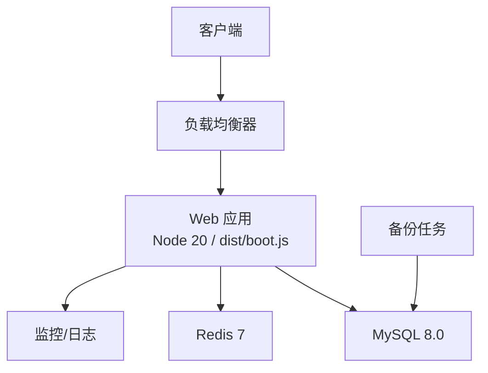
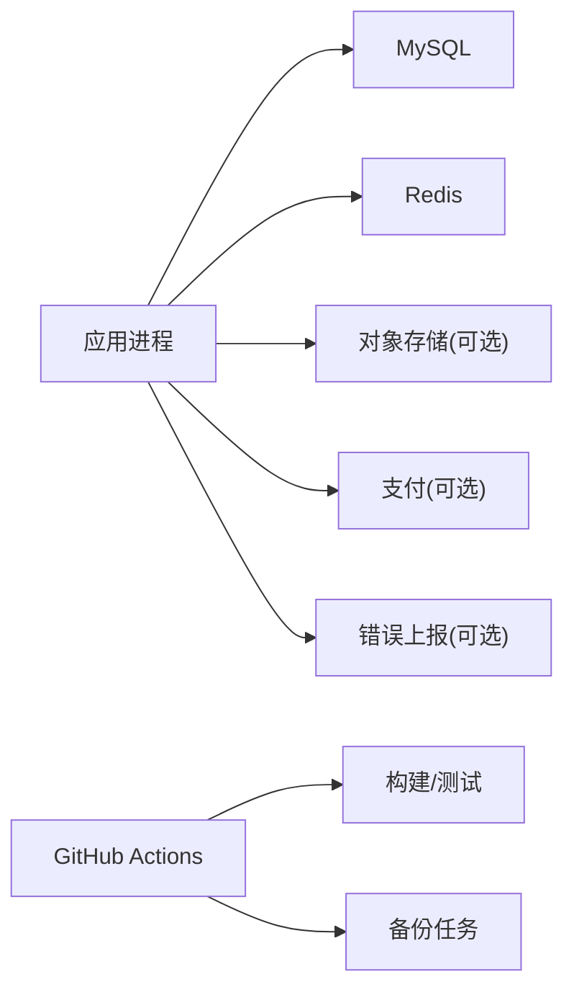

# 云平台部署

<cite>
**本文引用的文件**
- [README.md](file://README.md)
- [DEPLOY.md](file://DEPLOY.md)
- [Dockerfile](file://Dockerfile)
- [docker-compose.yml](file://docker-compose.yml)
- [docker-compose.backup.yml](file://docker-compose.backup.yml)
- [docker-compose.relay.yml](file://docker-compose.relay.yml)
- [ecosystem.config.cjs](file://ecosystem.config.cjs)
- [deploy/aliyun-optimized.md](file://deploy/aliyun-optimized.md)
- [deploy/aliyun-setup.sh](file://deploy/aliyun-setup.sh)
- [api/lib/env.ts](file://api/lib/env.ts)
- [api/lib/observability.ts](file://api/lib/observability.ts)
- [api/lib/rateLimiter.test.ts](file://api/lib/rateLimiter.test.ts)
- [api/lib/providerThrottle.ts](file://api/lib/providerThrottle.ts)
- [api/mcp/register.ts](file://api/mcp/register.ts)
- [.github/workflows/backup.yml](file://.github/workflows/backup.yml)
</cite>

## 目录
1. [简介](#简介)
2. [项目结构](#项目结构)
3. [核心组件](#核心组件)
4. [架构总览](#架构总览)
5. [详细组件分析](#详细组件分析)
6. [依赖关系分析](#依赖关系分析)
7. [性能与弹性伸缩](#性能与弹性伸缩)
8. [监控、日志与安全组](#监控日志与安全组)
9. [多云与混合云方案](#多云与混合云方案)
10. [成本优化与最佳实践](#成本优化与最佳实践)
11. [故障排查指南](#故障排查指南)
12. [结论](#结论)

## 简介
本部署文档面向在主流云平台（阿里云、AWS、Google Cloud）上部署 DeeWaanAI 系统。内容涵盖容器化与编排、服务网格与微服务治理建议、各平台特定配置与优化（弹性伸缩、负载均衡、存储）、监控与日志、安全组策略，以及多云/混合云实现路径和成本优化建议。文档同时结合仓库内现有部署脚本与环境变量说明，给出可落地的步骤与注意事项。

## 项目结构
DeeWaanAI 采用 Node.js + Hono/tRPC 后端，MySQL 作为持久化存储，Redis 用于队列/发布订阅（可选），前端为 React + Vite 构建产物由同一进程提供。应用支持 Docker 多阶段构建、PM2 进程管理、GitHub Actions 备份工作流，并提供阿里云本地部署脚本与优化指南。

图表来源
- [Dockerfile:1-39](file://Dockerfile#L1-L39)
- [docker-compose.yml:1-52](file://docker-compose.yml#L1-L52)
- [ecosystem.config.cjs:1-32](file://ecosystem.config.cjs#L1-L32)
- [docker-compose.backup.yml:1-47](file://docker-compose.backup.yml#L1-L47)

章节来源
- [README.md:20-37](file://README.md#L20-L37)
- [README.md:89-103](file://README.md#L89-L103)

## 核心组件
- 应用进程：单进程 Node 应用，暴露 API、MCP 表面与静态 SPA。健康检查端点 /api/health 用于就绪探测。
- 数据库：MySQL 8.0，通过环境变量连接；支持只读副本（DATABASE_READ_URL）。
- 缓存与队列：Redis 7，用于队列与发布订阅；未配置时回退到内存模式（仅单节点）。
- 进程管理：PM2 单实例 fork 模式，限制堆大小并自动重启。
- 反向代理：Nginx 提供限流、超时与 SSE 流式转发。
- 备份：GitHub Actions 定时任务调用备份接口，或使用独立 compose 容器执行 mysqldump。

章节来源
- [Dockerfile:15-38](file://Dockerfile#L15-L38)
- [docker-compose.yml:1-52](file://docker-compose.yml#L1-L52)
- [ecosystem.config.cjs:1-32](file://ecosystem.config.cjs#L1-L32)
- [deploy/aliyun-setup.sh:126-166](file://deploy/aliyun-setup.sh#L126-L166)
- [docker-compose.backup.yml:1-47](file://docker-compose.backup.yml#L1-L47)

## 架构总览
下图展示生产环境典型部署拓扑：入口流量经负载均衡器进入 Web 层（应用容器），应用访问 MySQL 与 Redis；SSE/长连接由 Nginx 或 LB 透传；备份任务通过 CI 或独立容器定期导出数据库至对象存储。

图表来源
- [Dockerfile:30-38](file://Dockerfile#L30-L38)
- [docker-compose.yml:1-52](file://docker-compose.yml#L1-L52)
- [api/lib/observability.ts:17-33](file://api/lib/observability.ts#L17-L33)
- [.github/workflows/backup.yml](file://.github/workflows/backup.yml)

## 详细组件分析

### 容器镜像与运行参数
- 多阶段构建：builder 阶段安装依赖并构建产物；runner 阶段仅包含运行时依赖与非 root 用户。
- 健康检查：容器内置 /api/health 探测，便于 K8s/编排器进行存活与就绪判断。
- 端口与环境：默认监听 3000，NODE_ENV=production。

章节来源
- [Dockerfile:1-38](file://Dockerfile#L1-L38)

### 进程管理与资源限制
- PM2 配置：单实例 fork 模式，最大内存重启阈值 280MB，NODE_OPTIONS 限制堆大小 256MB，自动重启与日志轮转。
- 适用场景：低内存主机（如 0.5GB）需严格控制进程数与堆大小，避免 OOM。

章节来源
- [ecosystem.config.cjs:1-32](file://ecosystem.config.cjs#L1-L32)
- [deploy/aliyun-optimized.md:47-83](file://deploy/aliyun-optimized.md#L47-L83)

### 反向代理与限流
- Nginx 限流：按 IP 设置请求速率与突发，保护后端免受滥用。
- 超时与流式：针对 LLM 调用与 SSE 流式响应调整超时与缓冲策略。

章节来源
- [deploy/aliyun-setup.sh:126-166](file://deploy/aliyun-setup.sh#L126-L166)
- [deploy/aliyun-optimized.md:92-122](file://deploy/aliyun-optimized.md#L92-L122)

### 数据库与缓存
- MySQL：通过环境变量连接，支持读写分离（DATABASE_READ_URL）。
- Redis：队列与 pub/sub 后端；缺失时回退到内存模式（单节点）。
- 备份：GitHub Actions 定时调用备份接口，或将 mysqldump 输出到对象存储；也可使用独立 compose 容器周期性执行备份。

章节来源
- [README.md:41-69](file://README.md#L41-L69)
- [docker-compose.yml:1-52](file://docker-compose.yml#L1-L52)
- [docker-compose.backup.yml:1-47](file://docker-compose.backup.yml#L1-L47)

### MCP 与认证限流
- MCP 路由：OAuth 2.1 授权服务器端点与 /mcp* 流式 HTTP 传输，所有 /mcp* 需要有效 Bearer Token。
- 限流：每客户速率限制与用量计量，防止滥用。

章节来源
- [api/mcp/register.ts:1-13](file://api/mcp/register.ts#L1-L13)
- [api/mcp/register.ts:90-110](file://api/mcp/register.ts#L90-L110)
- [api/lib/rateLimiter.test.ts:36-71](file://api/lib/rateLimiter.test.ts#L36-L71)

### 提供者节流（AIMD）
- 自适应速率控制：基于 AIMD 算法动态发现每个外部提供商的可持续 RPM，状态存储在 Redis（无 Redis 则内存回退）。
- 窗口与冷却：60 秒窗口，降速后冷却若干窗口再恢复增长。

章节来源
- [api/lib/providerThrottle.ts:1-153](file://api/lib/providerThrottle.ts#L1-L153)

## 依赖关系分析
- 应用依赖：MySQL（必需）、Redis（可选）、对象存储（截图/备份，可选）、支付网关（Stripe，可选）、错误上报（Sentry，可选）。
- 编排依赖：Docker 与 Compose 用于本地与容器化部署；PM2 用于裸机/虚拟机进程管理；Nginx 用于反向代理与限流。
- CI/CD：GitHub Actions 触发类型检查、测试、构建与集成测试；备份工作流定时执行。

图表来源
- [README.md:41-69](file://README.md#L41-L69)
- [.github/workflows/backup.yml](file://.github/workflows/backup.yml)

章节来源
- [README.md:41-69](file://README.md#L41-L69)
- [DEPLOY.md:116-133](file://DEPLOY.md#L116-L133)

## 性能与弹性伸缩
- 单节点与分片：默认单进程即可满足轻量负载；高并发场景可将 Worker 从 Web 中拆分（参考 Railway 部署指南中的 worker 服务）。
- 弹性伸缩：
  - 阿里云 ACK/ECS：根据 CPU/内存/网络指标配置 HPA/弹性伸缩组；Nginx/LB 前置限流与连接池调优。
  - AWS ECS/EKS：基于 CloudWatch 指标与 Auto Scaling Group/HPA 进行扩缩容；ALB/NLB 承载流量。
  - Google Cloud GKE：基于 Metrics Server 与 HPA 进行 Pod 级弹性；GCLB 作为入口。
- 数据库与缓存：
  - 使用托管数据库（RDS/Cloud SQL/PolarDB）并启用只读副本分担读压力。
  - Redis 使用托管服务（ElastiCache/Memorystore/Redis 企业版）提升可用性与吞吐。
- 存储：
  - 截图与备份使用对象存储（OSS/S3/GCS），通过环境变量接入；保持私有并通过鉴权访问。

章节来源
- [DEPLOY.md:135-145](file://DEPLOY.md#L135-L145)
- [README.md:41-69](file://README.md#L41-L69)
- [docker-compose.backup.yml:1-47](file://docker-compose.backup.yml#L1-L47)

## 监控、日志与安全组
- 监控与错误上报：
  - 通过 SENTRY_DSN 启用 Sentry；初始化失败不影响服务启动。
  - 健康检查端点 /api/health 与 /api/ready 用于就绪探测与降级指示。
- 日志：
  - PM2 日志轮转，避免磁盘占满；生产环境建议集中收集（ELK/Cloud Logging）。
- 安全组/防火墙：
  - 仅开放必要端口（如 80/443），数据库与缓存仅对应用网段开放。
  - 反向代理与 LB 负责 TLS 终止与访问控制。

章节来源
- [api/lib/observability.ts:17-33](file://api/lib/observability.ts#L17-L33)
- [ecosystem.config.cjs:22-30](file://ecosystem.config.cjs#L22-L30)
- [deploy/aliyun-setup.sh:168-172](file://deploy/aliyun-setup.sh#L168-L172)

## 多云与混合云方案
- 多云策略：
  - 将应用容器镜像推送到各云镜像仓库（ACR/ECR/GCR），使用各自编排器（ACK/EKS/GKE）部署。
  - 数据面使用各云托管数据库与缓存，通过环境变量切换连接串。
  - 统一 CI/CD：GitHub Actions 构建一次，分发到多云部署流水线。
- 混合云/边缘：
  - 使用 on-prem relay 连接器（outbound-only）打通本地服务与云端，无需暴露入站端口，满足数据驻留要求。
  - 通过环境变量 LOCAL_URL/CLOUD_URL/RELAY_TOKEN 配置。

章节来源
- [docker-compose.relay.yml:1-38](file://docker-compose.relay.yml#L1-L38)
- [README.md:89-103](file://README.md#L89-L103)

## 成本优化与最佳实践
- 计算：
  - 低内存场景使用单进程 + 堆限制（见 PM2 配置与阿里云优化指南）。
  - 按需扩容：利用 HPA/ASG 在高峰时段自动扩展，低谷期收缩。
- 存储：
  - 使用冷/热分层存储；对象存储生命周期策略清理旧备份与临时文件。
- 数据库：
  - 读写分离、连接池调优、慢查询优化；必要时引入缓存层减少重复查询。
- 网络：
  - 合理设置 LB 超时与缓冲，避免长连接被误断；对 SSE/流式接口单独优化。
- 观测：
  - 开启错误上报与关键指标采集，建立告警规则（CPU/内存/错误率/延迟）。

章节来源
- [ecosystem.config.cjs:1-32](file://ecosystem.config.cjs#L1-L32)
- [deploy/aliyun-optimized.md:1-151](file://deploy/aliyun-optimized.md#L1-L151)
- [docker-compose.backup.yml:1-47](file://docker-compose.backup.yml#L1-L47)

## 故障排查指南
- 启动失败：
  - 检查必需环境变量（APP_SECRET、DATABASE_URL、VITE_APP_ID）是否配置正确；生产环境拒绝已知不安全默认值。
- 健康检查异常：
  - /api/health 返回 degraded 通常表示数据库不可达；确认连接串与网络可达性。
- 内存溢出：
  - 降低并发或升级实例规格；确保 PM2 的 max_memory_restart 与 NODE_OPTIONS 限制生效。
- 备份失败：
  - 确认 BACKUP_TOKEN 与 S3_* 变量；验证对象存储权限与网络连接；查看 GitHub Actions 日志。
- 限流与节流：
  - 检查 Nginx 限流与 provider throttle 配置；观察 Redis 状态与内存使用。

章节来源
- [api/lib/env.ts:1-22](file://api/lib/env.ts#L1-L22)
- [DEPLOY.md:108-133](file://DEPLOY.md#L108-L133)
- [api/lib/providerThrottle.ts:1-153](file://api/lib/providerThrottle.ts#L1-L153)
- [docker-compose.backup.yml:1-47](file://docker-compose.backup.yml#L1-L47)

## 结论
DeeWaanAI 具备容器化与多环境部署能力，配合 PM2、Nginx、MySQL/Redis 与 CI/CD 形成完整的生产就绪方案。通过合理的弹性伸缩、存储与监控配置，可在阿里云、AWS、Google Cloud 等主流平台上稳定运行。对于混合云与数据驻留需求，on-prem relay 提供了安全的出站通道。建议在上线前完成安全加固、备份演练与容量规划，持续优化成本与性能。