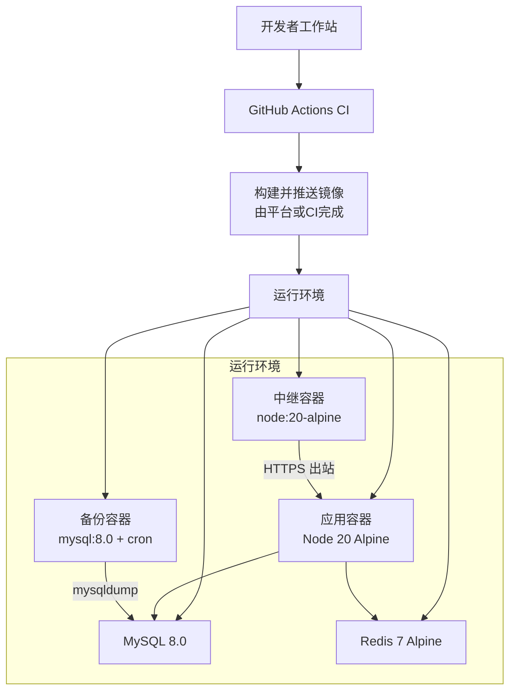
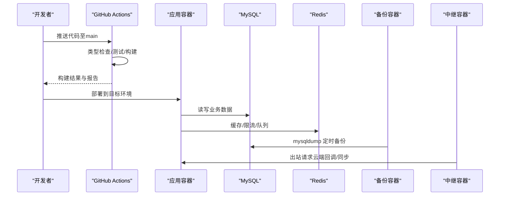
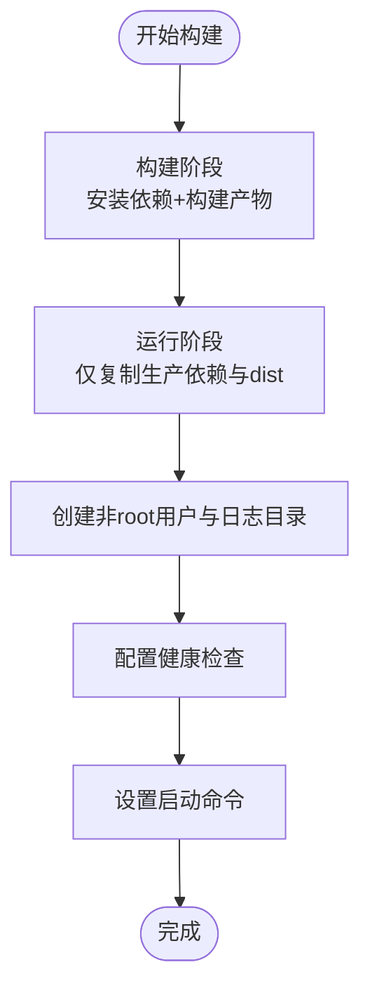
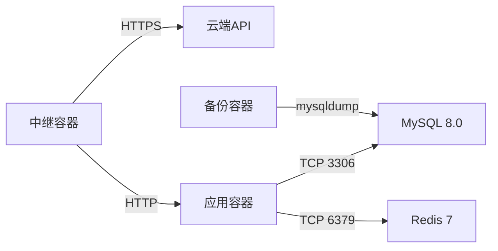
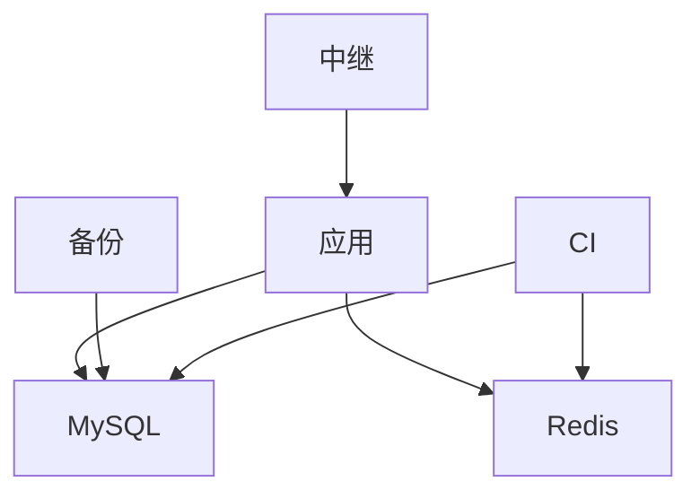

# 容器化部署

<cite>
**本文引用的文件**
- [Dockerfile](file://Dockerfile)
- [.dockerignore](file://.dockerignore)
- [docker-compose.yml](file://docker-compose.yml)
- [docker-compose.backup.yml](file://docker-compose.backup.yml)
- [docker-compose.relay.yml](file://docker-compose.relay.yml)
- [DEPLOY.md](file://DEPLOY.md)
- [deploy/aliyun-setup.sh](file://deploy/aliyun-setup.sh)
- [deploy/install.sh](file://deploy/install.sh)
- [ecosystem.config.cjs](file://ecosystem.config.cjs)
- [api/lib/env.ts](file://api/lib/env.ts)
- [.github/workflows/ci.yml](file://.github/workflows/ci.yml)
- [.github/workflows/backup.yml](file://.github/workflows/backup.yml)
</cite>

## 目录
1. [简介](#简介)
2. [项目结构](#项目结构)
3. [核心组件](#核心组件)
4. [架构总览](#架构总览)
5. [详细组件分析](#详细组件分析)
6. [依赖关系分析](#依赖关系分析)
7. [性能与资源限制](#性能与资源限制)
8. [故障排除指南](#故障排除指南)
9. [结论](#结论)
10. [附录](#附录)

## 简介
本文件面向DeeWaanAI系统的容器化部署，覆盖多阶段Docker构建、镜像标签与版本控制、服务编排（MySQL、Redis、应用、备份、中继）、健康检查、日志收集、监控与排障，以及在不同环境（本地、云托管、自有服务器）的部署实践。文档以仓库中的Dockerfile、Compose文件、CI/CD工作流和部署脚本为依据，提供可操作的步骤与最佳实践。

## 项目结构
与容器化相关的关键文件与职责：
- Dockerfile：定义多阶段构建与生产镜像，包含最小化依赖、非root用户、健康检查和启动命令。
- .dockerignore：排除不必要的构建上下文，减小镜像体积并提升构建速度。
- docker-compose.yml：编排MySQL、Redis与应用（开发时启用），定义数据卷与健康检查。
- docker-compose.backup.yml：独立备份服务，使用mysql:8.0镜像执行定时mysqldump到宿主机目录。
- docker-compose.relay.yml：企业内网中继连接器，仅出站访问云端和本地服务，不暴露端口。
- DEPLOY.md：Railway一键部署清单与环境变量说明。
- deploy/*.sh：阿里云ECS安装与Nginx反向代理、PM2进程管理脚本。
- ecosystem.config.cjs：PM2进程管理配置（内存限制、日志轮转）。
- api/lib/env.ts：环境变量校验与安全策略。
- .github/workflows/*：CI门禁、集成测试与每日数据库备份触发。

图表来源
- [Dockerfile:1-39](file://Dockerfile#L1-L39)
- [docker-compose.yml:1-52](file://docker-compose.yml#L1-L52)
- [docker-compose.backup.yml:1-47](file://docker-compose.backup.yml#L1-L47)
- [docker-compose.relay.yml:1-38](file://docker-compose.relay.yml#L1-L38)

章节来源
- [Dockerfile:1-39](file://Dockerfile#L1-L39)
- [.dockerignore:1-17](file://.dockerignore#L1-L17)
- [docker-compose.yml:1-52](file://docker-compose.yml#L1-L52)
- [docker-compose.backup.yml:1-47](file://docker-compose.backup.yml#L1-L47)
- [docker-compose.relay.yml:1-38](file://docker-compose.relay.yml#L1-L38)

## 核心组件
- 应用镜像（多阶段构建）
  - 构建阶段：基于Node 20 Alpine，安装依赖并执行构建产物输出。
  - 运行阶段：仅复制必要文件，创建非root用户，安装轻量客户端工具，设置环境变量与健康检查，启动入口为dist/boot.js。
- 数据层
  - MySQL 8.0：持久化业务数据，通过命名卷保存数据。
  - Redis 7 Alpine：缓存与会话等场景，通过命名卷持久化。
- 辅助服务
  - 备份服务：使用mysql:8.0镜像运行定时任务，将数据库导出到宿主目录，支持保留策略。
  - 中继服务：仅出站连接云端API与本地服务，满足数据驻留与严格出站网络策略。
- 进程管理（非容器环境）
  - PM2：单实例、内存上限、崩溃重启、日志轮转，适配低内存服务器。

章节来源
- [Dockerfile:1-39](file://Dockerfile#L1-L39)
- [docker-compose.yml:1-52](file://docker-compose.yml#L1-L52)
- [docker-compose.backup.yml:1-47](file://docker-compose.backup.yml#L1-L47)
- [docker-compose.relay.yml:1-38](file://docker-compose.relay.yml#L1-L38)
- [ecosystem.config.cjs:1-32](file://ecosystem.config.cjs#L1-L32)

## 架构总览
下图展示容器化部署的整体交互：应用容器依赖MySQL与Redis；备份容器定期导出数据库；中继容器在受限网络中桥接云端与本地服务。

图表来源
- [.github/workflows/ci.yml:1-96](file://.github/workflows/ci.yml#L1-L96)
- [docker-compose.yml:1-52](file://docker-compose.yml#L1-L52)
- [docker-compose.backup.yml:1-47](file://docker-compose.backup.yml#L1-L47)
- [docker-compose.relay.yml:1-38](file://docker-compose.relay.yml#L1-L38)

## 详细组件分析

### 多阶段Docker构建与优化
- 构建阶段
  - 使用Node 20 Alpine作为基础镜像，安装依赖并执行构建，产出静态/编译后的dist目录。
  - 通过.dockerignore排除node_modules、dist、测试与格式化配置等，减少上下文大小。
- 运行阶段
  - 仅复制package.json、lock文件与dist，安装生产依赖并清理缓存。
  - 创建专用用户与日志目录，设置NODE_ENV与PORT，暴露端口并配置健康检查。
  - 启动命令指向dist/boot.js。
- 安全与可维护性
  - 非root用户运行，最小权限原则。
  - 仅安装必要的系统包（如mariadb-client用于备份端点）。

图表来源
- [Dockerfile:1-39](file://Dockerfile#L1-L39)
- [.dockerignore:1-17](file://.dockerignore#L1-L17)

章节来源
- [Dockerfile:1-39](file://Dockerfile#L1-L39)
- [.dockerignore:1-17](file://.dockerignore#L1-L17)

### 镜像构建、标签管理与版本控制
- 构建触发
  - CI在push/PR时执行类型检查、测试与构建，确保质量门禁。
- 标签策略建议
  - 使用语义化版本与Git提交哈希组合，例如：v1.2.3-abc1234。
  - 同时维护latest标签指向最新稳定版本，便于快速验证但避免在生产直接依赖latest。
- 版本追溯
  - 将镜像标签与CI工件关联，记录构建参数、环境变量与依赖锁定文件版本。
  - 在部署清单中固化镜像标签，禁止滚动更新到未经验证的latest。

章节来源
- [.github/workflows/ci.yml:1-96](file://.github/workflows/ci.yml#L1-L96)

### 容器编排与服务间通信
- 服务组成
  - 应用：Node 20 Alpine镜像，监听3000端口。
  - MySQL：8.0镜像，数据持久化到命名卷，提供健康检查。
  - Redis：7 Alpine镜像，数据持久化到命名卷，提供健康检查。
- 网络与端口
  - 默认仅暴露MySQL与Redis端口供本地开发；应用端口在Compose中注释掉，按需开启。
  - 中继容器不暴露端口，仅出站访问云端与本地服务。
- 环境变量
  - DATABASE_URL、REDIS_URL、APP_SECRET等关键变量通过Compose或平台注入。
  - 应用启动时校验必需变量，防止不安全默认值进入生产。

图表来源
- [docker-compose.yml:1-52](file://docker-compose.yml#L1-L52)
- [docker-compose.backup.yml:1-47](file://docker-compose.backup.yml#L1-L47)
- [docker-compose.relay.yml:1-38](file://docker-compose.relay.yml#L1-L38)
- [api/lib/env.ts:1-22](file://api/lib/env.ts#L1-L22)

章节来源
- [docker-compose.yml:1-52](file://docker-compose.yml#L1-L52)
- [docker-compose.backup.yml:1-47](file://docker-compose.backup.yml#L1-L47)
- [docker-compose.relay.yml:1-38](file://docker-compose.relay.yml#L1-L38)
- [api/lib/env.ts:1-22](file://api/lib/env.ts#L1-L22)

### 数据持久化
- MySQL数据卷：mysql-data映射到/var/lib/mysql，保证容器重建后数据不丢失。
- Redis数据卷：redis-data映射到/data，持久化缓存与队列数据。
- 备份数据：备份容器将压缩dump写入宿主./backups目录，便于离线归档与恢复。

章节来源
- [docker-compose.yml:1-52](file://docker-compose.yml#L1-L52)
- [docker-compose.backup.yml:1-47](file://docker-compose.backup.yml#L1-L47)

### 健康检查与就绪探针
- 应用健康检查：容器内置HEALTHCHECK调用/api/health，间隔、超时、重试时间合理配置。
- 依赖健康检查：MySQL与Redis均配置健康检查，确保服务可用后再启动依赖方。
- 就绪状态：可通过/api/ready判断依赖是否全部可达，适合编排器进行流量接入控制。

章节来源
- [Dockerfile:30-38](file://Dockerfile#L30-L38)
- [docker-compose.yml:14-18](file://docker-compose.yml#L14-L18)
- [docker-compose.yml:43-47](file://docker-compose.yml#L43-L47)
- [DEPLOY.md:108-112](file://DEPLOY.md#L108-L112)

### 日志收集与监控
- 应用日志
  - 容器内logs目录用于应用日志；非容器环境使用PM2日志轮转（combined/out/error），限制文件大小与数量。
- 外部化日志
  - 推荐将logs目录挂载到宿主或接入集中式日志系统（如ELK/Cloud Logging）。
- 指标与监控
  - 结合平台监控（如Railway Logs/Actions）观察健康检查与错误日志。
  - 对MySQL与Redis可启用慢查询与监控指标（根据平台能力）。

章节来源
- [Dockerfile:25-28](file://Dockerfile#L25-L28)
- [ecosystem.config.cjs:1-32](file://ecosystem.config.cjs#L1-L32)
- [.github/workflows/backup.yml:1-46](file://.github/workflows/backup.yml#L1-L46)

### 不同环境的部署实践
- 本地开发
  - 使用docker-compose启动MySQL与Redis，按需启用应用服务并挂载.env。
- 云托管（Railway）
  - 按DEPLOY.md添加MySQL、Redis与密钥，设置DATABASE_URL、REDIS_URL、APP_SECRET等，首次推送到main自动构建部署。
  - 通过/api/health与/api/ready验证服务状态。
- 自有服务器（阿里云ECS）
  - 使用deploy脚本安装Node、MySQL、Nginx与PM2，生成密钥并构建应用，配置反向代理与防火墙。
  - 低内存实例需启用swap并限制Node堆大小。

章节来源
- [docker-compose.yml:20-34](file://docker-compose.yml#L20-L34)
- [DEPLOY.md:28-112](file://DEPLOY.md#L28-L112)
- [deploy/aliyun-setup.sh:1-198](file://deploy/aliyun-setup.sh#L1-L198)
- [deploy/install.sh:1-222](file://deploy/install.sh#L1-L222)
- [ecosystem.config.cjs:1-32](file://ecosystem.config.cjs#L1-L32)

## 依赖关系分析
- 应用对MySQL与Redis的强依赖，通过环境变量与网络服务名连接。
- 备份服务对MySQL的只读访问，无入站端口。
- 中继服务对云端与本地的出站访问，满足数据驻留与网络安全要求。
- CI对MySQL与Redis的服务容器进行集成测试，确保依赖可用性。

图表来源
- [docker-compose.yml:1-52](file://docker-compose.yml#L1-L52)
- [docker-compose.backup.yml:1-47](file://docker-compose.backup.yml#L1-L47)
- [docker-compose.relay.yml:1-38](file://docker-compose.relay.yml#L1-L38)
- [.github/workflows/ci.yml:45-96](file://.github/workflows/ci.yml#L45-L96)

章节来源
- [docker-compose.yml:1-52](file://docker-compose.yml#L1-L52)
- [.github/workflows/ci.yml:45-96](file://.github/workflows/ci.yml#L45-L96)

## 性能与资源限制
- 容器资源限制
  - 建议在编排层为应用容器设置CPU与内存上限，避免影响MySQL与Redis。
  - 对于低内存实例，使用PM2的max_memory_restart与NODE_OPTIONS限制堆大小。
- 构建优化
  - 使用多阶段构建与.dockerignore减少镜像体积与构建时间。
  - 缓存npm依赖，仅在变更时重新安装。
- 运行时优化
  - 合理设置健康检查间隔与超时，避免误判。
  - 对长耗时操作（如流式处理）调整代理超时与缓冲策略。

章节来源
- [Dockerfile:1-39](file://Dockerfile#L1-L39)
- [.dockerignore:1-17](file://.dockerignore#L1-L17)
- [ecosystem.config.cjs:1-32](file://ecosystem.config.cjs#L1-L32)

## 故障排除指南
- 健康检查失败
  - 检查/api/health与/api/ready返回状态，确认MySQL与Redis可达。
  - 查看容器日志与平台日志定位错误。
- 数据库连接问题
  - 核对DATABASE_URL格式与凭据，确保网络连通与端口开放。
  - 使用备份脚本验证对外部MySQL的连接与导出能力。
- 内存溢出与崩溃
  - 启用swap并限制Node堆大小，观察PM2重启日志。
  - 逐步排查内存泄漏点，必要时拆分worker服务。
- 备份失败
  - 确认BACKUP_TOKEN与S3_*变量已配置，检查备份工作流与容器日志。
  - 本地备份可使用docker-compose.backup.yml验证mysqldump流程。

章节来源
- [DEPLOY.md:108-133](file://DEPLOY.md#L108-L133)
- [docker-compose.backup.yml:1-47](file://docker-compose.backup.yml#L1-L47)
- [.github/workflows/backup.yml:1-46](file://.github/workflows/backup.yml#L1-L46)
- [ecosystem.config.cjs:1-32](file://ecosystem.config.cjs#L1-L32)

## 结论
本方案通过多阶段Docker构建、严格的镜像安全与最小化依赖、完善的容器编排与健康检查、可靠的备份与中继机制，以及针对不同环境的部署脚本与CI门禁，为DeeWaanAI提供了稳定、可观测、易运维的容器化部署路径。建议在生产环境中持续完善镜像版本管理、日志与监控体系，并结合平台能力实施弹性伸缩与灰度发布。

## 附录
- 环境变量清单（示例）
  - DATABASE_URL：数据库连接串
  - REDIS_URL：缓存连接串
  - APP_SECRET：应用密钥
  - NODE_ENV：运行环境
  - PORT：应用端口
  - BACKUP_TOKEN：备份接口鉴权令牌
  - S3_*：对象存储配置（可选）
- 常用命令
  - 本地编排：docker compose up -d
  - 查看日志：docker compose logs -f
  - 健康检查：curl http://localhost:3000/api/health
  - 备份触发：docker compose -f docker-compose.backup.yml up -d

章节来源
- [docker-compose.yml:1-52](file://docker-compose.yml#L1-L52)
- [docker-compose.backup.yml:1-47](file://docker-compose.backup.yml#L1-L47)
- [DEPLOY.md:46-67](file://DEPLOY.md#L46-L67)