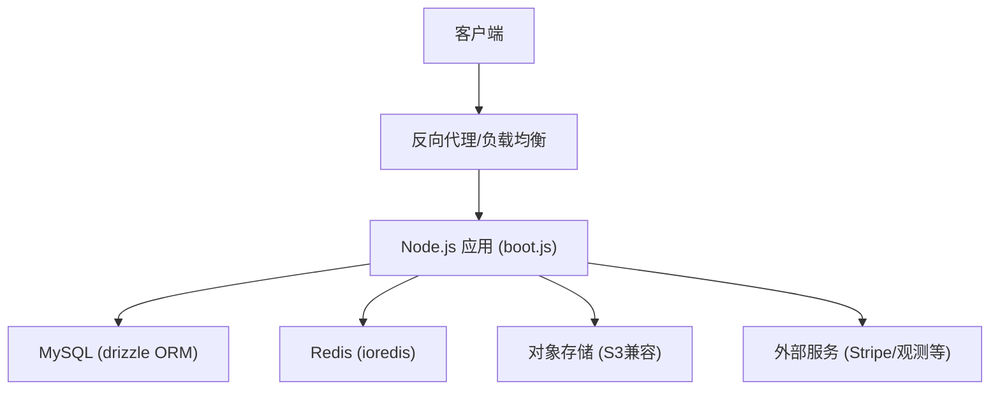
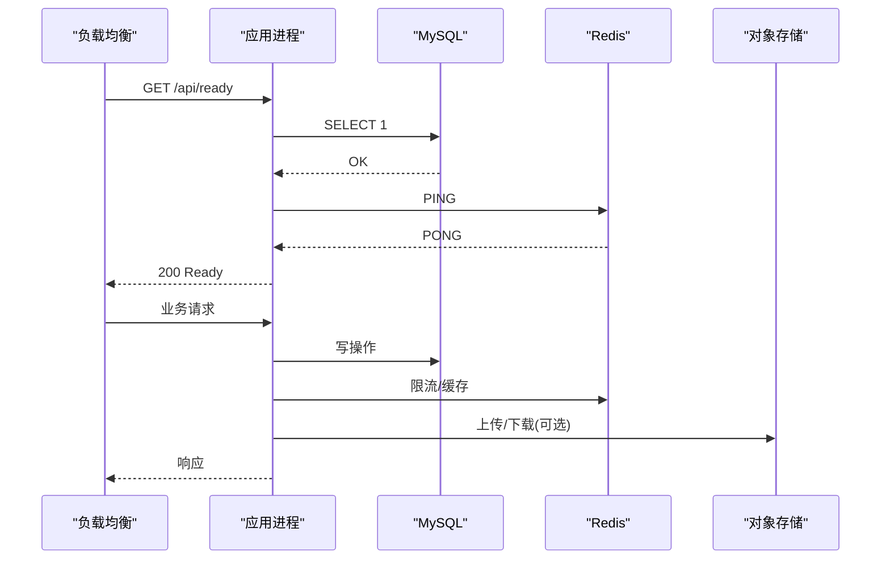
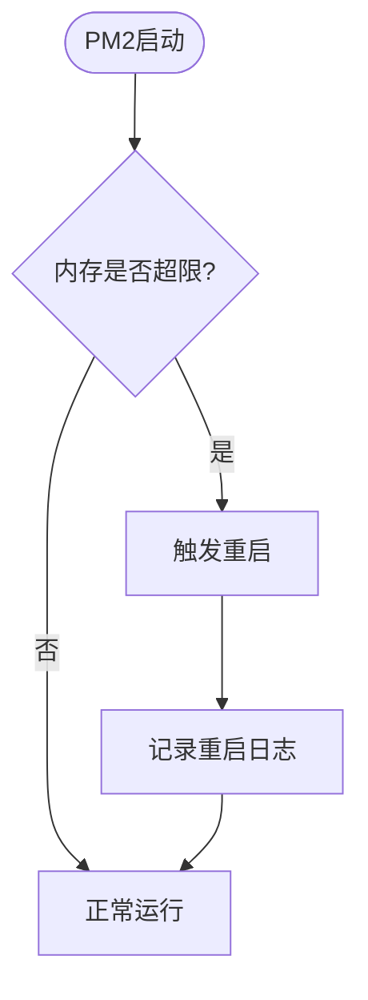
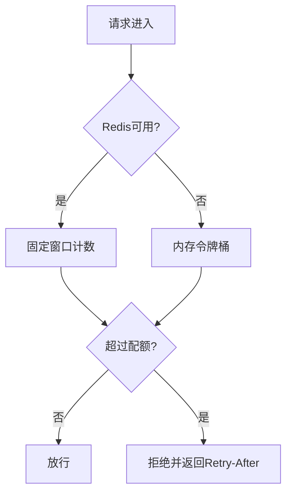
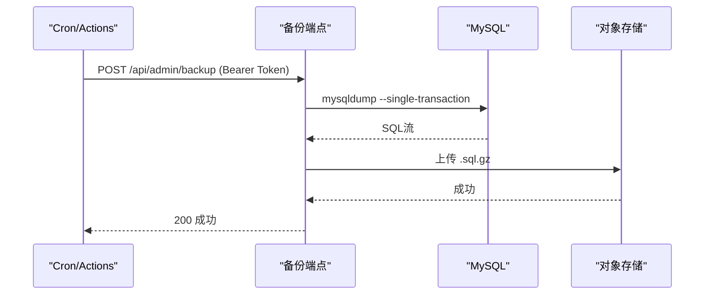
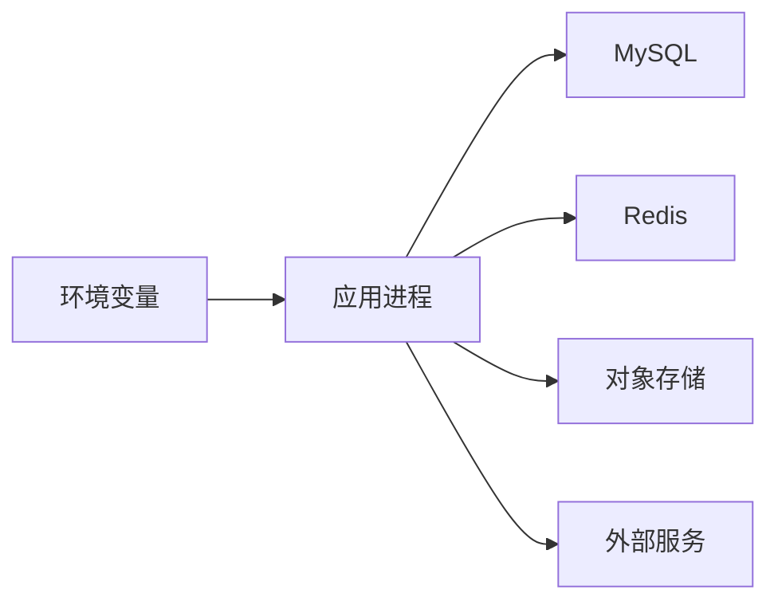

# 生产环境部署

<cite>
**本文引用的文件**
- [ecosystem.config.cjs](file://ecosystem.config.cjs)
- [docker-compose.yml](file://docker-compose.yml)
- [Dockerfile](file://Dockerfile)
- [DEPLOY.md](file://DEPLOY.md)
- [api/lib/env.ts](file://api/lib/env.ts)
- [api/infra/redis.ts](file://api/infra/redis.ts)
- [api/queries/connection.ts](file://api/queries/connection.ts)
- [api/boot.ts](file://api/boot.ts)
- [api/lib/rateLimiter.ts](file://api/lib/rateLimiter.ts)
- [api/services/backup.ts](file://api/services/backup.ts)
- [scripts/backup-db.sh](file://scripts/backup-db.sh)
- [.github/workflows/backup.yml](file://.github/workflows/backup.yml)
- [api/lib/logger.ts](file://api/lib/logger.ts)
- [api/lib/observability.ts](file://api/lib/observability.ts)
</cite>

## 目录
1. [简介](#简介)
2. [项目结构](#项目结构)
3. [核心组件](#核心组件)
4. [架构总览](#架构总览)
5. [详细组件分析](#详细组件分析)
6. [依赖关系分析](#依赖关系分析)
7. [性能考虑](#性能考虑)
8. [故障排查指南](#故障排查指南)
9. [结论](#结论)
10. [附录](#附录)

## 简介
本文件面向生产环境的DeeWaanAI系统，提供从进程管理、负载均衡与高可用，到数据库连接池、Redis集成、外部服务接入、SSL与反向代理、安全加固、性能调优、监控告警、日志管理、备份恢复、灾难恢复以及扩容缩容的完整部署指南。文档基于仓库中的实际配置与实现进行说明，确保可操作性与一致性。

## 项目结构
- 应用容器化：通过多阶段构建镜像，运行期仅包含必要依赖与编译产物，暴露端口并内置健康检查。
- 本地编排：使用docker-compose提供MySQL与Redis服务，便于开发与测试。
- 进程管理：提供PM2配置文件，用于生产进程守护、内存限制与日志轮转。
- 环境变量：集中定义必需与可选的环境变量，并在生产模式下进行严格校验。
- 健康与就绪：提供/api/health与/api/ready端点，供负载均衡器与健康探针使用。

**图表来源**
- [Dockerfile:1-39](file://Dockerfile#L1-L39)
- [docker-compose.yml:1-52](file://docker-compose.yml#L1-L52)
- [api/boot.ts:85-125](file://api/boot.ts#L85-L125)

**章节来源**
- [Dockerfile:1-39](file://Dockerfile#L1-L39)
- [docker-compose.yml:1-52](file://docker-compose.yml#L1-L52)
- [DEPLOY.md:1-145](file://DEPLOY.md#L1-L145)

## 核心组件
- 进程管理与守护：PM2集群模式、实例数、内存限制、自动重启与日志轮转。
- 环境变量与安全：必需变量强制校验、敏感值保护、可信代理开关。
- 数据库连接：主库写、读库读（可选），Drizzle ORM单例。
- Redis集成：懒连接、重试退避、降级为内存态。
- 健康与就绪：/api/health与/api/ready探测，供LB/编排器使用。
- 限流：令牌桶与固定窗口两种策略，支持Redis共享与内存降级。
- 备份：mysqldump + gzip + S3上传，保留策略与自动化触发。
- 日志与观测：结构化JSON日志、Sentry可选初始化。

**章节来源**
- [ecosystem.config.cjs:1-32](file://ecosystem.config.cjs#L1-L32)
- [api/lib/env.ts:1-105](file://api/lib/env.ts#L1-L105)
- [api/queries/connection.ts:1-43](file://api/queries/connection.ts#L1-L43)
- [api/infra/redis.ts:1-88](file://api/infra/redis.ts#L1-L88)
- [api/boot.ts:85-125](file://api/boot.ts#L85-L125)
- [api/lib/rateLimiter.ts:1-216](file://api/lib/rateLimiter.ts#L1-L216)
- [api/services/backup.ts:149-184](file://api/services/backup.ts#L149-L184)
- [scripts/backup-db.sh:1-56](file://scripts/backup-db.sh#L1-L56)
- [.github/workflows/backup.yml:1-46](file://.github/workflows/backup.yml#L1-L46)
- [api/lib/logger.ts:1-32](file://api/lib/logger.ts#L1-L32)
- [api/lib/observability.ts:1-33](file://api/lib/observability.ts#L1-L33)

## 架构总览
生产环境推荐拓扑：
- 入口：HTTPS终止于反向代理或托管平台边缘（如Railway），将请求转发至应用。
- 应用层：Node.js进程由PM2管理，单实例或根据资源调整；开启健康检查与就绪探针。
- 数据层：MySQL主库（读写）、可选只读副本（读扩展）；Redis作为缓存/队列/限流共享状态。
- 外部服务：Stripe支付、对象存储（S3兼容）、可选Sentry观测。

**图表来源**
- [api/boot.ts:85-125](file://api/boot.ts#L85-L125)
- [api/infra/redis.ts:1-88](file://api/infra/redis.ts#L1-L88)
- [api/queries/connection.ts:1-43](file://api/queries/connection.ts#L1-L43)
- [api/services/backup.ts:149-184](file://api/services/backup.ts#L149-L184)

## 详细组件分析

### 进程管理（PM2）
- 实例与模式：当前配置为单实例fork模式，适合内存受限场景；如需水平扩展，可在LB后部署多实例，并通过Redis共享状态（限流、队列）。
- 内存限制：设置max_memory_restart阈值，避免内存泄漏导致OOM；同时可通过NODE_OPTIONS限制堆大小。
- 重启策略：崩溃自动重启，最小存活时间、重启延迟与最大重启次数控制重启风暴。
- 日志：统一输出到logs目录，按大小与数量轮转，合并标准输出与错误输出。

**图表来源**
- [ecosystem.config.cjs:1-32](file://ecosystem.config.cjs#L1-L32)

**章节来源**
- [ecosystem.config.cjs:1-32](file://ecosystem.config.cjs#L1-L32)

### 环境变量与安全
- 必需变量：生产模式下缺失关键变量会阻止启动，防止误配上线。
- 安全校验：拒绝已知不安全默认值，避免开发密钥泄露到生产。
- 可信代理：默认信任x-forwarded-for（托管平台边缘已清洗），若直连公网需关闭该选项。
- 可选能力：Redis、Stripe、S3、Sentry等均为可选，未配置时优雅降级或返回特定状态码。

**章节来源**
- [api/lib/env.ts:1-105](file://api/lib/env.ts#L1-L105)

### 数据库连接与读扩展
- 写连接：单例Drizzle实例，指向DATABASE_URL。
- 读连接：当配置DATABASE_READ_URL时，读重查询走只读副本，否则回退到主库。
- 迁移与初始化：通过db:push或迁移脚本在首次部署创建表结构。

**章节来源**
- [api/queries/connection.ts:1-43](file://api/queries/connection.ts#L1-L43)
- [DEPLOY.md:69-80](file://DEPLOY.md#L69-L80)

### Redis连接与降级
- 懒连接：仅在需要时建立连接，降低冷启动开销。
- 重试与退避：最多尝试若干次，指数退避，失败则标记不可用。
- 降级策略：所有子系统在Redis不可用时切换为内存态，保证可用性。

**章节来源**
- [api/infra/redis.ts:1-88](file://api/infra/redis.ts#L1-L88)

### 健康与就绪探针
- /api/health：返回运行状态、内存、数据库连通性、Redis启用状态、队列后端与工作进程状态。
- /api/ready：当数据库可达且Redis（若配置）连通时返回200，否则503，供负载均衡器剔除不健康节点。

**章节来源**
- [api/boot.ts:85-125](file://api/boot.ts#L85-L125)

### 限流策略
- 令牌桶：适用于短突发控制，内存态实现，定期清理过期桶。
- 固定窗口：基于Redis INCR+PEXPIRE实现跨节点共享预算，失败降级为内存态。
- 客户分级：支持solo/team/admin不同配额，结合认证上下文应用。

**图表来源**
- [api/lib/rateLimiter.ts:1-216](file://api/lib/rateLimiter.ts#L1-L216)

**章节来源**
- [api/lib/rateLimiter.ts:1-216](file://api/lib/rateLimiter.ts#L1-L216)

### 备份与恢复
- 应用内备份：调用mysqldump生成gzipped dump，上传至S3，并按保留策略清理旧备份。
- 独立脚本：提供backup-db.sh，支持在任何可访问数据库的机器上定时执行。
- 自动化：GitHub Actions每日触发，调用生产备份端点；未激活时跳过并记录提示。

**图表来源**
- [api/services/backup.ts:149-184](file://api/services/backup.ts#L149-L184)
- [scripts/backup-db.sh:1-56](file://scripts/backup-db.sh#L1-L56)
- [.github/workflows/backup.yml:1-46](file://.github/workflows/backup.yml#L1-L46)

**章节来源**
- [api/services/backup.ts:149-184](file://api/services/backup.ts#L149-L184)
- [scripts/backup-db.sh:1-56](file://scripts/backup-db.sh#L1-L56)
- [.github/workflows/backup.yml:1-46](file://.github/workflows/backup.yml#L1-L46)
- [DEPLOY.md:125-129](file://DEPLOY.md#L125-L129)

### SSL证书与反向代理
- HTTPS终止：建议在反向代理或托管平台边缘完成TLS终止，应用接收HTTP流量。
- 可信代理：默认信任x-forwarded-for，确保限流基于真实客户端IP；直连公网时需关闭。
- 域名与证书：托管平台提供自定义域名与自动证书申请；自托管可使用Nginx/Traefik等。

**章节来源**
- [api/lib/env.ts:57-63](file://api/lib/env.ts#L57-L63)
- [DEPLOY.md:103-113](file://DEPLOY.md#L103-L113)

### 安全加固措施
- 环境变量强校验：生产缺失必需变量直接报错，防止弱密钥上线。
- 速率限制：对认证、执行、批量提交等接口实施限流，防止滥用。
- 备份鉴权：备份端点要求Bearer Token，并配合S3访问控制。
- 最小权限：容器以非root用户运行，仅暴露必要端口。

**章节来源**
- [api/lib/env.ts:1-22](file://api/lib/env.ts#L1-L22)
- [api/lib/rateLimiter.ts:95-103](file://api/lib/rateLimiter.ts#L95-L103)
- [Dockerfile:15-33](file://Dockerfile#L15-L33)

### 性能调优
- 进程模型：单实例适合小内存；多实例需配合Redis共享状态（限流、队列）。
- 内存限制：通过NODE_OPTIONS与PM2 max_memory_restart控制堆与重启阈值。
- 数据库：读扩展使用只读副本，减少主库压力；合理索引与查询优化。
- 缓存：优先命中Redis，降低DB与外部服务调用。
- 超时与重试：对外部服务调用设置超时与重试策略，避免雪崩。

**章节来源**
- [ecosystem.config.cjs:1-32](file://ecosystem.config.cjs#L1-L32)
- [api/queries/connection.ts:20-43](file://api/queries/connection.ts#L20-L43)
- [api/infra/redis.ts:1-88](file://api/infra/redis.ts#L1-L88)

### 监控告警与日志管理
- 结构化日志：JSON格式输出，便于采集与分析；支持日志级别过滤。
- 观测集成：Sentry可选初始化，空DSN时不引入SDK，不影响可用性。
- 健康探针：/api/health与/api/ready用于编排器健康检查与流量路由。
- 指标建议：结合平台监控（CPU/内存/磁盘/网络）与业务指标（QPS/延迟/错误率）。

**章节来源**
- [api/lib/logger.ts:1-32](file://api/lib/logger.ts#L1-L32)
- [api/lib/observability.ts:1-33](file://api/lib/observability.ts#L1-L33)
- [api/boot.ts:85-125](file://api/boot.ts#L85-L125)

### 备份恢复与灾难恢复
- 备份策略：每日mysqldump + gzip + S3归档，保留7天；支持手动触发。
- 恢复流程：从S3拉取最新备份，解压后导入数据库；验证数据一致性与完整性。
- 演练计划：定期执行恢复演练，确保RTO/RPO满足业务需求。
- 多活考虑：跨区域复制数据库与对象存储，提升灾难恢复能力。

**章节来源**
- [scripts/backup-db.sh:1-56](file://scripts/backup-db.sh#L1-L56)
- [api/services/backup.ts:149-184](file://api/services/backup.ts#L149-L184)
- [.github/workflows/backup.yml:1-46](file://.github/workflows/backup.yml#L1-L46)

### 扩容缩容策略
- 横向扩容：增加应用实例，配合负载均衡分发流量；确保Redis与数据库具备足够连接数与吞吐。
- 纵向扩容：提升单机CPU/内存，调整PM2内存限制与NODE_OPTIONS。
- 弹性伸缩：基于CPU/内存/队列长度等指标自动扩缩容；注意连接池与外部服务限流。
- 灰度发布：逐步放量新版本，观察健康与错误率，快速回滚。

**章节来源**
- [docker-compose.yml:1-52](file://docker-compose.yml#L1-L52)
- [ecosystem.config.cjs:1-32](file://ecosystem.config.cjs#L1-L32)
- [api/boot.ts:85-125](file://api/boot.ts#L85-L125)

## 依赖关系分析
- 应用依赖：MySQL（写入）、Redis（缓存/限流/队列）、对象存储（备份/上传）、外部服务（支付/观测）。
- 模块耦合：env集中管理配置；redis与connection分别封装外部依赖；rateLimiter复用redis能力。
- 外部集成：Stripe、S3、Sentry均为可选，未配置时优雅降级或返回特定状态。

**图表来源**
- [api/lib/env.ts:1-105](file://api/lib/env.ts#L1-L105)
- [api/queries/connection.ts:1-43](file://api/queries/connection.ts#L1-L43)
- [api/infra/redis.ts:1-88](file://api/infra/redis.ts#L1-L88)

**章节来源**
- [api/lib/env.ts:1-105](file://api/lib/env.ts#L1-L105)
- [api/queries/connection.ts:1-43](file://api/queries/connection.ts#L1-L43)
- [api/infra/redis.ts:1-88](file://api/infra/redis.ts#L1-L88)

## 性能考虑
- 连接池：数据库与Redis连接复用，避免频繁握手；根据并发调整池大小。
- 缓存命中率：热点数据优先命中Redis，减少DB与外部调用。
- 超时与重试：对外部服务设置合理超时与重试，避免级联失败。
- 资源限制：通过PM2与NODE_OPTIONS限制内存，防止OOM；监控RSS与Heap使用。
- 日志量：生产环境控制日志级别与采样，避免I/O瓶颈。

[本节为通用指导，无需具体文件引用]

## 故障排查指南
- 健康检查：/api/health显示数据库与Redis状态；/api/ready用于就绪判定。
- 日志定位：查看PM2日志与应用日志，关注错误与警告；结构化日志便于检索。
- 备份失败：检查BACKUP_TOKEN与S3配置；确认数据库可达与权限正确。
- 限流问题：确认Redis可用性与限流配置；必要时调整配额或放宽限制。
- 外部服务：Stripe回调、S3上传、Sentry上报失败时，检查密钥与网络连通性。

**章节来源**
- [api/boot.ts:85-125](file://api/boot.ts#L85-L125)
- [api/lib/logger.ts:1-32](file://api/lib/logger.ts#L1-L32)
- [.github/workflows/backup.yml:1-46](file://.github/workflows/backup.yml#L1-L46)
- [api/lib/rateLimiter.ts:1-216](file://api/lib/rateLimiter.ts#L1-L216)

## 结论
本部署指南基于仓库现有实现，覆盖进程管理、负载均衡、高可用、数据库与Redis集成、外部服务接入、SSL与反向代理、安全加固、性能调优、监控日志、备份恢复与扩容缩容等关键环节。建议在生产环境中严格遵循环境变量校验、健康探针与限流策略，并结合平台能力实现弹性伸缩与持续交付。

## 附录
- 快速清单：
  - 配置必需环境变量（APP_SECRET、DATABASE_URL、AI_SWARM_MASTER_KEY、MARKETPLACE_MASTER_KEY）。
  - 启用健康与就绪探针，配置负载均衡器剔除不健康节点。
  - 配置Redis与对象存储，启用备份与自动化任务。
  - 设置日志级别与观测DSN，纳入监控与告警体系。
  - 定期演练备份恢复与扩容缩容流程。

[本节为补充信息，无需具体文件引用]