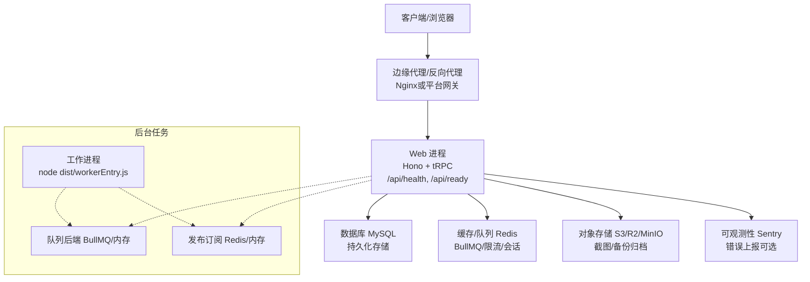
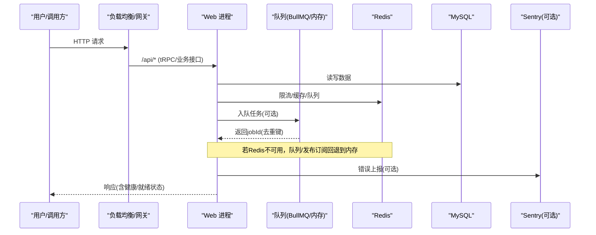
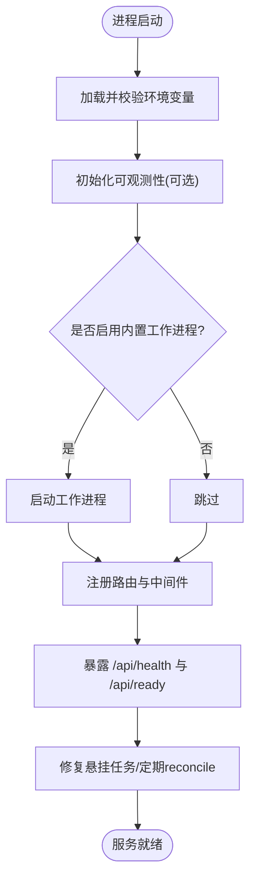
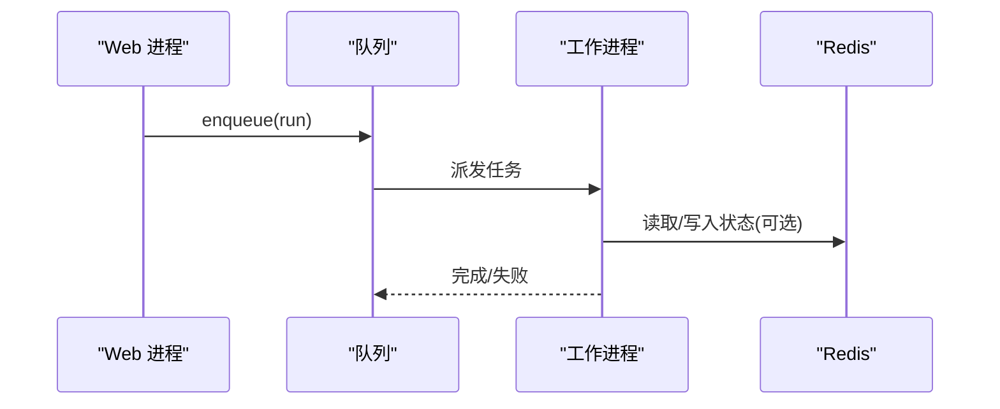
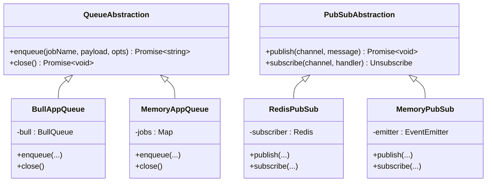
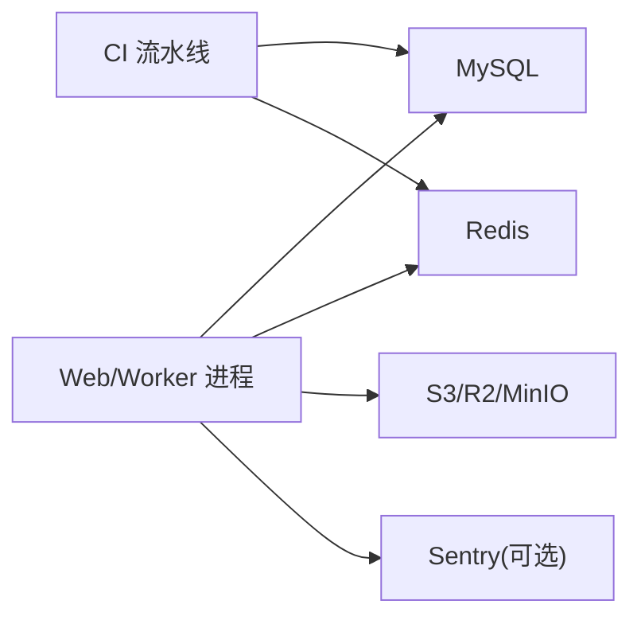

# 部署拓扑

<cite>
**本文引用的文件**
- [Dockerfile](file://Dockerfile)
- [docker-compose.yml](file://docker-compose.yml)
- [docker-compose.backup.yml](file://docker-compose.backup.yml)
- [docker-compose.relay.yml](file://docker-compose.relay.yml)
- [DEPLOY.md](file://DEPLOY.md)
- [ecosystem.config.cjs](file://ecosystem.config.cjs)
- [deploy/aliyun-setup.sh](file://deploy/aliyun-setup.sh)
- [.github/workflows/ci.yml](file://.github/workflows/ci.yml)
- [.github/workflows/backup.yml](file://.github/workflows/backup.yml)
- [api/boot.ts](file://api/boot.ts)
- [api/workerEntry.ts](file://api/workerEntry.ts)
- [api/lib/env.ts](file://api/lib/env.ts)
- [api/infra/redis.ts](file://api/infra/redis.ts)
- [api/infra/queue.ts](file://api/infra/queue.ts)
- [api/infra/pubsub.ts](file://api/infra/pubsub.ts)
- [api/lib/observability.ts](file://api/lib/observability.ts)
</cite>

## 目录
1. [简介](#简介)
2. [项目结构](#项目结构)
3. [核心组件](#核心组件)
4. [架构总览](#架构总览)
5. [详细组件分析](#详细组件分析)
6. [依赖关系分析](#依赖关系分析)
7. [性能与容量规划](#性能与容量规划)
8. [故障排查指南](#故障排查指南)
9. [结论](#结论)
10. [附录：多环境差异与云平台实践](#附录多环境差异与云平台实践)

## 简介
本部署拓扑文档面向DeeWaanAI系统的容器化、服务编排与负载均衡策略，覆盖开发、测试与生产环境的差异配置；说明Web进程与工作进程的分离部署；描述数据库、Redis、消息队列等基础设施的配置与管理；并提供不同云平台的部署指南与最佳实践；同时给出监控、日志收集与故障恢复的配置方法。

## 项目结构
- 应用镜像构建与运行入口由Dockerfile定义，暴露健康检查端点并设置生产环境变量。
- 本地与集成测试使用docker-compose编排MySQL与Redis，提供健康检查与数据持久卷。
- 备份任务通过独立的compose文件以定时脚本方式执行mysqldump并落盘。
- 企业内网中继连接器（on-prem relay）以独立容器运行，仅出站访问云端。
- CI流水线在GitHub Actions中执行类型检查、单元测试、构建与集成测试（真实MySQL/Redis）。
- 应用启动时注册路由、初始化可观测性、启动工作进程（可选）、暴露健康与就绪探针。
- 队列与发布订阅抽象支持BullMQ（Redis）与内存模式自动降级。
- PM2生态配置文件用于单机进程管理与日志轮转。

图表来源
- [Dockerfile:1-39](file://Dockerfile#L1-L39)
- [docker-compose.yml:1-52](file://docker-compose.yml#L1-L52)
- [api/boot.ts:61-135](file://api/boot.ts#L61-L135)
- [api/infra/queue.ts:1-70](file://api/infra/queue.ts#L1-L70)
- [api/infra/pubsub.ts:1-69](file://api/infra/pubsub.ts#L1-L69)

章节来源
- [Dockerfile:1-39](file://Dockerfile#L1-L39)
- [docker-compose.yml:1-52](file://docker-compose.yml#L1-L52)
- [docker-compose.backup.yml:1-47](file://docker-compose.backup.yml#L1-L47)
- [docker-compose.relay.yml:1-38](file://docker-compose.relay.yml#L1-L38)
- [.github/workflows/ci.yml:1-96](file://.github/workflows/ci.yml#L1-L96)

## 核心组件
- Web进程：基于Hono的HTTP服务，注册tRPC与各类API路由，提供健康与就绪探针，启动时可选择内置工作进程。
- 工作进程：独立进程消费队列任务，避免长耗时任务阻塞HTTP服务。
- 队列与发布订阅：统一抽象，优先使用BullMQ+Redis，不可用时回退到进程内内存实现。
- 数据库与缓存：MySQL作为主存储，Redis用于缓存、限流、队列与跨节点广播。
- 可观测性与日志：Sentry错误上报（可选），PM2日志轮转（单机），容器健康检查。
- 备份与中继：定时备份至对象存储；企业内网中继连接器仅出站访问云端。

章节来源
- [api/boot.ts:61-135](file://api/boot.ts#L61-L135)
- [api/workerEntry.ts:1-65](file://api/workerEntry.ts#L1-L65)
- [api/infra/queue.ts:1-70](file://api/infra/queue.ts#L1-L70)
- [api/infra/pubsub.ts:1-69](file://api/infra/pubsub.ts#L1-L69)
- [api/lib/observability.ts:1-33](file://api/lib/observability.ts#L1-L33)
- [ecosystem.config.cjs:1-32](file://ecosystem.config.cjs#L1-L32)

## 架构总览
系统采用“Web进程 + 可选独立工作进程”的多进程架构，通过队列与发布解耦耗时任务。所有外部依赖（MySQL、Redis、S3）均通过环境变量注入，具备优雅降级能力（Redis不可用则回退内存模式）。

图表来源
- [api/boot.ts:61-135](file://api/boot.ts#L61-L135)
- [api/infra/queue.ts:1-70](file://api/infra/queue.ts#L1-L70)
- [api/infra/pubsub.ts:1-69](file://api/infra/pubsub.ts#L1-L69)
- [api/lib/observability.ts:1-33](file://api/lib/observability.ts#L1-L33)

## 详细组件分析

### Web 进程与启动流程
- 启动时加载环境变量，校验必填项与敏感默认值，初始化可观测性。
- 注册安全头、请求ID、体大小限制等中间件。
- 根据环境变量决定是否启动内置工作进程。
- 暴露健康检查（进程存活且数据库可达）与就绪检查（数据库与Redis均可达）。
- 注册各功能路由（上传、回调、MCP、SSO、中继等），失败不阻断启动。
- 启动时修复“悬挂”的运行任务，周期性 reconciler 清理过期状态。
- 优雅关闭：停止工作进程、关闭队列与连接。

图表来源
- [api/boot.ts:61-135](file://api/boot.ts#L61-L135)
- [api/boot.ts:197-359](file://api/boot.ts#L197-L359)
- [api/lib/env.ts:1-105](file://api/lib/env.ts#L1-L105)

章节来源
- [api/boot.ts:61-135](file://api/boot.ts#L61-L135)
- [api/boot.ts:197-359](file://api/boot.ts#L197-L359)
- [api/lib/env.ts:1-105](file://api/lib/env.ts#L1-L105)

### 工作进程（独立部署）
- 独立入口文件仅消费队列任务，避免与HTTP共享资源。
- 通过环境变量控制Web进程不启动内置工作进程。
- 同样具备全局异常捕获与优雅关闭逻辑。
- 与Web进程共享同一队列后端，保证任务一致性。

图表来源
- [api/workerEntry.ts:1-65](file://api/workerEntry.ts#L1-L65)
- [api/infra/queue.ts:200-261](file://api/infra/queue.ts#L200-L261)

章节来源
- [api/workerEntry.ts:1-65](file://api/workerEntry.ts#L1-L65)
- [DEPLOY.md:135-145](file://DEPLOY.md#L135-L145)

### 队列与发布订阅（双后端）
- 队列：优先BullMQ（持久、跨节点），不可用时回退到进程内内存队列；支持延迟任务与去重键（24小时TTL）。
- 发布订阅：优先Redis pub/sub（多实例广播），不可用时回退到进程内EventEmitter；消息带来源标识避免自环。
- 连接管理：对Redis连接进行有限重试与指数退避，失败后记录告警并降级。

图表来源
- [api/infra/queue.ts:1-70](file://api/infra/queue.ts#L1-L70)
- [api/infra/queue.ts:200-261](file://api/infra/queue.ts#L200-L261)
- [api/infra/pubsub.ts:1-69](file://api/infra/pubsub.ts#L1-L69)

章节来源
- [api/infra/queue.ts:1-334](file://api/infra/queue.ts#L1-L334)
- [api/infra/pubsub.ts:1-154](file://api/infra/pubsub.ts#L1-L154)
- [api/infra/redis.ts:1-88](file://api/infra/redis.ts#L1-L88)

### 数据库与缓存
- 数据库：MySQL 8.0，提供健康检查与数据卷持久化；CI中使用服务容器模拟。
- 缓存/队列：Redis 7 Alpine，提供连接重试与降级；健康检查与数据卷持久化。
- 连接参数与可用性通过环境变量控制，缺失时应用保持可用但部分功能降级。

章节来源
- [docker-compose.yml:1-52](file://docker-compose.yml#L1-L52)
- [.github/workflows/ci.yml:45-96](file://.github/workflows/ci.yml#L45-L96)
- [api/infra/redis.ts:1-88](file://api/infra/redis.ts#L1-L88)

### 备份与中继
- 备份：通过GitHub Actions每日触发应用备份端点，将数据库dump压缩后上传至对象存储；也可在任意主机运行独立compose容器定时执行mysqldump。
- 中继：企业内网连接器仅出站访问云端，无需暴露端口，满足数据驻留要求。

章节来源
- [.github/workflows/backup.yml:1-46](file://.github/workflows/backup.yml#L1-L46)
- [docker-compose.backup.yml:1-47](file://docker-compose.backup.yml#L1-L47)
- [docker-compose.relay.yml:1-38](file://docker-compose.relay.yml#L1-L38)

## 依赖关系分析
- Web进程依赖：MySQL（数据）、Redis（缓存/队列/限流/广播）、S3（备份/截图）、Sentry（可选）。
- 工作进程依赖：队列后端（BullMQ/内存）、Redis（可选）。
- 编排依赖：Docker Compose用于本地与集成测试；CI使用服务容器拉起MySQL/Redis。
- 进程管理：PM2用于单机进程守护与日志轮转。

图表来源
- [api/boot.ts:61-135](file://api/boot.ts#L61-L135)
- [api/infra/queue.ts:1-70](file://api/infra/queue.ts#L1-L70)
- [.github/workflows/ci.yml:45-96](file://.github/workflows/ci.yml#L45-L96)

章节来源
- [api/lib/env.ts:1-105](file://api/lib/env.ts#L1-L105)
- [api/infra/queue.ts:1-70](file://api/infra/queue.ts#L1-L70)
- [.github/workflows/ci.yml:1-96](file://.github/workflows/ci.yml#L1-L96)

## 性能与容量规划
- 单进程限制：PM2配置限制Node堆大小与最大内存重启阈值，防止内存泄漏导致OOM。
- 并发与吞吐：队列并发度可通过环境变量调整；BullMQ worker并发受限于Redis与下游依赖。
- 资源隔离：建议在高负载时将Web与工作进程拆分部署，避免长任务影响HTTP响应。
- 存储与I/O：截图与备份建议使用对象存储，避免容器文件系统被回收导致数据丢失。
- 网络与代理：信任边缘代理的X-Forwarded-For头以正确识别限速IP；直连公网时需关闭信任。

章节来源
- [ecosystem.config.cjs:1-32](file://ecosystem.config.cjs#L1-L32)
- [api/infra/queue.ts:235-261](file://api/infra/queue.ts#L235-L261)
- [DEPLOY.md:125-133](file://DEPLOY.md#L125-L133)

## 故障排查指南
- 健康检查：/api/health返回进程状态、内存、数据库与队列后端信息；/api/ready仅在依赖全部可达时返回200。
- 常见症状：
  - 数据库不可达：健康检查返回degraded，就绪检查返回not-ready。
  - Redis不可用：队列/发布订阅自动降级为内存模式；限流与会话可能失效。
  - 工作进程未运行：健康检查显示worker disabled；需检查START_WORKER与环境变量。
- 日志与可观测性：
  - PM2日志轮转：combined/out/error日志按大小与数量轮转。
  - Sentry：DSN为空时不初始化；初始化失败不影响启动。
- 恢复策略：
  - 启动时修复悬挂任务，周期性reconciler清理过期状态。
  - 备份：每日触发备份端点或运行独立备份容器；保留7天。

章节来源
- [api/boot.ts:61-135](file://api/boot.ts#L61-L135)
- [api/boot.ts:197-359](file://api/boot.ts#L197-L359)
- [ecosystem.config.cjs:1-32](file://ecosystem.config.cjs#L1-L32)
- [api/lib/observability.ts:1-33](file://api/lib/observability.ts#L1-L33)
- [.github/workflows/backup.yml:1-46](file://.github/workflows/backup.yml#L1-L46)

## 结论
DeeWaanAI采用容器化与可编排的服务架构，Web与工作进程分离部署，队列与发布订阅具备强韧的双后端实现。通过健康与就绪探针、PM2进程管理、Sentry可观测性与自动化备份，系统在多云与私有环境中具备高可用与易运维特性。建议在生产环境启用独立工作进程、对象存储与完善的监控告警，确保稳定性与可恢复性。

## 附录：多环境差异与云平台实践

### 开发环境与测试环境
- 本地开发：使用docker-compose启动MySQL与Redis，按需启用应用容器；环境变量通过.env注入。
- 集成测试：CI中拉起MySQL与Redis服务容器，执行类型检查、单元测试与构建，验证真实依赖下的行为。

章节来源
- [docker-compose.yml:1-52](file://docker-compose.yml#L1-L52)
- [.github/workflows/ci.yml:45-96](file://.github/workflows/ci.yml#L45-L96)

### 生产环境差异配置
- 环境变量：DATABASE_URL、REDIS_URL、APP_SECRET、AI_SWARM_MASTER_KEY、MARKETPLACE_MASTER_KEY等为必填；S3_*、SENTRY_DSN、BACKUP_TOKEN等为可选增强。
- 工作进程：生产建议启用独立工作进程，Web进程设置START_WORKER=false。
- 代理与安全：信任边缘代理的XFF头；直连公网需关闭信任；启用HTTPS与HSTS。
- 资源限制：合理设置Node堆大小与进程内存上限，避免OOM。

章节来源
- [api/lib/env.ts:1-105](file://api/lib/env.ts#L1-L105)
- [DEPLOY.md:46-67](file://DEPLOY.md#L46-L67)
- [DEPLOY.md:135-145](file://DEPLOY.md#L135-L145)
- [ecosystem.config.cjs:1-32](file://ecosystem.config.cjs#L1-L32)

### 云平台部署指南与最佳实践
- Railway：
  - 一键部署：从GitHub仓库部署，自动检测Dockerfile。
  - 服务编排：添加MySQL与Redis服务，配置环境变量与域名。
  - 工作进程：创建第二个服务运行workerEntry.js，Web服务禁用内置工作进程。
  - 备份：通过GitHub Actions每日触发备份端点，上传至S3兼容存储。
  - 健康检查：/api/health与/api/ready用于探针与流量切换。
- 阿里云ECS（自建）：
  - 安装Node.js、PM2、MySQL、Nginx，生成密钥并配置.env。
  - 使用PM2守护进程，Nginx反向代理并配置限流与超时。
  - 可选Let's Encrypt证书启用HTTPS。
  - 防火墙开放必要端口，保存PM2配置并开机自启。

章节来源
- [DEPLOY.md:1-145](file://DEPLOY.md#L1-L145)
- [deploy/aliyun-setup.sh:1-198](file://deploy/aliyun-setup.sh#L1-L198)

### 监控、日志与故障恢复
- 监控：
  - 健康与就绪探针：/api/health与/api/ready。
  - 可观测性：Sentry错误上报（可选），按环境区分。
- 日志：
  - PM2日志轮转：combined/out/error，限制大小与数量。
  - 容器健康检查：HEALTHCHECK探测/api/health。
- 故障恢复：
  - 启动时修复悬挂任务，周期性reconciler清理过期状态。
  - 备份：每日触发备份端点或运行独立备份容器，保留7天。
  - 降级：Redis不可用时队列与发布订阅回退内存模式，保障基本功能。

章节来源
- [api/boot.ts:61-135](file://api/boot.ts#L61-L135)
- [api/lib/observability.ts:1-33](file://api/lib/observability.ts#L1-L33)
- [ecosystem.config.cjs:1-32](file://ecosystem.config.cjs#L1-L32)
- [.github/workflows/backup.yml:1-46](file://.github/workflows/backup.yml#L1-L46)
- [docker-compose.backup.yml:1-47](file://docker-compose.backup.yml#L1-L47)