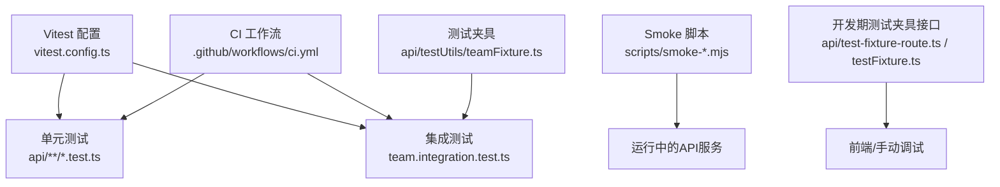
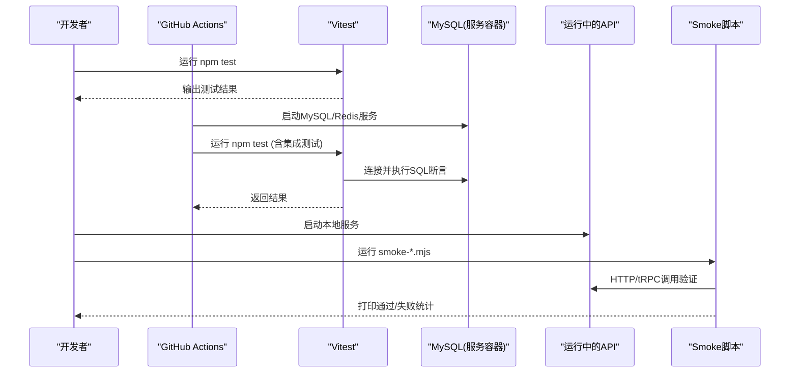
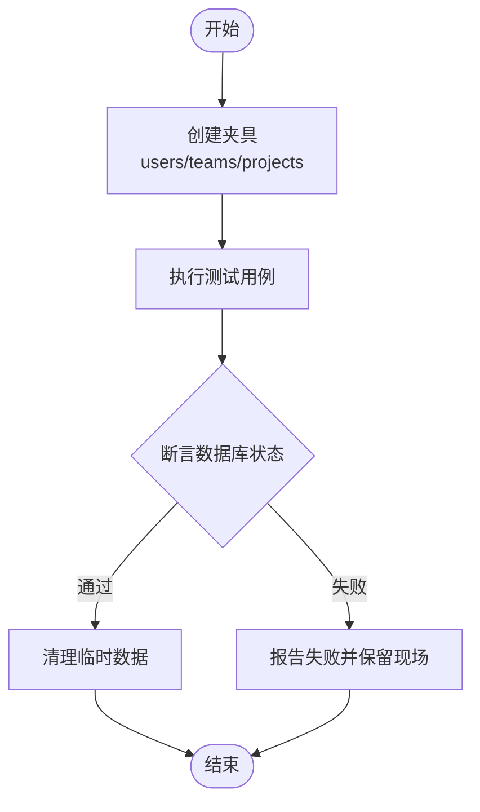
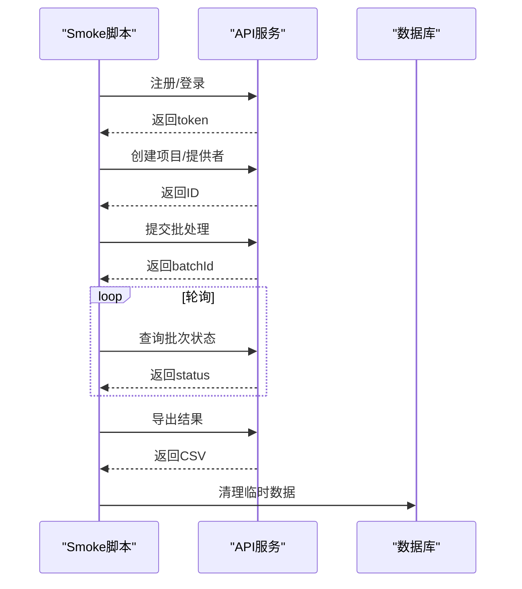
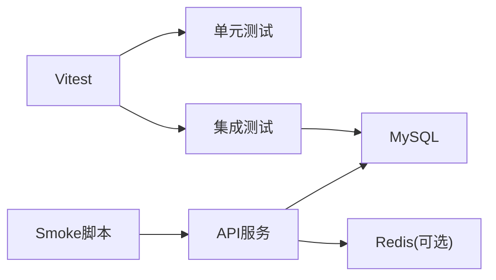

# 测试指南

<cite>
**本文引用的文件**
- [vitest.config.ts](file://vitest.config.ts)
- [package.json](file://package.json)
- [.github/workflows/ci.yml](file://.github/workflows/ci.yml)
- [api/lib/adminGuards.test.ts](file://api/lib/adminGuards.test.ts)
- [api/routers/team.integration.test.ts](file://api/routers/team.integration.test.ts)
- [api/testUtils/teamFixture.ts](file://api/testUtils/teamFixture.ts)
- [scripts/smoke-batch.mjs](file://scripts/smoke-batch.mjs)
- [scripts/smoke-waitlist.mjs](file://scripts/smoke-waitlist.mjs)
- [api/test-fixture-route.ts](file://api/test-fixture-route.ts)
- [api/routers/testFixture.ts](file://api/routers/testFixture.ts)
</cite>

## 目录
1. [简介](#简介)
2. [项目结构](#项目结构)
3. [核心组件](#核心组件)
4. [架构总览](#架构总览)
5. [详细组件分析](#详细组件分析)
6. [依赖分析](#依赖分析)
7. [性能考虑](#性能考虑)
8. [故障排查指南](#故障排查指南)
9. [结论](#结论)
10. [附录](#附录)

## 简介
本指南面向DeeWaanAI项目的测试实践，覆盖单元测试、集成测试与端到端（E2E）烟雾测试的策略、工具与环境配置。文档基于仓库现有实现，说明Vitest配置、测试夹具与Mock数据的使用方式，提供测试环境设置、测试数据准备方法，并给出覆盖率要求、持续集成配置与最佳实践建议。同时记录常见测试场景与用例编写规范，帮助团队在本地与CI中稳定运行测试。

## 项目结构
- 测试框架：Vitest（Node环境），通过根级配置文件集中管理别名与测试范围。
- 测试组织：
  - 单元测试：位于 api/** 下的 *.test.ts 文件，针对纯函数、中间件、工具模块等。
  - 集成测试：使用真实MySQL数据库，通过服务容器在CI中启动；测试套件包含团队路由的完整流程验证。
  - E2E/Smoke测试：位于 scripts 目录，直接调用运行中的API进行功能验证，并在完成后清理数据。
- 测试夹具：
  - 通用夹具：api/testUtils/teamFixture.ts 用于创建用户、团队、项目等基础数据，并提供按用户身份调用的tRPC调用器。
  - 开发期测试夹具接口：api/test-fixture-route.ts 与 api/routers/testFixture.ts 提供上传/下载/删除测试包的能力（仅开发环境可用）。

图表来源
- [vitest.config.ts:1-21](file://vitest.config.ts#L1-L21)
- [.github/workflows/ci.yml:1-96](file://.github/workflows/ci.yml#L1-L96)
- [api/testUtils/teamFixture.ts:1-145](file://api/testUtils/teamFixture.ts#L1-L145)
- [api/test-fixture-route.ts:61-198](file://api/test-fixture-route.ts#L61-L198)
- [api/routers/testFixture.ts:1-61](file://api/routers/testFixture.ts#L1-L61)

章节来源
- [vitest.config.ts:1-21](file://vitest.config.ts#L1-L21)
- [package.json:7-22](file://package.json#L7-L22)
- [.github/workflows/ci.yml:1-96](file://.github/workflows/ci.yml#L1-L96)

## 核心组件
- Vitest 配置
  - 测试环境：node
  - 匹配规则：api 目录下所有 .test.ts 与 .spec.ts
  - 路径别名：@, @contracts, @assets, @db
- 测试脚本
  - npm test：执行 vitest run
- CI 流水线
  - gates 任务：类型检查、i18n校验、单元测试、生产构建
  - integration 任务：启动MySQL与Redis服务容器，推送数据库schema后运行全部测试（含集成测试）

章节来源
- [vitest.config.ts:1-21](file://vitest.config.ts#L1-L21)
- [package.json:7-22](file://package.json#L7-L22)
- [.github/workflows/ci.yml:10-96](file://.github/workflows/ci.yml#L10-L96)

## 架构总览
下图展示了测试在本地与CI中的整体流程：单元测试由Vitest直接执行；集成测试需要真实MySQL；Smoke测试需要已运行的API服务并通过HTTP/tRPC调用验证关键路径。

图表来源
- [.github/workflows/ci.yml:45-96](file://.github/workflows/ci.yml#L45-L96)
- [scripts/smoke-batch.mjs:1-134](file://scripts/smoke-batch.mjs#L1-L134)
- [scripts/smoke-waitlist.mjs:1-96](file://scripts/smoke-waitlist.mjs#L1-L96)

## 详细组件分析

### 单元测试策略与实践
- 目标：验证无副作用或低耦合逻辑，如权限守卫、限流、消息处理等。
- 示例：adminGuards.test.ts 对管理员降级保护逻辑进行边界条件断言。
- 建议：
  - 每个业务单元至少一个单测，覆盖正常路径与异常分支。
  - 对外部依赖（网络、存储、第三方SDK）采用Mock或替换为内存实现。
  - 保持测试幂等与快速执行。

章节来源
- [api/lib/adminGuards.test.ts:1-35](file://api/lib/adminGuards.test.ts#L1-L35)

### 集成测试策略与实践
- 目标：验证跨层交互与持久化行为，确保数据库约束与服务契约正确。
- 示例：team.integration.test.ts 使用真实MySQL，覆盖团队创建、加入、成员角色变更、项目共享、导入流水线、计费前置条件等场景。
- 夹具：teamFixture.ts 通过原始SQL创建用户、团队、项目，并提供按用户身份的tRPC调用器，避免迁移差异导致的不稳定。
- 建议：
  - 使用事务或测试后清理保证隔离性。
  - 将外部依赖（如Stripe）以未配置状态验证错误路径。
  - 明确断言数据库最终状态，而不仅看返回值。

图表来源
- [api/routers/team.integration.test.ts:1-436](file://api/routers/team.integration.test.ts#L1-L436)
- [api/testUtils/teamFixture.ts:1-145](file://api/testUtils/teamFixture.ts#L1-L145)

章节来源
- [api/routers/team.integration.test.ts:1-436](file://api/routers/team.integration.test.ts#L1-L436)
- [api/testUtils/teamFixture.ts:1-145](file://api/testUtils/teamFixture.ts#L1-L145)

### 端到端/烟雾测试策略与实践
- 目标：验证关键业务流程在真实服务上的可用性，包括批量任务、等待列表、MCP助手等。
- 示例：
  - smoke-batch.mjs：注册账号、登录、创建项目、添加提供者、运行批处理、轮询状态、导出CSV、列出批次，最后清理数据。
  - smoke-waitlist.mjs：验证等待列表接口的join、重复处理、引用、计数、CORS等。
- 建议：
  - 每次运行前读取.env获取DATABASE_URL与PORT，确保可配置。
  - 使用唯一标签生成临时数据，避免冲突。
  - 在finally块中确保清理，防止污染后续运行。

图表来源
- [scripts/smoke-batch.mjs:1-134](file://scripts/smoke-batch.mjs#L1-L134)
- [scripts/smoke-waitlist.mjs:1-96](file://scripts/smoke-waitlist.mjs#L1-L96)

章节来源
- [scripts/smoke-batch.mjs:1-134](file://scripts/smoke-batch.mjs#L1-L134)
- [scripts/smoke-waitlist.mjs:1-96](file://scripts/smoke-waitlist.mjs#L1-L96)

### 测试夹具与Mock数据
- 团队夹具：teamFixture.ts 提供创建用户、团队、项目以及按用户身份调用tRPC的方法，适合集成测试复用。
- 开发期测试夹具接口：
  - test-fixture-route.ts：提供上传ZIP到服务器、下载、删除等操作（仅开发环境）。
  - testFixture.ts：暴露tRPC路由用于列举与更新夹具元信息。
- Mock建议：
  - 对网络请求、文件系统、第三方SDK使用vi.fn()或模块替换。
  - 对时间敏感逻辑使用固定时间源。
  - 对随机性使用种子或固定输入。

章节来源
- [api/testUtils/teamFixture.ts:1-145](file://api/testUtils/teamFixture.ts#L1-L145)
- [api/test-fixture-route.ts:61-198](file://api/test-fixture-route.ts#L61-L198)
- [api/routers/testFixture.ts:1-61](file://api/routers/testFixture.ts#L1-L61)

### 测试环境设置与数据准备
- 本地运行单元测试：
  - 安装依赖后执行 npm test。
- 本地运行集成测试：
  - 确保环境变量 DATABASE_URL 指向可用的MySQL实例。
  - 如需Redis相关测试，设置 REDIS_URL。
- 本地运行Smoke测试：
  - 先启动API服务（默认端口3000）。
  - 确保 .env 中存在 DATABASE_URL。
  - 执行对应脚本，例如 node scripts/smoke-batch.mjs。
- 数据准备：
  - 集成测试通过夹具自动创建所需数据，并在结束后清理。
  - Smoke测试在finally中清理临时数据，避免残留。

章节来源
- [vitest.config.ts:16-19](file://vitest.config.ts#L16-L19)
- [scripts/smoke-batch.mjs:8-13](file://scripts/smoke-batch.mjs#L8-L13)
- [scripts/smoke-waitlist.mjs:10-15](file://scripts/smoke-waitlist.mjs#L10-L15)

### 覆盖率要求
- 当前仓库未配置Vitest覆盖率选项。建议在vitest.config.ts中添加coverage配置，设定行/分支/函数/语句覆盖率阈值，并在CI中强制通过。
- 建议目标：
  - 行覆盖率 ≥ 80%
  - 分支覆盖率 ≥ 70%
  - 关键路径（认证、计费、权限）覆盖率 ≥ 90%

[本节为通用建议，不直接分析具体文件]

### 持续集成配置
- GitHub Actions 工作流：
  - gates：类型检查、i18n校验、单元测试、生产构建。
  - integration：启动MySQL与Redis服务容器，推送schema后运行全部测试。
- 环境变量：
  - NODE_ENV=test
  - DATABASE_URL、REDIS_URL、APP_ID、APP_SECRET、AI_SWARM_MASTER_KEY、MARKETPLACE_MASTER_KEY
- 建议：
  - 增加覆盖率上报步骤（如codecov）。
  - 缓存依赖提升速度。
  - 并行化测试任务缩短反馈时间。

章节来源
- [.github/workflows/ci.yml:10-96](file://.github/workflows/ci.yml#L10-L96)

### 测试最佳实践
- 命名与组织：
  - 测试文件与源码同名后缀.test.ts，便于定位。
  - 描述性测试名，体现场景与预期。
- 数据隔离：
  - 使用夹具创建独立数据，避免相互影响。
  - 在afterAll或finally中清理。
- 断言质量：
  - 断言数据库最终状态，而非仅返回值。
  - 对错误路径进行显式断言。
- 稳定性：
  - 避免硬编码时间戳与随机值，使用固定种子或夹具。
  - 对网络调用进行超时与重试控制。
- 可维护性：
  - 抽取公共夹具与工具函数。
  - 将复杂流程拆分为多个小用例。

[本节为通用建议，不直接分析具体文件]

### 常见测试场景与用例编写指南
- 权限与角色：
  - 覆盖owner/admin/member/outsider不同角色的操作权限。
  - 验证不可变约束（如不能移除owner）。
- 数据一致性：
  - 验证创建/更新/删除后的数据库状态。
  - 验证级联删除与唯一约束。
- 外部依赖：
  - 未配置计费时的错误路径。
  - 网络异常与超时处理。
- 接口契约：
  - 参数校验错误码与消息。
  - CORS与预检请求。
- 批量与异步：
  - 轮询状态直至完成或达到上限。
  - 导出结果的格式与行数断言。

[本节为通用建议，不直接分析具体文件]

## 依赖分析
- 测试与运行时依赖：
  - Vitest：测试框架
  - mysql2：集成测试与Smoke脚本直连数据库
  - tRPC客户端：Smoke脚本通过HTTP调用tRPC端点
- 外部服务：
  - MySQL：集成测试与Smoke脚本必需
  - Redis：部分集成测试可能依赖（如限流）
- 耦合关系：
  - 集成测试强依赖数据库schema与数据完整性。
  - Smoke脚本强依赖API服务的可用性与配置。

图表来源
- [.github/workflows/ci.yml:45-96](file://.github/workflows/ci.yml#L45-L96)
- [scripts/smoke-batch.mjs:1-134](file://scripts/smoke-batch.mjs#L1-L134)
- [scripts/smoke-waitlist.mjs:1-96](file://scripts/smoke-waitlist.mjs#L1-L96)

章节来源
- [.github/workflows/ci.yml:45-96](file://.github/workflows/ci.yml#L45-L96)
- [scripts/smoke-batch.mjs:1-134](file://scripts/smoke-batch.mjs#L1-L134)
- [scripts/smoke-waitlist.mjs:1-96](file://scripts/smoke-waitlist.mjs#L1-L96)

## 性能考虑
- 单元测试应快速执行，避免I/O与网络调用。
- 集成测试尽量最小化数据量，使用索引与合理查询。
- Smoke测试应限制轮询次数与超时，避免长时间阻塞。
- CI中缓存依赖与构建产物，减少冷启动时间。

[本节为通用建议，不直接分析具体文件]

## 故障排查指南
- 无法连接数据库：
  - 检查DATABASE_URL是否正确，MySQL服务是否启动。
  - 确认CI中服务容器健康检查通过。
- 集成测试失败：
  - 查看数据库表结构与迁移是否一致。
  - 检查夹具创建的数据是否符合预期。
- Smoke测试失败：
  - 确认API服务已启动且端口可达。
  - 检查.env中的DATABASE_URL与PORT。
  - 查看脚本输出的错误信息与数据库清理日志。
- 权限与认证问题：
  - 使用夹具提供的callerAs方法模拟不同用户。
  - 检查tRPC中间件的鉴权逻辑。

章节来源
- [api/routers/team.integration.test.ts:1-436](file://api/routers/team.integration.test.ts#L1-L436)
- [scripts/smoke-batch.mjs:1-134](file://scripts/smoke-batch.mjs#L1-L134)
- [scripts/smoke-waitlist.mjs:1-96](file://scripts/smoke-waitlist.mjs#L1-L96)

## 结论
本项目已具备完善的测试体系：Vitest驱动的单元测试、基于真实MySQL的集成测试、以及覆盖关键流程的Smoke测试。通过夹具与CI服务容器，测试可在本地与云端稳定运行。建议补充覆盖率配置与更多边界场景用例，进一步提升质量与可维护性。

[本节为总结，不直接分析具体文件]

## 附录
- 常用命令
  - 运行单元测试：npm test
  - 运行Smoke测试：node scripts/smoke-batch.mjs 或 node scripts/smoke-waitlist.mjs
- 环境变量
  - DATABASE_URL：数据库连接串
  - PORT：API服务端口（Smoke脚本默认3000）
  - REDIS_URL：Redis连接串（可选）
- 参考文件
  - 测试配置：vitest.config.ts
  - CI流程：.github/workflows/ci.yml
  - 夹具：api/testUtils/teamFixture.ts
  - Smoke脚本：scripts/smoke-*.mjs

[本节为补充信息，不直接分析具体文件]