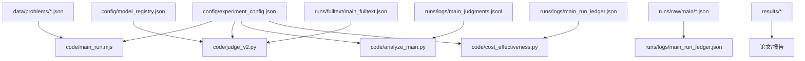
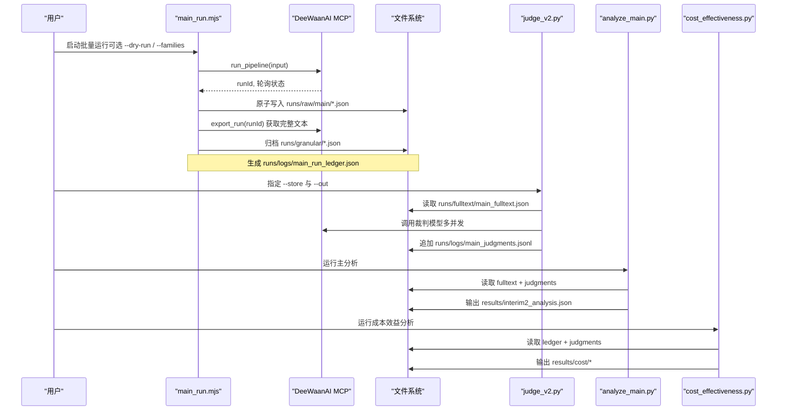
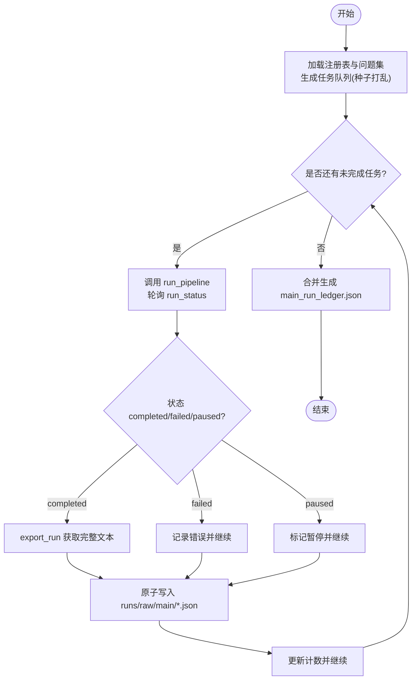
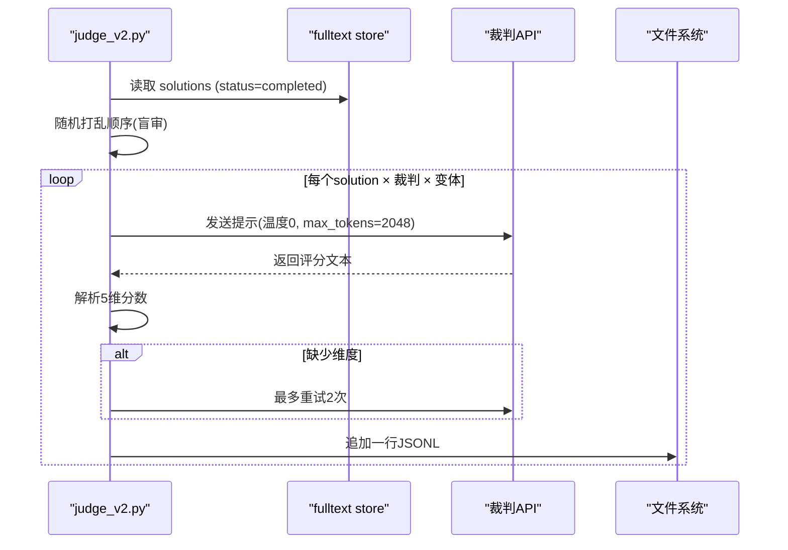
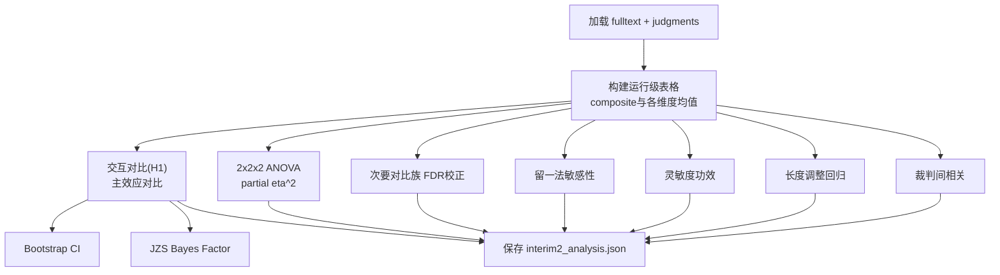
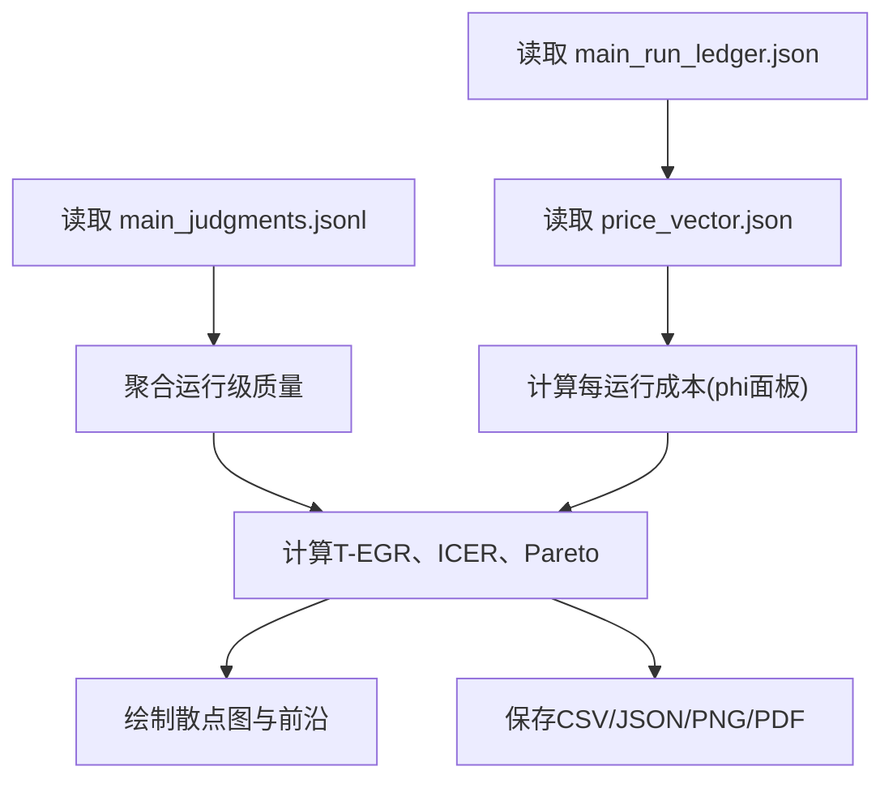
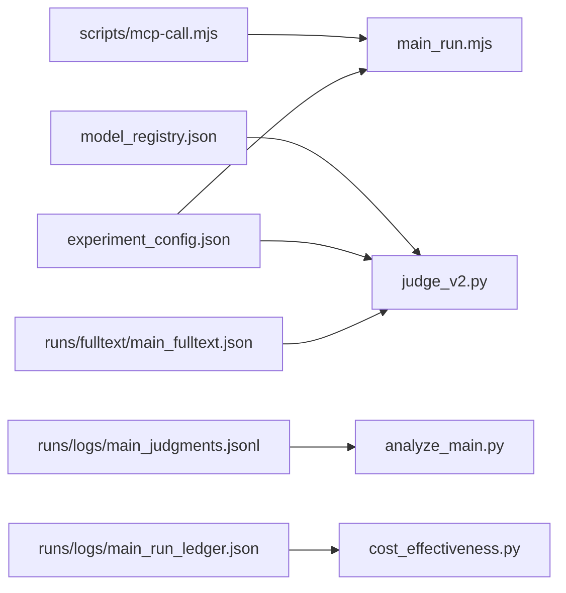

# 分析脚本

<cite>
**本文引用的文件**
- [research/orchestration-economics/README.md](file://research/orchestration-economics/README.md)
- [research/orchestration-economics/code/README.md](file://research/orchestration-economics/code/README.md)
- [research/orchestration-economics/config/experiment_config.json](file://research/orchestration-economics/config/experiment_config.json)
- [research/orchestration-economics/config/model_registry.json](file://research/orchestration-economics/config/model_registry.json)
- [research/orchestration-economics/data/problems/business_problems_15.json](file://research/orchestration-economics/data/problems/business_problems_15.json)
- [research/orchestration-economics/code/main_run.mjs](file://research/orchestration-economics/code/main_run.mjs)
- [research/orchestration-economics/code/judge_v2.py](file://research/orchestration-economics/code/judge_v2.py)
- [research/orchestration-economics/code/analyze_main.py](file://research/orchestration-economics/code/analyze_main.py)
- [research/orchestration-economics/code/cost_effectiveness.py](file://research/orchestration-economics/code/cost_effectiveness.py)
- [research/orchestration-economics/code/sequential_analysis.py](file://research/orchestration-economics/code/sequential_analysis.py)
- [research/orchestration-economics/code/cross_family.py](file://research/orchestration-economics/code/cross_family.py)
</cite>

## 目录
1. [简介](#简介)
2. [项目结构](#项目结构)
3. [核心组件](#核心组件)
4. [架构总览](#架构总览)
5. [详细组件分析](#详细组件分析)
6. [依赖关系分析](#依赖关系分析)
7. [性能与并行处理](#性能与并行处理)
8. [调试与错误处理](#调试与错误处理)
9. [结论](#结论)
10. [附录：参数与环境配置](#附录参数与环境配置)

## 简介
本文件为 DeeWaanAI 研究仓库中“编排经济学”实验的分析脚本提供系统化文档。内容覆盖主分析脚本功能与执行流程、批量运行与判分脚本的参数与用法、流水线管道定义与执行机制、统计分析逻辑与输出格式、自定义分析脚本开发指南、依赖与环境配置，以及调试、错误处理与性能优化实践。所有说明均基于仓库内已提交的代码与配置文件，确保可复现与可审计。

## 项目结构
该子仓库聚焦于“编排经济学”实验的数据、代码与结果，采用“数据-配置-代码-结果”的清晰分层：
- config：实验设计、模型注册表、价格向量等配置
- data：问题集、文化人设等输入数据
- code：运行器、判分器、统计分析与可视化脚本
- runs：原始运行记录、完整文本、日志与聚合结果
- evaluation：评审提示词与原始评分
- results：分析产出（表格、图表、JSON）

**图示来源**
- [research/orchestration-economics/config/experiment_config.json:1-272](file://research/orchestration-economics/config/experiment_config.json#L1-L272)
- [research/orchestration-economics/config/model_registry.json:1-226](file://research/orchestration-economics/config/model_registry.json#L1-L226)
- [research/orchestration-economics/code/main_run.mjs:1-267](file://research/orchestration-economics/code/main_run.mjs#L1-L267)
- [research/orchestration-economics/code/judge_v2.py:1-236](file://research/orchestration-economics/code/judge_v2.py#L1-L236)
- [research/orchestration-economics/code/analyze_main.py:1-319](file://research/orchestration-economics/code/analyze_main.py#L1-L319)
- [research/orchestration-economics/code/cost_effectiveness.py:1-243](file://research/orchestration-economics/code/cost_effectiveness.py#L1-L243)

**章节来源**
- [research/orchestration-economics/README.md:18-41](file://research/orchestration-economics/README.md#L18-L41)
- [research/orchestration-economics/code/README.md:1-200](file://research/orchestration-economics/code/README.md#L1-L200)

## 核心组件
- 批量运行器 main_run.mjs：按预注册计划生成任务队列，调用 DeeWaanAI MCP 接口执行流水线，采集 token、延迟、状态，并原子写入每条运行的 JSON 记录；支持断点续跑与并发控制。
- 判分器 judge_v2.py：从完整文本存储读取解决方案，使用三个独立裁判模型对每个方案进行盲审（3个裁判×3变体），输出 JSONL 评分记录，具备完整性校验与重试机制。
- 主分析 analyze_main.py：构建运行级复合指标，计算主要假设对比、主效应、交互作用，并提供 Bootstrap CI、FDR 校正、ANOVA、贝叶斯因子、敏感性分析等。
- 成本效益 cost_effectiveness.py：基于令牌用量与冻结价格向量计算每运行成本，生成单元汇总、Pareto 前沿、T-EGR 指标与散点图。
- 序贯分析 sequential_analysis.py：对试点阶段数据进行中期决策（含混合效应模型、交叉检查、停止规则评估）。
- 跨族比较 cross_family.py：在锁定数据上重算跨模型族的描述性比较。

**章节来源**
- [research/orchestration-economics/code/main_run.mjs:1-267](file://research/orchestration-economics/code/main_run.mjs#L1-L267)
- [research/orchestration-economics/code/judge_v2.py:1-236](file://research/orchestration-economics/code/judge_v2.py#L1-L236)
- [research/orchestration-economics/code/analyze_main.py:1-319](file://research/orchestration-economics/code/analyze_main.py#L1-L319)
- [research/orchestration-economics/code/cost_effectiveness.py:1-243](file://research/orchestration-economics/code/cost_effectiveness.py#L1-L243)
- [research/orchestration-economics/code/sequential_analysis.py:1-248](file://research/orchestration-economics/code/sequential_analysis.py#L1-L248)
- [research/orchestration-economics/code/cross_family.py:1-105](file://research/orchestration-economics/code/cross_family.py#L1-L105)

## 架构总览
整体流水线由“运行→判分→分析→可视化”四阶段构成，数据流严格单向，便于审计与复现。

**图示来源**
- [research/orchestration-economics/code/main_run.mjs:91-267](file://research/orchestration-economics/code/main_run.mjs#L91-L267)
- [research/orchestration-economics/code/judge_v2.py:148-231](file://research/orchestration-economics/code/judge_v2.py#L148-L231)
- [research/orchestration-economics/code/analyze_main.py:182-313](file://research/orchestration-economics/code/analyze_main.py#L182-L313)
- [research/orchestration-economics/code/cost_effectiveness.py:40-243](file://research/orchestration-economics/code/cost_effectiveness.py#L40-L243)

## 详细组件分析

### 批量运行器 main_run.mjs
- 功能：根据固定管道注册表与问题集生成任务队列，按种子打乱顺序并发执行，采集 token、延迟、步骤信息，并在完成时通过 export_run 抓取完整文本，避免截断。
- 关键参数与行为：
  - 并发度：默认 c=100，可通过进程池控制
  - 断点续跑：扫描 runs/raw/main 下已完成且非空记录，跳过重复
  - 家族过滤：--families 仅运行指定模型族
  - 超时与重试：run_status 轮询、网络异常指数退避重试
  - 原子写入：临时文件+rename 保证幂等与一致性
- 输出：
  - runs/raw/main/*.json：单条运行记录
  - runs/granular/*.json：带导出内容的归档
  - runs/logs/main_run_ledger.json：合并后的账本

**图示来源**
- [research/orchestration-economics/code/main_run.mjs:91-267](file://research/orchestration-economics/code/main_run.mjs#L91-L267)

**章节来源**
- [research/orchestration-economics/code/main_run.mjs:1-267](file://research/orchestration-economics/code/main_run.mjs#L1-L267)

### 判分器 judge_v2.py
- 功能：从完整文本存储读取解决方案，使用三个裁判模型（deepseek、GLM、Llama）对每个方案进行盲审（3个裁判×3提示变体），输出 JSONL 评分记录。
- 关键特性：
  - 完整文本：避免 pilot 中 run_status 截断导致的评分偏差
  - 完整性校验：缺失维度则最多重试2次，失败记录 incomplete 标志
  - 并发控制：按裁判家族设置信号量，线程池并发
  - 可恢复：已有输出行去重，支持增量追加
- 输入/输出：
  - 输入：--store runs/fulltext/main_fulltext.json
  - 输出：--out runs/logs/main_judgments.jsonl

**图示来源**
- [research/orchestration-economics/code/judge_v2.py:148-231](file://research/orchestration-economics/code/judge_v2.py#L148-L231)

**章节来源**
- [research/orchestration-economics/code/judge_v2.py:1-236](file://research/orchestration-economics/code/judge_v2.py#L1-L236)

### 主分析 analyze_main.py
- 功能：构建运行级复合指标，检验主要假设（层级×结构的交互）、主效应，并提供多种稳健性与证据强度度量。
- 主要步骤：
  - 加载完整文本元数据与判分记录，构建 DataFrame
  - 计算交互对比 d、Bootstrap 95% CI、Welch t 检验
  - 主效应（tier、structure、persona）对比
  - 2x2x2 ANOVA 与效应量 partial eta^2
  - FDR 校正的次要对比族
  - 留一法敏感性（按家族、按问题）
  - 灵敏度功效（最小可检测效应）
  - 长度调整回归（历史兼容）
  - 裁判间相关性
- 输出：results/interim2_analysis.json

**图示来源**
- [research/orchestration-economics/code/analyze_main.py:48-313](file://research/orchestration-economics/code/analyze_main.py#L48-L313)

**章节来源**
- [research/orchestration-economics/code/analyze_main.py:1-319](file://research/orchestration-economics/code/analyze_main.py#L1-L319)

### 成本效益 cost_effectiveness.py
- 功能：基于令牌用量与冻结价格向量计算每运行成本，生成单元汇总、Pareto 前沿、T-EGR（团队效率增益比率）与散点图。
- 关键点：
  - 成本公式：tokens × blend(phi)/1e6，phi 主值 0.5，敏感性 {0.25, 0.75}
  - T-EGR：以 F-S-N 为基准，按家族内归一化质量与成本
  - Study-2 扩展：包含 refine 调优点的成本与质量
- 输出：results/cost/cost_per_run.csv、cell_summary.csv、pareto_frontier.csv、t_egr.json、cost_effectiveness_scatter.png/.pdf

**图示来源**
- [research/orchestration-economics/code/cost_effectiveness.py:40-243](file://research/orchestration-economics/code/cost_effectiveness.py#L40-L243)

**章节来源**
- [research/orchestration-economics/code/cost_effectiveness.py:1-243](file://research/orchestration-economics/code/cost_effectiveness.py#L1-L243)

### 序贯分析 sequential_analysis.py
- 功能：对试点阶段（Phase A+B）数据进行中期决策，使用混合效应模型估计交互项，结合停止规则（早期成功/无效/继续）决定进入主阶段。
- 关键点：
  - 主模型：quality ~ tier*structure*persona + (1|problem) + (1|family)
  - 交叉检查：平衡子集 rm-ANOVA、简单效应方向诊断
  - 停止规则：R1 p<0.01 早停；R2 p>0.10 且 BF01>10 无效；否则继续
- 输出：results/interim1_sequential_analysis.json

**章节来源**
- [research/orchestration-economics/code/sequential_analysis.py:1-248](file://research/orchestration-economics/code/sequential_analysis.py#L1-L248)

### 跨族比较 cross_family.py
- 功能：在锁定数据上重算跨模型族的描述性比较（Study-1 与 Study-2），零新 API 调用。
- 关键点：
  - 最小 runId 匹配规则
  - Holm 校正的多方向比较
  - 输出 cross_family.json

**章节来源**
- [research/orchestration-economics/code/cross_family.py:1-105](file://research/orchestration-economics/code/cross_family.py#L1-L105)

## 依赖关系分析
- 运行器依赖 DeeWaanAI MCP 工具（run_pipeline、run_status、export_run），通过 scripts/mcp-call.mjs 调用
- 判分器依赖裁判模型端点（DeepSeek、Together/GitHub Models、Meta Llama）
- 分析脚本依赖 pandas、numpy、scipy、statsmodels、pingouin 等
- 配置驱动：experiment_config.json 与 model_registry.json 决定模型、价格、裁判、执行窗口等

**图示来源**
- [research/orchestration-economics/code/main_run.mjs:25-36](file://research/orchestration-economics/code/main_run.mjs#L25-L36)
- [research/orchestration-economics/code/judge_v2.py:83-99](file://research/orchestration-economics/code/judge_v2.py#L83-L99)
- [research/orchestration-economics/config/experiment_config.json:1-272](file://research/orchestration-economics/config/experiment_config.json#L1-L272)
- [research/orchestration-economics/config/model_registry.json:1-226](file://research/orchestration-economics/config/model_registry.json#L1-L226)

**章节来源**
- [research/orchestration-economics/code/main_run.mjs:1-267](file://research/orchestration-economics/code/main_run.mjs#L1-L267)
- [research/orchestration-economics/code/judge_v2.py:1-236](file://research/orchestration-economics/code/judge_v2.py#L1-L236)
- [research/orchestration-economics/config/experiment_config.json:1-272](file://research/orchestration-economics/config/experiment_config.json#L1-L272)
- [research/orchestration-economics/config/model_registry.json:1-226](file://research/orchestration-economics/config/model_registry.json#L1-L226)

## 性能与并行处理
- 运行器并发：默认 c=100，通过 Promise.all 工作线程池实现；建议根据 API 限流与网络状况调整
- 判分器并发：按裁判家族设置信号量，线程池并发；max_workers = 每家族并发数 × 裁判数
- 幂等与断点续跑：
  - 运行器：扫描 runs/raw/main 下已完成且非空记录，跳过重复
  - 判分器：已有输出行去重，支持增量追加
- 重试与退避：
  - 运行器：网络异常指数退避重试
  - 判分器：HTTP 5xx/429 指数退避，缺失维度最多重试2次
- 原子写入：临时文件+rename 避免部分写入导致的数据损坏

[本节为通用指导，不直接分析具体文件]

## 调试与错误处理
- 运行器：
  - 打印每条运行状态、token、长度、截断标记与错误摘要
  - streamError 辅助函数拉取流水线错误详情
  - 支持 --dry-run 预览计划
- 判分器：
  - 记录 error/incomplete 字段便于审计
  - 环境变量或 .env 文件加载 API Key，缺失时报错退出
- 分析脚本：
  - 清理不完整判分记录，仅纳入有效评分
  - 输出完整性统计（judgeable_runs、dropped_error_incomplete）

**章节来源**
- [research/orchestration-economics/code/main_run.mjs:77-89](file://research/orchestration-economics/code/main_run.mjs#L77-L89)
- [research/orchestration-economics/code/main_run.mjs:154-167](file://research/orchestration-economics/code/main_run.mjs#L154-L167)
- [research/orchestration-economics/code/judge_v2.py:83-99](file://research/orchestration-economics/code/judge_v2.py#L83-L99)
- [research/orchestration-economics/code/judge_v2.py:194-223](file://research/orchestration-economics/code/judge_v2.py#L194-L223)
- [research/orchestration-economics/code/analyze_main.py:48-58](file://research/orchestration-economics/code/analyze_main.py#L48-L58)
- [research/orchestration-economics/code/analyze_main.py:188-192](file://research/orchestration-economics/code/analyze_main.py#L188-L192)

## 结论
本套分析脚本围绕“运行→判分→分析→可视化”的流水线，提供了高可靠性、可审计、可复现的实验执行与分析能力。通过配置驱动、原子写入、断点续跑、并发控制与多重稳健性检验，确保了大规模实验的可控性与结果可信度。建议在后续扩展中保持现有数据契约与审计字段，以便持续追踪与回溯。

[本节为总结性内容，不直接分析具体文件]

## 附录：参数与环境配置
- 批量运行 main_run.mjs
  - 参数：--dry-run（仅打印计划）、--families <list>（仅运行指定家族）
  - 环境：需配置 MCP 调用路径与 DeeWaanAI 服务可达
- 判分 judge_v2.py
  - 参数：--store <path>（完整文本存储）、--out <path>（输出 JSONL）
  - 环境变量：DEEPSEEK_API_KEY、TOGETHER_API_KEY（或 TOGETHER_AI_API_KEY）、ANTHROPIC_API_KEY、OPENAI_API_KEY、ALIBABA_API_KEY、KIMI_API_KEY 等（依据 model_registry.json 中的 env_key）
- 分析 analyze_main.py
  - 无需额外参数；依赖 runs/fulltext/main_fulltext.json 与 runs/logs/main_judgments.jsonl
- 成本效益 cost_effectiveness.py
  - 无需额外参数；依赖 runs/logs/main_run_ledger.json 与 runs/logs/main_judgments.jsonl
- 序贯分析 sequential_analysis.py
  - 无需额外参数；依赖试点阶段生成与判分日志
- 跨族比较 cross_family.py
  - 无需额外参数；依赖主运行与判分数据

**章节来源**
- [research/orchestration-economics/code/main_run.mjs:20-24](file://research/orchestration-economics/code/main_run.mjs#L20-L24)
- [research/orchestration-economics/code/judge_v2.py:23-27](file://research/orchestration-economics/code/judge_v2.py#L23-L27)
- [research/orchestration-economics/code/judge_v2.py:83-99](file://research/orchestration-economics/code/judge_v2.py#L83-L99)
- [research/orchestration-economics/config/model_registry.json:129-167](file://research/orchestration-economics/config/model_registry.json#L129-L167)