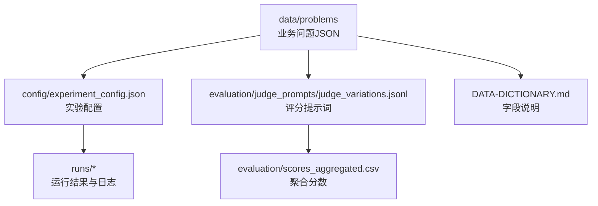
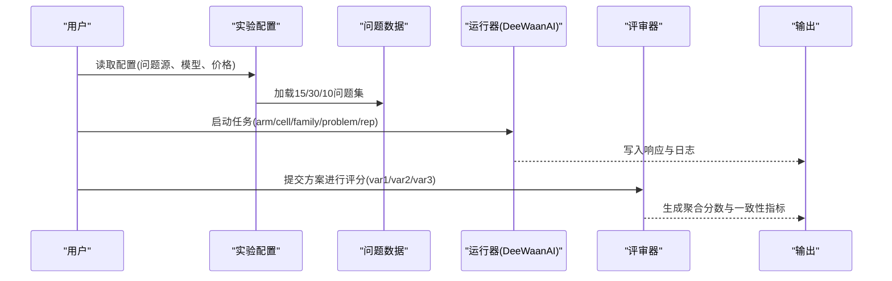
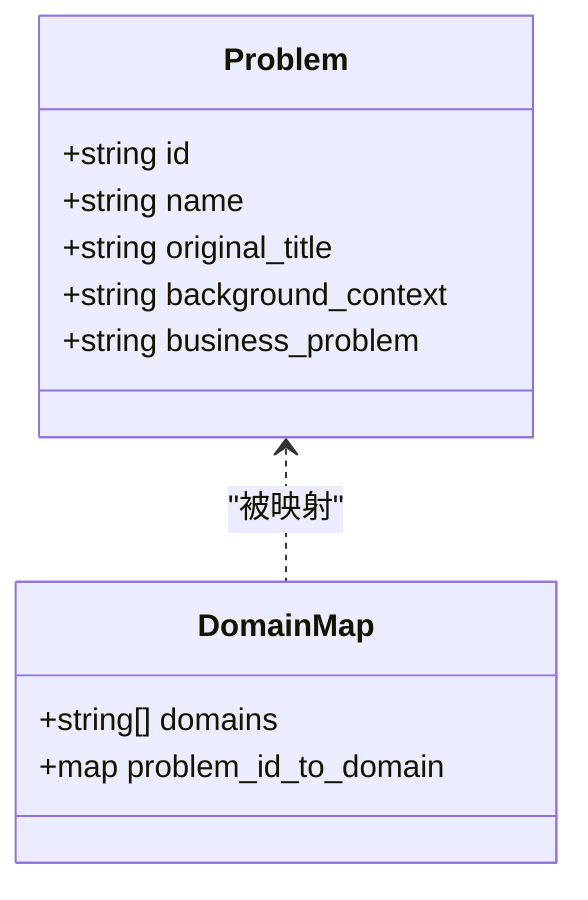
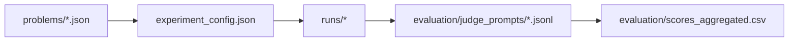
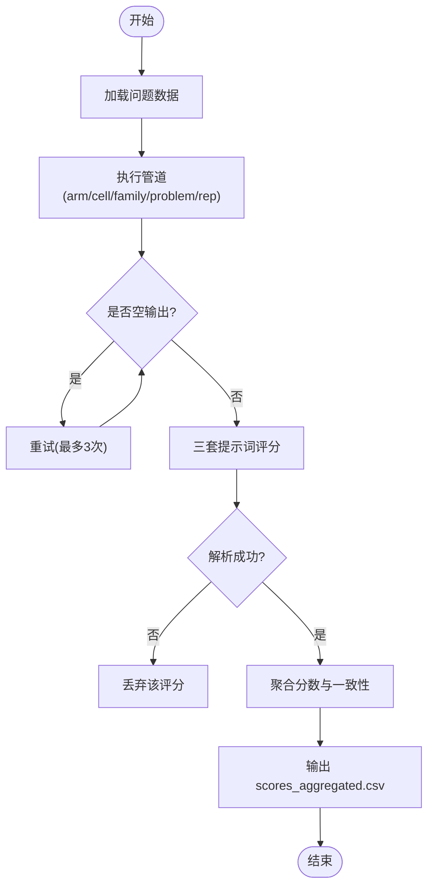

# 业务问题数据集

<cite>
**本文引用的文件**
- [business_problems_15.json](file://research/orchestration-economics/data/problems/business_problems_15.json)
- [business_problems_domain_15.json](file://research/orchestration-economics/data/problems/business_problems_domain_15.json)
- [fresh_business_cases_10.json](file://research/orchestration-economics/data/problems/fresh_business_cases_10.json)
- [domain_map.json](file://research/orchestration-economics/data/problems/domain_map.json)
- [DATA-DICTIONARY.md](file://research/orchestration-economics/DATA-DICTIONARY.md)
- [README.md](file://research/orchestration-economics/README.md)
- [experiment_config.json](file://research/orchestration-economics/config/experiment_config.json)
- [judge_variations.jsonl](file://research/orchestration-economics/evaluation/judge_prompts/judge_variations.jsonl)
</cite>

## 目录
1. [简介](#简介)
2. [项目结构](#项目结构)
3. [核心组件](#核心组件)
4. [架构总览](#架构总览)
5. [详细组件分析](#详细组件分析)
6. [依赖关系分析](#依赖关系分析)
7. [性能与成本考量](#性能与成本考量)
8. [故障排查指南](#故障排查指南)
9. [结论](#结论)
10. [附录](#附录)

## 简介
本文件为 DeeWaanAI 的“业务问题数据集”提供完整、可操作的技术文档。内容覆盖三类数据集（15个、30个、10个）的结构与用途，领域映射与分类标准，标注格式、难度等级与质量评估指标，数据访问与查询示例，版本管理与更新策略，以及数据质量检查工具与验证流程。同时记录数据来源、生成过程与清洗步骤，确保研究可复现与审计可追溯。

## 项目结构
业务问题数据集位于 research/orchestration-economics/data/problems 目录下，包含：
- business_problems_15.json：原始15个已验证的业务问题（来自 LLM-Creativity 数据集）。
- business_problems_domain_15.json：作者新增的15个问题（Business_Problem_16–30），按6个业务领域分层设计。
- domain_map.json：预注册的30个主问题的6×5领域网格映射。
- fresh_business_cases_10.json：10个后截断控制案例（2026年情境），用于稳健性检验，不参与领域网格。

此外，实验配置、评测提示词与数据字典提供了执行、评分与字段规范。

图表来源
- [README.md:18-41](file://research/orchestration-economics/README.md#L18-L41)
- [experiment_config.json:232-238](file://research/orchestration-economics/config/experiment_config.json#L232-L238)
- [DATA-DICTIONARY.md:5-29](file://research/orchestration-economics/DATA-DICTIONARY.md#L5-L29)

章节来源
- [README.md:18-41](file://research/orchestration-economics/README.md#L18-L41)
- [DATA-DICTIONARY.md:5-29](file://research/orchestration-economics/DATA-DICTIONARY.md#L5-L29)

## 核心组件
- 数据集对象键：以 Business_Problem_{n} 或 Fresh_Case_{n} 作为键名。
- 基础字段：id、name、original_title、background_context、business_problem。
- 扩展字段（16–30）：domain、created、provenance。
- 领域映射：domain_map.json 将30个问题映射到6个领域，每个领域5题。
- 新鲜案例：fresh_business_cases_10.json 不参与领域网格，用于后截断稳健性测试。

章节来源
- [DATA-DICTIONARY.md:5-29](file://research/orchestration-economics/DATA-DICTIONARY.md#L5-L29)
- [domain_map.json:1-44](file://research/orchestration-economics/data/problems/domain_map.json#L1-L44)

## 架构总览
业务问题数据集在实验流水线中的角色如下：
- 输入：business_problems_15.json、business_problems_domain_15.json、fresh_business_cases_10.json。
- 配置：experiment_config.json 指定问题源、特殊臂子集、模型与价格向量等。
- 执行：通过 DeeWaanAI MCP 接口运行管道，产出 runs/responses 与 runs/logs。
- 评估：使用 judge_variations.jsonl 的三套提示词对方案进行多维评分，生成 scores_aggregated.csv。
- 分析：基于聚合分数进行统计分析与可视化。

图表来源
- [experiment_config.json:232-238](file://research/orchestration-economics/config/experiment_config.json#L232-L238)
- [README.md:83-90](file://research/orchestration-economics/README.md#L83-L90)
- [DATA-DICTIONARY.md:84-103](file://research/orchestration-economics/DATA-DICTIONARY.md#L84-L103)

## 详细组件分析

### 15个业务问题（business_problems_15.json）
- 结构：对象键为 Business_Problem_{1..15}，包含 id、name、original_title、background_context、business_problem。
- 用途：作为原始基准问题集，用于机制臂（A5–A8）与部分对比实验。
- 特点：来源于 LLM-Creativity 数据集，保持原文背景与任务陈述，便于跨研究比较。

章节来源
- [business_problems_15.json:1-107](file://research/orchestration-economics/data/problems/business_problems_15.json#L1-L107)
- [DATA-DICTIONARY.md:5-15](file://research/orchestration-economics/DATA-DICTIONARY.md#L5-L15)

### 30个业务问题（business_problems_domain_15.json + domain_map.json）
- 结构：新增15个问题（Business_Problem_16–30），含 domain、created、provenance；配合 domain_map.json 形成6×5领域网格。
- 领域划分：strategy_market_entry、marketing_communications、operations_supply_chain、hr_organization、finance_business_models、product_innovation。
- 用途：支持主效应与领域调节效应分析（如 Structure × Domain 交互），保证领域均衡覆盖。

图表来源
- [business_problems_domain_15.json:1-153](file://research/orchestration-economics/data/problems/business_problems_domain_15.json#L1-L153)
- [domain_map.json:1-44](file://research/orchestration-economics/data/problems/domain_map.json#L1-L44)

章节来源
- [business_problems_domain_15.json:1-153](file://research/orchestration-economics/data/problems/business_problems_domain_15.json#L1-L153)
- [domain_map.json:1-44](file://research/orchestration-economics/data/problems/domain_map.json#L1-L44)

### 10个新鲜案例（fresh_business_cases_10.json）
- 结构：对象键为 Fresh_Case_{1..10}，包含 id、name、original_title、created、background_context、business_problem。
- 用途：后截断稳健性检验，不在领域网格内，避免污染主样本。
- 特点：聚焦2026年前沿议题（AI合规、数据主权、碳边境调节等），增强外部效度。

章节来源
- [fresh_business_cases_10.json:1-83](file://research/orchestration-economics/data/problems/fresh_business_cases_10.json#L1-L83)
- [DATA-DICTIONARY.md:25-29](file://research/orchestration-economics/DATA-DICTIONARY.md#L25-L29)

### 领域映射与分类标准
- 预注册网格：6个领域各5题，共30题；Fresh_Case 不参与网格。
- 映射规则：domain_map.json 明确每个问题所属领域；原15题标签在预注册冻结前待作者确认。
- 分析意义：支持领域作为固定调节变量，检验不同业务场景下方法差异。

章节来源
- [domain_map.json:1-44](file://research/orchestration-economics/data/problems/domain_map.json#L1-L44)
- [DATA-DICTIONARY.md:25-29](file://research/orchestration-economics/DATA-DICTIONARY.md#L25-L29)

### 标注格式、难度等级与质量评估指标
- 标注字段：id、name、original_title、background_context、business_problem；扩展字段 domain、created、provenance。
- 难度等级：仓库未定义显式难度字段；可通过以下代理指标间接衡量：
  - 完成度：每单元空输出率（门控 G0 ≤5%）。
  - 评审一致性：Fleiss κ ≥0.40。
  - 成本效率：T-EGR（团队效率增益比）与 Novelty per 1K tokens。
- 质量评估维度：Novelty（主要）、Usefulness/Feasibility、Flexibility、Elaboration、Cultural Sensitivity（1–5分）。

章节来源
- [DATA-DICTIONARY.md:5-29](file://research/orchestration-economics/DATA-DICTIONARY.md#L5-L29)
- [experiment_config.json:177-193](file://research/orchestration-economics/config/experiment_config.json#L177-L193)
- [experiment_config.json:257-269](file://research/orchestration-economics/config/experiment_config.json#L257-L269)

### 数据访问方法与查询示例
- 直接读取JSON：
  - 获取15题：读取 data/problems/business_problems_15.json。
  - 获取30题：合并 business_problems_15.json 与 business_problems_domain_15.json。
  - 获取10题：读取 data/problems/fresh_business_cases_10.json。
- 按领域筛选：
  - 使用 domain_map.json 的 map 字段过滤 Business_Problem_{1..30}。
- 查询示例（概念性）：
  - 列出所有 marketing_communications 领域的问题ID。
  - 筛选 created 日期为 2026-07-30 的问题。
  - 计算每个领域的平均 Novelty（需结合 evaluation/scores_aggregated.csv）。

章节来源
- [experiment_config.json:232-238](file://research/orchestration-economics/config/experiment_config.json#L232-L238)
- [domain_map.json:1-44](file://research/orchestration-economics/data/problems/domain_map.json#L1-L44)
- [DATA-DICTIONARY.md:84-103](file://research/orchestration-economics/DATA-DICTIONARY.md#L84-L103)

### 版本管理与更新策略
- 版本标记：experiment_config.json 中 version 字段标识当前阶段（如 0.2-phase0-pinned）。
- 冻结策略：预注册时冻结模型版本与价格向量；变更通过 amendment 记录。
- 可复现性：代码与配置均提交至仓库；运行清单 ledger 由 seed 42 生成且不再重算。
- 更新路径：新增问题或调整映射需同步更新 DATA-DICTIONARY.md 与 MANIFEST.md。

章节来源
- [experiment_config.json:1-4](file://research/orchestration-economics/config/experiment_config.json#L1-L4)
- [README.md:12-16](file://research/orchestration-economics/README.md#L12-L16)
- [DATA-DICTIONARY.md:112-115](file://research/orchestration-economics/DATA-DICTIONARY.md#L112-L115)

### 数据来源、生成过程与清洗步骤
- 数据来源：
  - 15题：LLM-Creativity 数据集（DOI 10.5281/zenodo.17407392）。
  - 16–30题：作者起草的领域分层扩展集（Entry 4）。
  - 10题：后截断稳健性案例（2026年情境）。
- 生成过程：
  - 通过 DeeWaanAI MCP 接口执行固定或自适应管道，生成解决方案。
  - 使用三套评审提示词独立评分，保留原始响应与解析结果。
- 清洗步骤：
  - 空输出检测与重试（失败不评分）。
  - 评审完整性门控（max_tokens 与 parsed_ok）。
  - 去标识化与随机顺序盲评。

章节来源
- [DATA-DICTIONARY.md:5-29](file://research/orchestration-economics/DATA-DICTIONARY.md#L5-L29)
- [README.md:83-90](file://research/orchestration-economics/README.md#L83-L90)
- [experiment_config.json:177-193](file://research/orchestration-economics/config/experiment_config.json#L177-L193)

## 依赖关系分析
- 问题数据依赖：experiment_config.json 指定 main_original_15、main_domain_extension_15、fresh_control 的路径。
- 评审依赖：judge_variations.jsonl 提供三套提示词；评分结果写入 evaluation/scores_aggregated.csv。
- 执行依赖：runs/ledger.csv 驱动幂等执行；状态机 PENDING→RUNNING→DONE/FAILED_*。

图表来源
- [experiment_config.json:232-238](file://research/orchestration-economics/config/experiment_config.json#L232-L238)
- [DATA-DICTIONARY.md:84-103](file://research/orchestration-economics/DATA-DICTIONARY.md#L84-L103)

章节来源
- [experiment_config.json:232-238](file://research/orchestration-economics/config/experiment_config.json#L232-L238)
- [DATA-DICTIONARY.md:84-103](file://research/orchestration-economics/DATA-DICTIONARY.md#L84-L103)

## 性能与成本考量
- 温度与令牌上限：统一 temperature=1，max_tokens=8192，避免隐藏推理耗尽预算。
- 成本核算：tokens × price_vector.json 计算成本，不存储美元观测值。
- 并行与重试：最大并发4，失败重试最多3次，退避5/30/120秒。
- 经济DV：T-EGR = (Novelty_cell / Novelty_F-S-N) / (Cost_cell / Cost_F-S-N)。

章节来源
- [experiment_config.json:166-175](file://research/orchestration-economics/config/experiment_config.json#L166-L175)
- [experiment_config.json:208-231](file://research/orchestration-economics/config/experiment_config.json#L208-L231)
- [experiment_config.json:245-256](file://research/orchestration-economics/config/experiment_config.json#L245-L256)

## 故障排查指南
- 空输出率高：检查门控 G0（≤5%），提升 max_tokens 或重试策略。
- 评审不一致：确保 Fleiss κ ≥0.40；核对 parsed_ok 与 prompt 完整性。
- 成本超支：核对 token 列 input_tokens/output_tokens；调整并发或温度。
- 执行中断：查看 runs/ledger.csv 状态，恢复 PENDING/FAILED_RETRYABLE 行。

章节来源
- [experiment_config.json:257-269](file://research/orchestration-economics/config/experiment_config.json#L257-L269)
- [DATA-DICTIONARY.md:60-79](file://research/orchestration-economics/DATA-DICTIONARY.md#L60-L79)

## 结论
本数据集以15/30/10三种规模覆盖经典与前沿业务问题，并通过预注册领域网格与稳健性案例保障内部与外部效度。结合严格的标注规范、多维评审与成本核算，可在不同模型与编排策略下进行公平比较。建议在使用时遵循版本冻结与幂等执行原则，并持续维护数据字典与清单以确保可复现。

## 附录

### 数据质量检查流程图

图表来源
- [experiment_config.json:177-193](file://research/orchestration-economics/config/experiment_config.json#L177-L193)
- [experiment_config.json:208-231](file://research/orchestration-economics/config/experiment_config.json#L208-L231)
- [DATA-DICTIONARY.md:84-103](file://research/orchestration-economics/DATA-DICTIONARY.md#L84-L103)