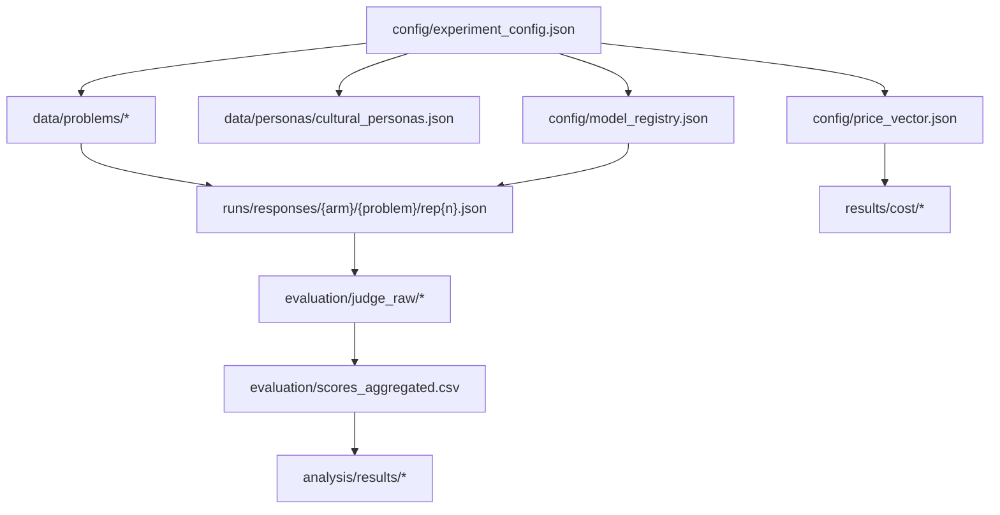
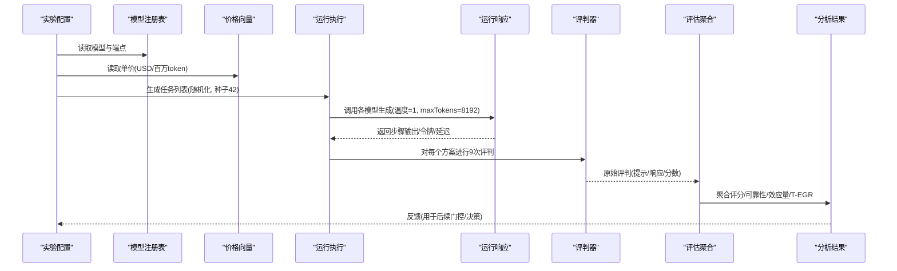
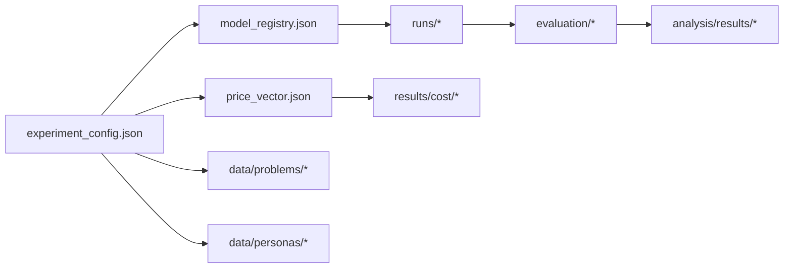

# 实验数据

<cite>
**本文引用的文件**
- [research/orchestration-economics/README.md](file://research/orchestration-economics/README.md)
- [research/orchestration-economics/DATA-DICTIONARY.md](file://research/orchestration-economics/DATA-DICTIONARY.md)
- [research/orchestration-economics/config/experiment_config.json](file://research/orchestration-economics/config/experiment_config.json)
- [research/orchestration-economics/config/price_vector.json](file://research/orchestration-economics/config/price_vector.json)
- [research/orchestration-economics/config/model_registry.json](file://research/orchestration-economics/config/model_registry.json)
- [research/orchestration-economics/data/problems/business_problems_15.json](file://research/orchestration-economics/data/problems/business_problems_15.json)
- [research/orchestration-economics/data/problems/domain_map.json](file://research/orchestration-economics/data/problems/domain_map.json)
- [research/orchestration-economics/data/personas/cultural_personas.json](file://research/orchestration-economics/data/personas/cultural_personas.json)
- [research/orchestration-economics/results/cost_effectiveness.json](file://research/orchestration-economics/results/cost_effectiveness.json)
- [research/orchestration-economics/runs/granular/oe-claude-C-S-N__Business_Problem_10__run694.json](file://research/orchestration-economics/runs/granular/oe-claude-C-S-N__Business_Problem_10__run694.json)
- [research/orchestration-economics/DESIGN-DECISIONS.md](file://research/orchestration-economics/DESIGN-DECISIONS.md)
</cite>

## 目录
1. [简介](#简介)
2. [项目结构](#项目结构)
3. [核心组件](#核心组件)
4. [架构总览](#架构总览)
5. [详细组件分析](#详细组件分析)
6. [依赖关系分析](#依赖关系分析)
7. [性能与成本考量](#性能与成本考量)
8. [故障排查指南](#故障排查指南)
9. [结论](#结论)
10. [附录：数据访问与使用示例](#附录数据访问与使用示例)

## 简介
本文件为DeeWaanAI“编排经济学”实验的数据文档，聚焦于数据集结构、来源与质量特征；业务问题数据集的构成与标注标准；模型配置与价格向量等实验参数；实验结果存储格式与分析指标；数据访问方法和使用示例；版本控制与更新策略；以及数据质量检查与清洗流程、运行元数据与执行日志。该仓库遵循“一切可复现”的原则：所有流水线定义、逐步骤响应、令牌/延迟日志、评判提示与原始分数、分析输出均导出为文件并随版本提交，确保可追溯与可重复。

## 项目结构
研究数据与代码按功能分层组织，关键目录与职责如下：
- config：实验配置（设计、模型注册、价格向量、评判设置）
- data：输入数据（业务问题、领域映射、文化人设）
- pipelines：导出的流水线JSON（固定与自适应）
- runs：运行产物（响应、日志、账本）
- evaluation：评判提示、原始评判、聚合评分
- analysis/results：统计分析与图表
- code：全部可执行脚本（生成、评判、聚合、统计）

图示来源
- [research/orchestration-economics/config/experiment_config.json:1-272](file://research/orchestration-economics/config/experiment_config.json#L1-L272)
- [research/orchestration-economics/config/model_registry.json:1-226](file://research/orchestration-economics/config/model_registry.json#L1-L226)
- [research/orchestration-economics/config/price_vector.json:1-26](file://research/orchestration-economics/config/price_vector.json#L1-L26)
- [research/orchestration-economics/data/problems/business_problems_15.json:1-107](file://research/orchestration-economics/data/problems/business_problems_15.json#L1-L107)
- [research/orchestration-economics/data/personas/cultural_personas.json:1-21](file://research/orchestration-economics/data/personas/cultural_personas.json#L1-L21)
- [research/orchestration-economics/DATA-DICTIONARY.md:1-115](file://research/orchestration-economics/DATA-DICTIONARY.md#L1-L115)

章节来源
- [research/orchestration-economics/README.md:18-41](file://research/orchestration-economics/README.md#L18-L41)
- [research/orchestration-economics/DATA-DICTIONARY.md:1-115](file://research/orchestration-economics/DATA-DICTIONARY.md#L1-L115)

## 核心组件
- 实验设计与参数：2×2×2因子设计（层级×结构×人设），跨5个模型家族，含特殊臂A5–A8；温度统一为1，最大令牌数统一为8192；评判采用3个廉价评判器×3种提示变体，共9分/方案。
- 模型注册与价格：冻结的价格向量（USD/百万token），成本由令牌×价格向量重算，不直接存储美元数值。
- 业务问题与人设：30个主问题（6领域×5题）+10个后截止案例；3个文化人设（构建者/批评者/精炼者）。
- 运行与评估：每个运行包含逐步骤输出、令牌与延迟、最终方案；评判原始记录与聚合评分。
- 结果与分析：描述性统计、效应量、混合模型结果、T-EGR（团队效率增益比率）、图件。

章节来源
- [research/orchestration-economics/config/experiment_config.json:5-207](file://research/orchestration-economics/config/experiment_config.json#L5-L207)
- [research/orchestration-economics/config/price_vector.json:1-26](file://research/orchestration-economics/config/price_vector.json#L1-L26)
- [research/orchestration-economics/data/problems/domain_map.json:1-44](file://research/orchestration-economics/data/problems/domain_map.json#L1-L44)
- [research/orchestration-economics/data/personas/cultural_personas.json:1-21](file://research/orchestration-economics/data/personas/cultural_personas.json#L1-L21)
- [research/orchestration-economics/DATA-DICTIONARY.md:46-110](file://research/orchestration-economics/DATA-DICTIONARY.md#L46-L110)

## 架构总览
下图展示从配置到运行、评判、分析的端到端数据流。

图示来源
- [research/orchestration-economics/config/experiment_config.json:166-207](file://research/orchestration-economics/config/experiment_config.json#L166-L207)
- [research/orchestration-economics/config/model_registry.json:129-167](file://research/orchestration-economics/config/model_registry.json#L129-L167)
- [research/orchestration-economics/config/price_vector.json:1-26](file://research/orchestration-economics/config/price_vector.json#L1-L26)
- [research/orchestration-economics/DATA-DICTIONARY.md:46-110](file://research/orchestration-economics/DATA-DICTIONARY.md#L46-L110)

## 详细组件分析

### 业务问题数据集与标注标准
- 数据来源与结构
  - 原始15题：来自LLM-Creativity数据集，字段包括id、name、original_title、background_context、business_problem。
  - 扩展15题：作者起草的领域分层问题，增加domain、created、provenance字段。
  - 领域映射：预注册的6×5领域网格，将30个主问题映射至6个业务领域。
  - 后截止案例：10个2026年场景，作为稳健性检验集，不参与领域网格。
- 标注标准
  - 每个问题提供背景与任务陈述，保证跨文化情境的可比性。
  - 领域标签用于确认H2（领域调节效应）的验证性分析。
  - 人设与角色映射：Culture_5→Builder，Culture_Expert→Critic，Culture_11→Refiner，保持角色一致性。

章节来源
- [research/orchestration-economics/data/problems/business_problems_15.json:1-107](file://research/orchestration-economics/data/problems/business_problems_15.json#L1-L107)
- [research/orchestration-economics/data/problems/domain_map.json:1-44](file://research/orchestration-economics/data/problems/domain_map.json#L1-L44)
- [research/orchestration-economics/data/personas/cultural_personas.json:1-21](file://research/orchestration-economics/data/personas/cultural_personas.json#L1-L21)
- [research/orchestration-economics/DATA-DICTIONARY.md:5-44](file://research/orchestration-economics/DATA-DICTIONARY.md#L5-L44)

### 模型配置与价格向量
- 模型注册
  - 5个生成家族（gpt、claude、gemini、kimi、qwen）+ 3个评判家族（deepseek、zhipu、meta），严格分离以避免自偏好偏差。
  - 每个模型记录端点、环境变量键、上下文长度、定价来源与备注（如是否带推理痕迹需剥离）。
- 价格向量
  - 冻结版本v2026-07-30，单位USD/百万token；成本通过令牌×价格向量重算，不直接存储美元值。
  - 支持替换价格向量以进行敏感性分析。
- 执行窗口与折扣
  - 统一执行窗口UTC 14:00–00:00，兼顾Qwen折扣时段并避开DeepSeek高峰时段。
  - 记录started_at_utc、in_discount_window、pinned_price_usd与paid_price_usd估计，用于敏感性分析。

章节来源
- [research/orchestration-economics/config/model_registry.json:1-226](file://research/orchestration-economics/config/model_registry.json#L1-L226)
- [research/orchestration-economics/config/price_vector.json:1-26](file://research/orchestration-economics/config/price_vector.json#L1-L26)
- [research/orchestration-economics/config/experiment_config.json:208-231](file://research/orchestration-economics/config/experiment_config.json#L208-L231)

### 运行产物与评估
- 运行响应
  - 每运行一个JSON文件，包含run_id、arm、problem_id、rep、时间戳、steps数组（每步的agent、role、persona、provider、model、temperature、system_prompt、input、output、tokens、latency、critic_verdict等）、final_solution、total_tokens、total_latency_ms。
- 评判原始记录
  - 每个solution×judge×variant一条记录，包含prompt、raw_response、scores（novelty、usefulness、flexibility、elaboration、cultural_sensitivity）、parsed_ok。
- 聚合评分
  - long格式CSV：solution_id、arm、problem_id、rep、judge、variant及各项分数；配套Fleiss' κ与ICC(2,k)。

章节来源
- [research/orchestration-economics/DATA-DICTIONARY.md:46-110](file://research/orchestration-economics/DATA-DICTIONARY.md#L46-L110)
- [research/orchestration-economics/runs/granular/oe-claude-C-S-N__Business_Problem_10__run694.json:1-101](file://research/orchestration-economics/runs/granular/oe-claude-C-S-N__Business_Problem_10__run694.json#L1-L101)

### 结果存储与分析指标
- 成本与有效性
  - cost_effectiveness.json、cell_summary.csv、cost_per_run.csv、pareto_frontier.csv等。
- 统计结果
  - descriptive_stats.csv、effect_sizes.csv（Cohen's d、95% Bootstrap CI、FDR调整p）、mixed_model_results.csv、tegr_by_arm.csv。
- 主要指标
  - 主要DV：Novelty（均值与可靠性）
  - 经济DV：T-EGR = (Novelty_cell / Novelty_F-S-N) / (Cost_cell / Cost_F-S-N)，成本基于令牌×冻结价格向量计算。

章节来源
- [research/orchestration-economics/results/cost_effectiveness.json:1-101](file://research/orchestration-economics/results/cost_effectiveness.json#L1-L101)
- [research/orchestration-economics/DATA-DICTIONARY.md:100-110](file://research/orchestration-economics/DATA-DICTIONARY.md#L100-L110)
- [research/orchestration-economics/config/experiment_config.json:245-256](file://research/orchestration-economics/config/experiment_config.json#L245-L256)

### 版本控制与更新策略
- 预注册与冻结
  - 假设、对比、选择规则、提示词与完整随机化运行账本在预注册前冻结并提交（GitHub tag/OSF）。
- 变更管理
  - 设计决策登记（D1–D30）记录每次变更的原因、学术依据与实现位置；重大偏离（如温度、maxTokens）明确报告。
- 可复现性
  - 所有执行代码、配置、数据、环境均在仓库中；种子42、依赖锁定、幂等执行。

章节来源
- [research/orchestration-economics/DESIGN-DECISIONS.md:103-131](file://research/orchestration-economics/DESIGN-DECISIONS.md#L103-L131)
- [research/orchestration-economics/DESIGN-DECISIONS.md:172-200](file://research/orchestration-economics/DESIGN-DECISIONS.md#L172-L200)
- [research/orchestration-economics/README.md:81-91](file://research/orchestration-economics/README.md#L81-L91)

### 数据质量检查与清洗流程
- 运行健壮性
  - 运行账本runs/ledger.csv：一次性生成（seed 42），状态机PENDING/RUNNING/DONE/FAILED_RETRYABLE/FAILED_PERMANENT；最多3次重试（退避5/30/120秒），并发≤4。
  - parsed_ok门控：失败生成不评分，避免预算浪费与噪声评分。
- 评判完整性
  - 全量评判（9分/方案），缺失或解析失败则回退重评；保留历史记录。
- 令牌与成本
  - 令牌为不变物理量；成本由冻结价格向量重算；执行窗口统一，记录折扣与峰值信息用于敏感性分析。

章节来源
- [research/orchestration-economics/DATA-DICTIONARY.md:60-83](file://research/orchestration-economics/DATA-DICTIONARY.md#L60-L83)
- [research/orchestration-economics/config/experiment_config.json:208-231](file://research/orchestration-economics/config/experiment_config.json#L208-L231)
- [research/orchestration-economics/DESIGN-DECISIONS.md:109-113](file://research/orchestration-economics/DESIGN-DECISIONS.md#L109-L113)

### 实验运行的元数据与执行日志
- 元数据
  - run_id、arm、family、problem_id、rep、started_at/finished_at、total_tokens、total_latency_ms、agentsUsed、pipelineVersion等。
- 日志
  - runs/logs/保存原始exportMyData与runStatus导出；runs/responses/保存结构化响应；evaluation/judge_raw/保存评判原始记录。

章节来源
- [research/orchestration-economics/DATA-DICTIONARY.md:46-83](file://research/orchestration-economics/DATA-DICTIONARY.md#L46-L83)
- [research/orchestration-economics/runs/granular/oe-claude-C-S-N__Business_Problem_10__run694.json:1-101](file://research/orchestration-economics/runs/granular/oe-claude-C-S-N__Business_Problem_10__run694.json#L1-L101)

## 依赖关系分析
- 配置驱动：experiment_config.json决定设计、模型、评判、执行参数。
- 模型注册：model_registry.json提供端点、环境变量、定价来源与备注。
- 价格向量：price_vector.json作为成本计算的唯一权威来源。
- 数据输入：problems与personas作为刺激与角色注入。
- 运行与评估：runs与evaluation产出中间与最终结果。
- 分析：analysis/results基于evaluation/scores_aggregated.csv生成统计与图表。

图示来源
- [research/orchestration-economics/config/experiment_config.json:1-272](file://research/orchestration-economics/config/experiment_config.json#L1-L272)
- [research/orchestration-economics/config/model_registry.json:1-226](file://research/orchestration-economics/config/model_registry.json#L1-L226)
- [research/orchestration-economics/config/price_vector.json:1-26](file://research/orchestration-economics/config/price_vector.json#L1-L26)

章节来源
- [research/orchestration-economics/config/experiment_config.json:1-272](file://research/orchestration-economics/config/experiment_config.json#L1-L272)
- [research/orchestration-economics/config/model_registry.json:1-226](file://research/orchestration-economics/config/model_registry.json#L1-L226)
- [research/orchestration-economics/config/price_vector.json:1-26](file://research/orchestration-economics/config/price_vector.json#L1-L26)

## 性能与成本考量
- 温度与令牌上限：统一温度=1，统一maxTokens=8192，避免空输出与截断。
- 成本核算：令牌×冻结价格向量；执行窗口优化折扣并避开高峰；记录实际支付价格用于敏感性分析。
- 并行与重试：并发≤4，重试退避策略提升鲁棒性。
- 经济性指标：T-EGR衡量团队相对于前沿模型的性价比。

章节来源
- [research/orchestration-economics/config/experiment_config.json:166-207](file://research/orchestration-economics/config/experiment_config.json#L166-L207)
- [research/orchestration-economics/config/model_registry.json:217-224](file://research/orchestration-economics/config/model_registry.json#L217-L224)
- [research/orchestration-economics/config/price_vector.json:1-26](file://research/orchestration-economics/config/price_vector.json#L1-L26)

## 故障排查指南
- 常见错误
  - API不可用或超时：账本状态标记FAILED_RETRYABLE，自动重试；若连续失败转为FAILED_PERMANENT。
  - 评判解析失败：parsed_ok=false时重新评判；保留历史记录。
  - 空输出：检查maxTokens与模型推理令牌占用；必要时提高上限或调整上下文。
- 定位方法
  - 查看runs/logs/原始导出与runs/responses/结构化响应。
  - 核对execution_resilience配置与账本状态。
  - 检查模型端点与环境变量是否正确配置。

章节来源
- [research/orchestration-economics/DATA-DICTIONARY.md:60-83](file://research/orchestration-economics/DATA-DICTIONARY.md#L60-L83)
- [research/orchestration-economics/config/experiment_config.json:208-231](file://research/orchestration-economics/config/experiment_config.json#L208-L231)

## 结论
本实验数据体系以“可复现、可追溯、可审计”为核心原则，通过冻结配置、冻结价格向量、完整运行产物与评判记录，确保研究过程透明且可重复。业务问题覆盖多领域，人设与角色映射严谨；模型与评判家族分离，减少偏差；成本核算基于令牌与冻结价格，支持敏感性分析。整体架构清晰，数据流闭环，便于后续扩展与复用。

## 附录：数据访问与使用示例
- 访问业务问题
  - 路径：data/problems/business_problems_15.json、data/problems/business_problems_domain_15.json、data/problems/domain_map.json
  - 用途：加载问题与领域标签，用于生成任务与分层分析。
- 加载人设
  - 路径：data/personas/cultural_personas.json
  - 用途：注入角色系统提示，构建团队或单人增强。
- 运行与评估
  - 路径：runs/responses/{arm}/{problem}/rep{n}.json、evaluation/judge_raw/*、evaluation/scores_aggregated.csv
  - 用途：提取最终方案与评分，进行统计分析与可视化。
- 成本与有效性
  - 路径：results/cost_effectiveness.json、results/cell_summary.csv、results/tegr_by_arm.csv
  - 用途：计算T-EGR与成本效益对比。
- 配置与模型
  - 路径：config/experiment_config.json、config/model_registry.json、config/price_vector.json
  - 用途：复现实验参数与成本重算。

章节来源
- [research/orchestration-economics/DATA-DICTIONARY.md:5-110](file://research/orchestration-economics/DATA-DICTIONARY.md#L5-L110)
- [research/orchestration-economics/config/experiment_config.json:1-272](file://research/orchestration-economics/config/experiment_config.json#L1-L272)
- [research/orchestration-economics/config/model_registry.json:1-226](file://research/orchestration-economics/config/model_registry.json#L1-L226)
- [research/orchestration-economics/config/price_vector.json:1-26](file://research/orchestration-economics/config/price_vector.json#L1-L26)