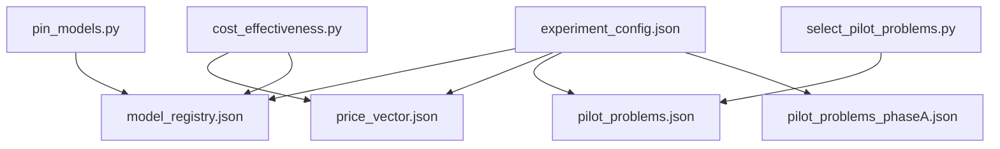
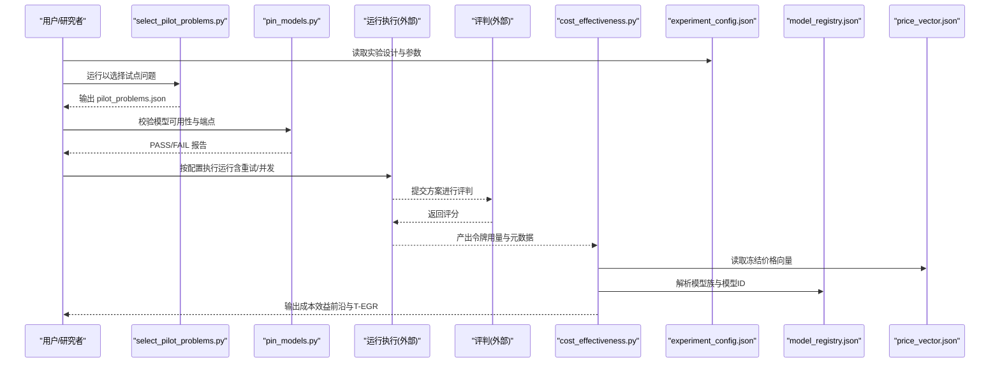
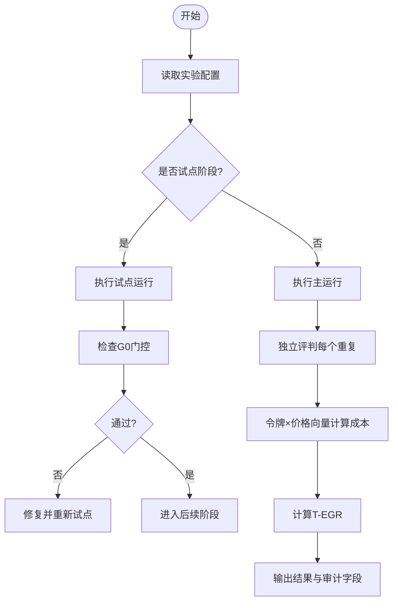
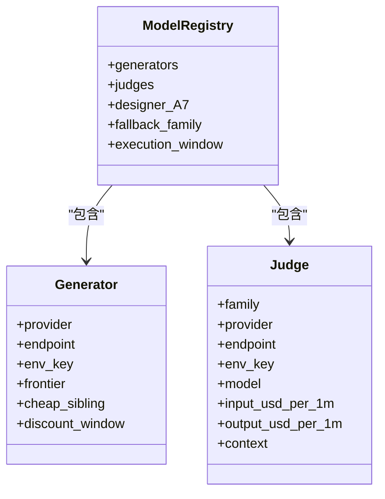
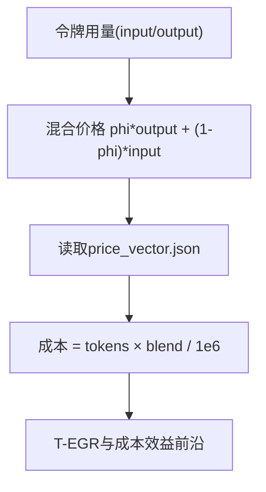
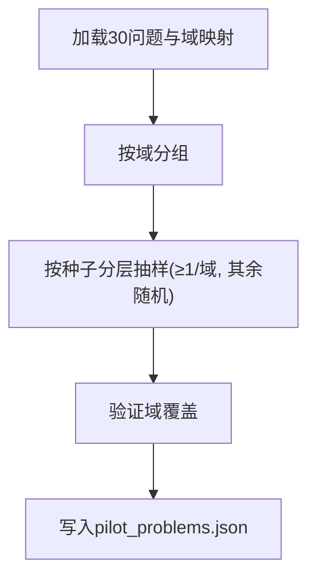
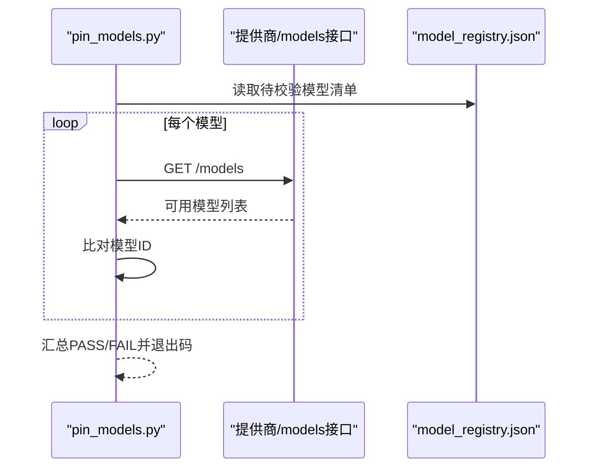
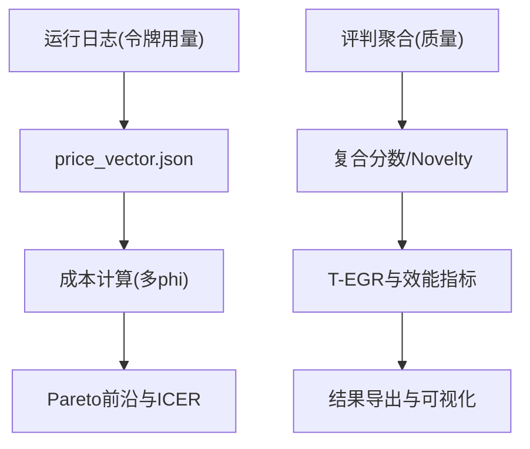
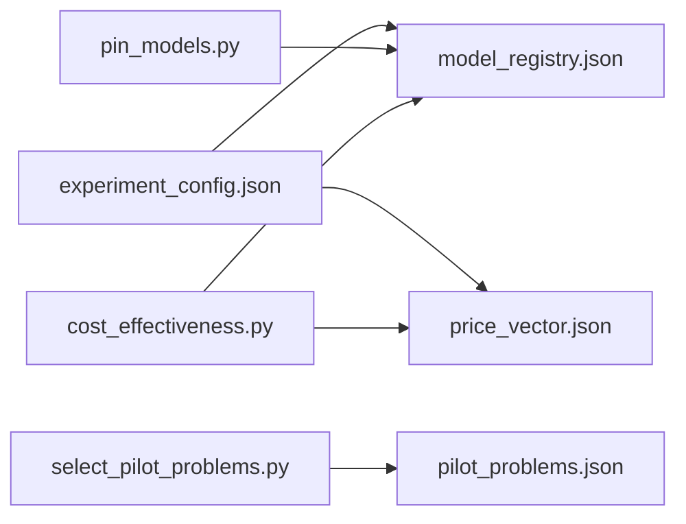

# 实验配置数据

<cite>
**本文引用的文件**
- [experiment_config.json](file://research/orchestration-economics/config/experiment_config.json)
- [model_registry.json](file://research/orchestration-economics/config/model_registry.json)
- [price_vector.json](file://research/orchestration-economics/config/price_vector.json)
- [pilot_problems.json](file://research/orchestration-economics/config/pilot_problems.json)
- [pilot_problems_phaseA.json](file://research/orchestration-economics/config/pilot_problems_phaseA.json)
- [DESIGN-DECISIONS.md](file://research/orchestration-economics/DESIGN-DECISIONS.md)
- [MANIFEST.md](file://research/orchestration-economics/MANIFEST.md)
- [select_pilot_problems.py](file://research/orchestration-economics/code/select_pilot_problems.py)
- [pin_models.py](file://research/orchestration-economics/code/pin_models.py)
- [cost_effectiveness.py](file://research/orchestration-economics/code/cost_effectiveness.py)
</cite>

## 目录
1. [简介](#简介)
2. [项目结构](#项目结构)
3. [核心组件](#核心组件)
4. [架构总览](#架构总览)
5. [详细组件分析](#详细组件分析)
6. [依赖关系分析](#依赖关系分析)
7. [性能与成本考量](#性能与成本考量)
8. [故障排查指南](#故障排查指南)
9. [结论](#结论)
10. [附录：模板与最佳实践](#附录模板与最佳实践)

## 简介
本文件为 DeeWaanAI“编排经济学”实验的配置数据提供系统化文档，覆盖以下目标：
- 解释实验配置文件结构与参数含义
- 说明模型注册表的管理方式与版本控制
- 描述价格向量的计算方法与成本优化策略
- 说明试点问题选择标准与配置方法
- 提供配置模板与最佳实践
- 记录配置验证与错误处理机制
- 记录配置变更历史与回滚策略

## 项目结构
实验配置集中在 research/orchestration-economics/config 目录下，配合 code 中的脚本完成校验、选择与计算。关键文件职责如下：
- experiment_config.json：实验设计、因子、单元格、评估、执行与探索性门控等全局配置
- model_registry.json：生成器、评审者、设计师与回退模型的端点、密钥键名、上下文长度与定价来源
- price_vector.json：冻结的价格向量（美元/百万token），用于将令牌用量转换为成本
- pilot_problems.json / pilot_problems_phaseA.json：试点问题集与域分层抽样结果
- code 中脚本：选择试点问题、校验模型可用性、计算成本效益前沿

图表来源
- [experiment_config.json:1-272](file://research/orchestration-economics/config/experiment_config.json#L1-L272)
- [model_registry.json:1-226](file://research/orchestration-economics/config/model_registry.json#L1-L226)
- [price_vector.json:1-26](file://research/orchestration-economics/config/price_vector.json#L1-L26)
- [pilot_problems.json:1-89](file://research/orchestration-economics/config/pilot_problems.json#L1-L89)
- [pilot_problems_phaseA.json:1-123](file://research/orchestration-economics/config/pilot_problems_phaseA.json#L1-L123)
- [select_pilot_problems.py:1-71](file://research/orchestration-economics/code/select_pilot_problems.py#L1-L71)
- [pin_models.py:1-122](file://research/orchestration-economics/code/pin_models.py#L1-L122)
- [cost_effectiveness.py:1-243](file://research/orchestration-economics/code/cost_effectiveness.py#L1-L243)

章节来源
- [experiment_config.json:1-272](file://research/orchestration-economics/config/experiment_config.json#L1-L272)
- [model_registry.json:1-226](file://research/orchestration-economics/config/model_registry.json#L1-L226)
- [price_vector.json:1-26](file://research/orchestration-economics/config/price_vector.json#L1-L26)
- [pilot_problems.json:1-89](file://research/orchestration-economics/config/pilot_problems.json#L1-L89)
- [pilot_problems_phaseA.json:1-123](file://research/orchestration-economics/config/pilot_problems_phaseA.json#L1-L123)

## 核心组件
- 实验设计（experiment_config.json）
  - 因子：层级（前沿 vs 廉价）、结构（单人 vs 三人团队）、角色人设（无 vs 加载）
  - 单元格：C-S-N/C-S-P/C-T-N/C-T-P/F-S-N/F-S-P/F-T-N/F-T-P 及其重复次数与运行数
  - 评估：温度、最大token、评分变体、盲审、集成规则
  - 执行弹性：账本、状态机、重试、并发、错误处理
  - 问题与人设：主问题集、域映射、新鲜案例、人设映射
  - 经济指标：T-EGR、成本核算、执行窗口
  - 探索性门控：G0/G-A5/G-A6/G-A7/G-A7P/G-A8 的阈值与动作
- 模型注册表（model_registry.json）
  - 生成器：kimi/qwen/gpt/claude/gemini 的前沿与廉价子模型、端点、环境变量键、上下文长度、定价来源
  - 评审者：deepseek/zhipu/meta 三模型，禁用推理模式以保证统一能力
  - 设计师（A7）：kimi-k3，温度=0
  - 回退家族：deepseek，含高峰时段规避规则
  - 执行窗口：统一在 14:00–00:00 UTC，兼顾折扣与避峰
- 价格向量（price_vector.json）
  - 冻结版本 v2026-07-30，单位 USD/百万token
  - 仅用于将令牌用量换算为成本；原始数据只存令牌
- 试点问题（pilot_problems*.json）
  - 分层随机抽样，保证每域至少一题，种子固定，输出冻结
  - Phase A 扩展问题集，作者批准的域分层补充

章节来源
- [experiment_config.json:1-272](file://research/orchestration-economics/config/experiment_config.json#L1-L272)
- [model_registry.json:1-226](file://research/orchestration-economics/config/model_registry.json#L1-L226)
- [price_vector.json:1-26](file://research/orchestration-economics/config/price_vector.json#L1-L26)
- [pilot_problems.json:1-89](file://research/orchestration-economics/config/pilot_problems.json#L1-L89)
- [pilot_problems_phaseA.json:1-123](file://research/orchestration-economics/config/pilot_problems_phaseA.json#L1-L123)

## 架构总览
实验配置驱动端到端流程：从问题选择、模型可用性校验、运行执行、评判到成本效益分析。

图表来源
- [select_pilot_problems.py:1-71](file://research/orchestration-economics/code/select_pilot_problems.py#L1-L71)
- [pin_models.py:1-122](file://research/orchestration-economics/code/pin_models.py#L1-L122)
- [cost_effectiveness.py:1-243](file://research/orchestration-economics/code/cost_effectiveness.py#L1-L243)
- [experiment_config.json:1-272](file://research/orchestration-economics/config/experiment_config.json#L1-L272)
- [model_registry.json:1-226](file://research/orchestration-economics/config/model_registry.json#L1-L226)
- [price_vector.json:1-26](file://research/orchestration-economics/config/price_vector.json#L1-L26)

## 详细组件分析

### 实验配置（experiment_config.json）
- 设计维度
  - 因子：tier（frontier/cheap_sibling）、structure（solo/team_3step）、persona（none/persona_loaded）
  - 团队规则：同族同质模型，仅人设/角色提示不同
  - 单元格：定义各单元族的数量、重复次数与运行总数
- 评估设置
  - 生成温度统一为1（D27），最大token统一为8192（D28）
  - 评判独立于每次重复，答案不合并，仅在分数层面集成
  - 盲审与随机顺序，评审提示词冻结
- 执行弹性
  - 账本记录完整随机交错列表，支持幂等恢复
  - 重试策略：最多3次，指数退避
  - 并发限制与批次暂停
  - 失败重跑且不计分（parsed_ok门控）
- 问题与人设
  - 主问题集与域映射，新鲜案例作为稳健性集合
  - 人设与角色映射（Builder/Critic/Refiner）
- 经济指标
  - T-EGR = (Novelty_cell/Novelty_F-S-N)/(Cost_cell/Cost_F-S-N)
  - 成本由令牌×价格向量计算，不直接存储美元
- 探索性门控
  - G0/G-A5/G-A6/G-A7/G-A7P/G-A8 的阈值与动作，确保预算与可行性

图表来源
- [experiment_config.json:1-272](file://research/orchestration-economics/config/experiment_config.json#L1-L272)
- [DESIGN-DECISIONS.md:145-155](file://research/orchestration-economics/DESIGN-DECISIONS.md#L145-L155)

章节来源
- [experiment_config.json:1-272](file://research/orchestration-economics/config/experiment_config.json#L1-L272)
- [DESIGN-DECISIONS.md:145-155](file://research/orchestration-economics/DESIGN-DECISIONS.md#L145-L155)

### 模型注册表（model_registry.json）
- 生成器家族
  - kimi/qwen/gpt/claude/gemini：前沿与廉价子模型、端点、环境变量键、上下文长度、定价来源
  - 注意：qwen 使用快照版本以避免别名漂移；gemini 标注预览风险并有预注册回退
- 评审者
  - deepseek/zhipu/meta：统一非推理模式，避免隐藏链式思考影响评分一致性
  - 与生成器家族完全不相交，避免自偏好偏差
- 设计师（A7）
  - kimi-k3，温度=0，费用计入A7成本
- 回退家族
  - deepseek：包含高峰时段规避规则，避免峰值加价
- 执行窗口
  - 统一 14:00–00:00 UTC，同时满足Qwen折扣与避开DeepSeek高峰

图表来源
- [model_registry.json:1-226](file://research/orchestration-economics/config/model_registry.json#L1-L226)

章节来源
- [model_registry.json:1-226](file://research/orchestration-economics/config/model_registry.json#L1-L226)

### 价格向量（price_vector.json）
- 冻结版本 v2026-07-30，单位 USD/百万token
- 所有美元成本均通过 tokens × price_vector 计算，不直接存储美元
- 支持多phi敏感性分析（输入/输出权重组合）
- 包含评审者价格用于开销报告，但不计入单元T-EGR

图表来源
- [price_vector.json:1-26](file://research/orchestration-economics/config/price_vector.json#L1-L26)
- [cost_effectiveness.py:36-70](file://research/orchestration-economics/code/cost_effectiveness.py#L36-L70)

章节来源
- [price_vector.json:1-26](file://research/orchestration-economics/config/price_vector.json#L1-L26)
- [cost_effectiveness.py:1-243](file://research/orchestration-economics/code/cost_effectiveness.py#L1-L243)

### 试点问题选择（pilot_problems*.json）
- 选择规则
  - 分层随机抽样，保证每域至少一题，种子固定（如 20260802/20260803）
  - 输出冻结至 config/pilot_problems.json 或 phaseA 对应文件
- 脚本实现
  - select_pilot_problems.py：读取30个问题与域映射，按种子抽样并写入配置
- Phase A 扩展
  - pilot_problems_phaseA.json：作者批准的域分层补充问题集

图表来源
- [select_pilot_problems.py:1-71](file://research/orchestration-economics/code/select_pilot_problems.py#L1-L71)
- [pilot_problems.json:1-89](file://research/orchestration-economics/config/pilot_problems.json#L1-L89)
- [pilot_problems_phaseA.json:1-123](file://research/orchestration-economics/config/pilot_problems_phaseA.json#L1-L123)

章节来源
- [select_pilot_problems.py:1-71](file://research/orchestration-economics/code/select_pilot_problems.py#L1-L71)
- [pilot_problems.json:1-89](file://research/orchestration-economics/config/pilot_problems.json#L1-L89)
- [pilot_problems_phaseA.json:1-123](file://research/orchestration-economics/config/pilot_problems_phaseA.json#L1-L123)

### 配置验证与错误处理
- 模型可用性校验
  - pin_models.py：调用各提供商 /models 接口，列出可用模型，比对注册表中的模型ID，输出PASS/FAIL
  - 要求 .env 中包含各提供商API密钥，不会消耗LLM token
- 运行与评判错误处理
  - 失败重跑，未通过解析的门控不计分
  - 评判完整性门控：缺失维度则重试，持久失败标记并审计
- 执行窗口与折扣
  - 统一窗口避免时间相关价格波动对主要指标的干扰
  - 记录 started_at_utc、in_discount_window、pinned_price_usd、paid_price_usd 供敏感性分析

图表来源
- [pin_models.py:49-117](file://research/orchestration-economics/code/pin_models.py#L49-L117)
- [model_registry.json:1-226](file://research/orchestration-economics/config/model_registry.json#L1-L226)

章节来源
- [pin_models.py:1-122](file://research/orchestration-economics/code/pin_models.py#L1-L122)
- [experiment_config.json:208-231](file://research/orchestration-economics/config/experiment_config.json#L208-L231)
- [model_registry.json:217-224](file://research/orchestration-economics/config/model_registry.json#L217-L224)

### 成本效益计算
- 成本公式
  - cost(run) = tokensUsed × blend(phi)/1e6，blend = phi*p_out + (1-phi)*p_in
  - 主phi=0.5，敏感性面板{0.25, 0.75}
- 数据来源
  - 令牌用量来自运行日志；质量来自评判聚合
- 输出
  - per-run成本表、单元格摘要、Pareto前沿、T-EGR、散点图

图表来源
- [cost_effectiveness.py:1-243](file://research/orchestration-economics/code/cost_effectiveness.py#L1-L243)
- [price_vector.json:1-26](file://research/orchestration-economics/config/price_vector.json#L1-L26)

章节来源
- [cost_effectiveness.py:1-243](file://research/orchestration-economics/code/cost_effectiveness.py#L1-L243)

## 依赖关系分析
- 配置间耦合
  - experiment_config.json 依赖 model_registry.json（模型族与模型ID）与 price_vector.json（价格）
  - 成本计算脚本依赖两者以得出可复现的经济指标
- 脚本与配置
  - select_pilot_problems.py 依赖 domain_map 与问题集，输出 pilot_problems.json
  - pin_models.py 依赖 model_registry.json 与 .env 密钥
- 外部依赖
  - 各提供商API端点与可用性
  - Together.ai、OpenAI、Anthropic、Google、Moonshot、Alibaba、DeepSeek

图表来源
- [experiment_config.json:1-272](file://research/orchestration-economics/config/experiment_config.json#L1-L272)
- [model_registry.json:1-226](file://research/orchestration-economics/config/model_registry.json#L1-L226)
- [price_vector.json:1-26](file://research/orchestration-economics/config/price_vector.json#L1-L26)
- [select_pilot_problems.py:1-71](file://research/orchestration-economics/code/select_pilot_problems.py#L1-L71)
- [pin_models.py:1-122](file://research/orchestration-economics/code/pin_models.py#L1-L122)
- [cost_effectiveness.py:1-243](file://research/orchestration-economics/code/cost_effectiveness.py#L1-L243)

章节来源
- [experiment_config.json:1-272](file://research/orchestration-economics/config/experiment_config.json#L1-L272)
- [model_registry.json:1-226](file://research/orchestration-economics/config/model_registry.json#L1-L226)
- [price_vector.json:1-26](file://research/orchestration-economics/config/price_vector.json#L1-L26)

## 性能与成本考量
- 执行窗口
  - 统一 14:00–00:00 UTC，兼顾Qwen折扣与避开DeepSeek高峰
- 并发与重试
  - 最大并行运行数与批次暂停，重试退避策略
- 令牌效率
  - Novelty per 1K output tokens 作为价格无关的效率指标（跨tokenizer差异需声明）
- 成本敏感性
  - 多phi敏感性面板，比较不同输入/输出权重下的T-EGR与Pareto前沿

章节来源
- [model_registry.json:217-224](file://research/orchestration-economics/config/model_registry.json#L217-L224)
- [experiment_config.json:208-231](file://research/orchestration-economics/config/experiment_config.json#L208-L231)
- [cost_effectiveness.py:29-70](file://research/orchestration-economics/code/cost_effectiveness.py#L29-L70)

## 故障排查指南
- 模型不可用
  - 使用 pin_models.py 校验端点与模型ID，检查 .env 密钥与账户权限
- 空输出或截断
  - 检查 max_tokens 与 hidden reasoning 占用；团队场景可能耗尽预算导致空输出
  - 使用 fulltext 归档与审计字段（truncatedAtSource、fulltextLen）定位
- 评判不完整
  - 提升 judge max_tokens 并启用完整性门控；记录重试与失败
- 折扣与峰值
  - 确认执行窗口与 discount_window/surge_window；记录 paid_price_usd 用于敏感性分析

章节来源
- [pin_models.py:49-117](file://research/orchestration-economics/code/pin_models.py#L49-L117)
- [experiment_config.json:166-194](file://research/orchestration-economics/config/experiment_config.json#L166-L194)
- [model_registry.json:210-224](file://research/orchestration-economics/config/model_registry.json#L210-L224)

## 结论
本配置体系通过冻结价格向量与模型注册表，实现了成本与模型的可复现管理；通过分层抽样与门控协议，保障了试点与主运行的严谨性；通过执行窗口与重试并发策略，提升了鲁棒性与经济性。建议严格遵循配置变更流程与审计字段记录，确保研究透明与可追溯。

## 附录：模板与最佳实践
- 配置模板要点
  - 明确实验ID与版本、状态与设计类型
  - 定义因子、单元格、重复次数与运行数
  - 指定生成与评判参数（温度、max_tokens、变体、集成规则）
  - 设定执行弹性（账本、状态、重试、并发、错误处理）
  - 指定问题集与人设映射
  - 定义经济指标与成本核算规则
  - 预设探索性门控阈值与动作
- 最佳实践
  - 所有美元成本由 tokens × price_vector 计算，不直接存储美元
  - 模型与价格冻结于预注册标签，变更需记录并评估影响
  - 使用脚本自动化选择问题与校验模型，输出冻结配置
  - 记录审计字段（started_at_utc、in_discount_window、pinned_price_usd、paid_price_usd）
  - 对异常进行重试与门控，避免静默失败与预算浪费
  - 保持生成器与评审者家族不相交，避免自偏好偏差
  - 统一执行窗口，减少时间相关价格波动对主要指标的影响

章节来源
- [experiment_config.json:1-272](file://research/orchestration-economics/config/experiment_config.json#L1-L272)
- [model_registry.json:1-226](file://research/orchestration-economics/config/model_registry.json#L1-L226)
- [price_vector.json:1-26](file://research/orchestration-economics/config/price_vector.json#L1-L26)
- [DESIGN-DECISIONS.md:145-155](file://research/orchestration-economics/DESIGN-DECISIONS.md#L145-L155)