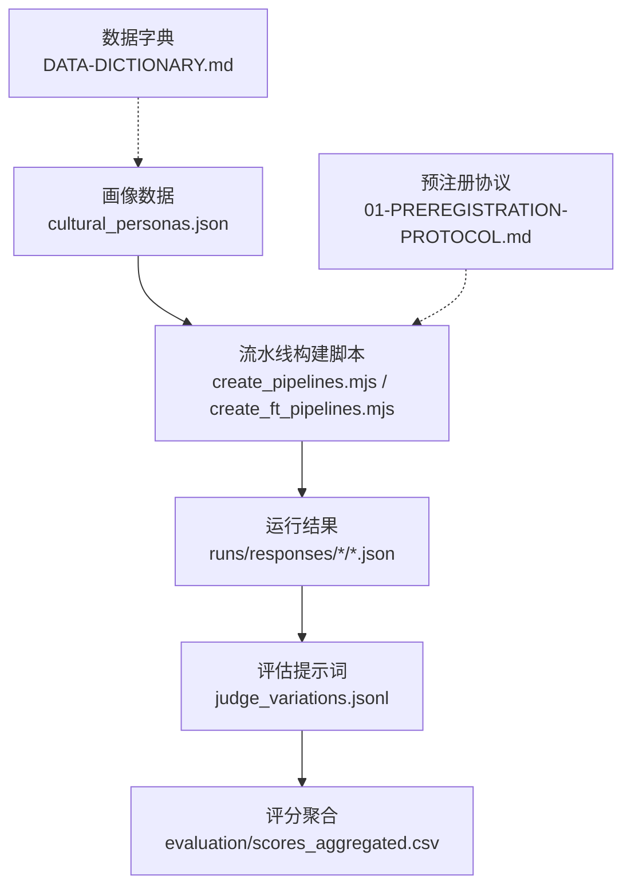
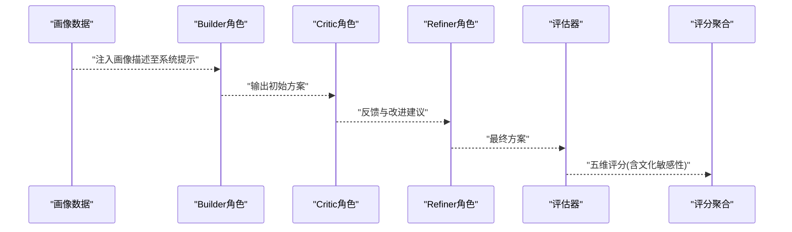
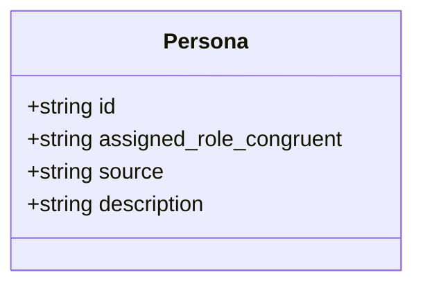
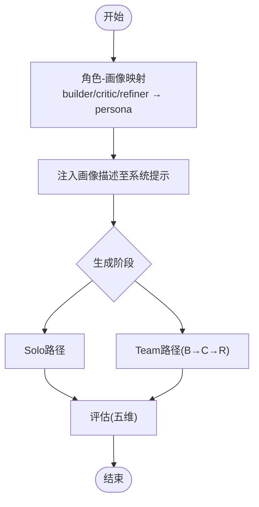
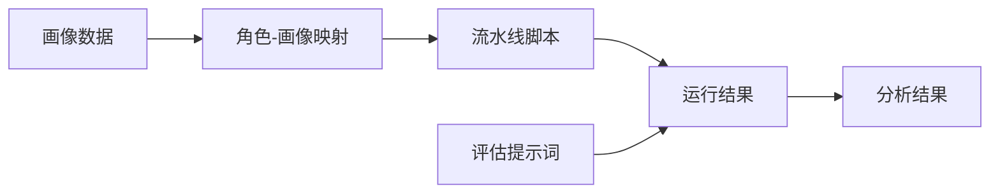

# 用户画像数据

<cite>
**本文引用的文件**
- [cultural_personas.json](file://research/orchestration-economics/data/personas/cultural_personas.json)
- [DATA-DICTIONARY.md](file://research/orchestration-economics/DATA-DICTIONARY.md)
- [01-PREREGISTRATION-PROTOCOL.md](file://DeeWaanAI-Next/protocols/01-PREREGISTRATION-PROTOCOL.md)
- [judge_variations.jsonl](file://research/orchestration-economics/evaluation/judge_prompts/judge_variations.jsonl)
- [create_pipelines.mjs](file://research/orchestration-economics/code/create_pipelines.mjs)
- [create_ft_pipelines.mjs](file://research/orchestration-economics/code/create_ft_pipelines.mjs)
- [RESEARCH-PAPER-PLAN.md](file://research/orchestration-economics/RESEARCH-PAPER-PLAN.md)
</cite>

## 目录
1. [简介](#简介)
2. [项目结构](#项目结构)
3. [核心组件](#核心组件)
4. [架构总览](#架构总览)
5. [详细组件分析](#详细组件分析)
6. [依赖关系分析](#依赖关系分析)
7. [性能与成本考量](#性能与成本考量)
8. [故障排查指南](#故障排查指南)
9. [结论](#结论)
10. [附录](#附录)

## 简介
本文件为DeeWaanAI研究管线中的“文化背景用户画像”数据提供完整文档，覆盖数据结构、字段定义、文化背景划分标准与特征描述、在实验中的应用场景与作用机制、数据使用示例与集成方法、更新与维护流程，以及数据隐私保护与伦理考虑。该画像数据用于在生成式大模型任务中注入文化视角，以评估其对解决方案质量（新颖性、实用性、灵活性、详尽度、文化敏感性）的影响。

## 项目结构
与用户画像相关的数据与代码主要位于研究子目录：
- 画像数据：research/orchestration-economics/data/personas/cultural_personas.json
- 数据字典：research/orchestration-economics/DATA-DICTIONARY.md
- 实验协议：DeeWaanAI-Next/protocols/01-PREREGISTRATION-PROTOCOL.md
- 评估提示词：research/orchestration-economics/evaluation/judge_prompts/judge_variations.jsonl
- 流水线构建脚本：research/orchestration-economics/code/create_pipelines.mjs、create_ft_pipelines.mjs
- 研究计划与角色映射说明：research/orchestration-economics/RESEARCH-PAPER-PLAN.md

图表来源
- [cultural_personas.json:1-21](file://research/orchestration-economics/data/personas/cultural_personas.json#L1-L21)
- [create_pipelines.mjs:54-90](file://research/orchestration-economics/code/create_pipelines.mjs#L54-L90)
- [create_ft_pipelines.mjs:30-57](file://research/orchestration-economics/code/create_ft_pipelines.mjs#L30-L57)
- [judge_variations.jsonl:1-4](file://research/orchestration-economics/evaluation/judge_prompts/judge_variations.jsonl#L1-L4)
- [DATA-DICTIONARY.md:31-38](file://research/orchestration-economics/DATA-DICTIONARY.md#L31-L38)
- [01-PREREGISTRATION-PROTOCOL.md:10-18](file://DeeWaanAI-Next/protocols/01-PREREGISTRATION-PROTOCOL.md#L10-L18)

章节来源
- [DATA-DICTIONARY.md:31-38](file://research/orchestration-economics/DATA-DICTIONARY.md#L31-L38)

## 核心组件
- 文化画像数据集：包含三个画像条目，分别代表不同文化取向的“业务专业人士”角色设定，用于驱动LLM在不同文化背景下生成解决方案。
- 角色-画像映射：将画像与流水线中的Builder/Critic/Refiner角色进行理论驱动的匹配，形成“画像-角色一致性”的实验条件。
- 评估体系：通过多版本评估提示词对生成的解决方案在五个维度上进行评分，其中包含“文化敏感性”维度，直接呼应画像的文化背景。

章节来源
- [cultural_personas.json:1-21](file://research/orchestration-economics/data/personas/cultural_personas.json#L1-L21)
- [RESEARCH-PAPER-PLAN.md:166-182](file://research/orchestration-economics/RESEARCH-PAPER-PLAN.md#L166-L182)
- [judge_variations.jsonl:1-4](file://research/orchestration-economics/evaluation/judge_prompts/judge_variations.jsonl#L1-L4)

## 架构总览
下图展示了从画像数据到最终评分的端到端流程：画像数据被注入到流水线各角色的系统提示中，执行后产出解决方案，再由评估提示词进行多维打分。

图表来源
- [create_pipelines.mjs:54-90](file://research/orchestration-economics/code/create_pipelines.mjs#L54-L90)
- [create_ft_pipelines.mjs:30-57](file://research/orchestration-economics/code/create_ft_pipelines.mjs#L30-L57)
- [judge_variations.jsonl:1-4](file://research/orchestration-economics/evaluation/judge_prompts/judge_variations.jsonl#L1-L4)

## 详细组件分析

### 文化画像数据结构与字段定义
- id：字符串，标识特定文化画像（如Culture_Expert、Culture_5、Culture_11）。
- assigned_role_congruent：字符串，预注册的与画像最匹配的角色（builder/critic/refiner），体现“画像-角色一致性”。
- source：字符串，数据来源与出处（例如persona-model-fit及DOI）。
- description：字符串，完整的系统提示文本，用于让模型扮演具有特定文化取向的业务专业人士；包含问题处理方式、决策风格、沟通方式、层级态度、关注焦点与风险偏好等维度。

图表来源
- [cultural_personas.json:1-21](file://research/orchestration-economics/data/personas/cultural_personas.json#L1-L21)
- [DATA-DICTIONARY.md:31-38](file://research/orchestration-economics/DATA-DICTIONARY.md#L31-L38)

章节来源
- [cultural_personas.json:1-21](file://research/orchestration-economics/data/personas/cultural_personas.json#L1-L21)
- [DATA-DICTIONARY.md:31-38](file://research/orchestration-economics/DATA-DICTIONARY.md#L31-L38)

### 文化背景划分标准与特征描述
- 划分依据：基于已验证的“persona-model-fit”工具与文献，选取三种代表性文化取向：
  - Culture_Expert：专家型实施者，强调系统性分析与可行性。
  - Culture_5：创新者型，强调独立探索与高模糊容忍度。
  - Culture_11：文化专家型，强调群体和谐与间接沟通。
- 特征维度：每个画像在description中明确刻画了问题处理、决策、沟通、层级态度、关注点与风险偏好的差异，从而在实验中形成可比较的文化视角。

章节来源
- [RESEARCH-PAPER-PLAN.md:166-182](file://research/orchestration-economics/RESEARCH-PAPER-PLAN.md#L166-L182)
- [cultural_personas.json:1-21](file://research/orchestration-economics/data/personas/cultural_personas.json#L1-L21)

### 画像在实验中的应用场景与作用机制
- 应用场景：
  - 单角色（Solo）与三角色团队（Team）两种结构下，分别启用或禁用画像注入，形成8个实验单元（tier×structure×persona）。
  - 画像通过“角色-画像一致性”映射注入到Builder/Critic/Refiner的系统提示中，影响生成策略与风格。
- 作用机制：
  - 画像提升新颖性但可能降低实用性与详尽度；后续可通过Refiner阶段修复部分维度。
  - 评估包含“文化敏感性”维度，直接衡量跨文化适配程度。

图表来源
- [create_pipelines.mjs:54-90](file://research/orchestration-economics/code/create_pipelines.mjs#L54-L90)
- [create_ft_pipelines.mjs:30-57](file://research/orchestration-economics/code/create_ft_pipelines.mjs#L30-L57)
- [judge_variations.jsonl:1-4](file://research/orchestration-economics/evaluation/judge_prompts/judge_variations.jsonl#L1-L4)

章节来源
- [01-PREREGISTRATION-PROTOCOL.md:10-18](file://DeeWaanAI-Next/protocols/01-PREREGISTRATION-PROTOCOL.md#L10-L18)
- [RESEARCH-PAPER-PLAN.md:166-182](file://research/orchestration-economics/RESEARCH-PAPER-PLAN.md#L166-L182)

### 数据使用示例与集成方法
- 使用示例：
  - 在Solo条件下，将某画像的description作为系统提示直接发送给模型，生成初始方案。
  - 在Team条件下，依次将对应画像注入Builder/Critic/Refiner的系统提示，形成协作式生成。
- 集成方法：
  - 通过流水线构建脚本读取画像数据与角色映射，自动生成步骤配置（name、role、systemPrompt、model、temperature、maxTokens等）。
  - 运行后，将最终方案输入评估提示词，得到五维评分并聚合。

章节来源
- [create_pipelines.mjs:54-90](file://research/orchestration-economics/code/create_pipelines.mjs#L54-L90)
- [create_ft_pipelines.mjs:30-57](file://research/orchestration-economics/code/create_ft_pipelines.mjs#L30-L57)
- [DATA-DICTIONARY.md:40-59](file://research/orchestration-economics/DATA-DICTIONARY.md#L40-L59)

### 画像数据的更新与维护流程
- 更新原则：
  - 画像数据来源于已验证的persona-model-fit工具，保持“原样复用”，确保构念连续性与可重复性。
  - 任何新增或修改需遵循预注册冻结期外的变更流程，并在MANIFEST中记录版本与日期。
- 维护要点：
  - 保持字段完整性（id、assigned_role_congruent、source、description）。
  - 与角色映射保持一致，避免破坏“画像-角色一致性”假设。
  - 评估提示词与评分维度保持不变，保证跨批次可比性。

章节来源
- [DATA-DICTIONARY.md:112-115](file://research/orchestration-economics/DATA-DICTIONARY.md#L112-L115)
- [RESEARCH-PAPER-PLAN.md:166-182](file://research/orchestration-economics/RESEARCH-PAPER-PLAN.md#L166-L182)

### 数据隐私保护与伦理考虑
- 隐私保护：
  - 画像数据不包含个人身份信息，仅用于模拟文化视角；不采集或存储受试者敏感信息。
  - 运行日志与评分数据按匿名化方式保存，便于共享与复现。
- 伦理考虑：
  - 文化画像应避免刻板印象强化；评估中包含“文化敏感性”维度以约束生成内容。
  - 在跨文化场景中，谨慎解释结果，避免将文化差异等同于优劣判断。

章节来源
- [judge_variations.jsonl:1-4](file://research/orchestration-economics/evaluation/judge_prompts/judge_variations.jsonl#L1-L4)
- [DATA-DICTIONARY.md:84-103](file://research/orchestration-economics/DATA-DICTIONARY.md#L84-L103)

### 数据来源与构建过程
- 数据来源：
  - 画像数据来自persona-model-fit仓库（含DOI引用），确保科学性与可追溯性。
  - 评估提示词来自同一来源的多版本变体，用于稳健性检验。
- 构建过程：
  - 通过流水线脚本将画像与角色模板组合，生成标准化步骤配置。
  - 运行后收集响应与评分，形成结构化结果集供分析。

章节来源
- [cultural_personas.json:1-21](file://research/orchestration-economics/data/personas/cultural_personas.json#L1-L21)
- [judge_variations.jsonl:1-4](file://research/orchestration-economics/evaluation/judge_prompts/judge_variations.jsonl#L1-L4)
- [create_pipelines.mjs:54-90](file://research/orchestration-economics/code/create_pipelines.mjs#L54-L90)

## 依赖关系分析
- 画像数据依赖：
  - 角色-画像映射（pre-registered）决定注入位置与顺序。
  - 评估提示词决定评分维度与一致性。
- 代码依赖：
  - 流水线脚本依赖画像数据与角色模板，生成步骤配置。
  - 运行结果依赖模型家族与参数设置（温度、最大token数）。

图表来源
- [create_pipelines.mjs:54-90](file://research/orchestration-economics/code/create_pipelines.mjs#L54-L90)
- [create_ft_pipelines.mjs:30-57](file://research/orchestration-economics/code/create_ft_pipelines.mjs#L30-L57)
- [judge_variations.jsonl:1-4](file://research/orchestration-economics/evaluation/judge_prompts/judge_variations.jsonl#L1-L4)

章节来源
- [DATA-DICTIONARY.md:40-59](file://research/orchestration-economics/DATA-DICTIONARY.md#L40-L59)

## 性能与成本考量
- 性能：
  - 团队结构（Builder→Critic→Refiner）相比单角色能提升整体质量，但增加延迟与token消耗。
  - 画像注入可能提升新颖性，但需权衡实用性与详尽度。
- 成本：
  - 成本由输入/输出token与模型定价决定；廉价模型+团队结构可接近前沿模型单角色的性价比。
  - 建议在预算约束下优先选择高性价比模型家族（如kimi、claude、qwen）配合团队结构。

章节来源
- [01-PREREGISTRATION-PROTOCOL.md:56-66](file://DeeWaanAI-Next/protocols/01-PREREGISTRATION-PROTOCOL.md#L56-L66)
- [DATA-DICTIONARY.md:60-79](file://research/orchestration-economics/DATA-DICTIONARY.md#L60-L79)

## 故障排查指南
- 常见问题：
  - API错误/超时：检查网络与配额，重试策略已在执行账本中内置。
  - 画像未生效：确认角色-画像映射正确且系统提示拼接无误。
  - 评分异常：核对评估提示词版本与解析逻辑。
- 定位方法：
  - 查看运行日志与导出数据，定位失败步骤与错误信息。
  - 对比不同模型家族的运行结果，识别模型特异性问题。

章节来源
- [DATA-DICTIONARY.md:60-82](file://research/orchestration-economics/DATA-DICTIONARY.md#L60-L82)

## 结论
文化背景用户画像数据为DeeWaanAI实验提供了可复现、可评估的文化视角注入机制。通过角色-画像一致性与团队结构协同，能够在保持新颖性的同时，借助Refiner修复其他维度损失。评估体系中的“文化敏感性”维度确保了跨文化适配的量化测量。建议在后续研究中持续优化画像内容与评估提示词，以提升鲁棒性与泛化能力。

## 附录
- 关键文件路径参考：
  - 画像数据：research/orchestration-economics/data/personas/cultural_personas.json
  - 数据字典：research/orchestration-economics/DATA-DICTIONARY.md
  - 预注册协议：DeeWaanAI-Next/protocols/01-PREREGISTRATION-PROTOCOL.md
  - 评估提示词：research/orchestration-economics/evaluation/judge_prompts/judge_variations.jsonl
  - 流水线脚本：research/orchestration-economics/code/create_pipelines.mjs、create_ft_pipelines.mjs
  - 研究计划：research/orchestration-economics/RESEARCH-PAPER-PLAN.md