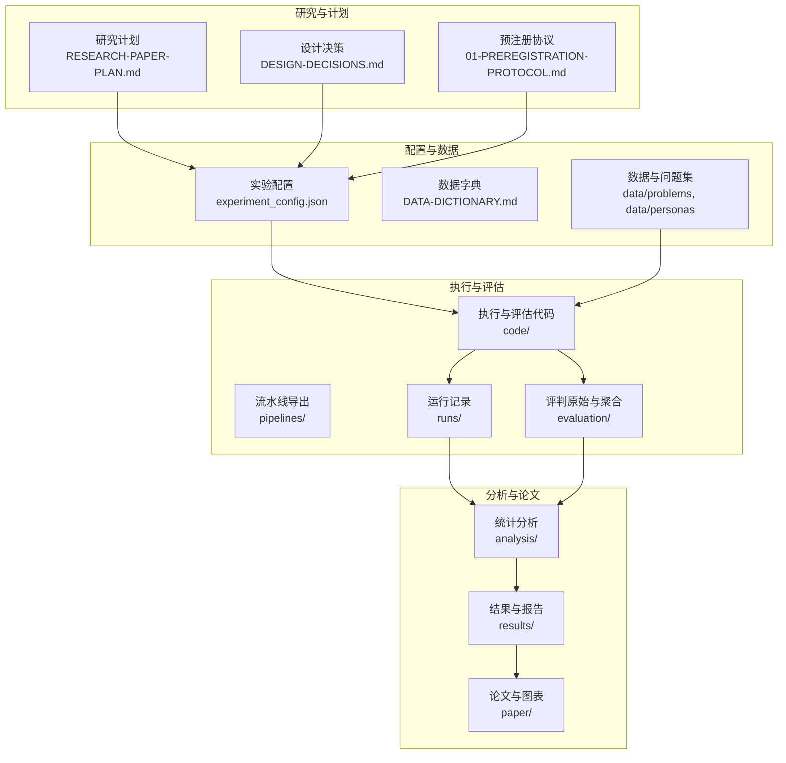
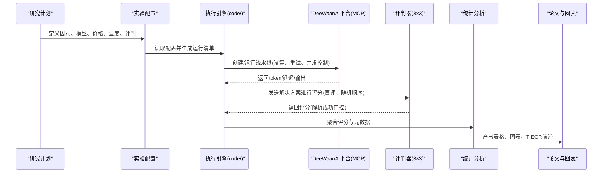
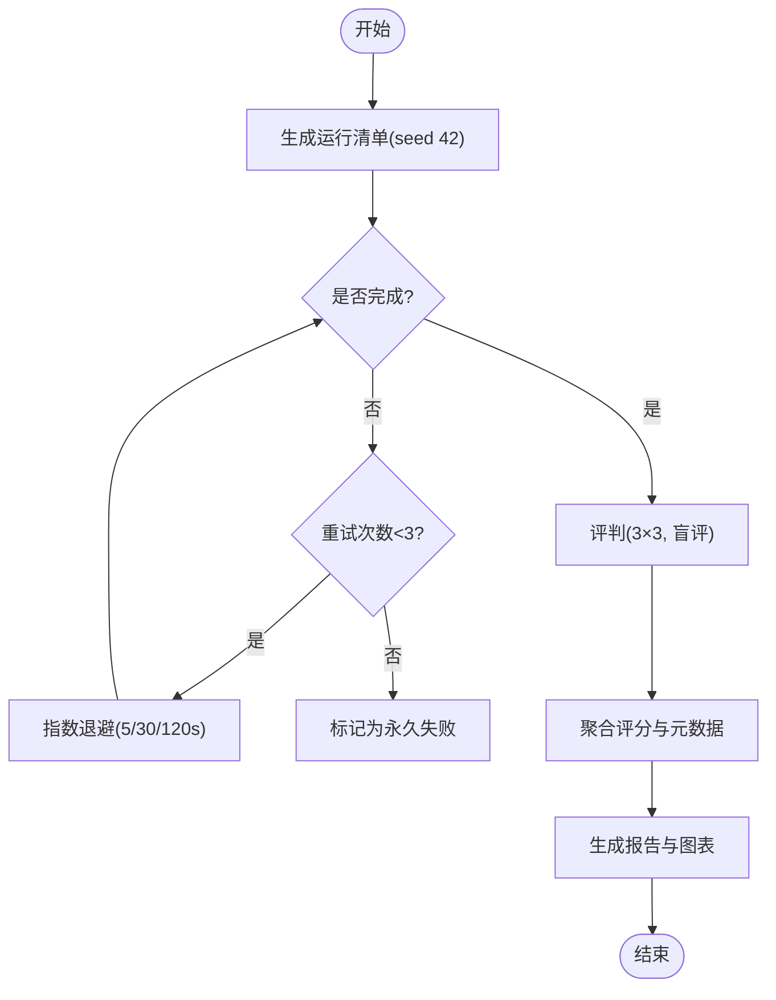
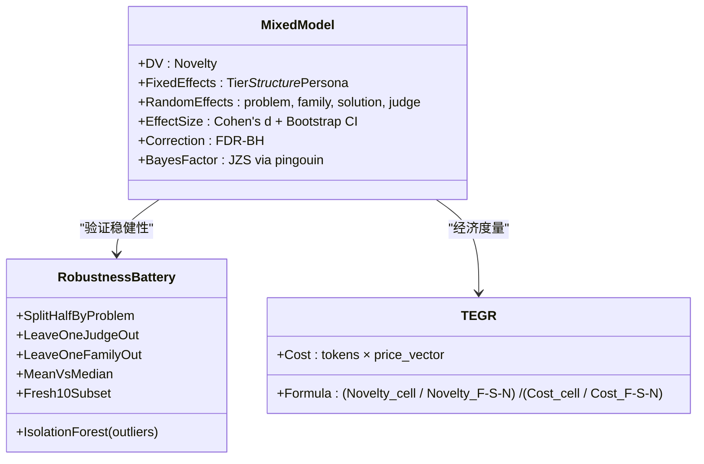

# 研究和实验文档

<cite>
**本文引用的文件**
- [research/orchestration-economics/README.md](file://research/orchestration-economics/README.md)
- [research/orchestration-economics/RESEARCH-PAPER-PLAN.md](file://research/orchestration-economics/RESEARCH-PAPER-PLAN.md)
- [research/orchestration-economics/DATA-DICTIONARY.md](file://research/orchestration-economics/DATA-DICTIONARY.md)
- [research/orchestration-economics/DESIGN-DECISIONS.md](file://research/orchestration-economics/DESIGN-DECISIONS.md)
- [DeeWaanAI-Next/protocols/01-PREREGISTRATION-PROTOCOL.md](file://DeeWaanAI-Next/protocols/01-PREREGISTRATION-PROTOCOL.md)
- [research/orchestration-economics/config/experiment_config.json](file://research/orchestration-economics/config/experiment_config.json)
- [research/orchestration-economics/code/README.md](file://research/orchestration-economics/code/README.md)
- [research/orchestration-economics/results/COST-EFFECTIVENESS.md](file://research/orchestration-economics/results/COST-EFFECTIVENESS.md)
- [research/orchestration-economics/results/PILOT-V2-ANALYSIS.md](file://research/orchestration-economics/results/PILOT-V2-ANALYSIS.md)
</cite>

## 目录
1. [引言](#引言)
2. [项目结构](#项目结构)
3. [核心组件](#核心组件)
4. [架构总览](#架构总览)
5. [详细组件分析](#详细组件分析)
6. [依赖关系分析](#依赖关系分析)
7. [性能与成本考量](#性能与成本考量)
8. [故障排查指南](#故障排查指南)
9. [结论](#结论)
10. [附录](#附录)

## 引言
本文件为 DeeWaanAI 的“编排经济学”研究提供完整的研究方法与实验文档。内容覆盖预注册协议、质量控制流程、统计分析方法、实验设计、数据集描述、实验结果与分析报告、论文撰写与图表生成、引用管理、研究进度跟踪与阶段性成果，以及研究数据访问与分析脚本使用指南。同时记录研究协议的变更历史与版本管理，确保可复现性与学术严谨性。

## 项目结构
该研究以“编排经济学”为核心，围绕多智能体流水线在业务问题上的新颖性与经济性展开。仓库采用“研究计划—配置—代码—数据—评估—分析—论文”的分层组织：
- 研究计划与设计：RESEARCH-PAPER-PLAN.md、DESIGN-DECISIONS.md、DATA-DICTIONARY.md、README.md
- 预注册与协议：DeeWaanAI-Next/protocols/01-PREREGISTRATION-PROTOCOL.md
- 实验配置：config/experiment_config.json（模型、价格、温度、评判、执行策略）
- 执行与评估代码：code/（运行、评判、聚合、统计）
- 数据与产物：data/、pipelines/、runs/、evaluation/、results/
- 论文与图表：paper/（草稿、图表生成脚本、引用审计）

**图示来源**
- [research/orchestration-economics/RESEARCH-PAPER-PLAN.md:1-474](file://research/orchestration-economics/RESEARCH-PAPER-PLAN.md#L1-L474)
- [research/orchestration-economics/DESIGN-DECISIONS.md:1-305](file://research/orchestration-economics/DESIGN-DECISIONS.md#L1-L305)
- [research/orchestration-economics/config/experiment_config.json:1-272](file://research/orchestration-economics/config/experiment_config.json#L1-L272)

**章节来源**
- [research/orchestration-economics/README.md:1-91](file://research/orchestration-economics/README.md#L1-L91)
- [research/orchestration-economics/RESEARCH-PAPER-PLAN.md:1-474](file://research/orchestration-economics/RESEARCH-PAPER-PLAN.md#L1-L474)

## 核心组件
- 研究计划与方法论：明确研究问题、假设、实验设计、测量指标、分析计划与执行韧性策略。
- 预注册协议：冻结假设、样本量、停止规则、盲评与数据共享策略，提交至 OSF/GitHub 标签。
- 设计与决策登记：每个设计决策附带学术依据与实现位置，形成方法论素材。
- 实验配置：集中管理模型家族、价格向量、温度、评判器、并发与重试策略等。
- 执行与评估：基于 DeeWaanAI MCP 的工具链，支持幂等执行、断点续跑、错误重跑与日志归档。
- 数据分析：混合效应模型、效应量与置信区间、FDR校正、贝叶斯因子、鲁棒性电池、T-EGR 经济度量。
- 论文与图表：多轮草稿、图表生成脚本、引用审计与图选择指南。

**章节来源**
- [research/orchestration-economics/RESEARCH-PAPER-PLAN.md:82-365](file://research/orchestration-economics/RESEARCH-PAPER-PLAN.md#L82-L365)
- [DeeWaanAI-Next/protocols/01-PREREGISTRATION-PROTOCOL.md:1-131](file://DeeWaanAI-Next/protocols/01-PREREGISTRATION-PROTOCOL.md#L1-L131)
- [research/orchestration-economics/DESIGN-DECISIONS.md:12-157](file://research/orchestration-economics/DESIGN-DECISIONS.md#L12-L157)
- [research/orchestration-economics/config/experiment_config.json:1-272](file://research/orchestration-economics/config/experiment_config.json#L1-L272)
- [research/orchestration-economics/code/README.md:1-25](file://research/orchestration-economics/code/README.md#L1-L25)

## 架构总览
研究执行通过 DeeWaanAI MCP 工具链驱动，遵循“计划—配置—执行—评估—分析—论文”的闭环。关键路径包括：
- 生成阶段：按固定或自适应流水线调用模型，记录 token、延迟与输出。
- 评判阶段：三组廉价评判器×三种提示变体，独立评分并聚合。
- 分析阶段：混合效应模型、效应量、鲁棒性检查与经济度量（T-EGR）。
- 论文阶段：图表生成、引用审计与多轮草稿迭代。

**图示来源**
- [research/orchestration-economics/RESEARCH-PAPER-PLAN.md:382-410](file://research/orchestration-economics/RESEARCH-PAPER-PLAN.md#L382-L410)
- [research/orchestration-economics/config/experiment_config.json:166-231](file://research/orchestration-economics/config/experiment_config.json#L166-L231)
- [research/orchestration-economics/code/README.md:8-17](file://research/orchestration-economics/code/README.md#L8-L17)

## 详细组件分析

### 预注册协议与质量控制
- 预注册目标：在主要运行前冻结假设、主要结果、样本量、分析计划与停止规则，并提交至 OSF/GitHub 时间戳化。
- 质量控制要点：
  - 盲评：评判器不获知条件；解决方案去标识并按随机顺序呈现。
  - 失败处理：API错误或超时重跑，错误输出不参与评分。
  - 执行韧性：预注册运行清单（seed 42），状态机（PENDING/RUNNING/DONE/FAILED_RETRYABLE/FAILED_PERMANENT），幂等续跑。
  - 质量门控：空输出率、评判一致性（Fleiss' κ）、成本包络阈值。

**图示来源**
- [research/orchestration-economics/RESEARCH-PAPER-PLAN.md:342-364](file://research/orchestration-economics/RESEARCH-PAPER-PLAN.md#L342-L364)
- [research/orchestration-economics/config/experiment_config.json:208-231](file://research/orchestration-economics/config/experiment_config.json#L208-L231)
- [DeeWaanAI-Next/protocols/01-PREREGISTRATION-PROTOCOL.md:83-104](file://DeeWaanAI-Next/protocols/01-PREREGISTRATION-PROTOCOL.md#L83-L104)

**章节来源**
- [DeeWaanAI-Next/protocols/01-PREREGISTRATION-PROTOCOL.md:1-131](file://DeeWaanAI-Next/protocols/01-PREREGISTRATION-PROTOCOL.md#L1-L131)
- [research/orchestration-economics/DESIGN-DECISIONS.md:109-113](file://research/orchestration-economics/DESIGN-DECISIONS.md#L109-L113)

### 统计分析方法与实验设计
- 实验设计：2×2×2 族内析因设计（Tier × Structure × Persona），跨 5 个模型家族；特殊臂 A5–A8 用于机制探索。
- 主要 DV：新颖性（Novelty）；经济 DV：团队效率增益比（T-EGR）。
- 分析计划：混合效应模型（随机效应：问题、家族、解决方案、评判器）；效应量（Cohen's d + 95% Bootstrap CI）；FDR校正；贝叶斯因子；鲁棒性电池（离群检测、留一法、均值/中位数敏感性、新鲜案例子集）。
- 伪重复修正：以解决方案级集成分数为主，避免将每条评判×变体视为独立观测。

**图示来源**
- [research/orchestration-economics/RESEARCH-PAPER-PLAN.md:303-316](file://research/orchestration-economics/RESEARCH-PAPER-PLAN.md#L303-L316)
- [research/orchestration-economics/config/experiment_config.json:195-207](file://research/orchestration-economics/config/experiment_config.json#L195-L207)

**章节来源**
- [research/orchestration-economics/RESEARCH-PAPER-PLAN.md:111-165](file://research/orchestration-economics/RESEARCH-PAPER-PLAN.md#L111-L165)
- [research/orchestration-economics/RESEARCH-PAPER-PLAN.md:303-316](file://research/orchestration-economics/RESEARCH-PAPER-PLAN.md#L303-L316)
- [research/orchestration-economics/config/experiment_config.json:195-207](file://research/orchestration-economics/config/experiment_config.json#L195-L207)

### 数据集描述
- 主问题集：30 个业务问题（6 领域×5 问题），来自 LLM-Creativity 与作者新增的领域分层扩展。
- 角色人设：3 个文化人设（Culture_5、Culture_Expert、Culture_11），用于团队角色映射。
- 新鲜案例：10 个后截断商业案例，作为污染控制与稳健性子集。
- 数据字典：明确每个文件的字段、类型与来源，确保可追溯性。

**章节来源**
- [research/orchestration-economics/RESEARCH-PAPER-PLAN.md:247-254](file://research/orchestration-economics/RESEARCH-PAPER-PLAN.md#L247-L254)
- [research/orchestration-economics/DATA-DICTIONARY.md:5-44](file://research/orchestration-economics/DATA-DICTIONARY.md#L5-L44)
- [research/orchestration-economics/DATA-DICTIONARY.md:84-103](file://research/orchestration-economics/DATA-DICTIONARY.md#L84-L103)

### 实验结果与分析报告
- 成本效益分析：计算各单元的成本、质量与 T-EGR；绘制帕累托前沿；识别被支配单元。
- 试点 v2 再评判：修复传输截断与评判完整性问题；对比 v1/v2 一致性；分析层级×结构交互的残余信号。
- 关键发现：
  - 低成本单代理与新巧性/美元比最高；团队在廉价端替代层级，但在前沿端无显著收益。
  - 人设对新颖性有正向作用但对其他维度（实用性、详尽性）有负向影响。
  - 截断与长度偏差对结果有影响，需在全文本与长度调整下报告。

**章节来源**
- [research/orchestration-economics/results/COST-EFFECTIVENESS.md:1-73](file://research/orchestration-economics/results/COST-EFFECTIVENESS.md#L1-L73)
- [research/orchestration-economics/results/PILOT-V2-ANALYSIS.md:1-117](file://research/orchestration-economics/results/PILOT-V2-ANALYSIS.md#L1-L117)

### 论文撰写过程、图表生成与引用管理
- 论文草稿：多轮迭代（FULL-PAPER-DRAFT*.md），包含文献综述、方法、结果、讨论与限制。
- 图表生成：脚本化生成前沿图、补充图与插入图；图选择指南确保可视化传达核心信息。
- 引用审计：审查引用一致性与来源可靠性，确保学术规范。

**章节来源**
- [research/orchestration-economics/paper/FULL-PAPER-DRAFT.md:1-200](file://research/orchestration-economics/paper/FULL-PAPER-DRAFT.md#L1-L200)
- [research/orchestration-economics/paper/generate_figures.py:1-100](file://research/orchestration-economics/paper/generate_figures.py#L1-L100)
- [research/orchestration-economics/paper/CITATION-AUDIT-REPORT.md:1-100](file://research/orchestration-economics/paper/CITATION-AUDIT-REPORT.md#L1-L100)

### 研究进度跟踪、接受证据与阶段性成果
- 阶段划分：Phase 0（设置与模型固定）、Phase 1（试点）、Phase 2（主运行）、Phase 3（移除人类验证）、Phase 4（分析与写作）。
- 阶段性成果：试点分析报告、成本效益报告、中间决策（INTERIM1/INTERIM2）、修订协议（Amendment A1–A4）。
- 接受证据：预注册提交、OSF 时间戳、GitHub 标签、Zenodo 数据存档。

**章节来源**
- [research/orchestration-economics/RESEARCH-PAPER-PLAN.md:382-410](file://research/orchestration-economics/RESEARCH-PAPER-PLAN.md#L382-L410)
- [research/orchestration-economics/results/INTERIM1-DECISION.md:1-50](file://research/orchestration-economics/results/INTERIM1-DECISION.md#L1-L50)
- [research/orchestration-economics/results/INTERIM2-DECISION.md:1-50](file://research/orchestration-economics/results/INTERIM2-DECISION.md#L1-L50)

### 研究数据访问与分析脚本使用指南
- 数据访问：所有运行、日志、评判原始数据与聚合结果均保存在本地仓库，可通过文件系统直接访问。
- 脚本使用：
  - 生成运行清单：`make_ledger.py`
  - 执行实验：`run_experiment.py`（幂等、可恢复）
  - 评判解决方案：`judge_solutions.py`
  - 聚合评分：`aggregate_scores.py`
  - 统计分析：`analysis/stats.py`
- 复现要求：种子 42、配置文件驱动、依赖锁定、环境变量管理密钥。

**章节来源**
- [research/orchestration-economics/code/README.md:8-17](file://research/orchestration-economics/code/README.md#L8-L17)
- [research/orchestration-economics/README.md:81-91](file://research/orchestration-economics/README.md#L81-L91)

### 研究协议变更历史与版本管理
- 设计决策登记：每项决策标注学术依据与实现位置，形成方法论素材。
- 修订协议：A1（试点工件修正）、A2（扩展中间分析）、A3（探索性高级统计）、A4（归纳定性分析）。
- 版本管理：Git 标签（如 preregistration）、OSF 提交、Zenodo 数据存档。

**章节来源**
- [research/orchestration-economics/DESIGN-DECISIONS.md:301-305](file://research/orchestration-economics/DESIGN-DECISIONS.md#L301-L305)
- [DeeWaanAI-Next/protocols/05-AMENDMENT-A1-PILOT-ARTIFACT-CORRECTIONS.md:1-100](file://DeeWaanAI-Next/protocols/05-AMENDMENT-A1-PILOT-ARTIFACT-CORRECTIONS.md#L1-L100)
- [DeeWaanAI-Next/protocols/06-AMENDMENT-A2-EXTENDED-INTERIM2-ANALYSIS.md:1-100](file://DeeWaanAI-Next/protocols/06-AMENDMENT-A2-EXTENDED-INTERIM2-ANALYSIS.md#L1-L100)

## 依赖关系分析
- 组件耦合：研究计划驱动配置，配置驱动执行与评估，评估结果驱动分析与论文。
- 外部依赖：DeeWaanAI MCP 工具、模型提供商 API、Together.ai 评判服务。
- 潜在循环依赖：无直接循环；但需注意配置与代码的版本同步。

**图示来源**
- [research/orchestration-economics/RESEARCH-PAPER-PLAN.md:382-410](file://research/orchestration-economics/RESEARCH-PAPER-PLAN.md#L382-L410)
- [research/orchestration-economics/config/experiment_config.json:1-272](file://research/orchestration-economics/config/experiment_config.json#L1-L272)

**章节来源**
- [research/orchestration-economics/RESEARCH-PAPER-PLAN.md:382-410](file://research/orchestration-economics/RESEARCH-PAPER-PLAN.md#L382-L410)
- [research/orchestration-economics/config/experiment_config.json:1-272](file://research/orchestration-economics/config/experiment_config.json#L1-L272)

## 性能与成本考量
- 成本核算：以 token 数×冻结价格向量计算，避免实时价格波动影响。
- 并发策略：默认并发执行，校准最大并发度以避免节流与延迟膨胀。
- 预算控制：上限 token 限制、前沿最后运行、成本匹配基线（A6）。
- 经济性度量：T-EGR 比较团队与单代理的效率增益。

**章节来源**
- [research/orchestration-economics/RESEARCH-PAPER-PLAN.md:256-283](file://research/orchestration-economics/RESEARCH-PAPER-PLAN.md#L256-L283)
- [research/orchestration-economics/config/experiment_config.json:166-176](file://research/orchestration-economics/config/experiment_config.json#L166-L176)
- [research/orchestration-economics/results/COST-EFFECTIVENESS.md:1-73](file://research/orchestration-economics/results/COST-EFFECTIVENESS.md#L1-L73)

## 故障排查指南
- 常见错误：API 超时、令牌耗尽、模型不可用、评判格式不合规。
- 处理策略：
  - 重试与退避：最多 3 次，指数退避。
  - 幂等续跑：跳过已完成，重新排队可重试失败。
  - 评判完整性：缺失维度重试，记录不完整标记。
  - 传输截断：使用全文本存储，避免显示截断影响。

**章节来源**
- [research/orchestration-economics/config/experiment_config.json:208-231](file://research/orchestration-economics/config/experiment_config.json#L208-L231)
- [research/orchestration-economics/results/PILOT-V2-ANALYSIS.md:13-26](file://research/orchestration-economics/results/PILOT-V2-ANALYSIS.md#L13-L26)

## 结论
本研究通过严格的预注册、质量控制与统计分析，系统评估了小型语言模型在文化人设下的团队协作是否能在同等成本下超越前沿模型。结果表明，低成本单代理在性价比上最优，团队在廉价端能部分替代层级，但在前沿端无显著收益。未来工作包括进一步的人设优化、自适应设计与人类验证。

## 附录
- 数据字典：详细字段说明与来源。
- 代码清单：所有可执行脚本与依赖锁定。
- 图表生成：脚本与图选择指南。
- 引用审计：确保引用一致性与可靠性。

**章节来源**
- [research/orchestration-economics/DATA-DICTIONARY.md:1-115](file://research/orchestration-economics/DATA-DICTIONARY.md#L1-L115)
- [research/orchestration-economics/code/README.md:1-25](file://research/orchestration-economics/code/README.md#L1-L25)
- [research/orchestration-economics/paper/FIGURE-SELECTION-GUIDE.md:1-100](file://research/orchestration-economics/paper/FIGURE-SELECTION-GUIDE.md#L1-L100)
- [research/orchestration-economics/paper/CITATION-AUDIT-REPORT.md:1-100](file://research/orchestration-economics/paper/CITATION-AUDIT-REPORT.md#L1-L100)