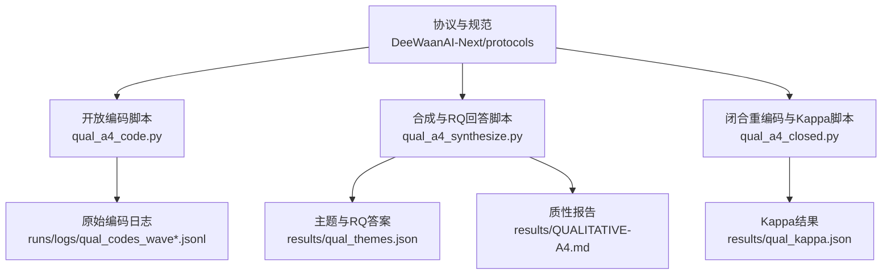
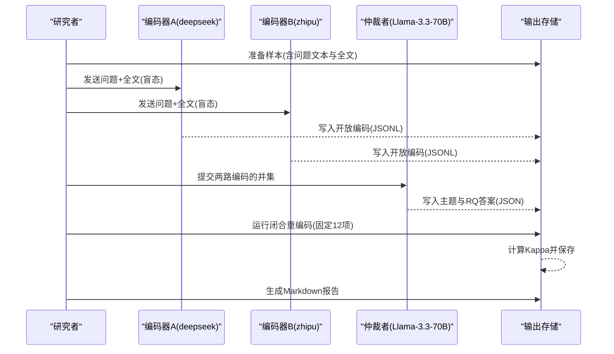
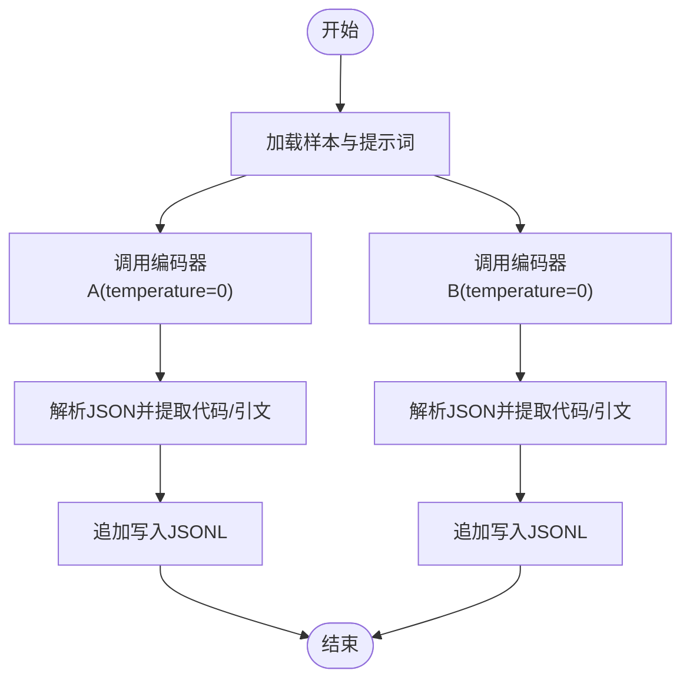
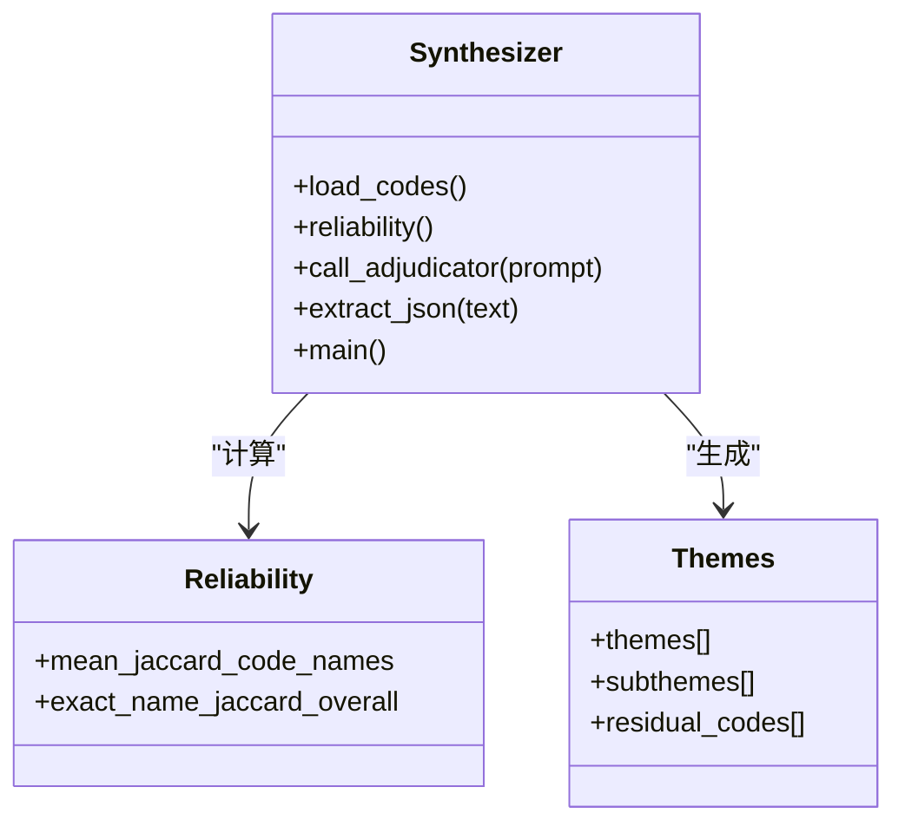
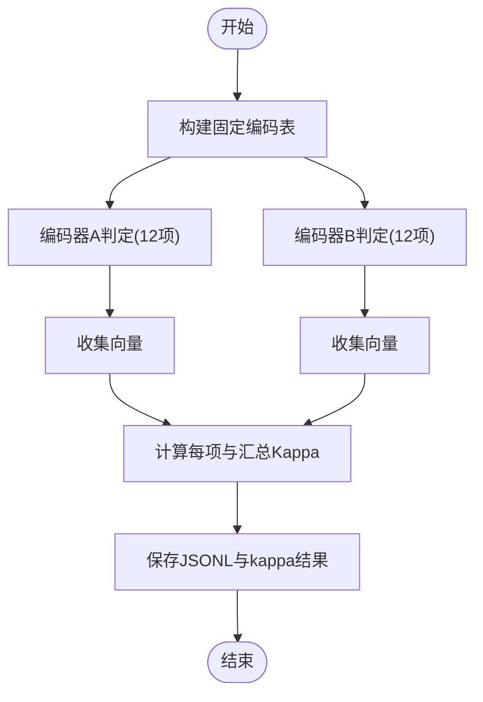
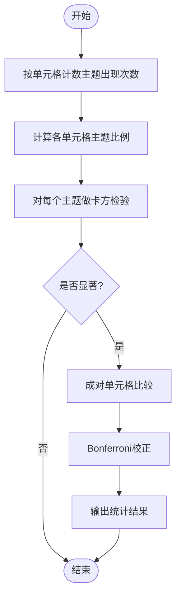
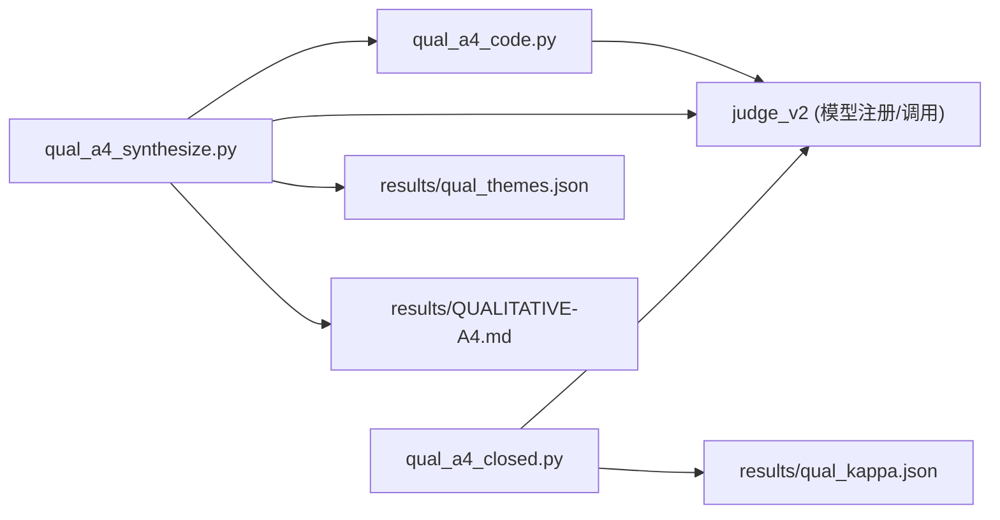

# 主题分析

<cite>
**本文引用的文件**
- [02-QUALITATIVE-ANALYSIS-PROTOCOL.md](file://DeeWaanAI-Next/protocols/02-QUALITATIVE-ANALYSIS-PROTOCOL.md)
- [08-AMENDMENT-A4-INDUCTIVE-QUALITATIVE.md](file://DeeWaanAI-Next/protocols/08-AMENDMENT-A4-INDUCTIVE-QUALITATIVE.md)
- [qual_a4_code.py](file://research/orchestration-economics/code/qual_a4_code.py)
- [qual_a4_synthesize.py](file://research/orchestration-economics/code/qual_a4_synthesize.py)
- [qual_a4_closed.py](file://research/orchestration-economics/code/qual_a4_closed.py)
- [QUALITATIVE-A4.md](file://research/orchestration-economics/results/QUALITATIVE-A4.md)
- [qual_themes.json](file://research/orchestration-economics/results/qual_themes.json)
</cite>

## 目录
1. [引言](#引言)
2. [项目结构](#项目结构)
3. [核心组件](#核心组件)
4. [架构总览](#架构总览)
5. [详细组件分析](#详细组件分析)
6. [依赖分析](#依赖分析)
7. [性能考虑](#性能考虑)
8. [故障排查指南](#故障排查指南)
9. [结论](#结论)
10. [附录：数据分析模板与报告格式](#附录：数据分析模板与报告格式)

## 引言
本文件为DeeWaanAI的主题分析提供完整、可复现的方法说明，覆盖以下目标：
- 主题流行度的计算方法（按单元格计算每个主题的呈现比例）
- 差异检验的统计方法（卡方检验与事后成对比较的Bonferroni校正）
- 定性示例的选择标准与方法（每主题每单元格选取2–3个代表性引文）
- 数据分析模板与报告格式（结果表格、统计检验结果、质性证据展示）

本方案同时兼容两种路径：
- 演绎法（基于预定义主题编码表）
- 归纳法（A4修正案：开放编码→轴心编码→综合回答研究问题）

## 项目结构
围绕主题分析的代码与文档主要位于research/orchestration-economics/code与DeeWaanAI-Next/protocols下，关键产出保存在results中。

图表来源
- [02-QUALITATIVE-ANALYSIS-PROTOCOL.md:9-87](file://DeeWaanAI-Next/protocols/02-QUALITATIVE-ANALYSIS-PROTOCOL.md#L9-L87)
- [08-AMENDMENT-A4-INDUCTIVE-QUALITATIVE.md:30-61](file://DeeWaanAI-Next/protocols/08-AMENDMENT-A4-INDUCTIVE-QUALITATIVE.md#L30-L61)
- [qual_a4_code.py:1-195](file://research/orchestration-economics/code/qual_a4_code.py#L1-L195)
- [qual_a4_synthesize.py:1-218](file://research/orchestration-economics/code/qual_a4_synthesize.py#L1-L218)
- [qual_a4_closed.py:1-230](file://research/orchestration-economics/code/qual_a4_closed.py#L1-L230)

章节来源
- [02-QUALITATIVE-ANALYSIS-PROTOCOL.md:9-87](file://DeeWaanAI-Next/protocols/02-QUALITATIVE-ANALYSIS-PROTOCOL.md#L9-L87)
- [08-AMENDMENT-A4-INDUCTIVE-QUALITATIVE.md:30-61](file://DeeWaanAI-Next/protocols/08-AMENDMENT-A4-INDUCTIVE-QUALITATIVE.md#L30-L61)

## 核心组件
- 开放编码器（双盲、无预设主题）：使用两个独立模型进行开放编码，输出自由词标签、定义与逐字引文。
- 仲裁合成器：将两路编码合并为候选主题与子主题，并基于主题回答研究问题。
- 闭合重编码器：冻结12项指标，计算Cohen's kappa以评估信度。
- 报告生成器：输出Markdown报告与JSON结构化结果。

章节来源
- [qual_a4_code.py:32-60](file://research/orchestration-economics/code/qual_a4_code.py#L32-L60)
- [qual_a4_synthesize.py:25-139](file://research/orchestration-economics/code/qual_a4_synthesize.py#L25-L139)
- [qual_a4_closed.py:27-70](file://research/orchestration-economics/code/qual_a4_closed.py#L27-L70)
- [QUALITATIVE-A4.md:1-14](file://research/orchestration-economics/results/QUALITATIVE-A4.md#L1-L14)

## 架构总览
下图展示了从数据到报告的端到端流程，包括开放编码、轴心合成、闭合信度评估与报告生成。

图表来源
- [qual_a4_code.py:82-160](file://research/orchestration-economics/code/qual_a4_code.py#L82-L160)
- [qual_a4_synthesize.py:90-179](file://research/orchestration-economics/code/qual_a4_synthesize.py#L90-L179)
- [qual_a4_closed.py:112-220](file://research/orchestration-economics/code/qual_a4_closed.py#L112-L220)

## 详细组件分析

### 组件A：开放编码（双盲、无预设主题）
- 输入：问题文本与生成全文；不暴露单元格、家族或分数。
- 处理：调用两个模型分别进行开放编码，要求返回若干“代码”（名称、定义、逐字引文），以及推理风格、结构与显著性备注。
- 输出：按runId与coder_family分组的JSONL记录，支持断点续跑与并发执行。

图表来源
- [qual_a4_code.py:32-60](file://research/orchestration-economics/code/qual_a4_code.py#L32-L60)
- [qual_a4_code.py:117-160](file://research/orchestration-economics/code/qual_a4_code.py#L117-L160)

章节来源
- [qual_a4_code.py:1-195](file://research/orchestration-economics/code/qual_a4_code.py#L1-L195)

### 组件B：轴心编码与综合（主题合成与RQ回答）
- 可靠性基线：计算两路编码的名称重叠（Jaccard）作为下限指标。
- 主题合成：将两路编码的并集压缩为5–9个主题与子主题，保留未归类代码。
- 研究问题回答：在合成后解除盲态，结合分组聚合观察回答RQ1–RQ4。
- 输出：结构化JSON与Markdown报告。

图表来源
- [qual_a4_synthesize.py:25-139](file://research/orchestration-economics/code/qual_a4_synthesize.py#L25-L139)
- [qual_themes.json:16-412](file://research/orchestration-economics/results/qual_themes.json#L16-L412)

章节来源
- [qual_a4_synthesize.py:1-218](file://research/orchestration-economics/code/qual_a4_synthesize.py#L1-L218)
- [qual_themes.json:1-596](file://research/orchestration-economics/results/qual_themes.json#L1-L596)

### 组件C：闭合重编码与信度（Cohen's kappa）
- 固定12项指标（来自A4合成），两编码器独立判断存在与否（温度=0，盲态）。
- 计算每项与汇总的Cohen's kappa与一致率，识别低于阈值的条目。
- 输出：JSONL与kappa结果JSON。

图表来源
- [qual_a4_closed.py:27-70](file://research/orchestration-economics/code/qual_a4_closed.py#L27-L70)
- [qual_a4_closed.py:183-220](file://research/orchestration-economics/code/qual_a4_closed.py#L183-L220)

章节来源
- [qual_a4_closed.py:1-230](file://research/orchestration-economics/code/qual_a4_closed.py#L1-L230)

### 组件D：主题流行度与差异检验（演绎路径）
- 流行度计算：对每个单元格，计算每个主题被标记为“出现”的比例（即该主题在该单元格的输出中被编码为present的数量除以该单元格总输出数）。
- 差异检验：对每个主题，使用卡方检验比较各单元格间流行度是否存在显著差异。
- 事后比较：若整体显著，则进行成对单元格比较，并使用Bonferroni校正控制族错误率。
- 依据：协议明确列出上述步骤与报告写法。

图表来源
- [02-QUALITATIVE-ANALYSIS-PROTOCOL.md:69-87](file://DeeWaanAI-Next/protocols/02-QUALITATIVE-ANALYSIS-PROTOCOL.md#L69-L87)

章节来源
- [02-QUALITATIVE-ANALYSIS-PROTOCOL.md:69-87](file://DeeWaanAI-Next/protocols/02-QUALITATIVE-ANALYSIS-PROTOCOL.md#L69-L87)

### 组件E：定性示例选择（每主题每单元格2–3个引文）
- 选择标准：在每个主题×单元格组合内，挑选最能体现该主题特征且语言清晰的逐字引文，数量控制在2–3条。
- 用途：用于论文中的质性证据展示，支撑量化发现与机制解释。
- 依据：协议明确要求“每主题每单元格选取2–3个代表性引文”。

章节来源
- [02-QUALITATIVE-ANALYSIS-PROTOCOL.md:84-87](file://DeeWaanAI-Next/protocols/02-QUALITATIVE-ANALYSIS-PROTOCOL.md#L84-L87)

## 依赖分析
- 模块耦合：
  - qual_a4_code.py 依赖 judge_v2 提供的模型注册与调用接口。
  - qual_a4_synthesize.py 读取开放编码结果，调用仲裁模型进行主题合成与RQ回答。
  - qual_a4_closed.py 读取样本与编码结果，计算信度。
- 外部依赖：
  - 多模型API（deepseek、zhipu、meta等）通过统一接口调用。
  - 文件系统：JSONL与JSON持久化，便于审计与复现。

图表来源
- [qual_a4_code.py:24-27](file://research/orchestration-economics/code/qual_a4_code.py#L24-L27)
- [qual_a4_synthesize.py:17-19](file://research/orchestration-economics/code/qual_a4_synthesize.py#L17-L19)
- [qual_a4_closed.py:19-21](file://research/orchestration-economics/code/qual_a4_closed.py#L19-L21)

章节来源
- [qual_a4_code.py:1-195](file://research/orchestration-economics/code/qual_a4_code.py#L1-L195)
- [qual_a4_synthesize.py:1-218](file://research/orchestration-economics/code/qual_a4_synthesize.py#L1-L218)
- [qual_a4_closed.py:1-230](file://research/orchestration-economics/code/qual_a4_closed.py#L1-L230)

## 性能考虑
- 并发与限流：开放编码与闭合重编码均使用线程池与信号量限制每编码器的并发度，避免过载。
- 重试与容错：网络请求具备指数退避重试；解析失败时记录错误并继续。
- 可扩展性：支持增量写入与断点续跑，适合大规模转录本的批处理。
- 资源占用：高token上限与多模型并行调用需关注配额与延迟。

[本节为通用指导，无需特定文件引用]

## 故障排查指南
- JSON解析失败：检查模型返回是否包含完整JSON块；脚本已内置去除围栏与括号匹配逻辑。
- 编码不完整：当返回字段缺失时，记录attempt与error信息，便于后续重跑。
- 信度偏低：若某项kappa低于阈值，需在报告中降级相关主张的证据等级，并在下一轮修订编码定义。
- 超时与网络异常：脚本内置多次重试；如仍失败，检查模型端点与密钥配置。

章节来源
- [qual_a4_code.py:117-160](file://research/orchestration-economics/code/qual_a4_code.py#L117-L160)
- [qual_a4_closed.py:144-181](file://research/orchestration-economics/code/qual_a4_closed.py#L144-L181)
- [QUALITATIVE-A4.md:15-43](file://research/orchestration-economics/results/QUALITATIVE-A4.md#L15-L43)

## 结论
本方案提供了从开放编码到主题合成、信度评估与报告生成的完整闭环。对于量化部分，采用按单元格的主题流行度与卡方检验（含Bonferroni校正）确保统计严谨性；对于质性部分，采用双盲开放编码与仲裁合成，辅以闭合重编码的信度验证，保证结果的可信与可复现。

[本节为总结性内容，无需特定文件引用]

## 附录：数据分析模板与报告格式

### 模板A：主题流行度表（按单元格）
- 行：主题
- 列：单元格（如C-S-N、C-T-P等）
- 值：该主题在该单元格的呈现比例（出现次数/该单元格总输出数）
- 附加：单元格总输出数、出现次数

### 模板B：统计检验结果表
- 列：主题、卡方统计量、自由度、p值、是否显著
- 若显著：增加事后比较列（单元格对、校正后p值、效应方向）

### 模板C：质性证据展示
- 每主题×单元格：2–3条代表性引文
- 每条附：runId、所属组别（如W1a/W1b/W1c）、简要说明为何代表该主题

### 模板D：最终报告结构
- 方法与数据：样本规模、编码流程、信度指标（Jaccard、kappa）
- 结果：
  - 主题流行度表
  - 统计检验结果（含事后比较）
  - 质性证据（引文与出处）
- 讨论：机制解释、模型家族差异、局限性
- 附录：编码表、原始JSONL与JSON、报告Markdown

章节来源
- [02-QUALITATIVE-ANALYSIS-PROTOCOL.md:69-116](file://DeeWaanAI-Next/protocols/02-QUALITATIVE-ANALYSIS-PROTOCOL.md#L69-L116)
- [QUALITATIVE-A4.md:15-102](file://research/orchestration-economics/results/QUALITATIVE-A4.md#L15-L102)
- [qual_themes.json:16-412](file://research/orchestration-economics/results/qual_themes.json#L16-L412)