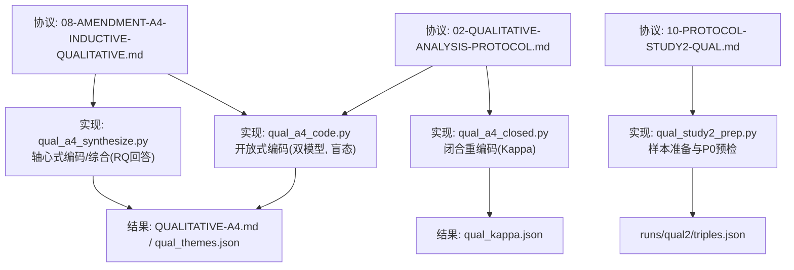
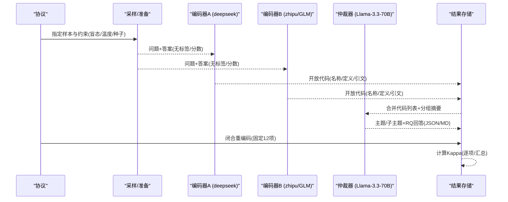
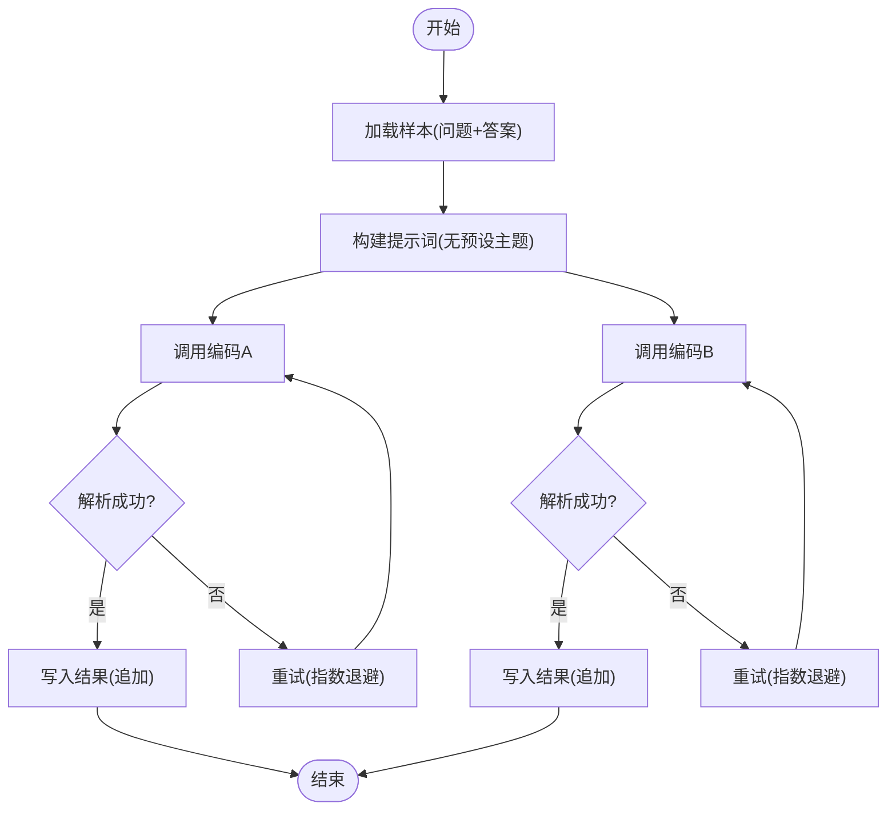
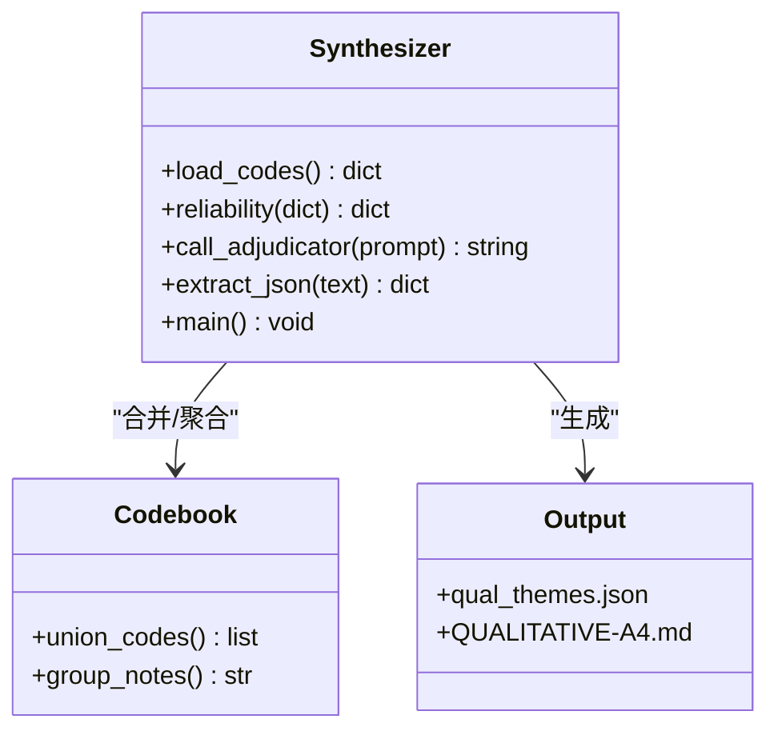
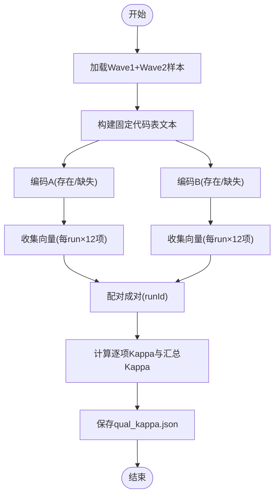
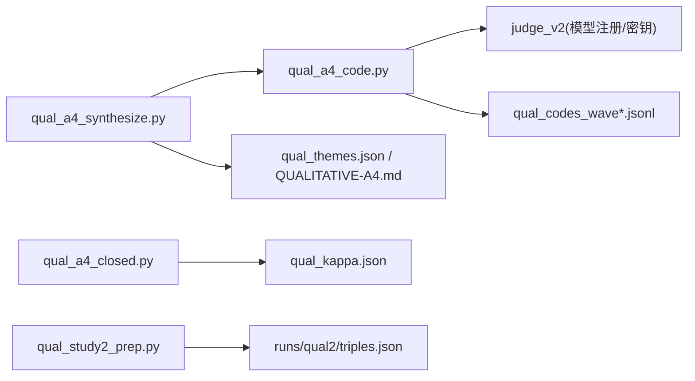

# 定性分析协议

<cite>
**本文引用的文件**
- [DeeWaanAI-Next/protocols/02-QUALITATIVE-ANALYSIS-PROTOCOL.md](file://DeeWaanAI-Next/protocols/02-QUALITATIVE-ANALYSIS-PROTOCOL.md)
- [DeeWaanAI-Next/protocols/08-AMENDMENT-A4-INDUCTIVE-QUALITATIVE.md](file://DeeWaanAI-Next/protocols/08-AMENDMENT-A4-INDUCTIVE-QUALITATIVE.md)
- [DeeWaanAI-Next/protocols/10-PROTOCOL-STUDY2-QUAL.md](file://DeeWaanAI-Next/protocols/10-PROTOCOL-STUDY2-QUAL.md)
- [research/orchestration-economics/code/qual_a4_code.py](file://research/orchestration-economics/code/qual_a4_code.py)
- [research/orchestration-economics/code/qual_a4_synthesize.py](file://research/orchestration-economics/code/qual_a4_synthesize.py)
- [research/orchestration-economics/code/qual_a4_closed.py](file://research/orchestration-economics/code/qual_a4_closed.py)
- [research/orchestration-economics/code/qual_study2_prep.py](file://research/orchestration-economics/code/qual_study2_prep.py)
- [research/orchestration-economics/results/QUALITATIVE-A4.md](file://research/orchestration-economics/results/QUALITATIVE-A4.md)
- [research/orchestration-economics/results/qual_themes.json](file://research/orchestration-economics/results/qual_themes.json)
- [research/orchestration-economics/results/qual_kappa.json](file://research/orchestration-economics/results/qual_kappa.json)
- [research/orchestration-economics/results/QUALITATIVE-NOTES.md](file://research/orchestration-economics/results/QUALITATIVE-NOTES.md)
</cite>

## 目录
1. [引言](#引言)
2. [项目结构](#项目结构)
3. [核心组件](#核心组件)
4. [架构总览](#架构总览)
5. [详细组件分析](#详细组件分析)
6. [依赖关系分析](#依赖关系分析)
7. [性能与可扩展性](#性能与可扩展性)
8. [质量控制与信度检验](#质量控制与信度检验)
9. [伦理与数据管理](#伦理与数据管理)
10. [故障排查指南](#故障排查指南)
11. [结论](#结论)
12. [附录](#附录)

## 引言
本文件为DeeWaanAI项目的“定性分析协议”提供完整、可复现的技术文档。内容覆盖编码方案的设计原则与分类体系（主题识别、代码分配、类别定义）、信度检验方法（编码者间一致性、Kappa系数计算）、主题分析实施流程（开放式编码→轴心式编码→选择性编码）、质性数据的收集与分析方法（访谈转录、文本分析与案例研究）、质量控制措施（三角验证、成员检查、同行评审）以及伦理考虑与数据管理策略。该协议以LLM作为自动化编码器，结合人类或另一模型的独立编码，形成严谨的混合方法定性分析管线。

## 项目结构
围绕定性分析的协议与实现主要分布在以下位置：
- 协议层：DeeWaanAI-Next/protocols 下的三个关键协议文件，分别规定演绎编码、归纳编码与Study 2的定性分析计划。
- 实现层：research/orchestration-economics/code 下的Python脚本，负责采样、编码、合成与信度计算。
- 结果层：research/orchestration-economics/results 下的报告与JSON产物，包括主题、Kappa等指标。

图表来源
- [DeeWaanAI-Next/protocols/02-QUALITATIVE-ANALYSIS-PROTOCOL.md:1-133](file://DeeWaanAI-Next/protocols/02-QUALITATIVE-ANALYSIS-PROTOCOL.md#L1-L133)
- [DeeWaanAI-Next/protocols/08-AMENDMENT-A4-INDUCTIVE-QUALITATIVE.md:1-68](file://DeeWaanAI-Next/protocols/08-AMENDMENT-A4-INDUCTIVE-QUALITATIVE.md#L1-L68)
- [DeeWaanAI-Next/protocols/10-PROTOCOL-STUDY2-QUAL.md:1-74](file://DeeWaanAI-Next/protocols/10-PROTOCOL-STUDY2-QUAL.md#L1-L74)
- [research/orchestration-economics/code/qual_a4_code.py:1-195](file://research/orchestration-economics/code/qual_a4_code.py#L1-L195)
- [research/orchestration-economics/code/qual_a4_synthesize.py:1-218](file://research/orchestration-economics/code/qual_a4_synthesize.py#L1-L218)
- [research/orchestration-economics/code/qual_a4_closed.py:1-230](file://research/orchestration-economics/code/qual_a4_closed.py#L1-L230)
- [research/orchestration-economics/code/qual_study2_prep.py:1-102](file://research/orchestration-economics/code/qual_study2_prep.py#L1-L102)

章节来源
- [DeeWaanAI-Next/protocols/02-QUALITATIVE-ANALYSIS-PROTOCOL.md:1-133](file://DeeWaanAI-Next/protocols/02-QUALITATIVE-ANALYSIS-PROTOCOL.md#L1-L133)
- [DeeWaanAI-Next/protocols/08-AMENDMENT-A4-INDUCTIVE-QUALITATIVE.md:1-68](file://DeeWaanAI-Next/protocols/08-AMENDMENT-A4-INDUCTIVE-QUALITATIVE.md#L1-L68)
- [DeeWaanAI-Next/protocols/10-PROTOCOL-STUDY2-QUAL.md:1-74](file://DeeWaanAI-Next/protocols/10-PROTOCOL-STUDY2-QUAL.md#L1-L74)

## 核心组件
- 编码方案与分类体系
  - 演绎主题集（Protocol 02）：文化适配、结构严谨、角色一致性、分析深度、可操作性、创造性；每个主题含定义与示例指标。
  - 归纳主题集（A4）：从开放编码中涌现的主题与子主题，经第三方模型仲裁合并为候选主题，并记录残差代码。
  - Study 2 冻结骨架（Protocol 10）：基于RQ的演绎骨架（前沿优势、风格与长度、饱和信号），在Wave 1观察后冻结为约12个代码用于Wave 2闭合编码。
- 编码器与仲裁器
  - 开放编码：两个独立LLM（deepseek-v4-flash、GLM-5.2），温度=0，盲态输入（仅问题与答案）。
  - 轴心式编码/综合：第三方模型（meta/Llama-3.3-70B）合并代码列表为主题/子主题，并在综合阶段揭示分组信息以回答RQ。
  - 闭合重编码：固定12项代码表，对全部转录进行存在/缺失判断，计算Cohen's κ。
- 数据流与产物
  - 输入：锁定数据集（main_fulltext.json、main_judgments.jsonl）与抽样文件。
  - 输出：qual_codes_waveN.jsonl、qual_themes.json、QUALITATIVE-A4.md、qual_kappa.json、triples.json等。

章节来源
- [DeeWaanAI-Next/protocols/02-QUALITATIVE-ANALYSIS-PROTOCOL.md:9-66](file://DeeWaanAI-Next/protocols/02-QUALITATIVE-ANALYSIS-PROTOCOL.md#L9-L66)
- [DeeWaanAI-Next/protocols/08-AMENDMENT-A4-INDUCTIVE-QUALITATIVE.md:24-54](file://DeeWaanAI-Next/protocols/08-AMENDMENT-A4-INDUCTIVE-QUALITATIVE.md#L24-L54)
- [DeeWaanAI-Next/protocols/10-PROTOCOL-STUDY2-QUAL.md:24-61](file://DeeWaanAI-Next/protocols/10-PROTOCOL-STUDY2-QUAL.md#L24-L61)
- [research/orchestration-economics/results/QUALITATIVE-A4.md:1-102](file://research/orchestration-economics/results/QUALITATIVE-A4.md#L1-L102)
- [research/orchestration-economics/results/qual_themes.json:1-596](file://research/orchestration-economics/results/qual_themes.json#L1-L596)
- [research/orchestration-economics/results/qual_kappa.json:1-89](file://research/orchestration-economics/results/qual_kappa.json#L1-L89)

## 架构总览
下图展示从协议到实现的端到端流程：协议定义编码规则与质量门槛；实现脚本按波次采样、并行编码、仲裁合成与信度计算；结果文件沉淀主题、证据与统计指标。

图表来源
- [research/orchestration-economics/code/qual_a4_code.py:32-60](file://research/orchestration-economics/code/qual_a4_code.py#L32-L60)
- [research/orchestration-economics/code/qual_a4_synthesize.py:125-168](file://research/orchestration-economics/code/qual_a4_synthesize.py#L125-L168)
- [research/orchestration-economics/code/qual_a4_closed.py:27-70](file://research/orchestration-economics/code/qual_a4_closed.py#L27-L70)

## 详细组件分析

### 组件A：开放式编码（A4 Wave 1/2）
- 目标：在无预设主题的情况下，从文本中涌现代码，捕捉措辞、推理方式、结构与语气等。
- 实现要点
  - 双编码器独立工作，温度=0，最大token限制，并发执行。
  - 解析LLM返回的JSON，提取代码、定义与逐字引文。
  - 容错重试与幂等写入，支持断点续跑。
- 复杂度与性能
  - 任务数 = 样本量 × 编码器数量；线程池并发控制避免过载。
  - 网络请求带指数退避重试，提升鲁棒性。

图表来源
- [research/orchestration-economics/code/qual_a4_code.py:82-160](file://research/orchestration-economics/code/qual_a4_code.py#L82-L160)
- [research/orchestration-economics/code/qual_a4_code.py:163-190](file://research/orchestration-economics/code/qual_a4_code.py#L163-L190)

章节来源
- [research/orchestration-economics/code/qual_a4_code.py:1-195](file://research/orchestration-economics/code/qual_a4_code.py#L1-L195)

### 组件B：轴心式编码与综合（A4 Synthesis）
- 目标：将两编码器的自由代码合并为主题与子主题，并在综合阶段揭示分组信息以回答研究问题。
- 实现要点
  - 计算开放编码的词名重叠（Jaccard）作为下限可靠性指标。
  - 聚合分组层面的推理/结构/亮点备注，供仲裁器参考。
  - 两次仲裁调用：主题合成 + RQ回答；输出JSON与Markdown报告。
- 产出
  - results/qual_themes.json：主题、子主题、成员代码、残差代码、RQ回答与置信度。
  - results/QUALITATIVE-A4.md：可读报告，包含可靠性、主题与RQ回答。

图表来源
- [research/orchestration-economics/code/qual_a4_synthesize.py:25-110](file://research/orchestration-economics/code/qual_a4_synthesize.py#L25-L110)
- [research/orchestration-economics/code/qual_a4_synthesize.py:125-178](file://research/orchestration-economics/code/qual_a4_synthesize.py#L125-L178)

章节来源
- [research/orchestration-economics/code/qual_a4_synthesize.py:1-218](file://research/orchestration-economics/code/qual_a4_synthesize.py#L1-L218)
- [research/orchestration-economics/results/qual_themes.json:1-596](file://research/orchestration-economics/results/qual_themes.json#L1-L596)
- [research/orchestration-economics/results/QUALITATIVE-A4.md:1-102](file://research/orchestration-economics/results/QUALITATIVE-A4.md#L1-L102)

### 组件C：闭合重编码与Kappa计算（A4.6）
- 目标：基于开放编码涌现的12项固定代码表，对全部转录进行存在/缺失判断，计算逐项与汇总Kappa。
- 实现要点
  - 固定代码表（id/name/definition），严格二分判断，保守编码（不确定记0）。
  - 并发编码、幂等写入；失败重试与错误记录。
  - 内置Kappa计算函数，输出per-item与pooled指标及低于阈值的代码清单。
- 质量门槛
  - 协议要求κ≥0.70；低于阈值的代码需在报告中披露并降级相关结论的可靠性等级。

图表来源
- [research/orchestration-economics/code/qual_a4_closed.py:27-70](file://research/orchestration-economics/code/qual_a4_closed.py#L27-L70)
- [research/orchestration-economics/code/qual_a4_closed.py:183-220](file://research/orchestration-economics/code/qual_a4_closed.py#L183-L220)

章节来源
- [research/orchestration-economics/code/qual_a4_closed.py:1-230](file://research/orchestration-economics/code/qual_a4_closed.py#L1-L230)
- [research/orchestration-economics/results/qual_kappa.json:1-89](file://research/orchestration-economics/results/qual_kappa.json#L1-L89)

### 组件D：Study 2 样本准备与预检（Protocol 10）
- 目标：在正式编码前完成长度相关性预检（P0）与三胞胎样本抽取（原始/精炼/前沿），确保后续Wave 1/2的可比性与可重复性。
- 实现要点
  - 使用固定随机种子抽取每家族10个三胞胎，共30个。
  - 计算长度比率与复合评分变化的Pearson/Spearman相关，按家族与总体报告。
  - 输出材料包（问题文本与三段文本）供后续盲态编码。

章节来源
- [DeeWaanAI-Next/protocols/10-PROTOCOL-STUDY2-QUAL.md:17-42](file://DeeWaanAI-Next/protocols/10-PROTOCOL-STUDY2-QUAL.md#L17-L42)
- [research/orchestration-economics/code/qual_study2_prep.py:1-102](file://research/orchestration-economics/code/qual_study2_prep.py#L1-L102)

## 依赖关系分析
- 模块耦合
  - qual_a4_code.py 依赖 judge_v2 注册表与密钥，负责并发编码与结果落盘。
  - qual_a4_synthesize.py 读取编码结果与样本元数据，调用仲裁器生成主题与RQ回答。
  - qual_a4_closed.py 读取样本与编码结果，计算Kappa并输出可靠性报告。
  - qual_study2_prep.py 依赖主实验与精炼阶段的日志/判定文件，生成Study 2材料包。
- 外部依赖
  - 各脚本通过HTTP调用不同模型家族的聊天接口，需配置鉴权与环境变量。
  - 结果文件采用JSON/JSONL/Markdown格式，便于审计与复现。

图表来源
- [research/orchestration-economics/code/qual_a4_code.py:24-27](file://research/orchestration-economics/code/qual_a4_code.py#L24-L27)
- [research/orchestration-economics/code/qual_a4_synthesize.py:17-19](file://research/orchestration-economics/code/qual_a4_synthesize.py#L17-L19)
- [research/orchestration-economics/code/qual_a4_closed.py:19-21](file://research/orchestration-economics/code/qual_a4_closed.py#L19-L21)
- [research/orchestration-economics/code/qual_study2_prep.py:16-19](file://research/orchestration-economics/code/qual_study2_prep.py#L16-L19)

章节来源
- [research/orchestration-economics/code/qual_a4_code.py:1-195](file://research/orchestration-economics/code/qual_a4_code.py#L1-L195)
- [research/orchestration-economics/code/qual_a4_synthesize.py:1-218](file://research/orchestration-economics/code/qual_a4_synthesize.py#L1-L218)
- [research/orchestration-economics/code/qual_a4_closed.py:1-230](file://research/orchestration-economics/code/qual_a4_closed.py#L1-L230)
- [research/orchestration-economics/code/qual_study2_prep.py:1-102](file://research/orchestration-economics/code/qual_study2_prep.py#L1-L102)

## 性能与可扩展性
- 并发与吞吐
  - 每个编码器按线程池并发（默认每家族8个工作线程），显著缩短整体编码时间。
  - 幂等写入与断点续跑，支持中断恢复与增量执行。
- 资源与成本
  - 开放编码与闭合重编码均设置max_tokens与temperature=0，降低噪声与成本。
  - 重试机制（指数退避）减少网络抖动导致的失败。
- 扩展建议
  - 可按家族/问题维度拆分任务队列，进一步水平扩展。
  - 引入缓存层（如已解析结果）避免重复调用。

[本节为通用指导，不直接分析具体文件]

## 质量控制与信度检验
- 编码者间一致性
  - 开放编码阶段：报告词名Jaccard作为下限指标，强调语义收敛重于字面重合。
  - 闭合重编码阶段：计算逐项与汇总Cohen's κ，阈值≥0.70；低于阈值的代码公开并降级相关结论。
- 三角验证
  - 方法三角：开放编码（归纳）与闭合编码（演绎）交叉验证；A4.5允许用Protocol 02的六主题进行二次验证。
  - 数据三角：多模型编码器（deepseek、zhipu）与仲裁器（Llama-3.3-70B）共同产出。
- 成员检查与同行评审
  - 协议明确标注“EXPLORATORY”，结果进入论文讨论但不改变已锁定决策；所有中间产物保留以供审计。
- 信度结果（A4）
  - 汇总Kappa=0.774（同意率89.8%）；部分主观风格代码低于阈值，已在报告中披露并谨慎解释。

章节来源
- [research/orchestration-economics/results/QUALITATIVE-A4.md:15-43](file://research/orchestration-economics/results/QUALITATIVE-A4.md#L15-L43)
- [research/orchestration-economics/results/qual_kappa.json:1-89](file://research/orchestration-economics/results/qual_kappa.json#L1-L89)
- [DeeWaanAI-Next/protocols/02-QUALITATIVE-ANALYSIS-PROTOCOL.md:56-66](file://DeeWaanAI-Next/protocols/02-QUALITATIVE-ANALYSIS-PROTOCOL.md#L56-L66)
- [DeeWaanAI-Next/protocols/08-AMENDMENT-A4-INDUCTIVE-QUALITATIVE.md:42-54](file://DeeWaanAI-Next/protocols/08-AMENDMENT-A4-INDUCTIVE-QUALITATIVE.md#L42-L54)

## 伦理与数据管理
- 伦理考虑
  - 盲态编码：开放编码阶段隐藏分组、家庭与分数，仅在综合阶段揭示分组信息，避免偏见。
  - 探索性声明：A4与前期诊断均为“EXPLORATORY”，不得改变已锁定的定量决策。
- 数据管理
  - 输入：锁定数据集（main_fulltext.json、main_judgments.jsonl）与抽样文件。
  - 过程：编码日志（qual_codes_wave*.jsonl）、仲裁输出（qual_themes.json）、可靠性报告（qual_kappa.json）。
  - 输出：可读报告（QUALITATIVE-A4.md）、Study 2材料包（triples.json）。
  - 审计：所有中间产物保留，支持回溯与复现。

章节来源
- [DeeWaanAI-Next/protocols/08-AMENDMENT-A4-INDUCTIVE-QUALITATIVE.md:24-28](file://DeeWaanAI-Next/protocols/08-AMENDMENT-A4-INDUCTIVE-QUALITATIVE.md#L24-L28)
- [research/orchestration-economics/results/QUALITATIVE-A4.md:1-14](file://research/orchestration-economics/results/QUALITATIVE-A4.md#L1-L14)
- [research/orchestration-economics/code/qual_study2_prep.py:74-97](file://research/orchestration-economics/code/qual_study2_prep.py#L74-L97)

## 故障排查指南
- 常见错误与处理
  - JSON解析失败：脚本内置正则提取与深度计数逻辑，失败时记录raw片段以便调试。
  - 网络超时/限流：指数退避重试（最多5次），失败则记录error字段。
  - 输出截断：长答案可能导致解析不完整，需检查raw长度与重试次数。
- 定位步骤
  - 查看对应日志行中的attempt与error字段，确认是否达到最大重试次数。
  - 核对模型端点与鉴权是否正确，必要时切换备用模型。
  - 对于Study 2，若长度比率异常，检查原始与精炼文本长度与裁剪标记。

章节来源
- [research/orchestration-economics/code/qual_a4_code.py:63-79](file://research/orchestration-economics/code/qual_a4_code.py#L63-L79)
- [research/orchestration-economics/code/qual_a4_code.py:163-190](file://research/orchestration-economics/code/qual_a4_code.py#L163-L190)
- [research/orchestration-economics/code/qual_a4_closed.py:73-87](file://research/orchestration-economics/code/qual_a4_closed.py#L73-L87)
- [research/orchestration-economics/results/QUALITATIVE-NOTES.md:9-36](file://research/orchestration-economics/results/QUALITATIVE-NOTES.md#L9-L36)

## 结论
本定性分析协议以LLM为自动化编码器，结合双编码器独立编码与第三方仲裁，实现了从开放式编码到轴心式编码再到选择性编码的完整流程。通过严格的信度检验（Kappa≥0.70）与三角验证，确保了主题识别与分类体系的稳健性。Study 2的预检与样本准备进一步提升了可比性与可重复性。所有过程与结果均透明可审计，符合探索性研究的伦理与数据管理规范。

[本节为总结性内容，不直接分析具体文件]

## 附录
- 主题与子主题示例（来自A4合成）
  - 结构化推理、探索性方法、文化敏感性、协作语气等过程主题。
  - 文化适配、沟通与协作、风险管理、创新与实验、领导力与治理等技术/业务主题。
- 关键指标
  - 汇总Kappa=0.774；逐项Kappa与同意率详见qual_kappa.json。
  - 主题分布与证据引用见qual_themes.json与QUALITATIVE-A4.md。

章节来源
- [research/orchestration-economics/results/qual_themes.json:16-515](file://research/orchestration-economics/results/qual_themes.json#L16-L515)
- [research/orchestration-economics/results/qual_kappa.json:1-89](file://research/orchestration-economics/results/qual_kappa.json#L1-L89)
- [research/orchestration-economics/results/QUALITATIVE-A4.md:45-86](file://research/orchestration-economics/results/QUALITATIVE-A4.md#L45-L86)